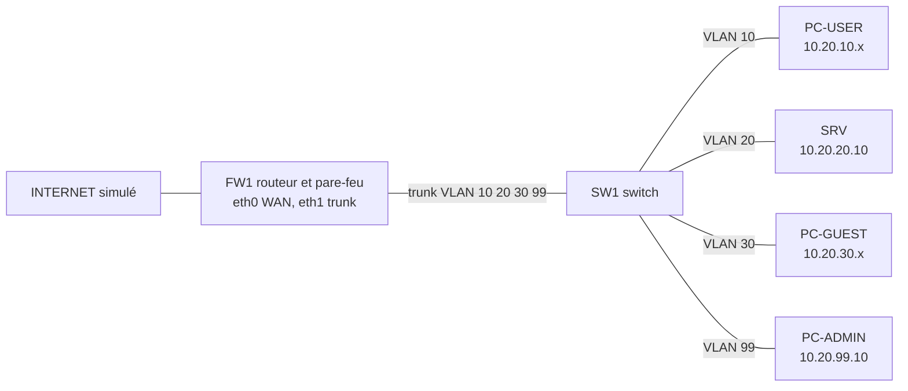
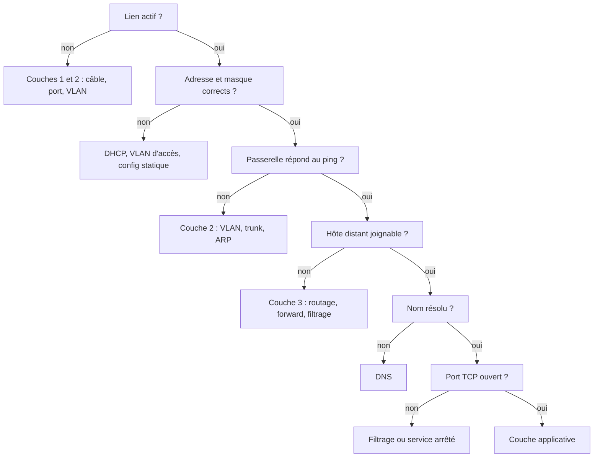

# Projet pratique — Réseau d'entreprise segmenté

## Objectifs pédagogiques

À la fin de ce projet, vous saurez :

- **Concevoir** un plan d'adressage et un schéma réseau à partir d'un besoin métier exprimé en langage courant
- **Déployer** dans un laboratoire virtuel quatre segments VLAN avec routage inter-VLAN, DHCP et DNS
- **Appliquer** une politique de filtrage entre segments, réserver l'accès d'administration à un VLAN dédié et centraliser les journaux
- **Diagnostiquer** une panne couche par couche, en appuyant chaque conclusion sur une commande, un journal ou une capture Wireshark
- **Livrer** un dossier exploitable par quelqu'un d'autre : schéma, configurations versionnées et fiche de diagnostic

## Mise en situation

Prenons une PME fictive de 60 personnes, installée sur un seul site. Aujourd'hui, tout vit dans un unique réseau plat : postes du personnel, serveur interne, imprimantes, et le Wi-Fi des visiteurs qui débarque dans le même sous-réseau. Un jour, la direction pose trois questions simples :

- Pourquoi un visiteur connecté au Wi-Fi peut-il ouvrir l'intranet ?
- Pourquoi n'importe quel poste peut-il tenter de se connecter en SSH au serveur ?
- Quand « ça ne marche plus », pourquoi personne ne sait dire où chercher ?

Vous êtes l'administrateur réseau chargé de répondre. Vous allez refondre ce réseau en segments distincts, définir qui peut parler à qui, garder une trace de ce qui se passe, et prouver que vous savez retrouver la cause d'une panne au lieu de redémarrer des équipements au hasard.

Le projet synthétise tout le niveau 1 : adressage, VLAN, routage, services de base, outils de diagnostic, capture de trames. L'objectif n'est pas d'apprendre de nouvelles commandes, mais de les faire fonctionner ensemble dans un réseau qui tient debout.

## De la demande au plan d'adressage

Avant de toucher une machine, traduisez le besoin en décisions. La demande de la direction se découpe naturellement en quatre populations qui n'ont pas les mêmes droits : le personnel, le serveur, les visiteurs et les administrateurs. Quatre populations, quatre segments. Un VLAN fonctionne comme un étage d'immeuble : tout le monde sur le palier se croise librement, mais pour changer d'étage il faut passer par un point de contrôle, ici le routeur-pare-feu.

Voici le plan retenu :

| VLAN | Nom | Réseau | Passerelle | Adressage | Usage |
|------|-----|--------|-----------|-----------|-------|
| 10 | USERS | 10.20.10.0/24 | 10.20.10.1 | DHCP .100 à .200, bail 12 h | postes du personnel |
| 20 | SERVERS | 10.20.20.0/24 | 10.20.20.1 | statique, SRV en .10 | serveur interne |
| 30 | GUEST | 10.20.30.0/24 | 10.20.30.1 | DHCP .100 à .200, bail 1 h | visiteurs |
| 99 | MGMT | 10.20.99.0/24 | 10.20.99.1 | statique, switch en .2, PC admin en .10 | administration |

Quelques choix méritent d'être justifiés, car c'est ce qu'on vous demandera de défendre :

- **Un /24 par segment.** Avec 60 personnes, leurs téléphones et quelques périphériques, un pool de 101 adresses laisse de la marge. Découper plus finement compliquerait le plan sans bénéfice.
- **Le bloc 10.20.0.0/16.** Il appartient aux adresses privées de la RFC 1918 et laisse de la place : les VLAN 40 à 98 restent libres pour une future imprimerie, de la téléphonie ou une zone Wi-Fi supplémentaire.
- **Un bail court pour les invités.** Les visiteurs vont et viennent, et un bail d'une heure évite d'épuiser le pool avec des appareils partis depuis longtemps.
- **Le VLAN ID égal au troisième octet.** VLAN 10 donne 10.20.10.0/24, VLAN 99 donne 10.20.99.0/24. Quand vous lirez une adresse dans un journal ou une capture, vous retrouverez le segment sans ouvrir le tableau.

Le schéma qui accompagne ce plan reste volontairement petit :



Notez que FW1 tient en un seul équipement, ce qui en fait un point de défaillance unique. Le laboratoire ne le traite pas, mais votre schéma doit le signaler : un bon document réseau montre aussi ses faiblesses.

## Le laboratoire

Le projet demande peu de matériel, mais chaque équipement joue un rôle précis :

| Composant | Rôle dans le projet | Réalisation possible |
|-----------|--------------------|----------------------|
| FW1 | passerelle des quatre VLAN, DHCP, DNS, NAT, filtrage | VM Debian ou Ubuntu avec deux cartes : eth0 vers l'extérieur (NAT de l'hyperviseur), eth1 en trunk |
| SW1 | VLAN, trunk, ports d'accès | image de switch de type IOS dans GNS3 ou EVE-NG, ou bridge Linux |
| SRV | intranet (nginx, port 80), collecteur de journaux, script de contrôle | VM Linux légère |
| PC-USER, PC-GUEST, PC-ADMIN | clients de test, un par segment | VM Linux légères ou conteneurs |

En général, une machine avec 8 Go de RAM suffit si les clients restent minimalistes.

> ⚠️ **Comportement contre-intuitif.** Tout hyperviseur n'est pas capable de transporter des trames VLAN étiquetées entre deux VM. Selon le produit et le type de réseau virtuel choisi, les étiquettes peuvent être supprimées ou le trafic rejeté, et le trunk semble alors « configuré mais muet ». Un simulateur où le switch est un nœud à part entière (GNS3, EVE-NG) évite ce piège. Sinon, consultez la documentation de votre hyperviseur : le réglage dépend du produit et de sa version.
{: .callout .callout-attention}

## Construction progressive

La construction suit un ordre logique : d'abord faire circuler, puis restreindre, puis observer. Chaque étape se valide avant la suivante. Si vous empilez tout d'un coup, vous ne saurez plus quelle couche est responsable quand ça casse.

### Étape 1 : le switch, VLAN et trunk

Le switch ne route rien. Son travail est de cloisonner les ports par VLAN et de transporter les quatre VLAN, étiquetés, vers le routeur sur un seul lien. La syntaxe ci-dessous est de type Cisco IOS et peut varier selon le constructeur ou la version.

```
vlan 10
 name USERS
vlan 20
 name SERVERS
vlan 30
 name GUEST
vlan 99
 name MGMT
vlan 999
 name BLACKHOLE
!
interface GigabitEthernet0/1
 description TRUNK-vers-FW1
 switchport mode trunk
 switchport trunk native vlan 999
 switchport trunk allowed vlan 10,20,30,99
!
interface GigabitEthernet0/2
 description PC-USER
 switchport mode access
 switchport access vlan 10
 spanning-tree portfast
!
interface GigabitEthernet0/3
 description SRV
 switchport mode access
 switchport access vlan 20
!
interface GigabitEthernet0/4
 description PC-GUEST
 switchport mode access
 switchport access vlan 30
!
interface GigabitEthernet0/5
 description PC-ADMIN
 switchport mode access
 switchport access vlan 99
!
interface Vlan99
 ip address 10.20.99.2 255.255.255.0
 no shutdown
!
ip default-gateway 10.20.99.1
```

Plusieurs lignes méritent un commentaire :

- **`interface Vlan99`** est une SVI (Switch Virtual Interface). Elle donne au switch sa propre adresse dans le VLAN d'administration, indispensable pour le joindre en SSH, lui envoyer des requêtes de supervision et le voir émettre ses journaux.
- **`native vlan 999`** déplace le VLAN natif du trunk, celui dont les trames circulent sans étiquette, vers un VLAN où personne n'est connecté. Une trame non étiquetée qui arrive sur le trunk ne tombe alors dans aucun réseau utile.
- **Sur certains modèles**, il faut ajouter `switchport trunk encapsulation dot1q` avant `switchport mode trunk`.

SSH exige un nom d'hôte, un nom de domaine, une clé RSA et un utilisateur local ; l'accès se limite ensuite au VLAN de gestion :

```
hostname SW1
ip domain-name corp.test
crypto key generate rsa modulus 2048
username <UTILISATEUR> secret <MOT_DE_PASSE>
!
ip access-list standard MGMT-ONLY
 permit 10.20.99.0 0.0.0.255
line vty 0 4
 access-class MGMT-ONLY in
 login local
 transport input ssh
```

Sans image de switch, un bridge Linux peut jouer le rôle de SW1. Seule la partie VLAN et trunk est reproduite ici : l'adresse de management et le filtrage SSH sont à adapter.

```
sudo ip link add br0 type bridge vlan_filtering 1
sudo ip link set br0 up
sudo ip link set eth1 master br0 && sudo ip link set eth1 up
sudo bridge vlan del dev eth1 vid 1
for v in 10 20 30 99; do sudo bridge vlan add dev eth1 vid $v; done
sudo ip link set eth2 master br0 && sudo ip link set eth2 up
sudo bridge vlan del dev eth2 vid 1
sudo bridge vlan add dev eth2 vid 10 pvid untagged
```

La dernière ligne reproduit un port d'accès VLAN 10. Répétez les deux lignes de `eth2` pour chaque port, avec le bon VLAN.

> ⚠️ **Comportement contre-intuitif.** Sur un trunk de type IOS, `switchport trunk allowed vlan 40` **remplace** la liste entière au lieu d'ajouter le VLAN 40. Les quatre VLAN du projet disparaissent d'un coup et tout le site se retrouve coupé. Pour ajouter, il faut écrire `switchport trunk allowed vlan add 40`, puis vérifier avec `show interfaces trunk`.
{: .callout .callout-attention}

### Étape 2 : le routeur, sous-interfaces et routage inter-VLAN

Ici, FW1 reçoit un seul câble (le trunk) et y présente quatre interfaces logiques, une par VLAN. On appelle ce montage « router-on-a-stick » : un routeur au bout d'un seul fil, qui fait entrer et sortir les paquets par la même porte physique. Grâce à la convention de nommage, une seule boucle suffit :

```
sudo ip link set eth1 up
for v in 10 20 30 99; do
  sudo ip link add link eth1 name eth1.$v type vlan id $v
  sudo ip addr add 10.20.$v.1/24 dev eth1.$v
  sudo ip link set eth1.$v up
done
sudo sysctl -w net.ipv4.ip_forward=1
```

La dernière ligne est celle qu'on oublie le plus souvent. Sans `ip_forward`, FW1 répond à ses voisins directs mais se refuse à transmettre un paquet qui ne lui est pas destiné. Pour que le réglage survive au redémarrage, ajoutez `net.ipv4.ip_forward=1` dans `/etc/sysctl.d/99-router.conf`. La persistance des sous-interfaces dépend de la distribution (Netplan, NetworkManager, fichiers `interfaces`) : choisissez la méthode de votre système et ne laissez pas le projet reposer sur des commandes tapées à la main.

Validation de l'étape : `ip -br addr` sur FW1 affiche les quatre interfaces avec leurs adresses en `.1`, et un ping depuis chaque client vers sa passerelle répond.

### Étape 3 : DHCP et DNS avec dnsmasq

Un seul service, dnsmasq, tient les deux rôles sur FW1. FW1 possède déjà une interface dans chaque VLAN, donc aucun relais DHCP n'est nécessaire : dnsmasq répond directement sur l'interface par laquelle la demande arrive.

```
# /etc/dnsmasq.d/lab.conf
interface=eth1.10
interface=eth1.20
interface=eth1.30
interface=eth1.99
bind-dynamic
no-resolv
server=1.1.1.1
domain=corp.test
local=/corp.test/
expand-hosts
host-record=srv.corp.test,10.20.20.10
dhcp-range=10.20.10.100,10.20.10.200,255.255.255.0,12h
dhcp-range=10.20.30.100,10.20.30.200,255.255.255.0,1h
dhcp-authoritative
log-dhcp
```

dnsmasq annonce par défaut sa propre adresse sur l'interface concernée, à la fois comme passerelle et comme serveur DNS : les clients du VLAN 10 reçoivent donc 10.20.10.1 pour les deux. Le domaine `.test` est réservé aux essais et ne risque pas d'entrer en conflit avec un vrai nom. Quant à `log-dhcp`, il écrit chaque échange DHCP dans le journal système, ce qui sera très utile à l'étape 5.

Sur un client, demandez un nouveau bail et lisez le résultat :

```
sudo dhclient -v eth0
ip -br addr
ip route
```

Vous devez obtenir une adresse entre `.100` et `.200` de votre VLAN, et une route par défaut via la passerelle de ce VLAN. La commande de renouvellement dépend de la distribution (`dhclient`, `nmcli`, `networkctl renew`) ; l'important est de provoquer un nouvel échange et de le voir se terminer correctement.

### Étape 4 : filtrage entre segments et accès administratif

Jusqu'ici, tout communique avec tout. C'est le moment d'écrire ce que la direction a réellement demandé. La politique, en français d'abord :

- Le personnel sort sur Internet et accède à l'intranet (ports 80 et 443), rien d'autre vers les serveurs.
- Les invités sortent sur Internet et n'ont accès à rien d'interne, hormis la passerelle pour le DHCP et le DNS.
- Le serveur n'initie que des connexions web sortantes, pour ses mises à jour.
- Seul le VLAN 99 administre : SSH vers FW1 et SRV, ping partout pour diagnostiquer.
- Tout le reste est interdit, et chaque refus laisse une trace.

Voici la traduction avec nftables (syntaxe stable, mais gardez la documentation de votre version sous la main) :

```
flush ruleset

define WAN      = "eth0"
define USERS    = "eth1.10"
define SERVERS  = "eth1.20"
define GUEST    = "eth1.30"
define ADMIN    = "eth1.99"
define INTERNAL = { "eth1.10", "eth1.20", "eth1.30", "eth1.99" }

table inet filter {
  chain input {
    type filter hook input priority 0; policy drop;
    ct state established,related accept
    iif "lo" accept
    iifname $INTERNAL icmp type echo-request accept
    iifname $INTERNAL udp dport { 53, 67 } accept
    iifname $INTERNAL tcp dport 53 accept
    iifname $ADMIN tcp dport 22 accept
    limit rate 5/minute log prefix "FW-IN-DROP "
  }

  chain forward {
    type filter hook forward priority 0; policy drop;
    ct state established,related accept
    ct state invalid drop

    iifname $USERS   oifname $WAN     accept
    iifname $GUEST   oifname $WAN     accept
    iifname $USERS   oifname $SERVERS tcp dport { 80, 443 } accept
    iifname $SERVERS oifname $WAN     tcp dport { 80, 443 } accept

    iifname $ADMIN   oifname $SERVERS tcp dport { 22, 443 } accept
    iifname $ADMIN   oifname $SERVERS udp dport 514 accept
    iifname $ADMIN   icmp type echo-request accept
    iifname $SERVERS oifname $ADMIN   icmp type echo-request accept

    limit rate 5/minute log prefix "FW-FWD-DROP "
  }
}

table ip nat {
  chain postrouting {
    type nat hook postrouting priority srcnat; policy accept;
    oifname $WAN masquerade
  }
}
```

Lisons cela dans l'ordre où le noyau l'évalue. Les paquets des connexions déjà établies passent d'abord : on ne vérifie les règles qu'à l'ouverture d'un échange, pas à chaque paquet de la réponse. Ensuite viennent les autorisations explicites, de la plus fréquente à la plus rare. Un paquet qui n'a rien déclenché atteint la ligne `log`, puis la politique `drop` qui le supprime. Le `limit rate 5/minute` évite de noyer les journaux sous un flux répétitif. Quant à la ligne `udp dport 514` du VLAN 99, elle autorise le switch à envoyer ses journaux vers le serveur.

Avant de recharger, validez la syntaxe avec `sudo nft -c -f /etc/nftables.conf`, puis chargez avec `sudo nft -f /etc/nftables.conf`. En laboratoire, la console de l'hyperviseur vous sauve si vous vous coupez de FW1 ; sur du matériel distant, on prévoit toujours un retour arrière automatique avant d'appliquer.

> ⚠️ **Comportement contre-intuitif.** Le pare-feu ne voit que le trafic qui le **traverse**. Deux machines dans le même VLAN communiquent par le switch, sans jamais passer par FW1 : aucune règle ne s'applique entre elles. C'est aussi pourquoi le PC d'administration et le switch (tous deux en VLAN 99) se parlent librement. Si deux machines doivent être filtrées l'une par rapport à l'autre, elles doivent être dans deux VLAN différents.
{: .callout .callout-attention}

Autre point de vigilance : vous venez de décider qu'un `ping` entre VLAN échoue, par conception, sauf depuis le VLAN d'administration. Ce n'est pas un défaut mais un choix : le VLAN 99 sert de poste d'observation pour les diagnostics. Vous y reviendrez dans la partie sur les pannes.

### Étape 5 : journaux centralisés et supervision de base

Un équipement qui garde ses journaux pour lui est inutile le jour où il tombe en panne. Trois sources alimentent le serveur : FW1 (refus nftables, DHCP), le switch et SRV lui-même. Sur SRV, rsyslog écoute en UDP et range les messages par machine émettrice :

```
# /etc/rsyslog.d/10-central.conf
module(load="imudp")
input(type="imudp" port="514")
template(name="PerHost" type="string" string="/var/log/central/%HOSTNAME%.log")
if $fromhost-ip != '127.0.0.1' then {
    action(type="omfile" dynaFile="PerHost")
    stop
}
```

Côté émetteurs, une ligne suffit sur FW1 (`*.* @10.20.20.10:514` dans `/etc/rsyslog.d/90-forward.conf`, l'arobase unique désignant UDP). Sur le switch :

```
service timestamps log datetime msec
logging host 10.20.20.10
logging trap informational
logging source-interface Vlan99
```

Testez le circuit avant de lui faire confiance : depuis PC-ADMIN, seul segment autorisé en UDP 514 vers SRV, `logger -d -n 10.20.20.10 -P 514 "test depuis PC-ADMIN"` doit faire apparaître une ligne dans `/var/log/central/` sur SRV. Un pipeline de journaux jamais testé est une assurance qui ne couvre rien.

> 💡 **Point clé.** Les journaux ne servent à corréler que si les horloges concordent. Avec 30 secondes de dérive entre le switch et FW1, le refus d'un paquet et l'événement du switch semblent n'avoir aucun lien. Synchronisez les trois équipements sur la même source de temps avant d'aller plus loin. Attention : la politique de l'étape 4 ne laisse passer aucun flux NTP (UDP 123). Ajoutez la règle nécessaire vers la source choisie, sans quoi le switch et SRV ne pourront pas se synchroniser.
{: .callout .callout-important}

Pour la supervision de base, ce projet ne déploie pas un outil complet. Un petit script exécuté chaque minute par cron sur SRV suffit à illustrer le principe : tester ce qui compte et écrire dans le journal quand ça échoue.

```
#!/bin/sh
# /usr/local/bin/checks.sh, lancé par cron : * * * * * /usr/local/bin/checks.sh
chk() { "$@" >/dev/null 2>&1 || logger -p user.err -t netcheck "KO: $*"; }
chk ping -c1 -W1 10.20.10.1
chk ping -c1 -W1 10.20.99.2
chk nc -z -w2 10.20.20.10 80
chk sh -c 'dig +short +time=1 +tries=1 @10.20.20.1 srv.corp.test | grep -q 10.20.20.10'
```

Les quatre tests couvrent la passerelle des utilisateurs, le switch, l'intranet et le DNS. Retenez ce qu'on surveille : une panne se détecte plus vite quand on teste le service rendu (« le nom se résout-il ? ») que le composant (« le processus tourne-t-il ? »). Dès que le réseau grossit, des outils comme Zabbix, Nagios ou LibreNMS prendront le relais avec des graphiques et des alertes ; le principe reste identique.

### Recette : prouver que le réseau fait ce qu'on a promis

Une configuration ne vaut que par ses tests. Voici la recette minimale, que vous rejouerez après chaque modification :

| Test | Depuis | Résultat attendu |
|------|--------|------------------|
| `ip -br addr` | PC-USER | adresse 10.20.10.100 à .200 |
| `dig +short srv.corp.test` | PC-USER | 10.20.20.10 |
| `nc -zv -w2 10.20.20.10 80` | PC-USER | succeeded |
| `ping -c2 1.1.1.1` | PC-GUEST | réponses |
| `nc -zv -w2 10.20.20.10 80` | PC-GUEST | délai dépassé (voulu) |
| `ssh <UTILISATEUR>@10.20.20.10` | PC-USER | délai dépassé (voulu) |
| `ssh <UTILISATEUR>@10.20.20.10` | PC-ADMIN | connexion établie |
| `tail /var/log/central/*.log` | SRV | lignes de FW1 et du switch |

> 💡 **Point clé.** Les échecs voulus figurent dans le tableau au même titre que les réussites. Une politique de filtrage se valide autant par ce qu'elle bloque que par ce qu'elle laisse passer. Quand tous les tests passent, prenez un instantané de chaque VM et créez le tag Git de la configuration de référence : vous allez maintenant casser des choses.
{: .callout .callout-important}

## Casser pour comprendre : pannes et diagnostic par couches

Sur un réseau qui fonctionne, on ne sait pas encore diagnostiquer, on sait seulement configurer. Le diagnostic s'apprend en provoquant des pannes connues et en vérifiant qu'on les retrouve avec la méthode. Injectez-les **une par une**, retrouvez la cause, puis restaurez la référence depuis Git ou l'instantané avant la suivante.

Quelle méthode appliquer ? Partir du bas. Un test échoue : tout ce qui se situe au-dessus de lui n'a aucune chance de fonctionner, il est donc inutile d'examiner le DNS quand le câble est débranché. Voici l'arbre de décision :



Voici les six pannes du laboratoire, avec ce que l'utilisateur ressent et la commande qui la trahit :

| Panne injectée | Ce que dit l'utilisateur | Couche | Ce qui la révèle |
|----------------|--------------------------|--------|------------------|
| `shutdown` sur le port Gi0/2 du switch | « Plus de réseau du tout » | 1 | `show ip interface brief` sur SW1 : Gi0/2 en `administratively down` ; sur matériel physique, `ip -br link` du client affiche aussi DOWN, `NO-CARRIER` (en laboratoire virtuel, l'interface du client reste souvent UP) |
| Port de PC-USER basculé en VLAN 30 | « Internet marche, l'intranet non » | 2 | `ip -br addr` : adresse en 10.20.30.x au lieu de 10.20.10.x |
| VLAN 10 retiré du trunk | « Les nouveaux postes n'ont pas d'adresse » | 2 | `show interfaces trunk` : le 10 n'apparaît plus ; aucune requête DHCP n'arrive sur FW1 |
| `sysctl -w net.ipv4.ip_forward=0` sur FW1 | « La passerelle répond, mais rien d'autre » | 3 | `sysctl net.ipv4.ip_forward` ; dans `traceroute -n 1.1.1.1`, rien ne répond au-delà de la passerelle (qui peut s'afficher avec `!H`) |
| Route par défaut erronée sur SRV | « L'intranet ne répond plus » (délai dépassé) | 3 | `ip neigh` sur SRV : l'entrée de la fausse passerelle reste en FAILED |
| `systemctl stop dnsmasq` sur FW1 | « Internet est en panne » | 7 | `ping 1.1.1.1` répond, `dig @10.20.10.1 srv.corp.test` ne répond pas |

La quatrième panne montre l'intérêt de la méthode : les adresses sont bonnes, la route aussi, le ping vers la passerelle répond, et pourtant rien ne circule. Seul le test « hôte distant » du schéma révèle le problème. La cinquième est plus vicieuse : le symptôme ressemble exactement à un blocage de pare-feu, mais les règles ne sont pas en cause. Le SYN arrive bien sur SRV, qui tente de répondre vers une passerelle qui n'existe pas. Seul `ip neigh` (et une capture côté serveur) vous le montre.

Quelques commandes font l'essentiel du travail. `ip route get` montre le chemin que Linux choisirait réellement, sans émettre le moindre paquet :

```
$ ip route get 10.20.20.10
10.20.20.10 via 10.20.10.1 dev eth0 src 10.20.10.101
```

Lisez la ligne comme une phrase : « pour joindre 10.20.20.10, je passe par 10.20.10.1, via eth0, avec comme adresse source 10.20.10.101 ». Si la passerelle ou la source ne correspondent pas à votre plan, vous tenez déjà la cause. De son côté, `ip neigh` liste les voisins que la machine a réussi (ou non) à joindre :

```
$ ip neigh
10.20.20.254 dev eth0  FAILED
10.20.20.1   dev eth0 lladdr 52:54:00:aa:bb:cc REACHABLE
```

Une entrée `FAILED` signifie « j'ai demandé qui possède cette adresse, personne n'a répondu ». Côté test de port, `nc -zv -w2 10.20.20.10 80` distingue trois issues : `succeeded` (handshake complet), `refused` (l'hôte est joint, rien n'écoute ou le refus est explicite) et le silence jusqu'au délai (paquets perdus ou filtrés).

> ⚠️ **Comportement contre-intuitif.** Dans ce réseau, `ping` d'un VLAN à l'autre échoue par conception. Conclure « le serveur est en panne » parce que le ping de PC-USER vers SRV ne répond pas, c'est partir sur une fausse piste. Testez le port réellement autorisé avec `nc`, ou pingez depuis PC-ADMIN, où l'ICMP est permis.
{: .callout .callout-attention}

## Cas pratique : « l'intranet ne répond plus »

Reprenons un scénario illustratif, que vous pouvez reproduire dans le laboratoire. Lundi matin, un utilisateur du VLAN 10 écrit : « L'intranet ne répond plus depuis ce matin. » Vous menez l'enquête dans l'ordre du schéma, en gardant une trace de chaque test dans la fiche de diagnostic.

**1. Depuis le client.** `ip -br addr` montre 10.20.10.101/24, `ip route` une route par défaut via 10.20.10.1 et `ping 10.20.10.1` répond. `dig +short srv.corp.test` renvoie 10.20.20.10. Les couches 1 à 3 locales et le DNS sont donc sains. Mais `nc -zv -w2 10.20.20.10 80` ne répond pas avant le délai : le problème est plus haut, côté port.

**2. Côté serveur.** Depuis PC-ADMIN, connectez-vous en SSH à SRV. `ss -tlnp | grep :80` montre nginx à l'écoute, et `curl -sI http://localhost` répond `200 OK`. Le service tourne, il n'est tout simplement pas atteint depuis le VLAN 10.

**3. La capture, des deux côtés du mur.** Sur FW1, lancez deux captures en parallèle, une par interface :

```
sudo tcpdump -i eth1.10 -nn -w /tmp/users.pcap host 10.20.20.10 and tcp port 80
sudo tcpdump -i eth1.20 -nn -w /tmp/servers.pcap host 10.20.10.101 and tcp port 80
```

Relancez le test depuis PC-USER, arrêtez les captures et ouvrez `users.pcap` dans Wireshark avec le filtre `tcp.flags.syn == 1`. Vous obtenez quelque chose comme ceci (chiffres illustratifs) :

```
No.  Time      Source        Destination   Info
1    0.000000  10.20.10.101  10.20.20.10   51514 → 80 [SYN] Seq=0 Win=64240 Len=0 MSS=1460
2    1.011803  10.20.10.101  10.20.20.10   [TCP Retransmission] 51514 → 80 [SYN] ...
3    3.027412  10.20.10.101  10.20.20.10   [TCP Retransmission] 51514 → 80 [SYN] ...
4    7.055190  10.20.10.101  10.20.20.10   [TCP Retransmission] 51514 → 80 [SYN] ...
```

Le client envoie son SYN et n'obtient jamais de SYN-ACK, alors il recommence en doublant son délai d'attente : 1, 2 puis 4 secondes. Cette cadence est la signature d'un paquet qui ne reçoit aucune réponse. Maintenant, ouvrez `servers.pcap` : **il est vide**. Rien n'est jamais sorti de FW1 vers le serveur. Ce silence est une preuve à part entière : le paquet entre dans FW1 et n'en ressort pas, donc FW1 le supprime.

> 💡 **Point clé.** Capturer des deux côtés d'un équipement vous dit où le paquet disparaît, sans deviner. Une seule capture vous dit seulement qu'il a disparu quelque part.
{: .callout .callout-important}

**4. Le journal confirme.** Sur SRV, `grep FW-FWD-DROP /var/log/central/fw1.log | tail -1` renvoie une ligne de ce type (abrégée) :

```
FW-FWD-DROP IN=eth1.10 OUT=eth1.20 ... SRC=10.20.10.101 DST=10.20.20.10 ... PROTO=TCP SPT=51514 DPT=80 ... SYN
```

Les trois sources convergent : le client se plaint d'un délai dépassé, la capture montre des SYN sans réponse et le journal nomme le refus, port 80 inclus.

**5. La cause racine.** `git log -p configs/fw/nftables.conf` révèle un commit de la veille, « durcissement : HTTPS uniquement », qui a retiré le port 80 de la règle utilisateurs vers serveurs, alors que l'intranet ne sert pas encore en TLS. Voilà ce que le versionnement apporte : pas seulement un historique, mais l'explication de la panne en dix secondes.

**6. Correction et preuve.** Rétablissez la règle, rechargez nftables, relancez le test. La nouvelle capture montre cette fois un handshake complet : `[SYN]`, `[SYN, ACK]`, `[ACK]`, puis `GET / HTTP/1.1` et `HTTP/1.1 200 OK`. Cette capture « avant/après » rejoint la fiche de diagnostic comme pièce justificative.

> ⚠️ **Comportement contre-intuitif.** Ici, FW1 supprime les paquets sans répondre (`drop`), d'où les retransmissions et le délai. Avec un `reject`, le client aurait reçu un RST immédiat et aurait vu « connection refused » en une fraction de seconde. Le silence indique un filtrage ou une route cassée, le refus indique que l'hôte est joint. Pour les segments internes, où la facilité de diagnostic compte autant que la discrétion, certaines équipes choisissent `reject` ; vers Internet, on privilégie `drop`. C'est un compromis à connaître et à justifier dans votre document.
{: .callout .callout-attention}

Un dernier usage de Wireshark vaut le détour : capturez sur `eth1`, le trunk, avec `sudo tcpdump -i eth1 -e -nn -w /tmp/trunk.pcap`, et ouvrez le fichier avec le filtre `vlan.id == 10`. Vous verrez les étiquettes 802.1Q que vous avez configurées, ce qui rend le VLAN visible là où il n'était qu'un concept.

## Le livrable

Un projet réseau sans documentation est un projet que personne d'autre ne peut reprendre, vous-même dans six mois y compris. Trois éléments composent le dossier, versionnés dans un même dépôt Git.

```
reseau-segmente/
├── README.md                 # objectif, prérequis, comment reconstruire le labo
├── docs/
│   ├── schema.png            # schéma (ou .drawio avec sa source)
│   └── plan-adressage.md     # tableau des VLAN, pools, réservations
├── configs/
│   ├── sw1.cfg               # configuration du switch (sans secrets)
│   ├── nftables.conf
│   ├── dnsmasq-lab.conf
│   ├── vlan-setup.sh
│   └── rsyslog-central.conf
├── captures/
│   ├── intranet-avant.pcap
│   └── intranet-apres.pcap
└── diagnostics/
    └── 2024-fiche-001.md     # une fiche par incident
```

Chaque changement de configuration fait l'objet d'un commit court et explicite (`git commit -m "fw: autoriser tcp 80 users vers srv"`), idéalement d'une seule modification à la fois. Le tag `v1-baseline` marque l'état validé par la recette : c'est votre point de retour en cas de fausse manipulation.

> ⚠️ **Comportement contre-intuitif.** Une configuration exportée d'un équipement contient souvent des secrets : mots de passe (même hachés), clés, communautés de supervision. Un secret commité reste dans l'historique Git même après suppression du fichier. Remplacez-les par des valeurs fictives avant le commit et listez les fichiers sensibles dans `.gitignore`.
{: .callout .callout-attention}

La fiche de diagnostic, enfin, suit toujours le même squelette : c'est ce qui la rend lisible par quelqu'un qui n'était pas là.

```
# Fiche de diagnostic n° 001

- Date et heure :
- Symptôme rapporté (mot pour mot) :
- Périmètre : qui est touché, qui ne l'est pas

## Tests réalisés (dans l'ordre)
| Test | Depuis | Résultat | Conclusion |
|------|--------|----------|-----------|

## Preuves
- Capture : captures/...pcap (filtre utilisé : ...)
- Journal : extrait de /var/log/central/...

## Cause racine
(couche concernée + explication en une phrase)

## Correction et vérification
(ce qui a été changé, commit associé, test de contrôle)
```

## Bonnes pratiques

Une grande partie de ce qui distingue un réseau « qui marche » d'un réseau **maintenable** se joue dans les petites décisions de ce projet.

- **Tout interdire par défaut, autoriser explicitement.** Une politique `drop` suivie d'autorisations nommées se relit en cinq minutes ; l'inverse oblige à chercher ce qu'on a oublié de fermer.
- **Limiter l'administration à un segment dédié**, et le joindre uniquement par SSH. Le VLAN 99 sert aussi de point d'observation pour les diagnostics : un seul endroit où tout est permis, parfaitement identifié.
- **Ne jamais laisser le VLAN natif par défaut** sur un trunk, et mettre les ports inutilisés à l'arrêt, ou dans le VLAN poubelle.
- **Changer une seule chose à la fois, puis tester.** Quand une panne apparaît après deux modifications, on perd le bénéfice de la recette.
- **Versionner avant de modifier**, pas après. Un commit « avant » vaut mieux qu'une mémoire « d'avant ».
- **Écrire l'intention, pas seulement la commande.** « Les invités n'accèdent à rien d'interne » vaut plus, dans la documentation, que quatre lignes de règles que personne ne saura interpréter.
- **Regarder ce qui n'est pas redondant.** Ici, FW1 est le seul chemin vers l'extérieur et vers tous les VLAN. Le noter sur le schéma est déjà un premier pas ; le traiter (deuxième pare-feu, protocole de redondance) relève du module sur la haute disponibilité.

## Validation du niveau 1

Ce projet sert de validation du niveau. Voici ce que chaque compétence attendue signifie concrètement ici :

| Compétence | Preuve dans le projet |
|-----------|----------------------|
| Dessiner un réseau simple | schéma et plan d'adressage cohérents avec la configuration réelle |
| Expliquer une communication de bout en bout | récit commenté d'un accès de PC-USER à l'intranet, appuyé sur une capture |
| Configurer adresses et routes | VLAN, sous-interfaces, DHCP, routes, recette complète au vert |
| Capturer une conversation TCP | handshake et requête HTTP lus dans `intranet-apres.pcap` |
| Identifier la cause d'une panne | six fiches de diagnostic, avec tests, preuves et cause racine |

Pour le récit de bout en bout, voici la trame à suivre, que vous reconnaîtrez dans la capture :

1. PC-USER demande un bail DHCP, qui arrive sur FW1 via le trunk, étiqueté VLAN 10.
2. Il interroge le DNS (10.20.10.1) pour `srv.corp.test` et reçoit 10.20.20.10.
3. Cette adresse n'est pas dans son sous-réseau : il demande en ARP l'adresse MAC de sa passerelle.
4. Il envoie son SYN à l'adresse MAC de FW1, avec l'adresse IP de SRV comme destination.
5. FW1 consulte sa table de routage et ses règles, puis réexpédie le paquet dans le VLAN 20 avec une nouvelle trame (nouvelle adresse MAC source et destination).
6. SRV répond, le chemin retour traverse FW1 en sens inverse (c'est l'état de connexion qui l'autorise), et le handshake se termine.
7. Le client envoie `GET /`, le serveur répond `200 OK`.

## Résumé

| Concept | Rôle | Points clés |
|---------|------|-------------|
| Plan d'adressage | Traduire le besoin en segments | un segment par population ; VLAN ID = troisième octet ; plage réservée pour grandir |
| Trunk et ports d'accès | Transporter plusieurs VLAN sur un lien | `allowed vlan` remplace la liste ; VLAN natif inutilisé |
| Router-on-a-stick | Relier les VLAN entre eux | une sous-interface par VLAN ; `ip_forward` obligatoire |
| DHCP et DNS | Donner adresse, passerelle et noms | un pool par segment ; bail court pour les invités |
| Filtrage inter-VLAN | Appliquer la politique d'accès | politique `drop` ; seul le trafic routé est filtré, jamais celui d'un même VLAN |
| Journaux centralisés | Garder la trace après la panne | horloges synchronisées ; pipeline testé avec `logger` |
| Diagnostic par couches | Trouver la cause sans deviner | du bas vers le haut ; le premier test qui échoue désigne la couche |
| Capture Wireshark | Prouver ce qui se passe | SYN retransmis à 1, 2, 4 s ; capturer des deux côtés de l'équipement suspect |
| Livrable | Rendre le travail reprenable | schéma, configurations versionnées sans secrets, fiche de diagnostic |

Vous disposez maintenant d'un réseau que vous savez décrire, configurer, observer et réparer. Ce réseau fonctionne, mais fonctionner n'est pas la même chose qu'être protégé : les prochains modules changent de question, en s'intéressant à ce que ce réseau transporte, à ceux qui s'y connectent et à ce qui pourrait mal tourner.

<!-- snippet
id: reseaux_vlan_id_convention
type: tip
tech: reseaux
level: beginner
importance: medium
format: knowledge
tags: vlan,adressage,plan,documentation
title: Aligner le VLAN ID sur le troisième octet
content: Choisir VLAN ID = troisième octet du réseau : VLAN 10 → 10.20.10.0/24, VLAN 99 → 10.20.99.0/24. Dans un journal ou une capture Wireshark (filtre vlan.id == 10), l'adresse suffit à retrouver le segment sans ouvrir le tableau d'adressage.
description: Une règle de nommage évite de consulter le plan : une adresse en 10.20.30.x renvoie directement au VLAN 30 quand on lit un log ou une capture.
-->

<!-- snippet
id: reseaux_trunk_show_interfaces
type: command
tech: reseaux
level: beginner
importance: medium
format: knowledge
tags: vlan,trunk,switch,diagnostic
title: Vérifier les VLAN autorisés sur un trunk
context: Syntaxe de type Cisco IOS, à adapter selon le constructeur et la version
command: show interfaces trunk
description: Affiche les VLAN autorisés et actifs sur chaque trunk ainsi que le VLAN natif — premier réflexe quand un VLAN n'obtient plus d'adresse DHCP.
-->

<!-- snippet
id: reseaux_linux_route_get
type: command
tech: reseaux
level: beginner
importance: medium
format: knowledge
tags: routage,linux,diagnostic,iproute2
title: Voir la route réellement choisie par Linux
command: ip route get <IP_DESTINATION>
example: ip route get 10.20.20.10
description: Indique passerelle, interface et adresse source que Linux utiliserait pour atteindre la destination, sans envoyer aucun paquet.
-->

<!-- snippet
id: reseaux_nftables_check_syntaxe
type: command
tech: reseaux
level: beginner
importance: medium
format: knowledge
tags: nftables,pare-feu,configuration,verification
title: Valider un fichier nftables avant de l'appliquer
command: sudo nft -c -f <FICHIER>
example: sudo nft -c -f /etc/nftables.conf
description: Vérifie la syntaxe du jeu de règles sans le charger ; à lancer avant chaque rechargement pour éviter de se couper de l'équipement.
-->

<!-- snippet
id: reseaux_vlan_filtrage_intra
type: warning
tech: reseaux
level: beginner
importance: high
format: knowledge
tags: vlan,pare-feu,segmentation,routage
title: Le pare-feu ne filtre pas le trafic d'un même VLAN
content: Piège : croire que le pare-feu protège deux machines situées dans le même VLAN. Conséquence : leur trafic est commuté par le switch et ne traverse jamais le routeur, donc aucune règle ne s'applique. Correction : placer dans des VLAN distincts les machines qu'il faut filtrer l'une par rapport à l'autre.
description: Seul le trafic routé entre segments passe par les règles du pare-feu ; ce qui reste dans un VLAN circule librement par le switch.
-->

<!-- snippet
id: reseaux_ping_interdit_par_design
type: warning
tech: reseaux
level: beginner
importance: high
format: knowledge
tags: diagnostic,icmp,pare-feu,ping
title: Un ping qui échoue ne prouve pas une panne
content: Piège : conclure à une panne parce que ping échoue entre deux VLAN. Conséquence : avec une politique « tout interdit sauf... », l'ICMP est bloqué par conception et la recherche part sur une fausse piste. Correction : tester le port réellement autorisé (nc -zv -w2 <IP> <PORT>) ou pinguer depuis le VLAN d'administration où l'ICMP est permis.
description: Dans un réseau filtré, un ping muet entre segments est souvent normal ; le test pertinent cible le service autorisé, pas l'ICMP.
-->

<!-- snippet
id: reseaux_tcp_test_port_nc
type: command
tech: reseaux
level: beginner
importance: high
format: knowledge
tags: tcp,diagnostic,netcat,ports
title: Tester l'ouverture d'un port TCP avec netcat
command: nc -zv -w2 <IP> <PORT>
example: nc -zv -w2 10.20.20.10 80
description: succeeded = handshake réussi ; refused = RST reçu (rien n'écoute ou rejet explicite) ; délai dépassé = paquets perdus ou filtrés en silence.
-->

<!-- snippet
id: reseaux_filtrage_drop_reject
type: concept
tech: reseaux
level: intermediate
importance: medium
format: knowledge
tags: pare-feu,tcp,diagnostic,drop
title: DROP ou REJECT : deux échecs différents
content: Avec DROP, le pare-feu supprime le paquet sans répondre : le client retransmet son SYN puis finit en timeout. Avec REJECT, il renvoie un RST (TCP) ou un ICMP unreachable : échec immédiat, « connection refused ». Timeout = filtrage silencieux ou chemin cassé ; refused = hôte joint, service absent ou rejet explicite.
description: La nature de l'échec oriente le diagnostic : le silence évoque un filtrage ou une route cassée, un refus immédiat évoque un service absent.
-->

<!-- snippet
id: reseaux_tcp_syn_retransmission
type: concept
tech: reseaux
level: intermediate
importance: high
format: knowledge
tags: tcp,wireshark,diagnostic,syn
title: Reconnaître un SYN sans réponse dans Wireshark
content: Quand un SYN reste sans SYN-ACK, Linux le retransmet avec un délai doublé : envois à t=0, 1, 3 puis 7 s (attentes de 1, 2 et 4 s). Filtre Wireshark tcp.flags.syn == 1 && tcp.analysis.retransmission : une rafale de SYN sans réponse indique un paquet perdu ou filtré, plutôt qu'un service absent, qui répondrait par un RST.
description: Des SYN espacés de 1, 2 puis 4 s sans réponse sont la signature d'un filtrage silencieux ou d'une route de retour cassée.
-->

<!-- snippet
id: reseaux_tcpdump_capture_pcap
type: command
tech: reseaux
level: beginner
importance: high
format: knowledge
tags: tcpdump,wireshark,capture,diagnostic
title: Capturer un flux ciblé dans un fichier pcap
context: Sur un routeur, lancer une capture par interface pour voir de quel côté le paquet disparaît
command: sudo tcpdump -i <IFACE> -nn -w <FICHIER> host <IP> and tcp port <PORT>
example: sudo tcpdump -i eth1.10 -nn -w /tmp/intranet.pcap host 10.20.20.10 and tcp port 80
description: Enregistre uniquement le flux voulu pour l'ouvrir dans Wireshark ; -nn évite les résolutions de noms et de ports qui brouillent la lecture.
-->

<!-- snippet
id: reseaux_trunk_allowed_replace
type: warning
tech: reseaux
level: beginner
importance: high
format: knowledge
tags: vlan,trunk,switch,configuration
title: allowed vlan sans « add » écrase toute la liste du trunk
context: Comportement de type Cisco IOS, à vérifier selon le constructeur
content: Piège : écrire « switchport trunk allowed vlan 40 » pour ajouter un VLAN. Conséquence : la liste est remplacée, les VLAN 10, 20, 30 et 99 disparaissent du trunk et tout le site est coupé. Correction : utiliser « switchport trunk allowed vlan add 40 », puis contrôler avec show interfaces trunk.
description: Sur un trunk, omettre le mot « add » remplace la liste entière des VLAN autorisés au lieu de la compléter.
-->

<!-- snippet
id: reseaux_linux_ip_forward_off
type: error
tech: reseaux
level: beginner
importance: high
format: knowledge
tags: linux,routage,sysctl,diagnostic
title: Routeur Linux qui ne route pas : ip_forward à 0
content: Symptôme : les postes joignent leur passerelle mais aucun VLAN ni Internet, alors que routes et règles semblent correctes. Cause : net.ipv4.ip_forward vaut 0 (valeur par défaut) ou a été remis à 0 au redémarrage car sysctl -w n'est pas persistant. Correction : sysctl -w net.ipv4.ip_forward=1, puis écrire net.ipv4.ip_forward=1 dans /etc/sysctl.d/99-router.conf.
description: Sans ip_forward, Linux répond pour lui-même mais refuse de transmettre les paquets des autres ; le réglage doit être rendu persistant.
-->

<!-- snippet
id: reseaux_git_secrets_config
type: warning
tech: reseaux
level: beginner
importance: medium
format: knowledge
tags: git,configuration,secrets,documentation
title: Ne pas commiter une config d'équipement brute
content: Piège : versionner tel quel l'export d'un switch ou d'un fichier de service. Conséquence : mots de passe (même hachés), clés ou communautés SNMP restent dans l'historique Git, même après suppression du fichier. Correction : remplacer les secrets par des valeurs fictives avant le commit et lister les fichiers sensibles dans .gitignore.
description: Un secret commité reste lisible dans l'historique ; il faut le retirer avant le premier commit, pas après.
-->

<!-- snippet
id: reseaux_diagnostic_couches_ordre
type: concept
tech: reseaux
level: beginner
importance: high
format: knowledge
tags: diagnostic,osi,methodologie,troubleshooting
title: Diagnostiquer du bas vers le haut
content: Ordre des tests : lien (ip -br link), adresse et masque (ip -br addr), passerelle (ping), hôte distant (ip route get, ping ou nc), nom (dig), port TCP (nc -zv). Le premier test qui échoue désigne la couche à examiner ; tout ce qui se trouve au-dessus de lui n'a aucune chance de fonctionner tant qu'il échoue.
description: Chaque test s'appuie sur les précédents : inutile de chercher dans le DNS quand la passerelle ne répond pas.
-->
