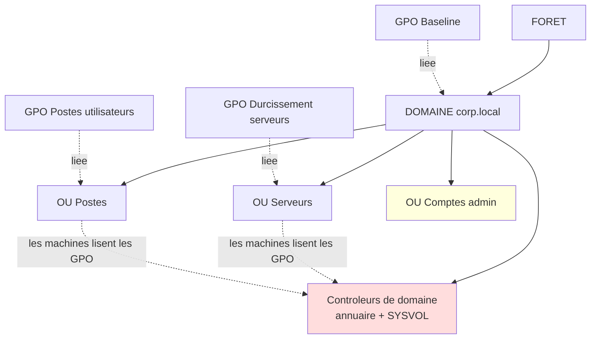

# Systèmes d'exploitation et sécurité des postes et serveurs

## Objectifs pédagogiques

À la fin de ce module, vous saurez :

- **Identifier** les éléments d'un système Linux et Windows qu'un attaquant exploite après un premier accès : processus, services, comptes, permissions.
- **Auditer** les privilèges d'un compte sur Linux (`sudo`, SUID, capabilities) et sur Windows (groupes, privilèges du jeton, appartenance à Domain Admins).
- **Expliquer** le rôle d'un domaine Active Directory et d'une GPO, et repérer les droits qui permettent de les détourner.
- **Configurer** la journalisation Windows et Linux pour que les événements utiles à une investigation existent réellement.
- **Concevoir** une politique de correctifs et de sauvegarde qui survit à un ransomware, puis la tester.

## Mise en situation

Voici un scénario illustratif, assemblé à partir de schémas d'attaque courants. Les chiffres sont inventés.

Une entreprise de 300 postes exploite un serveur de fichiers Windows. Il traîne depuis quatre mois sans plusieurs correctifs de sécurité : le redémarrage « tomberait mal » en période de clôture comptable.

Un attaquant obtient un premier accès par un poste utilisateur (pièce jointe piégée) et trouve une vulnérabilité d'élévation de privilèges locale sur ce serveur. Il devient administrateur local, puis lit la mémoire du processus LSASS* pendant qu'une session du compte `svc-backup` est ouverte. Ce compte de service a été ajouté à **Domain Admins** « pour que la sauvegarde ne rate plus jamais un dossier ».

Avec ce compte, l'attaquant :

1. se connecte au contrôleur de domaine ;
2. crée une GPO qui déploie un exécutable chiffrant sur tous les postes et serveurs ;
3. supprime les copies shadow, puis efface les jobs du serveur de sauvegarde, qui était lui aussi membre du domaine et administré par le même compte.

Le chiffrement démarre à 3 h du matin. Aucun antivirus n'a hurlé : tout a été fait avec des comptes légitimes et des outils d'administration. Au matin, il n'y a plus de sauvegarde exploitable.

Aucune des étapes n'est exotique. Chacune repose sur une faiblesse ordinaire : un correctif en retard, un compte sur-privilégié, une sauvegarde accessible depuis le même périmètre d'administration. Le scénario de synthèse, en fin de module, reprend cette chaîne étape par étape.

*\*LSASS (Local Security Authority Subsystem Service) : processus Windows qui conserve en mémoire des secrets liés aux sessions ouvertes, ce qui en fait la cible classique de mimikatz.*

## Surface d'attaque d'un poste et d'un serveur

Après un premier accès, l'attaquant ne cherche pas une faille « réseau ». Il regarde ce que le système lui offre localement.

| Vecteur | Exposition | Impact potentiel |
|---|---|---|
| Service exécuté avec un compte puissant (SYSTEM, root) | Un service web, une base ou un agent vulnérable donne directement ce niveau | Compromission totale de la machine |
| Binaires SUID et capabilities (Linux) | Exécutables qui tournent avec les droits de leur propriétaire | Escalade locale vers root (ex. PwnKit, CVE-2021-4034, dans `pkexec`) |
| `sudo` trop permissif | Règle `NOPASSWD: ALL` ou autorisation d'un éditeur/interpréteur | Shell root immédiat |
| Privilèges de jeton Windows (`SeImpersonatePrivilege`, `SeDebugPrivilege`) | Souvent accordés aux comptes de services web ou SQL | Passage à SYSTEM avec PrintSpoofer ou GodPotato |
| Comptes privilégiés connectés sur des machines peu protégées | Secrets en mémoire de postes ou serveurs secondaires | Vol de session, mouvement latéral |
| Droits d'écriture sur une GPO ou sur SYSVOL | Délégation trop large, ancien héritage | Exécution de code sur toutes les machines ciblées |
| Correctifs manquants | Noyau, composants Windows, services exposés | Exploits publics (EternalBlue, PrintNightmare CVE-2021-34527, Dirty Pipe CVE-2022-0847) |
| Sauvegardes accessibles avec les mêmes identifiants | Même domaine, même compte admin | Impossible de restaurer après un ransomware |

### Comment les deux systèmes sont construits

Les deux familles partagent le même modèle de base : un noyau en mode privilégié, des processus en espace utilisateur, et un moyen de décider qui a le droit de faire quoi. Les mécanismes diffèrent.

| Aspect | Linux | Windows |
|---|---|---|
| Identité d'un processus | UID/GID numériques | SID (Security Identifier) du compte et des groupes, regroupés dans un jeton d'accès |
| Services | Unités `systemd` (`/etc/systemd/system`, `/usr/lib/systemd/system`) | Service Control Manager, services déclarés dans le registre |
| Permissions fichiers | `rwx` propriétaire/groupe/autres, ACL POSIX en option | ACL NTFS avec héritage, entrées `Allow`/`Deny` |
| Pouvoirs spéciaux | `root` (UID 0), capabilities | Privilèges du jeton (`SeDebugPrivilege`, `SeBackupPrivilege`…) |
| Journaux | `journald`, fichiers `/var/log`, `auditd` | Journaux d'événements (Security, System, Application) |
| Configuration centralisée | Outils externes (Ansible, Puppet…) | GPO via Active Directory, Intune pour le cloud |

> 🧠 **Concept clé** : sous Windows, le droit d'agir ne dépend pas seulement de l'appartenance à un groupe, mais aussi des **privilèges** présents dans le jeton du processus. Un compte non administrateur qui possède `SeImpersonatePrivilege` peut souvent atteindre SYSTEM. Auditer les groupes ne suffit donc pas.
{: .callout .callout-important}

> 🎫 **Analogie : le jeton d'accès, un badge d'entreprise.** Chaque processus Windows porte un badge qui indique qui il est (SID du compte et des groupes) et ce qu'il peut faire (privilèges). Le système lit le badge, pas l'intention de celui qui le porte. Limite de l'image : un vrai badge se prête difficilement, alors qu'un processus qui détient `SeImpersonatePrivilege` peut emprunter le jeton d'un autre.
{: .callout .callout-analogie}

## Comptes, groupes et privilèges : de l'accès local à l'administration complète

### Côté attaquant

Sur Linux, la première énumération tient en quelques commandes, souvent automatisées par LinPEAS :

```bash
id
sudo -l
find / -perm -4000 -type f 2>/dev/null
getcap -r / 2>/dev/null
```

Si `sudo -l` répond `(ALL) NOPASSWD: /usr/bin/vim`, l'attaquant lance `sudo vim` puis tape `:!sh`. Il obtient un shell root sans exploiter aucune vulnérabilité. Le site GTFOBins recense ce type de détournement pour des centaines de binaires légitimes.

Sur le noyau, des failles comme Dirty Pipe (CVE-2022-0847, noyau Linux 5.8 et suivants avant correctif) ou PwnKit font passer un compte quelconque à root, mais seulement si le correctif manque.

Sur Windows, l'équivalent est :

```powershell
whoami /priv
whoami /groups
net localgroup administrators
```

> 🔴 **Vecteur d'attaque** : un attaquant qui compromet un pool d'applications IIS ou un compte SQL Server hérite souvent de `SeImpersonatePrivilege`. Avec PrintSpoofer ou GodPotato, il fait authentifier un service SYSTEM auprès de son processus et récupère un jeton SYSTEM. Le compte n'est pas administrateur, mais il suffit.
{: .callout .callout-danger}

### Côté défense

> 🔒 **Contrôle de sécurité** : le principe de moindre privilège se traduit en actions précises.
{: .callout .callout-securite}

- **Un compte par usage.** L'administrateur a un compte standard pour la messagerie et un compte distinct pour l'administration. Cela coûte un second mot de passe et un peu de friction, et supprime le cas où un phishing atterrit sur une session privilégiée.
- **`sudo` ciblé.** Ne jamais autoriser un éditeur, un interpréteur ou un outil capable de lancer un shell. Écrire une règle précise par commande dans `/etc/sudoers.d/` et valider avant de quitter.
- **Services sans privilèges superflus.** Un service Linux tourne sous un utilisateur dédié. Sous Windows, préférer un compte de service géré (gMSA, group Managed Service Account) ou un compte virtuel à un compte avec mot de passe statique.
- **Administrateur local unique par machine.** LAPS (Local Administrator Password Solution) fait générer et renouveler un mot de passe distinct pour chaque poste, stocké dans l'annuaire. Windows LAPS est intégré aux versions récentes de Windows ; la disponibilité dépend du niveau de mise à jour, à vérifier. Le coût est une procédure de récupération du mot de passe pour le support.

Exemple de règle `sudo` restreinte :

```bash
# Avant : trop large
%ops ALL=(ALL) NOPASSWD: ALL

# Après : une seule action, sans shell possible
# /etc/sudoers.d/ops-nginx
%ops ALL=(root) /usr/bin/systemctl reload nginx

# Toujours valider la syntaxe, sinon sudo peut se verrouiller
sudo visudo -cf /etc/sudoers.d/ops-nginx
```

> ⚠️ **Erreur fréquente : le compte de service ajouté à un groupe puissant « pour que ça marche ».** Conséquence : toute machine où ce compte ouvre une session devient un point d'entrée vers l'administration du domaine. Correction : lister les droits réellement nécessaires. Une sauvegarde a besoin de lire des fichiers, pas de gérer l'annuaire. Sous Windows, ce besoin passe par des droits délégués limités aux serveurs sauvegardés (par exemple le groupe local *Backup Operators* d'un serveur membre), pas par Domain Admins. Sur un contrôleur de domaine, *Backup Operators* donne `SeBackupPrivilege`, qui permet de lire NTDS.dit : ce groupe y équivaut alors à une administration du domaine.
{: .callout .callout-attention}

> 💡 **Astuce** : pour auditer les comptes à UID 0 sur Linux, `awk -F: '($3==0){print $1}' /etc/passwd`. Tout résultat autre que `root` mérite une explication immédiate.
{: .callout .callout-astuce}

## Active Directory : domaine, annuaire et GPO

> 📖 **Définition.** Active Directory (AD) est le service d'annuaire de Microsoft. Il centralise les comptes, les groupes, les machines et les politiques de configuration d'un parc.
{: .callout .callout-definition}

Ses briques principales :

- le **domaine** est le périmètre administratif ;
- les **contrôleurs de domaine** (DC, Domain Controller) hébergent l'annuaire et se répliquent entre eux ;
- les **unités d'organisation** (OU, Organizational Unit) rangent les objets : on y délègue l'administration et on y applique des GPO (Group Policy Object)*.



Trois conséquences pratiques :

1. **Quiconque contrôle un DC contrôle le domaine.** L'annuaire contient les secrets de tous les comptes. Les DC se traitent comme des actifs de niveau maximal : peu de comptes, aucun usage bureautique.
2. **Domain Admins est un groupe de domaine entier.** Un membre est administrateur de chaque machine jointe. Le groupe doit rester presque vide en temps normal. Enterprise Admins et Schema Admins sont plus larges encore.
3. **Une GPO est un mécanisme de déploiement.** Elle s'applique par héritage (site, domaine, OU) et les machines la récupèrent régulièrement. Quelqu'un qui peut modifier une GPO peut exécuter du code sur toutes les machines qu'elle touche.

> 🔴 **Vecteur d'attaque** : l'outil SharpGPOAbuse ajoute une tâche planifiée immédiate ou un script de démarrage à une GPO modifiable. Aucune vulnérabilité n'est utilisée, uniquement un droit d'écriture trop généreux sur l'objet GPO, souvent hérité d'une délégation ancienne. BloodHound cartographie justement ces chemins d'attaque (qui peut modifier quoi).
{: .callout .callout-danger}

> 🔴 **Vecteur d'attaque, version historique** : avant le correctif MS14-025, les *Group Policy Preferences* permettaient de définir un mot de passe d'administrateur local dans une GPO. Il était chiffré en AES, mais la clé a été publiée par Microsoft. Le fichier XML (`cpassword`) est lisible par tout utilisateur du domaine dans SYSVOL. Beaucoup d'environnements anciens en contiennent encore des restes. Vérification :
{: .callout .callout-danger}

```powershell
findstr /S /I cpassword \\<DOMAINE>\sysvol\<DOMAINE>\policies\*.xml
```

> 🔒 **Contrôle de sécurité** : côté défense, les actions concrètes sont les suivantes.
{: .callout .callout-securite}

- Lister régulièrement les membres des groupes à privilèges : `Get-ADGroupMember "Domain Admins" -Recursive`.
- Auditer qui peut modifier les GPO, surtout celles liées à la racine du domaine ou à l'OU des DC. Le droit « Edit settings » ne devrait appartenir qu'à un petit groupe d'administrateurs.
- Garder une OU séparée pour les comptes d'administration et ne pas les laisser se connecter sur les postes bureautiques. Les stratégies de restriction de connexion (« Deny log on locally / through RDP ») se déploient par GPO.
- Activer l'audit des modifications d'objets d'annuaire pour obtenir l'événement 5136 (voir section journalisation).

Pour la suite : la façon dont les comptes prouvent leur identité (Kerberos, NTLM, MFA) est traitée dans le module suivant. Ici, on se concentre sur la structure, les droits et les politiques.

*\*GPO (Group Policy Object) : ensemble de paramètres de configuration (sécurité, registre, scripts, logiciels) rattaché à un site, un domaine ou une OU, et appliqué aux ordinateurs ou aux utilisateurs concernés.*

## Journaux d'événements : produire les traces avant d'en avoir besoin

Un journal absent ne se rattrape pas. Dans un scénario de réponse à incident, la question « qui a créé ce compte, et quand ? » n'a de réponse que si l'événement a été enregistré, conservé et non écrasé.

### Windows

Les trois journaux de base sont *Security*, *System* et *Application*. Les identifiants à connaître :

| ID | Journal | Signification | Pourquoi le surveiller |
|---|---|---|---|
| 4624 / 4625 | Security | Ouverture de session réussie / échouée | Brute force, connexions inhabituelles (type de session 3 réseau, 10 RDP) |
| 4672 | Security | Privilèges spéciaux attribués à une session | Un compte qui n'est pas censé être admin apparaît |
| 4688 | Security | Création de processus | Reconstituer les commandes lancées (si l'audit est activé) |
| 4698 | Security | Tâche planifiée créée | Persistance, déploiement par GPO |
| 4720 | Security | Compte créé | Compte de persistance |
| 4728 / 4732 / 4756 | Security | Ajout à un groupe global / local / universel | Élévation de privilèges |
| 5136 | Security | Objet d'annuaire modifié | Altération d'une GPO ou d'un groupe (audit DS Changes requis) |
| 7045 | System | Nouveau service installé | Outils d'administration à distance, persistance |
| 1102 / 104 | Security / System | Journal effacé | Effacement de traces, quasi toujours suspect |

Deux réglages sont souvent oubliés. L'audit de création de processus avec ligne de commande :

```powershell
auditpol /set /subcategory:"Process Creation" /success:enable
reg add "HKLM\SOFTWARE\Microsoft\Windows\CurrentVersion\Policies\System\Audit" /v ProcessCreationIncludeCmdline_Enabled /t REG_DWORD /d 1 /f
```

Et la taille du journal Security, qui est de 20 Mo par défaut. Sur un DC, il se remplit vite et écrase les anciens événements :

```powershell
wevtutil sl Security /ms:1073741824
```

Le coût est du stockage et du volume d'événements à traiter. En pratique, on envoie ces journaux vers un collecteur central : un attaquant avec les droits locaux peut effacer le journal de la machine, mais pas celui qui a déjà été transféré.

### Linux

Les événements d'authentification se trouvent dans `/var/log/auth.log` (Debian/Ubuntu) ou `/var/log/secure` (RHEL et dérivés), et dans `journald` :

```bash
journalctl -u ssh --since "1 hour ago"
last -a | head
lastb | head     # tentatives échouées, nécessite root
```

Pour voir ce qui touche aux comptes et aux droits, `auditd` est l'outil adapté :

```bash
# /etc/audit/rules.d/identity.rules
-w /etc/passwd -p wa -k identity
-w /etc/shadow -p wa -k identity
-w /etc/sudoers -p wa -k sudoers
-w /etc/sudoers.d/ -p wa -k sudoers
```

```bash
sudo augenrules --load
sudo ausearch -k identity -ts today
```

> ⚠️ Journaliser chaque `execve` de l'espace utilisateur donne une vision précieuse, mais génère un volume important sur un serveur actif. Sur un serveur de production, commencer par les fichiers d'identité et les exécutions de root, puis élargir en mesurant l'impact disque et CPU.
{: .callout .callout-attention}

> 🔒 **Contrôle de détection** : trois règles à valeur immédiate, quel que soit l'outil de corrélation :
>
> - Événement 1102 ou 104 : alerte immédiate.
> - 4728/4732/4756 sur un groupe privilégié en dehors d'une fenêtre de changement : alerte.
> - Commande contenant `vssadmin delete shadows`, `wbadmin delete catalog` ou `bcdedit ... recoveryenabled no` dans les événements 4688 : alerte critique, c'est le geste habituel qui précède un chiffrement.
{: .callout .callout-securite}

## Mises à jour, correctifs et durcissement

### Pourquoi le retard coûte cher

WannaCry (mai 2017) a exploité la vulnérabilité SMB MS17-010, dont le correctif existait depuis mars 2017. Les machines atteintes n'étaient pas victimes d'une attaque inconnue, mais d'un retard d'application. Le même schéma revient avec PrintNightmare (CVE-2021-34527), Zerologon (CVE-2020-1472) ou, sur Linux, sudo (Baron Samedit, CVE-2021-3156).

Pourquoi ces retards ? Pas par ignorance : la contrainte réelle, c'est le redémarrage, le risque de régression et l'accord du métier.

### Appliquer des correctifs sans casser la production

- **Anneaux de déploiement.** Un petit groupe de postes et de serveurs de test reçoit les mises à jour en premier, puis un groupe pilote, puis le reste. Sous Windows, cela se pilote avec WSUS, Intune ou Windows Update for Business ; sous Linux, avec un dépôt interne ou un orchestrateur.
- **Délais adaptés à l'exposition.** Un serveur exposé à Internet ou une vulnérabilité exploitée activement se traite en jours. Un serveur interne isolé peut suivre le cycle mensuel. Ces délais sont une décision de gestion du risque, à documenter, pas une constante.
- **Redémarrages.** Sous Linux, `needrestart` indique quels services utilisent encore des bibliothèques périmées ; le live patching du noyau existe selon la distribution, mais ne couvre pas tout. Sous Windows, un correctif non redémarré n'est souvent pas actif.

Vérifications rapides :

```powershell
Get-HotFix | Sort-Object InstalledOn -Descending | Select-Object -First 10
```

```bash
apt list --upgradable 2>/dev/null
sudo needrestart -r l
```

Sur Linux, activer les mises à jour de sécurité automatiques (`unattended-upgrades` sur Debian/Ubuntu, `dnf-automatic` sur RHEL) pour les serveurs non critiques est généralement un bon compromis. Pour les serveurs critiques, on préfère un déploiement planifié et testé.

### Durcir : réduire ce qui existe

> 📖 **Définition.** Le durcissement consiste à retirer ou verrouiller ce qui n'est pas nécessaire.
{: .callout .callout-definition}

Les référentiels de départ sont les **CIS Benchmarks** (Center for Internet Security) et les Security Baselines de Microsoft. Les benchmarks CIS proposent deux profils :

- **Level 1** : peu d'impact fonctionnel ;
- **Level 2** : plus strict, avec un risque de casser des applications.

Appliquer Level 2 d'un coup sur un parc existant est la façon la plus sûre de provoquer un incident auto-infligé : on teste sur un échantillon, on déploie par anneaux, on documente les exceptions.

**Windows** (via GPO ou Intune, l'interface varie selon la version) :

- désactiver SMBv1 : `Set-SmbServerConfiguration -EnableSMB1Protocol $false` ;
- déployer LAPS pour les administrateurs locaux ;
- activer le pare-feu Windows sur les trois profils, avec règles entrantes minimales ;
- chiffrer les postes avec BitLocker (vol ou perte de machine) ;
- activer les règles ASR (Attack Surface Reduction) de Defender en mode audit d'abord, puis blocage ;
- retirer les droits d'administration locale aux utilisateurs métier.

**Linux** :

- supprimer ou désactiver les services inutiles (`systemctl list-units --type=service --state=running`) ;
- vérifier les ports d'écoute avec `ss -tulpn` et comparer à ce qui est attendu ;
- pour SSH, `PermitRootLogin no` et un accès limité aux comptes nécessaires (le détail de l'authentification est vu au module suivant) ;
- contraindre chaque service avec les options `systemd`.

Exemple d'unité `systemd` durcie :

```ini
# /etc/systemd/system/<SERVICE>.service.d/hardening.conf
[Service]
User=<SERVICE_USER>
NoNewPrivileges=true
ProtectSystem=strict
ProtectHome=true
PrivateTmp=true
ReadWritePaths=/var/lib/<SERVICE>
```

```bash
sudo systemctl daemon-reload && sudo systemctl restart <SERVICE>
systemd-analyze security <SERVICE>
```

Le coût : un service qui écrit ailleurs que prévu échouera. Il faut tester, lire `journalctl -u <SERVICE>` et ajuster `ReadWritePaths`.

> ⚠️ **Erreur fréquente : durcir à la main, serveur par serveur.** Conséquence : dérive de configuration, une machine « oubliée » ouvre la porte. Correction : porter le durcissement dans une GPO, un rôle Ansible ou une image de base, et mesurer l'écart avec un outil d'audit (voir section tests).
{: .callout .callout-attention}

## Sauvegardes et restauration : ce qui reste quand le reste est chiffré

Les opérateurs de ransomware ne s'en tiennent plus aux fichiers de production : ils cherchent les sauvegardes. Leurs gestes classiques :

- `vssadmin delete shadows /all /quiet` pour supprimer les copies shadow Windows ;
- `wbadmin delete catalog -quiet` pour effacer le catalogue de sauvegarde Windows ;
- l'arrêt ou la suppression des jobs de la console de sauvegarde.

Si la console se connecte avec un compte du domaine compromis, l'attaquant dispose de tout ce qu'il faut.

Une sauvegarde utile répond à quatre exigences :

1. **Isolée.** Au moins une copie hors de portée des identifiants du domaine : stockage immuable (WORM, verrouillage d'objets), copie hors ligne ou compte dédié sans droits d'effacement. Le serveur de sauvegarde ne devrait pas dépendre du même cercle d'administrateurs que la production.
2. **Complète pour ce qui compte.** Données, mais aussi configuration du système et, pour AD, au moins deux DC sauvegardés (état du système). Restaurer un domaine est une procédure à part entière, avec ses pièges (restauration faisant autorité ou non) ; elle se répète en laboratoire avant le jour où elle sert.
3. **Dimensionnée par des objectifs.** Le RPO (Recovery Point Objective) est la quantité de données qu'on accepte de perdre. Le RTO (Recovery Time Objective) est le temps maximal de remise en service. Ces valeurs viennent du métier, pas de l'équipe technique : restaurer 20 To depuis un stockage froid peut prendre plusieurs jours.
4. **Testée.** Une sauvegarde jamais restaurée est une hypothèse.

> 🔑 **Moyen mnémotechnique** : le RPO regarde en arrière, vers le dernier **P**oint de sauvegarde (les données perdues). Le RTO regarde en avant, vers le **T**emps nécessaire pour repartir.
{: .callout .callout-memo}

Exemple avec `restic` sur Linux (principe identique avec d'autres outils) :

```bash
export RESTIC_REPOSITORY=<REPO>
export RESTIC_PASSWORD_FILE=<FICHIER_MOT_DE_PASSE>

restic backup /etc /var/www /var/lib/<SERVICE>
restic check
restic restore latest --target /tmp/restore-test --include /etc/nginx
```

Sous Windows Server, la sauvegarde de l'état du système d'un DC peut s'obtenir avec `wbadmin start systemstatebackup -backupTarget:<LECTEUR>:` (l'outil disponible dépend de la version et du rôle installé).

> 💡 **Astuce** : planifier un test de restauration trimestriel d'un système réel, avec chronométrage, et comparer le résultat au RTO annoncé. L'écart est presque toujours désagréable, et il vaut mieux le découvrir un mardi.
{: .callout .callout-astuce}

## Tester ce qui a été mis en place

Après chaque modification, vérifier au lieu de supposer.

```bash
# Linux : audit global de durcissement (score + suggestions)
sudo lynis audit system

# Quels services sont réellement contraints par systemd
systemd-analyze security

# Ports en écoute
ss -tulpn

# SUID inattendus
find / -perm -4000 -type f 2>/dev/null
```

```powershell
# Windows : SMBv1 désactivé ?
Get-SmbServerConfiguration | Select-Object EnableSMB1Protocol

# Qui est administrateur local ?
Get-LocalGroupMember -Group Administrators

# Qui est Domain Admin, y compris par imbrication ?
Get-ADGroupMember -Identity "Domain Admins" -Recursive | Select-Object Name, SamAccountName

# Quelles GPO s'appliquent réellement à cette machine ?
gpresult /h C:\Temp\gpo-report.html
```

Pour l'AD, PingCastle produit un rapport de risques (comptes obsolètes, délégations, groupes privilégiés) et BloodHound montre les chemins d'attaque entre un compte quelconque et Domain Admins. Ces outils sont utilisés par les attaquants comme par les défenseurs, et ne se lancent que sur un périmètre pour lequel on a une autorisation écrite (cadre vu dans les modules de gouvernance et d'audit).

## Scénario de synthèse : lire l'incident à l'envers

Reprenons le scénario d'ouverture. Voici ce que chaque contrôle aurait changé, en pratique :

| Étape de l'attaque | Contrôle qui aurait coupé la chaîne | Coût |
|---|---|---|
| Élévation locale sur le serveur de fichiers | Correctifs appliqués dans un délai défini, anneaux de test | Redémarrage planifié, un peu de gestion de changement |
| Vol de secrets en mémoire | Comptes d'administration limités à des machines dédiées, pas de session admin sur les serveurs ordinaires | Deux comptes par administrateur, discipline d'usage |
| `svc-backup` dans Domain Admins | Droits dédiés à la sauvegarde, jamais de groupe d'administration du domaine | Une analyse des droits réels à faire une fois |
| Création d'une GPO malveillante | Droits GPO limités, alerte sur 5136 et 4698 | Activer l'audit DS Changes, trier le bruit |
| Suppression des shadow copies | Alerte sur les commandes de suppression dans 4688 | Activer l'audit des processus avec ligne de commande |
| Perte des sauvegardes | Copie immuable ou hors domaine, test de restauration | Stockage supplémentaire, coût d'un second outil ou service |

Aucune ligne n'exige un produit exotique. Chacune demande une décision de priorité et un propriétaire.

## Erreurs fréquentes

> ⚠️ **`NOPASSWD: ALL` dans sudoers pour un groupe entier.**
{: .callout .callout-attention}

Conséquence : n'importe quel compte du groupe compromis devient root sans friction ni trace d'authentification supplémentaire.
Correction : règles par commande exacte dans `/etc/sudoers.d/`, sans éditeur ni interpréteur. Détecter avec `sudo -l -U <UTILISATEUR>` et `grep -r NOPASSWD /etc/sudoers /etc/sudoers.d/`.

> ⚠️ **Compte de service avec un mot de passe statique et des droits de domaine.**
{: .callout .callout-attention}

Conséquence : le mot de passe se retrouve dans un script, un fichier de config ou un partage, et le compte ouvre des sessions partout.
Correction : gMSA quand l'application le supporte, sinon mot de passe long dans un coffre avec rotation, et droits limités. Rechercher : `Get-ADUser -Filter {ServicePrincipalName -ne "$null"} -Properties MemberOf`.

> ⚠️ **Journal Security à 20 Mo sur un contrôleur de domaine.**
{: .callout .callout-attention}

Conséquence : les événements sont écrasés en quelques heures, une investigation ne trouve rien avant le jour de l'alerte.
Correction : augmenter la taille, centraliser les journaux. Vérifier : `wevtutil gl Security` (champ `maxSize`).

⚠️ **Sauvegardes sur un partage accessible par le compte d'administration du domaine.**

Conséquence : le ransomware chiffre aussi les sauvegardes, ou un attaquant les supprime.
Correction : copie immuable ou hors domaine, compte de suppression distinct. Test simple : depuis un poste admin du domaine, tenter de supprimer un fichier de sauvegarde ; si ça marche, l'attaquant le pourra aussi.

⚠️ **Appliquer un benchmark CIS Level 2 sur tout le parc en une fois.**

Conséquence : applications métier cassées, désactivation des règles « pour que ça marche », durcissement abandonné.
Correction : démarrer par Level 1, mode audit, anneau pilote, exceptions documentées.

⚠️ **Admin local au mot de passe identique sur tous les postes.**

Conséquence : un seul poste compromis donne l'accès administrateur à tous les autres.
Correction : LAPS. Détecter en comparant les hachages des comptes locaux lors d'un audit autorisé, ou simplement en demandant au support comment il se connecte en urgence.

## Résumé

Un système compromis se défend par ses fondations : comptes, privilèges, correctifs, journaux et sauvegardes. L'attaquant exploite d'abord un retard de correctif ou un compte trop puissant, puis monte jusqu'à l'annuaire, où une GPO lui sert de mécanisme de déploiement. La défense repose sur le moindre privilège (comptes dédiés, `sudo` ciblé, gMSA, LAPS), un domaine AD aux groupes privilégiés quasi vides, et des GPO modifiables par très peu de personnes. Elle exige aussi des journaux dimensionnés et centralisés, des correctifs appliqués par anneaux, un durcissement progressif depuis les benchmarks CIS, et des sauvegardes isolées dont la restauration est testée. Restent à surveiller : la dérive des groupes privilégiés, les droits hérités sur les GPO, l'écart entre RTO annoncé et RTO réel, et les nouvelles vulnérabilités d'élévation locale.

<!-- snippet
id: linux_suid_find_audit
type: command
tech: linux
level: intermediate
importance: high
format: knowledge
tags: linux,suid,escalade,audit
title: Lister les binaires SUID d'un système Linux
command: find / -perm -4000 -type f 2>/dev/null
description: Liste les exécutables qui tournent avec les droits de leur propriétaire (souvent root) ; tout binaire inattendu ou ancien est un candidat à l'escalade locale
-->

<!-- snippet
id: linux_sudo_nopasswd_warning
type: warning
tech: linux
level: intermediate
importance: high
format: knowledge
tags: linux,sudo,privileges,gtfobins
title: sudo NOPASSWD sur un éditeur ou un interpréteur
content: Une règle sudo autorisant vim, less, find ou python sans restriction donne un shell root : `sudo vim` puis `:!sh`. Conséquence : compromission d'un compte standard = root. Correction : n'autoriser que des commandes précises sans échappement shell, dans /etc/sudoers.d/, et valider avec `visudo -cf <FICHIER>`.
description: Un binaire autorisé via sudo peut lancer un shell (voir GTFOBins) ; l'autorisation doit viser une commande exacte, pas un outil généraliste
-->

<!-- snippet
id: linux_sudo_list_user_audit
type: command
tech: linux
level: beginner
importance: medium
format: knowledge
tags: linux,sudo,audit,privileges
title: Voir ce qu'un utilisateur peut faire avec sudo
command: sudo -l -U <UTILISATEUR>
example: sudo -l -U deploy
description: Affiche les commandes autorisées via sudo pour un compte ; première vérification lors d'un audit de privilèges ou d'une énumération post-accès
-->

<!-- snippet
id: systemd_hardening_analyze_security
type: command
tech: systemd
level: intermediate
importance: medium
format: knowledge
tags: linux,systemd,durcissement,services
title: Mesurer l'exposition d'un service systemd
command: systemd-analyze security <SERVICE>
example: systemd-analyze security nginx.service
description: Attribue un score d'exposition au service et liste les options d'isolation manquantes (NoNewPrivileges, ProtectSystem, PrivateTmp) à ajouter dans un drop-in
-->

<!-- snippet
id: windows_seimpersonate_concept
type: concept
tech: windows
level: advanced
importance: high
format: knowledge
tags: windows,privileges,escalade,jeton
title: SeImpersonatePrivilege : du compte de service à SYSTEM
content: Les comptes de services web ou SQL possèdent souvent SeImpersonatePrivilege dans leur jeton. Avec PrintSpoofer ou GodPotato, l'attaquant force un service SYSTEM à s'authentifier auprès de son processus et récupère un jeton SYSTEM. Vérifier avec `whoami /priv` ; réduire en utilisant des comptes virtuels ou gMSA et en isolant les services exposés.
description: Un compte non administrateur peut atteindre SYSTEM par un privilège de jeton ; auditer les groupes ne suffit pas, il faut lire whoami /priv
-->

<!-- snippet
id: windows_whoami_priv_check
type: command
tech: windows
level: beginner
importance: medium
format: knowledge
tags: windows,privileges,audit,jeton
title: Lister les privilèges du jeton d'un processus Windows
command: whoami /priv
description: Affiche les privilèges accordés (SeDebugPrivilege, SeImpersonatePrivilege, SeBackupPrivilege…) et leur état ; certains permettent une escalade sans être administrateur
-->

<!-- snippet
id: ad_domain_admins_recursive_audit
type: command
tech: active-directory
level: intermediate
importance: high
format: knowledge
tags: active-directory,domain-admins,audit,privileges
title: Lister les Domain Admins y compris par imbrication
command: Get-ADGroupMember -Identity "Domain Admins" -Recursive | Select-Object Name, SamAccountName
description: Révèle les comptes privilégiés cachés dans des groupes imbriqués ; le résultat attendu est une liste très courte, chaque compte justifié
-->

<!-- snippet
id: ad_gpo_write_permission_concept
type: concept
tech: active-directory
level: advanced
importance: high
format: knowledge
tags: active-directory,gpo,privileges,sharpgpoabuse
title: Droit d'écriture sur une GPO = exécution sur tout son périmètre
content: Une GPO liée à une OU est appliquée à toutes les machines de cette OU. Un compte ayant le droit de la modifier peut y ajouter une tâche planifiée ou un script (outil SharpGPOAbuse) et exécuter du code sur chaque machine concernée, sans vulnérabilité. Auditer les ACL des GPO et alerter sur l'événement 5136.
description: Le détournement de GPO utilise un droit d'écriture trop large, souvent hérité ; BloodHound montre ces chemins et l'événement 5136 permet de les détecter
-->

<!-- snippet
id: ad_gpp_cpassword_sysvol_search
type: command
tech: active-directory
level: intermediate
importance: high
format: knowledge
tags: active-directory,sysvol,gpp,secrets
title: Chercher des mots de passe GPP résiduels dans SYSVOL
command: findstr /S /I cpassword \\<DOMAINE>\sysvol\<DOMAINE>\policies\*.xml
example: findstr /S /I cpassword \\corp.local\sysvol\corp.local\policies\*.xml
description: Les Group Policy Preferences d'avant MS14-025 stockaient des mots de passe déchiffrables par n'importe quel utilisateur du domaine ; tout résultat est à supprimer et à renouveler
-->

<!-- snippet
id: windows_log_cleared_event_detect
type: tip
tech: windows
level: intermediate
importance: high
format: knowledge
tags: windows,journaux,detection,evenements
title: Alerter sur l'effacement des journaux Windows
content: Créer une alerte immédiate sur l'événement 1102 (journal Security effacé) et 104 (journal System effacé) dans votre collecteur de logs. Il est rarement légitime en production et signale souvent un attaquant qui nettoie ses traces. Transférer les journaux vers un serveur central pour qu'une copie survive à l'effacement local.
description: L'effacement d'un journal génère lui-même un événement ; l'alerte n'a de valeur que si les logs sont déjà exportés hors de la machine
-->

<!-- snippet
id: windows_process_creation_cmdline_audit
type: command
tech: windows
level: intermediate
importance: high
format: knowledge
tags: windows,audit,4688,journalisation
title: Activer l'audit des processus avec ligne de commande
command: reg add "HKLM\SOFTWARE\Microsoft\Windows\CurrentVersion\Policies\System\Audit" /v ProcessCreationIncludeCmdline_Enabled /t REG_DWORD /d 1 /f
context: À combiner avec auditpol /set /subcategory:"Process Creation" /success:enable, ou à déployer par GPO
description: Ajoute la commande complète dans les événements 4688 ; sans elle, impossible de voir un `vssadmin delete shadows` ou un PowerShell encodé
-->

<!-- snippet
id: linux_auditd_identity_watch
type: tip
tech: linux
level: intermediate
importance: medium
format: knowledge
tags: linux,auditd,journalisation,identite
title: Surveiller passwd, shadow et sudoers avec auditd
content: Dans /etc/audit/rules.d/identity.rules, ajouter `-w /etc/passwd -p wa -k identity`, la même ligne pour /etc/shadow, puis `-w /etc/sudoers -p wa -k sudoers` et `-w /etc/sudoers.d/ -p wa -k sudoers`. Charger avec `augenrules --load` et consulter avec `ausearch -k identity -ts today`. Coût négligeable, car ces fichiers changent rarement.
description: Toute écriture sur les fichiers de comptes et de droits génère un événement horodaté avec l'utilisateur à l'origine, utile pour dater une persistance
-->

<!-- snippet
id: windows_shadow_delete_ransomware_detect
type: concept
tech: windows
level: advanced
importance: high
format: knowledge
tags: windows,ransomware,detection,sauvegarde
title: Suppression des shadow copies : signal précurseur de ransomware
content: Avant de chiffrer, beaucoup de ransomwares exécutent `vssadmin delete shadows /all /quiet`, `wbadmin delete catalog -quiet` ou `bcdedit /set {default} recoveryenabled no` pour empêcher la restauration locale. Avec l'audit 4688 incluant la ligne de commande, une alerte sur ces chaînes donne souvent quelques minutes d'avance avant le chiffrement massif.
description: Ces trois commandes détruisent les points de restauration locaux ; leur présence dans 4688 hors d'un contexte d'administration connu justifie un isolement immédiat
-->

<!-- snippet
id: backup_restore_test_tip
type: tip
tech: restic
level: intermediate
importance: high
format: knowledge
tags: sauvegarde,restauration,rto,ransomware
title: Tester la restauration, pas seulement la sauvegarde
content: Chaque trimestre, restaurer un système réel dans un environnement isolé et chronométrer. Avec restic, `restic check` valide le dépôt et `restic restore latest --target <DOSSIER> --include <CHEMIN>` restaure un sous-ensemble. Comparer le temps mesuré au RTO annoncé au métier, et vérifier qu'une copie est hors de portée des comptes du domaine.
description: Une sauvegarde jamais restaurée est une hypothèse ; le test révèle les écarts de RTO, les données manquantes et les dépendances d'accès au domaine
-->

<!-- snippet
id: windows_smb1_disable_check
type: command
tech: windows
level: beginner
importance: medium
format: knowledge
tags: windows,smb,durcissement,eternalblue
title: Vérifier que SMBv1 est désactivé
command: Get-SmbServerConfiguration | Select-Object EnableSMB1Protocol
description: SMBv1 est le protocole exploité par EternalBlue (MS17-010) ; la valeur attendue est False, sinon désactiver avec Set-SmbServerConfiguration -EnableSMB1Protocol $false
-->

<!-- snippet
id: windows_laps_local_admin_warning
type: warning
tech: windows
level: intermediate
importance: high
format: knowledge
tags: windows,laps,administrateur-local,mouvement-lateral
title: Mot de passe administrateur local identique sur tous les postes
content: Si le compte administrateur local a le même mot de passe sur chaque poste (image de base), un seul poste compromis donne l'accès administrateur à tout le parc. Correction : déployer LAPS pour générer un mot de passe unique par machine, stocké dans l'annuaire et renouvelé automatiquement.
description: Le même secret local partout transforme un poste compromis en accès à toute la flotte ; LAPS limite le périmètre d'une compromission à une seule machine
-->
