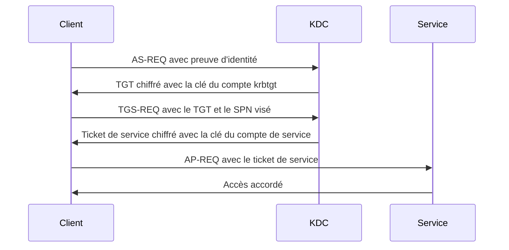
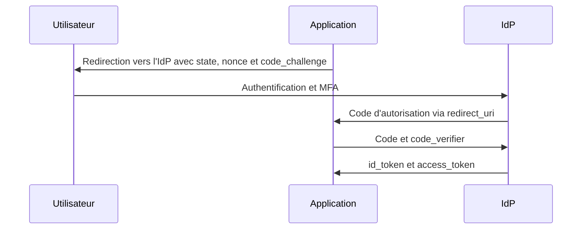

# Identité, authentification et contrôle d'accès

## Objectifs pédagogiques

À la fin de ce module, vous saurez :

- **distinguer** identification, authentification et autorisation, et situer sur laquelle des trois porte une faille donnée ;
- **comparer** les méthodes d'authentification (mot de passe, MFA (Multi-Factor Authentication), passkeys) selon les attaques auxquelles elles résistent ;
- **expliquer** le déroulé de Kerberos et **identifier** pourquoi Kerberoasting et AS-REP roasting fonctionnent ;
- **différencier** OAuth 2.0, OpenID Connect et SAML, et **repérer** une implémentation qui utilise OAuth comme preuve d'identité ;
- **auditer** les comptes privilégiés, les comptes de service et le cycle de vie des accès d'un annuaire avec des commandes précises.

## Mise en situation

*Scénario illustratif, chiffres fictifs.* Une entreprise industrielle de 800 postes protège son VPN par mot de passe et notification push sur smartphone. Sa politique impose un changement de mot de passe tous les 90 jours.

Un commercial a installé un utilitaire piégé sur son poste personnel. Un infostealer en a exfiltré les identifiants enregistrés dans le navigateur, et ils se retrouvent en vente dans un lot de logs. L'attaquant se connecte au VPN à 2 h du matin. L'utilisateur reçoit une vingtaine de notifications, dort mal, et finit par en accepter une pour que ça s'arrête. Ce schéma de fatigue MFA a été documenté publiquement dans plusieurs incidents, dont celui d'Uber en 2022.

Une fois dans le réseau avec un simple compte de domaine, l'attaquant liste les comptes porteurs d'un SPN (Service Principal Name). Il demande leurs tickets Kerberos et les casse hors ligne. Le compte `svc_backup` avait comme mot de passe `Backup2019!`, devenu `Backup2020!` à la rotation suivante, et il était membre de `Domain Admins`. Il tombe en quelques minutes. L'attaquant contrôle le domaine avant le petit-déjeuner de l'équipe IT.

Chaque défense « naïve » de ce scénario existait :

- La rotation à 90 jours n'a rien empêché : elle a produit des mots de passe prévisibles.
- Le MFA protégeait l'entrée VPN, mais pas la demande de ticket Kerberos interne.
- Le MFA push est approuvable par l'utilisateur, donc par celui qui le harcèle.
- Les comptes de service n'ont par nature aucun second facteur.

Ce module détaille chaque maillon de cette chaîne.

## Trois questions, trois mécanismes différents

> 🧠 **Concept clé**
>
> Un système d'accès répond à trois questions successives, et chacune a ses propres failles.
{: .callout .callout-important}

| Question | Nom | Mécanisme typique | Où ça casse |
|---|---|---|---|
| Qui prétend être là ? | Identification | Login, e-mail, identifiant de certificat | Énumération de comptes (messages d'erreur différents selon que le compte existe) |
| Peut-il le prouver ? | Authentification | Facteur de connaissance, de possession ou d'inhérence | Vol, devinette, relais, contournement du facteur |
| Que peut-il faire ? | Autorisation | Rôles, groupes, ACL, politiques, scopes | Droits excédentaires, contrôle absent côté serveur |

> 🔑 **Moyen mnémotechnique**
>
> Les trois catégories de facteurs tiennent en une formule classique. « Ce que je sais » correspond à la connaissance (mot de passe, PIN). « Ce que j'ai » correspond à la possession (clé matérielle, téléphone). « Ce que je suis » correspond à l'inhérence (empreinte, visage).
{: .callout .callout-memo}

Deux mots de passe, ou un mot de passe et une question secrète, ne font **pas** du MFA : ce sont deux fois la même catégorie.

Le contrôle d'accès, c'est l'application effective de l'autorisation, plus la traçabilité de ce qui a été fait. Une authentification parfaite ne corrige aucune faille d'autorisation. Un compte légitime, protégé par une clé FIDO2, qui lit les données d'un autre client parce que l'API ne vérifie pas la propriété de l'objet, reste une faille critique.

## Surface d'attaque et modèle de menace

Les acteurs les plus probables sont des opérateurs de ransomware ou des courtiers d'accès initial, qui achètent ou volent des identifiants, puis montent en privilège par l'annuaire. L'actif central est l'annuaire (Active Directory, AD, ou le fournisseur d'identité cloud), parce qu'il décide de tout le reste.

| Vecteur | Exposition | Impact potentiel |
|---|---|---|
| Portails de connexion (VPN, webmail, SSO) | Internet | Credential stuffing et password spraying, compte utilisateur compromis |
| Notifications MFA push | Utilisateur final | Fatigue MFA, accès accordé par l'utilisateur lui-même |
| Proxy de phishing temps réel (AiTM, Evilginx) | E-mail, faux domaine | Vol du cookie de session après MFA validé |
| Comptes de service avec SPN | Tout compte authentifié du domaine | Kerberoasting, souvent compte privilégié |
| Comptes sans préauthentification Kerberos | Réseau interne | AS-REP roasting |
| LDAP en clair ou bind anonyme | Port 389 interne | Énumération, interception, relais d'authentification |
| Clients OAuth mal configurés | Applications web | Vol de code ou de jeton via `redirect_uri` |
| Assertions SAML et clés de signature | Fournisseur d'identité | Forge d'assertion, accès à toutes les applications fédérées |
| Comptes admin permanents | Groupes AD privilégiés | Compromission totale en un seul vol de credential |
| Comptes d'anciens employés et jetons persistants | Processus départ | Accès légitime en apparence, longue durée |

## Authentifier : mot de passe, MFA, passkeys

### Ce que fait l'attaquant avec un mot de passe

Deux techniques dominent, et elles n'ont rien de sophistiqué.

> 🔴 **Vecteur d'attaque : credential stuffing**
>
> L'attaquant rejoue des couples login/mot de passe issus de fuites sur d'autres sites. Il compte sur la réutilisation. Des outils d'automatisation comme OpenBullet existent pour ça, et le trafic ressemble à des connexions normales réparties sur des milliers d'adresses IP.
{: .callout .callout-danger}

> 🔴 **Vecteur d'attaque : password spraying**
>
> À l'inverse du brute force classique, on teste **un seul** mot de passe plausible (`Printemps2025!`, `<Entreprise>2025`) contre **tous** les comptes. Le verrouillage après 5 échecs par compte ne se déclenche jamais. Des outils comme Kerbrute (`passwordspray`) ou MSOLSpray font ça sur Kerberos ou sur Microsoft 365.
{: .callout .callout-danger}

La recommandation du NIST (SP 800-63B) va à l'opposé de nombreuses politiques d'entreprise :

- privilégier la longueur plutôt que les règles de composition ;
- comparer les mots de passe choisis à des listes de mots de passe compromis ;
- ne pas imposer de rotation périodique sans soupçon de compromission.

Pourquoi renoncer à la rotation ? Parce que la rotation forcée pousse les utilisateurs à incrémenter un suffixe, ce qui est exactement ce que le spraying exploite. La contrepartie est un coût d'intégration : brancher un contrôle de listes compromises (par exemple via un filtre de mots de passe AD ou un service tiers) demande un projet, pas un simple réglage.

### MFA : tous les seconds facteurs ne se valent pas

| Méthode | Ce qui la casse | Résiste au phishing temps réel ? |
|---|---|---|
| SMS | Échange de carte SIM (SIM swap), interception, phishing | Non |
| TOTP (Time-based One-Time Password) | Relais du code dans les 30 s par un proxy AiTM | Non |
| Push simple | Fatigue MFA (spam de notifications) | Non |
| Push avec number matching | Réduit la fatigue, mais pas le relais AiTM | Non |
| FIDO2 / passkey | Vol de l'appareil, compromission du processus de récupération | **Oui** |

> ⚠️ **Erreur fréquente**
>
> Croire que « MFA activé » est une propriété binaire. Un proxy Evilginx placé entre la victime et le vrai site transmet le mot de passe, puis le code TOTP, puis récupère le cookie de session émis après validation. Le MFA a fonctionné, mais l'attaquant possède la session.
{: .callout .callout-attention}

### Passkeys : pourquoi elles changent la donne

Une passkey repose sur WebAuthn (Web Authentication) et FIDO2. À l'inscription, l'authentificateur crée une paire de clés **propre au site**. La clé publique est enregistrée côté serveur, la clé privée ne quitte pas l'authentificateur. À la connexion, le serveur envoie un défi. L'authentificateur le signe, et le navigateur inclut l'origine réelle du site dans les données signées.

Sur un faux domaine, l'authentificateur ne trouve aucun credential pour cette origine, et une signature relayée serait invalide pour le vrai site. L'utilisateur ne peut pas se faire piéger, même s'il le veut. C'est ce qui sépare « authentification forte » (au moins deux facteurs différents) de « résistante au phishing ».

> 🔒 **Contrôle de sécurité**
>
> Déployer d'abord des clés FIDO2 ou des passkeys pour les administrateurs et les accès à risque, puis étendre. Cela évite de payer le coût de support pour 800 personnes avant d'avoir sécurisé les 15 comptes qui comptent.
{: .callout .callout-securite}

Limites à connaître avant de décider :

- Le **processus de récupération de compte** devient la cible. Si un « mot de passe oublié » par SMS contourne la passkey, l'attaquant passe par là.
- Les passkeys synchronisées déplacent une partie du risque vers le compte du fournisseur de synchronisation.
- Les applications héritières (protocoles sans navigateur) ne supportent pas WebAuthn et doivent être traitées à part.

> 💡 **Astuce**
>
> Bloquer l'authentification héritière (basic auth sur IMAP, SMTP, certains endpoints Exchange). Elle ne supporte pas le MFA et contourne donc toute politique que vous venez de déployer.
{: .callout .callout-astuce}

## Où vivent les identités : comptes locaux, annuaires, fédération

Un **compte local** (SAM sous Windows, `/etc/passwd` sous Linux) n'existe que sur sa machine. Il n'y a ni révocation centralisée, ni journal unifié, et un mot de passe d'administrateur local identique sur 400 postes permet le mouvement latéral de l'un à l'autre. La parade est un mot de passe local unique et rotatif par machine, par exemple avec Windows LAPS.

Un **annuaire** centralise comptes, groupes et politiques. Active Directory domine en entreprise, OpenLDAP et d'autres annuaires existent côté Linux. Le protocole d'interrogation est LDAP (Lightweight Directory Access Protocol) : on se connecte (*bind*), puis on cherche (*search*) à partir d'un DN de base avec des filtres comme `(&(objectClass=user)(sAMAccountName=alice))`.

Quand plusieurs organisations ou applications doivent partager une identité sans dupliquer les comptes, on passe à la **fédération** : un fournisseur d'identité (IdP, Identity Provider) authentifie, et les applications lui font confiance. Le gain est un seul point de révocation et un MFA centralisé. Le risque est symétrique : l'IdP devient la cible qui ouvre tout.

### LDAP : trois façons de le faire mal

🔴 **Vecteur d'attaque : bind anonyme.** Si l'annuaire accepte des requêtes sans authentification, n'importe qui sur le réseau énumère utilisateurs, groupes et attributs. Test : `ldapsearch -x -H ldap://<HOST> -b "<BASE_DN>" "(objectClass=user)"`.

🔴 **Vecteur d'attaque : bind simple sur le port 389.** Le mot de passe transite en clair. Il faut LDAPS (636) ou StartTLS. Dans un domaine AD, l'attaquant peut aussi relayer une authentification NTLM vers LDAP. D'où les réglages de *LDAP signing* et de *channel binding*.

🔴 **Vecteur d'attaque : injection LDAP.** Si une application construit un filtre par concaténation, par exemple `(&(uid=<INPUT>)(userPassword=<PWD>))`, une entrée comme `*)(uid=*))(|(uid=*` peut transformer le filtre pour qu'il retourne toujours vrai. La correction est l'échappement des caractères spéciaux (`* ( ) \ NUL`), ou des filtres paramétrés par la bibliothèque.

🔒 **Contrôle de sécurité** : exiger la signature LDAP côté contrôleur de domaine. Le coût réel est la compatibilité : d'anciens équipements (imprimantes, NAS, applications maison) font du bind simple non signé. Avant de passer en « requis » :

1. relever à 2 le niveau de diagnostic « 16 LDAP Interface Events » dans le registre du contrôleur de domaine pour journaliser chaque liaison non signée (événement 2889 du journal *Directory Service* ; par défaut, seul le récapitulatif 2887 apparaît toutes les 24 h) ;
2. laisser tourner une à deux semaines ;
3. corriger les clients, puis bloquer.

## Kerberos : le mécanisme des tickets

Kerberos est le protocole d'authentification par défaut dans un domaine AD. Son principe : le mot de passe ne circule jamais sur le réseau. L'utilisateur prouve qu'il le connaît en déchiffrant quelque chose de dérivé de ce secret, et obtient des **tickets** valables pour une durée limitée.

Les tickets sont émis par le KDC*, qui tourne sur les contrôleurs de domaine.



Trois éléments à retenir :

- Le TGT (Ticket-Granting Ticket) est la preuve d'authentification réutilisable. Il est chiffré avec le secret du compte `krbtgt`, que seul le KDC connaît.
- Le ticket de service est chiffré avec le secret du **compte qui porte le SPN**.
- À cette étape, le KDC ne demande pas si l'utilisateur a le droit d'utiliser ce service : il émet le ticket, le service décidera.

C'est ce dernier point qui fonde l'attaque la plus rentable sur AD.

\* KDC (Key Distribution Center) : service Kerberos qui émet les TGT et les tickets de service, hébergé sur chaque contrôleur de domaine.

### Attaques sur Kerberos

🔴 **Kerberoasting.** Tout utilisateur authentifié peut demander un ticket pour n'importe quel SPN. Une partie de ce ticket est chiffrée avec le hash du mot de passe du compte de service. L'attaquant l'extrait (`GetUserSPNs.py` d'Impacket, `Rubeus kerberoast`) et le casse hors ligne avec hashcat (mode 13100 pour les tickets RC4). Aucun échec d'authentification n'est généré, rien ne déclenche de verrouillage, et le contrôleur de domaine ne voit qu'une demande de ticket banale. La technique a été présentée par Tim Medin en 2014 et reste efficace parce que les comptes de service ont des mots de passe humains, anciens, et parfois des droits excessifs.

🔴 **AS-REP roasting.** Les comptes avec l'option « ne pas exiger la préauthentification Kerberos » répondent à une requête non authentifiée avec une réponse chiffrée par leur secret, cassable hors ligne (hashcat mode 18200). Ces comptes sont rares, mais souvent oubliés depuis une migration.

🔴 **Silver ticket et Golden ticket.** Avec le hash d'un compte de service, on forge des tickets de service pour ce service (silver). Avec le hash de `krbtgt`, on forge des TGT pour n'importe quel utilisateur, y compris inexistant (golden), avec Mimikatz par exemple. Cette dernière persistance survit au changement de mot de passe de l'utilisateur : seule la double réinitialisation de `krbtgt` (avec un délai entre les deux, pour laisser expirer les tickets existants) la coupe.

🔒 **Contrôles de sécurité** :

- Pour les comptes de service, utiliser des gMSA (group Managed Service Accounts) : l'AD génère et fait tourner un mot de passe long et aléatoire, inatteignable par cassage hors ligne. Quand ce n'est pas possible, imposer 25 caractères aléatoires ou plus.
- Retirer les comptes de service des groupes privilégiés, ou réduire leurs droits au strict nécessaire.
- Forcer AES pour Kerberos et désactiver RC4 quand c'est possible. Contrepartie : les systèmes très anciens cesseront de s'authentifier, il faut donc inventorier avant.
- Placer les comptes d'administration dans le groupe *Protected Users*, qui désactive NTLM, RC4 et la délégation pour eux. Contrepartie : certaines applications qui reposent sur NTLM ou sur la délégation tomberont.
- Synchroniser l'heure. Kerberos tolère un écart de 5 minutes par défaut, au-delà les authentifications échouent.

## SSO, OAuth 2.0, OpenID Connect et SAML

Le SSO (Single Sign-On) évite de se reconnecter à chaque application : l'utilisateur s'authentifie une fois auprès de l'IdP, et les applications reçoivent une preuve. Trois standards se partagent ce terrain, avec des rôles différents.

> ⚠️ **Piège à traiter explicitement : OAuth 2.0 est un cadre d'autorisation, pas à lui seul un protocole d'authentification**
{: .callout .callout-attention}

OAuth 2.0 (RFC 6749) règle une seule question : comment une application obtient, avec le consentement de l'utilisateur, un **access token** pour appeler une API avec des droits limités (les *scopes*). Ce jeton dit : « le porteur peut appeler l'API X avec le scope Y ». Il ne dit pas qui est l'utilisateur, ni qu'il vient de s'authentifier, ni pour quelle application la connexion a eu lieu. L'application cliente n'a même pas à pouvoir lire son contenu : il est destiné à l'API.

> 🎫 **Analogie : le badge visiteur**
>
> Un access token fonctionne comme un badge visiteur. Il ouvre certaines portes pendant une durée limitée, mais il n'indique pas qui le tient. Limite de l'image : rien n'empêche de présenter à une application un jeton remis à une autre, si elle ne vérifie pas à qui il était destiné.
{: .callout .callout-analogie}

L'erreur classique ressemble à ceci. Un site propose « Se connecter avec <IDP> », reçoit un access token côté navigateur et, pour savoir qui se connecte, appelle l'endpoint profil avec ce jeton. Or un jeton obtenu par une autre application, que l'utilisateur a autorisée avec le même IdP, est tout aussi valide pour l'IdP. Un attaquant qui contrôle cette autre application peut rejouer le jeton auprès du site naïf et s'y connecter comme la victime. L'absence d'audience, de lien avec le client et de nonce rend la confusion possible.

### OpenID Connect : la couche d'identité

OIDC (OpenID Connect) est construit **au-dessus** d'OAuth 2.0 pour répondre à la question « qui est l'utilisateur ? ». Il ajoute le scope `openid`, un **id_token** (JWT, JSON Web Token) signé par l'IdP, un endpoint `userinfo` et un document de découverte (`/.well-known/openid-configuration`).



Ce flux est le *authorization code flow* avec PKCE*. Le flux *implicit*, qui renvoyait les jetons directement dans l'URL, est déprécié par les recommandations de sécurité OAuth, parce que les jetons fuient dans l'historique, les en-têtes `Referer` et les journaux.

Une application qui valide un `id_token` doit contrôler au minimum :

- la signature, avec les clés publiées sur `jwks_uri`, et l'algorithme attendu (jamais `none`) ;
- `iss` égal à l'IdP prévu ;
- `aud` égal à **son propre** `client_id`, qui est précisément la vérification que la mauvaise implémentation OAuth ne fait pas ;
- `exp` non dépassé ;
- `nonce` égal à celui qu'elle a envoyé, pour empêcher le rejeu.

\* PKCE (Proof Key for Code Exchange) : le client envoie un hash (`code_challenge = BASE64URL(SHA256(code_verifier))`) au départ et le secret (`code_verifier`) à l'échange, ce qui rend un code volé inutilisable.

### Attaques propres à OAuth et OIDC

🔴 **redirect_uri mal validé.** Si l'IdP accepte un préfixe ou un joker (`https://app.example.com/*`), un attaquant qui trouve une redirection ouverte sur ce domaine envoie à la victime un lien d'autorisation légitime dont le code finit chez lui. La validation doit être une comparaison exacte de chaîne.

🔴 **State absent.** Sans `state` lié à la session, l'attaquant peut lier son propre compte à celui de la victime (CSRF sur le callback).

🔴 **Illicit consent grant.** Pas de vol de mot de passe ici : une application malveillante enregistrée chez un fournisseur cloud demande des scopes comme `Mail.Read` par un lien de phishing. L'utilisateur clique « Accepter », et l'attaquant obtient un refresh token qui survit à une réinitialisation du mot de passe. Parade : restreindre le consentement utilisateur, exiger un consentement administrateur pour les scopes sensibles, et revoir régulièrement la liste des applications d'entreprise.

### SAML

SAML (Security Assertion Markup Language) est le standard plus ancien de fédération en entreprise. L'IdP envoie au SP (Service Provider) une assertion XML signée, via le navigateur de l'utilisateur. La sécurité entière dépend de la **validation de la signature** par le SP.

> 🔴 **XML Signature Wrapping**
>
> Le parseur valide la signature d'un élément, mais l'application lit les attributs d'un autre élément injecté. Ce genre de faille a produit des contournements d'authentification critiques dans plusieurs implémentations SAML.
{: .callout .callout-danger}

> 🔴 **Golden SAML**
>
> Un attaquant qui vole la clé privée de signature de l'IdP peut forger des assertions pour n'importe quel utilisateur, **sans mot de passe et sans MFA**. La technique a été décrite publiquement par CyberArk et observée dans la campagne SolarWinds. La défense est de traiter les serveurs d'IdP et leurs clés comme des actifs de niveau 0 : accès restreint, HSM (Hardware Security Module) quand c'est possible, surveillance des exports de certificat.
{: .callout .callout-danger}

### Quel protocole pour quel besoin

| Protocole | Répond à | Format du jeton | Usage typique |
|---|---|---|---|
| OAuth 2.0 | « Cette application peut-elle appeler cette API ? » | Access token (opaque ou JWT) | Délégation d'accès API, scopes |
| OIDC | « Qui est l'utilisateur, et comment s'est-il authentifié ? » | id_token (JWT) | Connexion web et mobile moderne |
| SAML | « Qui est l'utilisateur ? » (assertion) | XML signé | SSO d'entreprise, applications SaaS historiques |

Dans un SI mixte, on trouve les trois ensemble : SAML pour les anciens SaaS, OIDC pour les nouvelles applications, OAuth pour les API. La question utile en audit n'est pas « quel standard est le meilleur » mais « où le jeton est-il validé, et par qui ».

## Autorisation : RBAC, ABAC et cycle de vie des accès

**RBAC (Role-Based Access Control)** attribue des permissions à des rôles, puis des rôles à des personnes (« comptable », « support N2 »). C'est lisible et auditable : on sait qui a quel rôle. Il se dégrade de deux façons : explosion du nombre de rôles (« comptable-sauf-paie-mais-avec-trésorerie ») et accumulation de rôles quand les gens changent de poste.

**ABAC (Attribute-Based Access Control)** décide à partir d'attributs : département, sensibilité de la donnée, conformité de l'appareil, heure, pays. C'est plus fin (« lecture autorisée si l'appareil est géré **et** la donnée est classée interne »), mais la question « qui peut accéder à X ? » devient difficile à répondre sans simuler les politiques. Les politiques d'accès conditionnel des IdP cloud ou les conditions IAM basées sur des tags fonctionnent selon ce modèle.

En pratique : RBAC comme base, ABAC pour les conditions de contexte (appareil, localisation, risque).

### Le cycle de vie : là où se perdent les droits

Le modèle *Joiner-Mover-Leaver* décrit trois moments, et la majorité des écarts d'audit viennent du deuxième et du troisième :

- **Joiner** : création du compte avec les droits du poste, déclenchée par la source RH, pas par un ticket individuel.
- **Mover** : changement de poste. Les droits de l'ancien rôle doivent être **retirés**, sinon s'installe le *privilege creep* : le chef de projet qui a été comptable, puis support, cumule trois périmètres.
- **Leaver** : désactivation à la date de départ, sans attendre le ticket.

> ⚠️ **Erreur fréquente**
>
> Désactiver le compte et considérer l'accès coupé. Les sessions web existantes, les refresh tokens OAuth, les clés d'API et les mots de passe d'application peuvent rester valides. Il faut révoquer explicitement les sessions et jetons, et vérifier dans les journaux de l'IdP qu'aucune activité ne subsiste après la date de départ.
{: .callout .callout-attention}

> 🔒 **Contrôle de sécurité**
>
> Une revue périodique des accès (trimestrielle pour les droits sensibles, annuelle pour le reste) où le **responsable métier** confirme les droits de son équipe, pas l'équipe IT. Pour tenir ce rythme sans épuiser les managers, on concentre la revue sur les groupes privilégiés et les applications critiques.
{: .callout .callout-securite}

## PAM : gérer les comptes à privilèges

Un compte administrateur est le contrôle le plus rentable pour un attaquant : un seul vol de credential donne accès à des centaines de systèmes. La gestion des accès à privilèges (PAM, Privileged Access Management) réduit cette exposition.

> 🔴 **Vecteur d'attaque : récolte de credentials sur les postes**
>
> Un administrateur se connecte avec son compte `Domain Admin` sur un poste de travail utilisateur pour dépanner. Le hash ou le ticket reste en mémoire. L'attaquant qui a pris ce poste l'extrait avec Mimikatz, et le domaine est perdu. Le modèle de niveaux d'administration (*tiering*) sépare : comptes pour l'annuaire et les contrôleurs de domaine, comptes pour les serveurs, comptes pour les postes. Un compte d'un niveau ne se connecte jamais à un niveau inférieur.
{: .callout .callout-danger}

Les briques d'une architecture PAM :

- **Comptes d'administration séparés** du compte quotidien (`alice` et `adm-alice`), avec MFA résistant au phishing.
- **Coffre-fort** : les mots de passe de comptes partagés ou de service sont stockés, sortis à la demande (*check-out*) et réinitialisés après usage.
- **Accès juste-à-temps (JIT)** : l'élévation est accordée pour une durée limitée avec justification, pas permanente. L'objectif est zéro privilège permanent.
- **Enregistrement des sessions** sur les accès à privilèges, pour la traçabilité et l'enquête.
- **Comptes de secours (*break-glass*)** : deux comptes, mots de passe longs stockés hors ligne, exclus des mécanismes qui pourraient provoquer un verrouillage général (panne de l'IdP, politique d'accès conditionnel erronée), avec une alerte immédiate à chaque utilisation.

Les compromis sont concrets. Le JIT ajoute de la friction pour les administrateurs, notamment pendant les astreintes de nuit. Le coffre-fort devient un point de défaillance qu'il faut redonder, et une cible à protéger au même niveau que l'annuaire. Un projet PAM qui démarre par « tout mettre dans le coffre » échoue. Un projet qui démarre par « supprimer les 15 comptes `Domain Admin` permanents et les remplacer par 3 comptes JIT » réussit.

## Ce qu'on teste concrètement

Chaque contrôle ci-dessus a une vérification. Les commandes d'attaque (Impacket, hashcat) ne se lancent que dans un périmètre **autorisé par écrit** ; les commandes d'audit PowerShell nécessitent seulement un compte de lecture.

**Surface LDAP et Kerberos**

```bash
# Services d'annuaire exposés
nmap -p 88,389,636,3268 -sV <HOST>

# Le bind anonyme révèle-t-il des objets ?
ldapsearch -x -H ldap://<HOST> -b "<BASE_DN>" "(objectClass=user)" sAMAccountName
```

Le *rootDSE* (`-b "" -s base`) est lisible anonymement par conception dans AD. Le test qui compte est la lecture d'objets sous le DN de base.

**Comptes exposés à Kerberoasting et AS-REP roasting**

```powershell
# Comptes utilisateurs portant un SPN, avec ancienneté du mot de passe
Get-ADUser -Filter 'ServicePrincipalName -like "*" -and SamAccountName -ne "krbtgt"' -Properties ServicePrincipalName,PasswordLastSet,MemberOf |
  Select SamAccountName,PasswordLastSet,@{n='Groupes';e={$_.MemberOf.Count}}

# Comptes sans préauthentification Kerberos
Get-ADUser -Filter 'DoesNotRequirePreAuth -eq $true' -Properties DoesNotRequirePreAuth |
  Select SamAccountName

# Qui est administrateur de domaine, y compris via groupes imbriqués ?
Get-ADGroupMember -Identity "Domain Admins" -Recursive | Select SamAccountName
```

Pour reproduire l'attaque et mesurer le risque (périmètre autorisé) : `impacket-GetUserSPNs <DOMAIN>/<USER> -dc-ip <DC_IP> -request`.

**OAuth et OIDC**

```bash
# Récupérer la configuration publique de l'IdP
curl -s https://<IDP>/.well-known/openid-configuration | jq '{issuer,authorization_endpoint,token_endpoint,jwks_uri}'

# L'IdP refuse-t-il un redirect_uri non enregistré ?
curl -s -o /dev/null -D - "https://<IDP>/authorize?client_id=<CLIENT_ID>&response_type=code&redirect_uri=https://evil.example/cb&scope=openid&state=x"
```

Le résultat attendu pour le second test est une réponse d'erreur de l'IdP, pas une redirection (`302` avec un en-tête `Location`) vers `evil.example`.

**Lire un jeton**

```bash
echo '<JWT>' | cut -d. -f2 | tr '_-' '/+' | awk '{while (length($0) % 4) $0 = $0 "="; print}' | base64 -d | jq .
```

On y lit `iss`, `aud`, `exp`, `nonce`. Si `aud` ne correspond pas à l'application qui l'accepte, c'est un défaut de validation. Le décodage n'est **pas** une vérification de signature.

**Détection dans les journaux Windows**

| Événement | Signification | À regarder |
|---|---|---|
| 4768 | Demande de TGT | Type de préauthentification à 0 : AS-REP roasting possible |
| 4769 | Demande de ticket de service | Type de chiffrement `0x17` (RC4) sur un compte non machine : Kerberoasting probable |
| 4771 | Échec de préauthentification Kerberos | Même source, nombreux comptes différents : spraying |
| 4625 / 4740 | Échec de connexion / verrouillage | Salves distribuées, pics à des heures inhabituelles |
| 4672 | Privilèges spéciaux attribués à une session | Compte admin sur un poste utilisateur |

Pour le Kerberoasting, la règle utile combine deux conditions : un même compte demande des tickets pour plusieurs SPN distincts en quelques minutes, et le chiffrement est RC4. Si vous forcez AES partout, **tout** `0x17` devient un signal fort. Sinon, établissez d'abord une base de référence pour écarter les systèmes anciens légitimes.

## Cas réel en entreprise : audit d'identité d'une PME industrielle

*Scénario illustratif, chiffres fictifs.* Un consultant audite l'annuaire d'une entreprise de 600 personnes. Voici ce que donnent les requêtes précédentes :

- 14 comptes de service avec SPN, dont 5 avec un mot de passe inchangé depuis plus de cinq ans, et 2 membres de `Domain Admins`.
- 9 membres de `Domain Admins`, dont 4 utilisés pour des tâches quotidiennes sur des postes de travail.
- 37 comptes actifs appartenant à des personnes parties depuis plus de 90 jours.
- 120 consentements d'applications tierces accordés par des utilisateurs sans validation.
- MFA par push pour tous, sans number matching, avec authentification héritière encore ouverte sur la messagerie.

Le consultant ne peut pas tout traiter à la fois, et la question utile est l'ordre :

1. **Comptes de service dans `Domain Admins`** : c'est le chemin le plus court de « compte utilisateur banal » à « domaine compromis ». Retirer ces appartenances, puis migrer vers des gMSA quand l'application le permet. Coût : tests applicatifs, quelques semaines.
2. **Réduire `Domain Admins` de 9 à 3** et créer des comptes d'administration distincts. Coût : changement d'habitudes, mais peu de technique.
3. **Fermer l'authentification héritière et activer le number matching**. Gain rapide, coût faible, effet immédiat sur le scénario de fatigue MFA.
4. **Désactiver et révoquer les 37 comptes orphelins**, puis raccorder le processus Leaver à la source RH.
5. **Passkeys ou clés FIDO2 pour les administrateurs d'abord**, puis les accès exposés. Un déploiement général attendra le budget de support.
6. **Restreindre le consentement utilisateur OAuth** et passer en revue les 120 applications.

La leçon pour un livrable : ne pas présenter 40 constats à égalité, mais une chaîne d'attaque réaliste (credential volé → fatigue MFA → Kerberoasting → domaine), puis les trois ou quatre mesures qui la coupent le plus tôt pour le moins d'effort.

## Erreurs fréquentes

> ⚠️ **Utiliser l'access token comme preuve de connexion**
{: .callout .callout-attention}

*Configuration* : l'application web reçoit un access token et appelle `userinfo` pour savoir qui est connecté, sans valider d'`id_token`.
*Conséquence* : un jeton émis pour une autre application peut être rejoué ici (confusion d'audience).
*Correction* : passer en OIDC, valider `iss`, `aud`, `exp`, `nonce` et la signature de l'`id_token`.
*Détection* : en revue de code, chercher les endroits où un access token sert à déterminer l'identité ; en audit, rejouer un jeton émis pour un autre client.

> ⚠️ **Compte de service privilégié, mot de passe statique**
{: .callout .callout-attention}

*Configuration* : `svc_backup` dans `Domain Admins`, mot de passe de 10 caractères, jamais renouvelé.
*Conséquence* : Kerberoasting puis compromission du domaine, sans alerte au moment du vol du ticket.
*Correction* : gMSA, ou mot de passe aléatoire de 25 caractères ou plus, et droits réduits au service concerné.
*Détection* : requête `Get-ADUser` avec `ServicePrincipalName` croisée avec l'appartenance aux groupes privilégiés.

> ⚠️ **`redirect_uri` en préfixe ou avec joker**
{: .callout .callout-attention}

*Configuration* : `https://app.example.com/*` enregistré chez l'IdP.
*Conséquence* : combiné à une redirection ouverte sur le domaine, le code d'autorisation part chez l'attaquant.
*Correction* : liste de valeurs exactes, PKCE obligatoire, `state` lié à la session.
*Détection* : le test `curl` de la section précédente.

⚠️ **MFA push sans number matching, avec exclusions larges.**

*Configuration* : approbation en un tap, et exemption pour « les adresses IP du siège » ou « les pays de confiance ».
*Conséquence* : fatigue MFA ; l'attaquant qui passe par un proxy dans le pays autorisé contourne la règle.
*Correction* : number matching, exclusions limitées à des comptes de secours documentés, accès conditionnel plutôt qu'exemptions d'IP larges.
*Détection* : revue des politiques d'accès conditionnel, recherche des comptes exclus du MFA.

⚠️ **LDAP en clair et bind anonyme actif.**

*Configuration* : applications qui interrogent l'annuaire sur le port 389 avec un bind simple, signature LDAP non exigée.
*Conséquence* : mot de passe de compte de service visible sur le réseau, relais NTLM vers LDAP.
*Correction* : LDAPS ou StartTLS, signature et channel binding exigés après une période d'audit (événement 2889).
*Détection* : `ldapsearch` anonyme, capture réseau filtrée sur le port 389.

⚠️ **Désactiver un compte sans révoquer les sessions.**

*Configuration* : le processus Leaver se limite à décocher « compte activé ».
*Conséquence* : refresh tokens, cookies de session et clés d'API restent exploitables plusieurs jours ou semaines.
*Correction* : révocation explicite des sessions et jetons dans l'IdP, rotation des secrets partagés.
*Détection* : recherche d'activité dans les journaux de l'IdP après la date de départ.

## Résumé

L'identification déclare une identité, l'authentification la prouve, l'autorisation limite ce qu'elle peut faire, et chacune se casse différemment.

Les attaques dominantes ne sont pas exotiques : vol ou devinette de mots de passe, fatigue MFA, proxys AiTM, Kerberoasting sur des comptes de service mal gérés, jetons OAuth mal validés.

Les défenses efficaces sont concrètes : facteurs résistants au phishing pour les comptes à risque, gMSA et mots de passe longs pour les comptes de service, validation stricte de l'`id_token` et du `redirect_uri`, séparation des comptes d'administration, accès JIT et revue des accès pilotée par le métier.

Ce qui reste à surveiller : les processus de récupération de compte, la révocation des sessions après un départ, les consentements d'applications OAuth, les clés de l'IdP et les événements 4769 avec RC4.

Le prochain module traite des mécanismes cryptographiques sous-jacents à ces jetons, signatures et canaux chiffrés.

<!-- snippet
id: iam_identification_authentification_autorisation
type: concept
tech: iam
level: beginner
importance: high
format: knowledge
tags: iam,authentification,autorisation,fondamentaux
title: Identification, authentification, autorisation : trois étapes
content: Identification = déclarer qui on est (login). Authentification = le prouver (connaissance, possession ou inhérence). Autorisation = ce que le système permet ensuite. Une authentification parfaite ne corrige pas une autorisation défaillante : un compte légitime protégé par une clé FIDO2 peut lire les données d'un autre client si l'API ne vérifie pas la propriété de l'objet.
description: Les trois étapes ont des failles distinctes ; MFA n'empêche ni les droits excessifs ni les accès non contrôlés côté serveur.
-->

<!-- snippet
id: iam_oauth_access_token_pas_identite
type: warning
tech: iam
level: intermediate
importance: high
format: knowledge
tags: oauth,oidc,authentification,jeton
title: OAuth : l'access token ne prouve pas l'identité
content: Une application qui déduit l'identité de l'utilisateur à partir d'un access token (appel à userinfo sans id_token) accepte un jeton émis pour une autre application, que l'attaquant a obtenu via son propre service autorisé par la victime. Correction : utiliser OIDC et valider l'id_token (signature, iss, aud égal à son propre client_id, exp, nonce).
description: L'access token autorise un appel d'API ; sans contrôle d'audience, il peut être rejoué pour usurper une connexion.
-->

<!-- snippet
id: iam_oidc_id_token_validation
type: concept
tech: iam
level: intermediate
importance: high
format: knowledge
tags: oidc,jwt,validation,authentification
title: OIDC : les cinq contrôles de l'id_token
content: L'id_token est un JWT signé par l'IdP. L'application doit vérifier la signature avec les clés de jwks_uri et un algorithme attendu (jamais none), puis iss égal à l'IdP prévu, aud égal à son propre client_id, exp non dépassé et nonce égal à celui envoyé au départ. Sauter aud permet le rejeu d'un jeton émis pour une autre application.
description: Sans ces cinq contrôles, un jeton signé mais destiné à une autre application ou rejoué est accepté comme preuve de connexion.
-->

<!-- snippet
id: iam_oidc_discovery_curl
type: command
tech: iam
level: intermediate
importance: medium
format: knowledge
tags: oidc,curl,idp,audit
title: Lire la configuration publique d'un IdP OIDC
command: curl -s https://<IDP>/.well-known/openid-configuration | jq '{issuer,authorization_endpoint,token_endpoint,jwks_uri}'
example: curl -s https://login.example.com/.well-known/openid-configuration | jq '{issuer,authorization_endpoint,token_endpoint,jwks_uri}'
description: Donne l'issuer attendu dans iss et l'URL des clés publiques pour vérifier les signatures ; point de départ d'un audit OIDC.
-->

<!-- snippet
id: iam_jwt_decode_payload
type: command
tech: iam
level: intermediate
importance: medium
format: knowledge
tags: jwt,base64,audit,oidc
title: Décoder le payload d'un JWT en ligne de commande
context: Le décodage ne vérifie pas la signature ; il sert seulement à lire les claims.
command: echo '<JWT>' | cut -d. -f2 | tr '_-' '/+' | awk '{while (length($0) % 4) $0 = $0 "="; print}' | base64 -d | jq .
example: echo 'eyJhbGciOiJSUzI1NiJ9.eyJzdWIiOiJhbGljZSJ9.c2ln' | cut -d. -f2 | tr '_-' '/+' | awk '{while (length($0) % 4) $0 = $0 "="; print}' | base64 -d | jq .
description: Affiche iss, aud, exp et nonce pour contrôler à quelle application le jeton est destiné.
-->

<!-- snippet
id: iam_oauth_redirect_uri_wildcard
type: warning
tech: iam
level: intermediate
importance: high
format: knowledge
tags: oauth,redirect-uri,code,phishing
title: redirect_uri avec joker ou préfixe chez l'IdP
content: Si l'IdP accepte https://app.example.com/* comme redirect_uri, une redirection ouverte sur ce domaine permet d'envoyer le code d'autorisation à l'attaquant via un lien de connexion légitime. Correction : enregistrer des URL exactes, comparées caractère par caractère, avec PKCE obligatoire et un state lié à la session.
description: Une validation par préfixe transforme n'importe quelle redirection ouverte du domaine en vol de code d'autorisation OAuth.
-->

<!-- snippet
id: iam_oauth_redirect_uri_test
type: command
tech: iam
level: intermediate
importance: medium
format: knowledge
tags: oauth,curl,redirect-uri,test
title: Tester si l'IdP refuse un redirect_uri non enregistré
command: curl -s -o /dev/null -D - "https://<IDP>/authorize?client_id=<CLIENT_ID>&response_type=code&redirect_uri=https://evil.example/cb&scope=openid&state=x"
example: curl -s -o /dev/null -D - "https://login.example.com/authorize?client_id=app-123&response_type=code&redirect_uri=https://evil.example/cb&scope=openid&state=x"
description: Attendu : une réponse d'erreur de l'IdP. Un 302 avec Location vers evil.example signale une validation défaillante du redirect_uri.
-->

<!-- snippet
id: iam_kerberos_tickets_flow
type: concept
tech: iam
level: intermediate
importance: medium
format: knowledge
tags: kerberos,tgt,tgs,active-directory
title: Kerberos : TGT puis ticket de service
content: Le client prouve son identité au KDC et reçoit un TGT chiffré avec la clé du compte krbtgt. Il présente ce TGT avec un SPN pour obtenir un ticket de service, chiffré avec le secret du compte qui porte ce SPN. Le KDC n'évalue pas le droit d'usage à cette étape : le service décide. Le mot de passe ne circule jamais sur le réseau.
description: La clé du ticket de service est le secret du compte de service ; c'est ce qui rend le cassage hors ligne possible.
-->

<!-- snippet
id: iam_kerberoasting_mechanism
type: concept
tech: iam
level: intermediate
importance: high
format: knowledge
tags: kerberos,kerberoasting,active-directory,hashcat
title: Kerberoasting : cassage hors ligne d'un compte de service
content: Tout utilisateur authentifié peut demander un ticket de service pour n'importe quel SPN. Une partie du ticket est chiffrée avec le hash du mot de passe du compte de service. L'attaquant l'extrait (GetUserSPNs.py, Rubeus) et le casse hors ligne avec hashcat -m 13100, sans échec d'authentification ni verrouillage. Un mot de passe humain ou ancien tombe en minutes.
description: L'attaque ne génère aucun échec d'authentification ; seule la qualité du mot de passe du compte de service la rend inoffensive.
-->

<!-- snippet
id: iam_ad_spn_accounts_audit
type: command
tech: iam
level: intermediate
importance: high
format: knowledge
tags: active-directory,spn,powershell,audit
title: Lister les comptes utilisateurs avec SPN (cibles Kerberoast)
command: Get-ADUser -Filter 'ServicePrincipalName -like "*" -and SamAccountName -ne "krbtgt"' -Properties ServicePrincipalName,PasswordLastSet,MemberOf | Select SamAccountName,PasswordLastSet,@{n='Groupes';e={$_.MemberOf.Count}}
description: Croiser l'ancienneté du mot de passe et l'appartenance à des groupes privilégiés pour classer les comptes de service à traiter en premier.
-->

<!-- snippet
id: iam_ad_asrep_accounts_audit
type: command
tech: iam
level: intermediate
importance: medium
format: knowledge
tags: active-directory,kerberos,asrep,powershell
title: Trouver les comptes sans préauthentification Kerberos
command: Get-ADUser -Filter 'DoesNotRequirePreAuth -eq $true' -Properties DoesNotRequirePreAuth | Select SamAccountName
description: Ces comptes répondent à une requête non authentifiée avec des données cassables hors ligne (hashcat -m 18200) ; l'option est presque toujours inutile.
-->

<!-- snippet
id: iam_kerberoasting_detection_4769
type: tip
tech: iam
level: advanced
importance: high
format: knowledge
tags: kerberos,detection,siem,evenements
title: Détecter le Kerberoasting avec l'événement 4769
content: Alerter sur l'événement 4769 avec Ticket Encryption Type 0x17 (RC4) pour des comptes non machine (nom sans $, hors krbtgt), surtout quand un même compte demande plusieurs SPN distincts en quelques minutes. Si AES est imposé partout, tout 0x17 devient un signal fort ; sinon, établir d'abord une base de référence des clients anciens.
description: La combinaison RC4 et ticket demandé en rafale sur plusieurs SPN distingue l'attaque du trafic Kerberos légitime.
-->

<!-- snippet
id: iam_passkeys_origin_binding
type: concept
tech: iam
level: intermediate
importance: high
format: knowledge
tags: passkeys,webauthn,fido2,phishing
title: Passkeys : pourquoi elles résistent au phishing
content: À l'inscription, l'authentificateur crée une paire de clés propre au site ; seule la clé publique est stockée côté serveur. À la connexion, le navigateur inclut l'origine réelle dans les données signées. Sur un faux domaine, aucun credential n'existe pour cette origine, et une signature relayée est invalide pour le vrai site. Limite : le processus de récupération de compte devient la cible.
description: La liaison à l'origine neutralise les proxys AiTM comme Evilginx ; un fallback SMS ou e-mail réintroduit la faiblesse.
-->

<!-- snippet
id: iam_mfa_push_fatigue
type: warning
tech: iam
level: intermediate
importance: high
format: knowledge
tags: mfa,push,fatigue,acces-conditionnel
title: MFA push sans number matching : fatigue MFA
content: Un push à approbation simple permet à un attaquant qui possède le mot de passe de déclencher des dizaines de notifications jusqu'à ce que l'utilisateur accepte. Correction : activer le number matching, limiter les exclusions à des comptes de secours documentés, bloquer l'authentification héritière qui contourne le MFA, et migrer les comptes à risque vers FIDO2.
description: Le push simple se contourne par harcèlement ; le number matching réduit ce risque mais n'arrête pas les proxys AiTM.
-->

<!-- snippet
id: iam_password_spraying
type: concept
tech: iam
level: intermediate
importance: medium
format: knowledge
tags: password-spraying,verrouillage,authentification,detection
title: Password spraying : un mot de passe contre tous les comptes
content: L'attaquant teste un seul mot de passe plausible (Saison+Année, nom de l'entreprise) contre tous les comptes, avec des outils comme Kerbrute ou MSOLSpray. Le verrouillage par compte ne se déclenche jamais. Signature à surveiller : une même source ou un schéma distribué avec un échec par compte (événements 4771 ou 4625) sur des centaines de comptes différents.
description: Le verrouillage par compte ne protège pas : il faut corréler les échecs à travers les comptes et filtrer les mots de passe prévisibles.
-->

<!-- snippet
id: iam_ldap_anonymous_bind_test
type: command
tech: iam
level: intermediate
importance: medium
format: knowledge
tags: ldap,active-directory,audit,ldapsearch
title: Tester le bind anonyme sur un annuaire LDAP
command: ldapsearch -x -H ldap://<HOST> -b "<BASE_DN>" "(objectClass=user)" sAMAccountName
example: ldapsearch -x -H ldap://dc01.corp.local -b "DC=corp,DC=local" "(objectClass=user)" sAMAccountName
description: Si des comptes sont retournés sans authentification, l'annuaire permet l'énumération. Le rootDSE seul est lisible anonymement par conception dans AD.
-->

<!-- snippet
id: iam_service_account_domain_admin
type: warning
tech: iam
level: intermediate
importance: high
format: knowledge
tags: active-directory,compte-de-service,gmsa,kerberoasting
title: Compte de service dans Domain Admins avec mot de passe fixe
content: Un compte de service avec SPN, membre de Domain Admins et au mot de passe humain ancien offre un chemin court vers le contrôle du domaine : Kerberoasting puis cassage hors ligne. Correction : retirer l'appartenance privilégiée, migrer vers un gMSA ou imposer 25 caractères aléatoires ou plus, et réduire les droits au service concerné.
description: Le cumul SPN, privilèges élevés et mot de passe statique transforme un simple compte de domaine en accès administrateur.
-->

<!-- snippet
id: iam_pam_jit_vs_standing
type: concept
tech: iam
level: intermediate
importance: medium
format: knowledge
tags: pam,jit,privileges,administration
title: PAM : supprimer les privilèges permanents avec le JIT
content: Un compte administrateur permanent est exploitable à tout moment : un seul poste compromis où il s'est connecté suffit pour extraire hash ou ticket (Mimikatz). Le juste-à-temps accorde l'élévation pour une durée limitée avec justification et enregistrement de session, et les comptes d'administration restent séparés des comptes quotidiens. Prévoir un compte break-glass hors ligne avec alerte à l'usage.
description: Moins il y a de privilèges permanents, moins un vol de credential donne d'accès. Le coût est la friction pour les administrateurs d'astreinte.
-->

<!-- snippet
id: iam_leaver_revoke_sessions
type: warning
tech: iam
level: intermediate
importance: medium
format: knowledge
tags: cycle-de-vie,leaver,jetons,revocation
title: Désactiver un compte ne révoque pas ses sessions
content: Désactiver le compte d'un employé parti laisse souvent valides ses sessions web, ses refresh tokens OAuth, ses clés d'API et ses mots de passe d'application. Correction : révoquer explicitement sessions et jetons dans l'IdP lors du départ, faire tourner les secrets partagés, puis chercher dans les journaux toute activité postérieure à la date de départ.
description: Le processus Leaver doit inclure la révocation de sessions et de jetons, pas seulement la désactivation du compte.
-->
