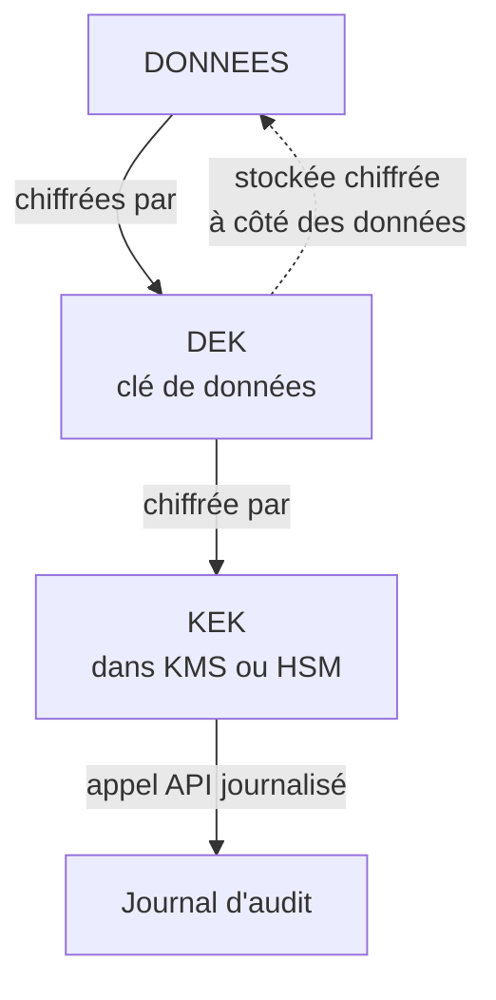
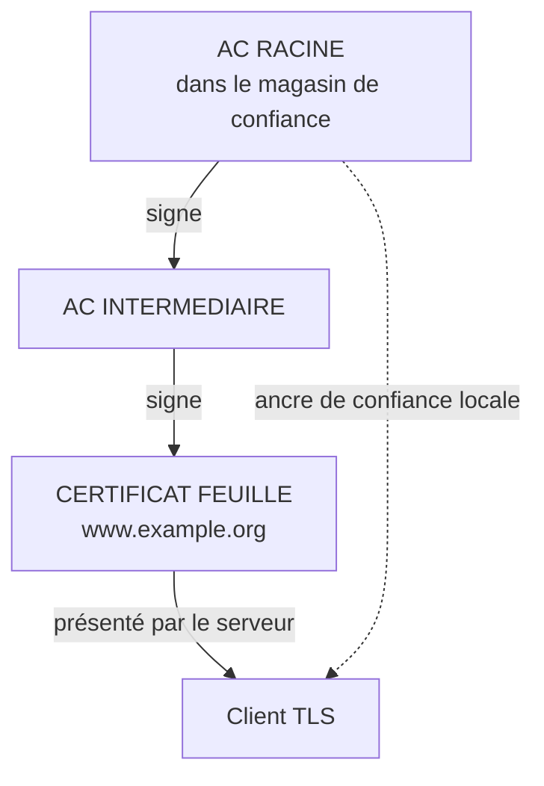
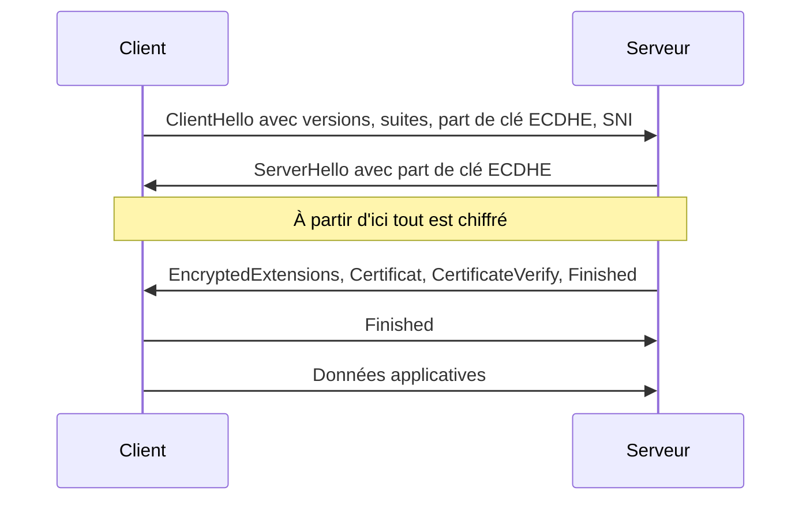

# Cryptographie et communications sécurisées

## Objectifs pédagogiques

À la fin de ce module, vous serez capable de :

- **distinguer** chiffrement symétrique, chiffrement asymétrique, hachage et signature, et choisir la primitive qui correspond à la propriété recherchée (confidentialité, intégrité, authenticité) ;
- **identifier** les erreurs d'usage qui rendent un algorithme solide inutile : nonce réutilisé, mot de passe haché trop vite, clé stockée à côté des données ;
- **analyser** une chaîne de certificats et la validation effectuée par un client TLS, puis détecter un certificat ou une configuration TLS défaillants ;
- **comparer** IPsec, OpenVPN et WireGuard selon le contexte de déploiement ;
- **vérifier** avec `openssl`, `nmap`, `testssl.sh`, `hashcat` et `gitleaks` qu'une protection cryptographique fonctionne réellement.

## Mise en situation : le dump qui se déchiffre tout seul

Une application web interne stocke les mots de passe de ses utilisateurs. Le développeur a suivi le conseil « ne stockez jamais de mots de passe en clair » : la colonne `password` contient des chaînes illisibles, produites par AES (Advanced Encryption Standard) avec une clé définie dans `config.php`.

Un attaquant exploite une injection SQL. Elle lui donne d'abord la table `users`. Une lecture de fichier via la même faille lui donne ensuite `config.php`, puisque la clé est sur le même serveur que les données. Il lance `openssl enc -d` en boucle sur la table. Le « chiffrement » n'a ajouté qu'une étape de script.

Ce scénario est illustratif, mais le schéma est documenté. En 2013, Adobe a vu fuiter une base de mots de passe chiffrés symétriquement, sans sel, avec les indices de mot de passe en clair à côté. Les chercheurs ont pu déduire de nombreux mots de passe en comparant les blocs chiffrés identiques et en lisant les indices. En 2012, LinkedIn a subi une fuite de hachés SHA-1 (Secure Hash Algorithm 1) non salés. Une grande partie a été cassée en quelques jours, parce que SHA-1 est conçu pour être rapide.

Dans ces cas, la défense naïve (« on chiffre ») n'a pas échoué à cause de la mathématique. Elle a échoué parce que la primitive était mal choisie, mal utilisée ou mal protégée. C'est le fil rouge du module : **la cryptographie casse presque toujours autour de l'algorithme, rarement dedans.**

## Surface d'attaque

| Vecteur | Exposition | Impact potentiel |
|---|---|---|
| Mots de passe stockés avec un haché rapide ou un chiffrement réversible | Dump de base (injection SQL, sauvegarde volée) | Mots de passe en clair en quelques heures, réutilisés sur d'autres services |
| Clé privée TLS ou clé de chiffrement dans un dépôt Git, une image de conteneur ou un volume partagé | Dépôts, registres d'images, sauvegardes | Usurpation d'identité du serveur, déchiffrement du trafic passé si la clé est de type RSA statique |
| Validation de certificat désactivée dans le code (`verify=False`, `-k`, `InsecureSkipVerify`) | Appels service à service, clients mobiles, scripts | Interception silencieuse par n'importe quel poste du même segment réseau |
| TLS — Transport Layer Security : versions et suites obsolètes (SSLv3, TLS 1.0/1.1, CBC, 3DES) | Services exposés et appliances anciennes | Attaques par downgrade ou par oracle de padding (POODLE, Sweet32) |
| Autorité de certification compromise ou certificat mal émis | Magasin de confiance des postes, PKI interne | Certificats frauduleux valides pour n'importe quel domaine |
| Clé pré-partagée faible sur un VPN IPsec | Port UDP 500/4500 exposé | Capture du haché d'authentification puis cassage hors ligne |
| Disque ou base non chiffrés | Poste nomade perdu, disque de serveur recyclé, snapshot cloud | Accès complet aux données sans aucune authentification |
| Certificat expiré non renouvelé | Services internes, API partenaires | Panne, puis contournement dangereux (désactivation de la vérification) |

## Modèle de menace : qui écoute, qui vole, qui triche

Un contrôle cryptographique protège contre un attaquant précis. Avant de choisir, posez la question : contre qui ?

| Acteur | Capacité typique | Ce que la crypto couvre | Ce qu'elle ne couvre pas |
|---|---|---|---|
| Observateur passif (Wi-Fi public, FAI, équipement intermédiaire) | Lit le trafic | TLS ou VPN : confidentialité | Métadonnées (IP, volume, SNI en clair avant ECH) |
| Attaquant actif sur le chemin (MITM — Man-In-The-Middle) | Modifie, rejoue, redirige | Authentification du serveur par certificat, intégrité AEAD | Un client qui ne vérifie pas le certificat |
| Voleur de données (dump de base, sauvegarde) | Obtient les données au repos | Chiffrement applicatif, hachage lent des mots de passe | Une clé accessible au même endroit que les données |
| Voleur de matériel | Dispose du disque | Chiffrement de disque, appareil éteint | Appareil allumé et session déverrouillée |
| Administrateur ou compte interne compromis | Accède au KMS (Key Management Service) ou aux secrets | Journalisation et séparation des rôles | Un administrateur légitime avec les droits de déchiffrement |
| Adversaire de long terme (« récolter maintenant, déchiffrer plus tard ») | Stocke le trafic chiffré aujourd'hui | Forward secrecy, et à terme cryptographie post-quantique | Un échange de clés RSA statique |

Le dernier point n'est pas théorique pour les données à longue durée de vie : le NIST a publié en 2024 ses premiers standards post-quantiques, dont ML-KEM (FIPS 203). Les navigateurs déploient déjà des échanges de clés hybrides. Retenez le principe : plus la donnée doit rester confidentielle longtemps, plus l'échange de clés compte.

## Chiffrer : symétrique, asymétrique, et pourquoi TLS utilise les deux ⭐

### Symétrique : une clé, rapide, mais il faut la partager

🧠 **Concept clé** : en chiffrement symétrique, la même clé chiffre et déchiffre. Les algorithmes modernes (AES-256, ChaCha20) traitent des gigaoctets par seconde, souvent avec des instructions matérielles dédiées (AES-NI). Le problème est ailleurs : comment deux parties qui ne se sont jamais rencontrées s'accordent-elles sur une clé sans la transmettre en clair ?

Le choix de l'algorithme compte moins que le **mode d'opération**.

🔴 **Vecteur d'attaque : ECB (Electronic Codebook).** Ce mode chiffre chaque bloc de 16 octets indépendamment. Deux blocs identiques donnent deux blocs chiffrés identiques. L'image du « pingouin ECB » (un logo chiffré dont la silhouette reste visible) illustre le défaut. Adobe a été touché par ce défaut en 2013 : deux utilisateurs avec le même mot de passe avaient le même chiffré, ce qui a permis de recouper les indices.

🔴 **Vecteur d'attaque : CBC sans authentification.** Un attaquant qui peut modifier le chiffré et observer si le serveur répond « padding invalide » ou « données invalides » reconstitue le clair octet par octet. C'est le principe de POODLE (CVE-2014-3566, SSLv3) et de Lucky13.

🔒 **Contrôle de sécurité** : utiliser un mode AEAD (Authenticated Encryption with Associated Data)*, concrètement AES-256-GCM (Galois/Counter Mode) ou ChaCha20-Poly1305. Il chiffre et authentifie en une seule opération : toute modification du chiffré est rejetée avant déchiffrement.

⚠️ **Erreur fréquente** : GCM exige un nonce unique par message pour une clé donnée. Réutiliser un nonce avec la même clé permet à l'attaquant de récupérer la clé d'authentification (« forbidden attack ») et de forger des messages. Un compteur mal persisté après un redémarrage, ou un nonce de 96 bits tiré au hasard sur un volume énorme de messages, suffit à déclencher le problème. Dans la pratique, n'appelez pas ces primitives directement : utilisez libsodium, Tink ou l'API de haut niveau de votre langage, qui gèrent le nonce pour vous.

\* AEAD : mode de chiffrement qui garantit à la fois la confidentialité du message et la détection de toute altération, en y incluant éventuellement des données associées (en-têtes) non chiffrées mais authentifiées.

### Asymétrique : deux clés, lent, mais résout la distribution

🧠 **Concept clé** : une paire de clés. Ce que la clé publique chiffre, seule la clé privée le déchiffre. Pour une signature, c'est l'inverse : la clé privée signe, la clé publique vérifie. Les algorithmes courants sont RSA (Rivest-Shamir-Adleman, 2048 bits minimum, 3072 pour le long terme), ECDSA sur la courbe P-256, Ed25519 pour les signatures et X25519 pour les échanges de clés. Ils sont des centaines de fois plus lents que l'AES : on ne chiffre pas un fichier de 4 Go avec RSA.

### Le schéma hybride

La pratique consiste à combiner les deux : l'asymétrique sert à **s'accorder sur une clé**, le symétrique à **chiffrer les données**. TLS, SSH, WireGuard, PGP et les VPN fonctionnent tous ainsi.

Pour l'accord de clé, la variante éphémère ECDHE (Elliptic Curve Diffie-Hellman Ephemeral)* génère une paire de clés jetable à chaque session. Même si un attaquant vole plus tard la clé privée du serveur, il ne peut pas déchiffrer le trafic qu'il avait enregistré : c'est la **forward secrecy**. Avec l'ancien échange RSA statique (TLS 1.2 et suites `TLS_RSA_*`), le vol de la clé privée, par exemple via Heartbleed (CVE-2014-0160), ouvrait tout l'historique enregistré.

\* ECDHE : échange de Diffie-Hellman sur courbe elliptique avec clés éphémères. Chaque partie envoie une valeur publique, les deux calculent le même secret, et un observateur qui voit les deux valeurs ne peut pas le reconstituer.

💡 **Astuce** : pour voir la différence de vitesse, `openssl speed -evp aes-256-gcm` puis `openssl speed rsa2048` donnent les débits sur votre machine en quelques secondes.

## Hacher n'est pas chiffrer : intégrité, MAC et signatures ⚠️

Revenons à la base d'Adobe et de LinkedIn. Le piège central du module : **un haché n'est pas un chiffrement réversible**. Il n'existe pas de clé de déchiffrement, et il n'y a rien à « déchiffrer ».

🧠 **Concept clé** : une fonction de hachage (SHA-256, SHA-3) transforme n'importe quelle entrée en empreinte de taille fixe, à sens unique. Impossible de remonter de l'empreinte à l'entrée par le calcul. Mais l'attaquant ne remonte pas : il **devine**. Il hache des candidats (`password`, `Azerty123!`, tout rockyou.txt) et compare. Pour `password`, `echo -n password | sha256sum` donne `5e884898da28047151d0e56f8dc6292773603d0d6aabbdd62a11ef721d1542d8`, que n'importe quelle table précalculée reconnaît instantanément.

Le défaut est donc la vitesse. SHA-256 est conçu pour être rapide, et un GPU grand public en calcule plusieurs milliards par seconde (ordre de grandeur). Un mot de passe de 8 caractères tombe en heures, voire en minutes.

🔴 **Vecteur d'attaque** : hashcat contre un dump de hachés.

```bash
# MD5 = -m 0, SHA-1 = -m 100, SHA-256 = -m 1400, bcrypt = -m 3200
hashcat -m 1400 -a 0 hashes.txt rockyou.txt
hashcat -m 1400 -a 3 hashes.txt '?l?l?l?l?l?l?l?l'   # force brute 8 minuscules
```

🔒 **Contrôle de sécurité** : pour les mots de passe, utiliser une fonction **volontairement lente et consommatrice de mémoire**, avec un sel unique par utilisateur : argon2id (OWASP recommande au minimum 19 MiB de mémoire, 2 itérations, 1 de parallélisme), à défaut bcrypt ou scrypt. Le sel élimine les tables précalculées et empêche de repérer deux utilisateurs au même mot de passe. Le coût est réel : chaque authentification consomme CPU et mémoire. Calibrez sur votre matériel (de l'ordre de 100 à 500 ms par authentification) et prévoyez une limitation du débit de tentatives, sinon la fonction lente devient un vecteur de déni de service.

### Intégrité : un haché seul n'authentifie rien

`sha256sum` publié à côté d'un téléchargement prouve l'intégrité **seulement si le haché vient d'un canal fiable**. Un attaquant qui remplace le fichier remplace aussi le haché publié sur la même page.

- **HMAC (Hash-based Message Authentication Code)** : haché calculé avec une clé secrète. Utile pour authentifier des webhooks, des cookies signés, des appels d'API. Ne construisez jamais `SHA256(secret || message)` : cette construction est vulnérable à l'attaque par extension de longueur.
- **Signature numérique** : on hache le document, puis on signe l'empreinte avec la clé privée. N'importe qui vérifie avec la clé publique, sans pouvoir signer à son tour. Cela fournit l'intégrité, l'authenticité et la non-répudiation. C'est le mécanisme des paquets `apt`/`rpm`, de la signature de code et des certificats.

Les fonctions de hachage vieillissent. En 2012, le malware Flame a exploité une collision MD5 (Message Digest 5) pour forger un certificat de signature de code qui semblait émis par Microsoft. En 2017, Google et le CWI ont publié la première collision SHA-1 (« SHAttered »). Aujourd'hui, SHA-256 ou SHA-3 pour tout nouvel usage ; MD5 et SHA-1 ne se justifient que pour des sommes de contrôle sans enjeu de sécurité.

```bash
# Signer et vérifier un fichier avec une paire ECDSA P-256
openssl ecparam -genkey -name prime256v1 -noout -out ec.key
openssl ec -in ec.key -pubout -out ec.pub
openssl dgst -sha256 -sign ec.key -out rapport.sig rapport.pdf
openssl dgst -sha256 -verify ec.pub -signature rapport.sig rapport.pdf   # Verified OK
```

Modifiez un seul octet de `rapport.pdf` et relancez la dernière commande : la vérification échoue.

## Gérer les clés : là où les systèmes cassent vraiment

Une cryptographie correcte avec une clé mal gérée est équivalente à pas de cryptographie. Les incidents réels le montrent :

- En 2006, un correctif Debian a réduit sans le vouloir l'entropie du générateur aléatoire d'OpenSSL (CVE-2008-0166, divulguée en 2008). Pendant près de deux ans, les clés générées sur ces systèmes ne pouvaient prendre qu'un nombre restreint de valeurs, énumérables par un attaquant.
- Avec Heartbleed, la clé privée du serveur pouvait être extraite de la mémoire d'un processus. Corriger OpenSSL ne suffisait pas : il fallait aussi **réémettre et révoquer** les certificats, car la clé était potentiellement déjà compromise.

### Le cycle de vie d'une clé

| Étape | Ce qu'il faut garantir | Coût ou contrainte |
|---|---|---|
| Génération | Source aléatoire de qualité (CSPRNG — Cryptographically Secure Pseudo-Random Number Generator), jamais `rand()` ni un horodatage | Aucun si on utilise la bibliothèque système |
| Stockage | Jamais à côté des données qu'elle protège ; coffre de secrets, KMS ou HSM (Hardware Security Module) | Un HSM coûte cher et impose une latence ; un KMS cloud facture chaque appel |
| Usage | Droits limités par service, journalisation de chaque opération de déchiffrement | Il faut accepter de gérer des politiques d'accès fines |
| Rotation | Planifiée, et immédiate après suspicion de compromission | Demande de pouvoir rechiffrer ou accepter plusieurs versions de clé en parallèle |
| Destruction | Suppression effective, y compris dans les sauvegardes | La suppression de la clé rend les anciennes sauvegardes illisibles, ce qui est voulu mais doit être anticipé |

### Chiffrement par enveloppe

Appeler le KMS pour chaque enregistrement serait lent et coûteux. Le schéma standard est le chiffrement par enveloppe : une clé de données (DEK — Data Encryption Key) chiffre les données localement, et une clé maîtresse (KEK — Key Encryption Key), qui ne quitte jamais le KMS ou le HSM, chiffre la DEK.



Pour compromettre les données, l'attaquant doit obtenir l'accès au KMS et non seulement au disque. Il peut aussi tourner la KEK sans rechiffrer toutes les données, en réenveloppant seulement les DEK.

⚠️ **Erreur fréquente** : stocker la clé dans une variable d'environnement ou un fichier de config **de la même image ou du même dépôt** que le code. Détection : `gitleaks detect --source .` ou `trufflehog git file://.` sur le dépôt, historique compris, car supprimer le fichier dans un commit ultérieur ne le retire pas de l'historique.

## Certificats, autorités de certification et PKI

Le chiffrement asymétrique résout un problème et en crée un autre : comment savoir que la clé publique reçue appartient bien à `banque.example` et pas à un attaquant ? La réponse est le certificat X.509 : un document qui lie une identité à une clé publique, signé par un tiers de confiance, l'autorité de certification (CA — Certificate Authority).

Un certificat contient notamment :

- le sujet et les noms valides (extension SAN — Subject Alternative Name, la seule vérifiée par les navigateurs modernes, pas le champ CN) ;
- la clé publique ;
- l'émetteur et la signature de l'émetteur ;
- la période de validité ;
- des contraintes d'usage (`basicConstraints`, `keyUsage`, `extendedKeyUsage`).

La PKI (Public Key Infrastructure) désigne l'ensemble des CA, politiques, processus d'émission et de révocation qui font fonctionner ce système.



L'AC racine reste hors ligne autant que possible. Ce sont les intermédiaires qui émettent, ce qui limite l'impact d'une compromission : on révoque un intermédiaire, pas la racine intégrée dans des millions de postes.

### Ce que le client vérifie réellement

1. La chaîne remonte jusqu'à une racine présente dans son magasin de confiance, et chaque signature est valide.
2. Les dates de validité sont respectées.
3. Le nom demandé figure dans le SAN.
4. Le certificat n'est pas révoqué, via CRL (Certificate Revocation List) ou OCSP (Online Certificate Status Protocol). En pratique la révocation est le maillon faible : beaucoup de clients échouent « en ouvert » si le répondeur ne répond pas, d'où l'intérêt de l'agrafage OCSP côté serveur.
5. Pour les certificats publics, la présence dans les journaux de Certificate Transparency, que les navigateurs exigent.

🔴 **Vecteur d'attaque : CA compromise.** En 2011, DigiNotar a été compromise et des certificats frauduleux, dont un `*.google.com`, ont été émis puis utilisés pour intercepter des connexions d'utilisateurs en Iran. Le chiffrement TLS fonctionnait parfaitement : c'est la confiance accordée à l'émetteur qui était rompue. La réponse a été le retrait de DigiNotar des magasins de confiance, d'où la faillite de l'autorité.

🔴 **Vecteur d'attaque : PKI interne.** Dans un domaine Windows, les modèles de certificats d'AD CS (Active Directory Certificate Services) mal configurés permettent à un utilisateur ordinaire d'obtenir un certificat au nom d'un administrateur. La famille de faiblesses « ESC1 » à « ESC8 » a été documentée par SpecterOps et s'audite avec Certipy ou Certify. Un certificat est aussi une preuve d'identité.

🔒 **Contrôle de sécurité** : automatiser l'émission et le renouvellement (protocole ACME — Automatic Certificate Management Environment, avec certbot ou un client intégré). Les certificats publics ont des durées de vie qui raccourcissent, et un renouvellement manuel finit toujours par être oublié. Le coût est d'investir dans l'automatisation et la supervision.

## TLS et HTTPS : ce que le client vérifie vraiment

HTTPS, c'est HTTP dans une session TLS. Le handshake TLS 1.3 tient en un aller-retour :



Les deux côtés calculent le même secret à partir des parts de clé, dérivent des clés symétriques AES-GCM ou ChaCha20, et le serveur prouve la possession de sa clé privée avec `CertificateVerify`. TLS 1.3 impose la forward secrecy et supprime les suites faibles. TLS 1.2 reste acceptable s'il est restreint à ECDHE + AEAD.

### Comment on attaque un déploiement TLS

🔴 **Interception par proxy** : `mitmproxy` ou Burp Suite se placent entre le client et le serveur et présentent un certificat généré à la volée. Cela ne fonctionne que si le client accepte l'autorité du proxy (installation de la CA sur le poste, ou validation désactivée dans le code). C'est exactement ce que font les proxys d'inspection TLS en entreprise. Ce mécanisme est légitime quand il est maîtrisé, et dangereux quand une CA d'interception est installée partout sans contrôle.

🔴 **SSL stripping** : l'attaquant, sur le chemin, intercepte la première requête en `http://` avant la redirection vers HTTPS et maintient la victime en clair (outil historique : `sslstrip`). La parade est l'en-tête HSTS (HTTP Strict Transport Security), qui ordonne au navigateur de ne plus jamais tenter HTTP pour ce domaine.

🔴 **Downgrade et suites faibles** : si le serveur accepte SSLv3 ou TLS 1.0 « pour les vieux clients », l'attaquant provoque la négociation du protocole le plus faible. C'est le terrain de POODLE, et celui de Sweet32 (CVE-2016-2183) pour les suites 3DES.

🔴 **Faille d'implémentation** : Heartbleed (CVE-2014-0160) était un défaut de lecture mémoire dans l'extension heartbeat d'OpenSSL. Aucune configuration TLS ne le corrigeait : seul le patch le faisait. Le chiffrement ne remplace pas la gestion des vulnérabilités.

### Configuration durcie

Avant, dans un `nginx.conf` hérité :

```nginx
ssl_protocols SSLv3 TLSv1 TLSv1.1 TLSv1.2;
ssl_ciphers ALL:!aNULL;
```

Après :

```nginx
ssl_protocols TLSv1.2 TLSv1.3;
ssl_ciphers ECDHE-ECDSA-AES128-GCM-SHA256:ECDHE-RSA-AES128-GCM-SHA256:ECDHE-ECDSA-AES256-GCM-SHA384:ECDHE-RSA-AES256-GCM-SHA384:ECDHE-ECDSA-CHACHA20-POLY1305:ECDHE-RSA-CHACHA20-POLY1305;
ssl_prefer_server_ciphers off;
ssl_session_tickets off;
ssl_stapling on;
ssl_stapling_verify on;
add_header Strict-Transport-Security "max-age=31536000; includeSubDomains" always;
```

Plutôt que de recopier cette liste, utilisez le générateur de configuration de Mozilla. Les valeurs évoluent et le profil « intermediate » est un bon compromis.

| Choix | Gain | Coût |
|---|---|---|
| Retirer TLS 1.0/1.1 | Supprime les attaques de downgrade | Casse les clients très anciens (vieux Java, appliances) : mesurer dans les logs avant de couper |
| `ssl_session_tickets off` | Évite qu'une clé de ticket compromise annule la forward secrecy | Reprises de session un peu plus coûteuses côté serveur |
| HSTS avec `includeSubDomains` | Bloque le stripping | Tous les sous-domaines doivent être servis en HTTPS ; le préchargement (`preload`) est difficile à annuler |
| Certificat ECDSA plutôt que RSA | Clés plus petites, handshake plus rapide | Quelques clients très anciens ne le supportent pas |

⚠️ **Erreur fréquente** : mettre `verify=False` ou `curl -k` « pour que ça marche » avec un certificat interne. La session reste chiffrée, mais avec n'importe qui. Correction : ajouter la CA interne au magasin de confiance du client (`REQUESTS_CA_BUNDLE`, `update-ca-certificates`) plutôt que de désactiver la vérification.

## VPN : IPsec, WireGuard et OpenVPN

Un VPN (Virtual Private Network) construit un tunnel chiffré entre deux points, pour relier un poste à un réseau ou deux sites entre eux. Les trois protocoles courants répondent aux mêmes besoins avec des philosophies opposées.

| Critère | IPsec (Internet Protocol Security) | OpenVPN | WireGuard |
|---|---|---|---|
| Fonctionnement | IKE (Internet Key Exchange) négocie les clés, ESP (Encapsulating Security Payload) chiffre les paquets | Tunnel au-dessus de TLS, en espace utilisateur | Protocole Noise, clés statiques par pair, intégré au noyau Linux depuis la version 5.6 |
| Négociation cryptographique | Large (nombreuses propositions possibles) | Large (suites TLS) | Aucune : Curve25519, ChaCha20-Poly1305, BLAKE2s |
| Complexité de configuration | Élevée (phases, propositions, interopérabilité entre constructeurs) | Moyenne | Faible (quelques lignes par pair) |
| Authentification | Certificats, PSK (Pre-Shared Key), EAP | Certificats, identifiants, MFA via plugin | Clés publiques uniquement : pas d'authentification utilisateur native |
| Traversée de pare-feu | UDP 500/4500, parfois filtré | UDP 1194 ou TCP 443, passe presque partout | UDP, port au choix |
| Usage typique | Site à site, matériel réseau, interopérabilité | Accès distant avec exigences d'authentification riches | Accès entre serveurs, mesh, petites flottes de clients |

Retenez la logique : **moins un protocole offre d'options, moins il offre de mauvaises configurations**. WireGuard supprime la négociation et donc les attaques de downgrade. En contrepartie, la gestion des utilisateurs (attribution d'adresses, révocation, journalisation) est à construire autour, ou à fournir par une couche comme Tailscale ou Netbird.

Exemple de configuration WireGuard côté serveur :

```ini
[Interface]
Address = 10.8.0.1/24
ListenPort = 51820
PrivateKey = <SERVER_PRIVATE_KEY>

[Peer]
PublicKey = <CLIENT_PUBLIC_KEY>
AllowedIPs = 10.8.0.2/32
```

🧠 **Concept clé** : `AllowedIPs` joue deux rôles. En sortie, il sert de table de routage ; en entrée, il filtre : un paquet déchiffré dont l'adresse source n'est pas dans `AllowedIPs` du pair est abandonné. Un `AllowedIPs = 0.0.0.0/0` côté serveur donne à ce client le droit de se faire passer pour n'importe quelle adresse.

🔴 **Vecteur d'attaque sur IPsec : mode agressif et PSK faible.** Avec IKEv1 en mode agressif, le haché d'authentification dérivé de la PSK est envoyé avant l'authentification du client. `ike-scan --aggressive` le récupère, puis `psk-crack` ou `hashcat` le casse hors ligne. Parades : IKEv2, authentification par certificats, ou PSK longue et aléatoire.

🔴 **Vecteur d'attaque : l'équipement VPN lui-même.** Les concentrateurs exposés sont des cibles de choix. CVE-2019-11510 (Pulse Connect Secure, lecture arbitraire de fichiers) et CVE-2018-13379 (Fortinet FortiOS, traversée de répertoire) ont été massivement exploités pour voler des identifiants. Un tunnel solide ne compense pas un équipement non patché, ce qui rejoint la gestion des correctifs.

## Au repos et en transit : choisir où chiffrer

Les deux expressions décrivent les moments où la donnée peut être volée, pas des techniques :

| Moment | Mécanismes | Contre quoi ça protège | Contre quoi ça ne protège pas |
|---|---|---|---|
| **En transit** | TLS, mTLS (mutual Transport Layer Security), VPN, SSH | Écoute et modification sur le réseau | Un serveur ou un client compromis, qui voit les données en clair après déchiffrement |
| **Au repos, disque** | LUKS (Linux Unified Key Setup), BitLocker, FileVault | Perte ou vol d'un appareil éteint, disque recyclé | Une session ouverte, un malware actif, une injection SQL |
| **Au repos, base ou stockage** | TDE (Transparent Data Encryption), chiffrement côté serveur des buckets objets | Vol du fichier de base ou du snapshot | Une requête SQL légitime (le moteur déchiffre automatiquement) |
| **Au repos, applicatif** | Chiffrement de champs avant écriture, avec clé hors base | Dump de base, administrateur de base curieux | Application compromise disposant de la clé |

⚠️ **Erreur fréquente** : conclure « la base est chiffrée, donc l'injection SQL est sans gravité ». Avec TDE, le moteur déchiffre pour toute requête autorisée, y compris celles de l'attaquant. Seul le chiffrement applicatif avec une clé que la base ne détient pas change réellement la situation, au prix d'une perte de capacité de recherche et de tri sur ces champs.

Le trafic interne est le grand oublié. Un réseau interne n'est pas un canal de confiance : des déplacements latéraux et des attaques ARP spoofing y sont courants. Le mTLS entre services authentifie les deux extrémités, mais impose de distribuer et renouveler des certificats à grande échelle, ce qui justifie en pratique une PKI interne automatisée ou un maillage de services.

## Tester concrètement

Après ce module, voici ce que vous devez savoir vérifier sur un système réel :

| Question | Commande ou outil | Résultat attendu |
|---|---|---|
| Quel certificat est réellement servi, avec quels noms et quelle échéance ? | `openssl s_client -connect <HOST>:443 -servername <HOST> </dev/null \| openssl x509 -noout -subject -issuer -dates -ext subjectAltName` | SAN contenant le nom, émetteur attendu, plusieurs semaines de validité restantes |
| Quelles versions et suites TLS sont acceptées ? | `nmap --script ssl-enum-ciphers -p 443 <HOST>` ou `testssl.sh <HOST>` | Seulement TLS 1.2 et 1.3, aucune suite CBC, 3DES ou RC4 |
| Le serveur impose-t-il HTTPS ? | `curl -sI http://<HOST>` puis `curl -sI https://<HOST> \| grep -i strict` | Redirection 301 vers HTTPS et en-tête `Strict-Transport-Security` |
| Le certificat expire-t-il bientôt ? | `openssl x509 -in <CERT_FILE> -noout -checkend 1209600` | Code retour 0 si valide plus de 14 jours, 1 sinon (à brancher en supervision) |
| Mes mots de passe en base résistent-ils ? | `hashcat -m <MODE> -a 0 <HASHFILE> <WORDLIST>` sur une copie de test | Quasi aucun résultat avec argon2id ou bcrypt ; cassage massif avec SHA-256 |
| Des clés ou secrets traînent-ils dans le dépôt ? | `gitleaks detect --source <REPO_PATH>` | Aucun résultat, historique compris |
| Le VPN IPsec expose-t-il le mode agressif ? | `ike-scan -M --aggressive <HOST>` | Aucune réponse en mode agressif |
| Le disque est-il chiffré ? | `lsblk -f` et `cryptsetup luksDump <DEVICE>` (Linux), `manage-bde -status` (Windows) | Type `crypto_LUKS` ou BitLocker « Protection On » |

💡 **Astuce** : pour valider ce que fait réellement votre client HTTP face à un mauvais certificat, lancez `mitmproxy` en laboratoire, sans installer sa CA sur le client. Un client correct refuse la connexion ; un client avec `verify=False` laisse passer le trafic en clair dans mitmproxy.

## Cas réel en entreprise : le certificat expiré du vendredi soir

*Scénario illustratif, chiffres fictifs.*

Une équipe gère une architecture de microservices avec une PKI interne. Les certificats de service sont émis pour 1 an, renouvelés à la main. Un vendredi à 18 h, le certificat d'une API de paiement interne expire. Les appels échouent, l'astreinte est sollicitée. Le développeur de garde fait la chose rapide : `verify=False` dans le client, déployé « temporairement ».

Le lundi, la panne est oubliée. Trois mois plus tard, un poste de prestataire compromis sur le même segment réseau lance un empoisonnement ARP et se place entre deux services. Comme la validation est désactivée, le client accepte le certificat de l'attaquant. Les jetons d'API circulent en clair dans son proxy. L'incident est détecté tardivement : aucun test automatique ne vérifiait la validation.

Ce que l'analyse post-incident met en évidence :

- **Cause racine** : renouvellement manuel, sans alerte d'expiration. L'attaquant n'a eu qu'à profiter d'un contournement.
- **Leçon 1** : automatiser le renouvellement (ACME interne ou outil de PKI) et superviser `-checkend` avec une alerte à 30 puis 14 jours.
- **Leçon 2** : interdire la désactivation de la validation par une règle Semgrep en intégration continue, qui échoue sur `verify=False` ou `InsecureSkipVerify: true`.
- **Leçon 3** : le segment réseau compte aussi. Un tunnel TLS correctement validé aurait survécu à l'ARP spoofing, un tunnel non validé non.

## Erreurs fréquentes

⚠️ **Haché rapide pour les mots de passe.**
- *Configuration dangereuse* : `SHA256(mot_de_passe)` ou `MD5` en base, avec ou sans sel unique.
- *Conséquence* : un dump permet un cassage par GPU à raison de milliards d'essais par seconde.
- *Correction* : argon2id ou bcrypt, sel automatique. Détection : une colonne de 32 ou 64 caractères hexadécimaux est suspecte, alors qu'un préfixe `$argon2id$` ou `$2b$` est attendu.

⚠️ **Chiffrement sans authentification, nonce réutilisé.**
- *Configuration dangereuse* : AES-CBC sans MAC, AES-GCM avec un nonce fixe ou un compteur remis à zéro.
- *Conséquence* : oracle de padding, falsification de messages, récupération de la clé d'authentification.
- *Correction* : libsodium ou Tink (API de haut niveau), AES-256-GCM ou ChaCha20-Poly1305. Détection : règles Semgrep ou Bandit repérant `AES.MODE_ECB`, `MODE_CBC` ou un `iv` constant.

⚠️ **Validation de certificat désactivée.**
- *Configuration dangereuse* : `requests.get(url, verify=False)`, `curl -k`, `InsecureSkipVerify: true`, `TrustManager` acceptant tout.
- *Conséquence* : n'importe quel attaquant sur le chemin devient le serveur légitime.
- *Correction* : installer la CA interne dans le magasin de confiance de l'environnement. Détection : Semgrep en CI, `grep -R "verify=False"`, test avec mitmproxy.

⚠️ **Clé privée dans le dépôt ou l'image.**
- *Configuration dangereuse* : `server.key` ou `.env` committés, ou copiés dans une couche d'image.
- *Conséquence* : l'historique Git et les registres conservent la clé même après suppression. Quiconque la récupère usurpe le service et, sans forward secrecy, déchiffre le trafic enregistré.
- *Correction* : révoquer et régénérer la clé, la stocker dans un coffre de secrets, l'injecter à l'exécution. Détection : `gitleaks`, `trufflehog`, `trivy image --scanners secret`.

⚠️ **Un certificat wildcard partagé partout.**
- *Configuration dangereuse* : le même `*.entreprise.fr` et la même clé privée copiés sur 40 serveurs.
- *Conséquence* : la compromission du serveur le moins protégé permet d'usurper tous les autres noms.
- *Correction* : un certificat par service ou par zone de confiance, rendu praticable par l'automatisation ACME.

⚠️ **Confondre encodage, hachage et chiffrement.**
- *Configuration dangereuse* : secrets « protégés » en Base64, XOR avec une constante, ou « chiffrement maison ».
- *Conséquence* : Base64 est un simple encodage réversible sans clé, et tout schéma maison se casse en quelques minutes avec `CyberChef`.
- *Correction* : primitives standard et éprouvées, jamais d'algorithme inventé. Si les données doivent être comparées sans être relues, c'est un haché ; si elles doivent être relues, c'est du chiffrement avec une clé gérée.

## Résumé

La cryptographie répond à trois besoins distincts : garder un secret (chiffrement), détecter une modification (hachage, MAC, signature) et prouver une identité (certificat). Le chiffrement symétrique protège les données, l'asymétrique sert à s'accorder sur les clés et à signer, et TLS, les VPN et SSH combinent les deux. Un haché n'est pas réversible mais se devine, d'où l'usage de fonctions lentes et salées pour les mots de passe. La confiance repose sur les certificats et les CA, qui sont la partie la plus fragile de TLS : chaîne, nom, date et révocation doivent être vérifiés, jamais désactivés. À surveiller : les clés elles-mêmes (stockage, rotation), l'expiration des certificats, les protocoles hérités acceptés par compatibilité, les équipements VPN non patchés et le trafic interne laissé en clair.

<!-- snippet
id: crypto_tls_inspect_certificate
type: command
tech: crypto
level: beginner
importance: high
format: knowledge
tags: tls,certificat,openssl,san
title: Inspecter le certificat réellement servi par un serveur
command: openssl s_client -connect <HOST>:443 -servername <HOST> </dev/null 2>/dev/null | openssl x509 -noout -subject -issuer -dates -ext subjectAltName
example: openssl s_client -connect www.example.org:443 -servername www.example.org </dev/null 2>/dev/null | openssl x509 -noout -subject -issuer -dates -ext subjectAltName
description: Affiche sujet, émetteur, dates et SAN du certificat servi ; -servername est indispensable derrière un reverse proxy hébergeant plusieurs noms.
-->

<!-- snippet
id: crypto_tls_enum_ciphers
type: command
tech: crypto
level: intermediate
importance: high
format: knowledge
tags: tls,nmap,audit,suites
title: Lister les versions TLS et suites acceptées par un serveur
command: nmap --script ssl-enum-ciphers -p <PORT> <HOST>
example: nmap --script ssl-enum-ciphers -p 443 www.example.org
description: Énumère chaque version de TLS acceptée avec une note ; toute présence de TLSv1.0, TLSv1.1, 3DES ou suite CBC doit être justifiée ou supprimée.
-->

<!-- snippet
id: crypto_tls_legacy_protocols_test
type: command
tech: crypto
level: intermediate
importance: medium
format: knowledge
tags: tls,testssl,downgrade,audit
title: Vérifier que les protocoles TLS obsolètes sont refusés
command: testssl.sh --protocols <HOST>:<PORT>
example: testssl.sh --protocols www.example.org:443
context: testssl.sh est un script autonome à télécharger depuis son dépôt officiel ; l'affichage varie selon la version.
description: Teste SSLv2/v3 et TLS 1.0 à 1.3 en une commande, sans dépendre du niveau de sécurité de votre build OpenSSL locale qui peut masquer les anciennes versions.
-->

<!-- snippet
id: crypto_hash_audit_hashcat
type: command
tech: crypto
level: intermediate
importance: medium
format: knowledge
tags: hashcat,mot-de-passe,hachage,audit
title: Mesurer la résistance de hachés de mots de passe
command: hashcat -m <MODE> -a 0 <HASHFILE> <WORDLIST>
example: hashcat -m 1400 -a 0 hashes.txt rockyou.txt
context: À exécuter uniquement sur une copie de test de vos propres données, avec autorisation.
description: Modes courants : 0 MD5, 100 SHA-1, 1400 SHA-256, 3200 bcrypt. Si une part notable casse en minutes, le schéma de hachage est à remplacer par argon2id.
-->

<!-- snippet
id: crypto_hash_not_encryption
type: concept
tech: crypto
level: beginner
importance: high
format: knowledge
tags: hachage,mot-de-passe,sha256,argon2
title: Un haché n'est pas un chiffrement réversible
content: Une fonction de hachage n'a pas de clé et pas d'opération inverse. L'attaquant ne la renverse pas, il hache des candidats (dictionnaire, force brute) et compare avec les empreintes volées. SHA-256 étant rapide, un GPU teste des milliards d'essais par seconde, d'où l'usage d'argon2id ou bcrypt, lents et salés, pour les mots de passe.
description: Le haché se devine par essais, pas par déchiffrement ; la sécurité dépend donc de la lenteur de la fonction et du sel, pas de l'algorithme seul.
-->

<!-- snippet
id: crypto_hybrid_encryption
type: concept
tech: crypto
level: beginner
importance: high
format: knowledge
tags: symetrique,asymetrique,tls,echange-cles
title: Chiffrement hybride : asymétrique pour la clé, symétrique pour les données
content: Le chiffrement asymétrique (RSA, X25519) est trop lent pour de gros volumes mais permet à deux inconnus de s'accorder sur un secret. Ce secret sert ensuite de clé symétrique (AES-GCM, ChaCha20) qui chiffre les données à plusieurs Go/s. TLS, SSH, WireGuard et PGP suivent ce schéma.
description: L'asymétrique résout la distribution des clés, le symétrique assure le débit ; confondre leurs rôles mène à des conceptions inutilement lentes ou non sûres.
-->

<!-- snippet
id: crypto_forward_secrecy
type: concept
tech: crypto
level: intermediate
importance: high
format: knowledge
tags: forward-secrecy,ecdhe,tls,heartbleed
title: Forward secrecy : pourquoi ECDHE protège le trafic passé
content: Avec ECDHE, chaque session génère une paire de clés éphémère jetée après usage. Voler plus tard la clé privée du serveur ne permet pas de déchiffrer le trafic enregistré. Avec un échange RSA statique (suites TLS_RSA_* de TLS 1.2), la même clé volée, par exemple via Heartbleed, déchiffre tout l'historique capturé.
description: Une clé privée compromise ne doit pas ouvrir les sessions passées ; TLS 1.3 impose ECDHE, TLS 1.2 doit être restreint aux suites ECDHE.
-->

<!-- snippet
id: crypto_aead_nonce_reuse
type: warning
tech: crypto
level: advanced
importance: high
format: knowledge
tags: aes-gcm,nonce,aead,chiffrement
title: Nonce réutilisé avec AES-GCM
content: AES-GCM avec un nonce fixe, un compteur remis à zéro au redémarrage ou un nonce aléatoire sur un volume énorme de messages permet à l'attaquant de récupérer la clé d'authentification et de forger des messages. Correction : passer par libsodium ou Tink, qui gèrent le nonce, ou utiliser XChaCha20-Poly1305 dont le nonce de 192 bits tolère le tirage aléatoire.
description: GCM exige un nonce unique par message pour une clé donnée ; une seule répétition suffit à casser l'authentification, pas seulement la confidentialité.
-->

<!-- snippet
id: crypto_tls_verify_disabled
type: warning
tech: crypto
level: beginner
importance: high
format: knowledge
tags: tls,verification,mitm,certificat
title: verify=False rend TLS inutile face à un attaquant actif
content: Avec verify=False, curl -k ou InsecureSkipVerify, le client chiffre mais accepte n'importe quel certificat, donc le proxy d'un attaquant (mitmproxy, Burp) lit tout. Correction : ajouter la CA interne au magasin de confiance (update-ca-certificates, variable REQUESTS_CA_BUNDLE) et interdire le motif par une règle Semgrep en CI.
description: Le chiffrement sans vérification d'identité protège de l'écoute passive seulement ; l'attaquant sur le chemin devient le serveur légitime.
-->

<!-- snippet
id: crypto_cert_validation_steps
type: concept
tech: crypto
level: intermediate
importance: high
format: knowledge
tags: certificat,pki,ca,san
title: Les cinq vérifications d'un client lors de la validation d'un certificat
content: Un client TLS vérifie que la chaîne remonte à une racine de son magasin de confiance avec des signatures valides, que les dates sont bonnes, que le nom demandé figure dans le SAN (le CN est ignoré par les navigateurs modernes), que le certificat n'est pas révoqué via CRL ou OCSP et, pour un certificat public, qu'il figure dans les journaux de Certificate Transparency. L'échec de la révocation est souvent toléré en pratique.
description: Chaîne et signatures, dates, SAN, révocation et Certificate Transparency sont les points à contrôler lors d'un diagnostic de certificat ; la révocation reste la vérification la moins fiable.
-->

<!-- snippet
id: crypto_envelope_encryption
type: concept
tech: crypto
level: intermediate
importance: medium
format: knowledge
tags: kms,dek,kek,gestion-cles
title: Chiffrement par enveloppe : DEK et KEK
content: Une clé de données (DEK) chiffre localement les données ; une clé maîtresse (KEK), conservée dans un KMS ou un HSM, chiffre la DEK. La DEK chiffrée est stockée à côté des données, la KEK ne les quitte jamais. Un dump de disque ne suffit plus : il faut aussi un appel KMS journalisé, et la rotation de la KEK ne demande de réenvelopper que les DEK.
description: Évite un appel KMS par enregistrement tout en gardant la clé maîtresse hors de portée du disque volé ; chaque déchiffrement laisse une trace d'audit.
-->

<!-- snippet
id: crypto_secrets_gitleaks_scan
type: command
tech: crypto
level: beginner
importance: high
format: knowledge
tags: gitleaks,secrets,git,cle-privee
title: Chercher des clés et secrets dans l'historique Git
command: gitleaks detect --source <REPO_PATH> --verbose
example: gitleaks detect --source . --verbose
context: Les sous-commandes évoluent selon la version de gitleaks (detect, git) ; consulter l'aide de votre version.
description: Parcourt tous les commits, pas seulement l'état courant : une clé supprimée d'un commit récent reste récupérable et doit être révoquée, pas seulement retirée.
-->

<!-- snippet
id: crypto_at_rest_scope
type: concept
tech: crypto
level: intermediate
importance: high
format: knowledge
tags: chiffrement-repos,tde,luks,sql-injection
title: Ce que le chiffrement au repos ne protège pas
content: LUKS, BitLocker et TDE chiffrent les blocs sur disque, mais le système les déchiffre automatiquement pour toute session autorisée. Ils protègent contre le vol d'un disque éteint ou d'un snapshot, pas contre une injection SQL, un malware actif ou un compte applicatif volé. Pour ces cas, il faut un chiffrement de champs avec une clé hors de la base.
description: Le chiffrement transparent est un contrôle contre le vol physique ou de sauvegarde, pas contre l'attaquant qui exécute des requêtes avec les droits de l'application.
-->

<!-- snippet
id: crypto_hsts_header
type: tip
tech: crypto
level: intermediate
importance: medium
format: knowledge
tags: hsts,https,sslstrip,nginx
title: Activer HSTS sans se piéger avec preload
content: Ajouter l'en-tête Strict-Transport-Security "max-age=31536000; includeSubDomains" always; dans nginx, après avoir vérifié que tous les sous-domaines répondent en HTTPS. Commencer avec max-age=300, monter progressivement, et n'ajouter preload qu'en dernier : le retrait de la liste des navigateurs prend des mois.
description: HSTS empêche le SSL stripping, mais includeSubDomains casse tout sous-domaine encore en HTTP ; tester avec un max-age court avant de s'engager.
-->

<!-- snippet
id: crypto_cert_expiry_check
type: command
tech: crypto
level: beginner
importance: medium
format: knowledge
tags: certificat,expiration,supervision,openssl
title: Détecter un certificat qui expire bientôt
command: openssl x509 -in <CERT_FILE> -noout -checkend <SECONDES>
example: openssl x509 -in /etc/ssl/certs/api.pem -noout -checkend 1209600
description: Retourne le code 1 si le certificat expire dans les secondes indiquées (1209600 = 14 jours) ; à brancher dans la supervision pour éviter la panne qui pousse à désactiver la vérification.
-->

<!-- snippet
id: crypto_wireguard_allowedips
type: concept
tech: crypto
level: intermediate
importance: medium
format: knowledge
tags: wireguard,vpn,allowedips,routage
title: AllowedIPs dans WireGuard : routage et filtrage à la fois
content: Dans WireGuard, AllowedIPs d'un pair sert de table de routage en sortie et de filtre en entrée : un paquet déchiffré dont l'IP source n'est pas dans cette liste est abandonné. Mettre 0.0.0.0/0 sur le serveur pour un client lui permet d'usurper n'importe quelle adresse. Restreindre à l'IP du tunnel du client, par exemple 10.8.0.2/32.
description: Une valeur trop large dans AllowedIPs côté serveur donne au client le droit d'usurper des adresses ; le principe de moindre privilège s'applique au tunnel.
-->

<!-- snippet
id: crypto_ipsec_psk_aggressive
type: warning
tech: crypto
level: advanced
importance: medium
format: knowledge
tags: ipsec,ike,psk,vpn
title: IPsec en mode agressif avec PSK faible
content: IKEv1 en mode agressif envoie le haché d'authentification dérivé de la clé pré-partagée avant toute authentification : ike-scan --aggressive le capture, puis psk-crack ou hashcat le cassent hors ligne. Correction : IKEv2 avec certificats, ou PSK aléatoire de 32 caractères ou plus, et désactiver le mode agressif sur le concentrateur.
description: Un attaquant n'a pas besoin d'un compte VPN pour récupérer un haché cassable hors ligne ; la robustesse de la PSK devient la seule défense.
-->
