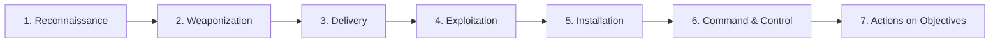
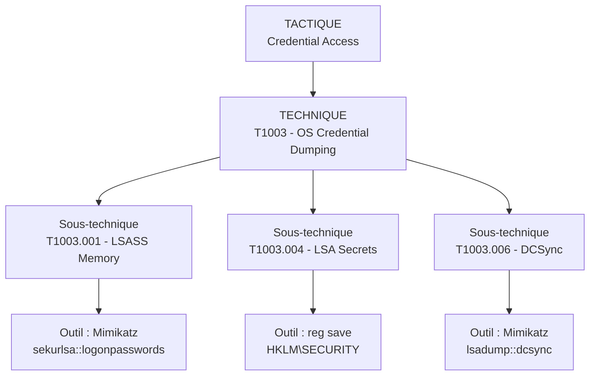

# Panorama des cybermenaces et méthodes d'attaque

## Objectifs pédagogiques

À l'issue de ce module, vous serez capable de :

1. **Identifier** les grandes familles de menaces et les distinguer selon leur vecteur d'entrée, leur objectif et leur mode opératoire.
2. **Décrire** le fonctionnement technique d'une attaque complète, du premier contact jusqu'à l'exfiltration ou le chiffrement.
3. **Analyser** un incident ou un scénario à l'aide de la Cyber Kill Chain et du framework MITRE ATT&CK.
4. **Évaluer** si une vulnérabilité est réellement exploitable dans un contexte donné, sans confondre exposition théorique et risque opérationnel.
5. **Relier** chaque technique d'attaque aux indicateurs observables qui permettent de la détecter.

---

## Mise en situation

En mai 2017, WannaCry chiffre en quelques heures des centaines de milliers de postes dans 150 pays. Le vecteur initial n'est pas un email de phishing sophistiqué : c'est EternalBlue, un exploit ciblant SMBv1 (port 445) développé par la NSA, divulgué par le groupe Shadow Brokers. Un patch existait depuis mars — MS17-010 — mais de très nombreuses organisations ne l'avaient pas déployé.

Ce qui rend cet incident représentatif, ce n'est pas l'exploit lui-même. C'est la combinaison : un service exposé, un patch non appliqué, aucune segmentation réseau interne, et un ransomware conçu pour se propager automatiquement sans interaction humaine. L'hôpital NHS qui ne peut plus accéder à ses dossiers patients ne souffre pas d'un "problème de cybersécurité" abstrait. Il souffre d'une combinaison précise de décisions techniques qui, prises individuellement, semblaient acceptables.

Ce module vous donne les outils pour décomposer n'importe quelle attaque avec ce niveau de précision.

---

## Les grandes familles de malwares

> 🧠 **Concept clé** — Un malware n'est pas défini par ce qu'il est, mais par ce qu'il fait. La même base de code peut être un espion, un relais ou un destructeur selon sa configuration.
{: .callout .callout-important}

### Ransomware

Le ransomware moderne fonctionne en deux phases distinctes. D'abord une phase de reconnaissance et de déplacement latéral — souvent plusieurs semaines — pendant laquelle l'attaquant cartographie le réseau, identifie les sauvegardes, élève ses privilèges et prépare le déploiement. Ensuite seulement vient le chiffrement, déclenché en quelques minutes sur l'ensemble des systèmes accessibles.

LockBit 3.0 utilise un modèle RaaS (Ransomware-as-a-Service) : le groupe fournit l'infrastructure de paiement et le chiffreur, les affiliés gèrent la compromission initiale. Résultat : le groupe LockBit lui-même n'a jamais besoin de phisher une cible. Ce sont ses clients qui le font.

Le chiffrement hybride est la norme : un chiffrement symétrique rapide pour les fichiers (AES ou ChaCha20 selon les familles), et une clé asymétrique (RSA ou Curve25519) pour protéger la clé symétrique (la clé de déchiffrement ne quitte jamais le serveur C2 de l'attaquant). Sans la clé privée RSA, il n'existe pas de déchiffrement possible par force brute.

### Chevaux de Troie (RAT et loaders)

Un RAT (Remote Access Trojan) cherche à paraître légitime aux yeux du système d'exploitation : il imite un processus existant, injecte du code dans des processus légitimes (`explorer.exe`, `svchost.exe`), et établit une connexion sortante vers son serveur C2 sur des ports autorisés (443, 80). Aucun port entrant n'est ouvert : un filtrage limité au trafic entrant ne suffit donc pas.

Cobalt Strike Beacon est l'exemple canonique. Il est utilisé aussi bien lors de pentests légitimes que dans des campagnes APT (APT41, APT29). Sa capacité à passer en mode "sleep" pendant de longues périodes réduit les signaux réseau à détecter.

### Vers

Un ver se propage sans fichier hôte et sans interaction utilisateur. EternalBlue + DoublePulsar (le vecteur de WannaCry) est l'exemple de référence : scan du réseau, exploitation SMBv1, injection d'un shellcode en mémoire, réplication. La phase d'exploitation se déroule en mémoire, ce qui la rend difficile à détecter pour un antivirus fondé sur les signatures de fichiers. WannaCry dépose ensuite ses binaires sur le disque.

> 🔴 **Vecteur d'attaque** — Les vers modernes combinent exploitation d'une vulnérabilité réseau (mouvement horizontal) et escalade de privilèges locale (mouvement vertical). La propagation est exponentielle : un seul hôte compromis suffit à atteindre des milliers d'autres en quelques minutes sur un réseau non segmenté.
{: .callout .callout-danger}

---

## Phishing, ingénierie sociale et vol d'identifiants

Le phishing est le vecteur d'entrée le plus fréquent dans les incidents documentés — non pas parce que les attaquants manquent d'autres options, mais parce que c'est souvent le chemin le plus rapide et le moins détectable.

### Spear phishing vs phishing de masse

| Technique | Cible | Effort | Efficacité relative |
|---|---|---|---|
| Phishing de masse | Indifférencié | Faible | Faible par message |
| Spear phishing | Individu ciblé | Moyen | Nettement plus élevée |
| Whaling | Dirigeants, DAF | Élevé | Variable |
| BEC (Business Email Compromise) | Processus financiers | Élevé | Très élevé si bien ciblé |

Un spear phishing efficace utilise des informations collectées sur LinkedIn, les publications de l'entreprise, les mentions légales. L'email envoyé à un responsable achats référence une commande réelle, utilise le bon nom de fournisseur, et pointe vers une page de login imitant exactement l'interface SSO de l'entreprise.

### AiTM (Adversary-in-the-Middle) phishing

La MFA ne suffit plus contre les attaques AiTM (Adversary-in-the-Middle). Des frameworks comme **Evilginx2** ou **Modlishka** agissent en proxy inverse : l'utilisateur se connecte réellement sur le vrai service (et passe la MFA), mais le proxy intercepte le cookie de session en transit. L'attaquant rejoue ce cookie — il n'a jamais eu besoin du mot de passe ni du second facteur.

> 🔴 **Vecteur d'attaque** — Avec Evilginx2, la chaîne complète prend moins de 10 minutes : déploiement d'un phishlet, envoi d'un lien, capture du cookie de session, accès à Microsoft 365 ou Gmail sans aucune alerte MFA côté victime.
{: .callout .callout-danger}

---

## Force brute et credential stuffing

### Force brute

La force brute classique sur un service exposé (SSH, RDP, panel d'administration) est bruyante : des milliers de tentatives génèrent des logs évidents. Les attaquants sophistiqués préfèrent le **password spraying** : un seul mot de passe commun testé sur des milliers de comptes. Cela contourne les politiques de verrouillage par compte tout en restant sous les seuils de détection si le rythme est lent.

Hydra, Medusa, et CrackMapExec sont les outils courants. CrackMapExec permet de tester des credentials volés contre une liste de machines sur un réseau Active Directory en quelques secondes.

### Credential stuffing

Après chaque fuite de données publique (Collection #1-5, par exemple), des milliards de paires email/mot de passe circulent. Le credential stuffing consiste à tester ces paires sur d'autres services — en supposant que les utilisateurs réutilisent leurs mots de passe.

> ⚠️ **Erreur fréquente** — Une application peut ne jamais avoir été compromise et pourtant présenter des connexions suspectes légitimes depuis ces bases. Les logs montrent des connexions réussies — pas d'alerte, pas d'anomalie. Seul un contrôle sur la détection d'anomalies comportementales (géolocalisation inhabituelle, appareil inconnu) permet de distinguer l'utilisateur légitime de l'attaquant.
{: .callout .callout-attention}

---

## Interception réseau : ARP et DNS spoofing

L'ARP spoofing se produit sur un réseau local, entre l'attaquant et sa cible. Le DNS spoofing peut aussi viser un résolveur à distance, par empoisonnement de cache.

### ARP spoofing

L'ARP (Address Resolution Protocol) n'a aucun mécanisme d'authentification. Sur un réseau local, n'importe quel hôte peut envoyer une réponse ARP non sollicitée (`ARP reply`) annonçant que l'IP de la passerelle correspond à sa propre adresse MAC. Les machines voisines mettent à jour leur cache ARP sans vérification.

Résultat : tout le trafic destiné à la passerelle passe désormais par l'attaquant. Outil typique : **arpspoof** (dsniff), **Ettercap**, **Bettercap**.

```
# Sur le réseau de l'attaquant : une commande par terminal, car chacune tourne en continu
arpspoof -i eth0 -t <CIBLE_IP> <GATEWAY_IP>
arpspoof -i eth0 -t <GATEWAY_IP> <CIBLE_IP>
```

Le trafic HTTPS est chiffré et non lisible directement — mais l'attaquant peut tenter un SSL stripping si le site n'impose pas HSTS, ou capturer les DNS queries en clair.

### DNS spoofing

Une fois le trafic redirigé via ARP spoofing, l'attaquant peut intercepter les requêtes DNS et y répondre avec des adresses frauduleuses avant le vrai serveur. L'outil **dnsspoof** (ou Bettercap en mode DNS) permet de pointer `login.monentreprise.com` vers un serveur sous contrôle de l'attaquant.

> 🔒 **Contrôle de sécurité** — DNSSEC signe cryptographiquement les enregistrements DNS et empêche le spoofing côté résolveur. Sur le réseau local, le Dynamic ARP Inspection (DAI) sur les switchs managés bloque les ARP replies non conformes à la table DHCP snooping. Ces contrôles réduisent fortement ces risques, mais DNSSEC est validé par le résolveur : il ne protège généralement pas le segment entre le poste et ce résolveur.
{: .callout .callout-securite}

---

## DDoS et attaques sur la disponibilité

Un DDoS (Distributed Denial of Service) vise à rendre un service inaccessible en saturant une ressource : bande passante, CPU, table de connexions TCP, file d'attente applicative.

### Taxonomie rapide

| Type | Mécanisme | Exemple |
|---|---|---|
| Volumétrique | Saturation de la bande passante | UDP flood, amplification DNS/NTP |
| Protocole | Exploitation de comportements TCP/IP | SYN flood, Ping of Death |
| Applicatif (L7) | Requêtes légitimes en volume | HTTP flood, Slowloris |

**L'amplification DNS** est particulièrement efficace : une requête de 60 octets peut provoquer une réponse de 3 000 octets si le resolver répond avec DNSSEC ou avec des enregistrements volumineux. Le facteur d'amplification peut atteindre 50×. L'attaquant spoofie l'IP source (celle de la cible) et envoie des milliers de requêtes à des resolvers ouverts.

**Slowloris** fonctionne différemment : il ouvre le maximum de connexions HTTP vers un serveur et envoie des headers incomplets très lentement, maintenant ces connexions ouvertes jusqu'à saturation du pool du serveur web. Il ne nécessite pas de bande passante importante — un seul hôte peut mettre hors service un serveur Apache mal configuré.

> 🔴 **Vecteur d'attaque** — Les botnets IoT (Mirai et ses variants) agrègent des centaines de milliers d'appareils compromis (caméras IP, routeurs) pour des attaques volumétriques. L'attaque contre le fournisseur DNS Dyn en 2016 a démontré qu'une infrastructure DNS critique peut être rendue inopérante, coupant l'accès à des services majeurs simultanément.
{: .callout .callout-danger}

---

## Attaques sur les applications et services exposés

Toute application exposée sur Internet est une surface d'attaque. Les vecteurs les plus documentés :

**Injection SQL** — L'attaquant insère des directives SQL dans un champ de formulaire. Si la requête n'est pas préparée, la base de données exécute le code injecté. `sqlmap -u "http://<HOST>/page?id=1" --dbs` automatise la découverte complète.

**XSS (Cross-Site Scripting)** — Injection de JavaScript dans des pages consultées par d'autres utilisateurs. Un XSS stocké sur un forum permet de voler les cookies de session de tous les visiteurs.

**SSRF (Server-Side Request Forgery)** — L'attaquant convainc le serveur d'effectuer des requêtes HTTP pour son compte. Dans un environnement cloud (AWS, GCP), cela permet d'atteindre l'endpoint de métadonnées (`http://169.254.169.254`) et de récupérer les credentials IAM attachés à l'instance — sans aucun accès direct au réseau interne.

**Exploitation de CVEs sur des services exposés** — Un service non patché (VPN SSL, serveur de messagerie, interface d'administration) peut être compromis directement. CVE-2021-44228 (Log4Shell) a permis une exécution de code à distance via un simple champ de log — le User-Agent HTTP suffisait à déclencher l'exploit sur des millions d'applications Java.

> 💡 **Astuce** — Pour identifier rapidement les services exposés d'une organisation, `shodan.io` indexe les banners des services accessibles sur Internet avec leurs versions. Un adversaire fait exactement cette recherche avant de vous attaquer.
{: .callout .callout-astuce}

---

## Mouvement latéral et persistance

La compromission initiale n'est qu'un point de départ. L'objectif est d'atteindre les actifs de valeur : serveurs de fichiers, contrôleurs de domaine, sauvegardes, bases de données, secrets d'infrastructure.

### Mouvement latéral

Une fois un premier poste compromis, l'attaquant cherche à progresser horizontalement vers des systèmes mieux positionnés. Les techniques courantes :

- **Pass-the-Hash** — Sur Windows, les hash NTLM peuvent être réutilisés directement pour s'authentifier sans connaître le mot de passe en clair. Outil : Mimikatz pour extraire les hashs depuis LSASS, CrackMapExec pour les rejouer.
- **Pass-the-Ticket** — Réutilisation de tickets Kerberos (TGT/TGS) volés en mémoire. Technique Overpass-the-Hash : convertir un hash NTLM en TGT Kerberos.
- **Kerberoasting** (vol d'identifiants, souvent préalable au mouvement latéral) — Demande de tickets de service pour des comptes avec un SPN (Service Principal Name), puis craquage offline du hash. Fonctionne sans aucun privilège particulier sur le domaine.
- **WMI / PSExec / SMB** — Exécution de commandes à distance sur d'autres machines du réseau si les credentials sont valides.

### Persistance

L'attaquant cherche à maintenir son accès même après un redémarrage, un changement de mot de passe, ou la suppression du malware initial :

- Clés de registre `HKCU\Software\Microsoft\Windows\CurrentVersion\Run`
- Tâches planifiées (`schtasks`) ou services Windows
- Backdoor dans les scripts de démarrage, les GPO, ou les hooks WMI
- Golden Ticket Kerberos : si l'attaquant a compromis le compte `krbtgt` (hash), il peut générer des tickets valides pour n'importe quel compte, valables 10 ans par défaut

> 🔴 **Vecteur d'attaque** — Un Golden Ticket survit à un reset du mot de passe d'un compte utilisateur. Il n'est invalidé que si le hash du compte `krbtgt` est changé deux fois (car les DCs maintiennent l'ancienne clé une période). Un attaquant avec un Golden Ticket peut rester invisible pendant des mois.
{: .callout .callout-danger}

---

## Cyber Kill Chain et MITRE ATT&CK

Ces deux frameworks ne décrivent pas les mêmes choses. Les comprendre ensemble est plus utile que de les apprendre séparément.

### Cyber Kill Chain (Lockheed Martin, 2011)

La Kill Chain décompose une attaque en 7 phases séquentielles :



La valeur opérationnelle de ce modèle : **interrompre la chaîne le plus tôt possible**. Bloquer à l'étape Delivery (filtrage email, proxy web) coûte moins cher que contenir une attaque à l'étape Actions on Objectives. Chaque étape franchie par l'attaquant représente une défense qui a échoué.

Limitation : le modèle est linéaire et centré sur l'intrusion initiale. Il sous-représente les phases post-compromission et les mouvements latéraux dans des environnements complexes.

### MITRE ATT&CK

ATT&CK (Adversarial Tactics, Techniques, and Common Knowledge) est une base de connaissances structurée décrivant les tactiques et techniques observées dans des campagnes réelles. Elle distingue :

- **Tactiques** — l'objectif de l'attaquant à une étape donnée (ex. : Credential Access, Lateral Movement, Exfiltration)
- **Techniques** — le moyen utilisé pour atteindre cet objectif (ex. : T1003 — OS Credential Dumping)
- **Sous-techniques** — la variante spécifique (ex. : T1003.001 — LSASS Memory)



La force d'ATT&CK : chaque technique référence les groupes APT connus qui l'utilisent, les détections possibles, les mitigations recommandées, et des exemples de procédures réelles. C'est un langage commun entre équipes red et blue.

> 💡 **Astuce** — Le MITRE ATT&CK Navigator (`https://mitre-attack.github.io/attack-navigator/`) permet de visualiser la couverture de détection d'un SOC en surchargeant la matrice avec les règles actives. Un exercice concret : prendre un rapport d'incident public (ex. : les rapports Mandiant ou CrowdStrike) et mapper chaque technique décrite sur ATT&CK.
{: .callout .callout-astuce}

---

## Vulnérabilité vs exploitabilité réelle

> ⚠️ **Piège central de ce module** — Un scanner de vulnérabilités qui retourne 847 CVEs ne signifie pas que 847 vecteurs d'attaque sont actifs. Cette confusion génère soit une paralysie (tout corriger en urgence), soit un désengagement (trop pour être traité).
{: .callout .callout-attention}

### Les conditions d'exploitabilité

Pour qu'une vulnérabilité soit exploitable en conditions réelles, plusieurs conditions doivent être réunies simultanément :

| Condition | Exemple |
|---|---|
| Le service vulnérable est accessible | SMBv1 exposé sur Internet vs. isolé sur un VLAN interne |
| Un exploit fonctionnel existe | PoC public disponible ou exploit dans Metasploit |
| L'attaquant est dans la bonne position réseau | ARP spoofing nécessite d'être sur le même segment L2 |
| L'environnement correspond aux prérequis | La CVE cible Windows Server 2008 mais le parc est 2022 |
| Aucun contrôle compensatoire n'est en place | EDR, WAF, MFA, segmentation peuvent rendre l'exploit inopérant |

### Exemple concret

CVE-2021-34527 (PrintNightmare) — CVSS 8.8. Exécution de code à distance et élévation de privilèges via le spooler d'impression Windows.

Un scanner retourne cette vulnérabilité sur 200 postes. Mais :
- Si le spooler est désactivé sur les serveurs critiques → les 200 postes concernés sont des postes utilisateurs
- Si l'attaquant n'a pas de pied dans le réseau interne → inaccessible depuis Internet
- Si les postes utilisateurs n'ont pas de données critiques directement accessibles → l'impact direct se limite à ces postes, mais le spooler reste exploitable à distance par un utilisateur authentifié du domaine

La CVE est réelle. Le risque opérationnel dépend du contexte.

> 🧠 **Concept clé** — Le CVSS (Common Vulnerability Scoring System) mesure la sévérité intrinsèque d'une vulnérabilité, pas le risque dans votre contexte. Le score environnemental (CVSS v3 Environmental Score) ajuste ce score en fonction de votre exposition réelle, mais il est rarement calculé par les équipes qui reçoivent les rapports de scan.
{: .callout .callout-important}

---

## Cas réel en entreprise

**Scénario illustratif — Compromission par ransomware via VPN sans MFA**

Dans ce type d'incident, la chronologie typique ressemble à ceci :

- **J-45** : L'attaquant achète un accès VPN sur un forum underground. Le vendeur a obtenu les credentials via credential stuffing depuis une fuite publique. Le compte appartient à un employé qui utilise le même mot de passe sur LinkedIn et sur le VPN de l'entreprise.
- **J-30** : Connexions VPN nocturnes depuis des IP ukrainiennes. Aucune alerte — pas de détection géographique configurée, pas de MFA sur ce VPN.
- **J-15** : Scan interne du réseau via le poste compromis. Découverte du contrôleur de domaine et du serveur de fichiers. Kerberoasting sur les comptes de service.
- **J-5** : Élévation de privilèges. Accès aux sauvegardes. Exfiltration de ~200 Go de données vers un bucket S3 temporaire.
- **J-0** : Déploiement du ransomware à 3h du matin. 400 serveurs et postes chiffrés en 47 minutes.

Ce scénario est composite — il agrège des techniques documentées dans de nombreux rapports d'incidents publics (CISA, ANSSI, Mandiant IR). Aucune entreprise ou date spécifique n'est attribuée.

Les leçons tirées sont systématiquement les mêmes dans ces cas :
1. Le vecteur initial était trivial — pas une 0-day, un mot de passe réutilisé.
2. La durée de présence de l'attaquant avant le déclenchement : plusieurs semaines.
3. Les sauvegardes étaient accessibles depuis le réseau compromis.
4. L'absence de segmentation a permis une propagation totale en moins d'une heure.

---

## Erreurs fréquentes

> ⚠️ **Confondre chiffrement et sécurité du transport** — HTTPS protège les données en transit, pas les identifiants stockés côté serveur. Un site en HTTPS peut parfaitement être vulnérable à une injection SQL ou à un vol de session. La présence du cadenas ne dit rien sur la sécurité de l'application.
{: .callout .callout-attention}

> ⚠️ **Croire que la MFA bloque tout phishing** — Les attaques AiTM (Evilginx2, Modlishka) contournent la MFA TOTP et SMS en interceptant le cookie de session post-authentification. Seules les méthodes résistantes au phishing (passkeys, FIDO2/WebAuthn) résolvent ce problème structurellement.
{: .callout .callout-attention}

> ⚠️ **Traiter les sauvegardes comme une défense anti-ransomware** — Une sauvegarde accessible depuis le réseau compromis sera chiffrée ou supprimée en premier. La règle 3-2-1 (3 copies, 2 supports différents, 1 hors ligne) n'est une défense que si la copie hors ligne est réellement déconnectée du réseau.
{: .callout .callout-attention}

> ⚠️ **Penser qu'un attaquant s'arrête après la détection** — Un attaquant qui sait avoir été détecté peut accélérer son calendrier plutôt que de se retirer. La détection sans réponse coordonnée peut provoquer un déclenchement anticipé du ransomware ou une exfiltration d'urgence.
{: .callout .callout-attention}

---

## Résumé

Les cybermenaces ne sont pas des événements discrets — elles sont des processus, souvent longs, structurés en phases progressives. Le ransomware est l'aboutissement visible d'une chaîne qui commence par un credential volé ou un service non patché. Le phishing reste le vecteur d'entrée le plus courant non pas par manque d'alternatives, mais parce que c'est souvent le chemin le plus rapide face à une défense périmétrique solide. Les attaques AiTM ont rendu la MFA classique insuffisante contre les campagnes ciblées. Le mouvement latéral — Pass-the-Hash, Kerberoasting, Golden Ticket — exploite la confiance implicite entre machines d'un même domaine. MITRE ATT&CK fournit un langage précis pour décrire et détecter chaque technique. Et surtout : une vulnérabilité avec un CVSS élevé n'est pas automatiquement un vecteur actif dans votre contexte — l'exploitabilité réelle dépend de l'accessibilité, des contrôles compensatoires et de la position de l'attaquant.

---

<!-- snippet
id: threat_ransomware_mechanism
type: concept
tech: malware
level: intermediate
importance: high
format: knowledge
tags: ransomware,chiffrement,raas,persistance,lateral-movement
title: Ransomware moderne — phases et chiffrement hybride
content: Un ransomware moderne fonctionne en deux temps : (1) phase silencieuse de plusieurs semaines — cartographie réseau, élévation de privilèges, accès aux sauvegardes ; (2) chiffrement déclenché en quelques minutes. Chiffrement hybride, par exemple AES-256 pour les fichiers et RSA-2048 pour protéger la clé AES. La clé privée RSA reste sur le C2 de l'attaquant — sans elle, aucun déchiffrement possible. Modèle RaaS : le groupe fournit l'infra, les affiliés gèrent l'intrusion initiale.
description: Le chiffrement est la dernière étape, précédée de semaines de préparation invisible — sauvegardes accessibles = sauvegardes chiffrées.
-->

<!-- snippet
id: threat_aitm_phishing_bypass
type: concept
tech: phishing
level: intermediate
importance: high
format: knowledge
tags: phishing,mfa,aitm,evilginx,cookie-hijacking
title: AiTM phishing — contournement de la MFA TOTP
content: Les frameworks AiTM (Evilginx2, Modlishka) agissent en proxy inverse : l'utilisateur s'authentifie réellement sur le vrai service et passe la MFA, mais le proxy capture le cookie de session post-authentification. L'attaquant rejoue ce cookie — il n'a jamais eu besoin du mot de passe ni du second facteur. Seules les méthodes résistantes au phishing (FIDO2/WebAuthn, passkeys) résolvent ce problème structurellement. TOTP et SMS sont vulnérables.
description: La MFA TOTP ne protège pas contre AiTM — le cookie de session est volé après l'authentification réussie, pas pendant.
-->

<!-- snippet
id: threat_credential_stuffing_detection
type: warning
tech: authentification
level: intermediate
importance: high
format: knowledge
tags: credential-stuffing,authentification,detection,anomalie
title: Credential stuffing — connexions réussies sans compromission directe
content: Après une fuite publique, des credentials valides peuvent être testés sur votre service sans qu'il ait jamais été compromis. Les connexions réussies via credential stuffing ne génèrent pas d'alerte standard — pas d'échec d'authentification en masse. Correction : détecter les anomalies comportementales (géolocalisation inhabituelle, appareil inconnu, heure atypique) et implémenter une vérification sur Have I Been Pwned pour les nouveaux mots de passe.
description: Le credential stuffing produit des connexions réussies — les alertes sur échecs d'authentification ne le détectent pas.
-->

<!-- snippet
id: threat_arp_spoofing_command
type: command
tech: réseau
level: intermediate
importance: medium
format: knowledge
tags: arp-spoofing,mitm,réseau-local,bettercap
title: ARP spoofing avec arpspoof — redirection du trafic local
context: Exécuté sur un hôte du même segment réseau L2 que la cible (lab ou pentest autorisé uniquement)
command: arpspoof -i <INTERFACE> -t <CIBLE_IP> <GATEWAY_IP>
example: arpspoof -i eth0 -t 192.168.1.50 192.168.1.1
description: Cette commande tourne en continu : pour les deux sens, lancer aussi la commande inverse dans un second terminal.
-->

<!-- snippet
id: threat_kerberoasting_principle
type: concept
tech: active-directory
level: intermediate
importance: high
format: knowledge
tags: kerberos,active-directory,credential-access,kerberoasting,mitre
title: Kerberoasting — extraction de hash sans privilèges élevés
content: Kerberoasting (T1558.003) exploite le protocole Kerberos : n'importe quel compte du domaine peut demander un ticket de service (TGS) pour un compte avec un SPN. Ce ticket est chiffré avec une clé dérivée du mot de passe du compte de service (son hash NTLM en RC4). L'attaquant exporte le ticket et le craque offline (hashcat, john). Aucun privilège particulier requis — un compte utilisateur standard suffit. Les comptes de service avec des mots de passe anciens et des SPN exposés sont les cibles prioritaires.
description: Kerberoasting ne nécessite aucun privilège élevé — un compte utilisateur de base suffit pour extraire des hash craquables offline.
-->

<!-- snippet
id: threat_golden_ticket_persistence
type: concept
tech: active-directory
level: intermediate
importance: high
format: knowledge
tags: kerberos,golden-ticket,persistance,active-directory,mitre
title: Golden Ticket — persistance post-compromission du compte krbtgt
content: Si l'attaquant compromet le hash du compte krbtgt (via DCSync ou accès direct au DC), il peut forger des tickets Kerberos valides pour n'importe quel compte, valables jusqu'à 10 ans. Ce ticket survit au reset du mot de passe des utilisateurs — seul un double reset du hash krbtgt invalide les Golden Tickets existants. Détection : tickets avec durée de vie anormale ou attributs incohérents dans les logs Kerberos (Event ID 4769).
description: Un Golden Ticket survit au reset des mots de passe utilisateurs — invalider krbtgt deux fois est la seule correction.
-->

<!-- snippet
id: threat_cvss_vs_exploitability
type: warning
tech: vulnérabilités
level: intermediate
importance: high
format: knowledge
tags: cvss,exploitabilité,gestion-vulnérabilités,risque,priorisation
title: CVSS élevé ≠ risque réel dans votre contexte
content: Le score CVSS mesure la sévérité intrinsèque d'une vulnérabilité, pas son exploitabilité dans votre environnement. Conditions à réunir pour qu'une CVE soit exploitable : service accessible depuis la position de l'attaquant, exploit fonctionnel disponible, prérequis techniques correspondants, absence de contrôle compensatoire (EDR, WAF, segmentation). Un CVSS 9.8 sur un service interne sans accès Internet et derrière un EDR est moins urgent qu'un CVSS 6.5 sur un VPN exposé sans MFA.
description: Prioriser par CVSS sans contexte génère soit de la paralysie, soit du désengagement — calculer le score environnemental ou utiliser EPSS.
-->

<!-- snippet
id: threat_mitre_attck_navigator
type: tip
tech: mitre-attck
level: intermediate
importance: medium
format: knowledge
tags: mitre,attck,soc,détection,purple-team
title: MITRE ATT&CK Navigator — visualiser la couverture de détection
content: Utiliser ATT&CK Navigator (https://mitre-attack.github.io/attack-navigator/) pour surcharger la matrice avec les règles de détection actives du SOC. Chaque cellule colorée = technique couverte. Les zones blanches = angles morts. Exercice concret : prendre un rapport d'incident public (Mandiant, CrowdStrike, CISA) et mapper chaque technique décrite — puis vérifier si ces techniques sont dans les zones blanches de votre couverture.
description: ATT&CK Navigator transforme un inventaire de règles SIEM en carte de couverture visuelle — utile pour planifier un exercice purple team.
-->

<!-- snippet
id: threat_ssrf_cloud_metadata
type: concept
tech: sécurité-applicative
level: intermediate
importance: high
format: knowledge
tags: ssrf,cloud,aws,metadata,iam
title: SSRF vers le endpoint de métadonnées cloud — vol de credentials IAM
content: Une SSRF (T1552.005) sur une application hébergée dans AWS/GCP/Azure permet d'atteindre l'endpoint de métadonnées interne (169.254.169.254 notamment). Ce endpoint retourne les credentials IAM temporaires attachés à l'instance EC2 (AccessKeyId, SecretAccessKey, Token) sans authentification. L'attaquant utilise ces credentials pour accéder à S3, RDS, ou escalader dans le compte AWS. IMDSv2 (AWS) oblige à un pre-flight PUT avec un token — il bloque les SSRF simples mais pas les SSRF avec contrôle total des headers.
description: Sur AWS avec IMDSv1 actif, une SSRF basique suffit à exfiltrer les credentials IAM de l'instance — activer IMDSv2 obligatoire.
-->

<!-- snippet
id: threat_backup_ransomware_rule
type: warning
tech: ransomware
level: intermediate
importance: high
format: knowledge
tags: ransomware,sauvegardes,résilience,3-2-1,isolation
title: Sauvegardes accessibles depuis le réseau = sauvegardes chiffrées
content: Les groupes ransomware ciblent explicitement les sauvegardes avant de déclencher le chiffrement. Une sauvegarde montée en permanence, accessible via SMB ou NFS depuis le réseau compromis, sera chiffrée ou supprimée en priorité. Correction : appliquer la règle 3-2-1 avec au moins une copie physiquement déconnectée (air-gapped) ou en mode immuable (S3 Object Lock, Azure Immutable Blob, Veeam Hardened Repository). La règle 3-2-1 n'est une défense que si la copie hors-ligne est réellement hors-ligne.
description: La règle 3-2-1 sans isolation physique ou immuabilité ne protège pas contre un ransomware ayant accès au réseau.
-->
