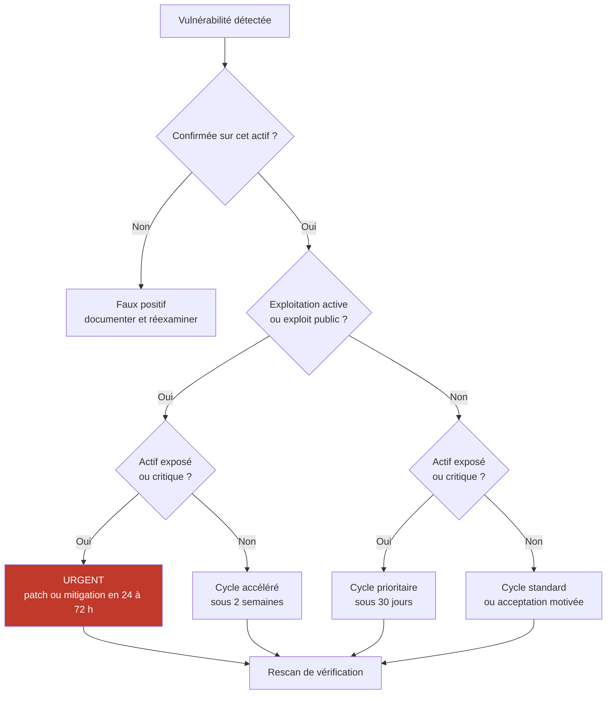

# Vulnérabilités, CVE et gestion des correctifs

## Objectifs pédagogiques

À la fin de ce module, vous saurez :

- **distinguer** une faille, une vulnérabilité et une mauvaise configuration, et choisir le bon traitement pour chacune ;
- **lire** un identifiant CVE et un vecteur CVSS, et retrouver l'information utile dans NVD, les avis éditeurs et les bulletins CERT ;
- **construire** un inventaire minimal des actifs et des logiciels, base de toute gestion de vulnérabilités ;
- **conduire** un scan sur un périmètre autorisé, puis **qualifier** les résultats en écartant les faux positifs ;
- **prioriser** selon l'exposition, l'exploitabilité et l'impact métier, puis **choisir** entre correctif, mitigation et acceptation du risque.

## Mise en situation

Lundi, 9 h. Le scanner du week-end a remonté 4 312 constats dont 187 « Critical ». L'équipe compte trois personnes, la fenêtre de maintenance est mensuelle, et la direction demande « combien de critiques sont corrigées d'ici vendredi ». Les chiffres sont illustratifs, mais l'ordre de grandeur est courant.

Faut-il trier par score CVSS et corriger du haut vers le bas ? Non, cela ne fonctionne pas. Parmi les 187 critiques, la plupart concernent des bibliothèques jamais appelées, des machines isolées ou des paquets déjà corrigés par un backport. Pendant ce temps, une vulnérabilité notée 6,5 sur le bastion d'administration, avec un module Metasploit public, reste dans la file.

Côté attaquant, le calcul est inverse. Il ne lit pas votre rapport. Il procède en trois temps :

1. il attend la publication d'un correctif ;
2. il compare l'ancienne et la nouvelle version du binaire (*patch diffing*, avec BinDiff par exemple) pour isoler le défaut ;
3. il scanne Internet avec masscan, Shodan ou Censys.
 Les templates Nuclei ou les modules Metasploit apparaissent souvent quelques jours après l'avis. Votre fenêtre de réaction se mesure en jours, pas en mois.

## Surface d'attaque

Ce qui est exposé dans une gestion de vulnérabilités ne se limite pas aux ports ouverts :

| Vecteur | Exposition | Impact potentiel |
|---|---|---|
| Service réseau obsolète (SMBv1, ancien Apache, OpenSSH ancien) | Internet ou réseau interne plat | Exécution de code à distance, mouvement latéral |
| Dépendance applicative embarquée (log4j dans un JAR, bibliothèque npm) | Invisible dans `dpkg -l` ou dans la liste des « programmes installés » | Compromission de l'application, parfois du serveur |
| Image de conteneur jamais reconstruite | Registre interne, clusters | Vulnérabilités héritées de l'image de base, persistantes |
| Équipement réseau, imprimante, hyperviseur | Souvent hors périmètre des agents | Pivot discret, rarement supervisé |
| Mauvaise configuration (Redis sans mot de passe, partage ouvert) | Aucun correctif à appliquer | Accès direct, sans exploit |
| Logiciel en fin de vie | Aucun correctif ne sera publié | Vulnérabilités permanentes, mitigation obligatoire |

> 🧠 **Concept clé**
>
> On ne corrige pas ce qu'on ne connaît pas. Un scanner ne trouve que ce qu'on lui montre et ce qu'il sait identifier. L'inventaire passe donc avant le scan.
{: .callout .callout-important}

## ⭐ Faille, vulnérabilité, mauvaise configuration

Les trois termes sont souvent mélangés dans les rapports, alors qu'ils appellent des actions différentes. Les définitions varient légèrement selon les référentiels. Voici celles qui sont utiles en opérations.

- **Faille** (*weakness*) : un défaut de conception ou de code. Une concaténation de chaînes dans une requête SQL en est un. Elle est classée par type dans le catalogue CWE (Common Weakness Enumeration). Une faille n'est pas forcément atteignable.
- **Vulnérabilité** : une faille dans un produit et une version précis, exploitable dans certaines conditions. Elle reçoit un identifiant CVE. Le correctif vient de l'éditeur.
- **Mauvaise configuration** : le logiciel fonctionne comme prévu, c'est le déploiement qui est dangereux. Elle n'a en général pas de CVE et aucun correctif éditeur n'existe. C'est à vous de la corriger.

> 🔴 **Vecteur d'attaque**
>
> Redis exposé sans authentification est le cas classique. L'attaquant se connecte avec `redis-cli -h <HOST>`, change le répertoire de sauvegarde avec `CONFIG SET dir /root/.ssh` et le nom du fichier avec `CONFIG SET dbfilename authorized_keys`, écrit sa clé publique dans une valeur, force une sauvegarde, puis se connecte en SSH. Il n'y a ni CVE ni correctif à appliquer. Un scan de versions ne verra rien, alors qu'un audit de configuration (CIS Benchmarks) trouvera le problème.
{: .callout .callout-danger}

Ces trois catégories ne se traitent pas dans la même file :

- les vulnérabilités vont dans le cycle de correctifs ;
- les mauvaises configurations vont dans le durcissement (CIS, guides ANSSI) ;
- les failles de code propre vont aux développeurs.
 Mélanger les trois dans un seul tableau de bord produit un chiffre qui ne dit rien à personne.

## CVE, CVSS et scores de sévérité

Le score le plus répandu est le CVSS (Common Vulnerability Scoring System)*, de 0,0 à 10,0 :

> 📖 **Définition**
>
> Une CVE (Common Vulnerabilities and Exposures) est un identifiant public du type `CVE-2021-44228` : l'année d'attribution suivie d'un numéro. Elle dit « cette vulnérabilité existe », rien de plus. Le score, les versions touchées et le correctif viennent d'autres sources.
{: .callout .callout-definition}

| Plage | Sévérité |
|---|---|
| 0,1 – 3,9 | Low |
| 4,0 – 6,9 | Medium |
| 7,0 – 8,9 | High |
| 9,0 – 10,0 | Critical |

Le vecteur est plus utile que le chiffre. Voici celui de Log4Shell (`CVE-2021-44228`, score 10,0) :

```text
CVSS:3.1/AV:N/AC:L/PR:N/UI:N/S:C/C:H/I:H/A:H
```

- `AV:N` : attaquable à distance par le réseau.
- `AC:L` : aucune condition particulière à réunir.
- `PR:N` / `UI:N` : sans compte ni interaction d'un utilisateur.
- `S:C` : l'impact dépasse le composant vulnérable (*scope changed*).
- `C:H/I:H/A:H` : confidentialité, intégrité et disponibilité fortement touchées.

À lire en priorité : `AV`, `PR` et `UI`. Un `AV:L` avec `PR:L` suppose que l'attaquant soit déjà sur la machine avec un compte, ce qui est un scénario très différent d'un `AV:N/PR:N`.

> ⚠️ **Le piège central du module**
>
> Un score CVSS critique n'implique pas la même urgence pour chaque organisation. Le score de base mesure la gravité intrinsèque dans le pire cas raisonnable. Il ne sait rien de votre pare-feu, de votre segmentation, de la valeur de la machine ni de l'existence d'un exploit. Le standard prévoit des métriques temporelles et environnementales pour cela, mais la plupart des scanners n'affichent que le score de base. L'inverse existe aussi : un score « High » peut justifier une action immédiate (voir le cas WannaCry plus bas).
{: .callout .callout-attention}

> 💡 **Astuce**
>
> Deux sources externes corrigent en partie cette limite.
{: .callout .callout-astuce}

- **KEV (Known Exploited Vulnerabilities)**, catalogue de la CISA : liste les CVE dont l'exploitation réelle est avérée.
- **EPSS (Exploit Prediction Scoring System)**, publié par FIRST : estime la probabilité d'exploitation d'une CVE dans les 30 jours.

> 💡 **À retenir**
>
> Une CVE présente dans KEV passe devant toutes les autres, quel que soit son score.
{: .callout .callout-important}

\* *CVSS est un standard de FIRST qui note la sévérité intrinsèque d'une vulnérabilité à partir de métriques d'attaque et d'impact, indépendamment de votre contexte ; les versions 3.1 et 4.0 coexistent dans les bases publiques.*

## Où chercher l'information fiable

| Source | Ce qu'elle apporte | Limite |
|---|---|---|
| NVD (National Vulnerability Database) | Fiche normalisée par CVE : description, score, produits concernés via les CPE (Common Platform Enumeration) | L'enrichissement peut arriver en retard, et le score NVD peut différer de celui de l'éditeur |
| Avis éditeurs (Microsoft Security Update Guide, Red Hat, Debian Security Tracker, Ubuntu USN) | Versions corrigées, correctif exact, état par distribution | Un format différent par éditeur |
| Bulletins CERT (CERT-FR avec ses avis et alertes, CISA) | Synthèse en français ou en anglais, urgence, liens vers les correctifs | Ils filtrent : tout n'y figure pas |
| KEV et EPSS | Signal d'exploitation réelle ou probable | Ne couvrent pas les produits de niche |

CERT (Computer Emergency Response Team) désigne un centre de réponse aux incidents. Pour un même produit, la source qui fait foi est l'avis de l'éditeur ou de la distribution, qui dit si votre version précise est corrigée.

Interroger NVD ou EPSS depuis un terminal évite de dépendre d'une interface web (la structure de la réponse peut évoluer) :

```bash
curl -s "https://services.nvd.nist.gov/rest/json/cves/2.0?cveId=CVE-2021-44228" \
  | jq '.vulnerabilities[0].cve.metrics.cvssMetricV31[0].cvssData | {baseScore, vectorString}'

curl -s "https://api.first.org/data/v1/epss?cve=CVE-2021-44228" | jq '.data[0]'
```

## Inventaire des actifs et des logiciels

Un inventaire exploitable répond à quatre questions pour chaque actif : qui en est propriétaire, quelle est sa criticité métier, est-il exposé à Internet, et quels logiciels (avec leurs versions) y tournent.

Pour les systèmes, la découverte réseau et les gestionnaires de paquets suffisent pour démarrer :

```bash
# Découverte des machines actives (périmètre autorisé uniquement)
nmap -sn <CIDR> -oG - | grep "Status: Up"

# Paquets installés, versionnés et datés
dpkg-query -W -f='${Package} ${Version}\n' | sort > inventaire_$(hostname)_$(date +%F).txt
rpm -qa --qf '%{NAME} %{VERSION}-%{RELEASE}\n' | sort
```

Pour les dépendances applicatives, le gestionnaire de paquets système ne voit rien. Trivy génère l'inventaire d'un projet ou d'une image sous forme de SBOM (Software Bill of Materials), par exemple `trivy fs --format cyclonedx --output sbom.json .`. Ce SBOM conserve la liste pour répondre en quelques minutes à « où utilisons-nous cette bibliothèque ? ».

> 🧾 **Analogie : la liste des ingrédients**
>
> Un SBOM joue le rôle de la composition imprimée sur un emballage alimentaire : quand un ingrédient fait l'objet d'un rappel, on lit l'étiquette au lieu d'ouvrir chaque boîte. Limite : l'étiquette ne recense que ce que l'outil a su détecter au moment où il l'a générée.
{: .callout .callout-analogie}

> 🔴 **Cas Log4Shell**
>
> Au moment de la divulgation de `CVE-2021-44228`, beaucoup d'équipes ont découvert que log4j-core était embarqué dans des JAR « shadés » (recompilés dans un autre JAR), invisibles pour un `find` sur le nom de fichier. Il fallait chercher la classe elle-même :
>
> ```bash
> find / -type f -name 'log4j-core*.jar' 2>/dev/null
> unzip -l <APPLICATION.jar> | grep JndiLookup
> ```
{: .callout .callout-danger}

> ⚠️ **Erreur fréquente**
>
> Un inventaire manuel dans un tableur, mis à jour une fois par an. Au premier avis urgent, personne ne sait dire si le produit est présent. Correction : un inventaire alimenté automatiquement (agents, découverte réseau, SBOM générés en intégration continue), avec un propriétaire par actif.
{: .callout .callout-attention}

## Scans de vulnérabilités sur un périmètre autorisé

Un scan envoie du trafic qui ressemble à une attaque et peut faire tomber un service fragile (imprimante, automate, vieil équipement). Il se fait donc toujours avec :

- une autorisation écrite précisant les plages d'adresses, les créneaux et les contacts d'urgence ;
- un profil adapté (non destructif en production, débit limité) ;
- si possible, un scan **authentifié** avec un compte en lecture seule : le scanner lit alors les paquets installés au lieu de deviner des versions à partir de bannières, ce qui réduit fortement les faux positifs et les faux négatifs.

Pour une première passe, nmap avec le script `vulners` donne un aperçu rapide, tandis que Greenbone/OpenVAS ou Nessus (ou équivalents commerciaux) couvrent le suivi dans le temps. Le script `vulners` ne confirme rien : il associe la version détectée à une base de CVE.

```bash
nmap -sV --script vulners -p 22,80,443 <TARGET>
```

> 💡 **Astuce**
>
> Planifiez le scan interne chaque semaine et comparez les résultats d'un passage à l'autre. Ce qui compte, c'est l'écart (nouvelles vulnérabilités, réapparitions), pas le total absolu.
{: .callout .callout-astuce}

## Faux positifs et validation des résultats

Un faux positif coûte du temps d'ingénierie et use la confiance des équipes d'exploitation. Au bout de trois rapports faux, plus personne ne lit le quatrième. Les causes les plus courantes :

- **Backport** : Debian, Ubuntu et Red Hat corrigent souvent une vulnérabilité dans l'ancienne version sans changer le numéro de version amont. Un scanner qui lit la bannière `OpenSSH_8.4p1` signale une vulnérabilité déjà corrigée.
- **Composant présent mais code non appelé** : la bibliothèque est dans l'image, jamais chargée.
- **Fonction désactivée** ou protégée en amont, ce que le scanner ne voit pas.
- **Erreur de détection** : le scanner confond deux produits, ou lit une bannière personnalisée.

Validation non destructive, en trois étapes. D'abord, vérifier ce que dit le paquet lui-même :

```bash
apt changelog <PACKAGE> | grep -i <CVE-ID>
rpm -q --changelog <PACKAGE> | grep <CVE-ID>
```

Ensuite, vérifier que la condition d'exploitation est réellement remplie (service écouté, option activée, chemin de code accessible). Enfin, consigner la décision (« faux positif, backport, vérifié le JJ/MM ») dans l'outil de suivi avec une date de réexamen, sinon le même constat reviendra au prochain scan.

> ⚠️ **Ne pas tomber dans l'excès inverse**
>
> Un scan non authentifié manque tout ce qui n'est pas visible depuis le réseau (bibliothèques locales, services en écoute sur localhost). L'absence de résultat ne prouve pas l'absence de vulnérabilité.
{: .callout .callout-attention}

## Prioriser : exposition, exploitabilité, impact métier

Trois questions, dans cet ordre :

1. **Exploitabilité** : la CVE est-elle dans KEV ? A-t-elle un score EPSS élevé ? Existe-t-il un exploit public (module Metasploit, template Nuclei, PoC GitHub) ?
2. **Exposition** : l'actif est-il joignable depuis Internet, depuis un réseau utilisateur, depuis un seul VLAN d'administration, ou depuis nulle part ?
3. **Impact métier** : que perd-on si l'actif est compromis (données, service, rebond vers un domaine) ?



Les délais ci-dessus sont des exemples de politique, à adapter à votre organisation.

**Scénario illustratif** : la même CVE, notée 9,8 (`AV:N/PR:N/UI:N`), touche un serveur web.

- **Organisation A** : le serveur est publié sur Internet et héberge un portail client. Correction ou mitigation en moins de 72 h.
- **Organisation B** : le même produit tourne dans un VLAN de test sans données, joignable seulement depuis deux postes d'administration. Le cycle standard suffit, avec contrôle de l'isolation.
- **À l'opposé** : une élévation de privilèges locale notée 6,5, avec module Metasploit public, sur un bastion utilisé par 40 administrateurs, peut mériter d'être traitée avant les deux premières.

Le score est le même pour A et B, l'urgence ne l'est pas.

Les métriques environnementales de CVSS permettent de formaliser cet ajustement, mais en pratique la plupart des équipes obtiennent le même résultat avec des étiquettes sur les actifs (exposition, criticité) et des règles de tri simples.

## Mise à jour, mitigation ou acceptation du risque

Trois issues légitimes, aucune n'est un échec si elle est documentée :

- **Mise à jour** : l'option par défaut. Le coût réel est le test de non-régression, le redémarrage et la fenêtre de maintenance. Déploiement par anneaux (pilote, puis groupe élargi, puis le reste), snapshot ou plan de retour arrière avant intervention.
- **Mitigation** : quand le correctif n'existe pas encore, casserait l'application, ou nécessite un arrêt impossible avant la prochaine fenêtre. Exemples : règle de filtrage réseau, désactivation de la fonction concernée, règle de détection ciblée. Une mitigation est provisoire et doit avoir un propriétaire et une échéance.
- **Acceptation du risque** : décision écrite d'une personne qui a l'autorité métier pour la prendre (pas l'équipe technique seule), avec les contrôles compensatoires, une date d'expiration et une revue planifiée.

> ⚠️ **Une mitigation peut être incomplète**
>
> Pour Log4Shell, l'option `-Dlog4j2.formatMsgNoLookups=true` a été largement diffusée comme contournement. Elle s'est ensuite révélée insuffisante dans certaines configurations (voir `CVE-2021-45046`). Si vous appliquez une mitigation, relisez l'avis de l'éditeur à chaque mise à jour, et ne considérez le sujet clos que lorsque la version corrigée est déployée.
{: .callout .callout-attention}

> 🔒 **Contrôle de sécurité**
>
> Pour un actif en fin de vie sans correctif possible, on isole (segment dédié, règles strictes), on supervise et on planifie le remplacement. Garder la machine « telle quelle, au cas où » équivaut à accepter le risque sans l'avoir décidé.
{: .callout .callout-securite}

## Configuration sécurisée de la chaîne de correctifs

Sur Debian et Ubuntu, activer les mises à jour de sécurité automatiques, sans redémarrage automatique :

```text
// /etc/apt/apt.conf.d/20auto-upgrades
APT::Periodic::Update-Package-Lists "1";
APT::Periodic::Unattended-Upgrade "1";

// /etc/apt/apt.conf.d/50unattended-upgrades
Unattended-Upgrade::Allowed-Origins {
    "${distro_id}:${distro_codename}-security";
};
Unattended-Upgrade::Automatic-Reboot "false";
Unattended-Upgrade::Mail "<ADMIN_EMAIL>";
```

Vérification sans rien installer :

```bash
sudo unattended-upgrade --dry-run --debug
```

Le coût : une mise à jour de sécurité peut redémarrer un service ou casser une dépendance. Il vaut mieux l'activer d'abord sur les serveurs non critiques, avec supervision.

Sur Windows, la même logique passe par WSUS, Intune ou un outil équivalent (chemins variables selon la version) : anneau pilote, anneau général, délais de report limités, redémarrages planifiés. Le Patch Tuesday tombe le deuxième mardi du mois : calez le cycle d'essai dessus.

Pour les conteneurs, le correctif consiste à reconstruire l'image, pas à patcher le conteneur en cours d'exécution. Un seuil en intégration continue bloque les nouvelles vulnérabilités avec correctif disponible :

```bash
trivy image --severity HIGH,CRITICAL --ignore-unfixed --exit-code 1 <IMAGE>
```

L'option `--ignore-unfixed` évite de bloquer les builds sur des CVE sans correctif. Si vous ignorez une CVE précise, utilisez un fichier `.trivyignore` avec une date d'expiration (la syntaxe peut varier selon la version) plutôt qu'une exclusion définitive.

## Contrôles de détection

Entre l'avis et le correctif, vous êtes exposé. Il faut donc chercher les tentatives d'exploitation pendant cette période.

- **Journaux applicatifs et web** : chercher les motifs publics de la vulnérabilité. Pour Log4Shell : `grep -rE '\$\{jndi:' /var/log/nginx/`. Les variantes obfusquées (`${${lower:j}ndi:`) contournent ce motif simple, il faut donc des règles plus larges dans le SIEM.
- **Sorties réseau inhabituelles** depuis un serveur applicatif vers Internet (LDAP, DNS vers un domaine inconnu), qui signent souvent un callback d'exploit.
- **Processus enfants anormaux** lancés par le service vulnérable (un serveur Java qui lance `/bin/sh`).
- **Indicateurs de pilotage du programme** : âge des vulnérabilités KEV encore ouvertes, délai moyen de correction par criticité, pourcentage d'actifs scannés avec authentification.

> ⚠️ **Erreur fréquente**
>
> Correctif installé, service jamais redémarré. Le processus continue d'utiliser l'ancienne bibliothèque en mémoire. Vérification :
>
> ```bash
> sudo needrestart -r l
> ```
{: .callout .callout-attention}

## Tests de sécurité : vérifier que le correctif a vraiment fermé la porte

Un ticket fermé ne vaut pas un problème résolu. Après chaque correction :

1. relancer un scan ciblé sur l'actif (authentifié si possible) et vérifier que le constat a disparu ;
2. contrôler la version effective : `dpkg -l <PACKAGE>`, `rpm -q <PACKAGE>`, `Get-HotFix -Id <KB>` sous Windows ;
3. vérifier que le service tourne bien avec la nouvelle version (`needrestart`, redémarrage constaté) ;
4. pour une mitigation, tester qu'elle bloque réellement (requête de test inoffensive, règle de filtrage vérifiée avec `nmap` ou `curl`) ;
5. pour un faux positif, relire la décision à la date de réexamen.

Croiser les CVE d'un export de scan avec KEV prend quelques secondes et donne immédiatement une liste de travail courte :

```bash
curl -s https://www.cisa.gov/sites/default/files/feeds/known_exploited_vulnerabilities.json -o kev.json
jq -r '.vulnerabilities[].cveID' kev.json | sort > kev_ids.txt
sort -u scan_cves.txt | comm -12 - kev_ids.txt
```

(`scan_cves.txt` contient une CVE par ligne, extraite de l'export du scanner.)

## Erreurs fréquentes

| Configuration dangereuse | Conséquence | Correction |
|---|---|---|
| File de correctifs triée uniquement par score CVSS | Temps passé sur des critiques sans exposition, alors qu'une CVE de KEV reste ouverte | Trier d'abord par KEV/exploit public, puis exposition et criticité de l'actif |
| Scan non authentifié comme seule source | Bibliothèques locales invisibles, faux positifs par bannière | Compte de scan en lecture seule sur les actifs, SBOM pour les applications |
| Acceptation de risque sans date d'expiration | « Temporaire » devient permanent, personne ne relit | Date de revue, propriétaire métier signataire, contrôles compensatoires listés |
| Correctif installé mais service non redémarré | Le processus reste vulnérable en mémoire | `needrestart -r l`, redémarrage planifié, vérification au rescan |
| Faux positif classé sans trace | Le même constat revient chaque semaine, le rapport perd sa crédibilité | Décision documentée avec preuve (changelog) et date de réexamen |
| Scan agressif sur des systèmes industriels ou anciens | Crash du service, incident causé par le scan | Profil non destructif, fenêtre validée, contact d'urgence prévenu |
| Logiciel en fin de vie « toléré » | Vulnérabilités sans correctif, accumulées | Isolation, supervision renforcée, date de remplacement actée |

## Cas réel : WannaCry et le bulletin MS17-010

Ce cas montre la défaillance de la gestion des correctifs et, en sens inverse, les limites du CVSS.

Microsoft a publié le bulletin MS17-010 le 14 mars 2017. Il corrigeait plusieurs vulnérabilités du protocole SMBv1, dont `CVE-2017-0144`, exploitée par l'outil EternalBlue. Le 12 mai 2017, le ver WannaCry a utilisé cette vulnérabilité pour se propager de machine en machine sur des réseaux du monde entier. Le correctif était donc disponible depuis environ deux mois.

Deux enseignements pour ce module :

- **Les machines touchées n'étaient pas corrigées** : soit elles manquaient dans l'inventaire, soit le correctif n'avait pas été déployé, soit le système n'était plus supporté. C'est un problème de processus, pas de technologie.
- **Le score ne disait pas tout** : la fiche NVD de `CVE-2017-0144` affiche un score CVSS v3 de l'ordre de 8,1 (High), alors que Microsoft classait le bulletin Critical. Ce qui comptait était l'exploitabilité réelle (un exploit fiable, utilisable par un ver) et l'exposition d'un protocole SMB largement accessible sur les réseaux internes plats. Un tri automatique sur le seul seuil « ≥ 9,0 » aurait pu manquer cette vulnérabilité.

Questions à vous poser après ce cas : savez-vous, en moins d'une heure, quelles machines de votre périmètre ont SMBv1 activé ? Avez-vous un moyen de savoir si le correctif est installé ? Et si un exploit public apparaît pour une vulnérabilité notée 8,x, qui décide de sortir du cycle normal ?

## Résumé

Une vulnérabilité est une faille exploitable dans un produit et une version précis, identifiée par une CVE. Une mauvaise configuration, elle, n'a pas de correctif éditeur et se traite par durcissement.

Le CVSS mesure la sévérité intrinsèque, pas votre risque : il faut le croiser avec KEV, EPSS, l'exposition de l'actif et son impact métier.

L'inventaire (actifs, paquets, dépendances, SBOM) est le prérequis de tout le reste. Les scans authentifiés sur périmètre autorisé produisent des faux positifs (backports, code non appelé) qu'il faut valider et documenter.

Les décisions possibles sont le correctif, la mitigation temporaire ou l'acceptation écrite avec date de revue.

Restent à surveiller :

- les services non redémarrés après patch ;
- les mitigations jamais remplacées ;
- les logiciels en fin de vie ;
- les tentatives d'exploitation pendant la fenêtre entre avis et correctif.

<!-- snippet
id: vuln_faille_vulnerabilite_config
type: concept
tech: vulnerabilites
level: beginner
importance: high
format: knowledge
tags: cve,vulnerabilite,configuration,cwe
title: Faille, vulnérabilité et mauvaise configuration
content: Faille = défaut de conception ou de code (type CWE). Vulnérabilité = faille exploitable dans un produit et une version précis, avec une CVE et un correctif éditeur. Mauvaise configuration = déploiement dangereux sans bug (Redis sans mot de passe, partage ouvert), sans CVE, à corriger par durcissement (CIS). Un scan de versions ne détecte pas les mauvaises configurations.
description: Chaque catégorie suit un traitement différent : correctif éditeur, durcissement ou correction de code. Les mélanger fausse les indicateurs et les priorités.
-->

<!-- snippet
id: vuln_cvss_score_not_risk
type: concept
tech: vulnerabilites
level: intermediate
importance: high
format: knowledge
tags: cvss,priorisation,risque,kev
title: Le CVSS de base n'est pas votre niveau de risque
content: Le score CVSS de base évalue la gravité intrinsèque dans le pire cas, sans connaître votre segmentation, la valeur de l'actif ni l'existence d'un exploit. Une CVE à 9,8 sur un hôte isolé peut attendre le cycle standard, alors qu'une élévation de privilèges à 6,5 avec un module Metasploit public sur un bastion partagé peut être plus urgente. Croiser le score avec KEV, EPSS, l'exposition et la criticité de l'actif.
description: Même score CVSS, urgence différente selon l'organisation : la sévérité intrinsèque se corrige avec l'exploitation réelle, l'exposition et l'impact métier.
-->

<!-- snippet
id: vuln_cvss_vector_reading
type: concept
tech: vulnerabilites
level: intermediate
importance: medium
format: knowledge
tags: cvss,vecteur,lecture,exploitabilite
title: Lire un vecteur CVSS, AV PR UI en priorité
content: Dans CVSS:3.1/AV:N/AC:L/PR:N/UI:N/S:C/C:H/I:H/A:H, AV:N signifie attaque par le réseau, PR:N aucun compte requis, UI:N aucune action utilisateur. Cette combinaison (Log4Shell, score 10,0) est exploitable à distance par un script. Un AV:L avec PR:L suppose déjà un accès local avec compte, scénario bien moins urgent.
description: Les trois métriques AV, PR et UI donnent l'essentiel de l'exploitabilité sans passer par le score global.
-->

<!-- snippet
id: vuln_kev_epss_priority
type: concept
tech: vulnerabilites
level: intermediate
importance: high
format: knowledge
tags: kev,epss,priorisation,exploitation
title: KEV et EPSS pour prioriser les correctifs
content: KEV (CISA) liste les CVE dont l'exploitation réelle est avérée, EPSS (FIRST) estime la probabilité d'exploitation dans les 30 jours. Une CVE présente dans KEV passe en tête de file, quel que soit son score CVSS. EPSS aide à départager les CVE de même sévérité quand aucun exploit n'est encore confirmé.
description: Deux signaux gratuits qui mesurent l'exploitation réelle ou probable, là où CVSS mesure uniquement la sévérité théorique.
-->

<!-- snippet
id: vuln_nvd_api_query
type: command
tech: vulnerabilites
level: intermediate
importance: medium
format: knowledge
tags: nvd,cve,curl,jq
title: Interroger NVD en ligne de commande pour une CVE
context: La structure du JSON peut évoluer ; vérifier la présence de cvssMetricV31 ou V40 selon la CVE
command: curl -s "https://services.nvd.nist.gov/rest/json/cves/2.0?cveId=<CVE_ID>" | jq '.vulnerabilities[0].cve.metrics.cvssMetricV31[0].cvssData | {baseScore, vectorString}'
example: curl -s "https://services.nvd.nist.gov/rest/json/cves/2.0?cveId=CVE-2021-44228" | jq '.vulnerabilities[0].cve.metrics.cvssMetricV31[0].cvssData | {baseScore, vectorString}'
description: Affiche le score de base et le vecteur CVSS d'une CVE sans passer par l'interface web, utile pour automatiser un tri.
-->

<!-- snippet
id: vuln_kev_crossref_scan
type: command
tech: vulnerabilites
level: intermediate
importance: high
format: knowledge
tags: kev,cisa,scan,priorisation
title: Croiser un export de scan avec le catalogue KEV
context: kev.json est le flux KEV de la CISA téléchargé au préalable (curl -s https://www.cisa.gov/sites/default/files/feeds/known_exploited_vulnerabilities.json -o kev.json) ; scan_cves.txt contient une CVE par ligne extraite de l'export du scanner
command: jq -r '.vulnerabilities[].cveID' kev.json | sort > kev_ids.txt && sort -u <SCAN_CVES_FILE> | comm -12 - kev_ids.txt
example: jq -r '.vulnerabilities[].cveID' kev.json | sort > kev_ids.txt && sort -u scan_cves.txt | comm -12 - kev_ids.txt
description: Sort la liste des CVE de votre scan déjà exploitées dans la nature, première file de travail après chaque scan.
-->

<!-- snippet
id: vuln_epss_api_query
type: command
tech: vulnerabilites
level: intermediate
importance: low
format: knowledge
tags: epss,first,curl,priorisation
title: Lire le score EPSS d'une CVE
command: curl -s "https://api.first.org/data/v1/epss?cve=<CVE_ID>" | jq '.data[0]'
example: curl -s "https://api.first.org/data/v1/epss?cve=CVE-2021-44228" | jq '.data[0]'
description: Retourne la probabilité d'exploitation sous 30 jours et son percentile, pour départager des CVE de sévérité équivalente.
-->

<!-- snippet
id: vuln_nmap_vulners_banner
type: command
tech: nmap
level: intermediate
importance: medium
format: knowledge
tags: nmap,scan,vulners,faux-positif
title: Aperçu rapide des CVE par version avec nmap vulners
context: À lancer uniquement sur un périmètre autorisé ; le résultat se base sur la version détectée, pas sur une confirmation d'exploit
command: nmap -sV --script vulners -p <PORTS> <TARGET>
example: nmap -sV --script vulners -p 22,80,443 192.168.10.20
description: Associe les versions détectées à des CVE connues ; à valider ensuite, car les backports provoquent des faux positifs.
-->

<!-- snippet
id: vuln_backport_false_positive
type: error
tech: vulnerabilites
level: intermediate
importance: high
format: knowledge
tags: faux-positif,backport,changelog,scan
title: Constat signalé alors que le paquet est corrigé (backport)
content: Symptôme : le scanner signale une CVE sur OpenSSH 8.4p1 alors que le système est à jour. Cause : Debian, Ubuntu et Red Hat corrigent dans l'ancienne version sans changer le numéro amont, et le scanner lit la bannière. Correction : vérifier avec apt changelog <PACKAGE> ou rpm -q --changelog <PACKAGE> | grep <CVE_ID>, puis documenter le faux positif avec date de réexamen.
description: La comparaison de version amont ignore les correctifs rétroportés ; seul le changelog de la distribution fait foi.
-->

<!-- snippet
id: vuln_patch_not_restarted
type: error
tech: vulnerabilites
level: intermediate
importance: high
format: knowledge
tags: patch,redemarrage,needrestart,verification
title: Paquet à jour mais processus encore vulnérable
content: Symptôme : le paquet affiche la version corrigée, le rescan détecte encore la vulnérabilité. Cause : le service n'a pas été redémarré et utilise toujours l'ancienne bibliothèque en mémoire. Correction : sudo needrestart -r l pour lister les services concernés, puis redémarrage planifié et rescan de vérification.
description: Installer le correctif ne suffit pas ; tant que le processus n'a pas redémarré, il exécute le code vulnérable chargé en mémoire.
-->

<!-- snippet
id: vuln_log4j_shaded_jar_search
type: command
tech: vulnerabilites
level: advanced
importance: medium
format: knowledge
tags: log4j,inventaire,jar,java
title: Retrouver log4j dans un JAR shadé
context: Les JAR shadés embarquent log4j sous un autre nom de fichier ; la recherche par nom manque ce cas
command: unzip -l <APPLICATION_JAR> | grep JndiLookup
example: unzip -l /opt/app/billing-service.jar | grep JndiLookup
description: Cherche la classe JndiLookup à l'intérieur du JAR, indicateur fiable de la présence de log4j-core même sans fichier nommé log4j.
-->

<!-- snippet
id: vuln_trivy_ci_gate
type: command
tech: trivy
level: intermediate
importance: medium
format: knowledge
tags: trivy,conteneur,ci,vulnerabilites
title: Bloquer un build sur les vulnérabilités corrigeables
command: trivy image --severity HIGH,CRITICAL --ignore-unfixed --exit-code 1 <IMAGE>
example: trivy image --severity HIGH,CRITICAL --ignore-unfixed --exit-code 1 registry.local/app:1.4.2
description: Échoue en CI si l'image contient une vulnérabilité High ou Critical avec correctif disponible, sans bloquer sur celles sans correctif.
-->

<!-- snippet
id: vuln_unattended_upgrades_dryrun
type: command
tech: apt
level: intermediate
importance: low
format: knowledge
tags: apt,unattended-upgrades,patch,debian
title: Tester les mises à jour automatiques sans rien installer
context: Après avoir configuré 20auto-upgrades et 50unattended-upgrades sur Debian ou Ubuntu
command: sudo unattended-upgrade --dry-run --debug
description: Affiche les paquets de l'origine sécurité qui seraient installés, pour valider la configuration avant de laisser le mécanisme agir.
-->

<!-- snippet
id: vuln_risk_acceptance_expiry
type: warning
tech: vulnerabilites
level: intermediate
importance: high
format: knowledge
tags: acceptation,risque,gouvernance,patch
title: Acceptation de risque sans expiration
content: Acceptation notée « risque accepté » dans le ticket, sans date, sans signataire métier ni contrôle compensatoire : la vulnérabilité reste ouverte indéfiniment et personne ne la réexamine. Correction : consigner le signataire métier, les contrôles compensatoires, une date d'expiration et une revue planifiée (.trivyignore avec date d'expiration pour les images).
description: Une acceptation doit être une décision datée et relue, sinon elle équivaut à un oubli.
-->

<!-- snippet
id: vuln_scan_authorization_scope
type: warning
tech: vulnerabilites
level: beginner
importance: high
format: knowledge
tags: scan,autorisation,perimetre,production
title: Lancer un scan sans périmètre ni fenêtre validés
content: Scan lancé sur des plages non autorisées ou avec un profil agressif en production : il peut faire tomber une imprimante ou un automate et engager votre responsabilité. Correction : autorisation écrite précisant plages, créneaux et contacts d'urgence, profil non destructif, débit limité, compte authentifié en lecture seule.
description: Un scan ressemble à une attaque ; sans cadre écrit, il peut provoquer un incident ou un litige.
-->

<!-- snippet
id: vuln_inventory_before_scan
type: tip
tech: vulnerabilites
level: beginner
importance: medium
format: knowledge
tags: inventaire,sbom,actifs,log4shell
title: Constituer l'inventaire avant d'acheter un scanner
content: Générer un SBOM à chaque build avec trivy ou syft, stocker la liste des paquets par machine (dpkg-query -W ou rpm -qa chaque semaine) et attribuer un propriétaire à chaque actif. Au prochain avis urgent, une recherche dans ces inventaires répond en minutes à « sommes-nous concernés ? », sans attendre un scan.
description: L'inventaire des actifs et des dépendances permet de répondre à un avis urgent sans balayer tout le réseau.
-->
