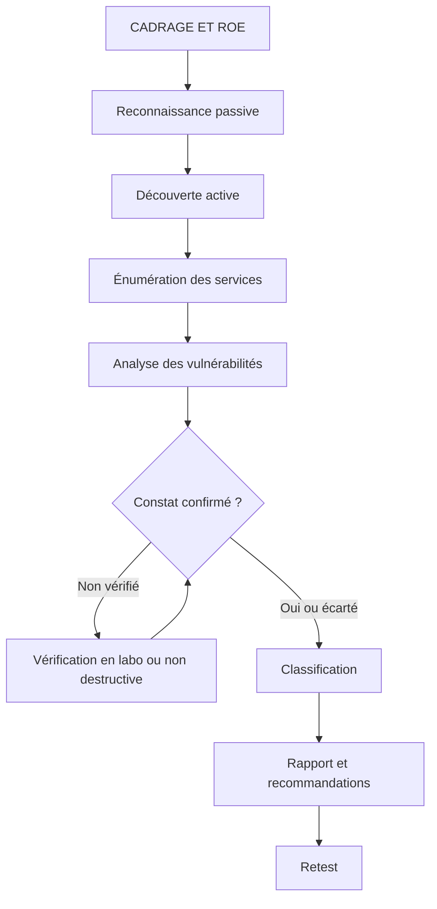

# Introduction à l'audit technique et aux tests d'intrusion

## Objectifs pédagogiques

À la fin de ce module, vous saurez :

- **distinguer** un audit de configuration, un scan de vulnérabilités et un test d'intrusion, et choisir celui qui répond à la question posée par le client
- **rédiger** un cadre d'engagement exploitable : périmètre, autorisation écrite, règles d'engagement, conditions d'arrêt
- **conduire** une reconnaissance passive puis active, et cartographier hôtes et services avec Nmap
- **qualifier** une constatation (confirmée, probable, faux positif) en vérifiant ce que l'outil affirme, en laboratoire
- **classer** les constats et **structurer** un rapport technique que le destinataire peut traiter

## Mise en situation

En mai 2017, WannaCry se propage sur des réseaux entiers via EternalBlue (CVE-2017-0144), une faille du protocole SMB. Le correctif MS17-010 était publié depuis mars. Beaucoup d'organisations avaient pourtant un scanner de vulnérabilités qui remontait le problème. Il apparaissait quelque part dans un export de plusieurs milliers de lignes, au même rang que des certificats expirés et des bannières bavardes.

Ce qui manquait n'était pas la détection. C'était la qualification : savoir que le port 445 de tel serveur était joignable depuis le VLAN des postes, que SMBv1 y était actif, et que cet hôte hébergeait un partage de production. Un scan dit « ce logiciel semble vulnérable ». Un audit technique répond à « qu'est-ce qui est réellement atteignable, par qui, avec quel effet, et que corrige-t-on en premier ».

Scénario illustratif que nous reprendrons dans tout le module : une PME de 200 postes mandate un consultant pour évaluer son réseau interne et sa façade Internet. Le DSI a déjà un rapport de scanner de 400 lignes. Il veut savoir ce qu'il doit réellement faire lundi matin.

> 🧠 **Concept clé**
>
> Un audit technique produit des **constats défendables** : chaque affirmation est accompagnée d'une preuve reproductible. C'est cette exigence qui le distingue d'un export d'outil.
{: .callout .callout-important}

## Audit, scan, pentest : trois questions différentes

Ces trois activités se confondent dans les appels d'offres, mais elles ne répondent pas à la même question et ne coûtent pas la même chose.

| Activité | Question posée | Méthode | Profondeur | Risque pour la prod |
|---|---|---|---|---|
| Audit de configuration | « Est-ce conforme à un référentiel de durcissement ? » | Revue avec accès (compte, fichiers de config), comparaison à une référence | Large sur un nombre limité d'hôtes | Faible |
| Scan de vulnérabilités | « Quelles failles connues semblent présentes ? » | Outil automatisé (Nessus, OpenVAS, Nmap NSE) | Large, superficielle | Faible à moyen |
| Pentest | « Un attaquant peut-il atteindre cet objectif ? » | Manuelle, orientée objectif, enchaînement de faiblesses | Étroite, profonde | Moyen à élevé |

Un exemple sur un même serveur Linux :

- L'**audit** constate que `PermitRootLogin yes` figure dans `sshd_config` et que les mots de passe sont autorisés, sans jamais tenter de connexion.
- Le **scan** relève qu'OpenSSH annonce une version associée à un CVE.
- Le **pentest** teste ce serveur avec une liste d'identifiants issus d'une fuite, obtient un shell, découvre une clé SSH dans le home et rebondit vers la base de données.

Ces trois approches se complètent. Le piège est de vendre ou d'acheter l'une en croyant obtenir le résultat de l'autre. Un scan à 800 € livré comme « pentest » est le cas le plus courant sur le marché.

> 💡 **Astuce**
>
> Pour tester votre compréhension, demandez-vous : le livrable contient-il une chaîne d'actions menant à un objectif (accès à un compte admin, lecture d'une donnée métier) ? Si oui, c'est un pentest. S'il contient une liste de faiblesses indépendantes, c'est un scan ou un audit.
{: .callout .callout-astuce}

## Cadrage : périmètre, autorisation, règles d'engagement

Un test d'intrusion non autorisé est une infraction. En France, l'accès ou le maintien frauduleux dans un système est visé par l'article 323-1 du Code pénal, et l'intention de « bien faire » ne change rien. L'autorisation écrite est ce qui sépare l'audit de l'intrusion.

Elle doit être signée par quelqu'un qui a **le pouvoir d'engager l'entité propriétaire des systèmes**. Le DSI ne peut pas autoriser le test d'un service hébergé chez un tiers. C'est aussi vrai pour l'hébergeur ou le fournisseur cloud, dont les conditions de test s'appliquent en plus. Deux pièges sont fréquents :

- Un périmètre exprimé en noms de domaine : le DNS d'un sous-domaine peut pointer vers l'IP mutualisée d'un SaaS qui ne vous a rien autorisé.
- Un périmètre exprimé en plage IP : une adresse peut appartenir à un prestataire.

Les règles d'engagement (ROE — Rules of Engagement) fixent le « comment ». Voici un squelette utilisable tel quel :

```yaml
engagement:
  id: <ENGAGEMENT_ID>
  signataire: <NOM_SIGNATAIRE>            # personne habilitée à engager l'entité
  fenetre: "<DATE_DEBUT> 20:00 → <DATE_FIN> 06:00 (<FUSEAU>)"
  perimetre_inclus: [<CIDR_1>, <DOMAINE_1>]
  perimetre_exclu: [<IP_ERP_PROD>, <IP_TIERS_HEBERGE>]
  techniques_autorisees: [decouverte, enumeration, scan_authentifie, verification_non_destructive]
  techniques_interdites: [deni_de_service, ingenierie_sociale, exploitation_en_prod]
  source_ip_testeur: [<IP_SOURCE>]        # permet au client de distinguer test et attaque réelle
  contact_urgence: <TEL_ASTREINTE>
  conditions_arret: "service dégradé, donnée personnelle réelle accessible, hôte hors périmètre"
  conservation_preuves: "<DUREE> jours, chiffrées, suppression attestée"
```

> 🔒 **Contrôle de sécurité**
>
> Les conditions d'arrêt protègent aussi le testeur. Si vous tombez sur un partage contenant des données de santé réelles, la règle prévue à l'avance (vous arrêtez, vous prévenez, vous ne copiez rien) évite de négocier dans l'urgence. Le coût de cette discipline est un échange de plus avec le client. Il reste négligeable face au risque de fuite causée par le prestataire lui-même.
{: .callout .callout-securite}

Le déroulé complet d'une mission suit ce schéma :



## Reconnaissance : passive puis active

### Passive : ce que l'organisation publie sans le savoir

La reconnaissance passive n'envoie aucun paquet vers la cible. Elle exploite des sources publiques, ce qu'on appelle OSINT (Open Source Intelligence). Un attaquant réel commence toujours par là, car c'est gratuit et invisible.

> 🏠 **Analogie : repérer un bâtiment**
>
> La reconnaissance passive revient à consulter le cadastre, les annonces et les photos publiques sans s'approcher. La reconnaissance active, c'est frapper à chaque porte et noter lesquelles répondent : on en apprend davantage, mais on est vu. Limite : « invisible » vaut pour la cible seulement. Les services publics interrogés (crt.sh, whois) peuvent journaliser vos requêtes.
{: .callout .callout-analogie}

```bash
# Sous-domaines révélés par la transparence des certificats
curl -s 'https://crt.sh/?q=%25.<DOMAINE>&output=json' | jq -r '.[].name_value' | sort -u

# Enregistrements DNS publics (messagerie, SPF, services tiers)
dig <DOMAINE> MX +short
dig TXT <DOMAINE> +short

# Propriétaire des plages IP
whois <IP_PUBLIQUE>
```

Les certificats émis pour `vpn-recette.<DOMAINE>` ou `jenkins-old.<DOMAINE>` trahissent des environnements que personne n'a recensés. Ce sont souvent les premières cibles intéressantes d'un attaquant, parce qu'ils sont moins patchés que la production.

### Active : on parle à la cible

La reconnaissance active envoie du trafic : elle est **détectable** et doit donc être couverte par les ROE. Cette détectabilité n'est pas un défaut. Elle sert d'indicateur, comme nous le verrons dans la partie défense.

| Vecteur observé | Exposition typique | Impact potentiel |
|---|---|---|
| Ports de gestion ouverts (22, 3389, 5900, 8080) | Directement sur Internet ou accessibles depuis le VLAN utilisateurs | Point d'entrée par force brute ou identifiants volés |
| Bannières de service avec version | Réponse par défaut d'Apache, OpenSSH, vsftpd | Cible un exploit précis sans tâtonner |
| Sous-domaines oubliés | Certificats ou DNS résiduels | Logiciel non maintenu, souvent sans authentification forte |
| Partages SMB anonymes ou invités | Serveur de fichiers ancien | Lecture de documents, scripts avec mots de passe |
| Interfaces d'administration par défaut | Imprimantes, caméras, hyperviseurs | Prise de contrôle avec identifiants constructeur |

## Découvrir machines et services avec Nmap

Nmap est l'outil de référence, car il combine découverte, détection de services et scripts. Une règle pratique : **sauvegardez tout** avec `-oA`, qui produit trois fichiers (`.nmap`, `.gnmap`, `.xml`). Ils servent de preuve, de base de comparaison au retest et d'annexe de rapport.

Étape 1 : savoir qui répond. Les fichiers de périmètre et d'exclusion sont ceux de vos ROE, pas une liste saisie de tête.

```bash
sudo nmap -sn -iL scope.txt --excludefile exclusions.txt -oA 01_discovery
grep "Status: Up" 01_discovery.gnmap | awk '{print $2}' > live_hosts.txt
```

Sur le réseau local, Nmap utilise ARP, ce qui est fiable. À distance, il combine ICMP et sondes TCP (443, 80 par défaut). Un hôte filtré peut donc sembler absent alors qu'il est actif. Un résultat « down » n'est pas une preuve d'absence.

Étape 2 : quels ports, sur ceux qui répondent.

```bash
sudo nmap -sS -p- -T3 --open -iL live_hosts.txt -oA 02_tcp_full
sudo nmap -sU --top-ports 20 -iL live_hosts.txt -oA 02_udp_top
```

`-p-` couvre les 65 535 ports TCP. Les services intéressants sont rarement sur les ports habituels : une interface d'administration sur 8443 ou 9090 est plus courante qu'un Telnet sur 23. L'analyse UDP est lente (pas de handshake, il faut attendre les délais), donc on se limite aux ports utiles : DNS, SNMP, NTP.

> ⚠️ **Erreur fréquente**
>
> Lancer `-T5` ou `--min-rate 10000` sur un réseau d'entreprise pour « gagner du temps ». Sur du matériel fragile (automates, vieux commutateurs, imprimantes), cela provoque des plantages ou des blocages de table d'état sur le pare-feu. Correction : `-T3` par défaut, et `--max-rate <PAQUETS_PAR_SEC>` imposé par le client dans les ROE pour les segments sensibles. Une mission qui dure deux heures de plus coûte moins cher qu'une panne de production.
{: .callout .callout-attention}

## Versions et configurations exposées

La détection de service interroge chaque port ouvert pour identifier ce qui tourne derrière.

```bash
nmap -sV -sC -p <PORTS> <HOST> -oA 03_services
```

`-sV` identifie le produit et sa version. `-sC` lance les scripts de la catégorie `default` du moteur de scripts NSE (Nmap Scripting Engine)*. Ces scripts sont généralement peu intrusifs mais ils envoient plus de requêtes que `-sV` seul : ne les lancez que si les ROE autorisent l'énumération. Ils s'identifient aussi dans les logs HTTP avec un User-Agent reconnaissable, ce qui sert à la détection.

\* NSE est le moteur qui exécute des scripts Lua pour tester des comportements précis : bannières, authentification anonyme, présence d'une faille.

Quelques scripts ciblés valent mieux qu'un `--script vuln` généraliste :

```bash
nmap -p 443 --script ssl-enum-ciphers <HOST>          # suites et protocoles TLS acceptés
nmap -p 21  --script ftp-anon <HOST>                  # FTP anonyme autorisé ?
nmap -p 445 --script smb-security-mode,smb2-security-mode <HOST>   # signature SMB exigée ?
nmap -p 22  --script ssh2-enum-algos <HOST>           # algorithmes SSH acceptés
```

Côté audit de configuration, on complète par une vérification **avec accès** à l'hôte. Elle donne ce qu'aucun scan externe ne verra :

```bash
# Valeurs réellement appliquées par le démon (inclut les fichiers inclus)
sudo sshd -T | grep -Ei 'permitrootlogin|passwordauthentication|x11forwarding'

# Audit de durcissement global, rapport dans /var/log/lynis-report.dat
sudo lynis audit system
```

Lynis produit un indice de durcissement et des suggestions rattachées à des contrôles. Utilisez-le comme point de départ d'entretien avec l'administrateur, pas comme verdict.

Le référentiel CIS (Center for Internet Security) Benchmarks est la référence habituelle quand le client demande une conformité chiffrée. Certaines de ses recommandations cassent toutefois des applications métier : documentez les exceptions plutôt que de les supprimer du rapport.

## Vérifier avant d'affirmer

Pourquoi un scanner se trompe-t-il ? Pour trois raisons principales.

> ⚠️ **Un outil de scan ne prouve pas automatiquement qu'une vulnérabilité est exploitable**
>
> C'est la règle la plus importante du module.
{: .callout .callout-attention}

**Le piège de la version.** Nmap lit « OpenSSH 8.9p1 » sur la bannière et le scanner associe un CVE. Or Debian, Ubuntu et RHEL pratiquent le rétroportage.

> 📖 **Définition**
>
> Le rétroportage (*backporting*) consiste, pour un éditeur, à appliquer les correctifs de sécurité à l'ancienne version d'un logiciel sans en changer le numéro.
{: .callout .callout-definition}

Le numéro de version amont affiché (8.9p1) reste donc le même avant et après le correctif. Sur Debian et Ubuntu, seul un éventuel suffixe de révision du paquet change, et beaucoup de scanners l'ignorent. Vérifiez dans le journal du paquet :

```bash
# Debian / Ubuntu
apt changelog openssh-server | grep -i CVE-<ANNEE>-<NUMERO>

# RHEL / Rocky / Alma
rpm -q --changelog openssh-server | grep CVE-<ANNEE>-<NUMERO>
```

Si le CVE apparaît dans le changelog, la faille est corrigée malgré la version affichée.

**L'inverse existe aussi.** Un scanner non authentifié ne voit pas une bibliothèque vulnérable embarquée dans une application. Log4Shell (CVE-2021-44228) en a été l'illustration : la version du serveur ne disait rien de la version de Log4j empaquetée dedans. Une absence de résultat n'est pas une preuve de sécurité.

**La condition d'exploitation.** Certaines failles exigent une configuration précise, un module activé ou une position réseau particulière.

Ce que l'on peut faire, du plus sûr au plus risqué :

1. **Comparer** la version à la source éditeur et au changelog du paquet.
2. **Tester la condition** sans exploiter, par exemple un script de détection comme `smb-vuln-ms17-010`, qui envoie une requête forgée et lit la réponse sans exécuter de code :

```bash
nmap -p 445 --script smb-vuln-ms17-010 <HOST>
```

3. **Exploiter en laboratoire**, sur une copie, pour démontrer l'impact. En laboratoire, une machine volontairement vulnérable comme Metasploitable 2 convient. Elle héberge vsftpd 2.3.4, dont la version distribuée contenait une porte dérobée (CVE-2011-2523). Nmap l'identifie, puis le script NSE `ftp-vsftpd-backdoor` ou un module Metasploit démontre l'impact. Ce script est classé exploit et intrusive : il déclenche réellement la porte dérobée et exécute une commande (`id` par défaut).

```bash
nmap -sV -p 21 <HOST_LAB>                       # détecte "vsftpd 2.3.4"
nmap -p 21 --script ftp-vsftpd-backdoor <HOST_LAB>
```

> 🔴 **Vecteur d'attaque**
>
> Dans ce cas précis, l'attaquant envoie un nom d'utilisateur se terminant par `:)` et le service ouvre un shell sur le port 6200. Un scan qui détecte la version ne dit pas si la porte dérobée est atteignable à travers vos filtres. Tester le port 6200 depuis le segment de l'attaquant le dit.
{: .callout .callout-danger}

Cette étape n'est pas toujours possible en production. Le statut de la preuve doit alors rester honnête : « version vulnérable détectée, exploitation non testée ».

## Classer les constatations et formuler les recommandations

Un constat sans classement ne sert à personne. On le classe selon deux axes distincts, qu'on mélange souvent.

**1. Niveau de preuve.** Ce que vous pouvez affirmer.

| Statut | Signification | Exemple |
|---|---|---|
| Exploité | Impact démontré (en laboratoire ou avec accord explicite) | Shell obtenu sur la copie du serveur |
| Confirmé | Condition vérifiée, exploitation non tentée | `State: VULNERABLE` sur MS17-010, port joignable |
| Probable | Version sensible, condition non vérifiée | Bannière vsftpd 2.3.4 sans test |
| Écarté | Faux positif documenté | CVE présent dans le changelog du paquet |

**2. Priorité de traitement.** Le score de base (CVSS) est un point de départ, pas la conclusion. On l'ajuste selon l'exposition (Internet, VLAN utilisateurs, réseau isolé), l'exploitabilité observée, la valeur de l'actif et les contrôles compensatoires. Une même faille notée 9,8 est urgente sur un serveur joignable depuis Internet, et peut attendre la fenêtre de maintenance sur un hôte dans un VLAN sans route.

Fiche de constat minimale :

```markdown
### C-07 — SMBv1 actif sur le serveur de fichiers
- **Actif** : <HOSTNAME> (<IP>) — partage production comptabilité
- **Preuve** : `nmap -p445 --script smb-vuln-ms17-010 <IP> -oA C07_ms17` → State: VULNERABLE (fichier C07_ms17.xml, <HORODATAGE>)
- **Statut de preuve** : Confirmé (exploitation non tentée, hôte de production)
- **Impact** : exécution de code à distance depuis tout poste du VLAN utilisateurs
- **Priorité** : Critique — exposition large, actif à forte valeur
- **Recommandation** : appliquer MS17-010 puis désactiver SMBv1 (délai : <DELAI>). Contournement immédiat : filtrer le port 445 depuis le VLAN utilisateurs
- **Effort / effet de bord** : redémarrage nécessaire ; vérifier l'imprimante multifonction qui scanne vers ce partage en SMBv1
```

> 💡 **À retenir**
>
> Une recommandation utile contient un geste précis, un délai, un propriétaire et le coût côté exploitation. « Mettre à jour le système » n'est pas une recommandation, c'est une intention.
{: .callout .callout-important}

## Structure d'un rapport technique

Un rapport a deux lecteurs : la direction, qui décide, et les équipes techniques, qui corrigent. La pratique complète est traitée au thème 31 ; voici l'ossature minimale.

| Partie | Contenu | Piège |
|---|---|---|
| Synthèse | Verdict en 5 à 10 lignes, 3 à 5 actions prioritaires | Y mettre du jargon ou du score brut |
| Périmètre et méthode | Cible, dates, source IP, outils, limites | Omettre ce qui n'a pas été testé |
| Tableau des constats | ID, actif, priorité, statut de preuve | Ordonner par outil plutôt que par risque |
| Fiches détaillées | Format ci-dessus | Preuve non reproductible |
| Annexes | Sorties brutes, commandes, horodatages | Données personnelles dans les captures |

La section « limites » est ce qui rend le rapport crédible. Dire « les hôtes du segment production n'ont été testés que de façon non intrusive » protège le client d'une fausse assurance et vous protège d'un reproche ultérieur.

## Ce que voit le défenseur

Tout ce qui précède laisse des traces. Les connaître permet de vérifier que la supervision fonctionne, et c'est parfois la meilleure constatation d'une mission : « le scan complet n'a déclenché aucune alerte ».

> 🔒 **Contrôle de sécurité**
>
> Quelques signaux simples :
>
> ```bash
> # Sources qui touchent plus de 100 ports distincts dans les logs pare-feu (format iptables LOG)
> grep 'DPT=' /var/log/kern.log \
>   | sed -E 's/.*SRC=([0-9.]+).*DPT=([0-9]+).*/\1 \2/' \
>   | sort -u | awk '{c[$1]++} END{for(i in c) if(c[i]>100) print i, c[i]}'
>
> # Scripts NSE HTTP : le User-Agent par défaut contient "Nmap Scripting Engine"
> grep -i 'Nmap Scripting Engine' /var/log/nginx/access.log
> ```
{: .callout .callout-securite}

Les IDS comme Suricata disposent de règles de la catégorie `ET SCAN` pour ce trafic. Sachez toutefois qu'un attaquant prudent ralentit, fragmente ou change le User-Agent. Ces indicateurs détectent les scans bruyants, pas les attaquants discrets. C'est une limite à noter dans le rapport.

## Rejouer et retester

Une mission ne se termine pas à la remise du rapport. Après correction, on relance la **même commande** que celle qui a servi de preuve :

```bash
nmap -p 445 --script smb-vuln-ms17-010 <HOST> -oA retest_C07
```

C'est pour cela que les fichiers `-oA` et les horodatages comptent. Comparez aussi la découverte avec l'inventaire du client : tout hôte actif absent de l'inventaire est un constat en soi (actif non géré). Si possible, scannez depuis deux positions (Internet et VLAN utilisateurs). L'écart entre les deux résultats mesure l'efficacité du filtrage, qui est souvent la vraie réponse à la question « sommes-nous exposés ? ».

## Cas réel en entreprise (scénario illustratif)

Reprenons la PME de 200 postes. Les chiffres sont fictifs et servent uniquement à illustrer la démarche.

Le rapport du scanner annonce 412 constats dont 38 « critiques ». Le consultant s'organise ainsi :

1. **ROE signées**, périmètre limité au réseau interne et à deux IP publiques. Le serveur ERP est exclu des scans actifs et traité par audit de configuration avec l'administrateur.
2. **Découverte** : 214 hôtes actifs pour 187 déclarés. Les 27 écarts sont des imprimantes, des caméras et deux serveurs de test oubliés.
3. **Qualification** des 38 critiques : 19 sont des détections par version sur des paquets rétroportés, donc écartées. 6 concernent des hôtes sans route depuis le VLAN utilisateurs, déclassées. 13 restent, dont 4 confirmées par script non destructif.
4. **Constat majeur** : un serveur de test, oublié et joignable depuis le VLAN utilisateurs, a SMBv1 actif et un partage anonyme contenant un script avec un mot de passe de compte de service.
5. **Rapport** : 3 actions prioritaires dans la synthèse, 13 fiches de constats, une section « limites » (ERP non testé activement, aucun test d'ingénierie sociale).

La valeur ajoutée tient moins à l'outil qu'au tri : de 38 alertes critiques, 4 sont à traiter immédiatement. La leçon est que la meilleure défense contre le bruit est la qualification, avec une preuve attachée à chaque ligne.

## Erreurs fréquentes

⚠️ **Périmètre défini par nom de domaine, sans vérification de la propriété des IP**

- Conséquence : le scan touche un SaaS ou un hébergeur mutualisé qui n'a rien autorisé, avec un risque juridique et contractuel.
- Correction : résoudre chaque nom, croiser avec `whois`, et faire valider par le client la liste d'IP finale. Exclure explicitement tout tiers non couvert.

⚠️ **Scan agressif lancé sans fenêtre ni contact d'urgence**

- Conséquence : plantage d'un équipement fragile, personne à appeler, perte de confiance du client.
- Correction : `-T3`, `--max-rate` imposé sur les segments sensibles, fenêtre et numéro d'astreinte dans les ROE. Test préalable sur un hôte représentatif.

⚠️ **Rapport qui reprend l'export du scanner sans qualification**

- Conséquence : le client corrige des faux positifs (version rétroportée), ignore un vrai problème noyé dans la liste, et ne croit plus le prochain rapport.
- Correction : un statut de preuve par ligne, la commande de reproduction, et la liste des faux positifs écartés en annexe.

⚠️ **`--script vuln` ou exploitation lancés « pour voir » en production**

- Conséquence : certains scripts sont classés intrusifs et peuvent déclencher un plantage de service ou modifier un état. Hors ROE, c'est une sortie de périmètre.
- Correction : n'exécuter que les scripts nécessaires et autorisés. Les démonstrations d'exploitation se font sur une copie en laboratoire, jamais sur la production sauf accord explicite.

⚠️ **Preuves conservées en clair avec des données réelles**

- Conséquence : le jeu de preuves devient lui-même une fuite potentielle (captures avec noms, extraits de fichiers RH).
- Correction : ne capturer que le minimum nécessaire (nom du fichier et taille plutôt que son contenu), chiffrer le stockage, appliquer la durée de conservation des ROE et attester de la suppression.

## Résumé

L'audit de configuration, le scan et le pentest répondent à trois questions différentes : conformité, présence probable de failles connues, atteignabilité d'un objectif. Un test légitime repose sur une autorisation écrite signée par la bonne personne, un périmètre vérifié et des règles d'engagement avec conditions d'arrêt.

La démarche procède par reconnaissance passive, découverte puis énumération avec Nmap, en archivant chaque sortie. Chaque constat est vérifié (changelog de paquet, script non destructif, exploitation en laboratoire) puis classé selon deux axes, preuve et priorité.

Il reste à surveiller les faux négatifs d'un scan non authentifié, les hôtes inconnus de l'inventaire, et la capacité de la supervision à détecter un scan discret. Le retest avec la même commande boucle la mission.

<!-- snippet
id: pentest_audit_scan_pentest_difference
type: concept
tech: pentest
level: beginner
importance: high
format: knowledge
tags: audit,pentest,scan,methodologie
title: Audit, scan et pentest répondent à trois questions
content: Audit de configuration = conformité à un référentiel avec accès à l'hôte (ex. sshd -T, Lynis). Scan = liste automatisée de failles connues probables, sans enchaînement. Pentest = chaîne d'actions manuelles vers un objectif (compte admin, donnée métier) avec preuve d'impact. Un livrable sans chaîne d'actions est un scan, quel que soit son nom commercial.
description: Critère pratique pour reconnaître chaque activité : l'audit vérifie la conformité, le scan liste, le pentest démontre un chemin d'attaque.
-->

<!-- snippet
id: pentest_roe_scope_ownership
type: warning
tech: pentest
level: intermediate
importance: high
format: knowledge
tags: roe,perimetre,autorisation,legal
title: Périmètre par nom de domaine sans vérifier les IP
content: Un périmètre exprimé en noms de domaine peut résoudre vers l'IP d'un SaaS ou d'un hébergeur mutualisé qui n'a rien autorisé, et le scan devient un accès non autorisé (art. 323-1 du Code pénal en France). Correction : résoudre chaque nom, croiser avec whois, faire valider la liste d'IP par le signataire et exclure explicitement les tiers.
description: Le signataire doit être propriétaire des systèmes ; les tiers hébergeurs ou SaaS exigent leur propre accord et leurs conditions de test.
-->

<!-- snippet
id: pentest_roe_stop_conditions
type: tip
tech: pentest
level: intermediate
importance: medium
format: knowledge
tags: roe,conditions-arret,donnees,engagement
title: Écrire les conditions d'arrêt dans les ROE
content: Ajouter dans les règles d'engagement la clause conditions_arret avec trois déclencheurs : service dégradé, donnée personnelle réelle accessible, hôte hors périmètre atteint. Ajouter un contact_urgence joignable pendant la fenêtre et une source_ip_testeur pour que le client distingue le test d'une attaque réelle.
description: Une règle d'arrêt décidée avant la mission évite de négocier dans l'urgence quand on tombe sur des données de santé ou RH réelles.
-->

<!-- snippet
id: pentest_nmap_host_discovery
type: command
tech: nmap
level: beginner
importance: high
format: knowledge
tags: nmap,decouverte,perimetre
title: Découvrir les hôtes actifs depuis le fichier de périmètre
context: À lancer uniquement sur les cibles listées dans les ROE
command: nmap -sn -iL <SCOPE_FILE> --excludefile <EXCLUDE_FILE> -oA <OUTPUT_PREFIX>
example: nmap -sn -iL scope.txt --excludefile exclusions.txt -oA 01_discovery
description: Utilise ARP en local, ICMP et sondes TCP à distance ; un hôte filtré peut paraître absent, donc « down » ne prouve pas l'absence. -oA archive les preuves.
-->

<!-- snippet
id: pentest_nmap_full_tcp_safe_rate
type: command
tech: nmap
level: intermediate
importance: medium
format: knowledge
tags: nmap,scan-tcp,performance,production
title: Scan TCP complet à cadence maîtrisée
context: -sS exige les privilèges root (sudo) ; débit à fixer avec le client dans les ROE
command: nmap -sS -p- -T3 --max-rate <PAQUETS_PAR_SEC> --open -iL <LIVE_HOSTS_FILE> -oA <OUTPUT_PREFIX>
example: nmap -sS -p- -T3 --max-rate 300 --open -iL live_hosts.txt -oA 02_tcp_full
description: Couvre les 65 535 ports ; -T5 ou un débit élevé peut faire planter automates et imprimantes ou saturer la table d'état du pare-feu. Le débit se fixe avec le client.
-->

<!-- snippet
id: pentest_nmap_service_scripts
type: command
tech: nmap
level: intermediate
importance: high
format: knowledge
tags: nmap,versions,nse,enumeration
title: Identifier versions et scripts par défaut sur des ports ciblés
context: -sC envoie plus de requêtes que -sV seul ; vérifier que les ROE autorisent l'énumération
command: nmap -sV -sC -p <PORTS> <HOST> -oA <OUTPUT_PREFIX>
example: nmap -sV -sC -p 22,80,443,445 10.10.20.15 -oA 03_services
description: -sV lit produit et version, -sC lance les scripts NSE de catégorie default. Les scripts HTTP laissent un User-Agent « Nmap Scripting Engine » dans les logs.
-->

<!-- snippet
id: pentest_scan_version_not_exploit
type: warning
tech: pentest
level: intermediate
importance: high
format: knowledge
tags: faux-positif,scan,validation,backport
title: Une bannière vulnérable ne prouve pas une faille exploitable
content: Un scanner associe un CVE à la version lue sur la bannière. Or Debian, Ubuntu et RHEL appliquent des correctifs sans changer le numéro (rétroportage), et un scan non authentifié rate les bibliothèques embarquées comme Log4j. Correction : vérifier le changelog du paquet, tester la condition par script non destructif, et noter le statut de preuve (exploité, confirmé, probable, écarté) dans le rapport.
description: Un export de scanner n'est pas un constat ; le faux positif et le faux négatif existent dans les deux sens.
-->

<!-- snippet
id: pentest_backport_changelog_check
type: command
tech: pentest
level: intermediate
importance: high
format: knowledge
tags: backport,cve,faux-positif,rhel
title: Vérifier qu'un CVE est corrigé malgré la version affichée
context: À exécuter sur l'hôte audité, avec accès autorisé
command: rpm -q --changelog <PAQUET> | grep <CVE_ID>
example: rpm -q --changelog openssh-server | grep CVE-2023-38408
description: Sur Debian/Ubuntu, utiliser apt changelog <PAQUET> | grep -i <CVE_ID>. Si le CVE figure dans le changelog, la faille est corrigée même si la bannière affiche l'ancien numéro.
-->

<!-- snippet
id: pentest_nmap_ms17_010_check
type: command
tech: nmap
level: intermediate
importance: high
format: knowledge
tags: nmap,smb,ms17-010,verification
title: Tester la présence de MS17-010 sans exploiter
context: Vérifie la condition via une requête forgée, sans exécuter de code ; réservé aux hôtes du périmètre
command: nmap -p 445 --script smb-vuln-ms17-010 <HOST>
example: nmap -p 445 --script smb-vuln-ms17-010 10.10.20.15
description: Retourne State: VULNERABLE si SMBv1 non corrigé accepte la requête. À rejouer à l'identique après correction pour le retest. Ajouter -oA <OUTPUT_PREFIX> pour conserver la sortie.
-->

<!-- snippet
id: pentest_finding_two_axes
type: tip
tech: pentest
level: intermediate
importance: medium
format: knowledge
tags: classification,priorisation,rapport,constat
title: Classer chaque constat selon preuve puis priorité
content: Renseigner deux champs distincts par constat. Statut de preuve parmi exploité, confirmé, probable, écarté. Priorité obtenue en ajustant le score de base par exposition (Internet, VLAN utilisateurs, réseau isolé), valeur de l'actif et contrôles compensatoires. Une faille notée 9,8 sur un hôte sans route peut attendre une fenêtre de maintenance.
description: Mélanger preuve et priorité fait remonter des faux positifs en tête de liste ; les deux axes se décident séparément.
-->

<!-- snippet
id: pentest_detect_port_scan_firewall_logs
type: command
tech: pentest
level: advanced
importance: medium
format: knowledge
tags: detection,scan,logs,iptables
title: Repérer les sources qui balayent beaucoup de ports
context: Suppose des logs iptables au format LOG (SRC= avant DPT=) dans /var/log/kern.log
command: grep 'DPT=' <LOG_FILE> | sed -E 's/.*SRC=([0-9.]+).*DPT=([0-9]+).*/\1 \2/' | sort -u | awk '{c[$1]++} END{for(i in c) if(c[i]>100) print i, c[i]}'
example: grep 'DPT=' /var/log/kern.log | sed -E 's/.*SRC=([0-9.]+).*DPT=([0-9]+).*/\1 \2/' | sort -u | awk '{c[$1]++} END{for(i in c) if(c[i]>100) print i, c[i]}'
description: Liste les IP sources ayant touché plus de 100 ports distincts. Ne détecte que les scans bruyants ; un scan lent ou étalé dans le temps passe sous le seuil.
-->

<!-- snippet
id: pentest_detect_nse_user_agent
type: command
tech: pentest
level: intermediate
importance: low
format: knowledge
tags: detection,nse,http,logs
title: Détecter les scripts NSE HTTP dans les logs web
command: grep -i 'Nmap Scripting Engine' <ACCESS_LOG>
example: grep -i 'Nmap Scripting Engine' /var/log/nginx/access.log
description: Le User-Agent par défaut des scripts NSE HTTP contient cette chaîne. Un attaquant averti le modifie, donc son absence ne prouve pas l'absence de scan.
-->

<!-- snippet
id: pentest_evidence_minimal_data
type: warning
tech: pentest
level: intermediate
importance: medium
format: knowledge
tags: preuves,donnees-personnelles,rapport,confidentialite
title: Captures de preuve contenant des données réelles
content: Une capture montrant le contenu d'un partage RH ou de santé transforme le dossier de preuves en fuite potentielle. Correction : consigner uniquement nom du fichier, taille, chemin et horodatage, chiffrer le stockage, appliquer la durée de conservation prévue dans les ROE et fournir une attestation de suppression.
description: Prouver l'accès sans copier la donnée : le minimum suffisant pour reproduire le constat protège le client comme le prestataire.
-->
