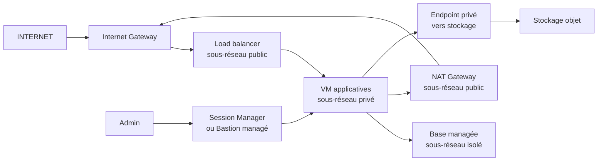
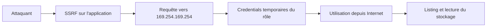

# Réseaux cloud et sécurité des infrastructures hébergées

## Objectifs pédagogiques

À l'issue de ce module, vous saurez :

- **Délimiter** ce que le fournisseur sécurise et ce qui reste à votre charge selon IaaS, PaaS et SaaS.
- **Concevoir** une topologie réseau cloud en couches (sous-réseaux publics, privés et isolés) avec routage et sortie Internet maîtrisés.
- **Durcir** le filtrage (Security Groups, NACL, firewalls) et les permissions IAM selon le moindre privilège.
- **Détecter** une exposition publique ou un abus de credentials à partir des journaux d'audit et des Flow Logs.
- **Tester** depuis l'extérieur et depuis l'instance qu'un contrôle fonctionne réellement.

---

## Mise en situation

Une équipe migre en « lift-and-shift » une application web interne vers le cloud : deux VM applicatives, une base PostgreSQL managée, un bucket de stockage pour les pièces jointes. Pour que la migration passe vite, tout est placé dans un seul réseau virtuel, avec les règles suivantes :

- SSH ouvert à `0.0.0.0/0`, « temporairement », pour que les prestataires puissent se connecter.
- Option « accessible publiquement » cochée sur la base pour tester depuis un poste de dev.
- Un rôle attaché aux VM avec `s3:*` sur `*`, parce que « ça évite les erreurs d'accès ».

L'application contient une fonction d'import d'image par URL, vulnérable à une SSRF (vue au module précédent). Un attaquant lui fait requêter `http://169.254.169.254/latest/meta-data/iam/security-credentials/`, récupère les identifiants temporaires du rôle, puis les utilise depuis sa propre machine pour lister et télécharger tous les buckets du compte. Le pare-feu applicatif est en place, la base est derrière un mot de passe fort, et pourtant les données sortent.

Ce schéma (SSRF, métadonnées d'instance, rôle trop large, stockage objet) est publiquement documenté, notamment dans l'affaire Capital One de 2019. La défense naïve échoue parce qu'elle protège le périmètre alors que l'attaquant exploite l'**identité de la machine**, qui n'a aucun lien avec le réseau.

---

## Responsabilité partagée : le contrat réel

> 🧠 **Concept clé** — Le fournisseur sécurise **le cloud** (datacenters, hyperviseur, plan de contrôle). Vous sécurisez **ce que vous y mettez et comment vous le configurez**. La frontière se déplace selon le modèle de service, mais elle ne disparaît jamais.
{: .callout .callout-important}

| Couche | IaaS (Infrastructure as a Service) | PaaS (Platform as a Service) | SaaS (Software as a Service) |
|--------|------|------|------|
| Datacenter, hyperviseur | Fournisseur | Fournisseur | Fournisseur |
| OS invité, correctifs | **Vous** | Fournisseur | Fournisseur |
| Moteur / runtime | **Vous** | Fournisseur | Fournisseur |
| Exposition réseau | **Vous** | **Vous** | Partiel (restrictions IP, accès conditionnel) |
| Identités et permissions | **Vous** | **Vous** | **Vous** |
| Données, chiffrement, partage | **Vous** | **Vous** | **Vous** |
| Application | **Vous** | **Vous** | Fournisseur |

> ⚠️ **Erreur fréquente** — « C'est du RDS managé, le fournisseur s'en occupe. » Il patche le moteur de base, mais ne décide pas à votre place que l'instance ne doit pas être joignable depuis Internet, que `rds_superuser` ne doit pas être donné à l'application, ou que les snapshots ne doivent pas être partagés publiquement. Même en SaaS, un lien de partage « tous les utilisateurs » ou un compte administrateur sans MFA relève de votre périmètre.
{: .callout .callout-attention}

Une règle de lecture utile : **plus vous montez vers le SaaS, moins vous avez de réseau à configurer et plus l'identité et la donnée concentrent le risque.**

---

## Surface d'attaque d'une infrastructure hébergée

| Vecteur | Exposition | Impact potentiel |
|---------|-----------|------------------|
| Security Group ouvert (`0.0.0.0/0` sur 22, 3389, 5432, 6379, 9200, 27017) | IP publique + règle d'entrée permissive | Brute force, exploitation d'un service sans authentification, pivot interne |
| Bucket ou blob public | ACL, policy ou « accès anonyme » activé | Fuite de données sans aucune exploitation |
| Service managé « publiquement accessible » | Endpoint DNS public résolvable | Accès direct à la base ou au cache, hors de tout contrôle réseau applicatif |
| IMDS (Instance Metadata Service)* de l'instance | Accessible depuis tout processus de la VM, y compris via SSRF | Vol des credentials du rôle attaché |
| Clés d'accès longue durée | Dépôt Git, image Docker, CI, poste de dev | Accès API complet, depuis n'importe où |
| Rôle IAM trop large | `*:*`, `iam:PassRole` sur `*` | Escalade de privilèges, prise de contrôle du compte |
| Journalisation absente ou modifiable | Trail désactivé, bucket de logs dans le même compte | Attaque invisible, effacement des traces |

\*IMDS : service HTTP local, joignable à l'adresse `169.254.169.254` depuis l'instance, qui fournit ses métadonnées et les identifiants temporaires du rôle associé.

> 🔴 **Vecteur d'attaque** — Les attaquants n'ont pas besoin de chercher longtemps. Des moteurs comme Shodan, Censys ou des scans massifs sur les plages publiques des fournisseurs indexent en continu les ports ouverts. Une base Elasticsearch ou MongoDB sans authentification, exposée sur une IP cloud, est typiquement découverte en quelques heures, pas en quelques semaines.
{: .callout .callout-danger}

---

## Architecture réseau de référence

### VPC, sous-réseaux et routage

Un VPC (Virtual Private Cloud) chez AWS, un VNet (Virtual Network) chez Azure : un réseau privé logiquement isolé dans lequel vous définissez plages CIDR, sous-réseaux et tables de routage. Ce qui rend un sous-réseau « public » n'est pas son nom : c'est **une route par défaut vers une Internet Gateway** et des instances disposant d'une IP publique. Un sous-réseau « privé » n'a pas cette route.

On construit en pratique trois couches :



- **Public** : uniquement ce qui doit recevoir du trafic entrant (load balancer, éventuellement bastion). Aucune VM applicative ici.
- **Privé** : applications. Sortie vers Internet via NAT (mises à jour, API tierces), pas d'IP publique.
- **Isolé** : bases et caches. Pas de route par défaut du tout. Seul le sous-réseau applicatif peut les joindre.

### IP publiques, privées et NAT cloud

Une IP publique attachée à une VM n'est pas « du réseau » mais une décision d'exposition. Dans une architecture saine, seuls les load balancers et les passerelles en ont. Le NAT cloud ne sert qu'à la **sortie** : il n'accepte aucune connexion entrante initiée de l'extérieur, ce qui en fait un contrôle utile contre l'exposition accidentelle, mais pas contre l'exfiltration.

> 💡 **Astuce** — Une VM sans IP publique mais dans un sous-réseau avec route vers l'Internet Gateway n'est pas joignable de l'extérieur. Dès que quelqu'un lui associe une IP élastique, elle l'est. Pour bloquer le cas à la source, interdisez par politique (SCP* ou Azure Policy) l'attribution d'IP publique hors des comptes ou sous-réseaux dédiés.
{: .callout .callout-astuce}

\*SCP (Service Control Policy) : politique AWS Organizations qui plafonne les actions autorisées dans un compte, quels que soient les droits IAM locaux.

### Coût et complexité

Cette architecture a un prix, et c'est ce qui la fait sauter en premier dans les projets pressés :

- La NAT Gateway est facturée à l'heure **et** au volume traité, ce qui devient visible quand les VM téléchargent beaucoup.
- Les endpoints privés de type *interface* sont payants. Les endpoints de type *gateway* pour le stockage objet sont gratuits chez AWS et font éviter le NAT pour ce trafic.
- Trois couches multiplient les sous-réseaux par zone de disponibilité. Un module Terraform réutilisable évite de refaire la topologie à chaque projet.

---

## Filtrage : Security Groups, NACL et firewalls

Trois mécanismes se superposent et se confondent souvent :

| Mécanisme | Niveau | État | Règles |
|-----------|--------|------|--------|
| Security Group (AWS) / NSG — Network Security Group (Azure) | Interface réseau / instance | Stateful | SG : autorisations uniquement. NSG : autorisations et refus, avec priorités |
| NACL — Network Access Control List (AWS) | Sous-réseau | Stateless | Autorisations et refus, évaluées dans l'ordre |
| Firewall managé (AWS Network Firewall, Azure Firewall…) | Flux entre réseaux et sortie | Variable | Filtrage L7, FQDN, IDS/IPS selon l'offre |

Les Security Groups font 95 % du travail. Leur force : une règle peut référencer **un autre Security Group** comme source, ce qui évite de manipuler des plages IP qui changent.

### Avant / après

```hcl
# ❌ Avant : accès direct depuis Internet, sortie totale
resource "aws_security_group" "app" {
  ingress {
    from_port   = 22
    to_port     = 22
    protocol    = "tcp"
    cidr_blocks = ["0.0.0.0/0"]
  }
  egress {
    from_port   = 0
    to_port     = 0
    protocol    = "-1"
    cidr_blocks = ["0.0.0.0/0"]
  }
}
```

```hcl
# ✅ Après : l'app ne reçoit que du load balancer, la base que de l'app
resource "aws_security_group_rule" "app_from_alb" {
  type                     = "ingress"
  from_port                = 8080
  to_port                  = 8080
  protocol                 = "tcp"
  security_group_id        = aws_security_group.app.id
  source_security_group_id = aws_security_group.alb.id
}

resource "aws_security_group_rule" "db_from_app" {
  type                     = "ingress"
  from_port                = 5432
  to_port                  = 5432
  protocol                 = "tcp"
  security_group_id        = aws_security_group.db.id
  source_security_group_id = aws_security_group.app.id
}

# Sortie de l'app vers la base : l'ingress du SG db ne suffit pas, l'egress du SG app doit aussi l'autoriser
resource "aws_security_group_rule" "app_egress_db" {
  type                     = "egress"
  from_port                = 5432
  to_port                  = 5432
  protocol                 = "tcp"
  security_group_id        = aws_security_group.app.id
  source_security_group_id = aws_security_group.db.id
}

# Sortie de l'app vers Internet limitée à HTTPS
resource "aws_security_group_rule" "app_egress_https" {
  type              = "egress"
  from_port         = 443
  to_port           = 443
  protocol          = "tcp"
  security_group_id = aws_security_group.app.id
  cidr_blocks       = ["0.0.0.0/0"]
}
```

Le filtrage sortant est celui qu'on oublie, alors qu'il conditionne l'exfiltration, les connexions de reverse shell et les canaux de commande et contrôle. Le restreindre à 443 est un compromis modeste. L'étape suivante, filtrer par FQDN avec un firewall managé, coûte cher et demande de maintenir une liste blanche : à réserver aux charges sensibles.

> 🔒 **Contrôle de sécurité** — Les NACL sont utiles comme garde-fou grossier (blocage de plages hostiles connues, interdiction de SSH depuis Internet au niveau du sous-réseau) mais deviennent vite illisibles à cause de leur nature stateless : il faut ouvrir les ports éphémères en retour. Ne les utilisez pas pour du filtrage applicatif fin.
{: .callout .callout-securite}

---

## IAM cloud : l'identité est le nouveau périmètre

### Mécanisme d'attaque : de la SSRF au compte cloud



Les credentials obtenus sont valides tant que la session n'a pas expiré, et rien ne les lie à l'instance d'origine. Avec IMDSv1, une simple requête GET suffit. IMDSv2 exige un jeton obtenu par une requête `PUT` avec un en-tête dédié, ce qui bloque la plupart des SSRF basées sur un simple GET (ainsi que le transfert via des reverse proxy mal configurés). Chez Azure, l'endpoint demande l'en-tête `Metadata: true`, chez GCP `Metadata-Flavor: Google` : la protection est équivalente en principe, mais pas aussi robuste qu'un jeton à durée limitée.

Une fois les credentials en main, l'attaquant utilise l'AWS CLI ou un outil comme **Pacu** pour énumérer ce qui est permis. Un rôle `s3:*` sur `*` ouvre tous les buckets du compte. Un rôle avec `iam:PassRole` et `ec2:RunInstances` permet souvent de lancer une instance avec un rôle plus puissant, et donc d'escalader.

### Durcir

```jsonc
// ❌ Avant
{
  "Effect": "Allow",
  "Action": "s3:*",
  "Resource": "*"
}

// ✅ Après : une action, un préfixe, un bucket
{
  "Effect": "Allow",
  "Action": ["s3:GetObject", "s3:PutObject"],
  "Resource": "arn:aws:s3:::<BUCKET>/uploads/*"
}
```

Les règles qui pèsent le plus en production :

- **Aucune clé d'accès longue durée** pour les workloads : rôle attaché à l'instance, au conteneur ou à la fonction. Les clés qui subsistent (CI externe, partenaires) doivent tourner et être détectées dans les dépôts avec `gitleaks` ou `trufflehog`.
- **Compte racine** : MFA matériel ou FIDO2, aucune clé d'accès, usage réservé aux rares opérations qui l'exigent.
- **Séparation par comptes ou abonnements** : production, préproduction et journalisation dans des comptes distincts. C'est le meilleur moyen de limiter le rayon d'impact d'une compromission, et plus fiable que n'importe quelle policy IAM fine dans un compte unique.
- **IMDSv2 obligatoire** et `hop-limit` à 1 pour qu'un conteneur en réseau bridge ne puisse pas obtenir de jeton IMDSv2 (sans effet sur un conteneur en mode réseau host).
- **Revue des permissions inutilisées** : IAM Access Analyzer (AWS) ou les outils équivalents des autres fournisseurs indiquent ce qu'un rôle n'a jamais utilisé en 90 jours. Cette revue coûte du temps d'ingénierie, mais c'est elle qui fait converger les policies vers le moindre privilège réel.

```bash
aws ec2 modify-instance-metadata-options \
  --instance-id <INSTANCE_ID> \
  --http-tokens required \
  --http-put-response-hop-limit 1
```

*Les noms d'options et l'interface varient selon la version de l'outil et le fournisseur ; le principe reste le même.*

---

## Accès aux VM et aux services managés

Le réflexe historique, « ouvrir SSH depuis l'IP du bureau », se dégrade vite : IP qui change, prestataires, télétravail, règles jamais retirées. Les alternatives sérieuses :

| Approche | Principe | Compromis |
|----------|----------|-----------|
| Session Manager (AWS SSM), Azure Bastion, GCP IAP | Connexion via le plan de contrôle du fournisseur, aucun port entrant ouvert, authentification IAM, session journalisée | Dépendance au fournisseur, agent à maintenir, coût pour Azure Bastion |
| Bastion auto-hébergé | Une VM dans le sous-réseau public, SSH vers l'interne | À patcher, à surveiller, devient une cible. Acceptable si clés courtes via CA SSH |
| VPN site-à-site ou client | Accès réseau complet au VPC | Large périmètre, à compléter par de la segmentation |

```bash
# AWS : aucune règle SSH entrante nécessaire
aws ssm start-session --target <INSTANCE_ID>

# GCP : tunnel via Identity-Aware Proxy
gcloud compute ssh <VM_NAME> --tunnel-through-iap
```

Pour les services managés, la base ne devrait avoir aucune IP publique. Si un développeur a besoin d'y accéder, il passe par un tunnel (port-forward via Session Manager ou bastion), pas par une règle ouverte. Les endpoints privés (PrivateLink, Private Endpoint) évitent que le trafic vers le service managé traverse Internet.

> ⚠️ **Erreur fréquente** — Le stockage objet, les files de messages et les clés de chiffrement ont leurs propres policies de ressource, indépendantes des Security Groups. Un VPC parfaitement segmenté n'empêche pas un bucket d'être public : ce sont deux plans de contrôle distincts.
{: .callout .callout-attention}

---

## Journalisation et visibilité

Sans logs, vous ne savez ni *si* vous avez été compromis ni *comment*. Trois sources, qui répondent à des questions différentes :

| Source | Répond à | Limite |
|--------|----------|--------|
| Journal d'audit du plan de contrôle (CloudTrail, Azure Activity Log, GCP Audit Logs) | Qui a fait quel appel API, depuis quelle IP, avec quelle identité | Par défaut, les événements de données (lecture d'objets S3, par exemple) ne sont pas inclus : à activer explicitement, avec un coût de volume |
| Flow Logs (VPC, NSG) | Quelles IP ont communiqué sur quels ports, flux acceptés ou rejetés | Métadonnées seulement : jamais le contenu des paquets |
| Logs applicatifs et de services managés | Ce qui s'est passé dans l'application ou la base | Dépend de ce que vous avez configuré |

```bash
aws ec2 create-flow-logs \
  --resource-type VPC \
  --resource-ids <VPC_ID> \
  --traffic-type ALL \
  --log-destination-type s3 \
  --log-destination arn:aws:s3:::<LOG_BUCKET>
```

> 🔒 **Contrôle de sécurité** — Envoyez les journaux vers un **compte séparé**, avec un bucket en écriture seule pour les comptes sources et la suppression restreinte. Un attaquant qui obtient des droits administrateur dans le compte de production commence souvent par chercher à arrêter la journalisation.
{: .callout .callout-securite}

### Ce qu'il faut surveiller

| Événement | Pourquoi c'est un signal |
|-----------|--------------------------|
| `StopLogging`, `DeleteTrail`, `UpdateTrail` | Tentative d'aveuglement |
| `AuthorizeSecurityGroupIngress` avec `0.0.0.0/0` | Ouverture d'exposition |
| `PutBucketPolicy`, `PutBucketAcl`, `DeletePublicAccessBlock` | Bucket potentiellement rendu public |
| `CreateAccessKey`, `AttachRolePolicy`, `PutUserPolicy` | Persistance ou escalade |
| Appels API avec une session de rôle d'instance depuis une IP hors de votre compte | Credentials volés (GuardDuty a des findings dédiés, `UnauthorizedAccess:IAMUser/InstanceCredentialExfiltration.OutsideAWS` et `.InsideAWS`) |
| `ConsoleLogin` sans MFA, ou depuis un pays inhabituel | Compromission de compte humain |
| Flux sortants volumineux vers une IP inconnue (Flow Logs) | Exfiltration potentielle |

Le piège de la détection cloud est le volume : tout journaliser et ne rien lire ne sert à rien. Commencez par les 6 ou 7 événements ci-dessus avec une alerte réelle (mail ou chat d'astreinte), puis étendez.

---

## Tests de sécurité : vérifier depuis l'extérieur

Un contrôle n'existe que si vous l'avez testé du côté attaquant.

```bash
# 1. Qu'est-ce qui répond sur mes IP publiques ?
nmap -Pn -p- --open <IP_PUBLIQUE>

# 2. Quels Security Groups ouvrent quelque chose à 0.0.0.0/0 ? (IPv6 ::/0 : filtre ip-permission.ipv6-cidr)
aws ec2 describe-security-groups \
  --filters Name=ip-permission.cidr,Values=0.0.0.0/0 \
  --query 'SecurityGroups[].[GroupId,GroupName]' --output text

# 3. Un bucket répond-il à une requête anonyme ?
aws s3 ls s3://<BUCKET> --no-sign-request

# 4. Depuis la VM : IMDSv1 est-il bien refusé ? (401 attendu)
curl -s -o /dev/null -w "%{http_code}\n" http://169.254.169.254/latest/meta-data/

# 5. Audit global de la posture
prowler aws
```

**ScoutSuite** et **Prowler** produisent un état des lieux selon les CIS Benchmarks du fournisseur. Ils sont adaptés à un audit ponctuel ou à une exécution planifiée en CI. Pour une surveillance continue, les services natifs (AWS Security Hub, Microsoft Defender for Cloud) ou une solution CSPM (Cloud Security Posture Management) automatisent cette vérification, en échange d'un coût et d'un bruit de fond à trier.

> 💡 **Astuce** — Après chaque changement de réseau, relancez `nmap` **depuis un poste externe à votre infrastructure**. Un scan depuis une VM du même VPC passe les Security Groups internes et ne prouve rien sur l'exposition réelle.
{: .callout .callout-astuce}

---

## Prise de décision : où poser le curseur

| Situation | Options | Compromis | Limite du contrôle |
|-----------|---------|-----------|--------------------|
| Accès d'administration aux VM | Session Manager / Bastion managé / VPN | SSM : sans port ouvert mais dépendance à l'agent et au fournisseur. VPN : large accès réseau | Un compte IAM d'admin compromis reste un accès complet |
| Sortie Internet des workloads | NAT seul / NAT + SG sortants stricts / firewall FQDN | Chaque palier ajoute coût et maintenance de listes d'autorisation | Le filtrage FQDN ne voit pas le contenu d'un flux HTTPS vers un domaine autorisé |
| Isolation des environnements | Un compte, plusieurs VPC / un compte par environnement | Multi-comptes : plus de plomberie (peering, rôles cross-account), mais rayon d'impact réduit | Les erreurs de rôles cross-account recréent des ponts |
| Accès au stockage objet | Via Internet / endpoint privé de type gateway | Endpoint gateway : gratuit chez AWS, et ajoute une condition réseau dans les policies | Ne protège pas contre un rôle légitime abusé |
| Posture continue | Scans ponctuels / CSPM | CSPM : couverture continue mais coût et alertes à trier | Détecte les mauvaises configurations, pas les attaques en cours |

Règle générale : **commencez par ce qui élimine une classe entière de risque pour un coût faible** (pas d'IP publique sur les VM, IMDSv2, Block Public Access au niveau compte, MFA sur les humains). Les contrôles chers (firewall FQDN, segmentation fine par workload) viennent ensuite, en fonction de la sensibilité des données.

---

## Scénario d'entreprise (illustratif)

Une société de services de taille moyenne héberge un portail client en IaaS. Les chiffres ci-dessous sont illustratifs.

1. **J0** : un audit interne lance Prowler. Résultat : 3 Security Groups ouverts sur le SSH, 1 base avec accès public, 14 rôles avec des permissions jamais utilisées, aucun événement de données dans CloudTrail.
2. **Semaine 1 – confinement** : suppression des règles `0.0.0.0/0`, passage à Session Manager, désactivation de l'accès public à la base. Impact : deux prestataires perdent leur accès SSH direct, ce qui nécessite deux jours de support.
3. **Semaines 2–3 – identité** : IMDSv2 forcé sur toutes les instances (une application ancienne utilisant IMDSv1 casse en préproduction : le SDK est mis à jour). Les policies `s3:*` sont réduites à partir de l'historique d'accès d'Access Analyzer.
4. **Semaine 4 – visibilité** : trail multi-régions vers un compte de journalisation séparé, événements de données activés sur les seuls buckets sensibles pour limiter le volume, et 7 alertes ciblées.
5. **Leçon** : le gain majeur n'a pas été l'ajout d'outils, mais la suppression de trois habitudes (IP publique par défaut, rôle large « pour simplifier », logs dans le même compte). Chaque correction a eu un coût (support, régression de compatibilité, volume de logs) à planifier dès le départ.

---

## Erreurs fréquentes

> ⚠️ **Bucket public par commodité**
{: .callout .callout-attention}

Configuration : policy avec `"Principal": "*"` ou ACL `public-read`, souvent posée pour servir un fichier à un partenaire.
Conséquence : lecture anonyme de tout le contenu, découvrable par des outils de recherche de buckets.
Correction : activer Block Public Access au niveau du **compte** (pas seulement du bucket), partager via URL présignée à durée limitée ou CloudFront. Détection : `aws s3 ls s3://<BUCKET> --no-sign-request`, Prowler, Access Analyzer.

> ⚠️ **Base managée avec accès public**
{: .callout .callout-attention}

Configuration : option « Publicly accessible = yes » plus un Security Group qui accepte `0.0.0.0/0` sur 5432.
Conséquence : scan, brute force et exploitation de vulnérabilités du moteur, sans passer par l'application.
Correction : sous-réseau isolé, SG limité au SG applicatif, accès humain par tunnel. Détection : `aws rds describe-db-instances --query 'DBInstances[?PubliclyAccessible]'`.

> ⚠️ **Clés d'accès dans le code ou l'image**
{: .callout .callout-attention}

Configuration : `AWS_ACCESS_KEY_ID` en dur dans un dépôt, un `.env` committé ou une couche d'image Docker.
Conséquence : des bots scrutent les dépôts publics et exploitent une clé en quelques minutes. Le coût se mesure souvent d'abord en minage de cryptomonnaie facturé.
Correction : rôles attachés, rotation immédiate de toute clé exposée (la supprimer du dépôt ne suffit pas, l'historique Git la contient), `gitleaks` en pre-commit et en CI.

> ⚠️ **Journalisation dans le compte compromis**
{: .callout .callout-attention}

Configuration : trail et bucket de logs dans le même compte que la production, sans protection contre la suppression.
Conséquence : l'attaquant avec des droits admin appelle `StopLogging` puis efface les logs : aucune reconstitution possible.
Correction : compte de journalisation séparé, bucket verrouillé (Object Lock ou politique de rétention), alerte sur `StopLogging`.

> ⚠️ **Confiance excessive dans le sous-réseau « privé »**
{: .callout .callout-attention}

Configuration : SG internes très permissifs (« tout le VPC peut parler à tout le VPC »).
Conséquence : une VM compromise (SSRF, dépendance vulnérable) sert de pivot vers les bases et les services internes.
Correction : règles SG par rôle (source = SG précis), filtrage sortant, surveillance des flux inhabituels dans les Flow Logs.

---

## Résumé

Héberger une application dans le cloud déplace la frontière de responsabilité sans la supprimer : le fournisseur garantit l'infrastructure sous-jacente, vous gardez la topologie réseau, les identités, la configuration des services et les données. Les attaques réelles passent peu par l'hyperviseur et beaucoup par des expositions volontaires ou héritées : un port ouvert, un bucket public, un rôle trop large couplé à une SSRF et à l'IMDS. La défense repose sur une architecture en couches (public, privé, isolé), des Security Groups référencés entre eux, des rôles au moindre privilège sans clés longue durée, un accès d'administration sans port entrant et des journaux envoyés hors du compte de production. Ce qui reste à surveiller : la dérive de configuration (une règle « temporaire » qui reste), les permissions IAM jamais auditées, et la couverture réelle de vos alertes sur les événements de contrôle.

<!-- snippet
id: cloud_responsabilite_partagee_limite
type: concept
tech: cloud
level: beginner
importance: high
format: knowledge
tags: cloud,responsabilite-partagee,iaas,paas
title: Responsabilité partagée : ce qui reste toujours chez vous
content: Le fournisseur sécurise l'hyperviseur, le datacenter et le plan de contrôle. Quel que soit le modèle (IaaS, PaaS, SaaS), vous gardez la configuration d'exposition réseau, les identités et permissions, et les données. Exemple : en PaaS (base managée), le patch du moteur est fourni, mais l'option "accès public" et les utilisateurs de la base restent votre configuration.
description: Même en PaaS ou SaaS, exposition, identités et données restent à votre charge ; seule la couche patchée par le fournisseur change.
-->

<!-- snippet
id: cloud_imds_ssrf_credentials
type: concept
tech: cloud
level: intermediate
importance: high
format: knowledge
tags: cloud,imds,ssrf,iam
title: SSRF vers IMDS : voler les credentials d'une instance
content: Une SSRF qui fait requêter http://169.254.169.254/latest/meta-data/iam/security-credentials/<ROLE> retourne AccessKeyId, SecretAccessKey et Token temporaires du rôle de l'instance en IMDSv1. L'attaquant les utilise ensuite depuis Internet avec l'AWS CLI, sans être lié à la VM. IMDSv2 exige un PUT préalable avec en-tête dédié, ce qui bloque les SSRF basées sur un simple GET.
description: Avec IMDSv1, un simple GET via SSRF suffit à obtenir des credentials utilisables depuis n'importe où ; IMDSv2 casse ce chemin.
-->

<!-- snippet
id: cloud_imdsv2_enforce
type: command
tech: cloud
level: intermediate
importance: high
format: knowledge
tags: cloud,aws,imds,hardening
title: Forcer IMDSv2 sur une instance EC2
context: AWS CLI configurée sur le compte cible ; tester en préproduction car certains SDK anciens utilisent encore IMDSv1
command: aws ec2 modify-instance-metadata-options --instance-id <INSTANCE_ID> --http-tokens required --http-put-response-hop-limit 1
example: aws ec2 modify-instance-metadata-options --instance-id i-0abc123def456789a --http-tokens required --http-put-response-hop-limit 1
description: http-tokens required refuse IMDSv1 ; hop-limit 1 empêche un conteneur en réseau bridge d'obtenir un jeton IMDSv2, mais pas un conteneur en mode réseau host.
-->

<!-- snippet
id: cloud_imds_test_v1_refuse
type: command
tech: cloud
level: intermediate
importance: medium
format: knowledge
tags: cloud,imds,test,curl
title: Vérifier que IMDSv1 est refusé depuis l'instance
context: À exécuter depuis la VM elle-même
command: curl -s -o /dev/null -w "%{http_code}\n" http://169.254.169.254/latest/meta-data/
description: Un code 401 confirme qu'IMDSv2 est exigé ; un 200 signifie qu'une SSRF peut encore lire les métadonnées avec un simple GET.
-->

<!-- snippet
id: cloud_sg_ouverts_monde_audit
type: command
tech: cloud
level: intermediate
importance: high
format: knowledge
tags: cloud,aws,security-groups,audit
title: Lister les Security Groups ouverts à 0.0.0.0/0
command: aws ec2 describe-security-groups --filters Name=ip-permission.cidr,Values=0.0.0.0/0 --query 'SecurityGroups[].[GroupId,GroupName]' --output text
description: Identifie les groupes avec au moins une règle d'entrée ouverte à 0.0.0.0/0 (IPv4 uniquement ; pour ::/0, utiliser le filtre ip-permission.ipv6-cidr) ; à croiser avec les ports 22, 3389, 5432, 6379, 9200 et 27017.
-->

<!-- snippet
id: cloud_sg_source_groupe_reference
type: tip
tech: cloud
level: intermediate
importance: medium
format: knowledge
tags: cloud,security-groups,segmentation,terraform
title: Référencer un Security Group comme source plutôt qu'un CIDR
content: Dans la règle d'entrée du SG de la base, mettre source_security_group_id = SG de l'application (au lieu de 10.0.0.0/16). Seules les instances portant ce SG peuvent joindre le port 5432, même si leurs IP changent ou si une autre VM du VPC est compromise.
description: Une règle basée sur un SG source suit les instances au lieu des plages IP, et empêche une VM voisine du même sous-réseau d'atteindre la base.
-->

<!-- snippet
id: cloud_s3_anonyme_test
type: command
tech: cloud
level: beginner
importance: high
format: knowledge
tags: cloud,aws,s3,exposition
title: Tester l'accès anonyme à un bucket S3
command: aws s3 ls s3://<BUCKET> --no-sign-request
example: aws s3 ls s3://clients-uploads-prod --no-sign-request
description: Sans credentials, un listing qui réussit prouve que le bucket est lisible publiquement ; AccessDenied est le résultat attendu.
-->

<!-- snippet
id: cloud_s3_block_public_access_compte
type: warning
tech: cloud
level: intermediate
importance: high
format: knowledge
tags: cloud,aws,s3,hardening
title: Block Public Access au niveau bucket seulement
content: Block Public Access géré bucket par bucket : depuis avril 2023, AWS l'active et désactive les ACL par défaut sur les nouveaux buckets, mais un bucket plus ancien ou dont le réglage a été désactivé peut être rendu public par une policy ou une ACL permissive. Correction : activer Block Public Access au niveau du compte (aws s3control put-public-access-block --account-id <ACCOUNT_ID> --public-access-block-configuration BlockPublicAcls=true,IgnorePublicAcls=true,BlockPublicPolicy=true,RestrictPublicBuckets=true) et l'imposer via SCP ou Terraform pour que tous les buckets, existants et futurs, soient couverts.
description: La protection par bucket peut être absente sur les buckets anciens ou désactivée explicitement ; le niveau compte couvre tout le périmètre existant et futur.
-->

<!-- snippet
id: cloud_iam_wildcard_moindre_privilege
type: warning
tech: cloud
level: intermediate
importance: high
format: knowledge
tags: cloud,iam,moindre-privilege,aws
title: Policy IAM avec Action * ou Resource * sur un rôle workload
content: Un rôle d'instance avec "s3:*" sur "*" donne à quiconque vole ses credentials (SSRF, RCE) la lecture et la suppression de tous les buckets du compte. Correction : lister les actions strictes (s3:GetObject, s3:PutObject), cibler l'ARN du bucket et du préfixe, puis affiner avec IAM Access Analyzer à partir de l'historique d'usage réel.
description: Les permissions larges transforment une compromission applicative en compromission du compte ; limiter actions et ressources borne le rayon d'impact.
-->

<!-- snippet
id: cloud_cles_longue_duree_depot
type: warning
tech: cloud
level: beginner
importance: high
format: knowledge
tags: cloud,secrets,git,iam
title: Clés d'accès cloud committées dans un dépôt
content: Une clé AWS commitée, même supprimée ensuite, reste dans l'historique Git et peut être exploitée en quelques minutes par des bots qui scannent les dépôts. Correction : révoquer et recréer la clé immédiatement, remplacer par un rôle attaché à la charge de travail, ajouter gitleaks en pre-commit et en CI.
description: Supprimer le fichier ne suffit pas, l'historique garde la clé ; la révocation immédiate et l'usage de rôles évitent la réutilisation.
-->

<!-- snippet
id: cloud_ssm_session_sans_ssh
type: command
tech: cloud
level: intermediate
importance: medium
format: knowledge
tags: cloud,aws,ssm,administration
title: Se connecter à une VM sans port SSH ouvert
context: Agent SSM installé sur l'instance, rôle d'instance avec la policy AmazonSSMManagedInstanceCore, Session Manager plugin installé sur le poste
command: aws ssm start-session --target <INSTANCE_ID>
example: aws ssm start-session --target i-0abc123def456789a
description: La connexion passe par le plan de contrôle AWS et l'authentification IAM, avec journalisation de session ; aucune règle d'entrée sur le port 22 n'est nécessaire.
-->

<!-- snippet
id: cloud_logs_compte_separe
type: tip
tech: cloud
level: advanced
importance: high
format: knowledge
tags: cloud,cloudtrail,journalisation,detection
title: Envoyer CloudTrail vers un compte de journalisation séparé
content: Créer un trail multi-régions dont le bucket de destination est dans un compte dédié, avec policy autorisant uniquement cloudtrail.amazonaws.com à écrire et Object Lock activé. Ajouter une alerte sur les événements StopLogging, DeleteTrail et UpdateTrail pour détecter toute tentative d'aveuglement.
description: Un attaquant admin du compte de production ne peut ni supprimer ni modifier des journaux stockés dans un compte qu'il ne contrôle pas.
-->

<!-- snippet
id: cloud_flow_logs_limite
type: concept
tech: cloud
level: intermediate
importance: medium
format: knowledge
tags: cloud,flow-logs,detection,reseau
title: Ce que les Flow Logs voient, et ce qu'ils ne voient pas
content: Les Flow Logs enregistrent IP source et destination, ports, protocole, volume et décision accept ou reject. Ils ne contiennent aucun payload. Ils permettent de repérer un scan (nombreux REJECT depuis une même IP) ou une exfiltration (gros volume sortant vers une IP inhabituelle), mais pas d'identifier le contenu échangé.
description: Les Flow Logs fournissent des métadonnées de flux uniquement ; pour comprendre le contenu d'un échange, il faut des logs applicatifs ou un miroir de trafic.
-->
