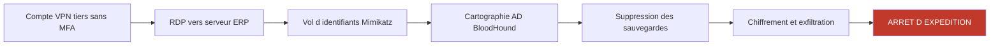
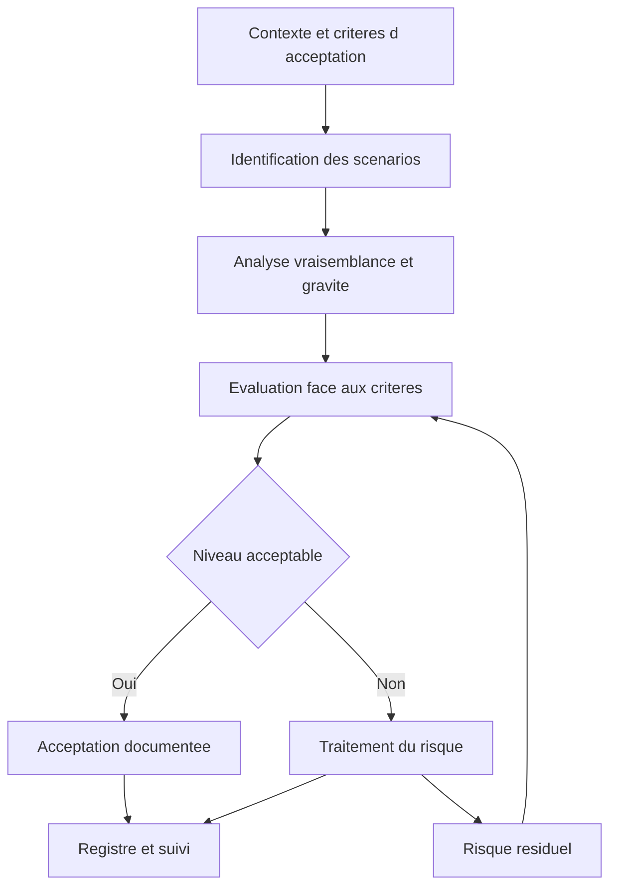

# Gestion des risques et gouvernance de la sécurité

## Objectifs pédagogiques

À la fin de ce module, vous saurez :

- **Distinguer** probabilité, vraisemblance, gravité et impact, et **évaluer** un risque avec une échelle exploitable plutôt qu'un chiffre décoratif.
- **Formuler** un scénario de risque métier à partir d'une chaîne d'attaque réelle, au lieu d'une simple liste de vulnérabilités.
- **Situer** EBIOS Risk Manager et ISO/IEC 27005 : ce que chacune produit, et quand choisir l'une ou l'autre.
- **Choisir** entre réduire, éviter, transférer et accepter un risque, et **documenter** une acceptation pour qu'elle résiste à un incident.
- **Contrôler** un registre des risques avec des commandes concrètes : exploitation connue, expiration des acceptations, mesures compensatoires réellement en place.

## Mise en situation

> Scénario fictif, chiffres illustratifs.

Un industriel de 450 salariés fait tourner son ERP (Enterprise Resource Planning) sur un Windows Server 2012 R2. Le support étendu de cet OS s'est terminé en octobre 2023, et l'éditeur de l'ERP ne certifie pas la version suivante. Le sujet remonte en comité informatique. Le DSI dit : « On accepte le risque, on migrera l'an prochain. » Rien n'est écrit, aucun responsable n'est nommé, aucune date de réexamen n'est fixée.

Dix-huit mois plus tard, un groupe de ransomware entre par un compte VPN d'un prestataire de maintenance, sans MFA (Multi-Factor Authentication). Le réseau est à plat : le compte atteint l'ERP en RDP.

Un dump de mémoire LSASS avec Mimikatz donne un compte administrateur de domaine, BloodHound cartographie le reste, et les sauvegardes en ligne sont supprimées avant le chiffrement. L'expédition est à l'arrêt neuf jours.

Aucune des défenses « naïves » n'aurait suffi :

- **Prioriser par score CVSS** ne voit pas le problème : le vrai risque n'est pas une CVE précise, c'est la combinaison d'un OS en fin de vie, d'un compte tiers sans MFA et d'un réseau sans segmentation.
- **Tout patcher** est impossible ici, puisque l'ERP ne supporte pas la mise à jour.
- **Accepter le risque** était peut-être défendable, mais une acceptation orale, sans propriétaire, sans mesure compensatoire et sans date d'expiration n'est qu'une décision oubliée.

La suite du module reprend ce scénario et montre comment le traiter correctement.

## Surface d'exposition : ce que l'organisation laisse ouvert

Ici la surface d'attaque n'est pas qu'un port ou un endpoint. Ce sont aussi des angles morts de gouvernance qui transforment une faiblesse technique en perte métier.

| Vecteur | Exposition | Impact potentiel |
|---|---|---|
| Actif support obsolète (OS en fin de support) | Aucun correctif futur, exploits publics durables | Point d'entrée ou de pivot stable pour l'attaquant |
| Compte tiers sans MFA | Accès distant valide, donc peu détectable | Intrusion sans exploit, avec des identifiants légitimes |
| Réseau plat | Un seul poste compromis suffit pour atteindre le cœur du SI | Mouvement latéral jusqu'au contrôleur de domaine |
| Exception non tracée | Personne ne sait qu'elle existe ni quand la revoir | Risque accepté de fait, sans arbitrage éclairé |
| Registre des risques inexistant ou périmé | Les décisions reposent sur la mémoire de quelques personnes | Incohérence entre ce que la direction croit couvert et ce qui l'est |
| Fournisseur critique non évalué | Dépendance sans visibilité sur son niveau de sécurité | Compromission indirecte, indisponibilité du service |

> 🧠 **Concept clé**
>
> Un risque n'existe qu'à l'intersection d'un **actif de valeur**, d'une **source de menace** et d'une **faiblesse exploitable**. Une vulnérabilité seule est un constat technique, pas un risque.
{: .callout .callout-important}

## Comment un attaquant fabrique un risque métier

Avant de défendre, comprenons le raisonnement de l'attaquant. Il ne cherche pas « la CVE la mieux notée ». Il cherche le chemin le moins coûteux vers un objectif qui rapporte : chiffrer, voler, perturber.



> 🔴 **Vecteur d'attaque**
>
> Dans ce schéma, aucune étape ne demande d'exploit sophistiqué. Mimikatz, BloodHound et des outils d'exfiltration comme Rclone sont publics. Les groupes de ransomware visent aussi les sauvegardes : la vulnérabilité CVE-2023-27532 de Veeam Backup & Replication a été utilisée pour récupérer les identifiants stockés avant le chiffrement.
{: .callout .callout-danger}

Cette lecture « chaîne d'attaque » est la matière première de l'analyse de risque. Elle explique la différence entre trois énoncés :

| Énoncé | Nature | Utilisable pour décider ? |
|---|---|---|
| « Serveur 2012 R2 non patché » | Constat technique | Non, il ne dit rien sur la perte |
| « Compromission de l'ERP » | Événement trop vague | Partiellement, la gravité reste floue |
| « Un groupe ransomware, entré par un compte prestataire, chiffre l'ERP et les sauvegardes en ligne ; expédition arrêtée plus d'une semaine » | Scénario de risque métier | Oui : source, chemin, actif et impact sont visibles |

> ⚠️ **Erreur fréquente**
>
> Remplir le registre avec des constats d'audit recopiés (« mots de passe faibles », « OS obsolète »). Correction : chaque ligne doit nommer une source de menace, un actif de valeur et une conséquence métier chiffrable ou au moins comparable.
{: .callout .callout-attention}

## Identifier, analyser, évaluer

La démarche tient en trois temps, dans le cadre d'un contexte défini au préalable (périmètre, critères, appétence au risque).



**Identification.** Les scénarios viennent de sources variées, aucune n'étant suffisante seule :

- ateliers avec les métiers : « Quelle perte vous arrêterait ? » ;
- inventaire des actifs et résultats de scans ;
- incidents internes passés et veille externe (modules 20 et 35) ;
- audits et tests d'intrusion, utiles surtout pour valider la faisabilité des chemins d'attaque.

**Analyse.** Quatre notions, souvent confondues :

| Notion | Définition pratique | Remarque |
|---|---|---|
| Probabilité | Fréquence mesurée ou estimée statistiquement | Rare en cyber : peu d'historique, adversaire qui s'adapte |
| Vraisemblance | Jugement sur la facilité et l'intérêt d'une attaque, sur une échelle qualitative | Ce qu'on estime réellement |
| Gravité | Niveau de conséquence d'un événement redouté sur l'organisation | Se pose indépendamment du chemin d'attaque |
| Impact | Conséquence concrète : euros, jours d'arrêt, données exposées | Sert à calibrer les niveaux de gravité |

Une échelle exploitable ancre chaque niveau dans une réalité mesurable, pas dans un adjectif :

| Niveau de gravité | Repère concret (exemple d'échelle) |
|---|---|
| 1 — Mineure | Moins de 4 h d'arrêt d'un service non critique |
| 2 — Significative | Un à trois jours de perturbation, perte inférieure à 50 k€ |
| 3 — Grave | Une semaine d'arrêt d'une activité clé ou fuite de données clients |
| 4 — Critique | Plus d'une semaine, perte supérieure à 500 k€ ou menace sur la survie de l'activité |

> 📖 **Définition**
>
> En approche quantitative, on calcule l'ALE (Annualized Loss Expectancy, perte annuelle attendue) : ALE = SLE (Single Loss Expectancy, coût d'une occurrence) × ARO (Annualized Rate of Occurrence, nombre d'occurrences par an).
{: .callout .callout-definition}

Avec des chiffres illustratifs : une attaque coûtant 400 000 € par occurrence, avec une occurrence tous les cinq ans (ARO = 0,2), donne un ALE de 80 000 € par an. Une mesure à 30 000 € par an qui ramène l'ARO à 0,05 laisse un ALE de 20 000 €, soit un gain net de 30 000 €.

> 💡 **Astuce**
>
> Refaites le calcul avec un ARO deux fois plus élevé et deux fois plus bas. Si la décision change, vos données sont trop fragiles pour trancher sur le seul calcul, et la discussion doit porter sur les hypothèses plutôt que sur le résultat.
{: .callout .callout-astuce}

**Évaluation.** On compare chaque risque aux critères d'acceptation définis avant l'analyse, jamais après.

> 🎯 **Analogie : la cible dessinée après le tir**
>
> Définir le seuil une fois les résultats connus, c'est tirer la flèche puis dessiner la cible autour : on « touche » à chaque fois, mais la règle a été ajustée au résultat voulu.
{: .callout .callout-analogie}

> ⚠️ **Piège de la matrice**
>
> Une matrice 4×4 écrase les écarts. Deux risques classés « orange » peuvent différer d'un facteur 20 en perte attendue. Gardez la matrice comme support de discussion, pas comme arbitre.
{: .callout .callout-attention}

## EBIOS Risk Manager : une méthode qui part de l'attaquant

EBIOS Risk Manager est la méthode d'appréciation des risques publiée par l'ANSSI. Sa logique inverse celle d'un inventaire d'actifs. Elle part :

1. de ce que l'organisation doit protéger ;
2. puis de qui voudrait l'atteindre ;
3. et seulement ensuite des moyens techniques.

La méthode se déroule en cinq ateliers. L'ANSSI met à jour sa documentation : vérifiez la version en vigueur et les supports officiels avant de démarrer une mission.

| Atelier | Question traitée | Production |
|---|---|---|
| 1 — Cadrage et socle de sécurité | Que protège-t-on ? Quels événements redoutés ? Quel est l'état de la sécurité aujourd'hui ? | Valeurs métier, événements redoutés avec gravité, écarts au socle |
| 2 — Sources de risque | Qui nous cible et pourquoi ? | Couples source de risque / objectif visé retenus |
| 3 — Scénarios stratégiques | Par quels partenaires ou chemins de haut niveau ? | Scénarios stratégiques, mesures sur l'écosystème |
| 4 — Scénarios opérationnels | Comment techniquement ? | Modes opératoires, vraisemblance, souvent rapprochés de MITRE ATT&CK |
| 5 — Traitement du risque | Que fait-on des risques évalués ? | Plan d'amélioration continue de la sécurité (PACS), risques résiduels |

Reprenons le scénario : le prestataire de maintenance est une partie prenante de l'écosystème. L'atelier 3 fait émerger le chemin « compromission du prestataire → accès à l'ERP ». L'atelier 4 le décline en techniques d'attaque, ce qu'un scan de vulnérabilités ne produit pas.

> 💡 **Astuce**
>
> Pour un premier exercice, lancez-vous sur un seul événement redouté (par exemple « arrêt de la production plus de 3 jours ») et déroulez les cinq ateliers dessus. Un périmètre complet dès le départ produit en général un document que personne ne maintient.
{: .callout .callout-astuce}

## ISO/IEC 27005 : le cadre de gestion des risques

ISO/IEC 27005 est la norme de lignes directrices pour gérer les risques liés à la sécurité de l'information. Elle n'est pas certifiable : c'est ISO/IEC 27001 qui l'est. Quel lien entre les deux ? La 27001 exige un processus de gestion des risques (appréciation, traitement, plan de traitement approuvé par les responsables des risques), et la 27005 explique comment le mettre en œuvre.

Dans l'édition 2022, la norme décrit deux approches complémentaires : par **événement** (on part de scénarios de menace) et par **actif** (on part de l'inventaire et on identifie menaces et vulnérabilités sur chaque actif). Son processus enchaîne le contexte, l'appréciation (identification, analyse, évaluation), le traitement, la communication et la surveillance.

| Critère | EBIOS Risk Manager | ISO/IEC 27005 |
|---|---|---|
| Origine | ANSSI, méthode prescriptive | Norme internationale, cadre générique |
| Point de départ | Valeurs métier et sources de risque | Événements ou actifs selon l'approche |
| Livrable typique | Scénarios stratégiques/opérationnels, PACS | Appréciation, plan de traitement, risques résiduels |
| Atout | Ancrage métier fort, lecture attaquant | Compatible avec un ISMS (Information Security Management System) certifié |
| Limite | Lourde si appliquée à tout le SI | Laisse les méthodes d'analyse au choix de l'organisation |
| Quand la choisir | Projet critique, contexte français ou public | Contexte de certification ISO/IEC 27001 |

Les deux ne s'excluent pas : une organisation certifiée 27001 peut très bien conduire des analyses EBIOS RM pour ses systèmes critiques, tant que les critères d'acceptation et la traçabilité sont cohérents avec son ISMS.

## Politiques et responsabilités

La gouvernance répond à une question simple : **qui a le droit de décider quoi, et sur quelle base**. Sans cela, la meilleure analyse de risque reste un document.

La documentation s'organise en couches de plus en plus précises :

1. une politique de sécurité des systèmes d'information (PSSI) signée par la direction, courte, qui fixe les principes et les rôles ;
2. des politiques thématiques (accès, sauvegarde, développement, tiers) ;
3. des procédures et standards techniques.

Chaque couche doit être maintenable par ceux qui l'appliquent. Une PSSI de 80 pages que personne n'ouvre est moins protectrice que 12 pages relues chaque année.

Voici un exemple de répartition en RACI (Responsible, Accountable, Consulted, Informed) pour la gestion des risques :

| Activité | Direction | RSSI | Propriétaire du risque (métier) | DSI |
|---|---|---|---|---|
| Fixer l'appétence au risque | A | C | C | I |
| Conduire l'analyse | I | R | C | C |
| Décider d'accepter un risque | I | C | **A** | C |
| Mettre en œuvre une mesure | I | C | I | R |
| Tenir le registre et le suivi | I | **A/R** | C | C |

> 🧠 **Concept clé**
>
> Le RSSI conseille et pilote le processus, mais **c'est le propriétaire du risque, celui qui subira la perte métier et dispose du budget, qui accepte**. Un RSSI qui accepte seul les risques est exposé et la direction a perdu le contrôle. Contrainte réelle : dans une PME sans RSSI à temps plein, le rôle est souvent endossé par le DSI. Il faut alors qu'une personne côté direction ou métier signe réellement les acceptations.
{: .callout .callout-important}

## Traiter le risque : réduire, éviter, transférer, accepter

> 🔑 **Moyen mnémotechnique**
>
> Les « 4 T » anglo-saxons. **T**reat (réduire), **T**erminate (éviter), **T**ransfer (transférer), **T**olerate (accepter).
{: .callout .callout-memo}

| Option | Principe | Exemple (scénario ERP) | Coût / limite |
|---|---|---|---|
| Réduire | Baisser vraisemblance ou gravité | MFA sur les comptes tiers, segmentation de l'ERP, sauvegardes immuables | Effort projet, parfois dette technique |
| Éviter | Supprimer l'activité ou l'actif porteur du risque | Décommissionner l'ERP, migrer vers une version supportée | Peut être coûteux ou bloquer le métier |
| Transférer | Partager la charge financière | Cyber-assurance, clause contractuelle prestataire | Ne transfère ni la responsabilité réglementaire, ni l'atteinte à l'image |
| Accepter | Décider de vivre avec le risque résiduel | Garder l'ERP 18 mois avec mesures compensatoires | Valable uniquement si décidé, documenté et daté |

> ⚠️ **Erreur fréquente sur le transfert**
>
> Croire que l'assurance couvre tout. Les polices imposent souvent des conditions (MFA, EDR [Endpoint Detection and Response], sauvegardes hors ligne) et comportent des exclusions. Un incident sur un contrôle prétendument en place mais absent peut remettre la prise en charge en cause. Correction : faire relire la police par le juridique et croiser ses exigences avec l'état réel des contrôles.
{: .callout .callout-attention}

### Accepter n'est pas corriger

Cela entraîne cinq conséquences opérationnelles pour toute acceptation :

> ⚠️ **Attention**
>
> Le point central du module : **un risque peut être accepté après évaluation sans que la vulnérabilité disparaisse.** L'acceptation est une décision de gouvernance valable à un instant donné, pour un niveau d'exposition donné. L'attaquant, lui, ne lit pas le registre : il exploite ce qui est exploitable.
{: .callout .callout-attention}

1. **Un propriétaire nommé** qui signe, avec l'autorité pour le faire.
2. **Une date d'expiration**, jamais « jusqu'à nouvel ordre ». Fixer 6 à 12 mois est courant.
3. **Des mesures compensatoires** vérifiables : isolation réseau, accès restreint, détection renforcée.
4. **Des déclencheurs de réexamen anticipé** : publication d'un exploit public, passage de la CVE dans le catalogue KEV (Known Exploited Vulnerabilities) de la CISA, incident chez un pair du secteur. La vulnérabilité Log4Shell (CVE-2021-44228) a par exemple été exploitée massivement dans les jours qui ont suivi sa publication en décembre 2021 : un risque jugé faible la veille ne l'était plus le lendemain.
5. **Un risque résiduel assumé** : l'accepteur sait ce qui reste ouvert, pas seulement qu'« un plan existe ».

## Registre des risques et suivi

Le registre est l'outil de pilotage, pas un fichier de conformité. Un tableur suffit pour démarrer, à condition que chaque ligne soit complète et relue. Exemple de structure, avec des valeurs illustratives :

```yaml
- id: R-014
  scenario: "Ransomware via compte prestataire, chiffrement ERP et sauvegardes en ligne"
  actif_metier: "Expédition et facturation"
  vraisemblance: 3          # échelle 1-4
  gravite: 4
  decision: reduire         # reduire | eviter | transferer | accepte
  proprietaire: "<DIRECTEUR_OPERATIONS>"
  mesures_compensatoires:
    - "MFA sur tous les accès distants tiers (échéance <DATE>)"
    - "ERP isolé dans un VLAN dédié, flux limités à <LISTE_FLUX>"
    - "Sauvegarde immuable hors domaine"
  declencheurs_reexamen:
    - "CVE de l'OS ajoutée au catalogue KEV"
    - "Incident chez un prestataire de maintenance"
  expiration: 2026-03-31
  risque_residuel: 3        # niveau visé après mesures (échelle 1-4), à accepter une fois les mesures testées
```

Le suivi repose sur quelques indicateurs de risque (KRI, Key Risk Indicator) bien choisis, pas sur un tableau de bord illisible :

- nombre d'acceptations expirées non revues ;
- part des mesures compensatoires dont l'échéance est dépassée ;
- délai moyen entre une alerte d'exploitation connue et la réévaluation du risque associé ;
- nombre d'actifs critiques sans propriétaire.

Une revue trimestrielle par un comité court (RSSI, DSI, représentants des métiers) fonctionne mieux qu'une revue annuelle exhaustive, car elle laisse le temps de traiter les écarts.

## Contrôles de détection

Une acceptation avec « surveillance renforcée » n'a de valeur que si cette surveillance existe. Pour l'ERP isolé de notre scénario, on attend au moins des alertes dans le SIEM (Security Information and Event Management) sur :

- toute connexion sortante vers Internet depuis le serveur ERP (il ne devrait pas en avoir) ;
- une ouverture de session de type 3 ou 10 (événement Windows 4624) depuis une source hors du serveur de rebond autorisé ;
- une exécution de `procdump`, `rundll32 comsvcs.dll MiniDump` ou accès à LSASS, signatures classiques du vol d'identifiants ;
- des modifications ou suppressions massives sur les sauvegardes.

Les règles précises dépendent de votre SIEM. Le point à retenir : chaque mesure compensatoire du registre doit pouvoir être reliée à une règle ou à un test.

## Tests : comment contester son propre registre

Un registre se vérifie. Voici quatre contrôles à pouvoir lancer en quelques minutes.

**1. Des CVE de votre inventaire sont-elles exploitées activement ?**

```bash
curl -s https://www.cisa.gov/sites/default/files/feeds/known_exploited_vulnerabilities.json -o kev.json
jq -r '.vulnerabilities[].cveID' kev.json | sort > kev_ids.txt
sort <FICHIER_CVE_INVENTAIRE> | comm -12 - kev_ids.txt
```

Toute CVE affichée qui figure dans un risque « accepté » impose un réexamen immédiat.

**2. Quelle est la probabilité d'exploitation prédite par l'EPSS (Exploit Prediction Scoring System) ?**

```bash
curl -s "https://api.first.org/data/v1/epss?cve=CVE-2021-44228" | jq '.data[] | {cve, epss, percentile}'
```

L'EPSS complète le score CVSS : une vulnérabilité à 9,8 peu exploitée et une à 7,5 massivement exploitée n'appellent pas la même priorité.

**3. Des acceptations sont-elles expirées ou sans propriétaire ?** (registre exporté en CSV, colonnes `id;titre;decision;proprietaire;expiration`)

```bash
awk -F';' -v today="$(date +%F)" 'NR>1 && $3=="accepte" && ($5<today || $4=="") {print $1, $2, "-> expiree ou sans proprietaire"}' registre.csv
```

**4. La mesure compensatoire existe-t-elle vraiment ?** À lancer depuis un poste du VLAN utilisateurs, vers l'ERP supposé isolé :

```bash
nmap -Pn -p 135,445,3389 <IP_ERP>
```

Si `3389/open` répond depuis le VLAN utilisateurs, la segmentation annoncée dans le registre est fausse.

> 💡 **Astuce**
>
> Comparez un export de scan de ports ou de flux réseau avec ce que dit le registre. Les écarts entre les deux sont presque toujours instructifs.
{: .callout .callout-astuce}

## Rejouer le scénario avec une gouvernance en place

> Reprise du scénario fictif de la mise en situation, chiffres illustratifs.

Avant l'incident, supposons qu'un atelier de cadrage (type EBIOS RM, ateliers 1 à 4) avait produit le scénario « ransomware via prestataire sur l'ERP » avec une gravité de 4 (plus d'une semaine d'arrêt d'expédition) et une vraisemblance de 3 :

1. **Évaluation** : le risque dépasse le seuil d'acceptation de la direction (gravité 4 jamais acceptable sans mesures).
2. **Options** : éviter (migration de l'ERP) est prévu mais dure 12 à 18 mois ; réduire immédiatement est possible à coût modéré.
3. **Décision** : le directeur des opérations, propriétaire du risque, valide un traitement par réduction en trois mesures : MFA sur les accès tiers sous 30 jours, VLAN dédié sous 60 jours, sauvegarde immuable sous 45 jours. Il n'acceptera le risque résiduel, pour 9 mois, qu'une fois ces mesures en place et testées.
4. **Suivi** : la ligne est au registre avec échéance. Le comité trimestriel constate que le VLAN n'est pas fait à 60 jours : l'acceptation n'est pas signée et le risque passe en revue prioritaire au lieu de rester invisible.
5. **Résultat attendu** : l'attaque reste possible, mais elle coûte plus d'efforts à l'attaquant et il reste du temps de détection. Ce n'est pas une garantie, c'est une exposition réduite et assumée.

La leçon : le gain ne vient pas d'un meilleur outil, mais du fait que chaque décision a un nom, une date, des conditions et des vérifications.

## Erreurs fréquentes

⚠️ **Acceptation orale ou par omission** → en cas d'incident, personne ne sait qui a décidé ni sur quelle base ; l'organisation perd à la fois en défense et en responsabilité. *Correction* : formulaire d'acceptation signé, avec propriétaire, mesures compensatoires et date d'expiration, enregistré au registre.

⚠️ **Tous les risques « moyens »** → les échelles ne sont pas calibrées et les décisions deviennent arbitraires. *Correction* : relier chaque niveau de gravité à des repères en euros, en jours d'arrêt ou en volume de données, comme dans le tableau plus haut. Une relecture croisée par les métiers fait vite apparaître les incohérences.

⚠️ **Registre figé après l'analyse initiale** → il décrit un SI qui n'existe plus. *Correction* : brancher les déclencheurs de réexamen (KEV, incident, changement d'architecture) et mesurer le nombre d'acceptations expirées.

⚠️ **Mesures compensatoires déclaratives** → « le serveur est isolé » alors que le pare-feu autorise du RDP depuis le LAN. *Correction* : tester la mesure (`nmap` depuis la zone concernée, revue des règles de flux) avant de signer l'acceptation et à chaque revue.

⚠️ **Confondre transfert et disparition du risque** → l'assurance rembourse en partie des pertes, pas l'arrêt d'activité de neuf jours ni la perte de confiance des clients. *Correction* : traiter le transfert comme un complément, jamais comme l'unique traitement des risques de gravité 4.

⚠️ **Appliquer une méthode complète à tout le SI** → épuisement des équipes, aucun suivi. *Correction* : démarrer par les 3 à 5 événements redoutés les plus graves, puis élargir.

## Résumé

La gestion des risques relie une chaîne d'attaque réaliste (source, chemin, actif) à une conséquence métier évaluée sur une échelle ancrée dans des repères mesurables. EBIOS Risk Manager structure cette démarche à partir des valeurs métier et des sources de risque, et ISO/IEC 27005 fournit le cadre de processus compatible avec une certification ISO/IEC 27001.

Le traitement (réduire, éviter, transférer, accepter) est une décision de gouvernance qui revient au propriétaire du risque, pas au seul RSSI.

Accepter un risque ne supprime pas la vulnérabilité : l'acceptation doit être datée, conditionnée par des mesures vérifiées et réexaminée dès qu'un déclencheur apparaît (exploit public, ajout au catalogue KEV).

Le registre est vivant : il se contrôle avec des tests concrets, et ce qu'il faut surveiller en continu, ce sont les acceptations expirées et les mesures compensatoires qui n'existent que sur le papier.

<!-- snippet
id: risque_vraisemblance_gravite_notions
type: concept
tech: gestion_risques
level: intermediate
importance: high
format: knowledge
tags: risque,vraisemblance,gravite,evaluation
title: Probabilité, vraisemblance, gravité et impact
content: En cyber, on estime une vraisemblance (facilité et intérêt d'une attaque, échelle qualitative) plutôt qu'une probabilité statistique, faute d'historique et face à un adversaire adaptatif. La gravité mesure la conséquence d'un événement redouté ; l'impact (euros, jours d'arrêt) sert à calibrer chaque niveau de l'échelle.
description: Évite de présenter un chiffre de probabilité sans données : on évalue une vraisemblance, et on ancre la gravité dans des impacts mesurables.
-->

<!-- snippet
id: risque_scenario_metier_formulation
type: concept
tech: gestion_risques
level: intermediate
importance: medium
format: knowledge
tags: risque,scenario,menace,metier
title: Formuler un scénario de risque exploitable
content: Un bon scénario nomme la source de menace, le chemin d'attaque, l'actif métier touché et la conséquence. « OS 2012 R2 non patché » est un constat ; « un groupe ransomware entre par un compte prestataire sans MFA, chiffre l'ERP et les sauvegardes, expédition arrêtée plus d'une semaine » permet de décider.
description: Distingue constat technique, événement vague et scénario métier : seul ce dernier permet de comparer et d'arbitrer.
-->

<!-- snippet
id: risque_acceptation_sans_tracabilite
type: warning
tech: gestion_risques
level: intermediate
importance: high
format: knowledge
tags: risque,acceptation,registre,gouvernance
title: Acceptation de risque sans propriétaire ni expiration
content: Accepter un risque à l'oral ou sans date de fin laisse la vulnérabilité ouverte sans que personne ne porte la décision, et l'exception n'est jamais réexaminée. Correction : formulaire signé par le propriétaire du risque avec mesures compensatoires, déclencheurs de réexamen et expiration à 6 à 12 mois, consigné au registre.
description: Une acceptation n'est valable que si elle est signée, datée, conditionnée et vérifiable ; sinon elle équivaut à une omission.
-->

<!-- snippet
id: risque_acceptation_vulnerabilite_persiste
type: concept
tech: gestion_risques
level: intermediate
importance: high
format: knowledge
tags: risque,acceptation,vulnerabilite,residuel
title: Accepter un risque ne supprime pas la vulnérabilité
content: L'acceptation est une décision de gouvernance valable à un instant donné pour un niveau d'exposition donné. La faille reste exploitable : un exploit public ou un ajout au catalogue KEV de la CISA peut faire basculer un risque jugé faible. D'où les déclencheurs de réexamen anticipé inscrits dans le registre.
description: L'attaquant ignore le registre : l'acceptation doit rester liée à des mesures compensatoires et à des déclencheurs de réévaluation.
-->

<!-- snippet
id: ebios_rm_cinq_ateliers
type: concept
tech: gestion_risques
level: intermediate
importance: medium
format: knowledge
tags: ebios,anssi,risque,methode
title: Les cinq ateliers d'EBIOS Risk Manager
content: Atelier 1 cadrage et socle de sécurité (valeurs métier, événements redoutés) ; 2 sources de risque ; 3 scénarios stratégiques (écosystème, partenaires) ; 4 scénarios opérationnels (modes opératoires) ; 5 traitement du risque et plan d'amélioration continue (PACS). La méthode part du métier et de l'attaquant, pas de l'inventaire des actifs.
description: Ordre et production de chaque atelier ; l'atelier 3 fait émerger les chemins via des tiers comme un prestataire de maintenance.
-->

<!-- snippet
id: iso27005_vs_27001_role
type: concept
tech: gestion_risques
level: intermediate
importance: medium
format: knowledge
tags: iso27005,iso27001,risque,isms
title: ISO/IEC 27005 vs ISO/IEC 27001
content: ISO/IEC 27001 est certifiable et exige un processus d'appréciation et de traitement des risques. ISO/IEC 27005 n'est pas certifiable : elle guide la mise en œuvre de ce processus, avec deux approches dans l'édition 2022 (par événement et par actif). Elle laisse libre le choix de la méthode d'analyse, par exemple EBIOS RM.
description: La 27005 donne le comment du processus exigé par la 27001 ; EBIOS RM peut servir de méthode d'analyse à l'intérieur de ce cadre.
-->

<!-- snippet
id: risque_kev_croisement_inventaire
type: command
tech: gestion_risques
level: intermediate
importance: medium
format: knowledge
tags: kev,cisa,cve,priorisation
title: Croiser son inventaire de CVE avec le catalogue KEV
context: Télécharger d'abord kev.json depuis le flux CISA, puis extraire les identifiants
command: jq -r '.vulnerabilities[].cveID' kev.json | sort > kev_ids.txt && sort <FICHIER_CVE> | comm -12 - kev_ids.txt
example: jq -r '.vulnerabilities[].cveID' kev.json | sort > kev_ids.txt && sort mes_cve.txt | comm -12 - kev_ids.txt
description: Affiche les CVE de votre inventaire déjà exploitées activement, donc à réexaminer en priorité si elles figurent dans un risque accepté.
-->

<!-- snippet
id: risque_epss_interroger_cve
type: command
tech: gestion_risques
level: intermediate
importance: medium
format: knowledge
tags: epss,cve,priorisation,api
title: Interroger l'EPSS pour une CVE
command: curl -s "https://api.first.org/data/v1/epss?cve=<CVE_ID>" | jq '.data[] | {cve, epss, percentile}'
example: curl -s "https://api.first.org/data/v1/epss?cve=CVE-2021-44228" | jq '.data[] | {cve, epss, percentile}'
description: Retourne la probabilité d'exploitation prédite et son percentile, utile pour compléter le score CVSS dans la priorisation.
-->

<!-- snippet
id: risque_registre_acceptations_expirees
type: command
tech: gestion_risques
level: intermediate
importance: medium
format: knowledge
tags: registre,acceptation,audit,awk
title: Détecter les acceptations expirées ou sans propriétaire
context: Registre exporté en CSV avec séparateur point-virgule : id;titre;decision;proprietaire;expiration
command: awk -F';' -v today="$(date +%F)" 'NR>1 && $3=="accepte" && ($5<today || $4=="") {print $1, $2}' <REGISTRE_CSV>
example: awk -F';' -v today="$(date +%F)" 'NR>1 && $3=="accepte" && ($5<today || $4=="") {print $1, $2}' registre.csv
description: Liste les risques acceptés dont la date d'expiration est dépassée ou dont le propriétaire est vide, signal d'un registre qui n'est plus suivi.
-->

<!-- snippet
id: risque_tester_mesure_compensatoire_nmap
type: command
tech: nmap
level: intermediate
importance: high
format: knowledge
tags: nmap,segmentation,mesure-compensatoire,test
title: Vérifier qu'une isolation annoncée existe vraiment
context: À lancer depuis une zone censée ne pas atteindre l'actif (par exemple le VLAN utilisateurs)
command: nmap -Pn -p 135,445,3389 <IP_ACTIF>
example: nmap -Pn -p 135,445,3389 10.20.30.15
description: Si RDP ou SMB répondent open depuis une zone non autorisée, la mesure compensatoire du registre est fausse et l'acceptation doit être revue.
-->

<!-- snippet
id: risque_assurance_transfert_limites
type: warning
tech: gestion_risques
level: intermediate
importance: medium
format: knowledge
tags: transfert,cyber-assurance,risque,contrat
title: Cyber-assurance perçue comme traitement complet
content: Compter sur l'assurance comme seul traitement d'un risque de gravité maximale ne couvre ni l'arrêt d'activité prolongé ni l'image, et les polices imposent souvent des conditions (MFA, EDR, sauvegardes hors ligne). Correction : relire la police avec le juridique et vérifier que ces contrôles sont réellement déployés.
description: Le transfert financier est partiel, conditionné et ne remplace pas la réduction du risque sur les scénarios critiques.
-->

<!-- snippet
id: risque_echelles_non_calibrees
type: error
tech: gestion_risques
level: intermediate
importance: medium
format: knowledge
tags: risque,echelle,matrice,evaluation
title: Registre où tous les risques sont notés « moyens »
content: Symptôme : la quasi-totalité des risques tombe dans la même case de la matrice et aucun arbitrage n'est possible. Cause : niveaux de gravité exprimés en adjectifs sans repère. Correction : relier chaque niveau à des valeurs mesurables (heures d'arrêt, euros, volume de données) validées par les métiers.
description: Une échelle sans repères chiffrés produit des évaluations arbitraires ; les métiers doivent valider les seuils avant l'analyse.
-->

<!-- snippet
id: risque_ale_sensibilite_hypotheses
type: tip
tech: gestion_risques
level: intermediate
importance: low
format: knowledge
tags: ale,quantification,risque,decision
title: Tester la sensibilité d'un calcul ALE
content: Après un calcul ALE = SLE × ARO, refaites-le avec un ARO deux fois plus bas et deux fois plus haut. Si la décision d'investir change, les données ne suffisent pas à trancher et la discussion doit porter sur les hypothèses, pas sur le résultat.
description: Un calcul quantitatif repose sur des estimations fragiles ; vérifier sa robustesse évite de défendre un chiffre illusoire devant la direction.
-->
