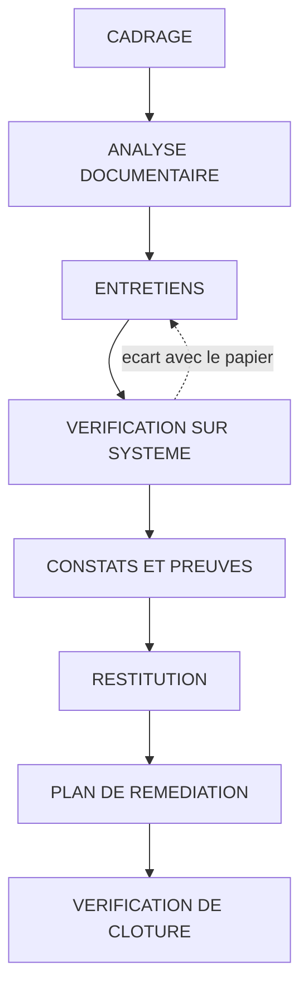

# Audit organisationnel, conformité et documentation de sécurité

## Objectifs pédagogiques

À la fin de ce module, vous saurez :

- **Distinguer** un audit de conformité, un audit technique et une analyse de risques, et choisir celui qui répond à la question posée.
- **Identifier** les exigences utiles d'ISO/IEC 27001 et 27002, et déterminer si une organisation relève du RGPD, de NIS2 ou de DORA.
- **Analyser** une PSSI, une charte informatique et des procédures pour repérer ce qui n'est pas vérifiable ou pas appliqué.
- **Collecter** des preuves exploitables (documents, entretiens, vérifications sur système) et les tracer.
- **Rédiger** un écart avec son critère, sa cause et sa conséquence, puis proposer un plan de remédiation dont la clôture se vérifie.

## Mise en situation

*Scénario illustratif, entreprise fictive.*

Un distributeur de 900 personnes est certifié ISO/IEC 27001 depuis trois ans. Le périmètre du certificat couvre « le siège et les systèmes de gestion ». Lors du dernier audit, les auditeurs ont reçu une PSSI approuvée, une procédure de gestion des correctifs (« vulnérabilités critiques corrigées sous 15 jours ») et des rapports de déploiement montrant 98 % des serveurs à jour. Aucun écart majeur n'a été relevé.

Six mois plus tard, un groupe de rançongiciel entre par l'équipement d'accès distant d'un entrepôt régional. Le boîtier est exposé sur Internet et vulnérable à une faille du type **CVE-2023-4966** (Citrix Bleed, vol de jetons de session sur NetScaler). Cet équipement ne figure dans aucun inventaire, car l'entrepôt appartient à une filiale hors périmètre. L'attaquant énumère ensuite les comptes de service avec `GetUserSPNs.py` (Impacket) et casse hors ligne le ticket Kerberos d'un compte de sauvegarde. Ce compte a un mot de passe qui n'expire jamais, exception « temporaire » ouverte quatre ans plus tôt. Il est administrateur de domaine, et le chiffrement des serveurs commence un vendredi soir.

La défense naïve était « avoir la certification et les procédures ». L'audit avait validé que les documents existaient et étaient cohérents. Il n'avait pas vérifié que la réalité du SI correspondait au périmètre déclaré, ni que les exceptions étaient bornées. L'attaquant ne lit pas la PSSI : il lit l'écart entre elle et ce qui tourne en production. Ce module porte sur la façon de mesurer cet écart.

## Trois audits, trois questions

🧠 **Concept clé** : on ne choisit pas un type d'audit par habitude, mais parce qu'il répond à une question précise.

| Type | Question posée | Critère de référence | Livrable typique |
|------|----------------|----------------------|------------------|
| Audit de conformité | « Fait-on ce que le référentiel ou la loi exige ? » | ISO/IEC 27001, RGPD, DORA, PSSI interne | Liste d'écarts par exigence |
| Audit technique | « Cette configuration, ce système, ce réseau résistent-ils ? » | Benchmarks, bonnes pratiques, tests | Vulnérabilités qualifiées avec preuves |
| Analyse de risques | « Que peut-on perdre, avec quelle probabilité, et que traite-t-on d'abord ? » | Méthode de risque retenue (module précédent) | Registre de risques et priorités |

Les trois s'alimentent. L'analyse de risques fixe ce qui compte, l'audit de conformité vérifie que les mesures décidées existent et fonctionnent, l'audit technique confirme qu'elles tiennent face à une attaque. Un audit de conformité ne cherche pas de vulnérabilités : il compare un état constaté à un critère. Si le critère est faible, un audit parfaitement conduit conclura que tout va bien.

Dans la mission de l'introduction, l'audit de conformité a fait son travail sur son périmètre. Il manquait un audit technique externe de l'exposition Internet de l'ensemble du groupe, et une analyse de risques qui aurait placé les filiales dans le périmètre.

## Surface d'attaque : là où le papier ne rencontre plus le réel

En audit organisationnel, la surface d'attaque est l'ensemble des zones où ce qui est écrit diverge de ce qui est exploitable. Voici les zones à cartographier en premier, avec ce que l'attaquant en tire.

| Zone d'écart | Ce que dit le document | Ce que trouve l'attaquant | Impact potentiel |
|--------------|-----------------------|---------------------------|------------------|
| Périmètre | « Le SMSI couvre le siège » | Filiales, sites distants, SaaS achetés sans la DSI | Point d'entrée hors contrôle |
| Inventaire | « Tous les actifs sont recensés » | Boîtiers VPN, Shadow IT, VM oubliées visibles sur Shodan ou via Nmap | Faille non corrigée car non connue |
| Comptes | « Revue trimestrielle des privilèges » | Comptes de départs encore actifs, comptes de service sans expiration | Kerberoasting, credential stuffing, élévation vers domain admin |
| Exceptions | « Dérogation temporaire » | Dérogations sans date de fin ni propriétaire | Contrôle contourné en permanence |
| Tiers | « Clauses de sécurité dans les contrats » | Prestataire avec accès VPN permanent et sans MFA (Multi-Factor Authentication) | Rebond via la chaîne d'approvisionnement |
| Preuves | « Les sauvegardes sont testées » | Aucune restauration réelle depuis 18 mois | Récupération impossible après chiffrement |

🔴 **Vecteur d'attaque** : un opérateur de rançongiciel commence par la cartographie externe (Shodan, Censys, `nmap`), puis cherche les comptes mal gérés avec BloodHound sur l'Active Directory. Il exploite rarement une faille inconnue : il vise les équipements d'accès distant exposés (par exemple CVE-2024-3400 sur GlobalProtect de Palo Alto, ou CVE-2023-46805 et CVE-2024-21887 sur Ivanti Connect Secure) et les comptes jamais revus. L'audit organisationnel doit reproduire ce raisonnement avec les moyens de l'auditeur : documents, exports et entretiens.

## ISMS, ISO/IEC 27001 et 27002 : ce que l'auditeur utilise comme critère

Un **ISMS** (Information Security Management System, appelé SMSI en France)\* est l'ensemble des politiques, processus et responsabilités qui pilotent la sécurité de façon continue. C'est un système de management, pas un outil.

\* *Il suit un cycle d'amélioration continue : on décide, on met en œuvre, on mesure, on corrige, et l'ISMS est donc jugé sur sa capacité à se corriger, pas sur l'état d'un jour.*

**ISO/IEC 27001** définit les exigences de l'ISMS. Les clauses 4 à 10 sont obligatoires pour être certifié : contexte, leadership, planification (dont l'appréciation des risques), support, fonctionnement, évaluation des performances et amélioration. L'**Annexe A** liste des contrôles de référence. Dans la version 2022, ils sont 93, répartis en quatre thèmes : organisationnels (37), personnes (8), physiques (14) et technologiques (34).

**ISO/IEC 27002** n'est pas certifiable. Elle détaille les contrôles de l'Annexe A : objectif, mise en œuvre, attributs. L'auditeur s'en sert pour savoir ce qui est raisonnablement attendu quand une exigence reste vague (par exemple A.8.15, journalisation).

Trois éléments décident de la valeur d'un audit ISO 27001 :

- **Le périmètre.** Le certificat ne couvre que ce qui y est déclaré. Un système hors périmètre peut être catastrophique sans que la certification soit remise en cause.
- **La Déclaration d'applicabilité**, ou **SoA** (Statement of Applicability). Elle liste les contrôles de l'Annexe A, indique s'ils sont retenus et justifie chaque exclusion. Une exclusion sans justification ou fondée sur « pas de risque identifié » mérite une question.
- **Les audits internes et la revue de direction** (clauses 9.2 et 9.3). Un audit interne réalisé par la personne qui a mis en place les contrôles n'a aucune indépendance.

Les contrôles les plus souvent testés en pratique : A.5.9 (inventaire des actifs), A.5.15 et A.5.18 (contrôle d'accès, droits d'accès), A.8.2 (accès privilégiés), A.8.5 (authentification sécurisée), A.8.8 (gestion des vulnérabilités techniques), A.8.13 (sauvegarde), A.8.15 (journalisation), A.5.19 (sécurité dans les relations avec les fournisseurs).

💡 **Astuce** : demandez la SoA et le périmètre dès le premier échange. Un écart entre le périmètre du certificat et le périmètre réel de l'entreprise explique souvent d'avance les constats les plus graves.

## RGPD, NIS2 et DORA : qui est concerné, et comment l'audit s'en sert

Un audit organisationnel doit d'abord établir quels textes s'appliquent, avant de les vérifier. Ces textes ne se valent pas : ISO/IEC 27001 est volontaire, les trois autres relèvent du droit.

| Texte | Nature | Qui est concerné | Ce que l'audit regarde |
|-------|--------|------------------|------------------------|
| **GDPR** (General Data Protection Regulation), RGPD en France | Règlement européen | Tout organisme traitant des données personnelles de personnes dans l'UE | Registre des traitements (art. 30), mesures de sécurité adaptées (art. 32), procédure de notification de violation sous 72 h (art. 33), analyses d'impact pour les traitements à risque (art. 35) |
| **NIS2** (Network and Information Security 2), directive (UE) 2022/2555 | Directive, à transposer dans chaque État | Entités des secteurs listés aux annexes I et II, selon leur taille, établies dans l'UE | Gestion des risques cyber, gestion des incidents, sécurité de la chaîne d'approvisionnement, responsabilité de la direction |
| **DORA** (Digital Operational Resilience Act), règlement (UE) 2022/2554 | Règlement, applicable directement depuis le 17 janvier 2025 | Entités financières et prestataires TIC critiques | Gestion du risque TIC, notification des incidents majeurs, tests de résilience, registre des contrats avec les prestataires TIC |

Le RGPD sera approfondi au module 37. Dans un audit de conformité, retenez son rôle de point de contrôle : le registre des traitements correspond-il aux systèmes réellement utilisés, et les mesures de l'article 32 sont-elles appliquées ?

Pour NIS2, la question d'applicabilité passe par quatre vérifications : le secteur d'activité (annexes I et II), la taille (en général moyenne ou grande entreprise, avec des exceptions), l'établissement dans l'UE, et la position de sous-traitant d'une entité concernée. Ce dernier cas est souvent oublié : une PME non visée peut subir des exigences contractuelles de ses clients assujettis. La transposition française évolue. Vérifiez son état à la date de la mission (Légifrance, ANSSI), car un auditeur qui cite un texte périmé perd sa crédibilité.

DORA s'applique par nature d'entité, sans seuil de taille comparable à NIS2. Si le client est une banque, un assureur ou l'un de leurs prestataires TIC, ce règlement prime sur le cadre général pour les points qu'il couvre.

L'auditeur cyber signale ce qui semble applicable et non conforme. Il ne qualifie pas juridiquement une infraction. Cette qualification revient au juriste ou au DPO (Data Protection Officer), et le rapport doit le dire.

## Documentation de sécurité : PSSI, charte et procédures

Les documents s'organisent comme une pyramide. Plus on descend, plus le niveau de détail augmente et plus la vérification est facile.

| Niveau | Document | Rôle | Ce que l'auditeur vérifie |
|--------|----------|------|----------------------------|
| Direction | **PSSI** (Information Systems Security Policy) | Orientations et principes, signée par la direction | Date, approbation, périmètre, diffusion, revue périodique |
| Usagers | Charte informatique | Règles pour les utilisateurs | Opposabilité (annexée au règlement intérieur, avis du juridique), signature, diffusion |
| Équipes | Procédures et standards | Comment on fait concrètement | Cohérence avec la PSSI, existence d'enregistrements |
| Preuves | Registres, rapports, tickets | Trace que la procédure est appliquée | Date, auteur, exhaustivité |

Un document peut être bien écrit et inutile. Trois contrôles révèlent ce défaut :

- **Existence d'un propriétaire.** Chaque procédure a un responsable nommé. Sans cela, personne ne la met à jour.
- **Mesurabilité.** « Les mots de passe doivent être robustes » ne se vérifie pas, alors que « 14 caractères minimum, MFA obligatoire sur les accès administrateur » se vérifie par une commande.
- **Traces.** Une procédure sans enregistrements n'a pas de preuve d'application. « Revue trimestrielle des accès » exige quatre comptes rendus datés sur l'année.

⚠️ **Erreur fréquente** : valider une PSSI parce qu'elle « couvre tous les chapitres » de la norme. Elle peut être complète et ne contenir aucune exigence vérifiable. Cherchez les verbes sans critère (« veiller à », « s'assurer que ») et demandez comment l'équipe le prouve.

## Conduire la mission : preuves, entretiens, analyse documentaire

Le déroulement suit une logique d'entonnoir : le papier, puis les personnes, puis le système.



**Cadrage.** Faites écrire noir sur blanc le périmètre, les critères, la période, les limites et l'autorisation. Sans autorisation écrite, aucune vérification technique ne doit être lancée, y compris un simple balayage Nmap. Le cadrage fixe aussi la méthode d'échantillonnage : c'est l'auditeur qui choisit les échantillons, pas l'audité.

**Force des preuves.** Toutes ne se valent pas :

| Type de preuve | Force | Exemple |
|----------------|-------|---------|
| Produite par le système, extraite par l'auditeur | Élevée | Export AD réalisé devant lui, `sshd -T` exécuté en séance |
| Produite par le système, fournie par l'audité | Moyenne | Rapport de scan fourni en PDF |
| Document, procédure | Faible à moyenne | PSSI, procédure de sauvegarde |
| Déclaration orale | Faible | « Oui, on fait ça tous les mois » |

Une déclaration orale seule ne fonde jamais un constat de conformité. Il faut la corroborer (trianguler) avec une preuve système ou un enregistrement.

**Entretiens.** 💡 Posez des questions de démonstration plutôt que des questions fermées. « Faites-vous une revue des comptes ? » obtient toujours « oui ». « Montrez-moi la dernière revue et les comptes qui ont été supprimés » donne une réponse vérifiable. Interrogez au moins deux niveaux (le RSSI et un administrateur) et comparez les réponses : les écarts entre eux sont souvent plus instructifs que les documents.

**Vérifications sur système.** Elles transforment une déclaration en fait, toujours sous autorisation et idéalement en lecture seule.

Comptes actifs dont le mot de passe n'expire jamais, sur Active Directory, à croiser ensuite avec les groupes privilégiés et les comptes de service :

```powershell
Get-ADUser -Filter 'Enabled -eq $true -and PasswordNeverExpires -eq $true' -Properties PasswordNeverExpires,LastLogonDate |
  Select-Object SamAccountName,LastLogonDate
```

Appartenance au groupe le plus sensible, pour comparer avec la liste « officielle » des administrateurs. Sur un AD installé en français, le groupe se nomme « Admins du domaine » :

```powershell
Get-ADGroupMember -Identity "Domain Admins" -Recursive |
  Get-ADUser -Properties LastLogonDate,Enabled |
  Select-Object SamAccountName,Enabled,LastLogonDate
```

Configuration SSH effective, calculée par sshd à partir des fichiers, `Include` compris, plutôt que la lecture brute de `sshd_config`. Sans l'option `-C`, les blocs `Match` ne sont pas évalués. La commande ne reflète pas non plus un processus sshd qui n'aurait pas été rechargé :

```bash
sudo sshd -T | grep -Ei '^(permitrootlogin|passwordauthentication|maxauthtries)'
```

Écart entre l'inventaire déclaré et les hôtes réellement joignables (hôtes présents sur le réseau mais absents de la CMDB, la Configuration Management Database) :

```bash
nmap -sn <CIDR> -oG - | awk '/Up$/{print $2}' | sort -u > reel.txt
comm -13 <(sort -u cmdb.txt) reel.txt
```

Intégrité des fichiers de preuve, pour pouvoir démontrer qu'ils n'ont pas été modifiés entre la collecte et le rapport :

```bash
sha256sum <FICHIER_PREUVE> >> preuves.sha256
sha256sum -c preuves.sha256
```

🔒 **Contrôle de sécurité** : les preuves sont archivées dans un dossier chiffré avec accès restreint à l'équipe d'audit. Un export AD contient des identifiants, des dates de dernière connexion et parfois des attributs sensibles, c'est-à-dire exactement ce que cherche un attaquant. À la fin de la mission, ils sont restitués ou détruits selon le contrat.

L'interface de chaque outil et la sortie de ces commandes varient selon la version et le contexte. Testez-les sur un environnement de laboratoire avant de les utiliser chez un client.

## Indicateurs d'un ISMS de façade

Ces signaux ne prouvent rien seuls, mais ils justifient d'approfondir.

| Signal | Ce qu'il suggère |
|--------|------------------|
| Toutes les procédures datent du même mois | Documentation écrite pour l'audit, pas par les équipes |
| Aucun incident enregistré en trois ans | Pas de détection, pas de remontée ou pas d'enregistrement |
| Registre des risques identique d'une année à l'autre | Appréciation du risque non revue |
| Dérogations sans date de fin ni propriétaire | Contrôles contournés sans suivi |
| Audit interne mené par le responsable de la sécurité | Indépendance absente |
| Exports de preuves toujours préparés avant l'arrivée de l'auditeur | Preuves sélectionnées, pas échantillonnées |

## Écarts, recommandations et plan de remédiation

Un écart exploitable répond à quatre questions : quel est le **critère**, quel est le **constat**, quelle est la **cause**, quelle est la **conséquence**. Sans la cause, la recommandation traite le symptôme. Sans la conséquence, personne ne sait quoi prioriser.

Voici un exemple de fiche d'écart, sous forme déclarative et facile à reprendre dans un tableur ou un outil de suivi :

```yaml
id: F-07
critere: "PSSI §4.2 : revue trimestrielle des comptes à privilèges (ISO/IEC 27001 A.5.18, A.8.2)"
constat: "Dernière revue datée de <DATE_REVUE>. L'export AD du <DATE_EXPORT> montre <N> comptes dans Domain Admins, dont <M> appartenant à des personnes ayant quitté l'entreprise."
preuves:
  - "EXPORT-AD-<DATE>.csv (sha256 : <HASH>)"
  - "Entretien avec <NOM_ADMIN>, <DATE>"
cause: "Aucun propriétaire désigné pour la procédure ; le départ RH ne déclenche pas de ticket vers l'équipe AD."
consequence: "Compte inactif d'un ancien administrateur exploitable par credential stuffing ou après fuite de mot de passe, avec contrôle total du domaine."
niveau: majeur
recommandation: "Désactiver immédiatement les <M> comptes. Lier le départ RH à un ticket automatique. Désigner un propriétaire de la revue."
critere_cloture: "Nouvel export AD sans compte orphelin dans Domain Admins, et compte rendu de revue du trimestre suivant."
```

**Niveaux de gravité.** Une échelle simple suffit : non-conformité **majeure** (exigence non satisfaite avec impact direct sur la sécurité), **mineure** (satisfaite en partie ou ponctuellement défaillante), **observation** (point de vigilance sans manquement). Définissez ces niveaux dans le cadrage, avant la mission, pour qu'ils ne soient pas rediscutés au moment de la restitution.

**Plan de remédiation.** Chaque action porte un responsable, une échéance, un effort estimé et un **critère de clôture vérifiable**. Un plan qui contient seulement « renforcer la gestion des comptes » ne se clôture jamais. La recommandation doit tenir compte des contraintes réelles :

| Recommandation | Problème | Version applicable |
|----------------|----------|--------------------|
| « Déployer un SIEM (Security Information and Event Management) » | Hors budget et hors compétence d'une équipe de trois personnes | « Centraliser les journaux d'authentification AD et VPN sur un serveur de logs, avec trois alertes de départ : échecs répétés, connexion hors horaire, ajout à un groupe privilégié » |
| « Mettre à jour tous les systèmes » | Non priorisé | « Corriger sous 15 jours les équipements exposés sur Internet, puis traiter les serveurs par criticité » |
| « Supprimer les exceptions » | Casse des applications métier | « Dater chaque exception, désigner un propriétaire, revue à 90 jours » |

Quand une action n'est pas réalisable, l'organisation peut **accepter le risque**. Cette acceptation doit être écrite, signée par une personne qui en a l'autorité (pas par l'équipe technique seule) et assortie d'une date de réexamen. Une acceptation sans date de fin est une dérogation permanente.

## Conformité ne signifie pas sécurité

⚠️ **Piège à traiter explicitement.** Être conforme à un référentiel prouve que des contrôles sont définis, appliqués sur un périmètre donné et revus. Cela ne prouve pas l'absence de vulnérabilités.

Quatre raisons expliquent cet écart :

- **Le périmètre limite la portée.** Ce qui est hors certificat n'est pas vérifié, comme l'équipement de l'entrepôt dans le scénario d'ouverture.
- **L'échantillonnage laisse des zones non vues.** Un audit contrôle un sous-ensemble ; une faille peut se trouver sur les systèmes qui n'ont pas été tirés.
- **Le référentiel décrit des exigences générales.** ISO/IEC 27001 demande de gérer les vulnérabilités techniques (A.8.8) sans dire quel délai est acceptable pour un VPN exposé sur Internet. L'organisation fixe elle-même ce niveau.
- **L'audit est une photographie.** Un état conforme en mars ne dit rien d'une faille publiée en avril.

Concrètement, une conclusion défendable ressemble à ceci : « Sur le périmètre X, pour la période Y, les contrôles Z sont conformes d'après l'échantillon vérifié. Le rapport ne se prononce pas sur la sécurité du reste du SI. » Si le client a besoin de savoir si une attaque réussirait, il lui faut en complément un audit technique et un test d'intrusion, thèmes des modules 22 et 31.

## Cas réel en entreprise

*Scénario illustratif, chiffres fictifs.*

Une entreprise de 1 200 personnes prépare le renouvellement de sa certification ISO/IEC 27001 et mandate un consultant pour un audit à blanc de trois semaines. L'équipe sécurité compte quatre personnes. La première semaine, le consultant lit les documents et s'étonne que 14 procédures sur 16 aient été approuvées le même jour. La deuxième semaine, il mène ses entretiens avec deux interlocuteurs par thème, dont un administrateur système. Le RSSI affirme que les comptes à privilèges sont revus tous les trimestres, tandis que l'administrateur répond : « La dernière revue, c'était avant mon arrivée, il y a deux ans. »

Le consultant extrait lui-même la liste du groupe Domain Admins : 19 comptes, alors que la procédure en autorise 8. Cinq appartiennent à des personnes parties. Le balayage autorisé du réseau (`nmap -sn`, comparé à la CMDB) révèle 11 hôtes absents de l'inventaire, dont un boîtier d'accès distant d'un site secondaire.

Le rapport contient 23 écarts, mais sa valeur tient à sa hiérarchie : 3 majeurs (privilèges, inventaire, périmètre ne couvrant pas le site secondaire), 9 mineurs et 11 observations. Le plan de remédiation tient en 12 actions sur 90 jours, chacune avec un critère de clôture. Les trois majeurs sont traités en priorité, dont la désactivation des comptes orphelins en 48 heures.

Trois leçons à retenir :

- Les entretiens croisés ont révélé plus de choses que la lecture des documents.
- Les preuves extraites par l'auditeur ont rendu les constats incontestables.
- Le rapport est utile parce qu'il priorise, pas parce qu'il est exhaustif.

## Erreurs fréquentes

⚠️ **Valider sur la foi des documents seuls**
- Configuration dangereuse : conclure à la conformité parce que la procédure existe et est signée.
- Conséquence : les dérogations, comptes orphelins et systèmes non inventoriés ne sont jamais vus.
- Correction : pour chaque exigence critique, ajouter au moins une preuve produite par le système (export AD, `sshd -T`, comparaison inventaire et Nmap).

⚠️ **Laisser l'audité choisir ses échantillons**
- Configuration dangereuse : l'audité sélectionne les serveurs, les tickets ou les comptes présentés.
- Conséquence : l'échantillon est représentatif de ce que l'équipe veut montrer, pas de la réalité.
- Correction : l'auditeur tire lui-même l'échantillon à partir d'un export complet, en consignant la méthode dans le cadrage.

⚠️ **Écrire un écart sans critère ni cause**
- Configuration dangereuse : « La gestion des correctifs est insuffisante. »
- Conséquence : l'audité conteste, personne ne sait comment clôturer, et la même recommandation revient à l'audit suivant.
- Correction : appliquer la structure critère, constat, cause, conséquence, avec les preuves rattachées.

⚠️ **Plan de remédiation sans critère de clôture**
- Configuration dangereuse : « Renforcer le contrôle des accès. »
- Conséquence : l'action est déclarée terminée sans qu'on puisse le vérifier.
- Correction : écrire la condition de clôture sous forme observable (« export AD sans compte orphelin dans Domain Admins »).

⚠️ **Confondre dérogation et acceptation du risque**
- Configuration dangereuse : une exception décidée par l'équipe technique, sans date ni signataire.
- Conséquence : elle devient permanente, comme le compte de sauvegarde du scénario d'ouverture.
- Correction : exiger un propriétaire, un risque documenté, une signature d'un décideur et une date de réexamen.

⚠️ **Oublier le périmètre dans la conclusion**
- Configuration dangereuse : un rapport qui conclut « l'organisation est conforme ».
- Conséquence : le client lit une garantie de sécurité globale que l'audit ne donne pas.
- Correction : borner chaque conclusion au périmètre, à la période et à la méthode.

## Résumé

L'audit organisationnel compare l'état réel d'une organisation à des critères (ISO/IEC 27001, RGPD, NIS2, DORA, PSSI interne) ; il ne remplace ni l'audit technique ni l'analyse de risques. La menace couverte est l'écart entre ce qui est documenté et ce qui est exploitable : périmètres incomplets, comptes orphelins, exceptions permanentes. Le mécanisme de défense est un audit fondé sur des preuves corroborées (documents, entretiens croisés, extractions système), tracées et hachées. Les écarts sont formulés avec critère, constat, cause et conséquence, et chaque action porte un critère de clôture vérifiable. Il reste à surveiller le périmètre, l'indépendance de l'audit, l'état de la transposition de NIS2 et le fait qu'une conformité constatée à un instant donné ne dit rien d'une faille apparue ensuite.

<!-- snippet
id: audit_trois_audits_questions
type: concept
tech: audit
level: beginner
importance: high
format: knowledge
tags: audit,conformite,risques,methodologie
title: Audit de conformité, technique et analyse de risques
content: Chaque approche répond à une question différente. Audit de conformité : fait-on ce que le référentiel exige ? Audit technique : cette configuration résiste-t-elle à une attaque ? Analyse de risques : que perd-on et par quoi commence-t-on ? Un audit de conformité compare un état à un critère et ne cherche pas de vulnérabilités. Un critère faible produit un audit propre mais inutile.
description: Choisir selon la question posée : exigences respectées, résistance réelle ou priorités. Un audit de conformité seul ne dit pas si une attaque réussirait.
-->

<!-- snippet
id: audit_iso27001_soa_perimetre
type: concept
tech: audit
level: intermediate
importance: high
format: knowledge
tags: iso27001,smsi,soa,perimetre
title: Périmètre et SoA : lire ce que couvre un certificat ISO 27001
content: Le certificat ISO/IEC 27001 ne couvre que le périmètre déclaré, pas toute l'organisation. La SoA (Statement of Applicability) liste les 93 contrôles de l'Annexe A (version 2022) avec leur statut et la justification de chaque exclusion. Un site, une filiale ou un SaaS hors périmètre peut être très exposé sans remettre en cause la certification. Demander périmètre et SoA dès le premier échange.
description: Périmètre et SoA fixent la portée réelle d'une certification. Les comparer au SI réel révèle les zones jamais auditées.
-->

<!-- snippet
id: audit_conformite_certificat_perimetre
type: warning
tech: audit
level: intermediate
importance: high
format: knowledge
tags: conformite,iso27001,perimetre,vulnerabilites
title: Certification ISO 27001 prise pour une garantie de sécurité
content: Conclure qu'une organisation certifiée est sûre : le certificat ne couvre que le périmètre déclaré, repose sur un échantillon, et fixe des exigences générales sans délai précis pour corriger une faille. Conséquence : un VPN exposé hors périmètre peut être compromis (ex. CVE-2023-4966 sur NetScaler) sans écart de conformité. Correction : borner la conclusion au périmètre et à la période, et compléter par un audit technique externe.
description: La conformité atteste de contrôles sur un périmètre et un instant donnés. Elle ne prouve pas l'absence de vulnérabilités.
-->

<!-- snippet
id: audit_nis2_dora_applicabilite
type: concept
tech: audit
level: intermediate
importance: medium
format: knowledge
tags: nis2,dora,reglementation,applicabilite
title: Déterminer si NIS2 ou DORA s'appliquent à une organisation
content: NIS2 est une directive à transposer : vérifier secteur (annexes I et II), taille, établissement dans l'UE, et statut de sous-traitant d'une entité visée, puis contrôler l'état de la transposition nationale à la date de la mission. DORA est un règlement applicable directement depuis le 17 janvier 2025 aux entités financières et à leurs prestataires TIC critiques. L'auditeur signale, le juriste qualifie.
description: Quatre critères pour NIS2, nature d'entité pour DORA. Vérifier la transposition nationale actuelle avant de citer un texte.
-->

<!-- snippet
id: audit_preuve_hash_sha256
type: command
tech: audit
level: beginner
importance: medium
format: knowledge
tags: preuves,integrite,sha256,tracabilite
title: Hacher les fichiers de preuve pour garantir leur intégrité
context: À exécuter juste après chaque collecte, avant tout traitement du fichier
command: sha256sum <FICHIER_PREUVE> >> preuves.sha256
example: sha256sum EXPORT-AD-2025-03-12.csv >> preuves.sha256
description: Consigne l'empreinte à la collecte ; sha256sum -c preuves.sha256 prouve plus tard que le fichier est inchangé entre collecte et rapport.
-->

<!-- snippet
id: audit_inventaire_nmap_cmdb
type: command
tech: audit
level: intermediate
importance: high
format: knowledge
tags: inventaire,nmap,cmdb,ecart
title: Comparer les hôtes actifs à l'inventaire déclaré (CMDB)
context: Sous autorisation écrite et sur le périmètre convenu ; bash requis pour la substitution de processus
command: nmap -sn <CIDR> -oG - | awk '/Up$/{print $2}' | sort -u > reel.txt && comm -13 <(sort -u cmdb.txt) reel.txt
example: nmap -sn 10.20.0.0/22 -oG - | awk '/Up$/{print $2}' | sort -u > reel.txt && comm -13 <(sort -u cmdb.txt) reel.txt
description: Affiche les hôtes joignables absents de la CMDB : le point de départ d'un constat sur l'inventaire des actifs (ISO A.5.9).
-->

<!-- snippet
id: audit_ad_comptes_mdp_non_expirant
type: command
tech: audit
level: intermediate
importance: high
format: knowledge
tags: active-directory,comptes,kerberoasting,audit
title: Lister les comptes AD dont le mot de passe n'expire jamais
context: PowerShell avec le module ActiveDirectory, en lecture seule, sous autorisation
command: Get-ADUser -Filter 'Enabled -eq $true -and PasswordNeverExpires -eq $true' -Properties PasswordNeverExpires,LastLogonDate | Select-Object SamAccountName,LastLogonDate
description: Repère les exceptions à la politique de rotation, souvent des comptes de service exposés au Kerberoasting et crackables hors ligne.
-->

<!-- snippet
id: audit_ssh_config_effective
type: command
tech: audit
level: intermediate
importance: medium
format: knowledge
tags: ssh,configuration,preuves,linux
title: Lire la configuration SSH effective calculée par sshd
context: À exécuter avec sudo sur le serveur audité, en présence de l'administrateur
command: sudo sshd -T | grep -Ei '^(permitrootlogin|passwordauthentication|maxauthtries)'
description: Affiche les valeurs globales calculées après Include, plus fiables que la lecture de sshd_config. Les blocs Match ne sont évalués qu'avec l'option -C.
-->

<!-- snippet
id: audit_entretien_montrez_moi
type: tip
tech: audit
level: beginner
importance: medium
format: knowledge
tags: entretien,preuves,methodologie,audit
title: Remplacer « faites-vous X ? » par « montrez-moi X »
content: En entretien, demander « Montrez-moi la dernière revue des comptes et les comptes supprimés à cette occasion » plutôt que « Faites-vous une revue ? ». Interroger au moins deux niveaux (RSSI et administrateur) sur le même sujet et comparer les réponses. Toute déclaration orale doit être corroborée par un enregistrement ou une extraction système.
description: Une question fermée appelle toujours « oui ». Une demande de démonstration produit une preuve et fait apparaître les écarts entre niveaux.
-->

<!-- snippet
id: audit_ecart_structure_quatre_champs
type: concept
tech: audit
level: intermediate
importance: high
format: knowledge
tags: ecart,constat,recommandation,rapport
title: Structure d'un écart : critère, constat, cause, conséquence
content: Un écart défendable se décompose en quatre champs. Critère : l'exigence non respectée (ex. PSSI §4.2, ISO A.5.18). Constat : le fait observé avec sa preuve (export AD, entretien). Cause : pourquoi cela arrive (pas de propriétaire, pas de lien RH). Conséquence : ce que cela permet (compte orphelin exploitable). Sans cause la recommandation traite le symptôme, sans conséquence on ne peut pas prioriser.
description: Les quatre champs rendent un constat contestable difficilement et orientent la recommandation vers la cause plutôt que vers le symptôme.
-->

<!-- snippet
id: audit_plan_remediation_cloture
type: warning
tech: audit
level: intermediate
importance: high
format: knowledge
tags: remediation,plan-action,cloture,suivi
title: Plan de remédiation sans critère de clôture vérifiable
content: Écrire « renforcer la gestion des comptes » sans condition observable : l'action est déclarée terminée sans preuve, et le même écart revient à l'audit suivant. Correction : pour chaque action, nommer un responsable, une échéance et un critère de clôture mesurable, par exemple « nouvel export AD sans compte orphelin dans Domain Admins ».
description: Un critère de clôture vérifiable (export, commande, enregistrement) permet à l'auditeur de fermer l'écart sans débat.
-->

<!-- snippet
id: audit_echantillon_choisi_par_audite
type: error
tech: audit
level: intermediate
importance: medium
format: knowledge
tags: echantillonnage,preuves,biais,methodologie
title: Audit sans écart mais incident sur un système non vu
content: Symptôme : tous les échantillons sont conformes, pourtant une compromission survient sur un système non examiné. Cause : l'audité a sélectionné lui-même serveurs, tickets ou comptes, donc l'échantillon est représentatif de ce qu'il voulait montrer. Correction : demander l'export complet et tirer l'échantillon soi-même (aléatoire ou ciblé par risque), en consignant la méthode dans le cadrage.
description: Le biais de sélection est la première source de faux positifs de conformité. L'échantillon doit être tiré par l'auditeur à partir d'un export complet.
-->

<!-- snippet
id: audit_derogation_vs_acceptation_risque
type: warning
tech: audit
level: intermediate
importance: medium
format: knowledge
tags: derogation,risque,exception,gouvernance
title: Dérogation sans propriétaire ni date de fin
content: Une exception à la PSSI décidée par l'équipe technique sans signataire ni échéance devient permanente (ex. compte de sauvegarde à mot de passe non expirant, administrateur de domaine). Conséquence : contrôle contourné sans suivi, exploitable par Kerberoasting. Correction : exiger propriétaire, risque documenté, signature d'un décideur ayant l'autorité, et revue à 90 jours.
description: Une acceptation de risque valide exige un décideur habilité et une date de réexamen. Sans cela, la dérogation est une faille documentée.
-->
