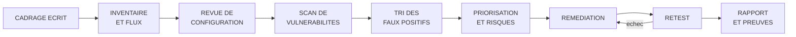
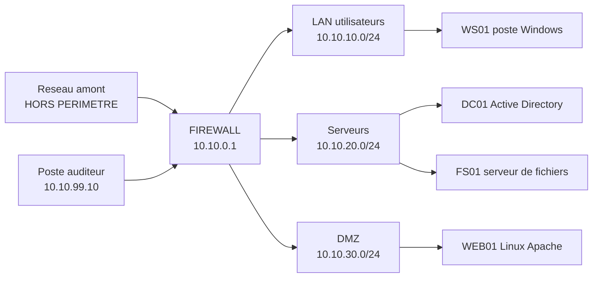

# Projet pratique — Audit d'une infrastructure de laboratoire

## Objectifs pédagogiques

À la fin de ce projet, vous saurez :

- **Rédiger** un cadrage d'audit qui fixe périmètre, règles d'engagement et conditions d'arrêt avant la moindre commande.
- **Reconstituer** l'inventaire et les flux réellement présents sur un réseau, puis les comparer à ce que la documentation prétend.
- **Mener** une revue de configuration sur un serveur Linux, un serveur Windows/Active Directory et un pare-feu.
- **Trier** les résultats d'un scanner de vulnérabilités, prouver les faux positifs et prioriser le reste selon l'exposition et l'impact métier.
- **Vérifier** les corrections par un retest comparable à l'état initial, et produire un rapport élémentaire dont chaque constat repose sur une preuve.

## Mise en situation

*Scénario illustratif.* Un technicien réseau reçoit une consigne : « Audite le labo avant qu'on le réutilise pour la formation. » Il lance un scanner de vulnérabilités sur `10.10.0.0/16`, puisque c'est un labo. Ce que personne n'a vérifié : le routeur du labo est relié au VLAN bureautique pour donner accès à Internet, et une partie de la plage `10.10.x.x` y est utilisée. Le scan atteint un NAS de sauvegarde et deux imprimantes réseau. Un vieux contrôleur d'imprimante plante, le NAS devient lent pendant une heure et l'audit est interrompu par la direction informatique.

Le rapport PDF exporté du scanner aligne 214 lignes. Personne ne sait lesquelles sont réelles ni par où commencer. Certaines concernent des machines qui n'appartiennent pas au labo.

Ce scénario cumule trois défaillances qu'aucun outil ne corrige :

- **Pas de cadrage écrit.** Le périmètre vivait dans la tête de l'auditeur.
- **Pas de tri.** Un scanner produit des hypothèses, pas des constats.
- **Pas de lien avec le métier.** Une liste de CVE ne dit pas ce qu'on risque de perdre.

Ce module reprend la démarche dans l'ordre : cadrer, inventorier, revoir les configurations, scanner, trier, prioriser, corriger, vérifier, rapporter. Le module précédent a traité l'audit documentaire et la conformité. Ici, tout est technique et chaque conclusion doit pouvoir être rejouée.



## Le laboratoire audité et sa surface d'attaque

Le projet utilise un laboratoire de référence que vous pouvez monter en machines virtuelles. Les adresses sont des exemples.



Avant de toucher quoi que ce soit, cartographiez ce qu'un attaquant installé sur un poste du LAN verrait. Le tableau mélange volontairement des faiblesses plausibles. Votre audit dira lesquelles existent réellement.

| Vecteur | Exposition | Impact potentiel |
|---|---|---|
| SSH sur WEB01 avec mot de passe | Port 22 joignable depuis tout le LAN | Force brute ou réutilisation d'identifiants, puis shell sur un serveur de la DMZ |
| SMB sur FS01 (SMBv1 actif, signature non exigée) | Port 445 ouvert au LAN | Exécution de code à distance (EternalBlue) ou relais d'authentification NTLM |
| Comptes de service AD avec SPN (Service Principal Name) | Tout compte du domaine peut demander un ticket de service | Kerberoasting : mot de passe cassé hors ligne, avec les privilèges du compte |
| Règle de pare-feu LAN vers serveurs « any » | Aucun cloisonnement réel | Un poste compromis atteint tous les services internes |
| Interface d'administration du pare-feu | Accessible depuis le LAN | Prise de contrôle du filtrage |
| Le dispositif d'audit lui-même | Identifiants du scanner, résultats bruts, rapports | Une liste de failles non corrigées et des comptes privilégiés entre de mauvaises mains |

La dernière ligne est souvent oubliée. Pendant l'audit, vous détenez l'information la plus utile à un attaquant sur ce réseau.

## Phase 0 : cadrage écrit du périmètre et des règles d'engagement

Les RoE (Rules of Engagement) sont le document qui sépare un audit d'une intrusion. Vous les rédigez avant le premier paquet, et le commanditaire les signe. Voici un squelette utilisable tel quel :

```yaml
# cadrage-audit-lab.yml
perimetre:
  dans_le_perimetre: ["10.10.10.0/24", "10.10.20.0/24", "10.10.30.0/24"]
  hors_perimetre: ["10.10.0.254 (routeur amont)", "tout hote absent de la liste"]
source_audit: "10.10.99.10"
fenetre: "<JJ/MM> 09:00-17:00"
techniques_autorisees:
  - decouverte reseau, scan de ports et de services
  - scan de vulnerabilites non destructif, authentifie et non authentifie
  - revue de configuration avec un compte dedie
techniques_interdites:
  - deni de service, tests de charge
  - exploitation au-dela de la preuve minimale
  - ingenierie sociale, acces physique
preuve_minimale_exploitation: "lecture de /etc/hostname sur WEB01, aucune ecriture"
arret_immediat_si:
  - un service du labo devient indisponible
  - un hote hors liste repond
  - une donnee personnelle reelle est decouverte
contacts: {commanditaire: "<NOM>", technique: "<NOM>", urgence: "<TEL>"}
donnees: "preuves chiffrees, suppression a J+<N> apres remise du rapport"
signature: "<COMMANDITAIRE> / <AUDITEUR> - <DATE>"
```

> ⚠️ **Toutes les vérifications restent limitées à un environnement autorisé.** « C'est un labo » n'est pas une autorisation. Le propriétaire réel de chaque machine et de chaque lien réseau doit avoir signé. En France, l'accès frauduleux à un système de traitement automatisé de données relève de l'article 323-1 du Code pénal, que la cible soit un labo ou non.
{: .callout .callout-attention}

Deux lignes du cadrage évitent les pires dérapages :

- **`preuve_minimale_exploitation`** : elle décide à l'avance jusqu'où vous pouvez aller pour confirmer une faille. Sans elle, vous vous arrêtez à la version et à la configuration observées. L'exploitation proprement dite relève du module de pentest en laboratoire, pas de cet audit.
- **`arret_immediat_si`** : elle transforme l'incident du scénario d'ouverture en simple pause.

> 💡 Avant de valider le périmètre, vérifiez ce que votre poste d'audit atteint réellement : `ip route` pour les routes, `traceroute <HOTE_HORS_LABO>` pour voir si vous sortez du labo. La frontière du labo se prouve avec les routes, pas avec le schéma.
{: .callout .callout-important}

## Phase 1 : inventaire des actifs et cartographie des flux

Un inventaire documentaire est une hypothèse, la découverte active la teste. L'écart entre les deux constitue souvent le premier constat : machine oubliée, VM de test restée allumée, équipement posé sans déclaration.

```bash
# 1. Découverte des hôtes vivants, strictement dans le périmètre
sudo nmap -sn -iL scope.txt --excludefile exclusions.txt -oA 01_decouverte
grep "Status: Up" 01_decouverte.gnmap | awk '{print $2}' > vivants.txt

# 2. Ports et services, uniquement sur les hôtes vivants
sudo nmap -sS -sV -p- --open --max-rate <PPS> -iL vivants.txt -oA 02_ports_initial
```

Le scan complet `-p-` sur trois /24 prend des heures. Restreindre aux hôtes vivants et plafonner le débit avec `--max-rate` est le compromis classique entre exhaustivité et risque de saturer un équipement fragile. Gardez les sorties `-oA` : elles servent de référence au retest.

Les ports ouverts ne disent pas qui parle à qui. Pour les flux, croisez trois sources :

- **Côté serveur** : `sudo ss -tn state established` liste les connexions actives avec leurs pairs, et `sudo ss -tulpn` les services en écoute avec le processus associé.
- **Côté pare-feu** : compteurs de règles et journaux de trafic autorisé.
- **Côté documentation** : ce que l'équipe pense avoir ouvert.

Le résultat tient dans une matrice de flux. Les lignes sans justification sont les constats :

| Source | Destination | Port | Justification | Observé |
|---|---|---|---|---|
| LAN | DC01 | 53, 88, 389, 445 | Authentification du domaine | Oui |
| LAN | FS01 | 445 | Partages de fichiers | Oui |
| LAN | WEB01 | 443 | Application interne | Oui |
| LAN | WEB01 | 22 | Aucune | Oui |
| WEB01 (DMZ) | DC01 | 389 | Aucune | Oui |

La dernière ligne est la plus parlante. Un serveur exposé en DMZ qui interroge l'annuaire interne est la brèche qu'une DMZ est censée empêcher. Une compromission de WEB01 donne alors à l'attaquant un chemin direct vers l'AD.

## Phase 2 : revue de configuration

Pensez comme l'attaquant avant de lire une configuration. Chaque point vérifié correspond à un geste offensif connu :

- 🔴 **SSH avec mot de passe et root autorisé** : Hydra ou un simple password spraying contre `root` ou des comptes courants.
- 🔴 **SMBv1 actif** : CVE-2017-0144 (EternalBlue, bulletin MS17-010), exploité à grande échelle par WannaCry en mai 2017. Le module Metasploit existe depuis des années.
- 🔴 **Compte de service avec SPN et mot de passe faible** : `GetUserSPNs.py` (Impacket) ou Rubeus demandent un ticket de service, puis `hashcat -m 13100` casse le mot de passe hors ligne. Il suffit d'être un utilisateur du domaine.
- 🔴 **SMB sans signature obligatoire** : `ntlmrelayx.py` relaie une authentification interceptée vers un serveur qui l'accepte.

### Linux (WEB01)

```bash
sudo ss -tulpn                                                   # qui écoute, et avec quel processus
sudo sshd -T | grep -Ei 'permitrootlogin|passwordauthentication|maxauthtries'
sudo grep -rE 'NOPASSWD' /etc/sudoers /etc/sudoers.d/            # sudo sans mot de passe
sudo awk -F: '($2==""){print $1}' /etc/shadow                    # comptes sans mot de passe
sudo lynis audit system --quick                                  # revue générale
```

`lynis` affiche un « hardening index » : c'est un indicateur, pas un objectif. Lisez les sections *Warnings* et *Suggestions* et gardez celles que vous pouvez justifier avec une preuve.

### Windows et Active Directory (FS01, DC01)

```powershell
Get-SmbServerConfiguration | Select EnableSMB1Protocol, RequireSecuritySignature
Get-LocalGroupMember -Group Administrators
Get-ADGroupMember "Domain Admins" | Select SamAccountName
Get-ADUser -Filter 'ServicePrincipalName -like "*"' -Properties ServicePrincipalName,PasswordLastSet |
  Select SamAccountName,PasswordLastSet
Get-ADUser -Filter 'PasswordNeverExpires -eq $true -and Enabled -eq $true' |
  Select SamAccountName
```

La quatrième commande liste les comptes kerberoastables (ignorez `krbtgt`). Un compte de service avec un mot de passe vieux de trois ans qui apparaît aussi dans *Domain Admins* est un constat prioritaire. Un compte *Domain Admins* utilisé pour une tâche de sauvegarde est un schéma fréquent.

### Pare-feu

```bash
sudo nft -a list ruleset      # -a affiche les handles; les compteurs apparaissent si les règles en ont
```

Cherchez cinq choses :

- une **politique par défaut** `accept` sur la chaîne `forward` ;
- des règles **source ou destination « any »** ;
- des **règles à zéro paquet** (règles mortes, héritées d'un ancien besoin) ;
- l'**absence de journalisation** des refus ;
- l'**interface d'administration** atteignable depuis le LAN.

Une règle « LAN vers serveurs, tout accepter », ajoutée en urgence « pour que ça marche », fait disparaître à elle seule tout le cloisonnement du schéma d'architecture.

## Phase 3 : scan de vulnérabilités et élimination des faux positifs

Lancez deux scans, car ils répondent à deux questions :

- **Non authentifié** : que voit un attaquant qui n'a aucun compte ?
- **Authentifié** : quels correctifs manquent réellement ? Il y a moins de devinettes sur les versions, et les vérifications de configuration deviennent possibles.

Avec Greenbone/OpenVAS, le principe est de créer une cible avec les hôtes du périmètre, une tâche avec un profil non destructif et un débit limité, puis d'ajouter les identifiants pour le scan authentifié. Les noms de menus changent selon la version.

> 🔒 Prenez un snapshot des VM avant chaque scan et lancez-le pendant la fenêtre prévue au cadrage. C'est la réponse directe à l'incident d'ouverture.
{: .callout .callout-securite}

### Tri : un résultat de scanner est une hypothèse

Pour chaque résultat, posez trois questions : la version détectée est-elle la vraie, la faille est-elle exploitable dans cette configuration, et le service est-il joignable par qui ?

| Résultat du scanner | Vérification | Verdict probable |
|---|---|---|
| Apache 2.4.49 vulnérable à CVE-2021-41773 | `apache2 -v`, puis lecture de la directive `Require` sur `/` | Exploitable seulement si le contenu hors racine n'est pas protégé par `Require all denied`. Sinon, mise à jour planifiée mais sans urgence |
| OpenSSH ou paquet « plus ancien que la version corrigée » | `zcat /usr/share/doc/<PAQUET>/changelog.Debian.gz \| grep <CVE_ID>` | Faux positif si la CVE figure au changelog du paquet installé : la distribution a rétroporté le correctif |
| Signature SMB non exigée sur FS01 | `Get-SmbServerConfiguration` | Vrai positif, confirmé par la configuration |
| Certificat TLS auto-signé sur WEB01 | `openssl s_client -connect <HOTE>:443` | Vrai mais faible dans un labo interne. À documenter, pas à prioriser |

Pour CVE-2021-41773, commencez par la version et la configuration, ce qui ne demande aucune exploitation :

```bash
curl -sI "http://<HOTE>/" | grep -i '^server:'
```

Si les RoE autorisent une preuve active, utilisez un test éprouvé et non destructif, par exemple le modèle Nuclei dédié (`nuclei -u http://<HOTE> -id CVE-2021-41773`). Sans cette autorisation écrite, arrêtez-vous à la version et à la configuration. 🧠 Une preuve se construit au niveau le plus bas qui suffit à convaincre.

Pour justifier un faux positif, notez la commande et sa sortie. Écrire « faux positif » sans preuve revient à lui faire perdre sa valeur le jour où quelqu'un conteste.

## Phase 4 : priorisation et analyse de risques simplifiée

Le score CVSS mesure la gravité technique d'une faille dans l'absolu, pas ce qu'elle coûte chez vous. Une priorité se déduit de quatre éléments :

- **L'exposition** : qui peut atteindre le service (Internet, LAN entier, un seul poste) ?
- **L'impact métier** : que perd-on si la machine tombe ou si la donnée fuit ?
- **L'exploitation connue** : une CVE du catalogue KEV (Known Exploited Vulnerabilities) de la CISA (Cybersecurity and Infrastructure Security Agency) est exploitée dans la nature. Un score EPSS (Exploit Prediction Scoring System) élevé estime aussi cette probabilité.
- **La combinaison avec d'autres faiblesses** : trois constats « moyens » forment parfois un chemin d'attaque complet.

Une méthode simple suffit à ce niveau : vraisemblance (1 à 4) × impact (1 à 4). L'exposition fait monter ou descendre la vraisemblance. Les chiffres ci-dessous sont illustratifs :

| Constat | Exposition | Impact métier | V × I | Priorité |
|---|---|---|---|---|
| F01 — SMBv1 actif sur FS01 | Tout le LAN | Perte des projets, rebond | 3 × 4 = 12 | P1 |
| F02 — Compte de service kerberoastable membre de Domain Admins | Tout compte du domaine | Compromission totale de l'AD | 3 × 4 = 12 | P1 |
| F03 — SSH root et mot de passe sur WEB01 | LAN vers DMZ | Prise de contrôle du serveur web | 3 × 3 = 9 | P2 |
| F04 — Règle LAN vers serveurs « any » | LAN | Aucun cloisonnement, amplifie F01, F02 et F03 | 3 × 3 = 9 | P2 |
| F05 — Aucun journal des refus du pare-feu | Interne | Attaque non détectée | 2 × 2 = 4 | P3 |
| F06 — Certificat auto-signé | Interne | Négligeable | 1 × 1 = 1 | P4 |

F04 a un rôle particulier : sa priorité intrinsèque est moyenne, mais elle rend F01 à F03 exploitables depuis n'importe quel poste. Dans le rapport, présentez-la comme multiplicateur et placez sa correction en tête du plan, car elle réduit trois risques à la fois.

## Phase 5 : plan de remédiation et vérification des corrections

Une recommandation sans responsable, sans délai et sans plan B reste une intention. Chaque constat reçoit une action, un propriétaire, un délai et, si la correction est impossible tout de suite, une mesure compensatoire.

| Constat | Action | Contrainte réelle | Mesure compensatoire |
|---|---|---|---|
| F01 | Désactiver SMBv1 : `Set-SmbServerConfiguration -EnableSMB1Protocol $false` | Un vieux scanner ou NAS peut en dépendre | Isoler l'équipement dans un segment dédié |
| F02 | Retirer le compte de *Domain Admins*, lui donner des droits délégués, mot de passe long aléatoire | Le logiciel de sauvegarde peut casser | Tester sur snapshot, planifier une fenêtre |
| F03 | Authentification par clé uniquement, root interdit | Risque de se verrouiller soi-même | Garder une seconde session ouverte pendant le changement |
| F04 | Politique `drop` par défaut et flux explicites | Nécessite la matrice de flux (AD = beaucoup de ports) | Basculer règle par règle avec journalisation |

### Avant / après : SSH

```text
# AVANT
PermitRootLogin yes
PasswordAuthentication yes

# APRÈS
PermitRootLogin no
PasswordAuthentication no
MaxAuthTries 3
AllowUsers <ADMIN_USER>
```

Validez avec `sudo sshd -t` avant de recharger le service, et gardez une session ouverte tant que vous n'avez pas testé la connexion par clé dans un second terminal.

### Avant / après : pare-feu (nftables)

```text
# AVANT : règle héritée du montage initial
chain forward {
  type filter hook forward priority 0; policy accept;
  ip saddr 10.10.10.0/24 accept
}

# APRÈS
chain forward {
  type filter hook forward priority 0; policy drop;
  ct state established,related accept
  ip saddr 10.10.10.0/24 ip daddr 10.10.20.11 tcp dport 445 accept
  ip saddr 10.10.10.0/24 ip daddr 10.10.30.10 tcp dport { 80, 443 } accept
  ip saddr 10.10.10.0/24 ip daddr 10.10.20.10 tcp dport { 53, 88, 389 } accept
  log prefix "FW-DROP " counter drop
}
```

La règle vers DC01 est simplifiée : un vrai domaine demande aussi UDP 53 et 88, RPC (135 et plage dynamique), 445, 636 et d'autres. Déduisez la liste réelle de la matrice de flux et des refus journalisés, pas d'un tutoriel. En cas d'erreur, un `policy drop` posé à distance vous coupe de la machine : programmez un retour arrière automatique avant de l'appliquer, par exemple une tâche `at` qui recharge l'ancienne configuration.

### Le retest : même méthode, même format

Un retest crédible reproduit les conditions de l'état initial :

```bash
sudo nmap -sS -sV -p- --open --max-rate <PPS> -iL vivants.txt -oA 03_ports_retest
ndiff 02_ports_initial.xml 03_ports_retest.xml
```

`ndiff` (livré avec nmap, ou dans un paquet séparé sur certaines distributions) montre précisément les ports apparus ou disparus. Rejouez aussi les commandes de revue de configuration de chaque constat et relancez un scan authentifié. Chaque constat reçoit un statut parmi trois :

- **Corrigé** : la preuve a changé.
- **Compensé** : la faille existe encore mais le chemin d'attaque est coupé. Documentez la mesure.
- **Risque accepté** : décision écrite du propriétaire, avec date de réexamen.

Vérifiez aussi que la correction n'a rien cassé : un service du labo inaccessible après le retest est un nouveau constat.

## Contrôles de détection : l'audit vu depuis la défense

Votre scan a laissé des traces ou non. C'est une information d'audit à part entière. Si personne ne l'a vu passer, c'est un constat (cf. F05). Les journaux à inspecter :

- **Windows** : 4625 (échec d'ouverture de session), 4769 (ticket de service Kerberos : un type de chiffrement `0x17`, RC4, associé à des demandes en rafale est un indice de Kerberoasting), 4732 et 4728 (ajout à un groupe local ou global sensible).
- **Linux** : `journalctl -u ssh --since "1 hour ago" | grep "Failed password"` (l'unité s'appelle `sshd` sur certaines distributions).
- **Pare-feu** : pic de compteurs de la règle `FW-DROP` pendant la fenêtre du scan.

Un test simple : lancez un `nmap -sS` rapide sur une machine du labo, puis cherchez-le dans les journaux. Si vous ne le trouvez pas, la visibilité du labo est insuffisante, quelle que soit la qualité de ses règles.

## Gestion des secrets de l'audit

L'authentification complète d'un scanner sous Windows exige en pratique des droits élevés sur la cible, ce qui crée un compte puissant sur tout le périmètre. Le compromis acceptable :

- un **compte dédié**, nommé explicitement (`svc-audit-<DATE>`), sans ouverture de session interactive, et restreint à l'IP du poste d'audit ;
- un stockage dans un gestionnaire de mots de passe ou un coffre, jamais en clair dans un fichier de configuration du scanner partagé ;
- une **désactivation le jour de la remise du rapport**, puis une suppression après le retest.

Dans le rapport, ne collez jamais un mot de passe ni un hash cassé. Masquez-les (`Pa****rd`, `$krb5tgs$23$*...*`) : la preuve de la faille ne doit pas contenir le secret lui-même. 🔒 Chiffrez les résultats bruts du scanner et les captures, car ils contiennent la cartographie exacte des faiblesses du labo.

## Livrable : un rapport d'audit élémentaire avec preuves

Le rapport tient en six parties, sans remplissage :

1. **Synthèse** (une page maximum) : trois à cinq risques principaux, en langage métier.
2. **Périmètre, méthode et limites** : ce qui a été testé, ce qui ne l'a pas été, outils et versions.
3. **Tableau des constats** : identifiant, priorité, actif, statut.
4. **Fiches de constat** : une par constat, selon le modèle ci-dessous.
5. **Plan de remédiation** : actions, responsables, délais, mesures compensatoires.
6. **Annexes** : preuves, sorties brutes chiffrées, empreintes.

```markdown
### F01 — SMBv1 activé sur FS01
- Priorité : P1 | Statut : corrigé (retest du <DATE>)
- Actif : FS01 (10.10.20.11)
- Constat : le protocole SMBv1 est activé et joignable depuis tout le LAN.
- Preuve : sortie de `Get-SmbServerConfiguration`, EnableSMB1Protocol : True
  (preuves/F01_20250101T093000Z.txt, sha256 : <HASH>)
- Impact : exécution de code à distance sans authentification (CVE-2017-0144) ;
  perte ou chiffrement des partages projets.
- Recommandation : désactiver SMBv1, isoler tout équipement qui l'exige.
- Vérification : mêmes commande et sortie après correction.
```

> 💡 Capturez chaque preuve en une ligne, horodatée et empreintée :
{: .callout .callout-important}

```bash
<COMMANDE> | tee preuves/F01_$(date -u +%Y%m%dT%H%M%SZ).txt
sha256sum preuves/* > preuves/SHA256SUMS
```

Un constat sans preuve rejouable est une opinion. Un constat avec preuve, horodatage et empreinte se défend devant n'importe quel interlocuteur technique.

## Scénario de synthèse : le laboratoire d'une PME *(illustratif)*

Voici comment les chiffres évoluent sur un audit de ce type. Les valeurs sont fictives.

- **Jour 1** : cadrage et signature des RoE, snapshots, inventaire. La découverte trouve 14 hôtes pour 11 documentés. Trois machines de test oubliées sont un premier constat.
- **Jour 2** : revue de configuration. Les écarts sont les attendus : SSH par mot de passe, SMBv1, un compte de service dans *Domain Admins*, une règle LAN vers serveurs « any ».
- **Jour 3** : scans. 214 résultats bruts, 61 après suppression des doublons et des informations sans impact, puis 14 écartés comme faux positifs ou non applicables, avec preuve. Restent 47 vraies faiblesses, regroupées par cause racine en **11 constats**. Par exemple, « correctifs Windows non appliqués » en regroupe 28.
- **Jours 4 et 5** : priorisation, plan de remédiation, premières corrections.
- **Retest, deux semaines plus tard** : 8 constats corrigés, 2 compensés (un équipement ancien isolé dans son propre segment), 1 risque accepté par écrit (certificat auto-signé).

La valeur de l'audit se lit dans le passage de 214 lignes à 11 décisions. Ce n'est pas le scanner qui l'a produit, c'est le tri.

## Erreurs fréquentes

> ⚠️ **Scanner une plage plus large que le labo.** Conséquence : équipements de production atteints, plantages, incident en cascade. Correction : valider les routes avec `ip route` et `traceroute`, travailler avec `-iL scope.txt --excludefile exclusions.txt`, et faire bloquer au pare-feu tout trafic du poste d'audit hors périmètre. Détection : `nmap -sn` ciblé sur une adresse hors périmètre depuis le poste d'audit ne doit rien répondre.
{: .callout .callout-attention}

> ⚠️ **Profil de scan avec contrôles dangereux, sans snapshot.** Conséquence : service arrêté pendant l'audit, arrêt de la mission. Correction : profil non destructif, débit limité, snapshot avant chaque scan, fenêtre horaire définie aux RoE.
{: .callout .callout-attention}

> ⚠️ **Trier par CVSS brut.** Conséquence : un 9,8 sur un hôte isolé passe avant un 6,5 exposé à tout le LAN qui mène à l'AD. Correction : matrice vraisemblance × impact, avec exposition, KEV et chemin d'attaque.
{: .callout .callout-attention}

> ⚠️ **Livrer l'export du scanner comme rapport.** Conséquence : 214 lignes sans décision possible, les propriétaires ne corrigent rien. Correction : un constat par cause racine, avec preuve et recommandation.
{: .callout .callout-attention}

> ⚠️ **Compte d'audit laissé actif, mot de passe dans le rapport.** Conséquence : un compte privilégié oublié qui facilite l'attaque suivante. Correction : désactivation le jour de la remise, secrets masqués, résultats bruts chiffrés.
{: .callout .callout-attention}

> ⚠️ **Retest sans état initial comparable.** Conséquence : impossible de prouver qu'un constat est corrigé, discussion sans fin. Correction : conserver les `-oA` du premier scan, comparer avec `ndiff`, rejouer exactement les commandes de preuve.
{: .callout .callout-attention}

## Auto-évaluation du niveau 2

Ce projet valide le niveau si vous pouvez, sur un labo réel et autorisé :

- expliquer les trois principaux risques de l'infrastructure en une phrase métier chacun ;
- lire un jeu de règles de pare-feu et désigner les règles trop larges, mortes ou non journalisées ;
- exécuter une revue de configuration Linux et Windows/AD avec les commandes ci-dessus et en tirer au moins cinq constats justifiés ;
- trier dix résultats de scanner en prouvant au moins deux faux positifs ;
- classer vos constats avec une matrice vraisemblance × impact, et expliquer pourquoi un constat « moyen » peut passer en tête du plan ;
- rédiger un rapport de huit pages au plus, où chaque constat a sa preuve, son responsable et son statut après retest.

## Résumé

Un audit d'infrastructure de laboratoire commence par des règles d'engagement signées, parce qu'un scan hors périmètre fait plus de dégâts que n'importe quelle faille. L'inventaire actif et la matrice de flux révèlent l'écart entre le réseau documenté et le réseau réel. La revue de configuration (SSH, SMB, comptes AD, pare-feu) cible les gestes offensifs connus : force brute, EternalBlue, Kerberoasting, mouvement latéral. Le scan produit des hypothèses : faux positifs, backports et exploitabilité réelle se tranchent par une preuve. La priorité vient de l'exposition, de l'impact métier et des chemins d'attaque, pas du seul CVSS. Reste à surveiller : le retest comparable, la durée de vie du compte d'audit et la capacité du labo à détecter le scan lui-même.

<!-- snippet
id: audit_roe_ecrire_perimetre
type: warning
tech: audit
level: intermediate
importance: high
format: knowledge
tags: audit,perimetre,roe,autorisation
title: Auditer sans RoE signées ni périmètre écrit
content: Périmètre « dans la tête » : le scan déborde sur un réseau non autorisé, plante un équipement et expose l'auditeur juridiquement. Correction : document signé avec plages dans/hors périmètre, IP source, fenêtre horaire, techniques interdites, preuve minimale d'exploitation autorisée et conditions d'arrêt immédiat.
description: Les RoE (Rules of Engagement) fixent jusqu'où aller ; sans preuve minimale écrite, on s'arrête à la version et à la configuration observées.
-->

<!-- snippet
id: audit_nmap_ports_initial
type: command
tech: audit
level: intermediate
importance: high
format: knowledge
tags: nmap,inventaire,scan,audit
title: Scan de ports exhaustif restreint au périmètre
context: À lancer depuis le poste d'audit déclaré aux RoE, après découverte des hôtes vivants
command: sudo nmap -sS -sV -p- --open --max-rate <PPS> -iL <FICHIER_HOTES> -oA <PREFIXE_SORTIE>
example: sudo nmap -sS -sV -p- --open --max-rate 300 -iL vivants.txt -oA 02_ports_initial
description: -p- couvre les 65535 ports TCP, --max-rate limite le débit pour ménager les équipements fragiles, -oA garde la référence du futur retest.
-->

<!-- snippet
id: audit_nmap_comparer_retest
type: command
tech: audit
level: intermediate
importance: medium
format: knowledge
tags: nmap,retest,ndiff,remediation
title: Comparer l'état avant et après remédiation avec ndiff
context: Nécessite les deux sorties XML produites avec -oA, mêmes cibles et mêmes options
command: ndiff <SCAN_INITIAL>.xml <SCAN_RETEST>.xml
example: ndiff 02_ports_initial.xml 03_ports_retest.xml
description: Affiche les ports ouverts ou fermés et les changements de service entre deux scans, ce qui fournit une preuve objective qu'une correction a eu lieu.
-->

<!-- snippet
id: audit_linux_ecoutes_processus
type: command
tech: audit
level: beginner
importance: medium
format: knowledge
tags: linux,ss,flux,inventaire
title: Lister les services en écoute et leur processus
command: sudo ss -tulpn
description: Montre ports TCP/UDP en écoute et processus propriétaire ; à croiser avec le scan externe pour repérer un service lancé hors procédure.
-->

<!-- snippet
id: audit_ssh_verifier_configuration
type: command
tech: audit
level: intermediate
importance: high
format: knowledge
tags: ssh,linux,configuration,durcissement
title: Lire la configuration SSH réellement appliquée
context: sshd -T affiche la configuration effective, y compris les valeurs par défaut et les fichiers inclus
command: sudo sshd -T | grep -Ei 'permitrootlogin|passwordauthentication|maxauthtries'
description: Lit la configuration effective et pas seulement le fichier sshd_config : une directive peut être surchargée par un fichier inclus ou une valeur par défaut.
-->

<!-- snippet
id: audit_smb_verifier_smbv1_signature
type: command
tech: audit
level: intermediate
importance: high
format: knowledge
tags: smb,windows,smbv1,configuration
title: Vérifier SMBv1 et signature SMB sur un serveur Windows
context: PowerShell en administrateur sur le serveur audité
command: Get-SmbServerConfiguration | Select EnableSMB1Protocol, RequireSecuritySignature
description: EnableSMB1Protocol à True ouvre la voie à CVE-2017-0144 ; RequireSecuritySignature à False permet le relais d'authentification NTLM.
-->

<!-- snippet
id: audit_ad_lister_comptes_spn
type: command
tech: audit
level: intermediate
importance: high
format: knowledge
tags: active-directory,kerberoasting,spn,comptes
title: Lister les comptes AD exposés au Kerberoasting
context: Module ActiveDirectory de PowerShell ; ignorer krbtgt dans les résultats
command: Get-ADUser -Filter 'ServicePrincipalName -like "*"' -Properties ServicePrincipalName,PasswordLastSet | Select SamAccountName,PasswordLastSet
description: Un compte utilisateur avec SPN et mot de passe ancien est cassable hors ligne ; le croiser avec Get-ADGroupMember "Domain Admins".
-->

<!-- snippet
id: audit_kerberoasting_mecanisme
type: concept
tech: audit
level: intermediate
importance: high
format: knowledge
tags: kerberos,kerberoasting,active-directory,detection
title: Kerberoasting : comment ça marche et comment le voir
content: Tout utilisateur du domaine peut demander un ticket de service Kerberos pour un compte portant un SPN. Une partie du ticket est chiffrée avec le mot de passe du compte de service : GetUserSPNs.py ou Rubeus l'extraient, hashcat -m 13100 le casse hors ligne sans générer d'échec de connexion. Côté détection, rafale d'événements 4769 avec type de chiffrement 0x17 (RC4) depuis un même poste.
description: L'attaque ne demande aucun privilège et reste silencieuse ; la défense repose sur des mots de passe longs aléatoires et des comptes sans droits excessifs.
-->

<!-- snippet
id: audit_scan_faux_positif_backport
type: command
tech: audit
level: intermediate
importance: medium
format: knowledge
tags: faux-positif,backport,debian,scan
title: Prouver un faux positif lié à un backport de correctif
context: Debian et dérivés ; le scanner compare la version affichée, pas le correctif réellement appliqué
command: zcat /usr/share/doc/<PAQUET>/changelog.Debian.gz | grep <CVE_ID>
example: zcat /usr/share/doc/openssh-server/changelog.Debian.gz | grep CVE-2023-38408
description: Si la CVE figure au changelog du paquet installé, la distribution a rétroporté le correctif : le résultat du scanner est un faux positif prouvable.
-->

<!-- snippet
id: audit_risque_prioriser_contexte
type: concept
tech: audit
level: intermediate
importance: high
format: knowledge
tags: priorisation,risque,cvss,kev
title: Prioriser par exposition et impact, pas par CVSS brut
content: Le CVSS mesure la gravité technique d'une faille dans l'absolu. La priorité réelle combine l'exposition (qui atteint le service), l'impact métier, l'exploitation connue (catalogue KEV de la CISA, score EPSS) et les combinaisons de constats. Une règle de pare-feu trop large, moyenne seule, se traite avec les constats qu'elle amplifie, par exemple si elle rend SMBv1 joignable depuis tout le LAN.
description: Un 9,8 sur un hôte isolé peut passer après un 6,5 exposé qui mène à l'AD ; présenter les multiplicateurs de risque en tête du plan de remédiation.
-->

<!-- snippet
id: audit_scan_perimetre_pont_production
type: warning
tech: audit
level: intermediate
importance: high
format: knowledge
tags: audit,perimetre,scan,production
title: Labo relié à un réseau de production : scan hors périmètre
content: Routeur du labo en pont vers le VLAN bureautique et plage CIDR trop large : le scanner atteint imprimantes et NAS de production, qui plantent. Correction : vérifier routes avec ip route et traceroute avant le scan, utiliser -iL et --excludefile, faire bloquer au pare-feu tout trafic du poste d'audit hors périmètre.
description: La frontière du labo se prouve avec les routes et le pare-feu, pas avec un schéma ; un scan hors liste est une cause d'arrêt immédiat prévue aux RoE.
-->

<!-- snippet
id: audit_preuves_horodater_hasher
type: tip
tech: audit
level: beginner
importance: medium
format: knowledge
tags: preuves,rapport,sha256,audit
title: Horodater et hasher chaque preuve d'audit
content: Capturer chaque sortie avec "<COMMANDE> | tee preuves/F01_$(date -u +%Y%m%dT%H%M%SZ).txt", puis générer les empreintes avec "sha256sum preuves/* > preuves/SHA256SUMS". Nommer le fichier avec l'identifiant du constat pour le retrouver depuis la fiche.
description: Un constat sans preuve rejouable est une opinion ; horodatage et empreinte rendent la preuve opposable en cas de contestation.
-->

<!-- snippet
id: audit_compte_scan_secret
type: warning
tech: audit
level: intermediate
importance: medium
format: knowledge
tags: secrets,scanner,compte,audit
title: Compte de scan privilégié laissé actif après l'audit
content: Un scan authentifié sous Windows exige des droits élevés ; si le compte reste actif ou si son mot de passe figure dans le rapport, il devient un accès privilégié à tout le périmètre. Correction : compte dédié limité à l'IP du poste d'audit, secret dans un coffre, désactivation le jour du rapport, suppression après le retest, secrets masqués dans les preuves.
description: Le dispositif d'audit détient les failles non corrigées et des comptes puissants ; le protéger fait partie de l'audit.
-->
