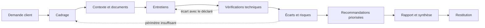

# Métier de consultant en cybersécurité

## Objectifs pédagogiques

À la fin de ce module, vous saurez :

- **distinguer** une mission de conseil technique, organisationnel ou GRC (Governance, Risk and Compliance) et adapter la méthode, les preuves et le livrable à chacune ;
- **cadrer** une mission : transformer une demande floue en objectifs, périmètre, exclusions et critères d'acceptation écrits ;
- **qualifier** un constat en distinguant ce qui est déclaré, documenté et vérifié, puis le rattacher à un écart sur un référentiel ;
- **traduire** un risque technique en conséquence métier défendable, et construire des recommandations priorisées qu'une équipe réelle peut exécuter ;
- **protéger** la mission elle-même : accès client, preuves, livrables et poste du consultant.

---

## Mise en situation

> **Scénario illustratif.** Les chiffres ci-dessous sont inventés pour les besoins du cours.

Une PME industrielle d'environ 300 personnes commande un « audit de sécurité » avant le renouvellement de son contrat avec un grand donneur d'ordre. Le consultant lance un scanner de vulnérabilités, exporte les résultats, ajoute un chapitre sur la politique de mots de passe et livre 86 pages avec 212 constats triés par score CVSS (Common Vulnerability Scoring System).

Le directeur général lit la page 3 (« maturité globale : 2,1/5 ») et classe le document. Le DSI a 212 lignes et aucune idée de la première à traiter.

En annexe, ligne 143, figure un constat classé « Moyen » : le compte de service `svc-sauvegarde` possède un SPN (Service Principal Name), un mot de passe qui n'a pas changé depuis 2014, et il est membre de `Domain Admins`. Il n'a ni CVE ni score CVSS élevé, donc il est noyé dans la masse.

Quatre mois plus tard, un attaquant exécute un Kerberoasting contre ce compte, casse le mot de passe hors ligne, prend le contrôle du domaine, supprime les sauvegardes avec ce même compte et déploie un rançongiciel.

Avoir fait l'audit ne suffisait-il pas ? Non, parce que le client n'achète pas une liste de défauts. Il achète une décision éclairée : quoi corriger en premier, pourquoi, avec quels moyens, et qu'est-ce que cela change pour l'activité.

> 💡 **À retenir**
>
> Un scanner produit des constats. Un consultant produit une priorisation compréhensible, validée avec le client et exécutable.
{: .callout .callout-important}

---

## Trois métiers sous un même titre

> 🧠 **Concept clé**
>
> « consultant en cybersécurité » recouvre trois familles de missions qui ne mobilisent ni les mêmes preuves ni les mêmes interlocuteurs.
{: .callout .callout-important}

| Famille | Question typique du client | Matière première | Livrable type | Piège spécifique |
|---|---|---|---|---|
| **Conseil technique** | « Cette architecture tient-elle face à un attaquant réel ? » | Configurations, logs, tests, revue d'architecture | Constats techniques reproductibles, plan de remédiation | Produire un rapport d'outil sans lecture métier |
| **Conseil organisationnel** | « Qui décide, qui répond, comment on réagit ? » | Entretiens, processus, organigramme, exercices de crise | Cartographie des rôles, procédures, trajectoire d'organisation | Décrire l'organigramme théorique au lieu de la pratique |
| **Conseil GRC** | « Sommes-nous conformes, et que risquons-nous si non ? » | Référentiels, politiques, registres de risques, preuves de conformité | Analyse d'écarts, registre de risques, feuille de route de conformité | Cocher des cases sans vérifier que le contrôle existe |

Dans la pratique, les missions mélangent ces familles. Une analyse d'écarts ISO 27001 demande des vérifications techniques par échantillonnage. Un audit Active Directory finit toujours par buter sur une question d'organisation : qui a le droit de désactiver un compte de service ?

> 💡 **Astuce**
>
> Pour savoir dans quelle famille se situe une demande, demandez « quelle décision allez-vous prendre avec ce livrable ? ». Si la réponse est « prouver notre conformité à un tiers », c'est du GRC. Si c'est « savoir si on peut nous compromettre », c'est du technique. Si c'est « savoir qui fait quoi pendant un incident », c'est de l'organisationnel.
{: .callout .callout-astuce}

---

## Surface d'attaque d'une mission de conseil

Un cabinet de conseil détient des cartographies d'infrastructure, des listes de vulnérabilités non corrigées et parfois des accès privilégiés chez plusieurs clients. C'est une cible rentable. Les campagnes publiques contre des prestataires de services managés (par exemple celles attribuées à APT10, dite « Cloud Hopper ») reposent sur ce raisonnement.

> 🗝️ **Analogie : le trousseau du serrurier**
>
> Plutôt que de forcer chaque porte, l'attaquant vole le trousseau de celui qui détient les doubles : il compromet un prestataire pour atteindre ses clients. Limite de l'image : le butin n'est pas seulement une clé, ce sont aussi des sessions déjà ouvertes et des informations (cartographies, vulnérabilités non corrigées).
{: .callout .callout-analogie}

| Vecteur | Exposition | Impact potentiel |
|---|---|---|
| Poste du consultant | Navigation, mails, clés USB, voyages ; infostealers qui exfiltrent cookies et sessions | Vol des accès VPN client, des notes et des rapports en cours |
| Comptes et accès client | Compte partagé « consultant », VPN permanent, mots de passe dans un tableur d'équipe | Accès persistant après la fin de mission, impossible à attribuer |
| Livrables | Rapport envoyé en clair par mail, métadonnées (auteur, chemin, historique de révision) | Feuille de route pour un attaquant : « voilà ce qui n'est pas corrigé » |
| Preuves collectées | Exports de configuration, captures, hashes, extraits de logs avec données personnelles | Fuite de secrets et incident RGPD chez le client |
| Entretiens | Un attaquant qui se fait passer pour un consultant ou un auditeur pour obtenir les mêmes informations (pretexting) | Divulgation d'informations sensibles à un tiers non mandaté |
| Sous-traitance | Freelance ajouté en cours de mission sans avenant ni NDA (Non-Disclosure Agreement) | Perte de maîtrise de la chaîne de confidentialité |

> 🔴 **Vecteur d'attaque**
>
> Un attaquant qui cible un cabinet n'a pas besoin de casser le client. Il lui suffit de compromettre un poste de consultant et de récupérer les sessions déjà authentifiées, via un infostealer ou un jeton de session volé, ou de lire le dernier rapport envoyé par mail. La mission est aussi un maillon de la chaîne d'approvisionnement du client.
{: .callout .callout-danger}

---

## Cadrage : de la demande à la lettre de mission

### Ce que le client demande n'est pas ce dont il a besoin

Un client dit « on veut un pentest ». Trois questions de cadrage suffisent souvent à reformuler :

1. **Pourquoi maintenant ?** Contrat à renouveler, incident récent, exigence d'un assureur, nouvelle réglementation, changement de direction.
2. **Quelle décision sera prise avec le résultat ?** Investir dans un projet, rassurer un client, justifier un budget, répondre à un régulateur.
3. **Que se passe-t-il si on ne fait rien ?** La réponse révèle la vraie contrainte (date, argent, personne).

Dans notre scénario, la bonne mission n'était pas « scan de vulnérabilités » mais « identifier les trois à cinq faiblesses qui compromettraient l'activité et dire comment les réduire avant la prochaine échéance contractuelle ».

### Ce que le cadrage doit écrire noir sur blanc

```yaml
mission:
  id: <MISSION_ID>
  client: <CLIENT>
  famille: conseil_technique   # conseil_technique | conseil_organisationnel | grc
  question_client: "Quels sont les chemins les plus probables vers une compromission du domaine ?"
  decision_attendue: "Arbitrer le budget sécurité du prochain exercice"
  perimetre:
    inclus:
      - "Domaine Active Directory <DOMAINE>, 2 sites"
      - "Serveurs de sauvegarde et d'administration"
    exclus:
      - "Environnement de production de l'ERP (hors AD)"
      - "Tests d'ingénierie sociale"
    hypotheses:
      - "Accès lecture seule au domaine fourni par le client"
      - "Disponibilité des administrateurs : 2 entretiens de 90 min"
  methode: "Entretiens, revue de configuration, vérifications techniques en lecture seule"
  livrables:
    - "Synthèse exécutive (2 pages max)"
    - "Rapport détaillé avec fiches de constats"
    - "Registre de recommandations priorisées (tableur)"
    - "Restitution : 1 session technique, 1 session direction"
  acceptation: "Relecture client sous 5 jours ouvrés ; 1 cycle de correction inclus"
  donnees:
    stockage_preuves: "Conteneur chiffré, accès nominatif"
    destruction: "J+<N> après la restitution, attestation fournie"
  contacts:
    sponsor: <NOM_SPONSOR>
    referent_technique: <NOM_REFERENT>
```

> ⚠️ **Erreur fréquente**
>
> Un périmètre accepté oralement (« on regardera aussi le Wi-Fi si vous avez le temps »). Conséquence : dépassement de budget, ou pire, test sur un système dont le client n'avait pas autorisé l'accès. Correction : tout ce qui n'est pas écrit dans « inclus » est hors mission ; tout ajout passe par un avenant d'une ligne, même par mail.
{: .callout .callout-attention}

Le cadre juridique et l'autorisation d'intervention ont été traités dans les modules d'audit ; ici, retenez que le cadrage est la première ligne de défense du consultant contre la dérive de périmètre.



Les flèches en pointillé sont le quotidien du métier : une vérification technique contredit un entretien, ou l'analyse révèle un angle mort dans le périmètre. Un bon cadrage prévoit ces retours.

---

## Comprendre le contexte du client

Avant le premier entretien, lisez ce qui existe : organigramme, politique de sécurité, dernier rapport d'audit, registre de risques, schéma d'architecture, contrats avec les clients clés. Cherchez les réponses à trois questions simples :

- **Qu'est-ce qui arrête l'activité ?** Une ligne de production, un ERP, un entrepôt, un site de vente.
- **Qu'est-ce qui coûte cher à perdre ?** Des données clients, une propriété intellectuelle, la confiance d'un donneur d'ordre.
- **Qui va imposer des exigences ?** Régulateur, assureur, client majeur, maison mère.

Ces réponses fixent le vocabulaire de vos recommandations. Une usine mesure son risque en heures d'arrêt de ligne, un cabinet d'avocats en confidentialité des dossiers, un e-commerçant en jours de chiffre d'affaires. Un risque exprimé dans le mauvais langage n'est pas entendu.

> 💡 **Astuce**
>
> Demandez très tôt « combien de temps pouvez-vous tenir sans votre outil principal (ERP, MES, messagerie) ? ». La réponse (souvent « on ne sait pas, peut-être trois jours ») est la meilleure base pour chiffrer plus tard un scénario de rançongiciel, et elle prouve au client que vous raisonnez en conséquences.
{: .callout .callout-astuce}

---

## Analyse de l'existant et identification des écarts

### Trois niveaux de preuve

> 🧠 **Concept clé**
>
> Un écart n'est défendable que si vous savez dire sur quoi il repose. Qualifiez chaque affirmation :
>
> | Niveau | Définition | Exemple | Utilisation dans le rapport |
> |---|---|---|---|
> | **Déclaré** | Dit en entretien, sans pièce | « Tous les admins ont du MFA » | Hypothèse à vérifier, jamais un constat |
> | **Documenté** | Existe sur papier ou dans une politique | « La procédure de revue des comptes existe » | Preuve de conception, pas de fonctionnement |
> | **Vérifié** | Observé ou testé par vous | Export des membres de `Domain Admins` comparé à la liste fournie | Seul niveau qui fonde un constat ferme |
{: .callout .callout-important}

Un écart se formule toujours par rapport à un référentiel : ISO 27001/27002, guide d'hygiène de l'ANSSI, NIST CSF, exigences contractuelles du donneur d'ordre, ou la politique interne du client. Sans référence, vous donnez une opinion ; avec elle, vous constatez une distance mesurable.

### Vérifier le déclaré : exemple Active Directory

L'administrateur affirme : « Nos comptes de service sont tous isolés et sans privilèges. » Avec un accès en lecture seule, deux vérifications de quelques secondes suffisent à confronter le déclaré au réel :

```powershell
# Membres du groupe le plus sensible
net group "Domain Admins" /domain

# Comptes avec SPN, ancienneté du mot de passe et appartenance aux groupes
Get-ADUser -Filter 'ServicePrincipalName -like "*"' `
  -Properties ServicePrincipalName,PasswordLastSet,MemberOf |
  Select-Object Name,PasswordLastSet,MemberOf
```

Si `svc-sauvegarde` apparaît dans les deux résultats avec un `PasswordLastSet` de 2014, vous avez un constat vérifié. Ces deux commandes ne montrent toutefois que l'appartenance directe : une appartenance via un groupe imbriqué exige une vérification récursive (par exemple `Get-ADGroupMember "Domain Admins" -Recursive`). Vous n'avez pas besoin de casser le mot de passe pour le démontrer, et vous ne devez pas le faire sans autorisation explicite dans la lettre de mission.

### Fiche de constat

Chaque constat suit la même structure, et chacun renvoie à une preuve identifiée :

| Champ | Contenu |
|---|---|
| Identifiant | `C-12` |
| Titre | Compte de service sauvegarde membre de Domain Admins, mot de passe inchangé depuis 2014 |
| Référence | Politique interne de gestion des comptes ; principe de moindre privilège |
| Preuve | `EV-12a` (export des membres), `EV-12b` (export des SPN et dates de mot de passe) |
| Niveau de preuve | Vérifié |
| Risque | Voir section suivante |
| Recommandation liée | `REC-07` |

---

## Entretiens avec les équipes métiers et techniques

Un entretien d'audit est de la reconnaissance : vous collectez de l'information sur les pratiques réelles. Un attaquant en ingénierie sociale cherche la même chose avec les mêmes questions. D'où l'importance de s'identifier clairement et de ne parler qu'aux personnes prévues par le cadrage.

**Ce qui marche :**

- **Questions ouvertes et demandes de démonstration** : « Montrez-moi la dernière fois que vous avez désactivé un compte après un départ » vaut dix questions fermées.
- **Un interlocuteur à la fois**, avec des variantes pour recouper : demandez le même processus à l'administrateur, à son manager et au support. Les divergences sont souvent le constat.
- **Poser les mêmes questions à des niveaux différents** : la direction décrit la politique, les administrateurs décrivent la pratique, le support décrit le contournement.
- **Rester sur les faits**, pas sur les responsabilités individuelles. Un entretien perçu comme une enquête sur des personnes ne produit que des réponses prudentes.

**Après l'entretien :**

- Envoyez un compte rendu sous 48 h et demandez une validation. Cela corrige les malentendus et évite les contestations en restitution.
- Séparez dans vos notes ce qui est dit (déclaré) de ce que vous avez vu (vérifié).
- Anonymisez les sources dans le rapport : « un administrateur indique que... », pas le nom. Une personne qui dit la vérité ne doit pas en payer le prix.

> ⚠️ **Erreur fréquente**
>
> Réaliser les entretiens sans vérification technique, puis écrire « le client dispose d'une revue trimestrielle des accès » dans le rapport. Conséquence : vous attestez d'un contrôle que vous n'avez pas vu fonctionner. Correction : écrire « déclaré en entretien, non vérifié » ou demander la dernière preuve de revue (export daté, ticket, compte rendu).
{: .callout .callout-attention}

---

## Traduire un risque technique en conséquence métier

> 🧠 **Concept clé**
>
> C'est le cœur du métier. Un risque technique n'existe pas pour la direction tant qu'on ne l'a pas relié à une activité, un coût ou une obligation.
{: .callout .callout-important}

### Comment l'attaque fonctionne réellement

Reprenons `svc-sauvegarde`. Voici ce que fait un attaquant ayant un compte de domaine quelconque (un compte utilisateur compromis suffit) :

```bash
# Demander les tickets de service de tous les comptes avec SPN
impacket-GetUserSPNs <DOMAINE>/<UTILISATEUR> -dc-ip <IP_DC> -request -outputfile hashes.txt

# Casser les tickets hors ligne (mode 13100 = Kerberos TGS-REP RC4)
hashcat -m 13100 hashes.txt <WORDLIST>
```

> 📖 **Définition**
>
> Le Kerberoasting détourne une opération Kerberos légitime : tout compte authentifié peut demander un ticket pour n'importe quel service. L'essentiel du travail, le craquage, se fait ensuite hors ligne, sans générer de tentative d'authentification échouée visible dans les journaux.
{: .callout .callout-definition}

Si le mot de passe date de 2014 et provient d'un schéma prévisible (nom de société + année), il tombe en minutes ou en heures, selon la puissance de calcul disponible.

Ce compte est membre de `Domain Admins` et sert aux sauvegardes. L'attaquant obtient donc le contrôle du domaine **et** la capacité de supprimer les sauvegardes. C'est précisément la combinaison que les opérateurs de rançongiciel recherchent avant de déclencher le chiffrement.

### Les quatre registres de traduction

| Ce que dit l'ingénieur | Ce qu'entend la direction | Ce que le consultant doit écrire |
|---|---|---|
| « Compte de service Kerberoastable, membre de DA, mot de passe de 2014 » | « Un problème de configuration informatique » | « Un compte utilisateur compromis suffit pour prendre le contrôle de l'ensemble des postes et serveurs, et supprimer les sauvegardes. L'entreprise ne pourrait alors plus redémarrer sans payer ou reconstruire. » |
| « SMB signing désactivé » | Rien | « Un attaquant présent sur le réseau peut se faire passer pour un serveur légitime et obtenir des droits d'administration sur des machines internes. » |
| « Pas de MFA sur la messagerie » | « Option de sécurité renforcée » | « Le vol d'un mot de passe suffit pour lire les mails des dirigeants et usurper une demande de virement. » |
| « 212 CVE ouvertes » | « Beaucoup de choses à corriger » | « Sur 212, 6 sont exposées sur Internet et activement exploitées ; ce sont ces six qui ont une échéance. » |

### Formule de rédaction

> **Actif concerné** + **Condition d'attaque** + **Conséquence opérationnelle** + **Ordre de grandeur de l'impact** + **Niveau de confiance**

Exemple pour la direction :

> « Si un seul poste de bureautique est compromis (scénario courant, par hameçonnage), l'attaquant peut atteindre l'ensemble du système d'information en quelques heures. Le client a indiqué que l'arrêt de l'ERP au-delà de 3 jours met en péril le contrat avec son principal donneur d'ordre. Les sauvegardes étant accessibles avec le même compte, la reprise serait longue. Hypothèse à valider avec la DAF : plusieurs semaines d'activité dégradée. »

Les chiffres d'impact doivent venir du client, ou être présentés comme des hypothèses à valider. Un consultant qui annonce « 2 M€ de pertes » sans source perd sa crédibilité à la première question.

> ⚠️ **Piège**
>
> Le score CVSS mesure la gravité technique d'une vulnérabilité, pas le risque pour ce client. Le constat C-12 n'a pas de CVSS, mais il est plus critique que 200 CVE de faible exposition. À l'inverse, une CVE à 9,8 sur une machine isolée sans donnée n'est pas prioritaire. Pour prioriser, croisez :
>
> - l'**exposition** (Internet, réseau interne, segment isolé) ;
> - l'**exploitation active** (présence dans le catalogue KEV (Known Exploited Vulnerabilities) de la CISA) ;
> - la **criticité de l'actif** (le client doit la confirmer) ;
> - les **contrôles compensatoires** déjà présents.
{: .callout .callout-attention}

---

## Recommandations réalistes et priorisées

Une recommandation que personne ne peut exécuter est un échec de conseil. La question à se poser est « qui fait quoi, avec quel effort, et comment saura-t-on que c'est fait ? ».

### Avant / après

| ❌ Recommandation inutilisable | ✅ Recommandation actionnable |
|---|---|
| « Renforcer la gestion des comptes à privilèges » | « Retirer `svc-sauvegarde` de `Domain Admins` ; lui donner uniquement les droits nécessaires sur le serveur de sauvegarde ; régénérer un mot de passe de 25 caractères ou utiliser un gMSA. Responsable : équipe infrastructure. Effort estimé : 2 jours + 1 test de restauration. Vérification : export des membres de `Domain Admins` et test de sauvegarde. » |
| « Mettre en place un SIEM » | « Centraliser les logs d'authentification des contrôleurs de domaine et de la messagerie. Un SIEM complet n'a de sens que si quelqu'un traite les alertes ; en attendant, une revue hebdomadaire de 5 alertes ciblées est réaliste pour une équipe de 2 personnes. » |

### Registre de recommandations

```yaml
- id: REC-07
  constat: C-12
  action: "Retirer svc-sauvegarde de Domain Admins, appliquer le moindre privilège, renouveler le secret"
  porteur: <EQUIPE_INFRA>
  horizon: 30j             # 30j | 3-6m | 6-18m
  effort: faible           # faible | moyen | fort
  cout_estime: "interne, 2 jours"
  reduction_du_risque: forte
  dependances: ["test de restauration à planifier hors production"]
  critere_de_succes: "Compte absent de Domain Admins ; sauvegarde nocturne fonctionnelle"
  si_non_applique: "Risque de compromission totale du domaine accepté par <SPONSOR>"
```

Le dernier champ (`si_non_applique`) force une décision explicite : corriger ou accepter le risque. Ce n'est plus votre rôle de trancher, mais c'est le vôtre de rendre la décision visible.

### Trois horizons

- **Moins de 30 jours** : actions à fort effet et faible coût (retrait de privilèges, activation d'un contrôle existant, correction d'exposition sur Internet).
- **3 à 6 mois** : chantiers structurants (segmentation, gestion des correctifs, processus d'arrivée et départ).
- **6 à 18 mois** : transformations (refonte d'architecture d'administration, programme de sensibilisation, plan de continuité).

> ⚠️ **Piège de réalisme**
>
> Un client avec une équipe informatique de quatre personnes ne mènera pas douze chantiers en parallèle. Limitez le plan à ce qui est faisable et indiquez clairement ce que vous mettez volontairement de côté. Les systèmes qu'on ne peut pas corriger (machine industrielle sous OS obsolète) reçoivent des mesures compensatoires (isolement réseau, accès restreint, surveillance), pas un « mettre à jour » théorique.
{: .callout .callout-attention}

> ⚠️ **Conflit d'intérêts**
>
> Ne recommandez pas un produit que vous revendez sans le dire et sans comparer des alternatives. Un doute sur votre neutralité décrédibilise tout le rapport.
{: .callout .callout-attention}

---

## Rapport, synthèse exécutive et restitution

### Structure du rapport

| Partie | Contenu | Lecteur |
|---|---|---|
| Synthèse exécutive | 2 pages max : situation, 3 à 5 risques majeurs en langage métier, décisions demandées, trajectoire | Direction |
| Contexte et méthode | Périmètre, dates, limites, niveau de preuve | Sponsor, auditeurs |
| Constats | Fiches (voir plus haut), ordonnées par priorité et non par outil | Équipes techniques |
| Feuille de route | Registre de recommandations, horizons, porteurs | DSI, RSSI, direction |
| Annexes | Preuves, sorties brutes, glossaire | Équipes techniques |

### La synthèse exécutive répond à trois questions

1. **Où en sommes-nous ?** Une phrase honnête, sans jargon et sans note chiffrée isolée.
2. **Que peut-il arriver ?** Deux ou trois scénarios, formulés avec la formule de la section précédente.
3. **Que décide-t-on ?** Les actions à valider, les budgets et arbitrages à faire, avec une échéance.

Si la direction termine la lecture sans savoir quoi décider, la synthèse a échoué.

> 💡 **Astuce**
>
> Testez chaque phrase de la synthèse avec le « et alors ? ». « Le domaine n'applique pas le moindre privilège » : et alors ? « Un seul compte compromis suffit à stopper la production ». Gardez la seconde.
{: .callout .callout-astuce}

### Restitution orale

- **Deux sessions** si les publics diffèrent : une technique (détails, preuves, plan d'action) et une direction (30 minutes : constats, décisions, calendrier).
- **Pas de surprise.** Montrez les constats aux porteurs concernés avant la restitution finale. Un administrateur découvrant en comité qu'il a « fait une erreur » réagira par la défense, et le message sera perdu. Ce pré-partage s'appelle le précâblage.
- **Ouvrez avec la décision attendue**, pas avec la méthode. La méthode est en annexe.
- **Anticipez les trois objections classiques** : « on n'a pas le budget » (proposez le quick win), « ce n'est pas notre priorité » (montrez le scénario métier), « ce n'est pas si grave » (montrez la preuve vérifiée).

---

## Durcissement de la mission : accès, preuves, livrables

Le consultant manipule des informations qui valent cher pour un attaquant. Chaque contrôle ci-dessous a un coût de friction, il faut donc l'adapter à la sensibilité de la mission.

| Mesure | Valeur recommandée | Coût réel |
|---|---|---|
| Poste dédié ou machine virtuelle par mission | Disque chiffré, pas de navigation personnelle, snapshot supprimé à la fin | Duplication des outils, quelques heures de préparation |
| Comptes client nominatifs | Un compte par consultant, MFA, expiration à la date de fin de mission | Demande au client à anticiper ; délai de création parfois d'une semaine |
| Accès privilégiés à la demande (JIT, Just-In-Time) | Élévation limitée à la fenêtre de test | Dépend de la maturité du client |
| Stockage des preuves | Conteneur chiffré par mission, accès nominatif, jamais sur un partage d'équipe générique | Discipline d'équipe |
| Transmission des livrables | Fichier chiffré, secret transmis par un canal distinct | Friction pour le destinataire |
| Métadonnées | Nettoyées ou contrôlées avant envoi | Étape de relecture supplémentaire |
| Fin de mission | Destruction des preuves à date fixée, attestation écrite au client | À planifier dans le cadrage |

### Livrer sans fuite

```bash
# Chiffrer le livrable (clé publique du destinataire)
age -r <CLE_PUBLIQUE> -o <FICHIER>.age <FICHIER>

# Empreinte pour que le client vérifie l'intégrité
sha256sum <FICHIER>.age

# Inspecter les métadonnées avant envoi
exiftool -a -G1 <FICHIER>
```

> ⚠️ **Attention**
>
> Sur un PDF, supprimer des métadonnées avec `exiftool -all=` est réversible : l'ancienne information reste souvent récupérable dans le fichier. Vérifiez avec `exiftool` et, si besoin, régénérez le PDF depuis le document source en ayant nettoyé les propriétés (auteur, société, chemins, commentaires, historique des révisions).
{: .callout .callout-attention}

### Garder les secrets hors des notes

Pendant une mission, mots de passe, hashes et jetons finissent dans des notes et des captures. Scannez votre dossier de travail avant archivage :

```bash
gitleaks detect --no-git --source <DOSSIER_MISSION>
grep -rEin "(password|passwd|pwd|secret|token)\s*[:=]" <DOSSIER_MISSION>
```

La syntaxe de `gitleaks` varie selon les versions ; consultez `gitleaks --help` pour votre installation.

> 🔒 **Contrôle de sécurité**
>
> Les preuves contenant des secrets du client (hashes, tokens, mots de passe) sont masquées dans le rapport (premiers et derniers caractères) et conservées uniquement dans le conteneur chiffré.
{: .callout .callout-securite}

---

## Contrôles de détection

Deux types de signaux sont à surveiller : ceux qui indiquent que la mission dérive, et ceux qui indiquent que la mission elle-même est exposée.

### Dérive de mission

| Signal | Ce que cela signifie | Réaction |
|---|---|---|
| Le client demande « un petit test en plus » hors cadrage | Dérive de périmètre | Avenant écrit avant toute action |
| Les entretiens se contredisent systématiquement | Pratiques réelles différentes des pratiques décrites | Prioriser la vérification technique |
| Un interlocuteur clé n'est jamais disponible | Risque de rapport fondé sur du déclaré | Escalader au sponsor, noter la limite dans le rapport |
| Les constats se limitent à la sortie d'un outil | Absence d'analyse | Revenir aux trois niveaux de preuve |
| Le client refuse de donner un accès en lecture | Périmètre irréaliste ou méfiance | Réviser le périmètre ou documenter la limite |

### Exposition de la mission

- **Côté consultant** : alertes de l'EDR sur le poste de mission, verrouillage des sessions, aucune synchronisation automatique des dossiers de mission vers des services personnels.
- **Côté client** : demandez que les comptes de consultants soient surveillés (connexion hors des heures convenues, depuis une adresse source inattendue, ou après la date de fin). Cette demande protège aussi le consultant, qui peut prouver que ce n'est pas lui.

---

## Tests de qualité avant livraison

Comme pour un contrôle de sécurité, un livrable se teste. Une relecture croisée par un collègue qui n'a pas participé à la mission détecte la plupart des défauts.

| Test | Question posée | Réussite |
|---|---|---|
| Traçabilité | Chaque constat est-il lié à au moins une preuve identifiée ? | Aucun constat sans `EV-xx` |
| Niveau de preuve | Aucune affirmation « déclarée » n'est présentée comme un fait ? | Relecture ligne à ligne |
| « Et alors ? » | La conséquence métier est-elle écrite ? | Chaque constat majeur en contient une |
| Actionnabilité | La recommandation a-t-elle un porteur, un effort et un critère de succès ? | Registre rempli |
| Cohérence du périmètre | Rien dans le rapport ne sort du périmètre cadré ? | Comparaison avec la lettre de mission |
| Confidentialité | Pas de secret en clair, métadonnées propres, livraison chiffrée ? | `gitleaks`, `exiftool`, `age` |
| Lisibilité direction | Un dirigeant non technique sait-il quoi décider après 2 pages ? | Relecture par un non-spécialiste |

---

## Compliance et standards

Ne citez pas tout le catalogue : choisissez ce qui s'applique à la mission.

- **ISO/IEC 27001 et 27002** : base courante pour les analyses d'écarts de gouvernance et de contrôles.
- **ISO/IEC 27005 et EBIOS Risk Manager** : méthodes d'analyse de risque ; EBIOS RM est la méthode de référence de l'ANSSI en France. Le choix dépend de ce que le client utilise déjà.
- **Guide d'hygiène de l'ANSSI** : référentiel pragmatique pour des organisations qui démarrent.
- **Qualification PASSI (ANSSI)** : pour les audits relevant d'un cadre qui l'exige, vérifiez que le prestataire est qualifié pour la portée concernée avant d'accepter la mission.
- **RGPD** : vos preuves peuvent contenir des données personnelles (logs, extractions, noms d'utilisateur). Minimisez-les, stockez-les chiffrées et détruisez-les à la date convenue.
- **NIS2** : la transposition et les obligations applicables à une entité donnée évoluent ; vérifiez le statut en vigueur et la qualification de l'entité au moment de la mission plutôt que de vous appuyer sur une information mémorisée.

---

## Cas en entreprise : une mission de bout en bout

> **Scénario illustratif**, chiffres inventés.

Un logisticien de 150 personnes doit répondre à un questionnaire de sécurité d'un grand client avant la fin du trimestre. Sa demande initiale : « un audit complet ». Le cadrage la reformule : **identifier les écarts critiques par rapport aux exigences du questionnaire et proposer un plan réaliste sur 6 mois**. Mission de type GRC avec vérifications techniques par échantillonnage, sur 12 jours-hommes.

| Semaine | Activité | Résultat |
|---|---|---|
| S1 | Cadrage, lecture des documents, premier entretien avec le DSI et la direction | Périmètre : AD, messagerie, sauvegardes, 2 entrepôts. Exclusions écrites. |
| S2 | 6 entretiens (DSI, admins, support, RH, direction logistique), vérifications techniques en lecture seule | 14 écarts, dont 3 vérifiés techniquement contredisant le déclaré (dont un compte de service privilégié) |
| S3 | Analyse, priorisation, rédaction, précâblage avec le DSI et l'administrateur principal | 9 recommandations, dont 4 à moins de 30 jours |
| S3 (fin) | Restitution technique (1 h 30) puis direction (30 min) | Le DG valide les 4 quick wins et un budget pour deux chantiers structurants |

Ce qui a fait la différence : le précâblage a transformé un administrateur potentiellement sur la défensive en porteur des corrections, et la synthèse exécutive a posé la décision en une phrase (« valider quatre actions avant la date de réponse au client »). Un test de restauration réalisé avec le DSI a aussi permis de démontrer la fragilité des sauvegardes, plus convaincante que n'importe quel slide.

---

## Erreurs fréquentes

⚠️ **Rapport = export d'outil**

- *Configuration dangereuse* : copier la sortie du scanner dans le rapport, classée par score.
- *Conséquence* : 200 lignes sans priorité ; les risques de configuration (AD, droits, sauvegardes) restent invisibles.
- *Correction* : regrouper en scénarios d'attaque, prioriser selon exposition, exploitation active et criticité. *Détection* : un relecteur compte le nombre de constats sans conséquence métier.

⚠️ **Périmètre oral**

- *Conséquence* : dépassement de budget ou action hors autorisation.
- *Correction* : avenant écrit, même d'une ligne, avant toute action non prévue.

⚠️ **Recommandation non exécutable**

- *Exemple* : « Mettre en place une politique de gestion des correctifs » pour une équipe de deux personnes.
- *Correction* : porteur, effort, critère de succès, horizon (voir le registre). *Détection* : demandez à l'administrateur « pouvez-vous commencer lundi ? ».

⚠️ **Sévérité fixée par CVSS seul**

- *Conséquence* : une mauvaise configuration critique (compte privilégié faible) passe sous le radar, et une CVE élevée sur un actif isolé mobilise l'équipe.
- *Correction* : priorisation contextuelle ; vérifier l'exploitation active (catalogue KEV) et la criticité de l'actif.

⚠️ **Surestimation de l'impact (ton alarmiste)**

- *Exemple* : annoncer des millions de pertes sans source.
- *Conséquence* : le rapport est discrédité à la première question de la DAF.
- *Correction* : chiffres sourcés par le client, ou hypothèses explicites, avec niveau de confiance.

⚠️ **Livrable envoyé en clair, métadonnées intactes**

- *Conséquence* : le rapport circule par mail non chiffré ; le PDF révèle le nom du consultant, des chemins internes ou des versions précédentes.
- *Correction* : `age` ou équivalent, secret par un autre canal, `exiftool -a -G1` avant envoi.

⚠️ **Comptes de mission oubliés**

- *Conséquence* : un compte VPN créé pour vous reste actif six mois après la restitution, sans propriétaire ; il devient un point d'entrée.
- *Correction* : date d'expiration à la création, désactivation confirmée par écrit à la fin de mission.

---

## Résumé

Le consultant en cybersécurité vend de la décision, pas des constats : il cadre une question, vérifie les faits au-delà du déclaré et traduit les écarts en conséquences que l'organisation comprend.

- **La menace couverte est double** : le client qui subit un incident évitable parce que son rapport n'a rien priorisé, et le cabinet lui-même, dont les accès et les livrables intéressent les attaquants.
- **Le mécanisme de défense** repose sur un cadrage écrit, trois niveaux de preuve, des recommandations avec porteur, effort et critère de succès, et un durcissement de la mission (comptes nominatifs, preuves chiffrées, livraison contrôlée).
- **Restent à surveiller** la dérive de périmètre, les écarts entre déclaré et vérifié, les chiffres d'impact non sourcés et les accès de mission non révoqués.

Ce module ne remplace pas la spécialisation technique : sans elle, la traduction métier reste approximative.

<!-- snippet
id: conseil_cyber_trois_familles_mission
type: concept
tech: conseil-cyber
level: intermediate
importance: high
format: knowledge
tags: conseil,grc,cadrage,mission
title: Technique, organisationnel, GRC : trois missions différentes
content: Technique = tester si une architecture résiste (preuves : configurations, logs, tests). Organisationnel = vérifier qui décide et agit réellement (preuves : entretiens, exercices). GRC = mesurer l'écart à un référentiel et l'exposer en risque (preuves : politiques, registres, contrôles échantillonnés). La question « quelle décision prendrez-vous avec ce livrable ? » permet de classer la demande.
description: Chaque famille a ses preuves, ses interlocuteurs et son piège ; identifier la bonne évite de livrer un rapport hors sujet.
-->

<!-- snippet
id: conseil_cyber_perimetre_ecrit
type: warning
tech: conseil-cyber
level: intermediate
importance: high
format: knowledge
tags: conseil,cadrage,perimetre,autorisation
title: Périmètre accepté à l'oral, dérive garantie
content: Périmètre élargi à l'oral en cours de mission → dépassement de budget et risque d'agir sur un système non autorisé. Correction : tout ce qui n'est pas dans la liste « inclus » du cadrage est hors mission ; tout ajout passe par un avenant écrit (un mail de validation suffit) avant toute action.
description: Le cadrage écrit protège le client et le consultant ; un ajout oral n'a aucune valeur contractuelle ni juridique.
-->

<!-- snippet
id: conseil_cyber_niveaux_de_preuve
type: concept
tech: conseil-cyber
level: advanced
importance: high
format: knowledge
tags: conseil,audit,preuve,constat
title: Déclaré, documenté, vérifié : trois niveaux de preuve
content: Déclaré = dit en entretien sans pièce ; documenté = existe sur papier (preuve de conception) ; vérifié = observé ou testé par le consultant (preuve de fonctionnement). Seul « vérifié » fonde un constat ferme ; les deux autres s'écrivent « déclaré, non vérifié » ou « documenté, fonctionnement non observé ».
description: Qualifier chaque affirmation évite d'attester dans un rapport d'un contrôle qu'on n'a jamais vu fonctionner.
-->

<!-- snippet
id: conseil_cyber_verifier_spn_ad
type: command
tech: conseil-cyber
level: advanced
importance: high
format: knowledge
tags: active-directory,kerberos,audit,service-account
title: Lister les comptes à SPN avec ancienneté du mot de passe
context: PowerShell avec module ActiveDirectory, accès lecture seule, dans le cadre autorisé de la mission
command: Get-ADUser -Filter 'ServicePrincipalName -like "*"' -Properties ServicePrincipalName,PasswordLastSet,MemberOf | Select-Object Name,PasswordLastSet,MemberOf
description: Repère les comptes de service kerberoastables, leur ancienneté et leurs groupes directs (l'appartenance imbriquée exige une vérification récursive), sans casser aucun mot de passe.
-->

<!-- snippet
id: conseil_cyber_kerberoasting_chaine
type: concept
tech: conseil-cyber
level: advanced
importance: high
format: knowledge
tags: kerberos,kerberoasting,active-directory,ransomware
title: Kerberoasting : du compte de service au rançongiciel
content: Tout compte de domaine peut demander un ticket de service pour un SPN (impacket GetUserSPNs -request). Le craquage se fait hors ligne (hashcat -m 13100), sans échec d'authentification dans les journaux. Si le compte est membre de Domain Admins et gère les sauvegardes, l'attaquant obtient le domaine et peut supprimer les sauvegardes avant le chiffrement.
description: Illustre un constat sans CVE ni CVSS élevé qui mène à la compromission totale ; modèle de risque à traduire en conséquences métier.
-->

<!-- snippet
id: conseil_cyber_formule_traduction_risque
type: tip
tech: conseil-cyber
level: advanced
importance: high
format: knowledge
tags: conseil,risque,communication,direction
title: Formule pour traduire un risque en langage direction
content: Rédiger chaque risque majeur ainsi - actif concerné, condition d'attaque, conséquence opérationnelle, ordre de grandeur de l'impact fourni par le client, niveau de confiance. Exemple - « un poste compromis suffit pour atteindre tout le domaine et supprimer les sauvegardes ; arrêt de l'ERP au-delà de 3 jours critique selon la direction ; hypothèse à valider avec la DAF ».
description: Évite le jargon technique et les chiffres d'impact inventés ; chaque élément chiffré provient du client ou est marqué comme hypothèse.
-->

<!-- snippet
id: conseil_cyber_cvss_priorisation
type: warning
tech: conseil-cyber
level: advanced
importance: high
format: knowledge
tags: cvss,priorisation,vulnerabilites,risque
title: Prioriser par CVSS seul masque les vrais risques
content: Trier les constats par score CVSS place une CVE à 9,8 sur un actif isolé avant un compte privilégié faible sans CVE. Correction : croiser exposition (Internet ou interne), exploitation active (catalogue KEV de la CISA), criticité de l'actif confirmée par le client et contrôles compensatoires existants.
description: CVSS mesure la gravité technique d'une faille, pas le risque pour un client précis ; les mauvaises configurations n'ont souvent aucun score.
-->

<!-- snippet
id: conseil_cyber_recommandation_actionnable
type: tip
tech: conseil-cyber
level: intermediate
importance: high
format: knowledge
tags: conseil,recommandation,priorisation,remediation
title: Une recommandation exécutable a cinq champs
content: Pour chaque recommandation, renseigner dans le registre - action précise, porteur nommé, effort estimé (jours), horizon (30 jours, 3-6 mois, 6-18 mois) et critère de succès vérifiable (ex. compte absent de Domain Admins, test de restauration réussi). Ajouter un champ « si non appliqué » pour forcer une décision explicite de risque accepté.
description: Test rapide : l'administrateur concerné doit pouvoir commencer lundi sans poser de question.
-->

<!-- snippet
id: conseil_cyber_synthese_executive
type: tip
tech: conseil-cyber
level: intermediate
importance: medium
format: knowledge
tags: conseil,rapport,synthese,restitution
title: Synthèse exécutive : 2 pages, 3 questions, une décision
content: Limiter à 2 pages et répondre à trois questions - où en est-on, que peut-il arriver (2 ou 3 scénarios formulés en conséquences), que décide-t-on (actions, budget, échéance). Appliquer le test « et alors ? » à chaque phrase technique et ne garder que la version qui parle d'activité.
description: La synthèse a échoué si la direction termine la lecture sans savoir quoi décider ; la méthode reste en annexe.
-->

<!-- snippet
id: conseil_cyber_precablage_restitution
type: tip
tech: conseil-cyber
level: intermediate
importance: medium
format: knowledge
tags: conseil,restitution,communication,audit
title: Précâbler les constats avant la restitution finale
content: Montrer chaque constat aux porteurs concernés (administrateur, DSI) avant le comité, avec les preuves. Un administrateur qui découvre un constat en public se défend et fait échouer le message ; en amont, il devient souvent porteur de la correction et peut contester un fait avant qu'il n'apparaisse dans le rapport.
description: Le précâblage évite l'effet de surprise en comité sans modifier le fond du constat vérifié.
-->

<!-- snippet
id: conseil_cyber_chiffrer_livrable_age
type: command
tech: conseil-cyber
level: intermediate
importance: high
format: knowledge
tags: livrable,chiffrement,age,confidentialite
title: Chiffrer un livrable avec age avant envoi
command: age -r <CLE_PUBLIQUE> -o <FICHIER>.age <FICHIER>
example: age -r age1ql3z7hjy54pw3hyww5ayyfg7zqgvc7w3j2elw8zmrj2kg5sfn9aqmcac8p -o rapport_v1.pdf.age rapport_v1.pdf
description: Chiffre le rapport pour la clé publique du destinataire ; l'échange de la clé et du fichier se fait par deux canaux distincts.
-->

<!-- snippet
id: conseil_cyber_metadonnees_pdf
type: command
tech: conseil-cyber
level: intermediate
importance: medium
format: knowledge
tags: livrable,metadonnees,exiftool,confidentialite
title: Inspecter les métadonnées d'un livrable avant envoi
command: exiftool -a -G1 <FICHIER>
example: exiftool -a -G1 rapport_v1.pdf
description: Affiche auteur, société, chemins et historique ; exiftool -all= sur un PDF reste réversible, mieux vaut régénérer le fichier depuis la source nettoyée.
-->

<!-- snippet
id: conseil_cyber_secrets_dans_notes
type: error
tech: conseil-cyber
level: intermediate
importance: medium
format: knowledge
tags: secrets,preuves,gitleaks,confidentialite
title: Secrets du client oubliés dans les notes de mission
content: Symptôme - hashes, tokens ou mots de passe retrouvés dans des notes ou captures archivées. Cause - collecte de preuves sans masquage ni scan avant archivage. Correction - exécuter gitleaks detect --no-git --source <DOSSIER> et un grep sur password, secret et token, masquer les valeurs dans le rapport et conserver les originaux dans un conteneur chiffré détruit à la date convenue.
description: La syntaxe de gitleaks dépend de la version ; vérifier avec gitleaks --help avant d'automatiser.
-->

<!-- snippet
id: conseil_cyber_comptes_mission_expiration
type: warning
tech: conseil-cyber
level: intermediate
importance: high
format: knowledge
tags: acces,moindre-privilege,mission,vpn
title: Comptes de mission sans date d'expiration
content: Compte VPN ou de domaine créé pour la mission sans expiration → il reste actif des mois après la restitution, sans propriétaire, et devient un point d'entrée si le poste du consultant est compromis. Correction : comptes nominatifs avec MFA, date d'expiration fixée à la création, désactivation confirmée par écrit à la fin de mission.
description: Les prestataires sont une cible réelle ; limiter la durée de vie des accès réduit autant le risque client que la responsabilité du consultant.
-->
