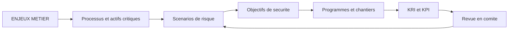
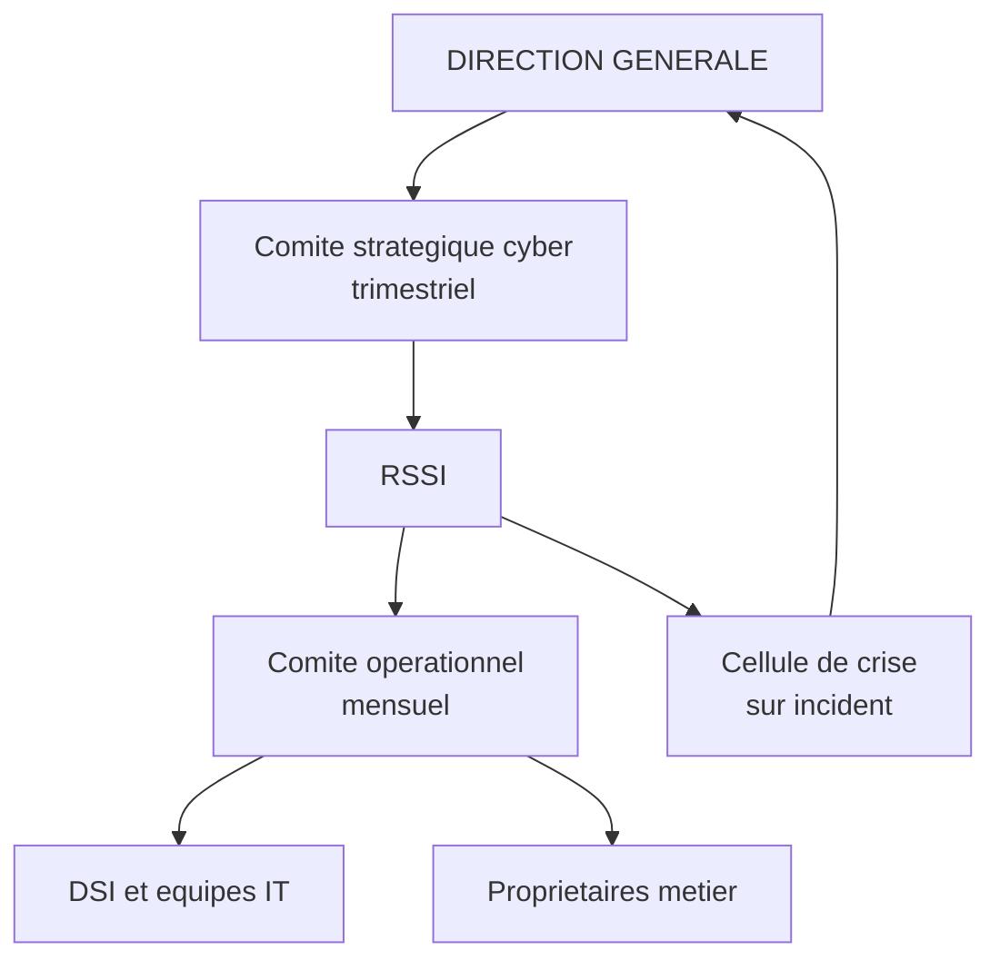

# RSSI, stratégie de sécurité et gestion des programmes

## Objectifs pédagogiques

À la fin de ce module, vous saurez :

- **distinguer** ce qui relève du RSSI, du DSI et de la direction générale, et **identifier** les rattachements qui rendent la fonction inopérante ;
- **construire** une stratégie cyber en partant des processus métier critiques, et non d'un catalogue d'outils ;
- **concevoir** une gouvernance (comités, propriétaires de risque, circuit d'exceptions) qui produit des décisions traçables ;
- **définir** des indicateurs KRI et KPI reliés à une décision, puis **vérifier** certains d'entre eux en ligne de commande ;
- **arbitrer** un budget cyber et **piloter** une feuille de route sur trois horizons ;
- **encadrer** le risque lié aux tiers, du tiering des fournisseurs aux clauses contractuelles.

## Mise en situation

*Scénario illustratif, chiffres fictifs.* Un industriel de 1 200 salariés sous-traite la maintenance de ses automates à un intégrateur. Pour intervenir rapidement, l'intégrateur dispose d'un compte VPN partagé, ouvert il y a quatre ans, protégé par un simple mot de passe, avec accès au réseau de production. Le contrat prévoit une clause de confidentialité. Rien sur la sécurité des accès.

Un attaquant achète sur un marché d'identifiants volés les credentials d'un technicien de l'intégrateur, récupérés par un infostealer sur son poste personnel. Il se connecte au VPN : c'est la technique MITRE ATT&CK T1078 (Valid Accounts), combinée à T1199 (Trusted Relationship). Aucune alerte ne se déclenche, car la connexion est légitime en apparence. Il rebondit vers le contrôleur de domaine, désactive les sauvegardes, puis déploie le ransomware un vendredi soir.

Le RSSI avait pourtant fait le nécessaire côté outils : un EDR déployé sur 95 % des postes, une politique de sécurité de 60 pages validée en 2021, un audit annuel. Mais le compte tiers n'apparaissait dans aucun registre de risque. L'exception « MFA non applicable aux prestataires » avait été accordée oralement, sans échéance ni propriétaire. Le budget de remédiation du périmètre industriel avait été repoussé deux ans de suite, sans que personne à la direction ait formellement accepté ce risque.

La défense naïve, « acheter plus d'outils et rédiger plus de politiques », n'aurait rien changé. Ce qui a manqué, c'est la gouvernance : savoir qui possède quel risque, qui peut l'accepter, avec quelle échéance, et comment on le voit remonter.

## Surface d'attaque organisationnelle

Un attaquant n'attaque pas votre politique de sécurité, il exploite ce qu'elle n'a pas couvert. Côté gouvernance, la surface se lit dans les zones sans propriétaire, sans date de péremption et sans mesure.

| Vecteur | Exposition | Impact potentiel |
|---|---|---|
| Comptes et accès de tiers | Comptes partagés, jamais revus, sans MFA (Multi-Factor Authentication) | Accès initial légitime, détection tardive |
| Exceptions de sécurité sans échéance | Dérogations orales ou dans des mails, jamais réexaminées | Contrôle contourné durablement et invisible |
| Risques acceptés sans le bon décideur | Le RSSI ou le DSI « accepte » à la place du propriétaire métier | Aucune légitimité en cas d'incident ou de contrôle |
| Périmètres hors radar | Production industrielle, filiales, shadow IT, SaaS achetés par les métiers | Angles morts exploités en premier |
| Dépendance à une personne | Un seul administrateur détient la connaissance d'un système critique | Rupture de service ou perte de contrôle en cas de départ |
| Indicateurs cosmétiques | Taux de couverture de l'EDR affiché, taux de remédiation réel ignoré | Fausse assurance de la direction |
| Chaîne d'approvisionnement logicielle | Mises à jour d'éditeurs, composants open source, MSP (Managed Service Provider) | Compromission en cascade, hors de votre contrôle direct |

🧠 **Concept clé** : en gouvernance, un risque sans propriétaire nommé, sans date de revue et sans indicateur n'est pas géré. Il est seulement connu.

## Qui fait quoi : RSSI, DSI et direction générale

Le RSSI (l'équivalent français du CISO, Chief Information Security Officer) a un rôle qui se définit souvent par ce qu'il n'est pas. Il ne possède pas le risque, il n'exploite pas le système d'information, et il n'a pas autorité sur les budgets métier. Il conseille, structure, contrôle et alerte.

| Acteur | Responsabilité réelle | Ce qu'il ne doit pas faire |
|---|---|---|
| Direction générale | Fixe l'appétence au risque, arbitre les budgets, **accepte formellement** les risques majeurs | Déléguer l'acceptation du risque à la DSI par défaut |
| DSI (CIO, Chief Information Officer) | Exploite et fait évoluer le SI, applique les mesures techniques, porte le risque opérationnel IT | Arbitrer seul entre disponibilité et sécurité sur les sujets qui engagent l'entreprise |
| RSSI | Définit la stratégie et le cadre, mesure l'écart, challenge, remonte les risques, pilote les programmes | Administrer les outils au quotidien, valider ses propres contrôles |
| Propriétaires métier | Possèdent les risques liés à leurs processus et données | Se désintéresser de la sécurité parce que « c'est un sujet IT » |

Cette répartition se formalise souvent avec une matrice RACI (Responsible, Accountable, Consulted, Informed). Sa valeur tient à une règle simple : une seule personne *Accountable* par décision.

⚠️ **Erreur fréquente : la fonction RSSI réduite à l'administration des outils.** Quand le RSSI passe ses semaines à régler le proxy, gérer les règles du pare-feu et trier les alertes de l'antivirus, la fonction devient un poste d'exploitation avec un titre de direction. Trois conséquences se cumulent :

- plus personne ne regarde le risque d'ensemble ;
- le contrôle est assuré par la personne qui a configuré ce qu'elle contrôle ;
- le jour de l'incident, le RSSI est submergé par l'opérationnel au moment où la direction attend un arbitrage.

La correction passe par un partage explicite. Le RSSI **définit et contrôle**, les équipes IT et le SOC (Security Operations Center) **exécutent**. Dans une petite structure où le cumul est inévitable, on compense par une revue externe annuelle des contrôles que le RSSI a lui-même mis en place.

Le rattachement pèse tout autant. Un RSSI rattaché au DSI arbitre sous pression des délais et du budget IT, alors que son rôle consiste précisément à contredire parfois le DSI. Un rattachement direct à la direction générale, ou à défaut un droit d'alerte formel vers le comité de direction, change la nature de la fonction. Cela a un coût : un RSSI près du pouvoir doit y consacrer du temps et de la crédibilité politique, et il peut s'éloigner du terrain.

## Une stratégie cyber alignée sur les enjeux de l'organisation ⭐

Une stratégie qui commence par « déployer un SIEM, un PAM (Privileged Access Management) et un EDR (Endpoint Detection and Response) » est une liste d'achats. Une stratégie alignée part de ce que l'organisation ne peut pas se permettre de perdre.

La démarche reste la même quel que soit le secteur :

1. **Enjeux métier** : que fait gagner de l'argent, quelles obligations légales pèsent, qu'est-ce qui arrête l'activité ? Pour l'industriel du scénario, c'est la production continue et la livraison dans les délais contractuels.
2. **Processus et actifs critiques** : les lignes de production, l'ordonnancement, la paie, les données clients.
3. **Scénarios de risque** : « ransomware sur l'Active Directory pendant une semaine de forte charge », « fuite de données de R&D via un tiers ». La méthode EBIOS Risk Manager de l'ANSSI structure ce travail, et l'ISO 27005 en propose une autre voie.
4. **Objectifs de sécurité** : formulés comme des capacités mesurables, pas comme des produits. Par exemple : « restaurer la production en moins de 48 h après perte totale de l'annuaire ».
5. **Programmes** : les chantiers qui produisent ces capacités.
6. **Indicateurs** : ce qui prouve que l'objectif avance.



💡 **Astuce** : testez votre stratégie avec la question suivante : « si la direction coupe 30 % du budget, quels objectifs de sécurité abandonne-t-on, et quel risque devient explicitement accepté ? » Si vous ne pouvez pas répondre, la stratégie n'est pas encore priorisée.

La stratégie doit aussi tenir compte de la contrainte réelle. Une PME avec deux personnes dédiées ne déploie pas le même programme qu'un groupe bancaire. La maturité cible se choisit selon le risque et les moyens, et l'ISO 27001 sert ici de cadre pour un ISMS (Information Security Management System) : on y justifie les mesures retenues par rapport aux risques, au lieu de viser une couverture maximale.

## Gouvernance, comités et responsabilités

La gouvernance sert à produire des décisions traçables au bon niveau. Trois instances suffisent dans la plupart des organisations, et tout ce qui s'y ajoute doit justifier son existence.



| Instance | Rythme | Participants | Décisions attendues |
|---|---|---|---|
| Comité stratégique cyber | Trimestriel | Direction générale, DSI, RSSI, représentants métier, juridique | Acceptation des risques majeurs, arbitrage budgétaire, validation de la feuille de route |
| Comité opérationnel | Mensuel | RSSI, DSI, responsables de projets et d'exploitation | Avancement des programmes, exceptions à approuver, vulnérabilités critiques en retard |
| Cellule de crise | À l'incident | Direction, RSSI, DSI, communication, juridique | Décisions de containment, communication, notification aux autorités |

Les décisions comptent plus que la forme. Un comité qui « prend acte » sans rien décider n'a aucun effet. Chaque séance doit sortir avec des décisions écrites, un propriétaire et une échéance. Le point le plus négligé reste l'acceptation de risque : elle est signée par le **propriétaire du processus concerné**, avec la durée de validité de l'acceptation.

🔒 **Contrôle de sécurité** : le registre des exceptions. Chaque dérogation à la politique y figure avec un identifiant, le périmètre, le risque, le propriétaire, la mesure compensatoire et une **date d'expiration**. Sans échéance, une dérogation devient une règle.

## Politique de sécurité et déclinaison opérationnelle

La politique de sécurité de 60 pages que personne n'a lue reste le piège classique. Pour qu'elle serve, on la découpe en couches de lisibilité différente :

- **Politique** (2 à 5 pages) : principes et engagements de la direction, signée par elle.
- **Standards** : règles vérifiables, par exemple « tout accès administrateur exige une authentification multifacteur ».
- **Procédures et guides** : comment on applique concrètement chaque standard.
- **Contrôles techniques** : les paramètres des systèmes qui l'imposent ou la mesurent.

Un standard n'a de valeur que s'il est testable. Si l'on ne peut pas écrire la commande ou la requête qui vérifie la règle, la règle est trop vague.

Exemple : le standard « MFA obligatoire pour les comptes disposant d'un accès console » se vérifie sur AWS (les commandes équivalentes existent chez les autres fournisseurs) :

```bash
aws iam generate-credential-report > /dev/null
sleep 5
aws iam get-credential-report --query Content --output text \
  | base64 -d \
  | awk -F, 'NR>1 && ($4=="true" || $4=="not_supported") && $8=="false" {print $1}'
```

Le résultat liste les utilisateurs avec mot de passe console actif et sans MFA. Il inclut aussi le compte root (`<root_account>`, pour lequel `password_enabled` vaut `not_supported`) s'il n'a pas de MFA. Colonne `$4` : `password_enabled`. Colonne `$8` : `mfa_active`. Si la liste n'est pas vide, le standard n'est pas respecté, et ce constat alimente directement un KPI.

La déclinaison a un coût : chaque standard demande un contrôle, donc du temps d'équipe. Mieux vaut vingt standards mesurés que cent écrits pour l'audit.

## Budget, ressources et priorisation

Le budget cyber se négocie rarement sur la peur et souvent sur la comparaison : risque réduit contre coût et effort. La priorisation ne s'appuie pas sur un calcul exact (la quantification du risque reste approximative), mais sur une grille partagée.

Une approche simple pour classer les initiatives :

```
priorité ≈ (réduction de risque × couverture) / (coût + charge d'exploitation + effort de conduite du changement)
```

Le terme souvent oublié est la **charge d'exploitation**. Un outil acheté crée un coût récurrent : licences, réglages, et surtout quelqu'un pour traiter ce qu'il remonte. Un EDR sans équipe pour répondre aux alertes ne réduit pas le risque proportionnellement à son prix.

Exemple illustratif pour l'industriel du scénario, avec des chiffres fictifs :

| Initiative | Coût année 1 | Effort interne | Risque réduit |
|---|---|---|---|
| MFA sur tous les accès distants, tiers compris | Faible | Moyen (communication aux prestataires) | Élevé |
| Sauvegardes isolées et test de restauration | Moyen | Moyen | Très élevé sur le scénario ransomware |
| Segmentation IT / production | Élevé | Élevé (arrêts de production à planifier) | Élevé, étalé sur 18 mois |
| SOC externalisé 24/7 | Élevé et récurrent | Faible à moyen | Moyen sans autres prérequis |
| Campagne de sensibilisation | Faible | Faible | Faible à moyen, effet qui s'érode |

Dans ce contexte, on commence par le MFA et les sauvegardes, qui coûtent peu au regard du risque couvert. La segmentation devient un programme pluriannuel. Le SOC externalisé attend que les prérequis (inventaire, journalisation) soient en place, sinon il surveille un périmètre qu'il ne connaît pas.

Côté ressources, la question n'est pas seulement « combien de personnes » mais « quelles compétences ne doivent pas reposer sur une seule personne ». Un expert unique sur l'Active Directory est un risque de gouvernance, au même titre qu'une vulnérabilité.

## Indicateurs : KRI et KPI

Les KRI (Key Risk Indicator) mesurent l'exposition au risque, ce qui peut mal tourner. Les KPI (Key Performance Indicator) mesurent la performance des actions menées, ce qui avance ou non. Un indicateur n'a de valeur que s'il déclenche une décision quand il franchit un seuil.

| Indicateur | Type | Source | Seuil d'alerte | Décision déclenchée |
|---|---|---|---|---|
| Vulnérabilités KEV* ouvertes sur des actifs exposés | KRI | Scanner + catalogue KEV | > 0 au-delà de 15 jours | Escalade au comité opérationnel |
| Comptes de tiers actifs sans propriétaire | KRI | Annuaire + registre fournisseurs | > 0 | Désactivation sous 5 jours |
| Exceptions expirées non réexaminées | KRI | Registre des exceptions | > 0 | Retour en comité ou suppression |
| Part des comptes à privilèges avec MFA | KPI | Annuaire / IAM | < 100 % | Plan de remédiation daté |
| Délai médian de correction des failles critiques | KPI | Gestion des correctifs | Au-dessus du SLA (Service Level Agreement) interne | Revue des ressources ou des priorités |
| Dernier test de restauration complet réussi | KPI | Rapport de test | > 6 mois | Test planifié sous 30 jours |

\* KEV : catalogue Known Exploited Vulnerabilities de la CISA, qui recense les CVE exploitées activement dans la nature, donc un meilleur signal de priorité qu'un score CVSS seul.

Pour calculer le premier indicateur, croisez les CVE ouvertes de votre scanner avec le catalogue KEV :

```bash
curl -s https://www.cisa.gov/sites/default/files/feeds/known_exploited_vulnerabilities.json \
  | jq -r '.vulnerabilities[].cveID' | sort > kev.txt
sort open_cves.txt | comm -12 - kev.txt
```

`open_cves.txt` contient un identifiant CVE par ligne, exporté du scanner. L'URL du flux peut évoluer, vérifiez-la dans la documentation de la CISA.

⚠️ **Erreur fréquente : les indicateurs cosmétiques.** « 98 % des postes équipés d'un EDR » rassure, mais ne dit pas si les 2 % restants sont les serveurs de production. Mesurez la couverture sur les actifs critiques, pas sur la moyenne. Un tableau de bord de 40 indicateurs est illisible : au comité stratégique, huit à douze suffisent, chacun relié à une décision possible.

## Pilotage de la feuille de route

Une feuille de route cyber ne se résume pas à une liste de projets. Elle relie des programmes à des objectifs de sécurité, avec des dépendances et des critères de réussite. On la structure en trois horizons :

| Horizon | Contenu typique | Critère de succès |
|---|---|---|
| 0 à 6 mois | Réductions de risque rapides : MFA, sauvegardes isolées, suppression des comptes orphelins, registre des exceptions | Scénarios les plus probables couverts au minimum |
| 6 à 18 mois | Programmes structurants : segmentation, gestion des identités privilégiées, journalisation centralisée | Capacité de détection et de confinement mesurée |
| 18 mois et plus | Capacités avancées : exercices de crise réguliers, automatisation des contrôles, sécurité intégrée aux projets | Niveau de maturité cible atteint, indicateurs stables |

Trois pratiques font la différence entre une feuille de route vivante et un document de décoration :

- **Revue trimestrielle en comité stratégique.** Chaque programme est vert, orange ou rouge, avec la cause du retard, pas seulement la couleur.
- **Critères d'arrêt.** On définit à l'avance dans quelles conditions un programme est suspendu ou abandonné. Sans cela, les chantiers s'accumulent.
- **Rebasing annuel.** Les priorités sont réévaluées quand le contexte change : nouvelle menace, fusion, incident, évolution réglementaire.

Pour les obligations réglementaires comme NIS2 ou DORA (Digital Operational Resilience Act), la feuille de route doit distinguer la directive ou le règlement européen, sa transposition nationale et les obligations qui s'appliquent réellement à votre entité. Cet état évolue, il se vérifie à la date où vous travaillez et ne s'apprend pas une fois pour toutes.

## Gestion des tiers, fournisseurs et risques contractuels

🔴 **Vecteur d'attaque** : l'attaquant cible le maillon que vous ne maîtrisez pas. En 2020, la compromission de la chaîne de mise à jour de SolarWinds Orion a touché ses clients en cascade. En 2021, l'attaque sur le logiciel Kaseya VSA, utilisé par des prestataires d'infogérance, a propagé un ransomware vers leurs clients. Fin mai 2023, l'exploitation de CVE-2023-34362 dans MOVEit Transfer a permis des vols de données massifs chez de nombreux utilisateurs du produit. Dans les trois cas, les victimes finales avaient un périmètre interne correct, mais une dépendance qu'elles ne pilotaient pas.

On ne peut pas auditer chaque fournisseur à fond. La gestion devient praticable avec un **tiering** :

| Niveau | Critère | Diligence proportionnée |
|---|---|---|
| Critique | Accès au SI de production, traitement de données sensibles, dépendance forte | Audit ou revue de certifications, droit d'audit, plan de sortie, revue annuelle |
| Important | Accès limité, données internes non sensibles | Questionnaire de sécurité, clauses standard, revue tous les deux ans |
| Standard | Peu ou pas d'accès, pas de donnée | Clauses de base, pas de revue dédiée |

Un questionnaire envoyé à tous, rempli à la main et jamais vérifié, ne fait qu'archiver des déclarations. Concentrez l'effort sur le niveau critique.

**Clauses contractuelles qui comptent vraiment :**

- délai de notification d'incident (de 24 à 72 heures selon l'activité et les obligations légales du client) ;
- droit d'audit ou accès aux rapports de certification et de test d'intrusion ;
- liste des sous-traitants et obligation de prévenir de tout changement ;
- exigences de sécurité des accès (MFA, comptes nominatifs, journalisation) ;
- réversibilité : restitution des données dans un format exploitable, suppression attestée, plan de sortie ;
- responsabilité et assurance, négociées avec la juridique selon le risque réel.

Le contrat ne remplace pas le contrôle technique. Les accès des tiers se traitent avec le même principe de moindre privilège que les accès internes : comptes nominatifs, durée limitée, MFA, périmètre restreint, et revue régulière contre le registre des fournisseurs. Pour détecter les comptes orphelins :

```bash
comm -23 <(sort comptes_actifs.txt) <(sort comptes_autorises.txt)
```

Le fichier `comptes_actifs.txt` ne doit contenir que les comptes tiers, filtrés au préalable (OU, préfixe ou groupe VPN dédié), sinon tous les comptes internes ressortent. La commande affiche alors les comptes tiers actifs absents du registre des accès tiers autorisés. Chaque ligne est un candidat à désactivation.

Le risque de concentration doit aussi être évalué : si votre messagerie, votre identité et vos sauvegardes dépendent du même fournisseur, une défaillance unique touche tout. Réduire cette dépendance coûte cher, et ce coût se justifie ou non selon l'impact métier d'une indisponibilité. Pour NIS2 comme pour DORA, la sécurité de la chaîne d'approvisionnement est un sujet d'exigence, mais le détail applicable à votre organisation se vérifie dans le texte et sa transposition.

## Prise de décision sécurité

**Situation** : budget supplémentaire de 400 k€ en année 1, exposition forte au ransomware, un RSSI et deux ingénieurs sécurité.

| Option | Ce qu'elle apporte | Compromis | Limite |
|---|---|---|---|
| Sauvegardes immuables + exercice de restauration | Capacité de reprise après perte totale | Ne réduit pas la probabilité d'intrusion, ne couvre pas l'exfiltration | La restauration peut rester longue si l'annuaire est détruit |
| PAM + MFA généralisé | Réduit fortement le risque de mouvement latéral et d'abus de comptes | Friction pour les utilisateurs, projet de 6 à 12 mois | Ne couvre pas les failles exploitées sans compte |
| SOC externalisé 24/7 | Surveillance continue sans recruter | Coût récurrent, dépend de la qualité des journaux fournis | Surveille mal un périmètre mal inventorié |
| Recrutement d'un architecte sécurité | Cohérence long terme | Délai de recrutement, rareté du profil | Effet lent sur les risques immédiats |

Dans ce contexte, un arbitrage défendable commence par les sauvegardes et le PAM avec MFA, car ils agissent directement sur le scénario dominant. Le SOC externalisé vient ensuite, quand les journaux sont en place. Ce choix atteint ses limites si la menace principale change, par exemple vers l'espionnage industriel : la priorité passe alors à la protection des données de R&D et à la détection d'exfiltration. Dans tous les cas, la décision et le risque résiduel sont consignés et signés par le propriétaire concerné.

## Scénario en entreprise : ce qui change après l'incident

*Scénario illustratif, chiffres fictifs, prolongeant la mise en situation.*

Après onze jours d'arrêt partiel de production et un coût estimé à plusieurs millions d'euros, le comité de direction demande un plan. Le RSSI présente les causes profondes, pas seulement le vecteur technique :

- le compte tiers sans propriétaire ni revue ;
- l'exception MFA jamais formalisée ;
- le risque industriel jamais présenté au comité de direction ;
- des sauvegardes non testées, restaurées en partie seulement.

La réorganisation en trois mois :

1. Le RSSI est rattaché à la direction générale, avec un droit d'alerte formel.
2. Un comité stratégique trimestriel est créé, avec des acceptations de risque signées par les directeurs de site.
3. Les fournisseurs sont classés par niveau ; ceux qui ont un accès à la production sont revus en priorité.
4. Trois KRI sont suivis chaque mois : comptes tiers sans propriétaire, exceptions expirées, ancienneté du dernier test de restauration.
5. La segmentation IT/production est lancée en programme pluriannuel avec jalons trimestriels.

La leçon : l'incident technique avait des causes organisationnelles. Les outils, qui existaient, n'auraient rien changé sans propriétaire, sans échéance et sans arbitrage.

## Erreurs fréquentes

⚠️ **Acceptation de risque signée par le RSSI ou le DSI.**
- *Conséquence* : en cas d'incident ou de contrôle, personne de légitime n'a décidé, et la direction découvre le risque après coup.
- *Correction* : le propriétaire du processus signe, avec une durée de validité. Le RSSI consigne et conseille.

⚠️ **Exceptions sans date d'expiration.**
- *Conséquence* : les dérogations s'accumulent, la politique n'est plus appliquée nulle part de façon cohérente.
- *Détection* :

```bash
awk -F, -v d="$(date +%F)" 'NR>1 && $5<d {print $1, $2, $5}' exceptions.csv
```

Ici, le fichier est un CSV simple (aucune virgule à l'intérieur des champs) dont la colonne 5 est la date d'expiration au format ISO (AAAA-MM-JJ). Toute ligne affichée est une exception expirée, ou sans date d'expiration (champ vide), à traiter.
- *Correction* : l'échéance est obligatoire, une exception expirée sans décision est supprimée.

⚠️ **Tableau de bord sans seuils.**
- *Conséquence* : les indicateurs sont présentés, commentés, puis oubliés ; aucune décision n'en découle.
- *Correction* : chaque indicateur porte un seuil et une décision associée. Sans cela, on le retire.

⚠️ **Feuille de route = liste d'achats.**
- *Conséquence* : les outils arrivent, mais les capacités attendues (détecter, contenir, restaurer) restent absentes.
- *Correction* : formuler les objectifs en capacités mesurables, puis choisir les moyens.

⚠️ **Diligence fournisseurs uniforme.**
- *Conséquence* : le temps est dépensé sur des fournisseurs sans accès, alors que les prestataires critiques restent mal couverts.
- *Correction* : le tiering décide de la profondeur de revue.

## Ce que vous pouvez tester dès maintenant

- Dans un environnement de laboratoire ou le vôtre (avec autorisation), listez les comptes sans MFA et comparez avec votre standard.
- Croisez une liste de CVE ouvertes avec le catalogue KEV et calculez votre premier KRI.
- Prenez dix exceptions de sécurité réelles ou fictives : retrouvez le propriétaire, la justification et l'échéance de chacune.
- Choisissez trois fournisseurs : classez-les par niveau et comparez les comptes actifs à ce qui est contractuellement autorisé.
- Écrivez, pour un risque majeur, la phrase d'acceptation : qui signe, pour combien de temps, avec quelles mesures compensatoires.

## Résumé

Le RSSI ne possède pas le risque : il structure la décision, mesure l'écart et alerte, alors que la direction générale accepte les risques majeurs et que la DSI exploite le SI. Une stratégie utile part des processus critiques et des scénarios de risque, puis définit des capacités mesurables avant de choisir des outils. La gouvernance repose sur trois instances (comité stratégique, comité opérationnel, cellule de crise), un registre d'exceptions avec échéance et des acceptations de risque signées par le bon décideur. Les indicateurs KRI et KPI n'ont de valeur que s'ils déclenchent une décision à un seuil donné. Les tiers et les fournisseurs se gèrent par un tiering, des clauses contractuelles ciblées et des contrôles techniques sur leurs accès. À surveiller : l'écart entre les indicateurs affichés et la réalité des actifs critiques, les exceptions qui vieillissent et les évolutions réglementaires, à revérifier à chaque revue de la feuille de route.

<!-- snippet
id: rssi_kev_exposure_command
type: command
tech: rssi
level: advanced
importance: medium
format: knowledge
tags: kri,vulnerabilites,kev,cisa
title: Croiser vos CVE ouvertes avec le catalogue KEV
context: à lancer sur un export du scanner, une CVE par ligne
command: curl -s https://www.cisa.gov/sites/default/files/feeds/known_exploited_vulnerabilities.json | jq -r '.vulnerabilities[].cveID' | sort > kev.txt && sort <FICHIER_CVE_OUVERTES> | comm -12 - kev.txt
example: curl -s https://www.cisa.gov/sites/default/files/feeds/known_exploited_vulnerabilities.json | jq -r '.vulnerabilities[].cveID' | sort > kev.txt && sort open_cves.txt | comm -12 - kev.txt
description: Liste les CVE de votre parc déjà exploitées activement, base d'un KRI plus pertinent qu'un score CVSS moyen. L'URL peut changer, à vérifier chez la CISA
-->

<!-- snippet
id: rssi_mfa_coverage_command
type: command
tech: rssi
level: advanced
importance: high
format: knowledge
tags: mfa,aws,kpi,identite
title: Lister les comptes AWS avec console active et sans MFA
context: nécessite une session AWS CLI avec droits iam:GenerateCredentialReport et iam:GetCredentialReport
command: aws iam generate-credential-report > /dev/null; sleep 5; aws iam get-credential-report --query Content --output text | base64 -d | awk -F, 'NR>1 && ($4=="true" || $4=="not_supported") && $8=="false" {print $1}'
description: Colonne 4 = password_enabled (not_supported pour le compte root), colonne 8 = mfa_active. Chaque ligne affichée viole le standard MFA et alimente directement un KPI mesurable
-->

<!-- snippet
id: rssi_exceptions_expired_command
type: command
tech: rssi
level: intermediate
importance: high
format: knowledge
tags: exceptions,gouvernance,registre,kri
title: Détecter les exceptions de sécurité expirées
context: le registre est un CSV simple, sans virgule dans les champs, dont la colonne 5 contient la date d'expiration au format AAAA-MM-JJ
command: awk -F, -v d="$(date +%F)" 'NR>1 && $5<d {print $1, $2, $5}' <REGISTRE_CSV>
example: awk -F, -v d="$(date +%F)" 'NR>1 && $5<d {print $1, $2, $5}' exceptions.csv
description: Compare chaque échéance à la date du jour. Toute ligne affichée est une dérogation périmée, ou sans échéance (champ vide), à renouveler en comité ou à supprimer
-->

<!-- snippet
id: rssi_tiers_comptes_orphelins_command
type: command
tech: rssi
level: advanced
importance: high
format: knowledge
tags: tiers,comptes,moindre-privilege,audit
title: Repérer les comptes tiers actifs non autorisés
context: bash requis pour la substitution de processus ; le fichier des comptes actifs doit être filtré au préalable sur les seuls comptes tiers (OU, préfixe, groupe VPN)
command: comm -23 <(sort <COMPTES_ACTIFS>) <(sort <COMPTES_AUTORISES>)
example: comm -23 <(sort comptes_actifs.txt) <(sort comptes_autorises.txt)
description: Affiche les comptes présents dans l'annuaire ou le VPN mais absents du registre des accès tiers autorisés, candidats à désactivation
-->

<!-- snippet
id: rssi_strategie_cascade_concept
type: concept
tech: rssi
level: advanced
importance: high
format: knowledge
tags: strategie,risque,alignement,gouvernance
title: Stratégie cyber : de l'enjeu métier à l'indicateur
content: Une stratégie alignée suit une cascade : enjeux métier, processus critiques, scénarios de risque, objectifs formulés en capacités mesurables, programmes, indicateurs, revue en comité. Exemple : « restaurer la production en moins de 48 h après perte de l'annuaire » est un objectif testable, « déployer un EDR » est un moyen.
description: Partir des scénarios de risque évite la liste d'achats. Un objectif en capacité se teste par exercice, un produit seul ne prouve rien
-->

<!-- snippet
id: rssi_kri_kpi_difference_concept
type: concept
tech: rssi
level: advanced
importance: high
format: knowledge
tags: kri,kpi,indicateurs,pilotage
title: KRI et KPI : exposition contre performance
content: Un KRI mesure l'exposition au risque (comptes tiers sans propriétaire, CVE KEV ouvertes depuis plus de 15 jours). Un KPI mesure l'avancement d'une action (part des comptes privilégiés avec MFA, délai médian de correction). Chaque indicateur doit porter un seuil et une décision associée, sinon il est retiré.
description: Un indicateur sans seuil ni décision associée est du décor. Limitez-vous à 8-12 indicateurs au comité stratégique
-->

<!-- snippet
id: rssi_acceptation_risque_warning
type: warning
tech: rssi
level: advanced
importance: high
format: knowledge
tags: risque,gouvernance,acceptation,responsabilite
title: Acceptation de risque signée par le mauvais décideur
content: Configuration dangereuse : le RSSI ou le DSI accepte lui-même un risque qui engage l'activité. Conséquence : en cas d'incident, aucune décision légitime n'existe et la direction découvre le risque après coup. Correction : le propriétaire du processus signe, pour une durée définie, avec les mesures compensatoires. Le RSSI conseille et consigne.
description: L'acceptation du risque appartient à celui qui en subit l'impact métier. Sans signature datée, le risque n'est ni accepté ni traité
-->

<!-- snippet
id: rssi_exceptions_sans_echeance_warning
type: warning
tech: rssi
level: intermediate
importance: high
format: knowledge
tags: exceptions,politique,registre,gouvernance
title: Exceptions sans échéance : la dérogation devient la règle
content: Configuration dangereuse : exception accordée oralement ou par mail, sans date de fin. Conséquence : des contrôles contournés pendant des années, comme l'exception MFA des prestataires. Correction : registre unique avec identifiant, propriétaire, mesure compensatoire et date d'expiration obligatoire. Revue mensuelle en comité opérationnel.
description: Une exception sans date n'est jamais revue. Le registre avec échéance rend visible ce que l'organisation tolère réellement
-->

<!-- snippet
id: rssi_fonction_outils_error
type: error
tech: rssi
level: advanced
importance: high
format: knowledge
tags: rssi,role,gouvernance,erreur
title: RSSI absorbé par l'administration des outils
content: Symptôme : le RSSI règle le pare-feu et trie les alertes, plus personne ne présente le risque global à la direction. Cause : fonction assimilée à l'exploitation sécurité et rattachée sous le DSI. Correction : séparer définition et contrôle (RSSI) de l'exécution (IT et SOC), prévoir un droit d'alerte vers la direction et une revue externe si le cumul est inévitable.
description: Le jour de l'incident, un RSSI submergé d'opérationnel ne peut pas arbitrer. Il contrôle aussi des configurations qu'il a faites lui-même
-->

<!-- snippet
id: rssi_tiers_supply_chain_concept
type: concept
tech: rssi
level: advanced
importance: high
format: knowledge
tags: tiers,supply-chain,fournisseurs,attaque
title: Attaque par les tiers : valid accounts et chaîne logicielle
content: L'attaquant évite votre périmètre en passant par un maillon de confiance : identifiants volés d'un prestataire (T1078 et T1199), mises à jour compromises (SolarWinds Orion, 2020), logiciel d'infogérance (Kaseya VSA, 2021) ou produit exposé (MOVEit, CVE-2023-34362). La connexion paraît légitime, donc rarement détectée.
description: Le tiers est un vecteur d'accès initial. Contrôlez les accès tiers, pas seulement les clauses du contrat
-->

<!-- snippet
id: rssi_clauses_tiers_tip
type: tip
tech: rssi
level: advanced
importance: medium
format: knowledge
tags: tiers,contrat,clauses,fournisseurs
title: Clauses contractuelles minimales pour un fournisseur critique
content: Pour un fournisseur de niveau critique, exigez au contrat un délai de notification d'incident (24 à 72 h selon vos obligations), un droit d'audit ou l'accès aux rapports de certification et de test, la liste des sous-traitants avec préavis de changement, le MFA et des comptes nominatifs sur vos accès, et un plan de réversibilité.
description: Ces cinq clauses se négocient avec la juridique. Une clause sans contrôle technique associé n'empêche pas l'accès par compte volé
-->

<!-- snippet
id: rssi_roadmap_criteres_arret_tip
type: tip
tech: rssi
level: advanced
importance: medium
format: knowledge
tags: feuille-de-route,programmes,pilotage,priorisation
title: Piloter une feuille de route avec critères d'arrêt
content: Pour chaque programme, définissez dès le départ un objectif mesurable, un propriétaire, un jalon trimestriel et un critère d'arrêt (par exemple retard de plus de deux trimestres sans levée de blocage). En revue trimestrielle, notez la cause du retard et pas seulement la couleur vert, orange ou rouge.
description: Sans critère d'arrêt, les chantiers s'empilent. Un rebasing annuel des priorités permet d'absorber un incident ou un changement réglementaire
-->
