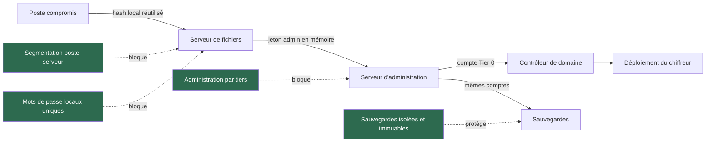
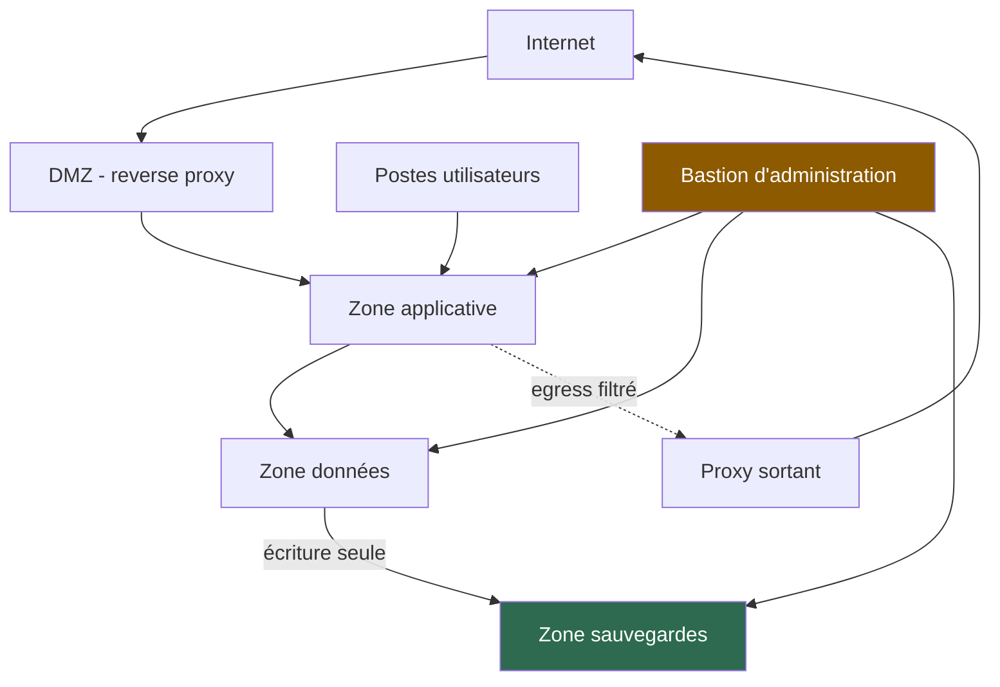
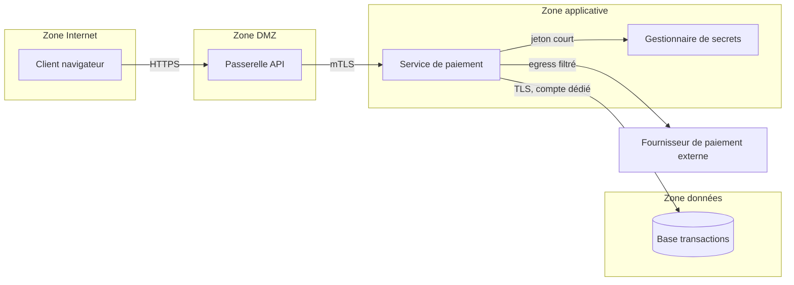

# Architecture de sécurité et conception des systèmes

## Objectifs pédagogiques

À la fin de ce module, vous saurez :

- **concevoir** une défense en profondeur dont chaque couche a un mode de défaillance distinct des autres ;
- **définir** des zones et une matrice de flux, puis choisir entre macrosegmentation et microsegmentation selon la valeur des actifs ;
- **appliquer** les principes Zero Trust à trois accès concrets : administration, service-à-service et métadonnées cloud ;
- **modéliser** les menaces d'un système à partir d'un schéma de flux, et dériver des contrôles testables ;
- **arbitrer** entre disponibilité, reprise, coût et complexité, puis **défendre** ces choix dans une revue de conception.

---

## Mise en situation

> Scénario fictif. Les durées sont illustratives, mais chaque technique citée existe et est utilisée.

Un éditeur de logiciels de 600 personnes dispose d'un pare-feu nouvelle génération en périphérie, d'un WAF (Web Application Firewall) devant son site, d'un EDR (Endpoint Detection and Response) sur les postes et d'une authentification multifacteur sur le VPN. Un audit récent a validé chacun de ces éléments.

Un vendredi à 17 h 40, un commercial ouvre une pièce jointe piégée. L'implant s'installe. L'EDR lève une alerte de priorité moyenne, qui sera traitée le lundi.

Voici la suite, étape par étape :

1. Le compte administrateur local a le même mot de passe sur tous les postes et sur le serveur de fichiers, faute de LAPS (Local Administrator Password Solution). L'attaquant extrait le hash NTLM avec Mimikatz et le rejoue (pass-the-hash) vers un autre poste, puis vers le serveur de fichiers. Le réseau est plat : le poste atteint les ports 445, 3389 et 5985 de tous les serveurs.
2. Sur ce serveur, un administrateur de domaine a ouvert une session RDP la veille pour un dépannage. Son jeton reste en mémoire. Un dump de LSASS donne à l'attaquant les droits sur tout le domaine.
3. Le serveur de sauvegarde est joint au même domaine et accepte les mêmes comptes. Les dépôts sont supprimés en premier.
4. Une stratégie de groupe déploie le chiffreur sur 400 machines.

Le délai entre le clic et le chiffrement est d'environ 31 heures. Aucun composant n'était mal configuré pris isolément. La défense naïve consiste à ajouter un outil. Le vrai défaut est ailleurs : tous les contrôles étaient en périphérie ou sur l'hôte, et aucun ne limitait le rayon d'explosion une fois un poste compromis. C'est le problème que l'architecture doit résoudre.

---

## Surface d'attaque : relations de confiance plutôt que ports

Pour un attaquant déjà à l'intérieur, la surface d'attaque est le graphe des relations de confiance : qui peut parler à qui, avec quel compte, et avec quel secret. Les ports ouverts n'en sont qu'une partie.

| Vecteur | Exposition | Impact potentiel |
|---|---|---|
| Flux est-ouest SMB, RDP, WinRM, SSH | Postes vers serveurs, serveurs vers serveurs, sans filtrage interne | Mouvement latéral avec PsExec ou impacket, relais NTLM avec ntlmrelayx |
| Comptes de service à mot de passe statique | SPN (Service Principal Name) exposés dans AD | Kerberoasting hors ligne, puis compte souvent sur-privilégié |
| Service de métadonnées cloud (169.254.169.254) | Accessible depuis toute application vulnérable à une SSRF (Server-Side Request Forgery) | Vol des identifiants temporaires du rôle de l'instance |
| Plan d'administration : hyperviseur, sauvegarde, IdP, CI/CD | Souvent joignable depuis le réseau utilisateur | Une seule compromission donne le contrôle de tout ce qu'il gère |
| Flux sortants (egress) | Serveurs autorisés à joindre Internet « pour les mises à jour » | Canal C2 (Command and Control) et exfiltration |
| Équipements de sécurité exposés | VPN, passerelles, ADC en bordure | CVE-2019-19781 (Citrix ADC), CVE-2023-46805 et CVE-2024-21887 (Ivanti Connect Secure) ont servi de point d'entrée |

La dernière ligne est contre-intuitive : un équipement de sécurité ajouté à l'architecture est aussi une surface d'attaque, en général privilégiée, exposée et très peu surveillée.

---

## Défense en profondeur : des couches qui ne tombent pas ensemble

### Comment l'attaquant progresse

Reprenons la chaîne du scénario. Elle ressemble à ce que décrivent les rapports d'incidents sur les rançongiciels de type NotPetya, qui combinait l'exploit EternalBlue (MS17-010) et le vol d'identifiants avec exécution distante :



Chaque flèche est une occasion d'arrêter l'attaquant. Elle n'existe que si le contrôle correspondant a été conçu avant l'incident, pas déployé après.

> 🧠 **Concept clé : la profondeur se mesure en indépendance.** Empiler un pare-feu, un WAF et un proxy ne fait pas de la défense en profondeur si un cookie de session volé les contourne tous les trois. Deux couches sont réellement distinctes quand elles ne tombent pas pour la même raison. Un EDR et un pare-feu interne ont des modes de défaillance différents : l'un voit le comportement d'un hôte, l'autre filtre une relation réseau. Un EDR et un second antivirus reposent sur la même télémétrie hôte.
{: .callout .callout-important}

### Les couches à concevoir

| Couche | Ce qu'elle arrête | Ce qui la contourne | Coût réel |
|---|---|---|---|
| Identité | Rejeu d'identifiants, élévation de privilèges (tiers d'administration, LAPS, comptes de service gérés) | Vol de session ou de jeton après authentification | Refonte des habitudes d'admin, comptes dédiés |
| Hôte (système) | Exécution de code, persistance (durcissement, EDR, liste blanche d'applications) | Compte légitime, outils natifs (LOLBins) | Faux positifs, gestion des exceptions |
| Réseau | Mouvement latéral, exfiltration (zones, filtrage egress) | Flux autorisé mais détourné, tunnel dans un protocole permis | Matrice de flux à maintenir |
| Application | Injection, abus de logique | Faille dans une dépendance, compte légitime | Effort de développement, dette technique |
| Données | Lecture et destruction (chiffrement avec clés séparées, sauvegardes immuables) | Compromission de l'application qui détient la clé | Gestion des clés, latence |
| Détection | Réduit le temps de présence | Journaux effacés, absence de personne pour agir | Bruit, astreinte |

La couche « Données » est celle qu'on oublie, alors que tout le reste existe pour la protéger. Partez de vos actifs critiques (la base clients, le référentiel de code, le contrôleur de domaine) et remontez : quelles couches l'attaquant doit-il franchir pour les atteindre, et combien de ces couches reposent sur le même secret ?

---

## Segmentation et microsegmentation

### Ce que fait l'attaquant d'un réseau plat

Sur un segment unique, trois techniques suffisent pour avancer sans exploiter de vulnérabilité :

- **Empoisonnement de résolution de noms.** Responder répond aux requêtes LLMNR et NBT-NS ratées et collecte des hashs NetNTLM.
- **Relais NTLM.** ntlmrelayx les retransmet vers un serveur qui n'impose pas la signature SMB.
- **Exploitation de service exposé.** WannaCry s'est propagé via EternalBlue (MS17-010) sur SMBv1 là où les segments étaient plats.

Un filtrage entre zones coupe ces trois chemins sans qu'on ait à les connaître tous.

### Décomposer en zones



La règle de découpage n'est pas l'organigramme. On sépare selon deux critères : la **sensibilité** de ce qui est dans la zone et le **plan de contrôle** (qui administre quoi). Dans l'ordre :

1. Isoler d'abord ce qui donne le contrôle de tout le reste : annuaire, hyperviseurs, sauvegardes, IdP, CI/CD.
2. Séparer ensuite les données sensibles du reste de la production.
3. Séparer les postes utilisateurs des serveurs.
4. Ne microsegmenter qu'ensuite, et seulement les actifs dont la valeur justifie le coût.

La segmentation sert aussi la conformité : dans PCI DSS, elle réduit le périmètre d'audit des données de cartes. C'est un bénéfice, mais pas une raison suffisante de segmenter.

### Macro et microsegmentation

La macrosegmentation filtre entre zones (VLAN ou VRF plus pare-feu). La microsegmentation filtre entre charges de travail d'une même zone : pare-feu hôte, agent, security groups cloud, NetworkPolicy Kubernetes.

Ce qu'elle coûte :

- **Inventaire des flux** : personne ne les connaît tous, et ceux qu'on oublie cassent en production.
- **Volume de règles** : il croît avec le nombre de charges de travail si on raisonne par IP plutôt que par rôle ou étiquette.
- **Performance** : le filtrage s'exécute sur chaque hôte ou nœud (pare-feu hôte, agent, CNI) et consomme des ressources locales qu'il faut mesurer.

Le gain est proportionnel à la valeur de ce qu'on isole. Segmenter 40 serveurs de bases de données par rôle est rentable. Segmenter 800 postes de travail l'est rarement : on isole plutôt les postes entre eux (isolation de clients), ce qui bloque le même mouvement latéral pour une fraction du coût.

### Configuration : avant et après sur un serveur

Avant, un serveur de base de données en politique ouverte :

```
table inet filter {
  chain input { type filter hook input priority 0; policy accept; }
}
```

Après, politique de rejet par défaut et flux explicitement justifiés :

```
table inet filter {
  chain input {
    type filter hook input priority 0; policy drop;
    ct state established,related accept
    iif lo accept
    ip saddr <BASTION_IP> tcp dport 22 accept
    ip saddr <APP_SUBNET> tcp dport 5432 accept
    limit rate 5/minute log prefix "nft-drop: "
  }
}
```

Chaque règle `accept` correspond à une ligne de la matrice de flux (voir plus bas). Le journal, limité en débit, enregistre les paquets que la politique va rejeter. Pendant la phase d'observation, chargez la même chaîne en `policy accept` : la règle `log` révèle alors les flux oubliés sans les bloquer, avant le passage en `policy drop`.

Sous Kubernetes, le même principe s'écrit ainsi :

```yaml
apiVersion: networking.k8s.io/v1
kind: NetworkPolicy
metadata:
  name: default-deny-all
  namespace: <NAMESPACE>
spec:
  podSelector: {}
  policyTypes: [Ingress, Egress]
```

> ⚠️ **Erreur fréquente** : appliquer cette politique sur un cluster dont le CNI (Container Network Interface) n'applique pas les NetworkPolicy (Flannel seul, par exemple). Le manifeste est accepté, aucune erreur n'apparaît, et rien n'est filtré. Vérifiez avec un test réel (voir ci-dessous). Avec Calico ou Cilium, pensez aussi à autoriser explicitement le DNS en egress vers kube-dns, sinon les pods perdent la résolution de noms.
{: .callout .callout-attention}

### Vérifier que la segmentation tient

Depuis une machine de la zone source, testez les flux qui doivent être refusés :

```bash
nmap -Pn -n -p 445,3389,5985,22 <TARGET_HOST>
```

Par exemple `nmap -Pn -n -p 445,3389,5985,22 10.20.30.15` depuis un poste utilisateur vers un serveur de fichiers : tous les ports doivent apparaître `filtered`, ou `closed` si le pare-feu rejette par TCP reset. Aucun ne doit être `open`. Testez ensuite l'egress depuis un serveur :

```bash
curl -m 5 -sS -o /dev/null -w "%{http_code}\n" https://<EXTERNAL_URL>
```

Un serveur de base de données qui obtient un `200` vers Internet est un canal C2 en attente. Dans Kubernetes : `kubectl exec -n <NAMESPACE> <POD> -- nc -zv -w 3 <SERVICE> <PORT>`.

> 💡 **Astuce** : déployez toujours en deux temps. D'abord un mode observation (journalisation sans blocage) pendant deux à quatre semaines, pour couvrir un cycle complet de traitements mensuels. Ensuite le blocage, zone par zone, avec un retour arrière préparé.
{: .callout .callout-astuce}

---

## Zero Trust : retirer la confiance liée à l'emplacement

### Pourquoi le VPN ne suffit pas

Un VPN transforme « être authentifié une fois » en « être sur le réseau ». Un attaquant qui vole une session par AiTM (Adversary-in-the-Middle, avec Evilginx par exemple) contourne le second facteur et hérite d'un accès réseau large. Le même principe vaut à l'intérieur : être dans la zone applicative ne prouve rien.

Zero Trust, tel que décrit dans NIST SP 800-207, repose sur une idée : chaque requête vers une ressource est évaluée sur l'identité, l'état de l'appareil et le contexte, et non sur l'emplacement réseau. Techniquement, un PDP* (Policy Decision Point) décide, et un PEP (Policy Enforcement Point) applique, par exemple un proxy d'accès, un bastion ou un sidecar de service mesh.

\* Le PDP et le PEP sont séparés pour que la logique de décision soit centralisée et auditée pendant que l'application de la décision reste au plus près de la ressource.

> 🧠 **Zero Trust n'est pas un produit.** C'est une trajectoire. Les fournisseurs vendent des briques ; l'architecture reste à votre charge. Commencez par ce qui a le plus d'effet.
{: .callout .callout-important}

### Trois chantiers dans l'ordre d'efficacité

**1. L'administration.** Le scénario d'ouverture est un échec d'accès privilégié.

- Modèle en tiers : un compte Tier 0 (domaine, IdP) ne se connecte jamais à une machine de niveau inférieur.
- Bastion ou station d'administration dédiée.
- Accès privilégié JIT (Just-In-Time) : l'élévation dure une heure, est journalisée, et est liée à un ticket.
- Mots de passe locaux uniques, via LAPS ou équivalent.

**2. Le service-à-service.** Les comptes de service à mot de passe statique sont la cible habituelle du Kerberoasting. Préférez les comptes gérés (gMSA) ou, côté cloud, des identités de charge de travail avec jetons de courte durée. Entre services, le mTLS* (mutual TLS) prouve l'identité des deux côtés. Un service mesh comme Istio ou Linkerd l'automatise, mais ajoute un composant à exploiter (voir la section sur la complexité).

\* Le mTLS exige que le client présente lui aussi un certificat, ce qui permet d'autoriser sur l'identité du service et non sur son adresse IP.

**3. Les métadonnées cloud.** Une SSRF dans une application interroge `http://169.254.169.254/latest/meta-data/iam/security-credentials/` et obtient des identifiants du rôle de l'instance. Plusieurs compromissions cloud publiques ont suivi ce schéma. Le contrôle sur AWS est d'imposer IMDSv2 (jeton de session obligatoire) et de limiter le saut réseau :

```bash
aws ec2 modify-instance-metadata-options \
  --instance-id <INSTANCE_ID> \
  --http-tokens required \
  --http-put-response-hop-limit 1
```

Test depuis l'instance : un GET sans jeton doit renvoyer `401`.

```bash
curl -s -o /dev/null -w "%{http_code}\n" http://169.254.169.254/latest/meta-data/
```

L'option `hop-limit 1` empêche aussi un conteneur sur l'hôte d'atteindre le service, ce qui peut casser des charges existantes : testez avant de généraliser. Les options exactes varient selon le fournisseur et la version de l'outil.

### Ce que ça coûte, et le piège de la disponibilité

Le PDP devient un composant critique. S'il tombe, personne ne se connecte, y compris les équipes qui doivent réparer. Prévoyez au minimum :

- une haute disponibilité du PDP et de l'IdP ;
- des comptes de secours (break-glass) hors du chemin d'authentification normal, avec alerte à chaque usage ;
- une politique d'échec explicite (fail closed ou fail open) décidée par ressource, pas par défaut.

Les applications héritées qui ne gèrent pas l'authentification moderne se placent derrière un proxy d'accès, avec une exception documentée et datée.

---

## Modéliser les menaces et les flux

Un attaquant cherche le flux que personne n'a dessiné : l'agent de sauvegarde avec un compte root, le runner CI qui détient des identifiants de production, le SSH de maintenance d'un prestataire. La modélisation de menaces sert à faire apparaître ces flux avant lui.

### Méthode, en 90 minutes

1. **Dessiner un DFD (Data Flow Diagram)** : acteurs, processus, stockages, flux, et surtout les **frontières de confiance**.
2. **Appliquer STRIDE** (Spoofing, Tampering, Repudiation, Information disclosure, Denial of service, Elevation of privilege) à chaque élément qui traverse une frontière.
3. **Retenir les 5 à 8 scénarios plausibles** et les relier à un contrôle testable.
4. **Écrire la matrice de flux** qui en découle.



### Exemple d'application de STRIDE

| Flux franchissant une frontière | Menace | Contrôle à concevoir | Test |
|---|---|---|---|
| Client vers passerelle | Spoofing (jeton volé ou rejoué) | Jetons à durée courte, liaison à l'appareil | Rejouer un jeton expiré : refus attendu |
| Passerelle vers service | Tampering (en-têtes d'identité falsifiés) | mTLS, identité extraite du certificat et non d'un en-tête | Appel direct au service sans passerelle : refus |
| Service vers base | Information disclosure (compte avec droits trop larges) | Compte dédié, droits minimaux, pas de `SELECT *` sur toutes les tables | Vérifier les GRANT du compte |
| Service vers fournisseur externe | Denial of service (dépendance) | Délai d'expiration, disjoncteur, file d'attente | Couper le flux en préproduction |
| Tous | Repudiation | Journal signé côté serveur, horodaté | Reconstituer une transaction à partir des journaux seuls |

Outils : OWASP Threat Dragon et pytm permettent de versionner le modèle avec le code. Le point décisif est de faire la revue avec ceux qui exploitent le système : ils connaissent les flux qui ne sont dans aucun schéma.

### La matrice de flux

C'est le livrable le plus utile. Chaque ligne justifie une règle de pare-feu :

| Source | Destination | Port et protocole | Authentification | Justification | Propriétaire |
|---|---|---|---|---|---|
| `<APP_SUBNET>` | `<DB_HOST>` | 5432/TCP | Compte `svc_pay`, TLS | Lecture et écriture des transactions | Équipe paiement |

Une règle sans propriétaire ni justification est une règle qu'on ne pourra jamais supprimer.

---

## Résilience : haute disponibilité, reprise et sauvegardes

### Ce que visent les rançongiciels

Avant de chiffrer, les opérateurs de rançongiciels détruisent la capacité de restauration : `vssadmin delete shadows /all /quiet`, suppression des dépôts de sauvegarde, vol des identifiants stockés dans la console. La CVE-2023-27532 (Veeam Backup & Replication, exposition d'identifiants) a été exploitée dans ce but. Une architecture de reprise doit donc être conçue pour survivre à un attaquant disposant de droits d'administrateur sur la production.

> 🧠 **Concept clé : la haute disponibilité n'est pas une reprise.** La réplication synchrone copie fidèlement les écritures, y compris le chiffrement malveillant et une suppression accidentelle. La HA répond à la panne ; la reprise répond à la corruption et à l'attaque. Il faut les deux, avec des mécanismes différents.
{: .callout .callout-important}

### Fixer les objectifs avant de choisir la technologie

| Objectif | Question posée | Effet sur l'architecture |
|---|---|---|
| RTO — Recovery Time Objective | Combien de temps peut-on rester arrêté ? | Détermine actif-actif, actif-passif ou restauration depuis sauvegarde |
| RPO — Recovery Point Objective | Combien de données peut-on perdre ? | Détermine réplication synchrone, asynchrone ou sauvegarde périodique |

Un RTO de quelques minutes exige au minimum un actif-passif chaud avec bascule automatique, voire de l'actif-actif, qui coûte généralement le double en infrastructure et ajoute de la complexité (cohérence des données, tests de bascule). Un RTO de 24 h tolère une restauration. Classez les applications en trois ou quatre niveaux ; aucune organisation ne peut payer le niveau le plus exigeant pour tout.

### Les sauvegardes qui survivent à une compromission

- **Isolation d'identité** : la console de sauvegarde n'est pas jointe au domaine de production, avec ses propres comptes et un second facteur dédié.
- **Immutabilité** : stockage objet avec verrouillage WORM (Write Once Read Many), ou copie hors ligne. La suppression est impossible, même pour un administrateur, pendant la période de rétention.
- **Règle 3-2-1-1-0** : trois copies, deux supports, une hors site, une immuable ou hors ligne, zéro erreur après test de restauration.
- **Flux unidirectionnel** : la production pousse vers la sauvegarde, la sauvegarde ne se laisse pas piloter depuis la production.

### Les SPOF de la sécurité elle-même

Listez ce dont dépend tout le reste : annuaire, DNS, PKI, IdP, PDP, serveur de journaux, bastion. Si l'un tombe ou est compromis, que devient le système ? Un annuaire unique est un SPOF de disponibilité et le trésor de l'attaquant ; il demande donc des réplicas, des sauvegardes testées et une procédure de reconstruction écrite.

> 💡 **Astuce** : mesurez un RTO réel avec un exercice de restauration chronométré d'une application de niveau 1, depuis la sauvegarde immuable, par une personne qui n'a pas conçu la procédure. Le chiffre obtenu est souvent trois à dix fois supérieur au RTO supposé.
{: .callout .callout-astuce}

---

## Choisir les contrôles : risques, contraintes, compromis

Le module précédent a produit un registre de risques. Ici, on le prend comme donnée d'entrée et on traduit chaque risque prioritaire en contrôle réalisable. Le raisonnement : *quel risque réduit-on, de combien, avec quelle dépendance nouvelle, et que se passe-t-il quand le contrôle échoue ?*

| Situation | Options | Compromis | Limite du contrôle retenu |
|---|---|---|---|
| 40 serveurs hérités non patchables (système en fin de support) | Isoler dans une zone à flux minimal ; patch virtuel (IPS) ; remplacer | Isolement : rapide et peu coûteux, mais n'élimine pas la vulnérabilité. Remplacement : définitif, mais coûteux et lent | L'isolement ne protège pas contre un flux légitime détourné. Fixer une date de sortie |
| Microsegmentation de 300 serveurs | Agent hôte ; pare-feu réseau ; security groups cloud | Agent : granularité fine, mais déploiement et mises à jour à gérer. Réseau : moins fin, mais sans impact sur les hôtes | Un agent est inutile sur un équipement qui n'en supporte pas |
| Application critique, RTO de 15 min | Actif-actif ; actif-passif avec bascule automatique ; restauration | Actif-actif : coût et complexité élevés. Restauration : insuffisant | Aucune HA ne protège contre la corruption : conserver une sauvegarde immuable |
| Accès des prestataires | VPN avec compte nominatif ; bastion avec enregistrement de session ; accès JIT par ticket | Le bastion ajoute une friction que les prestataires contourneront si on ne la rend pas supportable | Un accès JIT sans enregistrement ne permet pas d'enquêter |

Une règle simple de priorité : un contrôle qui coupe un chemin menant à un actif critique passe avant dix contrôles qui durcissent des actifs secondaires. Un contrôle dont personne ne sait vérifier le fonctionnement ne compte pas comme un contrôle.

---

## Revue de conception et dossier d'architecture

### Ce que doit contenir le dossier

Un bon dossier d'architecture est court, et il est utilisé. Contenu minimal :

1. **Contexte et périmètre** : ce que le système fait, ce qu'il manipule.
2. **Actifs et classification** des données.
3. **Schéma de zones et de flux**, avec la matrice de flux.
4. **Modèle de menaces** et scénarios retenus.
5. **Décisions d'architecture**, une par ADR (Architecture Decision Record).
6. **Exigences de résilience** : RTO, RPO, SPOF identifiés.
7. **Risques résiduels** explicitement acceptés, avec le nom de la personne qui les accepte.
8. **Plan de vérification** : comment prouver que chaque contrôle fonctionne.

Les ADR conservent le raisonnement, qui s'évapore plus vite que les schémas :

```markdown
# ADR-012 : Accès d'administration via bastion avec accès JIT
- Statut : accepté (<DATE>)
- Contexte : comptes admin utilisables depuis tout poste ; risque de vol de jeton
- Décision : administration uniquement depuis <BASTION_HOST>, élévation JIT de 60 min
- Alternatives écartées : VPN seul (accès réseau trop large), PAM complet (coût > bénéfice à ce stade)
- Conséquences : friction pour les astreintes ; break-glass nécessaire
- Condition de réexamen : plus de 30 élévations par jour, ou changement d'IdP
```

### Questions de revue qui font surface

Un relecteur sécurité efficace n'examine pas le schéma pour sa beauté. Il pose des questions auxquelles le dossier doit répondre :

- Si ce composant est compromis, jusqu'où l'attaquant peut-il aller ? Quels secrets y sont accessibles ?
- Où sont les secrets, et qui peut les lire ?
- En cas de défaillance du contrôle, le système bloque-t-il (fail closed) ou laisse-t-il passer (fail open) ? Ce choix est-il documenté ?
- Qui peut modifier cette règle, et comment le détecte-t-on ?
- Quel flux existe qui n'est pas dans la matrice ?
- Comment sait-on, aujourd'hui, que ce contrôle fonctionne ?

La revue se place **avant** la construction, au moment où changer un schéma coûte une heure. Après le déploiement, le même changement coûte un projet.

---

## Quand la complexité affaiblit l'architecture

> ⚠️ **Une architecture plus complexe n'est pas nécessairement plus sécurisée.** Chaque contrôle ajouté apporte une surface d'attaque, une dépendance, un mode de défaillance et une compétence à maintenir. Trois symptômes reviennent :
>
> - **Les règles que personne ne comprend.** Après quelques années, un pare-feu inter-zones contient 12 000 règles, dont des centaines d'exceptions sans propriétaire. Nul n'ose les supprimer. L'attaquant n'a pas besoin de trouver une faille : il suffit qu'une règle trop large subsiste.
> - **Le contrôle qui devient la cible.** Les passerelles VPN, les ADC et les pare-feu exposés ont régulièrement été exploités (CVE-2019-19781, CVE-2023-46805 et CVE-2024-21887 cités plus haut). Un empilement de produits de bordure multiplie les composants à patcher en urgence.
> - **Le contournement par les équipes.** Quand le contrôle est trop pénible (bastion lent, flux bloqués sans explication), les administrateurs installent un accès parallèle. La sécurité réelle devient pire que sur une architecture simple.
{: .callout .callout-attention}

Un test de lisibilité aide à trancher : un ingénieur d'astreinte à 3 h du matin peut-il, en cinq minutes, expliquer pourquoi le flux A vers B est autorisé et comment le couper ? Sinon, la complexité a dépassé la capacité d'exploitation.

Pour garder la complexité sous contrôle :

- **Compteurs de règles** : sur nftables, ajoutez `counter` aux règles et conservez des relevés datés et périodiques de `nft list ruleset`. Les compteurs sont cumulatifs et remis à zéro à chaque rechargement du ruleset. Une règle restée à zéro sur 90 jours de relevés est candidate à suppression.
- **Dates d'expiration** sur les exceptions, avec propriétaire nommé.
- **Un chemin d'administration par ressource**, pas trois.
- **Un composant ajouté, un composant simplifié** quand c'est possible.
- **Surveillance du plan de contrôle** : toute modification de règle sur les zones critiques génère une alerte.

---

## Erreurs fréquentes

⚠️ **Politique « accept » par défaut avec quelques règles de blocage.** Conséquence : tout flux oublié est autorisé, et les règles de blocage deviennent une liste noire que l'attaquant contourne par un port non listé. Correction : `policy drop` avec liste blanche, après une phase d'observation. Détection : `nft list ruleset | grep policy` ; revue des configurations de pare-feu avec un outil comme Nipper ou un script maison.

⚠️ **Sauvegardes jointes au domaine de production.** Conséquence : un administrateur de domaine compromis supprime aussi les sauvegardes, ce qui ne laisse que la rançon. Correction : annuaire et identité séparés pour la sauvegarde, copie immuable, test de restauration trimestriel. Détection : vérifier que le serveur de sauvegarde n'appartient pas au domaine (`systeminfo` sous Windows, `realm list` sous Linux) et que les comptes de production ne peuvent pas s'y connecter.

⚠️ **Segmentation déclarée mais non testée.** Conséquence : une règle « any » créée pendant un incident en 2022 rend la zone perméable. Correction : exécuter des scans de validation depuis chaque zone source vers les zones protégées (nmap, `nc -zv`) à chaque changement majeur, et en automatique chaque mois. Détection : écart entre la matrice de flux et le résultat du scan.

⚠️ **IMDSv1 autorisé sur des instances qui hébergent des applications web.** Conséquence : une SSRF suffit pour voler les identifiants du rôle, souvent bien plus larges que l'application. Correction : `http-tokens required` et rôle à moindre privilège. Détection : Prowler ou ScoutSuite signalent les instances en IMDSv1 ; AWS Config propose aussi une règle gérée dédiée.

⚠️ **Zero Trust avec un PDP unique et sans compte de secours.** Conséquence : une panne de l'IdP bloque tout le monde, y compris ceux qui doivent le réparer. Correction : IdP en haute disponibilité, deux comptes break-glass hors du chemin normal, alertés à chaque usage, avec test semestriel.

---

## Scénario de référence : refonte en trois phases

Reprenons l'éditeur de la mise en situation. Le plan de remédiation, présenté ici avec des durées illustratives, évite de tout arrêter pour tout refaire.

**Phase 1 (semaines 1 à 6) : couper les chemins qui mènent au contrôle total.**

- LAPS déployé sur tous les postes et serveurs.
- Administration du domaine depuis deux stations dédiées ; interdiction de connexion des comptes Tier 0 sur les serveurs membres.
- Sauvegardes déplacées dans un compte cloud séparé avec verrouillage objet de 30 jours.
- Le blocage de SMB, RDP et WinRM de poste à poste est activé par une règle du pare-feu hôte.

Aucun nouveau produit n'a été acheté. Les changements concernent la configuration et la discipline d'administration.

**Phase 2 (mois 2 à 5) : zones et flux.**

- Trois zones d'abord (postes, serveurs, plan d'administration), puis séparation des données.
- Observation de quatre semaines, avec journalisation des rejets, avant tout blocage.
- Matrice de flux produite à partir des journaux, relue par les équipes applicatives.
- Contrôle egress : les serveurs ne sortent plus que par un proxy avec liste d'autorisation.

**Phase 3 (mois 6 à 9) : accès et résilience.**

- JIT sur l'accès privilégié, bastion avec enregistrement de session.
- Classification des applications en trois niveaux de RTO et RPO.
- Exercice de restauration chronométré de l'application de niveau 1.

À la fin, un compromis de poste reste possible, car aucune architecture n'empêche tout. Mais le même attaquant se heurte à un filtrage au premier saut, ne trouve pas de jeton administrateur à voler, et ne peut pas supprimer les sauvegardes. Le temps de présence utile pour lui passe de 31 heures à une durée que l'équipe de détection a une vraie chance de rattraper.

---

## Résumé

L'architecture de sécurité vise à limiter le rayon d'explosion d'une compromission qu'on suppose inévitable, plutôt qu'à empêcher toute entrée. La défense en profondeur ne vaut que si les couches sont indépendantes, c'est-à-dire si elles ne tombent pas pour la même raison. La segmentation par zones de sensibilité et de plan de contrôle, puis la microsegmentation des seuls actifs critiques, coupent les chemins de mouvement latéral. Zero Trust retire la confiance liée à l'emplacement, en commençant par l'administration, les identités de service et les métadonnées cloud. La modélisation de menaces et la matrice de flux font apparaître les flux oubliés, et la résilience exige des sauvegardes isolées et immuables, distinctes de la haute disponibilité. À surveiller : la dérive des règles, les composants de sécurité eux-mêmes devenus cibles, et l'écart entre l'architecture documentée et l'architecture réelle, qu'on ne comble qu'en testant.

<!-- snippet
id: archisec_defense_profondeur_independance
type: concept
tech: architecture-securite
level: advanced
importance: high
format: knowledge
tags: defense-en-profondeur,architecture,mouvement-lateral,couches
title: Défense en profondeur : des couches indépendantes
context: conception d'une architecture en couches
content: Deux couches sont réellement distinctes si elles ne tombent pas pour la même raison. Pare-feu, WAF et proxy sont contournés ensemble par un cookie de session volé. En revanche, un filtrage inter-zones, des mots de passe locaux uniques (LAPS) et des sauvegardes immuables ont des modes de défaillance différents. Vérifier pour chaque paire de couches : quel événement unique les neutralise toutes les deux ?
description: La profondeur se mesure en indépendance des modes de défaillance, pas en nombre de contrôles empilés.
-->

<!-- snippet
id: archisec_segmentation_test_nmap
type: command
tech: architecture-securite
level: intermediate
importance: high
format: knowledge
tags: segmentation,nmap,validation,flux
title: Tester qu'un flux inter-zones est bien filtré
context: à lancer depuis une machine de la zone source, avec autorisation
command: nmap -Pn -n -p 445,3389,5985,22 <TARGET_HOST>
example: nmap -Pn -n -p 445,3389,5985,22 10.20.30.15
description: -Pn évite que l'absence de réponse ICMP fausse le résultat. Le résultat attendu est « filtered » (ou « closed » si le pare-feu rejette par TCP reset) sur tous les ports hors matrice de flux ; aucun ne doit être « open ».
-->

<!-- snippet
id: archisec_segmentation_observation_avant_blocage
type: tip
tech: architecture-securite
level: advanced
importance: medium
format: knowledge
tags: segmentation,microsegmentation,deploiement,flux
title: Observer 2 à 4 semaines avant de bloquer
content: Avant de passer une zone en blocage, laisser la chaîne en policy accept avec la règle log en fin de chaîne (nftables : limit rate 5/minute log prefix "nft-drop: "), ce qui journalise sans bloquer, pendant 2 à 4 semaines pour couvrir un cycle mensuel de traitements. Exploiter les rejets pour compléter la matrice de flux, puis passer en drop zone par zone avec retour arrière prévu.
description: Les flux mensuels, de sauvegarde ou de supervision sont ceux que l'inventaire oublie et qui cassent la production au premier blocage.
-->

<!-- snippet
id: archisec_k8s_networkpolicy_cni
type: warning
tech: kubernetes
level: advanced
importance: high
format: knowledge
tags: kubernetes,networkpolicy,segmentation,cni
title: NetworkPolicy ignorée si le CNI ne l'applique pas
context: cluster Kubernetes avec CNI de type Flannel seul
content: Une NetworkPolicy default-deny est acceptée par l'API même si le CNI (Flannel seul) ne l'implémente pas, et aucun trafic n'est filtré, sans erreur. Correction : utiliser Calico ou Cilium, puis valider avec kubectl exec -n <NAMESPACE> <POD> -- nc -zv -w 3 <SERVICE> <PORT> depuis un pod non autorisé.
description: Le manifeste valide ne prouve rien : seul un test de connexion réel confirme que le filtrage est effectif.
-->

<!-- snippet
id: archisec_k8s_egress_deny_dns
type: error
tech: kubernetes
level: advanced
importance: medium
format: knowledge
tags: kubernetes,networkpolicy,dns,egress
title: Pods sans résolution DNS après un default-deny egress
context: après application d'une NetworkPolicy avec policyTypes Egress
content: Symptôme : les pods échouent en « could not resolve host » juste après la politique default-deny. Cause : l'egress vers kube-dns (port 53 UDP et TCP) est aussi bloqué. Correction : ajouter une NetworkPolicy autorisant l'egress vers les pods kube-dns du namespace kube-system, puis les flux métier un par un.
description: Un default-deny en egress coupe aussi la résolution DNS ; l'autoriser en premier évite un faux diagnostic de panne applicative.
-->

<!-- snippet
id: archisec_imds_ssrf_credentials
type: concept
tech: aws
level: advanced
importance: high
format: knowledge
tags: cloud,ssrf,imds,identifiants
title: SSRF vers le service de métadonnées cloud
context: instances EC2 hébergeant une application web
content: Une SSRF force le serveur à requêter http://169.254.169.254/latest/meta-data/iam/security-credentials/ et renvoie les identifiants temporaires du rôle de l'instance, avec les droits du rôle et non de l'application. IMDSv1 répond à un simple GET ; IMDSv2 exige un jeton obtenu via un PUT, que la plupart des SSRF ne peuvent pas émettre.
description: Le risque vient des droits du rôle de l'instance, souvent très supérieurs à ceux de l'application compromise.
-->

<!-- snippet
id: archisec_imdsv2_enforce
type: command
tech: aws
level: advanced
importance: high
format: knowledge
tags: aws,imds,durcissement,ssrf
title: Imposer IMDSv2 sur une instance EC2
context: tester d'abord sur une instance non critique, hop-limit 1 peut casser des conteneurs sur l'hôte
command: aws ec2 modify-instance-metadata-options --instance-id <INSTANCE_ID> --http-tokens required --http-put-response-hop-limit 1
example: aws ec2 modify-instance-metadata-options --instance-id i-0a1b2c3d4e5f67890 --http-tokens required --http-put-response-hop-limit 1
description: Vérifier ensuite avec curl -s -o /dev/null -w "%{http_code}" http://169.254.169.254/latest/meta-data/ : le code 401 confirme que le jeton est exigé.
-->

<!-- snippet
id: archisec_zerotrust_pdp_breakglass
type: warning
tech: architecture-securite
level: advanced
importance: medium
format: knowledge
tags: zero-trust,disponibilite,break-glass,idp
title: PDP sans compte de secours : verrouillage total
context: mise en place d'un accès conditionnel centralisé
content: Quand toutes les décisions d'accès passent par un PDP ou un IdP unique, sa panne bloque tous les utilisateurs, y compris les administrateurs qui doivent le réparer. Correction : IdP et PDP en haute disponibilité, deux comptes break-glass hors du chemin d'authentification normal, alertés à chaque usage et testés tous les six mois.
description: Le PDP devient un SPOF de disponibilité ; la politique fail closed ou fail open doit être décidée ressource par ressource.
-->

<!-- snippet
id: archisec_stride_dfd_frontieres
type: concept
tech: architecture-securite
level: advanced
importance: medium
format: knowledge
tags: stride,modelisation-menaces,dfd,architecture
title: STRIDE s'applique aux flux qui franchissent une frontière
content: Dessiner le DFD avec les frontières de confiance (Internet, DMZ, zone applicative, données) puis appliquer STRIDE uniquement aux éléments qui traversent une frontière. Pour chaque menace retenue, noter le contrôle et le test qui le vérifie : par exemple, appeler le service sans passer par la passerelle doit être refusé si l'identité vient du certificat mTLS.
description: Limiter l'analyse aux franchissements de frontière réduit l'effort à 90 minutes et cible les flux que l'attaquant exploite.
-->

<!-- snippet
id: archisec_ha_vs_reprise
type: concept
tech: architecture-securite
level: advanced
importance: high
format: knowledge
tags: resilience,haute-disponibilite,sauvegarde,rancongiciel
title: La haute disponibilité réplique aussi la corruption
content: La réplication synchrone ou asynchrone copie fidèlement les écritures : un chiffrement par rançongiciel ou une suppression de table est répliqué en secondes sur le site secondaire. La HA répond à la panne ; contre la corruption et l'attaque, il faut une sauvegarde immuable (verrouillage objet WORM ou copie hors ligne) avec rétention supérieure au délai de détection.
description: Un actif-actif sans sauvegarde isolée donne deux copies chiffrées au lieu d'une.
-->

<!-- snippet
id: archisec_sauvegarde_hors_domaine
type: warning
tech: architecture-securite
level: advanced
importance: high
format: knowledge
tags: sauvegarde,rancongiciel,active-directory,immutabilite
title: Sauvegardes jointes au domaine de production
context: environnement Windows avec console de sauvegarde type Veeam
content: Un serveur de sauvegarde joint au domaine accepte les comptes compromis : l'attaquant supprime les dépôts avant de chiffrer (CVE-2023-27532 expose aussi les identifiants stockés dans la console Veeam). Correction : identité séparée (hors domaine), second facteur dédié, copie immuable, flux unidirectionnel de la production vers la sauvegarde.
description: Les attaquants détruisent les sauvegardes en premier ; leur isolation d'identité compte autant que leur chiffrement.
-->

<!-- snippet
id: archisec_restore_chronometre
type: tip
tech: architecture-securite
level: advanced
importance: medium
format: knowledge
tags: resilience,rto,restauration,test
title: Chronométrer une restauration réelle pour mesurer le RTO
content: Chaque trimestre, faire restaurer une application de niveau 1 depuis la sauvegarde immuable par une personne qui n'a pas écrit la procédure, avec un chronomètre et un journal des blocages. Comparer au RTO affiché : l'écart constaté est souvent de 3 à 10 fois, et c'est lui qui doit alimenter les décisions de coût.
description: Un RTO jamais mesuré est une hypothèse ; l'exercice révèle les dépendances oubliées (DNS, PKI, comptes de service).
-->

<!-- snippet
id: archisec_complexite_regles_mortes
type: warning
tech: architecture-securite
level: advanced
importance: medium
format: knowledge
tags: complexite,pare-feu,regles,hygiene
title: Règles de pare-feu sans propriétaire : dette de sécurité
context: pare-feu inter-zones en exploitation depuis plusieurs années
content: Des milliers de règles sans propriétaire ni date d'expiration finissent par contenir des règles « any » créées en urgence que personne n'ose supprimer. Correction : exiger un propriétaire et une date d'expiration par exception, activer les compteurs (nft : counter), les relever par export daté et périodique (ils sont cumulatifs et remis à zéro à chaque rechargement du ruleset), puis supprimer les règles restées à zéro sur 90 jours de relevés.
description: Les règles jamais utilisées sont supprimables sans risque ; celles qui subsistent sans justification sont les chemins qu'un attaquant exploite.
-->

<!-- snippet
id: archisec_adr_decision_alternatives
type: tip
tech: architecture-securite
level: advanced
importance: low
format: knowledge
tags: adr,documentation,revue-conception,decision
title: Écrire un ADR avec alternatives et condition de réexamen
content: Dans chaque ADR, ajouter les rubriques « Alternatives écartées » et « Condition de réexamen » avec un seuil chiffré (par exemple plus de 30 élévations JIT par jour). Sans elles, l'ADR devient un dogme et la décision n'est jamais remise en cause quand le contexte change.
description: Conserver le raisonnement de la décision plutôt que seulement son résultat permet de la contester proprement après un changement d'IdP ou de volume.
-->

<!-- snippet
id: archisec_egress_serveur_test
type: command
tech: architecture-securite
level: intermediate
importance: medium
format: knowledge
tags: egress,exfiltration,c2,validation
title: Vérifier qu'un serveur ne sort pas librement vers Internet
context: à lancer depuis un serveur de la zone données ou applicative, avec autorisation
command: curl -m 5 -sS -o /dev/null -w "%{http_code}\n" https://<EXTERNAL_URL>
example: curl -m 5 -sS -o /dev/null -w "%{http_code}\n" https://example.com
description: Un code 200 depuis un serveur de base de données signifie qu'un canal C2 ou d'exfiltration est possible ; le résultat attendu est un timeout ou un refus du proxy.
-->
