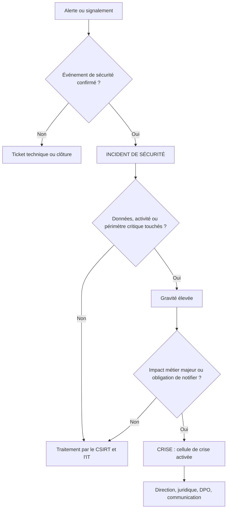
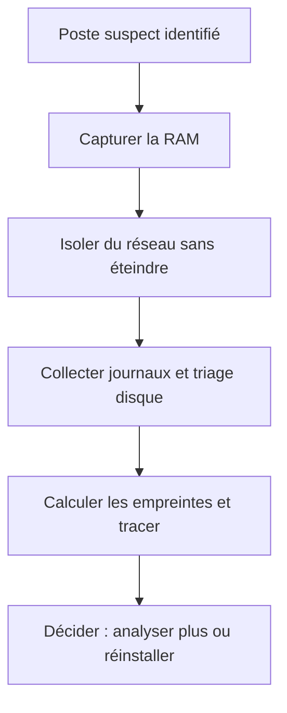

# Réponse aux incidents et gestion de crise cyber

## Objectifs pédagogiques

À la fin de ce module, vous serez capable de :

- **qualifier** un événement en incident technique, incident de sécurité ou crise, et en estimer la gravité et le périmètre ;
- **isoler** un poste, un serveur ou un compte compromis sans détruire les éléments nécessaires à l'enquête ;
- **tenir** un journal des décisions et une chaîne de traçabilité des preuves exploitables après coup ;
- **coordonner** une cellule de crise, y compris avec un CSIRT (Computer Security Incident Response Team) externe, et déterminer les obligations de notification applicables ;
- **analyser** un incident passé pour produire un retour d'expérience qui change réellement les procédures.

## Mise en situation

> Scénario illustratif, non tiré d'un incident réel. Les chiffres sont fictifs.

Vendredi, 18h40. Une société de logistique de 1 200 postes constate que le serveur de fichiers de l'entrepôt affiche des fichiers en `.locked`. L'administrateur d'astreinte fait ce que dicte le réflexe : il redémarre le serveur, le voit repartir en erreur, le restaure depuis la sauvegarde de la veille, puis réinitialise le mot de passe du compte qui a lancé le chiffrement.

Lundi matin, tout est chiffré, y compris la sauvegarde. L'enquête révèle que l'attaquant était présent depuis onze jours. L'entrée s'était faite par une session VPN détournée sur une passerelle Citrix NetScaler vulnérable à CVE-2023-4966 (« Citrix Bleed »). L'attaquant avait ensuite posé deux autres accès persistants, dont un compte de service créé le jour 3.

Chacun des trois réflexes du vendredi a aggravé la situation :

- **Le redémarrage** a effacé la mémoire du serveur, donc les processus et les connexions réseau qui auraient permis de dater et de cadrer l'intrusion.
- **La restauration** a remis en ligne un serveur déjà compromis.
- **Le changement de mot de passe d'un seul compte** a prévenu l'attaquant qu'il était repéré, et il a accéléré.

La défense naïve (« on remet en route, on change le mot de passe ») traite le symptôme visible et ignore tout ce qui est invisible. Elle détruit aussi la preuve qui aurait permis de savoir ce qui est invisible.

## Incident technique, incident de sécurité, crise

La qualification décide qui est réveillé, quels outils sont autorisés et quelles obligations légales s'enclenchent.

| Niveau | Critère distinctif | Exemple | Qui pilote | Conséquence |
|---|---|---|---|---|
| Incident technique | Pas d'acteur malveillant, défaillance | Disque plein, mise à jour qui casse un service | Exploitation / IT | Ticket, rétablissement du service |
| Incident de sécurité | Action malveillante avérée ou fortement suspectée | Compte compromis, malware sur un poste, fuite de secret dans un dépôt | CSIRT / SOC avec l'IT | Playbook d'incident, preuves à préserver |
| Crise | Impact métier majeur, ou décisions qui dépassent la technique | Production arrêtée, données personnelles exfiltrées, extorsion | Direction, cellule de crise | Communication, juridique, notification, arbitrages coûteux |

> 🧠 **Concept clé** : on ne passe pas d'un niveau à l'autre par la taille du problème technique. On bascule en crise quand une décision non technique devient nécessaire : payer ou non, arrêter la production, informer les clients, prévenir une autorité. Un seul serveur chiffré peut être une crise si c'est celui de la facturation un 30 du mois.
{: .callout .callout-important}



Ce diagramme est volontairement simple. En pratique, une qualification est révisée plusieurs fois : l'incident du vendredi soir devient une crise le dimanche, quand on découvre l'exfiltration.

## Surface d'attaque vue par le répondant

Le répondant n'a pas à lister les ports ouverts. Il doit connaître ce que l'attaquant a touché, ce qu'il peut encore toucher, et ce que lui-même peut abîmer.

| Vecteur | Exposition | Impact potentiel pendant la réponse |
|---|---|---|
| Accès initial (VPN, passerelle exposée, phishing, CVE-2021-44228 Log4Shell, CVE-2023-34362 MOVEit) | Équipements en bordure non corrigés, comptes sans MFA | Point d'entrée à identifier, sinon réinfection après éradication |
| Contrôleurs de domaine et comptes à privilèges | Hashes Kerberos, `ntds.dit`, `secretsdump.py` d'Impacket | Un seul compte domain admin compromis oblige à reconsidérer tout l'annuaire |
| Sauvegardes | Console Veeam jointe au domaine, CVE-2023-27532 (extraction d'identifiants stockés) | Plus de point de retour sûr |
| Canaux de communication internes | Messagerie et visioconférence sur le tenant compromis | L'attaquant lit vos échanges de crise |
| Journaux | Rétention courte, effacement local | Perte de la chronologie |
| Postes d'investigation du répondant | Outils lancés avec un compte admin sur une machine compromise | Vol des identifiants du répondant |

> 🔴 **Vecteur d'attaque** : dans les intrusions à finalité d'extorsion, les opérateurs consultent souvent la messagerie des équipes IT et de la direction pour savoir si la détection a eu lieu et quel est le plan. Un canal de crise hébergé sur l'environnement compromis fuite en temps réel.
{: .callout .callout-danger}

## Ce que l'attaquant a fait avant que vous le voyiez

Que faut-il chercher ? Pour le savoir, connaissez d'abord la séquence typique d'une intrusion à but d'extorsion.

1. **Accès initial** : exploitation d'une passerelle (Citrix Bleed), d'un VPN sans MFA avec identifiants volés, ou d'un phishing menant à un chargeur.
2. **Reconnaissance et élévation** : `BloodHound`/`SharpHound` pour cartographier les chemins vers domain admin, Kerberoasting (`GetUserSPNs.py`), `Mimikatz` ou dump LSASS.
3. **Mouvement latéral** : RDP, `PsExec`, `wmiexec.py`, balises Cobalt Strike ou équivalent, outils d'accès à distance légitimes (AnyDesk, ScreenConnect) pour la persistance.
4. **Exfiltration** : `rclone` ou `MEGAsync` vers un stockage cloud, souvent des jours avant le chiffrement.
5. **Neutralisation de la récupération** : `vssadmin delete shadows /all /quiet`, arrêt des services de sauvegarde, effacement des journaux (`wevtutil cl Security`).
6. **Chiffrement** : généralement déclenché hors heures ouvrées, via GPO ou PsExec sur l'ensemble du parc.

> 💡 **Astuce** : le chiffrement est la dernière étape. Quand il se produit, l'attaquant est déjà là depuis des jours ou des semaines, et la donnée est probablement déjà sortie. Se demander « que s'est-il passé avant ? » est plus utile que « comment arrêter le chiffrement ? ».
{: .callout .callout-astuce}

Autre comportement à anticiper : un attaquant qui se sait détecté accélère. Il lance le chiffrement immédiatement, ou il bascule sur ses accès de secours. D'où la préférence pour un confinement coordonné plutôt qu'un confinement au fil de l'eau (voir plus bas).

## Cycle de réponse : PICERL*

Préparation, identification, confinement, éradication, récupération, retour d'expérience. Ces six phases (modèle SANS, proche de NIST SP 800-61) ne sont pas séquentielles : on revient en identification dès qu'un confinement révèle un nouveau poste compromis.

\* PICERL : acronyme anglais des six phases (Preparation, Identification, Containment, Eradication, Recovery, Lessons learned) du modèle de réponse aux incidents de SANS.

> 🔑 **Moyen mnémotechnique** : l'acronyme se lit aussi en français pour les cinq premières lettres : **P**réparation, **I**dentification, **C**onfinement, **É**radication, **R**écupération. Seul le **L** (*Lessons learned*) se traduit par « retour d'expérience ».
{: .callout .callout-memo}

### Préparation : ce qu'il faut avoir avant

La préparation est la phase qui coûte le plus en temps, et le plus souvent celle qu'on sacrifie. Une cellule de crise ne s'improvise pas à 3h du matin.

| Élément | Contenu minimal | Coût réel |
|---|---|---|
| Canal hors bande | Messagerie chiffrée indépendante du SI (Signal, Matrix auto-hébergé), numéros personnels, conférence sur un autre tenant | Faible, mais exige de l'entraînement |
| Liste de contacts | Direction, DPO, juridique, assureur, CSIRT, prestataire de réponse, hébergeur, FAI. Imprimée et hors SI | Mise à jour trimestrielle |
| Droits de décision | Qui peut couper Internet, arrêter la production, isoler un site | Arbitrage politique |
| Kit d'intervention | Outils de capture mémoire et de triage (WinPmem, KAPE, Velociraptor), supports en lecture seule, postes d'analyse dédiés | Modeste |
| Rétention des journaux | Logs d'authentification, VPN, proxy, DNS sur 6 à 12 mois au minimum | Stockage, parfois volumineux |
| Sauvegardes | Hors domaine, immuables ou déconnectées, restauration testée | Complexité et licences |
| Contrat d'assistance | Prestataire de réponse aux incidents qualifié (ANSSI en France) ou assurance cyber avec service d'astreinte | Récurrent, négocié à l'avance |

> 🔒 **Contrôle de sécurité** : un prestataire sous contrat-cadre (« retainer ») arrive en heures, un prestataire à contacter pendant la crise en jours. La différence de coût annuel est faible comparée à l'arrêt d'activité.
{: .callout .callout-securite}

### Identification : de l'alerte au périmètre

Le SOC a levé l'alerte (module précédent). La réponse commence par une question de périmètre : combien de machines, quels comptes, depuis quand, quelles données.

Quelques requêtes de triage sur Windows, à adapter à votre outillage de journaux :

```powershell
# Vérifier si le journal de sécurité a été effacé (événement 1102) ou le journal système (104)
Get-WinEvent -FilterHashtable @{LogName='Security'; Id=1102}
Get-WinEvent -FilterHashtable @{LogName='System'; Id=104}

# Connexions RDP interactives sur les 14 derniers jours (type 10)
Get-WinEvent -FilterHashtable @{LogName='Security'; Id=4624; StartTime=(Get-Date).AddDays(-14)} |
  Where-Object { $_.Properties[8].Value -eq 10 }

# Nouveaux services installés (7045), souvent PsExec ou balise
Get-WinEvent -FilterHashtable @{LogName='System'; Id=7045}
```

| Indicateur | Où le chercher | Lecture |
|---|---|---|
| ID 1102 / 104 | Journaux Security et System | Journaux effacés : l'attaquant cache quelque chose, c'est une certitude |
| ID 4720, 4728, 4732 | Contrôleurs de domaine | Création de compte, ajout à un groupe privilégié |
| ID 7045, 4698 | Serveurs et postes | Service ou tâche planifiée récents |
| `rclone.exe`, `AnyDesk`, `ScreenConnect` hors inventaire | EDR, inventaire logiciel | Persistance ou exfiltration |
| `vssadmin list shadows` vide | Serveurs | Copies shadow supprimées, étape de neutralisation de la récupération |
| Gros volumes sortants vers un stockage cloud | Proxy, NetFlow | Exfiltration, parfois quelques jours avant le chiffrement |

> 💡 **Astuce** : les journaux locaux peuvent être effacés, mais le SIEM, le proxy, le pare-feu et l'EDR conservent souvent la trace. Croisez toujours plusieurs sources avant de conclure à l'absence d'activité.
{: .callout .callout-astuce}

### Qualification de la gravité et du périmètre

Une grille simple et partagée vaut mieux qu'un score sophistiqué que personne ne sait appliquer à 3h du matin.

| Critère | Question à trancher | Pourquoi |
|---|---|---|
| Actifs touchés | Annuaire, sauvegardes, systèmes de production, ou poste isolé ? | Un contrôleur de domaine touché change l'échelle |
| Données | Données personnelles, secrets industriels, données de santé, données clients ? | Déclenche notification et juridique |
| Progression | L'attaquant est-il encore actif ? | Détermine l'urgence du confinement |
| Impact métier | Quel processus est arrêté, depuis quand, jusqu'à quand le supporte-t-on ? | Fonde l'arbitrage de crise |
| Hypothèse d'exfiltration | Preuves de sortie de données, ou absence de preuves faute de logs ? | « Pas de preuve » n'est pas « pas d'exfiltration » |

Gravité et périmètre sont des hypothèses révisées, pas des constats figés. Un tableau de bord partagé (même une page de wiki hors SI) évite que chacun travaille sur sa propre version des faits.

## ⚠️ Confinement et preuves : le piège de la remédiation précipitée

C'est le point central du module. Chaque réflexe de remédiation a un coût d'enquête.

| Réflexe | Ce qu'on détruit | Alternative |
|---|---|---|
| Éteindre ou redémarrer la machine | Mémoire vive : processus, connexions, clés, charges injectées | Capturer la RAM avant, isoler le réseau sans éteindre |
| Réinstaller le poste | Artefacts disque (Prefetch, Amcache, MFT), persistance non encore identifiée | Triage disque ou image avant de réinstaller |
| Réinitialiser un seul compte compromis | L'effet de surprise, et l'attaquant garde ses autres accès | Cartographier d'abord, puis réinitialiser de façon coordonnée |
| Supprimer le malware avec l'antivirus | Échantillon, parfois horodatages et chemins | Mettre en quarantaine et conserver |
| Restaurer depuis la dernière sauvegarde | Chronologie, et réintroduction d'un implant | Restaurer dans un réseau isolé, après identification de la date de compromission |

> ⚠️ **Erreur fréquente** : réinitialiser `krbtgt` immédiatement « pour couper l'attaquant ». Un reset incomplet ou fait trop tôt peut rendre l'annuaire instable sans éliminer les accès déjà persistés. La pratique courante est de scoper d'abord, puis de réinitialiser deux fois avec un délai supérieur à la durée de vie maximale des tickets (10 heures par défaut), et de le faire dans la même fenêtre que le reste du confinement.
{: .callout .callout-attention}

### Isolement d'un poste ou d'un serveur

Ordre de volatilité (RFC 3227) : on capture d'abord ce qui disparaît le plus vite, c'est-à-dire la mémoire, puis les connexions et processus, puis le disque.

> 🔍 **Analogie : la scène de crime sous la pluie.** L'enquêteur relève d'abord les empreintes de pas dans la boue, puis les objets, qui peuvent attendre. La RAM joue le rôle des empreintes : une fois effacée, elle ne revient pas. Limite : ici, ce n'est pas la pluie qui efface, mais souvent le répondant lui-même, quand il éteint la machine.
{: .callout .callout-analogie}



Si vous avez un EDR avec fonction d'isolement, utilisez-la : elle coupe le réseau tout en laissant le canal de gestion actif. Sans EDR, deux solutions : désactiver le port de commutateur (ou basculer sur un VLAN de quarantaine) pour un poste, ou appliquer des règles locales pour un serveur Linux joignable uniquement depuis le poste d'investigation.

```bash
# Linux : isoler en ne laissant passer que l'hôte d'investigation (adapter si SSH passe par un bastion)
# IPv4 uniquement : appliquer les mêmes règles avec ip6tables si l'IPv6 est actif
iptables -I INPUT 1 -i lo -j ACCEPT
iptables -I OUTPUT 1 -o lo -j ACCEPT
iptables -I INPUT 1 -s <IR_HOST> -j ACCEPT
iptables -I OUTPUT 1 -d <IR_HOST> -j ACCEPT
iptables -P INPUT DROP
iptables -P OUTPUT DROP
```

Capture mémoire et empreinte (les options varient selon la version de l'outil) :

```powershell
# Windows : capture de la RAM avec WinPmem
winpmem_mini_x64_rc2.exe E:\evidence\<HOSTNAME>_ram.raw
```

```bash
# Empreinte et journalisation de la preuve
sha256sum <FILE> | tee -a evidence_hashes.txt
```

### Isolement d'un compte compromis

Désactiver un compte ne suffit pas : les sessions et jetons déjà émis restent valides jusqu'à leur expiration.

```powershell
# Active Directory : désactiver le compte
Disable-ADAccount -Identity <SAMACCOUNT>

# Entra ID (module Microsoft Graph PowerShell) : révoquer les sessions
Revoke-MgUserSignInSession -UserId <UPN>
```

Prévoir aussi : révoquer les jetons d'application et les clés d'API associées, vérifier les règles de redirection de messagerie, les applications OAuth consenties et les méthodes MFA ajoutées. Une règle de transfert créée par l'attaquant survit à un changement de mot de passe.

> 🔴 **Vecteur d'attaque** : un attaquant qui a enregistré sa propre méthode MFA sur un compte compromis garde l'accès après la réinitialisation du mot de passe. Vérifier les méthodes d'authentification enregistrées fait partie de l'isolement.
{: .callout .callout-danger}

### Confinement : immédiat, différé ou coordonné

| Stratégie | Quand | Risque |
|---|---|---|
| Immédiate | Chiffrement ou exfiltration en cours | Attaquant alerté, persistance non identifiée |
| Différée (observation) | Intrusion récente, besoin de comprendre l'étendue | Aggravation pendant l'observation, exige un contrôle strict |
| Coordonnée (« jour J ») | Intrusion étendue, annuaire touché | Demande une préparation de plusieurs jours, mais évite la course avec l'attaquant |

Dans une crise avec annuaire compromis, la coordination est généralement le meilleur compromis : on cartographie tout, puis on coupe tous les accès connus, on réinitialise les comptes critiques et on renforce la surveillance dans une seule fenêtre.

### Journal des décisions et traçabilité

Le journal des décisions répond à la question de l'audit, de l'assureur et du juge : pourquoi a-t-on fait cela, à ce moment, avec ces informations ?

| Heure | Décision | Décideur | Informations connues | Justification | Résultat |
|---|---|---|---|---|---|
| 2025-01-17 19:10 | Isolement du serveur FS01 | Responsable SOC | Chiffrement en cours, source inconnue | Limiter la propagation | Chiffrement stoppé sur FS01 |
| 2025-01-17 19:40 | Coupure du VPN | RSSI | Passerelle suspectée | Priorité à la fermeture de l'entrée | Accès externes interrompus |

(Dates d'exemple.) Principes :

- horodatage en UTC ;
- une ligne par décision ;
- la décision est consignée avant ou immédiatement après l'action, jamais reconstruite plus tard.

> 📖 **Définition.** La **chaîne de traçabilité** d'une preuve indique qui l'a collectée, quand, depuis quelle machine, avec quel outil, son empreinte, et qui l'a manipulée ensuite.
{: .callout .callout-definition}

## Éradication et récupération

**Éradication** signifie supprimer tout ce que l'attaquant a pu laisser, pas seulement le malware visible : comptes, tâches planifiées, services, clés de registre, règles de messagerie, applications OAuth, clés SSH, secrets exposés à renouveler.

**Récupération** : remettre en service sans réintroduire la compromission.

- **Reconstruire plutôt que nettoyer** les serveurs critiques et tout ce qui a été administré avec un compte compromis. Nettoyer sans pouvoir prouver l'absence d'implant est un pari.
- **Valider les sauvegardes** : restaurer dans un réseau isolé, scanner, comparer à la chronologie de l'intrusion. Une sauvegarde postérieure à la compromission peut contenir l'implant.
- **Reconnecter par paliers**, en commençant par les services d'infrastructure (annuaire, DNS, PKI), avec une surveillance renforcée et des critères de sortie écrits (aucune alerte pendant X heures, comptes rotés, passerelle corrigée).
- **Fermer l'accès initial** avant de rétablir : correctif de CVE-2023-4966, invalidation des sessions, MFA obligatoire, sinon la réinfection est rapide.

> ⚠️ **Erreur fréquente** : redémarrer la production dès que « ça marche » sans avoir identifié l'accès initial. Les attaquants qui reviennent quelques jours plus tard avec le même accès sont courants.
{: .callout .callout-attention}

## Rôles, CSIRT/CERT et coordination

| Rôle | Mission en crise |
|---|---|
| Directeur de crise | Arbitrages (payer, arrêter, informer), disponible en continu |
| Coordinateur technique (incident manager) | Pilote les équipes techniques, tient le tableau de situation |
| Analystes et investigateurs | Triage, collecte, analyse |
| IT / exploitation | Exécution du confinement et de la reconstruction |
| Juridique et DPO | Obligations de notification, qualification des données concernées |
| Communication | Messages internes et externes, relation presse |
| Métiers | Indiquer les priorités de reprise et les modes dégradés |

**CSIRT/CERT.** Un CSIRT (Computer Security Incident Response Team) ou un CERT (Computer Emergency Response Team) est une équipe de réponse aux incidents, interne à une organisation, sectorielle, régionale ou nationale. Le CERT-FR de l'ANSSI traite les incidents des administrations et des opérateurs réglementés, publie des alertes et des avis, et sert de point de contact. Pour les petites structures, il faut prévoir les dispositifs d'assistance territoriaux ou nationaux.

Le partage d'informations entre CSIRT utilise des marquages comme le **TLP (Traffic Light Protocol)** :

- **TLP:RED** : destinataires nommés seulement ;
- **TLP:AMBER** : l'organisation et ses clients (**TLP:AMBER+STRICT** : l'organisation seule) ;
- **TLP:GREEN** : la communauté ;
- **TLP:CLEAR** : le public.

Ne publiez pas un indicateur marqué restreint.

> 🧠 **Concept clé** : le coordinateur technique ne mène pas l'investigation et ne prend pas les décisions de direction. Dès qu'une personne cumule les trois rôles, la crise se désorganise en quelques heures.
{: .callout .callout-important}

## Communication et obligations de notification

Selon l'organisation, plusieurs régimes peuvent s'appliquer en parallèle. Le tableau donne le principe ; le texte exact et le statut de transposition doivent être vérifiés au moment de la crise.

| Cadre | Obligation (principe) | Point d'attention |
|---|---|---|
| GDPR (General Data Protection Regulation), art. 33 | Notifier l'autorité de contrôle (la CNIL en France) dans les 72 heures après avoir pris connaissance d'une violation de données personnelles, sauf si elle est improbable à engendrer un risque | Le délai court à partir de la connaissance, pas de la fin de l'enquête. On peut notifier par étapes |
| GDPR, art. 34 | Informer les personnes concernées si le risque pour elles est élevé | Contenu et ton à préparer avec le juridique |
| Sous-traitant (GDPR) | Informer le responsable de traitement dans les meilleurs délais | Vérifier ce que dit le contrat |
| NIS2 (Network and Information Security Directive 2), art. 23 | Alerte précoce sous 24 h, notification d'incident sous 72 h, rapport final sous un mois, pour les entités concernées | La transposition française était en cours à la date de rédaction. Vérifier le texte en vigueur et le statut (essentielle ou importante) |
| Réglementations sectorielles | Santé, finance, énergie, opérateurs d'importance vitale | Procédures et délais propres à chaque secteur |
| Plainte pénale | Dépôt de plainte sous 72 h après la connaissance de l'attaque, condition légale de l'indemnisation par l'assureur (art. L12-10-1 du Code des assurances, loi LOPMI) | À coordonner avec la préservation des preuves |

Principes de communication :

- **Une voix.** Un seul porte-parole, une seule version validée.
- **Dire ce qu'on sait, ce qu'on ne sait pas, ce qu'on fait.** Une affirmation fausse (« aucune donnée n'a été exfiltrée ») qui sera démentie est pire qu'un « nous investiguons ».
- **Canaux hors bande** pour la crise, avec une consigne aux équipes : ne pas discuter des détails sur la messagerie potentiellement compromise.
- **Documents préparés à l'avance** : modèles de notification, de message client, de communiqué.

## Tester la capacité de réponse

Un plan non testé est une hypothèse. Voici ce qu'il faut vérifier concrètement.

| Test | Comment | Critère de réussite |
|---|---|---|
| Isolement d'un poste | Isoler un poste de test via l'EDR ou le commutateur, puis `nmap -Pn -p 445,3389,22 <HOST>` depuis un autre segment | Tous les ports filtrés, canal de gestion actif, délai mesuré |
| Capture mémoire | Lancer l'outil sur un poste de test, vérifier que le fichier est valide (`vol -f <FILE> windows.info`) | Capture réussie en moins de 10 minutes |
| Restauration | Restaurer un serveur dans un réseau isolé | Service fonctionnel, durée mesurée, RPO vérifié |
| Rétention des journaux | Chercher un événement d'authentification vieux de 6 mois | Résultat disponible et exploitable |
| Canal hors bande | Exercice de conférence sans accès au SI | Tous les membres de la cellule joignables en moins de 30 minutes |
| Exercice sur table | Scénario ransomware avec annuaire compromis, injects de la direction | Décisions tracées, points de blocage notés |

```bash
nmap -Pn -p 22,445,3389 <HOST>
vol -f <FILE> windows.info
```

> 💡 **Astuce** : mesurer les délais est plus instructif que constater « ça marche ». Un isolement qui prend 90 minutes parce que personne n'a les droits sur le commutateur est une découverte utile en exercice et catastrophique en crise.
{: .callout .callout-astuce}

## Scénario complet : une intrusion à finalité d'extorsion

> Scénario illustratif. Entreprise, dates et chiffres fictifs.

Reprenons la société de logistique, mais avec une préparation correcte.

| Moment | Événement | Action | Trace |
|---|---|---|---|
| J-11 | Session VPN détournée (CVE-2023-4966), non détectée | Aucune | Visible rétrospectivement dans les logs de la passerelle |
| J-3 | Création d'un compte de service, Kerberoasting | Aucune | Événements 4720 et 4769 sur le DC |
| J0 18:40 | Chiffrement du serveur FS01 | Alerte EDR, SOC prévient l'astreinte | Ticket ouvert |
| J0 18:55 | Qualification : incident de sécurité, gravité élevée | Capture RAM de FS01, isolement via EDR, ouverture du journal | Journal des décisions |
| J0 19:30 | Recherche de l'indicateur sur le parc | 14 postes avec balise, 2 serveurs touchés | Tableau de situation |
| J0 21:00 | Annuaire suspecté compromis, bascule en crise | Cellule de crise activée par le canal hors bande, prestataire contacté | Décision de direction consignée |
| J1 | Cartographie, analyse des journaux VPN et DC | Confinement coordonné préparé pour la nuit suivante | Plan de confinement validé |
| J1 nuit | Fenêtre de confinement | Coupure VPN, désactivation des comptes, double reset `krbtgt`, isolement des machines identifiées | Journal et horodatages |
| J2 | Notification préliminaire à l'autorité de protection des données (exfiltration probable) | Juridique et DPO | Dépôt daté, complété ensuite |
| J3 à J12 | Reconstruction des serveurs, restauration validée en réseau isolé, reconnexion par paliers | Surveillance renforcée | Critères de sortie atteints |
| J30 | Retour d'expérience | Plan d'actions | Revue en direction |

Par rapport au scénario de départ, trois différences : la mémoire a été capturée avant l'isolement, le confinement a été coordonné plutôt que fait au fil de l'eau, et la notification a eu lieu dans le délai parce que le journal des décisions donnait la date de prise de connaissance.

## Retour d'expérience

Le retour d'expérience se tient dans les deux à quatre semaines, quand les faits sont établis et que l'émotion est retombée.

- **Sans recherche de coupable.** Si les personnes ont peur d'être sanctionnées, elles cacheront des informations au prochain incident.
- **Appuyé sur la chronologie.** Le journal des décisions et les journaux techniques servent de base, pas les souvenirs.
- **Orienté actions.** Chaque constat débouche sur une action avec un responsable, une échéance et un critère de vérification.
- **Mesuré.** Délai entre l'intrusion et la détection, entre la détection et le confinement, entre le confinement et la reprise. Ces mesures servent à comparer deux incidents, pas à noter l'équipe.

Questions utiles : qu'est-ce qui nous a ralentis ? Quelle information nous a manqué ? Quelle décision aurions-nous voulu prendre plus tôt ? Quel contrôle aurait arrêté l'attaquant à l'étape 2 ou 3 ?

> 🔒 **Contrôle de sécurité** : mettre à jour les playbooks et refaire l'exercice qui a échoué dans les trois mois. Un retour d'expérience sans second exercice reste un document.
{: .callout .callout-securite}

## Erreurs fréquentes

| Configuration ou pratique dangereuse | Conséquence | Correction | Détection |
|---|---|---|---|
| Canal de crise sur la messagerie de l'organisation | L'attaquant lit la stratégie et accélère | Canal hors bande préparé et testé | Exercice : cellule joignable sans le SI ? |
| Console de sauvegarde jointe au domaine, sans copie immuable | Sauvegardes chiffrées ou supprimées, aucun point de retour | Copie hors domaine ou immuable, restauration testée | Audit des sauvegardes, test de restauration |
| Rétention des journaux de 30 jours | Entrée initiale hors de la fenêtre, chronologie impossible | 6 à 12 mois pour l'authentification, VPN, proxy | Rechercher un événement de 6 mois |
| Réinitialisation d'un compte isolé | Persistance ailleurs, attaquant alerté | Scoper puis agir de façon coordonnée | Revue des méthodes MFA, applications consenties, règles de messagerie |
| Réinstallation immédiate des postes | Perte des artefacts, cause racine inconnue | Triage ou image avant réinstallation | Procédure d'isolement exigeant la collecte avant reconstruction |
| Pas de journal de décisions | Impossible de justifier un délai de notification, conflits en revue | Journal horodaté ouvert dès la qualification | Vérifier l'existence du journal dans chaque ticket d'incident majeur |
| Message public « aucune donnée touchée » trop tôt | Démenti ultérieur, perte de crédibilité, risque juridique | Formulation factuelle : ce qui est établi, ce qui est en cours | Relecture juridique avant toute publication |
| Outils d'investigation lancés avec un compte domain admin sur machine compromise | Vol des identifiants du répondant | Comptes dédiés, postes d'analyse propres, jetons à usage limité | Revue des connexions des comptes du SOC |

## Résumé

La réponse aux incidents consiste à reprendre le contrôle d'un système compromis sans perdre ce qui permet de comprendre l'intrusion. Le cycle (préparation, identification, confinement, éradication, récupération, retour d'expérience) sert de squelette, mais la décision clé est la qualification : incident technique, incident de sécurité ou crise, avec les obligations qui en découlent.

Les erreurs les plus coûteuses viennent de la précipitation : éteindre, réinstaller, réinitialiser un seul compte ou restaurer sans validation. Le confinement coordonné, la capture préalable des éléments volatils, le journal des décisions et un canal hors bande limitent les dégâts.

À surveiller après la crise : la réintroduction par l'accès initial non fermé, les persistances oubliées (MFA, OAuth, règles de messagerie), et le calendrier de notification réglementaire dont l'état de transposition doit être vérifié.

<!-- snippet
id: ir_picerl_cycle_phases
type: concept
tech: incident-response
level: intermediate
importance: high
format: knowledge
tags: picerl,cycle,reponse-incident,methodologie
title: Cycle PICERL : six phases non séquentielles
content: PICERL = Preparation, Identification, Containment, Eradication, Recovery, Lessons learned. Le confinement révèle souvent de nouvelles machines compromises, ce qui renvoie en identification. Un incident réel boucle donc plusieurs fois entre identification, confinement et éradication avant la récupération.
description: Les phases se chevauchent : chaque confinement peut élargir le périmètre et relancer l'identification avant l'éradication.
-->

<!-- snippet
id: ir_incident_vs_crise_criteres
type: concept
tech: incident-response
level: intermediate
importance: high
format: knowledge
tags: crise,qualification,incident,gouvernance
title: Incident de sécurité ou crise : le critère de bascule
content: On passe en crise quand une décision non technique devient nécessaire : payer ou non, arrêter la production, notifier une autorité, informer les clients. Un seul serveur chiffré peut déclencher une crise s'il porte la facturation un jour de clôture. La taille technique ne suffit pas à qualifier.
description: La bascule en crise dépend de l'impact métier et des décisions à arbitrer, pas du nombre de machines touchées.
-->

<!-- snippet
id: ir_order_of_volatility_ram_first
type: concept
tech: incident-response
level: advanced
importance: high
format: knowledge
tags: preuves,ram,volatilite,forensic
title: Ordre de volatilité : capturer la RAM avant tout
content: RFC 3227 : on collecte d'abord ce qui disparaît le plus vite. La RAM contient processus, connexions réseau, clés de chiffrement et charges injectées qui n'existent jamais sur disque. Un redémarrage ou une extinction les efface définitivement. Ordre : mémoire, connexions et processus, puis disque.
description: Éteindre une machine suspecte détruit les preuves les plus fragiles : la RAM vaut d'être capturée avant l'isolement ou la réinstallation.
-->

<!-- snippet
id: ir_winpmem_capture_ram
type: command
tech: incident-response
level: advanced
importance: high
format: knowledge
tags: ram,winpmem,preuves,windows
title: Capturer la mémoire d'un poste Windows avec WinPmem
context: Exécuté en administrateur sur la machine suspecte, vers un support externe. Les options varient selon la version de l'outil.
command: winpmem_mini_x64_rc2.exe <OUTPUT_PATH>
example: winpmem_mini_x64_rc2.exe E:\evidence\FS01_ram.raw
description: Produit une image brute de la RAM à analyser ensuite avec Volatility. À faire de préférence avant l'isolement réseau si l'EDR ne capture pas déjà la mémoire ; en cas de chiffrement actif, isoler d'abord sans éteindre.
-->

<!-- snippet
id: ir_sha256_evidence_chain
type: command
tech: incident-response
level: intermediate
importance: medium
format: knowledge
tags: preuves,sha256,tracabilite,integrite
title: Calculer et consigner l'empreinte d'une preuve
command: sha256sum <FILE> | tee -a evidence_hashes.txt
example: sha256sum FS01_ram.raw | tee -a evidence_hashes.txt
description: L'empreinte calculée dès la collecte prouve que la preuve n'a pas été modifiée. À consigner avec l'heure, l'opérateur et la machine source.
-->

<!-- snippet
id: ir_linux_isolation_iptables
type: command
tech: iptables
level: advanced
importance: medium
format: knowledge
tags: isolement,linux,iptables,confinement
title: Isoler un serveur Linux en gardant l'accès d'investigation
context: Insérer les règles ACCEPT avant de passer la politique en DROP, sous peine de couper votre propre session.
command: iptables -I INPUT 1 -s <IR_HOST> -j ACCEPT && iptables -I OUTPUT 1 -d <IR_HOST> -j ACCEPT && iptables -P INPUT DROP && iptables -P OUTPUT DROP
example: iptables -I INPUT 1 -s 10.20.0.15 -j ACCEPT && iptables -I OUTPUT 1 -d 10.20.0.15 -j ACCEPT && iptables -P INPUT DROP && iptables -P OUTPUT DROP
description: Coupe le serveur du réseau IPv4 sans l'éteindre, ce qui préserve la mémoire. Reprendre avec ip6tables si l'IPv6 est actif, et ajouter une règle sur lo si des outils locaux en ont besoin.
-->

<!-- snippet
id: ir_account_isolation_ad_entra
type: command
tech: powershell
level: advanced
importance: high
format: knowledge
tags: compte,entra-id,active-directory,revocation
title: Révoquer les sessions Entra ID d'un compte compromis
context: Avec le module Microsoft Graph PowerShell. À faire en plus de la désactivation du compte, car les jetons déjà émis restent valides.
command: Revoke-MgUserSignInSession -UserId <UPN>
example: Revoke-MgUserSignInSession -UserId j.martin@exemple.fr
description: Invalide les jetons de rafraîchissement du compte. Désactiver ou changer le mot de passe ne coupe pas toujours les sessions déjà établies.
-->

<!-- snippet
id: ir_check_log_clearing_events
type: command
tech: powershell
level: intermediate
importance: high
format: knowledge
tags: journaux,evenements,anti-forensic,windows
title: Détecter un effacement de journaux Windows
command: Get-WinEvent -FilterHashtable @{LogName='Security'; Id=1102}
description: L'événement 1102 (Security) indique un effacement du journal de sécurité ; pour le journal System, chercher l'événement 104 avec LogName='System'. C'est un signe fort d'activité d'attaquant : croiser avec SIEM, proxy et EDR.
-->

<!-- snippet
id: ir_mfa_persistence_after_reset
type: warning
tech: incident-response
level: advanced
importance: high
format: knowledge
tags: mfa,persistance,compte,entra-id
title: Reset de mot de passe sans revue MFA et OAuth
content: Réinitialiser le mot de passe d'un compte compromis sans vérifier ses méthodes MFA, ses applications OAuth consenties et ses règles de redirection de messagerie laisse l'accès intact. Correction : lister et supprimer les méthodes MFA inconnues, révoquer les consentements suspects et supprimer les règles de transfert avant de rendre le compte.
description: Un attaquant qui a enregistré sa propre méthode MFA ou une règle de transfert garde l'accès malgré le changement de mot de passe.
-->

<!-- snippet
id: ir_krbtgt_reset_timing
type: warning
tech: active-directory
level: advanced
importance: high
format: knowledge
tags: krbtgt,kerberos,confinement,active-directory
title: Reset krbtgt : pas avant le scoping, deux fois, avec délai
content: Réinitialiser krbtgt trop tôt alerte l'attaquant et peut déstabiliser l'annuaire sans supprimer ses autres accès. Correction : cartographier d'abord, puis réinitialiser deux fois avec un délai supérieur à la durée de vie maximale des tickets (10 h par défaut), dans la même fenêtre que le reste du confinement.
description: Le double reset invalide les Golden Tickets existants, mais il doit être planifié avec le confinement coordonné, pas fait en réflexe.
-->

<!-- snippet
id: ir_restore_backup_reinfection
type: error
tech: incident-response
level: advanced
importance: high
format: knowledge
tags: sauvegarde,restauration,reinfection,recuperation
title: Réinfection après restauration de sauvegarde
content: Symptôme : le chiffrement ou l'activité malveillante réapparaît quelques jours après la remise en service. Cause : la sauvegarde restaurée a été prise après l'intrusion, ou l'accès initial (ex. CVE-2023-4966) n'était pas fermé. Correction : dater la compromission, restaurer en réseau isolé, scanner, corriger l'accès initial avant reconnexion.
description: Une sauvegarde postérieure à la compromission contient l'implant, et un accès initial ouvert permet le retour immédiat de l'attaquant.
-->

<!-- snippet
id: ir_out_of_band_comms
type: tip
tech: incident-response
level: intermediate
importance: high
format: knowledge
tags: communication,crise,hors-bande,preparation
title: Prévoir un canal de crise hors du SI compromis
content: Monter à l'avance un canal indépendant du SI (Signal ou Matrix auto-hébergé, numéros personnels dans une liste imprimée) et tester une conférence sans accès au SI chaque semestre. Un attaquant présent dans la messagerie lit vos décisions de crise en temps réel.
description: Les opérateurs d'extorsion consultent souvent la messagerie des équipes IT et de la direction. Le canal de crise doit exister avant l'incident.
-->

<!-- snippet
id: ir_gdpr_72h_clock
type: concept
tech: gdpr
level: intermediate
importance: high
format: knowledge
tags: gdpr,notification,cnil,delais
title: GDPR art. 33 : le délai de 72 h court dès la connaissance
content: Le responsable de traitement notifie l'autorité de contrôle (CNIL en France) dans les 72 heures après avoir pris connaissance d'une violation, sauf s'il est improbable qu'elle engendre un risque. Le délai n'attend pas la fin de l'enquête : on notifie par étapes. Le journal des décisions date le moment de la prise de connaissance.
description: Le point de départ est la connaissance de la violation, pas la fin de l'investigation. Une notification initiale peut être complétée ensuite.
-->

<!-- snippet
id: ir_nis2_three_step_reporting
type: concept
tech: nis2
level: advanced
importance: medium
format: knowledge
tags: nis2,notification,delais,conformite
title: NIS2 : alerte 24 h, notification 72 h, rapport final à un mois
context: Transposition française en cours à la date de rédaction du cours : vérifier le texte en vigueur et le statut de l'entité avant de décider.
content: L'art. 23 de la directive NIS2 prévoit pour les entités concernées une alerte précoce sous 24 h, une notification d'incident sous 72 h et un rapport final sous un mois. Le périmètre dépend du statut (essentielle ou importante) et de la transposition nationale.
description: Trois étapes de reporting au lieu d'une seule. Le texte applicable et le statut de l'entité doivent être confirmés au moment de l'incident.
-->

<!-- snippet
id: ir_decision_log_format
type: tip
tech: incident-response
level: intermediate
importance: medium
format: knowledge
tags: journal,decisions,tracabilite,crise
title: Format minimal du journal des décisions
content: Ouvrir dès la qualification un tableau horodaté en UTC avec les colonnes : heure, décision, décideur, informations connues à ce moment, justification, résultat. Écrire la ligne avant ou juste après l'action. Un journal reconstruit plus tard ne sert ni à l'audit, ni à l'assureur, ni à justifier un délai de notification.
description: Le journal date la prise de connaissance et justifie les arbitrages. Il est exigé en pratique par l'assureur, l'auditeur et l'autorité.
-->

<!-- snippet
id: ir_coordinated_containment
type: concept
tech: incident-response
level: advanced
importance: medium
format: knowledge
tags: confinement,coordination,annuaire,strategie
title: Confinement coordonné : tout couper dans la même fenêtre
content: Quand l'annuaire est touché, on cartographie les accès (comptes, machines, persistances), puis on coupe VPN, désactive les comptes, réinitialise krbtgt et isole les machines dans une seule fenêtre. Un confinement progressif prévient l'attaquant, qui bascule sur ses accès de secours ou accélère le chiffrement.
description: Le confinement progressif alerte l'attaquant. La coordination demande de la préparation mais évite la course avec lui.
-->

<!-- snippet
id: ir_isolation_test_nmap
type: command
tech: nmap
level: intermediate
importance: medium
format: knowledge
tags: isolement,test,nmap,verification
title: Vérifier qu'un poste isolé est vraiment coupé
context: À lancer depuis un segment autre que celui du poste isolé, pendant un exercice ou après un isolement réel.
command: nmap -Pn -p 22,445,3389 <HOST>
example: nmap -Pn -p 22,445,3389 10.20.4.37
description: Les trois ports doivent apparaître filtrés. Si 445 ou 3389 répond, l'isolement n'est pas effectif et l'attaquant peut encore se déplacer latéralement.
-->
