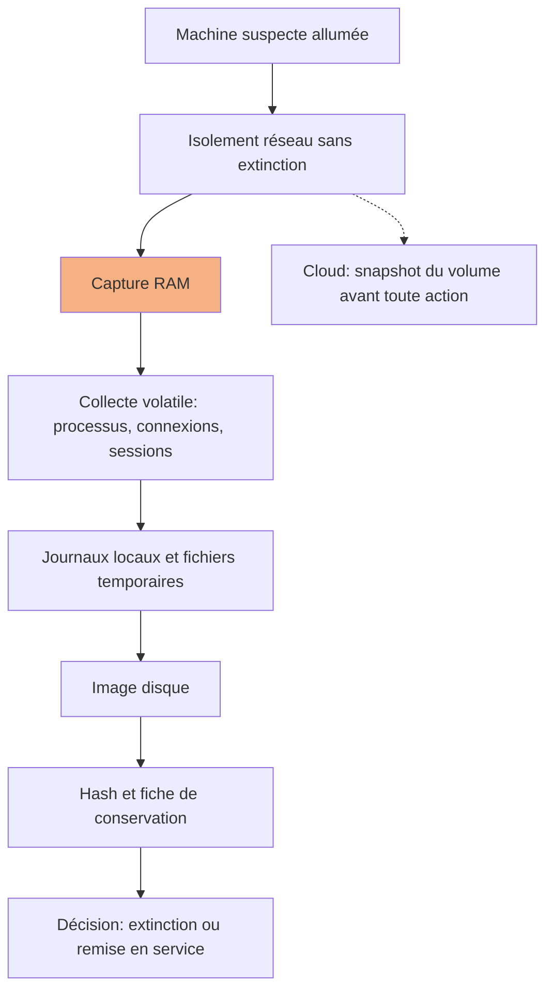

# Investigation numérique et forensic

## Objectifs pédagogiques

À la fin de ce module, vous saurez :

- **Appliquer** les principes de preuve numérique (intégrité, traçabilité, reproductibilité) et **tenir** une chaîne de conservation exploitable.
- **Ordonner** une collecte selon la volatilité des données et **choisir** entre capture à chaud et extinction.
- **Acquérir** une image disque, une capture mémoire et des journaux sans modifier la source.
- **Reconstruire** une chronologie fiable à partir de sources hétérogènes et **repérer** les altérations d'horodatage.
- **Analyser** une capture mémoire avec Volatility 3 et **rechercher** des indicateurs de compromission sur un système et dans le trafic réseau.
- **Rédiger** un rapport qui distingue faits, hypothèses et conclusions, avec ses limites explicites.

---

## Mise en situation

> Scénario illustratif : les chiffres sont fictifs, le déroulé est réaliste.

Un lundi matin, la supervision remonte des connexions sortantes régulières depuis un serveur web Linux vers une adresse inconnue. L'administrateur de garde agit avec les meilleurs réflexes d'exploitant :

1. il redémarre le serveur « pour couper la communication » ;
2. il lance un scan antivirus complet ;
3. il copie `/var/www` sur son poste avec `cp -r` pour « garder une trace » ;
4. il se connecte en SSH et exécute `ls -la`, `find` et `cat` dans une dizaine de répertoires.

Trois jours plus tard, l'équipe d'investigation arrive. Voici ce qu'il reste :

- **La mémoire a disparu.** Le processus malveillant, ses connexions et ses clés de chiffrement vivaient en RAM et ont été perdus au redémarrage.
- **Les horodatages d'accès sont brouillés.** Le scan antivirus et les `cat` ont lu de nombreux fichiers et ont pu mettre à jour leurs `atime`. Les `ls` et `find` ont touché ceux des répertoires parcourus. Déjà fragile (voir la section Horodatages), l'indice « quels fichiers l'attaquant a-t-il lus ? » se mêle désormais aux actions de l'administrateur.
- **La copie n'a aucune valeur probante.** Ni hash ni métadonnées d'origine. Les dates de création de la copie sont celles de lundi matin.
- **Le disque a été modifié.** Les outils installés par l'administrateur ont écrit sur le même volume et potentiellement écrasé des fichiers supprimés récupérables.

Le serveur est compromis, mais aucune conclusion ne peut être défendue. On ne sait ni quand, ni comment, ni jusqu'où l'attaquant est allé. La défense naïve (« nettoyer vite ») détruit exactement ce qui permet de répondre à ces questions.

Le module précédent a posé la décision d'isolement. Celui-ci traite ce que cette décision coûte en preuves, et comment les préserver malgré tout.

---

## Surface d'investigation : où se trouvent les traces

Un attaquant qui agit sur un système écrit à plusieurs endroits, qu'il le veuille ou non. La compétence du forensic consiste à savoir où regarder pour chaque action, et combien de temps la trace survit.

| Action de l'attaquant | Trace laissée | Où la trouver | Fragilité |
|---|---|---|---|
| Exécution d'un binaire | Création de processus, connexions | RAM, Prefetch/Amcache (Windows), journaux d'audit | Très haute en RAM, moyenne sur disque |
| Persistance (service, tâche, cron) | Clé de registre, unité systemd, entrée crontab | Registre, `/etc/systemd`, `/var/spool/cron` | Basse : survit au reboot |
| Mouvement latéral (RDP, SSH, SMB) | Authentification sur la cible, flux réseau | Événements 4624 (type 3 ou 10), `auth.log`, Zeek | Moyenne : dépend de la rotation des logs |
| Vol d'identifiants | Accès au processus LSASS (Local Security Authority Subsystem Service), fichier dump | Sysmon ID 10, mémoire, fichiers `.dmp` | Haute si non journalisé |
| Exfiltration | Gros volumes sortants, DNS anormal | Proxy, NetFlow, pcap | Haute sans capture réseau |
| Effacement des traces | Journal vidé, historique supprimé, horodatages modifiés | Événements 1102 et 104, `$MFT`, journaux distants | L'effacement lui-même est une trace |

> 🧠 **Concept clé**
>
> Le principe d'échange de Locard s'applique au numérique. Toute action laisse une trace, y compris l'effacement. Corréler plusieurs sources permet de détecter les incohérences, c'est-à-dire ce qu'un attaquant a réussi à masquer dans l'une mais pas dans l'autre.
{: .callout .callout-important}

---

## Principes de preuve et chaîne de conservation ⭐

Qu'est-ce qui donne de la valeur à une preuve numérique ? Il faut pouvoir démontrer trois choses :

- elle est **authentique** : elle vient bien de ce système ;
- elle est **intègre** : elle n'a pas changé depuis la collecte ;
- elle est **traçable** : on sait qui l'a eue, quand, et pourquoi.

> 🔍 **Analogie : le scellé**
>
> Chaque remise d'un scellé est signée et datée, ce qui retrace tout son parcours. Limite de l'image : la signature ne dit rien du contenu. En forensic, c'est le hash revérifié à chaque transfert qui prouve que la preuve n'a pas changé.
{: .callout .callout-analogie}

Les cadres de référence sont la RFC 3227 (collecte et archivage des preuves), la norme ISO/IEC 27037 (identification, collecte, acquisition, préservation) et le NIST SP 800-86 (intégration du forensic dans la réponse à incident).

### Ce qui rend une preuve exploitable

- **Hash à l'acquisition.** Calculer un SHA-256 de l'image au moment de la copie, le noter dans le registre, puis le recalculer à chaque transfert. MD5 reste présent dans de nombreux outils, mais SHA-256 est le minimum raisonnable pour l'intégrité.
- **Original intouché.** On travaille toujours sur une copie de travail. L'image originale, scellée et hashée, reste en lecture seule sur un support dédié.
- **Documentation de chaque geste.** Commande exacte, heure en UTC, opérateur, version de l'outil. Une capture mémoire sans trace de l'outil utilisé est difficile à défendre.
- **Cadre d'autorisation.** Avant de collecter, il faut un mandat clair (direction, juridique, parfois représentants du personnel). Un poste utilisé à titre privé en partie, ou des données personnelles de salariés, imposent un cadre défini par la charte informatique et l'avis du juridique. Une collecte hors mandat peut rendre la preuve inutilisable, voire exposer l'enquêteur.

### Exemple de fiche de conservation

```yaml
case_id: <CASE_ID>
item_id: <CASE_ID>-HDD-01
description: Image disque /dev/sda du serveur web-prod-03
acquired_by: <OPERATEUR>
acquired_at_utc: 2024-03-04T09:42:11Z
tool: dc3dd 7.2.646
sha256: <HASH_SHA256>
source_state: serveur isole du reseau, allume, capture RAM effectuee avant
storage: coffre B, scelle n°<NUM_SCELLE>
transfers:
  - from: <OPERATEUR>
    to: <ANALYSTE>
    at_utc: 2024-03-04T14:05:00Z
    hash_verified: true
```

> 💡 **Astuce**
>
> La fiche est remplie pendant la collecte, pas après. Reconstituer de mémoire l'heure et l'outil produit des trous que la partie adverse (ou un client exigeant) trouvera.
{: .callout .callout-astuce}

---

## Volatilité et ordre de collecte

Les données ne disparaissent pas toutes à la même vitesse.

> 🔍 **Analogie : la scène de crime sous la pluie**
>
> L'enquêteur relève d'abord les empreintes que la pluie va effacer, avant les objets qui ne bougeront pas. Ici, la RAM joue le rôle des empreintes et le disque celui des objets. Limite de l'image : contrairement à un objet, le disque peut être modifié par chaque geste de l'enquêteur.
{: .callout .callout-analogie}

La RFC 3227 propose donc de collecter dans l'ordre décroissant de volatilité :

| Priorité | Donnée | Durée de vie typique |
|---|---|---|
| 1 | Registres CPU, caches | Nanosecondes à millisecondes |
| 2 | Tables réseau (ARP, routage), connexions actives | Secondes à minutes |
| 3 | Mémoire (processus, modules noyau, clés) | Jusqu'à l'arrêt |
| 4 | Fichiers temporaires, swap, `hiberfil.sys` | Jusqu'au reboot ou à l'écrasement |
| 5 | Disque | Persistant, mais modifiable par chaque opération |
| 6 | Journaux distants, sauvegardes, supervision | Selon la rétention |

Les trois premiers niveaux sont inaccessibles dès que la machine s'éteint. En pratique, on traite les niveaux 1 et 2 quasi simultanément avec la capture mémoire.



### Le coût de la collecte à chaud

Toute commande exécutée sur la machine la modifie : chargement de binaires, écriture dans la mémoire, mise à jour d'`atime`. La règle n'est pas « ne rien toucher », mais **minimiser et documenter** :

- Exécuter les outils depuis un support externe monté en lecture seule, avec des binaires de confiance (statiques, ou une image de réponse live préparée). Les binaires du système compromis peuvent être remplacés par un rootkit.
- Écrire les sorties sur un support externe, jamais sur le disque suspect.
- Prévoir l'espace : une capture mémoire occupe la taille de la RAM (64 Go de RAM = ~64 Go de fichier).
- Noter chaque commande avec l'heure UTC.

Un exemple de collecte volatile Linux, à lancer depuis un support externe monté sur `<MNT_USB>` :

```bash
OUT=<MNT_USB>/<CASE_ID>/live
mkdir -p "$OUT"
{ date -u; uname -a; uptime; } > "$OUT/00_context.txt"
ss -tupan                    > "$OUT/10_sockets.txt"
ps auxwwf                    > "$OUT/11_processes.txt"
{ ip neigh; ip route; }     > "$OUT/12_neigh_route.txt" 2>&1
{ who -a; last -n 50; }     > "$OUT/13_sessions.txt"
ls -l /proc/*/exe 2>/dev/null | grep -i deleted > "$OUT/14_deleted_exe.txt"
sha256sum "$OUT"/* > "$OUT/SHA256SUMS"
```

La ligne sur `/proc/*/exe` vaut le détour : un processus dont le binaire a été supprimé du disque après lancement (technique courante des implants Linux) apparaît avec le suffixe `(deleted)`. Le binaire reste récupérable depuis `/proc/<PID>/exe` tant que le processus tourne.

> 🔒 **Contrôle de sécurité**
>
> Décider *avant* l'incident qui peut ordonner une capture mémoire, avec quel outil et sur quel support. Chercher ces réponses pendant la crise coûte plusieurs heures, soit l'écart entre une RAM capturée et une RAM perdue.
{: .callout .callout-securite}

---

## Piège central : ce qui détruit une preuve

> ⚠️ **Erreur fréquente**
>
> La collecte est elle-même le premier risque pour la preuve. Voici les actions qui reviennent le plus souvent dans les post-mortems d'investigation, avec leur conséquence concrète.
{: .callout .callout-attention}

| Geste | Conséquence | Alternative |
|---|---|---|
| Redémarrer ou éteindre « pour couper » | Perte de la RAM : processus, connexions, clés, code injecté | Isoler au niveau réseau (VLAN, règle de pare-feu, agent EDR), capturer la RAM d'abord |
| Éteindre un poste chiffré (BitLocker, LUKS) | Disque illisible sans clé de récupération | Capturer la RAM et le volume monté déverrouillé avant l'arrêt ; sécuriser les clés de récupération |
| Monter le disque original en lecture-écriture | Écritures du système de fichiers, modifications d'horodatages | Image + montage en lecture seule sur la copie |
| Monter un volume ext4 « en ro » sans précaution | Le journal peut être rejoué et modifier le volume | Option `noload` en plus de `ro`, ou travailler sur une copie |
| Lancer un antivirus ou `chkdsk`/`fsck` sur le disque original | Quarantaine, suppression, réparation, mises à jour d'`atime` | Analyser l'image, jamais le disque source |
| Installer des outils sur le système suspect | Écrasement d'espace non alloué, éventuelle récupération de fichiers supprimés compromise | Support externe, outils portables |
| Copier avec `cp` ou glisser-déposer | Dates de création/modification de la copie remplacées, métadonnées perdues | Image bit-à-bit ou outil de collecte qui préserve les métadonnées |
| Laisser un autoscaling ou une destruction automatique cloud agir | Instance détruite avec son disque éphémère | Snapshot du volume et capture mémoire avant toute action, puis isolement via groupe de sécurité |

Sur les SSD, le TRIM peut vider des blocs supprimés peu après la suppression, donc la récupération de fichiers effacés y est bien moins fiable que sur disque mécanique. Il faut le dire dans le rapport plutôt que promettre une récupération hypothétique.

---

## Acquisition : disque, mémoire, journaux

### Image disque

Sur un disque physique retiré ou démarré en environnement de capture, on passe par un bloqueur d'écriture matériel (préférable) ou, à défaut, une mise en lecture seule logicielle :

```bash
# Verrouillage logiciel en lecture seule (le matériel reste préférable)
blockdev --setro /dev/<DISQUE>

# Acquisition avec hash et log intégrés
dc3dd if=/dev/<DISQUE> of=<MNT_EVIDENCE>/<CASE_ID>-HDD-01.dd \
      hash=sha256 log=<MNT_EVIDENCE>/<CASE_ID>-HDD-01.log
```

Pour le format EWF (Expert Witness Format, fichiers `.E01`, compressé avec métadonnées de cas), `ewfacquire` ou FTK Imager sont les outils habituels. Le choix dépend de l'espace disponible et des outils d'analyse en aval, pas d'un impératif juridique.

Pour analyser, on monte **la copie** :

```bash
losetup --find --show --read-only --partscan <IMAGE>.dd
mount -o ro,noload /dev/loop0p1 /mnt/analysis
```

### Mémoire

| Système | Outil courant | Remarque |
|---|---|---|
| Windows | WinPmem, DumpIt, FTK Imager | L'exécutable et sa syntaxe varient selon la version |
| Linux | AVML, LiME | LiME est un module noyau compilé pour la version exacte ; AVML est un binaire autonome |
| VM | Snapshot avec état mémoire (`.vmem`, `.vmsn`) | Souvent le plus propre : capture sans agent sur la VM |

```bash
# Linux, avec AVML, en root, sortie sur support externe
avml <MNT_EVIDENCE>/<CASE_ID>-RAM-01.lime
sha256sum <MNT_EVIDENCE>/<CASE_ID>-RAM-01.lime
```

Sous Windows, `hiberfil.sys` et `pagefile.sys` sont des sources mémoire complémentaires. Elles survivent à un arrêt, ce qui peut sauver une enquête lorsque la RAM est perdue. Elles contiennent moins de contexte qu'une capture directe.

### Journaux

Copier les journaux plutôt que lire en direct sur la machine, pour figer leur état :

```powershell
wevtutil epl Security   E:\evidence\Security.evtx
wevtutil epl System     E:\evidence\System.evtx
wevtutil epl "Microsoft-Windows-Sysmon/Operational" E:\evidence\Sysmon.evtx
```

```bash
journalctl --since "2024-03-01" -o export > <MNT_EVIDENCE>/journal.export
cp -a /var/log <MNT_EVIDENCE>/var_log/    # garde droits, propriétaire et mtime ; pas ctime ni date de naissance
```

Pour un parc de postes, un collecteur de triage comme KAPE (`kape.exe --tsource C: --tdest <DEST> --target !SANS_Triage`) ou l'offline collector de Velociraptor récupère les artefacts utiles en quelques minutes, sans image complète. Les noms de cibles et options varient selon la version : vérifier la documentation de l'outil installé.

**Cloud** : le snapshot du volume (`aws ec2 create-snapshot --volume-id <VOLUME_ID>`, ou équivalent Azure/GCP) s'obtient en quelques secondes mais ne contient **pas** la RAM. Pour la mémoire, il faut un agent préinstallé ou une capture depuis l'intérieur de l'instance.

---

## Comment l'attaquant brouille les pistes

> 🔴 **Vecteur d'attaque**
>
> Les attaquants expérimentés intègrent l'effacement des traces à leur routine. Connaître leurs techniques indique où chercher les incohérences.
{: .callout .callout-danger}

**Effacement des journaux** (MITRE ATT&CK T1070.001) : `wevtutil cl Security` vide le journal. Cette action génère elle-même l'événement **1102** (journal Security effacé) ou **104** (autre journal, source Eventlog). Leur présence suffit à signaler l'intervention, même si le contenu est perdu. Sous Linux, `history -c`, `unset HISTFILE` ou `ln -sf /dev/null ~/.bash_history` empêchent l'écriture de l'historique, mais pas l'audit système (`auditd`) ni les journaux distants.

**Timestomping** (T1070.006) : modification des dates d'un fichier pour qu'il se fonde dans le décor.

Sous NTFS, les horodatages sont stockés à deux endroits dans la MFT (Master File Table)* :

- `$STANDARD_INFORMATION` : modifiable par les API Windows, donc par l'attaquant ;
- `$FILE_NAME` : mis à jour par le noyau, difficile à falsifier.

Un fichier dont la date `$STANDARD_INFORMATION` est **antérieure** à celle de `$FILE_NAME` est un candidat sérieux. Un outil comme MFTECmd ou Autopsy expose les deux.

**Exécution sans fichier** : injection de code dans un processus légitime, ou chargement de binaire directement en mémoire. Rien sur disque, mais la RAM contient des régions exécutables sans fichier support, que `malfind` repère.

**Vol d'identifiants** (T1003.001) : copie de la mémoire du processus LSASS, par exemple avec `procdump -ma lsass.exe` ou `rundll32 comsvcs.dll, MiniDump <PID> <FICHIER> full`.

Côté investigation, trois traces à chercher :

- Sysmon événement ID 10 (accès au processus lsass.exe) ;
- des fichiers `.dmp` ou sans extension de plusieurs dizaines de Mo dans un répertoire temporaire ;
- l'événement 4688 avec la ligne de commande.

**Persistance** : service (événements 4697 dans Security, 7045 dans System), tâche planifiée (4698), clés `Run` du registre, unité systemd, entrée `cron`, clé dans `~/.ssh/authorized_keys`. Ces traces survivent au redémarrage et sont presque toujours présentes.

*La MFT est la table qui référence chaque fichier d'un volume NTFS avec ses attributs, dont les horodatages.*

> 🧠 **Concept clé**
>
> On n'efface pas toutes les sources simultanément. Un attaquant qui nettoie `Security.evtx` oublie souvent le journal Sysmon, le proxy, les logs d'un équipement réseau ou la mémoire. C'est la **contradiction entre sources** qui révèle la manipulation.
{: .callout .callout-important}

---

## Horodatages et reconstruction chronologique

La chronologie est l'épine dorsale de l'investigation : elle transforme des milliers d'événements en histoire. Elle exige de la rigueur sur les dates.

### Pièges des horodatages

- **Fuseau horaire** : NTFS stocke en UTC, certains journaux Windows affichent en heure locale, `auth.log` en heure locale du serveur. Tout ramener en UTC avant de comparer.
- **Dérive d'horloge** : si le serveur avait 7 minutes de décalage, ses logs ne se corrèlent pas avec ceux du pare-feu. Mesurer l'écart (`chronyc tracking`, comparaison avec un événement connu) et l'inscrire au rapport.
- **Sémantique MACB** (Modified, Accessed, Changed, Born) : ne se comporte pas pareil selon le système de fichiers. Sous Linux, `relatime` (par défaut) ne met à jour `atime` que si elle est antérieure à `mtime`/`ctime` ou vieille de plus de 24 h : un `atime` n'est donc **pas** une preuve de lecture. Sous ext4, la date de naissance (`crtime`) existe mais n'est pas affichée par `ls` ; `stat` ou `debugfs` la montrent.
- **Sources modifiables** : les horodatages de fichiers sont falsifiables (timestomping). Les journaux d'événements et les logs distants le sont beaucoup moins.

### Construire la super-timeline

```bash
# 1. Repérer l'offset de la partition
mmls <IMAGE>.dd

# 2. Extraire les métadonnées de fichiers au format bodyfile
fls -r -m / -o <OFFSET> <IMAGE>.dd > body.txt

# 3. Produire une chronologie ISO 8601 en UTC
mactime -b body.txt -y -d -z UTC 2024-03-01..2024-03-05 > timeline.csv
```

Pour agréger fichiers, registre, journaux d'événements, historiques navigateur en une seule vue, Plaso :

```bash
log2timeline.py --storage-file case.plaso <IMAGE>.E01
psort.py -o l2tcsv -w timeline.csv case.plaso "date > datetime('2024-03-01T00:00:00')"
```

La sortie dépasse souvent plusieurs millions de lignes. Personne ne la lit : on **pivote**. On part d'un point d'ancrage (alerte, première connexion suspecte, date de création d'un binaire), on regarde les 5 minutes avant et après, puis on étend.

### Exemple de chronologie illustrative

| Heure UTC | Source | Événement |
|---|---|---|
| 02:14:07 | Proxy | Téléchargement d'un `.zip` depuis un domaine inconnu |
| 02:14:51 | Prefetch | Première exécution de `update.exe` |
| 02:15:03 | Sysmon ID 3 | Connexion sortante de `update.exe` vers `<IP_EXTERNE>:443` |
| 02:19:30 | Sécurité 4698 | Tâche planifiée créée sous le compte de l'utilisateur |
| 02:31:12 | Sysmon ID 10 | Accès à `lsass.exe` par `rundll32.exe` |
| 02:33:40 | Sécurité 1102 | Journal Security effacé |

Chaque ligne vient d'une source différente. Si l'attaquant a effacé le journal Security à 02:33, les lignes antérieures de Sysmon, du proxy et de Prefetch permettent quand même de reconstituer la séquence.

> 💡 **Astuce**
>
> Placer l'événement d'effacement dans la chronologie. Tout ce qui précède dans cette source est suspect de lacune, et il faut chercher la même période dans les sources qu'il n'a pas touchées.
{: .callout .callout-astuce}

---

## Recherche d'indicateurs de compromission

Dans une investigation, on cherche les IoC de deux façons : ceux que l'on **découvre** pendant l'analyse pour les propager au reste du parc, et ceux fournis par des sources externes (sujet du module suivant).

> 📖 **Définition**
>
> Un IoC (Indicator of Compromise) est une observation technique associée à une activité malveillante : hash de fichier, adresse IP, domaine, nom de tâche, clé de registre, mutex, chaîne caractéristique.
{: .callout .callout-definition}

```bash
# Rechercher une règle YARA sur un montage de l'image
yara -r <REGLES>.yar /mnt/analysis

# Retrouver tous les fichiers dont le hash correspond
find /mnt/analysis -type f -exec sha256sum {} + | grep <HASH_SHA256>

# Fichiers modifiés dans la fenêtre d'intrusion
find /mnt/analysis -type f -newermt "2024-03-01" ! -newermt "2024-03-05" -ls
```

Trois limites à garder en tête :

- **Un IoC périme vite.** Une IP de C2 change en quelques jours, un hash change au moindre recompilage. Les IoC comportementaux (chaîne de commande, tâche planifiée avec un nom particulier, parent-enfant de processus anormal) durent plus longtemps.
- **L'absence d'IoC ne prouve rien.** Un scan YARA négatif signifie « cette règle ne matche pas », pas « le système est sain ».
- **Faux positifs.** Une chaîne trouvée dans le cache d'un navigateur peut venir d'une page consultée, pas d'un binaire exécuté. Relier chaque IoC à un contexte d'exécution avant de le déclarer.

---

## Investigation système et réseau

### Windows

Les artefacts d'exécution répondent à « ce programme a-t-il tourné ? » même quand le binaire a disparu :

| Artefact | Ce qu'il apporte | Limite |
|---|---|---|
| Prefetch (`C:\Windows\Prefetch`) | Nom, nombre d'exécutions, 8 dernières dates | Désactivé par défaut sur certains serveurs |
| Amcache / Shimcache | Trace de présence d'un exécutable, parfois hash | Shimcache prouve la présence, pas toujours l'exécution |
| Événements 4624/4625 | Authentifications (type 3 réseau, type 10 RDP) | Dépend de la politique d'audit |
| Événement 4688 + ligne de commande | Commande exacte lancée | Ligne de commande à activer par GPO |
| MFT et journal USN | Création, renommage, suppression de fichiers | Journal USN tourne et se vide |
| Clés `Run`, services, tâches | Persistance | — |

Pour parcourir `.evtx` en volume avec des règles Sigma, Hayabusa ou Chainsaw donnent un premier tri rapide (exemple : `hayabusa csv-timeline -d <DOSSIER_EVTX> -o hayabusa.csv`). Ils servent à orienter l'analyse, pas à conclure.

### Linux

```bash
last -f /var/log/wtmp | head -30                  # connexions réussies
lastb -f /var/log/btmp | head -30                 # tentatives échouées
journalctl -u ssh --since "2024-03-01" --no-pager # authentifications SSH
find / -xdev -perm -4000 -type f 2>/dev/null      # binaires setuid
debsums -c 2>/dev/null                            # fichiers Debian modifiés
rpm -Va 2>/dev/null                               # équivalent RPM
```

Chercher en priorité : `authorized_keys` modifiés, crontabs et unités systemd récentes, binaires système dont le hash diffère du paquet, processus lancés depuis `/tmp`, `/dev/shm` ou avec binaire supprimé.

### Réseau

Une capture complète (pcap) est rarement disponible rétroactivement. Ce qui existe presque toujours : journaux de pare-feu, proxy, DNS, NetFlow. Quand un pcap existe, Zeek le transforme en journaux exploitables :

```bash
zeek -r <CAPTURE>.pcap
zeek-cut ts id.orig_h id.resp_h id.resp_p duration orig_bytes < conn.log | sort -k2,3 | head
```

Le **beaconing** (balise régulière vers un C2) se repère à l'intervalle quasi constant entre connexions d'un même couple source/destination, par exemple toutes les 60 s ± 2 s. Les malwares ajoutent du jitter, il faut donc regarder la distribution, pas l'égalité stricte.

Limite structurelle : avec TLS, on ne voit que les métadonnées (destination, SNI, volumes, rythme). Le contenu est inaccessible sans déchiffrement. Il faut le dire dans le rapport au lieu de suggérer ce qui a été exfiltré.

> 💡 **Astuce**
>
> Corréler mémoire et réseau. Une connexion visible dans `windows.netscan` et absente des logs du pare-feu indique un contournement du chemin supervisé (autre interface, tunnel, VPN).
{: .callout .callout-astuce}

---

## Volatility 3 et outils d'analyse

Volatility 3 est le framework de référence pour l'analyse mémoire. Volatility 2 n'est plus la version de référence (Python 2). L'outil reconstruit les structures du noyau à partir de la capture : il doit donc savoir quel système il analyse.

### Workflow de base

```bash
# 1. Identifier le système (Windows)
vol -f <MEMDUMP> windows.info

# 2. Lister les processus : deux méthodes différentes
vol -f <MEMDUMP> windows.pslist      # parcourt la liste chaînée du noyau
vol -f <MEMDUMP> windows.psscan      # scanne la mémoire à la recherche de structures

# 3. Arborescence parent-enfant et lignes de commande
vol -f <MEMDUMP> windows.pstree
vol -f <MEMDUMP> windows.cmdline

# 4. Connexions
vol -f <MEMDUMP> windows.netscan

# 5. Régions mémoire exécutables suspectes, avec extraction
vol -f <MEMDUMP> -o <DOSSIER_SORTIE> windows.malfind --dump
```

Les noms de plugins et leur syntaxe peuvent varier selon la version installée ; `vol -h` liste ce qui est disponible.

### Lire les résultats

- **pslist vs psscan** : un processus visible dans `psscan` mais absent de `pslist` a été retiré de la liste chaînée (rootkit) ou s'est terminé récemment. Dans les deux cas, c'est à examiner.
- **pstree** : `winword.exe` qui lance `powershell.exe`, ou `svchost.exe` dont le parent n'est pas `services.exe`, sont des classiques. Les noms légitimes avec parent aberrant sont plus parlants que les noms inconnus.
- **malfind** : signale des régions avec droits RWX sans fichier associé. Il produit des faux positifs (compilateurs JIT (Just-In-Time) de navigateurs, de .NET ou de Java). Un résultat n'est probant que lorsque le contenu extrait ressemble à du code (en-tête `MZ`, shellcode) et que le processus n'a aucune raison d'en contenir.

### Linux et symboles

Pour Linux, Volatility 3 a besoin d'une table de symboles ISF (Intermediate Symbol Format) correspondant au **noyau exact** du système capturé. Elle se génère depuis le paquet de symboles de débogage de la distribution (avec `dwarf2json`) ou se télécharge si elle existe. À préparer **avant** l'incident pour votre parc, d'autant que le poste d'analyse n'a pas toujours accès à Internet.

```bash
vol -f <MEMDUMP>.lime linux.pslist
vol -f <MEMDUMP>.lime linux.bash
vol -f <MEMDUMP>.lime linux.sockstat
```

### Autres outils

| Outil | Usage | Quand le choisir |
|---|---|---|
| Autopsy / Sleuth Kit | Analyse d'image disque, récupération de fichiers supprimés | Examen approfondi d'une machine |
| Plaso | Super-timeline multi-sources | Reconstruction chronologique |
| KAPE, Velociraptor | Triage et collecte à grande échelle | Plusieurs machines, délai court |
| Zeek, Wireshark/tshark | Analyse de trafic | Pcap disponible |
| YARA | Recherche de motifs | Propagation d'un IoC trouvé |

> 🔒 **Contrôle de sécurité**
>
> Traiter les échantillons extraits comme du code hostile. Analyse sur une VM isolée, jamais sur le poste de travail de l'analyste, et jamais de double-clic sur un binaire extrait.
{: .callout .callout-securite}

---

## Contrôles de détection : préparer l'investigation avant l'incident

Un forensic efficace dépend de ce qui a été journalisé avant l'incident. Ces réglages se décident en amont, parce qu'on ne peut pas journaliser rétroactivement.

| Réglage | Ce que ça permet | Coût |
|---|---|---|
| GPO « Audit Process Creation » + « Include command line » (événement 4688) | Voir les commandes exactes lancées | Volume de logs élevé sur serveurs bavards |
| Sysmon avec configuration éprouvée | Processus, connexions, accès LSASS, création de fichiers | Réglage fin pour éviter le bruit ; surcharge CPU modérée |
| `auditd` avec règles sur `execve` et fichiers sensibles | Historique d'exécution fiable côté Linux | Volume important, à filtrer |
| Transfert des logs vers un stockage distant | Les logs survivent à un effacement local | Pipeline à maintenir, coût de stockage |
| Rétention d'au moins 90 jours sur les sources clés | Remonter à la vraie date d'intrusion | Stockage ; le temps de présence avant détection dépasse souvent plusieurs semaines |
| Synchronisation d'horloge sur toute la chaîne | Chronologie corrélable | Faible |
| Procédure et outils de capture mémoire préinstallés | Gagner des heures en crise | Entretien des outils et des symboles |

IoC de manipulation à alerter en continu : événements 1102 et 104, arrêt du service de journalisation, volume de logs qui chute brutalement sur un hôte (silence suspect), changement soudain de l'heure système.

---

## Tests de sécurité : vérifier que l'investigation sera possible

La question à poser n'est pas « avons-nous des logs ? » mais « saurions-nous reconstituer une intrusion de 3 jours ? ». On le teste en laboratoire :

```bash
# Dérive d'horloge d'un serveur
chronyc tracking

# Règles auditd chargées
auditctl -l

# Intégrité d'une image après transfert
sha256sum -c <CASE_ID>-HDD-01.sha256
```

Un exercice simple et révélateur en environnement de test :

1. Sur une VM de laboratoire, simuler les actions d'un attaquant : création d'une tâche planifiée, exécution d'un binaire depuis un répertoire temporaire, effacement d'un journal.
2. Faire collecter RAM, journaux et disque par quelqu'un qui ne connaît pas le scénario.
3. Mesurer : combien de temps pour la capture, la chronologie est-elle reconstituable, l'effacement est-il détecté, les logs distants contiennent-ils bien les événements ?
4. Corriger les trous (audit absent, symboles manquants, espace insuffisant pour la RAM) et recommencer.

Le premier exercice révèle presque toujours un oubli : outil de capture non testé sur la version d'OS en production, support trop petit pour 128 Go de RAM, journaux distants non alimentés par un segment.

---

## Rapport d'investigation et limites des conclusions

Le rapport est le seul livrable que la direction, le juridique ou l'assureur liront. Il doit séparer strictement ce qui est observé de ce qui est déduit.

### Structure utile

1. **Synthèse** : en une demi-page, ce qui s'est passé, avec quel degré de certitude, et ce qui reste inconnu.
2. **Périmètre et mandat** : systèmes examinés, période, autorisation reçue.
3. **Sources et méthode** : chaque élément de preuve avec son hash, outils et versions.
4. **Chronologie** : en UTC, avec la source de chaque ligne et le décalage d'horloge mesuré.
5. **Constats** : chacun avec son niveau de confiance et les preuves associées.
6. **Limites** : ce qui n'a pas pu être vérifié, et pourquoi.
7. **Annexes** : hashes, fiches de conservation, sorties d'outils.

### Fait, hypothèse, conclusion

| Formulation faible | Formulation défendable |
|---|---|
| « L'attaquant a volé les données clients » | « Un volume de 4,2 Go a été émis vers `<IP_EXTERNE>` entre 02:40 et 03:10 UTC (logs proxy). Le contenu n'est pas visible (TLS). Compatible avec une exfiltration ; non confirmé. » |
| « Le malware a été installé par le courriel de phishing » | « Le premier exécutable suspect apparaît 47 s après un téléchargement depuis un domaine visité par ce poste. Le lien avec un courriel n'a pas pu être établi : le journal de messagerie n'a pas été fourni. » |
| « Aucune autre machine n'est touchée » | « Aucun des IoC identifiés n'a été trouvé sur les 12 autres hôtes examinés. Cela ne permet pas d'exclure une compromission par une technique non couverte. » |

### Limites structurelles à écrire noir sur blanc

- **L'absence de preuve n'est pas la preuve d'une absence.** Logs écrasés par rotation, audit non activé ou journal effacé : les conclusions négatives sont toujours conditionnelles.
- **Attribution.** Un forensic technique établit *ce qui s'est passé sur ces systèmes*, rarement *qui* en est responsable. Une IP, un outil ou un fuseau horaire ne désignent pas un acteur.
- **Chiffrement.** Sans clé, les volumes et les flux sont opaques.
- **Capture partielle.** Une RAM capturée six heures après le début de l'intrusion ne reflète pas l'état initial.
- **Intégrité douteuse.** Si la machine a été manipulée avant l'arrivée de l'investigateur, le rapport doit le mentionner : c'est une limite, pas un aveu d'échec.

> 🧠 **Concept clé**
>
> Un rapport honnête sur ses limites résiste mieux à la contestation qu'un rapport catégorique. Ce qui est affirmé doit pouvoir être reproduit par un tiers à partir des preuves et des hashes fournis.
{: .callout .callout-important}

---

## Scénario illustratif : poste de travail d'un comptable

> Scénario fictif construit pour montrer la corrélation de sources ; les valeurs sont illustratives.

Une alerte EDR signale un accès à `lsass.exe` sur le poste d'un comptable un jeudi soir. L'équipe suit la méthode ci-dessus :

1. **Isolement réseau** via l'agent EDR (le poste reste allumé), puis capture RAM avec un outil préparé, hashée et enregistrée.
2. **Triage** avec KAPE sur le poste, puis image disque.
3. **Journal Security** : l'événement 1102 indique un effacement à 02:33 UTC. Le contenu antérieur est perdu.
4. **Sysmon et le proxy**, eux, sont intacts parce qu'ils étaient transférés en continu : ils montrent le téléchargement initial, l'exécution et l'accès à LSASS.
5. **Volatility** : `pstree` montre un `rundll32.exe` enfant de `update.exe`, `malfind` extrait une région RWX contenant un exécutable injecté dans `explorer.exe`.
6. **MFT** : la date `$STANDARD_INFORMATION` de `update.exe` remonte à 2019, alors que `$FILE_NAME` indique le jour de l'intrusion : timestomping confirmé.
7. **Mouvement latéral** : des événements 4624 de type 3 sur un serveur de fichiers, avec le compte du comptable, une heure après l'accès à LSASS.

**Impact simulé** : un serveur de fichiers atteint, aucune exfiltration démontrée (TLS, volumes modestes). Le rapport conclut à une compromission avec vol d'identifiants *probable*, mouvement latéral *confirmé*, exfiltration *non établie*.

**Leçons** : le transfert des logs vers l'extérieur a sauvé l'investigation malgré l'effacement local. La capture mémoire a révélé l'injection invisible sur disque. Sans l'analyse de la MFT, le binaire aurait paru ancien et banal.

---

## Erreurs fréquentes

⚠️ **Hasher après coup, ou ne pas hasher du tout**

- *Configuration dangereuse* : l'image est copiée, déplacée, puis hashée une semaine plus tard « pour vérifier ».
- *Conséquence* : impossible de prouver que l'image n'a pas été altérée entre la collecte et l'analyse.
- *Correction* : hash calculé pendant l'acquisition (`dc3dd hash=sha256`), vérifié à chaque transfert (`sha256sum -c`), consigné dans la fiche.

⚠️ **Analyser sur l'image originale**

- *Configuration dangereuse* : l'analyste travaille directement sur l'unique exemplaire de l'image, monté en lecture-écriture.
- *Conséquence* : modification involontaire, perte de la référence pour une éventuelle contre-expertise.
- *Correction* : copie de travail, original scellé ; montage `ro,noload` via `losetup --read-only`.

⚠️ **Se fier aux horodatages sans les recouper**

- *Configuration dangereuse* : une chronologie bâtie sur les seules dates du système de fichiers.
- *Conséquence* : un timestomping ou une dérive d'horloge produit une histoire fausse mais cohérente en apparence.
- *Correction* : confronter `$STANDARD_INFORMATION` et `$FILE_NAME`, croiser avec journaux d'événements et logs distants, mesurer la dérive d'horloge.

⚠️ **Journaux uniquement locaux**

- *Configuration dangereuse* : aucun transfert de logs vers un stockage distant.
- *Conséquence* : un `wevtutil cl` ou un `rm /var/log/*` efface l'unique exemplaire de la preuve.
- *Correction* : transfert en quasi temps réel vers un collecteur distant, avec droits d'écriture seule pour les sources.

⚠️ **Conclure à partir d'un seul outil**

- *Configuration dangereuse* : traiter chaque résultat `malfind` ou chaque alerte Hayabusa comme une preuve.
- *Conséquence* : faux positifs présentés comme des compromissions, ou inversement, rassurer à tort sur un scan négatif.
- *Correction* : valider chaque indice par une deuxième source indépendante avant de l'inscrire comme constat.

⚠️ **Oublier la clé de récupération**

- *Configuration dangereuse* : poste chiffré éteint avant que les clés de récupération soient retrouvées.
- *Conséquence* : image disque illisible, investigation limitée aux journaux distants.
- *Correction* : annuaire des clés de récupération accessible aux enquêteurs ; capture à chaud du volume déverrouillé quand c'est possible.

---

## Résumé

Une investigation numérique transforme des traces fragiles en conclusions défendables, à condition de ne pas les détruire en les collectant.

La menace couverte est double :

- l'attaquant qui efface ses traces (journaux, horodatages, absence de fichier) ;
- l'enquêteur qui altère la preuve par un redémarrage, un montage en écriture ou une copie sans hash.

La défense repose sur l'ordre de volatilité (RAM avant disque), la chaîne de conservation (hash, fiche, copie de travail) et la corrélation de sources indépendantes (journaux distants, Sysmon, MFT, mémoire, réseau).

Volatility 3, Plaso et les outils de triage accélèrent le travail, mais n'établissent rien sans interprétation. Restent à surveiller : la rétention des journaux, la préparation des outils et symboles avant l'incident, le chiffrement des disques, et la tentation d'écrire des conclusions plus fortes que les preuves.

<!-- snippet
id: forensic_chain_custody_hash
type: concept
tech: forensic
level: intermediate
importance: high
format: knowledge
tags: forensic,preuve,chaine-conservation,hash
title: Chaîne de conservation : hash à l'acquisition, pas après
content: Une preuve numérique est défendable si on prouve authenticité, intégrité et traçabilité. Mécanisme : calculer un SHA-256 pendant l'acquisition, le noter dans la fiche (opérateur, outil, heure UTC), puis le revérifier à chaque transfert. Un hash calculé une semaine plus tard ne prouve rien sur la période intermédiaire.
description: L'intégrité se démontre par une suite de hashes concordants documentés dès la collecte, pas par un hash unique calculé tardivement.
-->

<!-- snippet
id: forensic_order_volatility
type: concept
tech: forensic
level: intermediate
importance: high
format: knowledge
tags: forensic,volatilite,rfc3227,memoire
title: Ordre de collecte : du plus volatil au plus persistant
content: RFC 3227 : collecter du plus volatil au plus persistant. En pratique, connexions et tables réseau se relèvent quasi simultanément avec la capture de la RAM, sans la retarder ; viennent ensuite fichiers temporaires et swap, puis le disque, puis les logs distants. La RAM contient processus, clés de chiffrement et code injecté sans fichier support, et disparaît à l'arrêt. L'isolement réseau se fait sans éteindre la machine.
description: Les données de la RAM n'existent nulle part ailleurs ; les capturer avant le disque évite de perdre processus, connexions et clés.
-->

<!-- snippet
id: forensic_dc3dd_image_hash
type: command
tech: forensic
level: intermediate
importance: high
format: knowledge
tags: forensic,image-disque,dc3dd,hash
title: Acquérir une image disque avec hash et log intégrés
context: À lancer avec le disque source en lecture seule (bloqueur matériel ou blockdev --setro)
command: dc3dd if=/dev/<DISQUE> of=<IMAGE>.dd hash=sha256 log=<IMAGE>.log
example: dc3dd if=/dev/sdb of=/mnt/evidence/CASE042-HDD-01.dd hash=sha256 log=/mnt/evidence/CASE042-HDD-01.log
description: dc3dd calcule le SHA-256 pendant la copie et produit un log horodaté, ce qui documente l'acquisition sans second passage sur le disque.
-->

<!-- snippet
id: forensic_mount_image_readonly_noload
type: command
tech: forensic
level: intermediate
importance: medium
format: knowledge
tags: forensic,montage,lecture-seule,ext4
title: Monter une image en lecture seule sans rejouer le journal
context: Sur le poste d'analyse, jamais sur la machine compromise
command: losetup --find --show --read-only --partscan <IMAGE>.dd && mount -o ro,noload /dev/<LOOPDEVICE>p1 /mnt/analysis
example: losetup --find --show --read-only --partscan CASE042-HDD-01.dd && mount -o ro,noload /dev/loop0p1 /mnt/analysis
description: L'option noload empêche ext4 de rejouer son journal, qui modifierait le volume même monté en ro ; losetup --read-only bloque l'écriture au niveau du loop.
-->

<!-- snippet
id: forensic_avml_memory_capture
type: command
tech: forensic
level: intermediate
importance: high
format: knowledge
tags: forensic,memoire,avml,linux
title: Capturer la RAM d'un serveur Linux avec AVML
context: En root, sortie sur un support externe dimensionné à la taille de la RAM
command: avml <MNT_EVIDENCE>/<FICHIER>.lime
example: avml /mnt/evidence/CASE042-RAM-01.lime
description: AVML est un binaire autonome qui ne demande pas de module noyau compilé ; la capture occupe autant d'espace que la RAM, hash à calculer juste après.
-->

<!-- snippet
id: forensic_deleted_exe_proc
type: command
tech: forensic
level: advanced
importance: medium
format: knowledge
tags: forensic,linux,fileless,processus
title: Repérer les processus Linux dont le binaire est supprimé
context: Collecte à chaud, binaires de confiance depuis un support externe
command: ls -l /proc/*/exe 2>/dev/null | grep -i deleted
description: Un implant qui supprime son exécutable après lancement reste visible avec le suffixe (deleted) ; le binaire est récupérable via cp /proc/<PID>/exe tant que le processus vit.
-->

<!-- snippet
id: forensic_vol_psscan_vs_pslist
type: tip
tech: forensic
level: advanced
importance: high
format: knowledge
tags: volatility,memoire,rootkit,processus
title: Comparer windows.pslist et windows.psscan
content: Lancer les deux plugins sur la même capture et comparer les PID. pslist suit la liste chaînée du noyau, psscan scanne la mémoire à la recherche de structures de processus. Un PID présent uniquement dans psscan est soit un processus terminé récemment, soit un processus retiré de la liste par un rootkit : à analyser avec windows.pstree et windows.cmdline.
description: L'écart entre les deux méthodes est un indicateur de dissimulation de processus que la liste du gestionnaire des tâches ne montre jamais.
-->

<!-- snippet
id: forensic_vol_malfind_dump
type: command
tech: forensic
level: advanced
importance: medium
format: knowledge
tags: volatility,malfind,injection,memoire
title: Extraire les régions mémoire exécutables avec malfind
context: Résultats à valider : faux positifs fréquents avec les compilateurs JIT (navigateurs, .NET, Java)
command: vol -f <MEMDUMP> -o <DOSSIER_SORTIE> windows.malfind --dump
example: vol -f CASE042-RAM-01.raw -o ./out windows.malfind --dump
description: Détecte les régions RWX sans fichier support dans un processus ; vérifier la présence d'un en-tête MZ ou d'un shellcode dans l'extrait avant de conclure à une injection.
-->

<!-- snippet
id: forensic_mactime_timeline
type: command
tech: forensic
level: intermediate
importance: medium
format: knowledge
tags: forensic,timeline,sleuthkit,horodatage
title: Produire une timeline de fichiers en UTC avec Sleuth Kit
command: fls -r -m / -o <OFFSET> <IMAGE>.dd > body.txt && mactime -b body.txt -y -d -z UTC <DATE_DEBUT>..<DATE_FIN> > timeline.csv
example: fls -r -m / -o 2048 CASE042-HDD-01.dd > body.txt && mactime -b body.txt -y -d -z UTC 2024-03-01..2024-03-05 > timeline.csv
description: L'offset de la partition vient de mmls ; forcer -z UTC évite de mélanger fuseaux horaires et fausse la corrélation avec les autres sources.
-->

<!-- snippet
id: forensic_timestomp_si_fn
type: concept
tech: forensic
level: advanced
importance: high
format: knowledge
tags: forensic,ntfs,timestomping,mft
title: Détecter le timestomping avec $STANDARD_INFORMATION et $FILE_NAME
content: NTFS stocke les horodatages à deux endroits de la MFT. $STANDARD_INFORMATION est modifiable par les API Windows (donc par l'attaquant, technique T1070.006). $FILE_NAME est mis à jour par le noyau. Si la date de $STANDARD_INFORMATION est antérieure à celle de $FILE_NAME, le fichier est suspect. Outils : MFTECmd, Autopsy.
description: Un fichier malveillant antidaté paraît ancien dans l'explorateur, mais la date $FILE_NAME trahit la vraie création.
-->

<!-- snippet
id: forensic_log_clear_events
type: concept
tech: forensic
level: intermediate
importance: high
format: knowledge
tags: forensic,windows,evtx,anti-forensic
title: Effacement de journal Windows : événements 1102 et 104
content: wevtutil cl Security vide le journal mais génère l'événement 1102 (Security) ; l'effacement d'un autre journal génère l'événement 104. Le contenu antérieur est perdu, mais la date d'effacement devient un point d'ancrage : chercher la même période dans Sysmon, le proxy et les logs distants que l'attaquant n'a pas touchés.
description: L'effacement lui-même est tracé ; il signale l'intervention et indique la fenêtre où croiser les sources restantes.
-->

<!-- snippet
id: forensic_reboot_destroys_ram
type: warning
tech: forensic
level: beginner
importance: high
format: knowledge
tags: forensic,memoire,reboot,collecte
title: Redémarrer une machine compromise détruit la mémoire
content: Redémarrer ou éteindre pour couper l'attaquant efface la RAM : processus, connexions, clés de chiffrement et code injecté sans fichier disparaissent. Correction : isoler au niveau réseau (VLAN, règle de pare-feu, agent EDR), capturer la RAM, puis décider de l'extinction.
description: L'isolement réseau coupe la communication sans coûter la preuve ; l'extinction se décide après la capture mémoire.
-->

<!-- snippet
id: forensic_bitlocker_poweroff
type: warning
tech: forensic
level: intermediate
importance: high
format: knowledge
tags: forensic,chiffrement,bitlocker,collecte
title: Éteindre un poste chiffré avant de capturer rend le disque illisible
content: Un volume BitLocker ou LUKS monté et déverrouillé est lisible à chaud ; éteint, il demande la clé de récupération. Éteindre sans la clé rend l'image disque inexploitable. Correction : vérifier l'accès aux clés de récupération (annuaire, coffre) avant toute extinction, et capturer RAM et volume déverrouillé d'abord.
description: Le chiffrement fait de l'extinction un geste irréversible pour l'enquête ; retrouver la clé de récupération avant, pas après.
-->

<!-- snippet
id: forensic_zeek_conn_beaconing
type: command
tech: forensic
level: advanced
importance: medium
format: knowledge
tags: forensic,reseau,zeek,beaconing
title: Extraire les connexions d'un pcap pour repérer un beacon
command: zeek -r <CAPTURE>.pcap && zeek-cut ts id.orig_h id.resp_h id.resp_p duration orig_bytes < conn.log | sort -k2,3
example: zeek -r incident.pcap && zeek-cut ts id.orig_h id.resp_h id.resp_p duration orig_bytes < conn.log | sort -k2,3
description: Trier par couple source/destination et regarder l'écart entre horodatages : un intervalle quasi constant (60 s ± jitter) vers une même IP signale un C2.
-->

<!-- snippet
id: forensic_ntp_drift_report
type: tip
tech: forensic
level: intermediate
importance: medium
format: knowledge
tags: forensic,horodatage,ntp,timeline
title: Mesurer la dérive d'horloge avant de corréler les logs
content: Sur chaque machine analysée, exécuter chronyc tracking (ou comparer un événement connu avec une source de référence) et noter l'écart en secondes dans le rapport. Convertir toutes les sources en UTC avant de construire la chronologie. Un décalage de 7 minutes suffit à inverser l'ordre apparent de deux événements.
description: Un décalage non mesuré fait paraître l'ordre des événements incohérent entre sources ; le noter protège le rapport d'une contestation.
-->

<!-- snippet
id: forensic_ioc_absence_not_proof
type: concept
tech: forensic
level: intermediate
importance: medium
format: knowledge
tags: forensic,ioc,yara,conclusion
title: Un scan d'IoC négatif ne prouve pas l'absence de compromission
content: Une règle YARA ou une recherche de hash ne détecte que ce qu'elle décrit. Un recompilage change le hash, une IP de C2 change en quelques jours. Formuler le résultat comme « aucun des indicateurs connus n'a été trouvé » et compléter par des indicateurs comportementaux (parent-enfant anormal, tâche planifiée suspecte).
description: Les IoC statiques périment vite ; une conclusion négative reste conditionnelle à la couverture de la recherche.
-->

<!-- snippet
id: forensic_report_fact_hypothesis
type: tip
tech: forensic
level: advanced
importance: medium
format: knowledge
tags: forensic,rapport,conclusion,limites
title: Séparer fait, hypothèse et conclusion dans le rapport
content: Pour chaque constat, écrire la source (fichier, hash, événement), le niveau de confiance (confirmé, probable, non établi) et ce qui manque. Exemple : « Compatible avec une exfiltration (4,2 Go vers IP externe, TLS donc contenu non visible) ; non confirmé. » Ajouter une section Limites : logs écrasés, chiffrement, capture tardive.
description: Un rapport qui énonce ses limites résiste mieux à la contestation qu'une conclusion catégorique que personne ne peut reproduire.
-->
