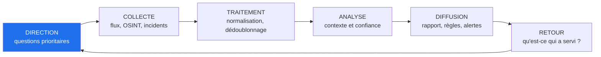
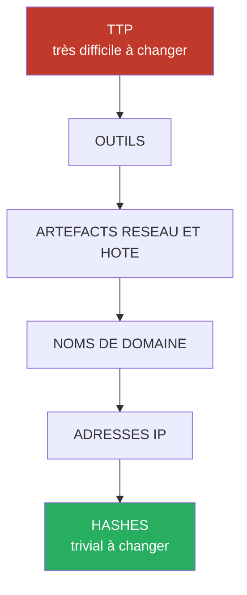

# Cyber Threat Intelligence et analyse des menaces

## Objectifs pédagogiques

À la fin de ce module, vous saurez :

- **distinguer** les trois niveaux de CTI (Cyber Threat Intelligence) et **choisir** le bon livrable pour le bon destinataire ;
- **évaluer** la valeur de détection d'un IoC (Indicator of Compromise) selon son type, son âge et son contexte, et **justifier** de ne pas le bloquer ;
- **cartographier** un rapport de menace sur MITRE ATT&CK et **mesurer** l'écart avec votre couverture de détection réelle ;
- **mener** une recherche OSINT (Open Source Intelligence) passive sur votre propre périmètre et sur une infrastructure suspecte, en pivotant d'un artefact à l'autre ;
- **produire et consommer** du renseignement structuré avec STIX et TAXII, puis le **traduire** en mesures défensives vérifiables.

## Mise en situation

> Scénario illustratif : l'organisation, les chiffres et la chronologie sont fictifs, mais chaque étape correspond à des techniques régulièrement documentées dans les rapports publics sur les opérations de rançongiciel.

Un distributeur industriel de 1 500 postes est abonné à un flux commercial d'IoC. Chaque semaine, environ 38 000 indicateurs (IP, domaines, hashes) sont importés automatiquement dans le pare-feu et le SIEM. Le RSSI considère le sujet couvert.

Un affilié de RaaS (Ransomware as a Service) achète à un courtier d'accès initial un identifiant VPN extrait d'un journal d'infostealer. Le profil VPN hérité n'impose pas de second facteur. L'enchaînement est classique :

1. connexion VPN depuis un proxy résidentiel qu'aucun flux n'a jamais listé ;
2. déploiement d'un beacon de C2 (Command and Control) sur un VPS loué 36 heures plus tôt ;
3. dump de LSASS avec `rundll32 comsvcs.dll, MiniDump` (T1003.001), puis Kerberoasting (T1558.003) ;
4. déplacement latéral par partages d'administration SMB (T1021.002) ;
5. exfiltration avec `rclone` vers un stockage cloud (T1567.002) ;
6. suppression des sauvegardes (T1490) puis chiffrement le vendredi à 23 h (T1486).

Pendant ce temps, les 38 000 IoC n'ont produit aucun match pertinent. En revanche, ils ont généré une centaine de blocages par semaine sur des IP de CDN réattribuées, au point que le SOC avait désactivé la moitié des flux. Trois semaines avant l'attaque, un rapport de menace public décrivait cette chaîne de TTP presque à l'identique. Personne n'avait la mission de le lire en pensant « que ferait-on si cela arrivait chez nous ? ».

Les indicateurs étaient périmés avant d'arriver, et la défense reposait sur ce qui change le plus vite chez l'attaquant. Ce module traite de ce qui reste stable : le comportement, et la manière de le transformer en décision défensive.

## Trois niveaux de renseignement, trois destinataires

> 🧠 **Concept clé**
>
> La CTI n'est pas un flux de données. C'est une réponse à une question posée par quelqu'un qui doit décider. Sans question, il n'y a que de la collecte.
{: .callout .callout-important}

| Niveau | Question posée | Destinataire | Durée de vie | Exemple de livrable |
|--------|----------------|--------------|--------------|---------------------|
| **Stratégique** | Qui peut nous cibler, pourquoi, et quel impact métier ? | Direction, RSSI, comité des risques | Mois à années | Note de 2 pages : « Les affiliés RaaS ciblent notre secteur ; le vecteur dominant est le compte VPN sans MFA » |
| **Tactique** | Comment ces acteurs opèrent-ils (TTP) ? | Architectes, responsables SOC, équipes de détection | Semaines à mois | Liste de 12 techniques ATT&CK priorisées avec état de couverture |
| **Opérationnelle** | Que se passe-t-il maintenant, sur quelle campagne ? | SOC, réponse à incident | Heures à jours | Alerte : « Campagne active exploitant CVE-2023-4966 sur Citrix NetScaler, voici les chemins de requête suspects » |

On ajoute souvent un niveau « technique » pour les IoC bruts consommés par les machines. Cette distinction est utile à condition de ne pas la confondre avec la tactique : les IoC sont l'extrait le plus périssable de la CTI.

Le travail suit un cycle dont le point d'entrée est la **direction**, c'est-à-dire les PIR.

> 📖 **Définition**
>
> Les PIR (Priority Intelligence Requirements) sont les quelques questions auxquelles l'organisation a besoin de répondre. Sans elles, on collecte tout et on exploite peu.
{: .callout .callout-definition}



> ⚠️ **Erreur fréquente**
>
> Mesurer une équipe CTI au nombre d'indicateurs ingérés. La bonne mesure est le nombre de décisions modifiées : un correctif priorisé, une règle de détection créée, une exception levée, un budget MFA débloqué.
{: .callout .callout-attention}

## Acteurs de menace : motivations et modes opératoires

Par où commencer l'analyse ? Par les motivations, car elles prédisent les TTP mieux que le nom du groupe. Un acteur motivé par l'argent veut être rapide et rentable. Un acteur motivé par l'espionnage accepte de rester discret pendant des mois.

| Catégorie | Motivation | Mode opératoire typique | Exemples publics |
|-----------|-----------|-------------------------|------------------|
| Affiliés de rançongiciel | Gain financier, rapidité | Accès VPN/RDP achetés ou volés, dump d'identifiants, double extorsion, destruction des sauvegardes | LockBit, groupes affiliés divers |
| Exploitation de masse | Gain financier, opportunisme | Exploitation d'une vulnérabilité sur un produit exposé, puis vol de données à grande échelle | Cl0p et MOVEit (CVE-2023-34362) |
| Courtiers d'accès initial | Revente d'accès | Infostealers, phishing, credentials stuffing, vente sur des forums | Écosystème fragmenté |
| Espionnage étatique (APT*) | Renseignement, avantage stratégique | Chaîne d'approvisionnement, comptes valides, persistance furtive, peu de malware | APT29 et la compromission SolarWinds Orion (SUNBURST, révélée en décembre 2020) |
| Sabotage étatique | Perturbation | Destruction de données déguisée en rançongiciel, propagation rapide | NotPetya (2017), distribué via la mise à jour d'un logiciel comptable ukrainien, attribué publiquement à Sandworm |
| Social engineering avancé | Gain financier | Appels au help desk, fatigue MFA, échange de SIM | Scattered Spider |
| Hacktivistes | Idéologie, visibilité | DDoS, défacement, fuite de données, rarement sophistiqué | Variable selon l'actualité |

\* APT (Advanced Persistent Threat) désigne un acteur capable de maintenir un accès durable ; le terme décrit un mode opératoire, pas un niveau de talent.

Deux outils d'analyse sont utiles ici :

- **Le Diamond Model** (Caltagirone, Pendergast, Betz, 2013) décrit toute intrusion par quatre sommets : adversaire, infrastructure, capacité, victime. Il sert à pivoter : une infrastructure connue mène à d'autres victimes, donc à d'autres capacités.
- **Le cluster plutôt que le nom.** Les rapports sérieux parlent de « cluster d'activité » (les identifiants de type UNCxxxx de Mandiant en sont un exemple) tant que l'attribution n'est pas établie. Les faux drapeaux existent, les outils fuitent et les acteurs réutilisent le code des autres. Pour un défenseur, savoir que le comportement ressemble à celui d'un affilié RaaS est plus utile que de deviner le pays.

## Surface d'attaque vue par l'attaquant : le terrain de l'OSINT

Avant de lancer une campagne, l'attaquant cartographie sa cible avec des sources ouvertes. Faire la même chose sur son propre périmètre est la manière la plus simple de commencer en CTI.

| Vecteur | Exposition | Impact potentiel |
|---------|-----------|------------------|
| Sous-domaines oubliés | Certificats publics dans les journaux Certificate Transparency (`crt.sh`) | Environnement de test vulnérable ou ancien portail oublié |
| Services exposés | Index Shodan/Censys : RDP (3389), appliances VPN, Exchange, Citrix | Exploitation directe d'un CVE connu sans phishing |
| Identifiants volés | Journaux d'infostealers, dumps revendus | Accès VPN ou SaaS sans exploit, contournement de la défense périmétrique |
| Dépôts et paste publics | Clés d'API, chaînes de connexion, `.env` committés | Accès cloud ou base de données |
| Profils professionnels | LinkedIn, organigrammes, offres d'emploi (stack technique) | Pretexting, appel au help desk, phishing ciblé |

> 🔴 **Vecteur d'attaque**
>
> Un attaquant exécute un `shodan search` filtré sur le nom de l'organisation ou sur un certificat, repère un portail non patché, puis vérifie sa version avec un `curl` sur un fichier statique. Il n'a rien envoyé d'agressif, et aucune règle de détection ne s'est déclenchée.
{: .callout .callout-danger}

Les deux commandes ci-dessous reproduisent cette reconnaissance sur *votre* périmètre :

```bash
# Sous-domaines vus dans les certificats publics
curl -s "https://crt.sh/?q=%25.<DOMAIN>&output=json" | jq -r '.[].name_value' | sort -u

# Services indexés par Shodan pour un certificat (clé API requise)
shodan search 'ssl.cert.subject.cn:"<DOMAIN>"' --fields ip_str,port,product
```

Une recherche OSINT passive ne touche pas la cible : on interroge des tiers qui ont déjà indexé l'information. Dès qu'on scanne soi-même, on sort du cadre de l'OSINT et on a besoin d'une autorisation écrite (cf. module sur le droit et l'éthique).

### Pivoter : de l'artefact à l'infrastructure

Exemple de raisonnement sur des valeurs illustratives :

> 📖 **Définition**
>
> Un pivot consiste à partir d'un élément connu pour en trouver d'autres qui partagent une caractéristique.
{: .callout .callout-definition}

1. Un hash de fichier suspect est analysé sur VirusTotal : le sandbox montre une connexion vers `update-check.example.net`.
2. Le passive DNS donne l'IP `203.0.113.10` pour ce domaine, vue du 10 au 17 janvier.
3. Le certificat TLS servi par cette IP (empreinte SHA-256) apparaît aussi sur `cdn-sync.example.org`.
4. Ce second domaine, enregistré 4 jours avant la campagne, est absent de tous les flux. Il rejoint l'enquête.

Les outils habituels sont VirusTotal, urlscan.io, les services abuse.ch (URLhaus, MalwareBazaar, ThreatFox), AlienVault OTX et `whois`. Aucun ne garantit la vérité : chaque source a son niveau de fiabilité.

Le système **Admiralty (OTAN)** note la fiabilité de la source de A à F et la crédibilité de l'information de 1 à 6. Une information « B2 » (source généralement fiable, information probablement vraie) ne pèse pas comme une « F6 » (fiabilité inconnue, crédibilité non évaluable).

> ⚠️ **Erreur fréquente**
>
> Envoyer sur VirusTotal un fichier trouvé sur un poste compromis. Les échantillons soumis sont accessibles à d'autres utilisateurs de la plateforme, ce qui expose les données internes qu'il contient et signale à l'attaquant qu'on l'a détecté. Pour un fichier suspect, interrogez d'abord son hash (`sha256sum`), qui ne divulgue rien.
{: .callout .callout-attention}

> 💡 **Astuce**
>
> Visitez une infrastructure suspecte depuis une VM isolée et un sortant dédié, pas depuis le réseau d'entreprise. Une IP d'entreprise qui consulte le C2 laisse une trace chez l'attaquant.
{: .callout .callout-astuce}

## IoC, TTP et la pyramide de la douleur

### Ce qu'on donne à l'attaquant à changer

En 2013, David Bianco a proposé la **Pyramid of Pain** : plus l'indicateur est haut, plus l'attaquant souffre quand on le détecte.



Côté attaquant, voici ce que coûte réellement un changement :

- **Hash** : recompiler avec une autre clé, un autre packer ou un octet modifié change l'empreinte. Coût proche de zéro.
- **IP** : louer un nouveau VPS prend quelques minutes. Certaines infrastructures sont jetables à l'échelle de la journée.
- **Domaine** : l'enregistrement coûte quelques euros, mais un domaine trop récent est repérable par son âge. Certains opérateurs achètent ou stockent des domaines vieillis, d'autres enregistrent les leurs quelques jours avant la campagne.
- **Artefacts** (chemin de service, nom de pipe, User-Agent, format de balise) : il faut modifier l'outil ou la configuration. Gêne modérée.
- **Outils** (Cobalt Strike, Mimikatz, Impacket, rclone) : changer d'outil demande du temps et des compétences.
- **TTP** : changer sa façon d'obtenir des identifiants ou de se déplacer latéralement oblige à repenser toute l'opération.

### Valeur de détection et durée de vie des IoC

En revanche, un IoC vieux garde deux usages utiles :

> ⚠️ **Piège principal du module**
>
> Un indicateur ancien ou isolé n'a pas nécessairement une valeur de détection élevée. Trois raisons concrètes :
>
> - **L'âge.** Une IP de C2 vue il y a quatre mois est peut-être revenue chez un hébergeur qui l'a réattribuée à un client légitime. La bloquer produit un faux positif, pas une protection.
> - **L'infrastructure partagée.** Les IP de CDN, de cloud public ou de plateformes de partage de fichiers hébergent aussi bien du légitime que du malveillant. Un match IoC dessus n'a aucune signification sans contexte.
> - **L'isolement.** Une seule IP dans un journal de pare-feu peut être un scan de masse, un test d'un chercheur ou un faux positif du flux. Sans autre signal (processus parent, authentification anormale, volume sortant), l'indicateur seul ne prouve rien.
{: .callout .callout-attention}

- **Rétro-chasse** (« retro-hunt ») : quand un nouvel indicateur arrive, on cherche dans les 90 jours de journaux déjà stockés, car la compromission a peut-être commencé avant la publication.
- **Périmétrage d'incident** : lié à un incident confirmé, un IoC même ancien permet d'identifier d'autres hôtes touchés.

```bash
# Rétro-chasse : cherche chaque IoC (un par ligne) dans les journaux DNS archivés
zgrep -H -F -f <IOC_FILE> /var/log/<LOG_DIR>/*.log*
```

> 🔒 **Contrôle de sécurité**
>
> Appliquer une durée de vie par type d'IoC et la faire respecter par le SIEM ou la plateforme CTI. Valeurs de départ à ajuster selon vos faux positifs :
>
> | Type | Durée de vie de départ | Usage |
> |------|------------------------|-------|
> | IP de C2 | 7 à 30 jours | Alerte, blocage seulement avec corroboration |
> | Domaine récent | 30 à 90 jours | Alerte ; blocage possible si domaine non légitime |
> | Hash | Long | Rétro-chasse, périmétrage, pas détection préventive |
> | Artefact, outil, TTP | Aussi longtemps que pertinent | Règles comportementales |
{: .callout .callout-securite}

Pour gravir la pyramide, il faut écrire une règle qui détecte l'action, pas le nom du binaire. Exemple en Sigma, qui repère un dump de LSASS par `procdump` (même renommé) ou par `comsvcs.dll` :

```yaml
title: Dump de la mémoire LSASS par ligne de commande
status: experimental
logsource:
  category: process_creation
  product: windows
detection:
  selection_procdump:
    CommandLine|contains|all:
      - 'lsass'
      - ' -ma '
  selection_comsvcs:
    CommandLine|contains|all:
      - 'comsvcs'
      - 'MiniDump'
  condition: selection_procdump or selection_comsvcs
falsepositives:
  - Outils de diagnostic légitimes lancés par l'administrateur
level: high
```

Cette règle a ses limites : elle repose sur des chaînes de la ligne de commande. Une copie renommée de comsvcs.dll, l'appel de MiniDump par ordinal, procdump ciblant LSASS par son PID ou un appel direct de l'API lui échappent. Elle monte néanmoins plusieurs marches par rapport à un hash.

## TTP et MITRE ATT&CK : cartographier la menace

> 🧠 **Concept clé**
>
> MITRE ATT&CK (Adversarial Tactics, Techniques, and Common Knowledge) est un catalogue du comportement observé, pas une checklist. Le vocabulaire de base :
>
> | Terme | Signification | Exemple |
> |-------|---------------|---------|
> | **Tactique** | L'objectif de l'attaquant (le « pourquoi ») | Credential Access (TA0006) |
> | **Technique** | La méthode générale (le « comment ») | OS Credential Dumping (T1003) |
> | **Sous-technique** | Variante précise | LSASS Memory (T1003.001) |
> | **Procédure** | L'implémentation observée chez un acteur | `rundll32 comsvcs.dll, MiniDump <PID> out.dmp full` |
{: .callout .callout-important}

Les TTP (Tactics, Techniques, and Procedures) forment le haut de la pyramide. Une technique comme T1003.001 reste utile des années, parce que Windows stocke toujours des secrets en mémoire.

### Du rapport à la matrice : méthode en quatre étapes

1. **Extraire** les techniques décrites dans le rapport : ne gardez que les comportements observés, pas les hypothèses.
2. **Marquer** chaque technique dans une couche ATT&CK Navigator.
3. **Superposer** une seconde couche : votre couverture de détection testée.
4. **Prioriser** les écarts selon le risque (voir la section suivante).

Format minimal d'une couche Navigator (les versions dépendent de l'outil installé) :

```json
{
  "name": "Rapport RaaS - affilié illustratif",
  "versions": { "attack": "<ATTACK_VERSION>", "navigator": "<NAVIGATOR_VERSION>", "layer": "<LAYER_VERSION>" },
  "domain": "enterprise-attack",
  "techniques": [
    { "techniqueID": "T1078", "color": "#e74c3c", "comment": "Compte VPN valide sans MFA" },
    { "techniqueID": "T1003.001", "color": "#e74c3c", "comment": "Dump LSASS via comsvcs.dll" },
    { "techniqueID": "T1490", "color": "#e74c3c", "comment": "Suppression des sauvegardes" }
  ]
}
```

ATT&CK est aussi distribué sous forme de bundle STIX, ce qui permet de l'interroger en ligne de commande. Pour lister les techniques associées à un groupe (le contenu dépend de la version du référentiel) :

```bash
curl -sL https://raw.githubusercontent.com/mitre-attack/attack-stix-data/master/enterprise-attack/enterprise-attack.json -o enterprise-attack.json

jq -r --arg g "<GROUP_NAME>" '
  . as $r
  | ($r.objects[] | select(.type=="intrusion-set" and .name==$g) | .id) as $id
  | $r.objects[]
  | select(.type=="relationship" and .source_ref==$id and .relationship_type=="uses"
           and (.target_ref|startswith("attack-pattern--")))
  | .target_ref as $t
  | $r.objects[] | select(.id==$t)
  | [.external_references[0].external_id, .name] | @tsv' enterprise-attack.json
```

> ⚠️ **Erreur fréquente**
>
> Colorer une technique en vert parce qu'une règle y est rattachée. Avoir une règle taguée T1003 ne prouve pas qu'elle détecte la variante `comsvcs.dll`. Configuration dangereuse : couverture déclarée par étiquette. Conséquence : fausse assurance, chaîne d'attaque invisible. Correction : exécuter la technique en laboratoire et noter ce que l'alerte a effectivement produit.
{: .callout .callout-attention}

```powershell
# Test unitaire d'une détection sur un hôte de laboratoire (Atomic Red Team installé)
Invoke-AtomicTest T1003.001 -TestNumbers <NUMBER>
```

ATT&CK a aussi ses limites. Le référentiel ne dit pas **quelle technique est la plus fréquente** : T1059.001 (PowerShell) et une technique rare y ont le même poids visuel. Pour décider, on croise avec les rapports ciblant votre secteur et avec le catalogue CISA KEV (Known Exploited Vulnerabilities) ou le score EPSS (Exploit Prediction Scoring System) lorsqu'une vulnérabilité est impliquée.

## Modèle de menace : quels adversaires pour quelle organisation

La CTI est utile quand elle réduit le champ : on ne défend pas contre tous les acteurs mais contre les plus plausibles. Reprenons le distributeur du scénario d'ouverture :

| Acteur probable | Actif visé | TTP clés | Contrôle existant | Écart |
|-----------------|------------|----------|-------------------|-------|
| Affilié RaaS via courtier | Serveurs de fichiers, ERP, sauvegardes | T1078, T1003.001, T1021.002, T1486, T1490 | VPN sans MFA sur anciens profils | Pas de MFA universel, sauvegardes accessibles depuis le domaine |
| Exploitation de masse d'un produit exposé | Appliances de bordure | T1190 | Inventaire des versions incomplet | Aucun suivi KEV, délai de correction mal mesuré |
| Fraude par le help desk | Comptes administrateurs | T1656, T1566.004, T1078 | Vérification d'identité informelle | Procédure de réinitialisation non durcie |

Les trois acteurs dominants donnent trois priorités concrètes : MFA, isolement des sauvegardes, suivi des vulnérabilités exploitées. Ce tableau vaut plus qu'une liste de 40 groupes.

## STIX et TAXII : structurer et partager le renseignement

STIX (Structured Threat Information Expression) est le format, TAXII (Trusted Automated eXchange of Intelligence Information) est le protocole de transport. STIX 2.1 décrit des **objets** (indicator, malware, intrusion-set, attack-pattern, campaign, report) reliés par des **relations** (`uses`, `indicates`, `attributed-to`).

> 📮 **Analogie : la lettre et la poste**
>
> STIX est la lettre, rédigée dans une langue commune : un modèle de données JSON qui décrit *quoi* partager. TAXII est le service postal qui l'achemine sur HTTPS : il décrit *comment* la transporter. Limite de l'image : un serveur TAXII ne fait pas que livrer, il range les objets dans des collections que le client vient interroger.
{: .callout .callout-analogie}

Exemple d'indicateur, avec les champs qui évitent l'accumulation d'IoC périmés :

```json
{
  "type": "indicator",
  "spec_version": "2.1",
  "id": "indicator--8e2e2d2b-17d4-4cbf-938f-98ee46b3cd3f",
  "created": "2025-01-15T09:00:00.000Z",
  "modified": "2025-01-15T09:00:00.000Z",
  "name": "Domaine C2 - campagne illustrative",
  "pattern": "[domain-name:value = 'update-check.example.net']",
  "pattern_type": "stix",
  "valid_from": "2025-01-15T09:00:00Z",
  "valid_until": "2025-02-15T09:00:00Z",
  "confidence": 60
}
```

Les champs `valid_until` et `confidence` sont ceux que la plupart des flux ignorent. Quand ils sont renseignés et que votre SIEM les respecte, l'expiration devient automatique. Ils figurent dans le standard, mais certaines plateformes les omettent à l'import.

Récupérer des objets depuis un serveur TAXII 2.1 :

```bash
curl -s -H "Accept: application/taxii+json;version=2.1" \
  -u <USER>:<PASSWORD> \
  "https://<TAXII_HOST>/<API_ROOT>/collections/<COLLECTION_ID>/objects/?match[type]=indicator&added_after=<TIMESTAMP>"
```

Les contraintes du partage dans la pratique :

- **Marquage TLP (Traffic Light Protocol)** : TLP:RED reste entre les destinataires nommés, TLP:AMBER est limité à l'organisation et à ses clients, TLP:GREEN à la communauté, TLP:CLEAR est public. Republier un contenu AMBER dans un canal public est une violation de la confiance, et celle-ci conditionne la qualité des échanges.
- **Qualité plutôt que volume.** Un flux STIX sans contexte reste un tas d'IoC. La valeur vient des objets `relationship` qui relient l'indicateur à la technique et à la campagne.
- **Plateformes.** MISP et OpenCTI importent et exportent STIX. Les ISAC (Information Sharing and Analysis Center) sectoriels et les CERT nationaux (par exemple le CERT-FR de l'ANSSI) publient des alertes et des synthèses de menace.
- **Coût d'intégration.** Convertir un pattern STIX en requête SIEM n'est pas automatique pour tous les types ; prévoir un test de bout en bout avant d'activer un flux.

## Des rapports de menace aux mesures défensives

Un rapport de menace contient généralement un résumé, une description de la campagne, l'analyse du malware, les TTP et une annexe d'IoC. L'annexe est la partie la plus visible mais la moins durable.

Triez avec trois questions : **est-ce notre secteur ou notre technologie ?** **Avons-nous la surface exposée ?** **Détecterions-nous cette technique aujourd'hui ?** Si les deux premières réponses sont non, archivez le rapport.

Exemple de traduction d'un rapport fictif décrivant l'exploitation de Citrix Bleed (CVE-2023-4966) suivie d'un détournement de session :

| Élément du rapport | Action défensive | Coût |
|--------------------|------------------|------|
| Exploitation de la CVE sur NetScaler | Vérifier les versions, appliquer le correctif | Fenêtre de maintenance |
| Détournement de session déjà authentifiée | Après correctif, **terminer toutes les sessions actives** (le correctif seul n'invalide pas un jeton volé) | Déconnexion de tous les utilisateurs |
| Requêtes anormalement longues dans les journaux | Chasse rétrospective sur les 30 derniers jours | Quelques heures d'analyste |
| Comptes valides réutilisés depuis une IP inconnue | Alerte de connexion impossible (« impossible travel ») | Règle SIEM, faux positifs à calibrer |

Une **chasse** (« threat hunting ») démarre par une hypothèse testable : « Si l'attaquant a obtenu un jeton de session, nous verrons le même identifiant de session depuis deux adresses IP sources en moins d'une heure. » Si la requête ne retourne rien, la valeur est double : on a une preuve d'absence sur la période, et une règle réutilisable.

Si vous rédigez vous-même un produit CTI, qualifiez le niveau de confiance explicitement (faible, modérée, élevée) et séparez les faits de l'évaluation.

> 🔑 **Moyen mnémotechnique**
>
> Pour structurer un produit CTI, suivez l'ordre « **Qui ? Quoi ? Et alors ? Que faire ?** »
{: .callout .callout-memo}

## Cas réel en entreprise (scénario illustratif)

> Les chiffres sont fictifs et servent à illustrer l'ordre de grandeur et la démarche.

Le distributeur du scénario d'ouverture lance, après son incident, un programme CTI à trois personnes à temps partiel.

**Semaine 1 à 2 : cadrage.** Trois PIR : (1) quels acteurs ciblent la distribution industrielle en Europe ? (2) quelles vulnérabilités de nos appliances exposées sont exploitées activement ? (3) quelles techniques d'accès initial sont les plus courantes dans les incidents rapportés ?

**Semaine 3 à 6 : collecte et tri.** Sources retenues : catalogue KEV, publications CERT-FR, deux rapports d'éditeurs, le canal d'un ISAC sectoriel. Les 38 000 IoC hebdomadaires sont ramenés à environ 2 000 après dédoublonnage et filtrage par âge et par type ; les IP de CDN sont exclues du blocage.

**Semaine 6 à 12 : production et décisions.** Une note tactique de deux pages par mois, limitée à 5 actions maximum. Résultats typiques de la première note : MFA imposé sur tous les profils VPN, accès aux sauvegardes séparé du domaine, et trois règles comportementales sur LSASS, Kerberoasting et `rclone`.

**Mesure.** Le nombre d'alertes IoC baisse de plus de 90 %, la proportion d'alertes qualifiées en incident réel augmente, et le délai de correction des vulnérabilités du KEV passe de 40 à 12 jours. Ces chiffres sont illustratifs, mais la logique est transposable : moins de volume, plus de décisions traçables.

**Leçon.** Le gain ne vient pas d'un meilleur flux, mais d'un cadrage des questions et d'un lien direct avec ceux qui exécutent. Un rapport lu mais sans propriétaire reste sans effet.

## Erreurs fréquentes

| Configuration dangereuse | Conséquence | Correction |
|--------------------------|-------------|------------|
| Flux d'IoC importés directement en blocklist pare-feu, sans expiration | Blocage d'IP de CDN réattribuées, saturation de tickets, désactivation du flux par lassitude | Appliquer une durée de vie par type, passer d'abord en mode alerte, mesurer la précision par flux |
| Match IoC isolé traité comme incident critique | Fatigue d'alerte, analystes qui ignorent la source | Exiger un second signal (processus parent, volume sortant, authentification anormale) avant escalade |
| Attribution comme objectif principal | Perte de temps, conclusions fragiles face aux faux drapeaux | Raisonner en cluster et en TTP, documenter le niveau de confiance |
| Couverture ATT&CK déclarée par étiquette de règle | Fausse assurance, angle mort | Tester la technique en laboratoire, consigner le résultat de détection |
| Fichier suspect envoyé sur une plateforme publique | Fuite de données internes, alerte à l'attaquant | Rechercher par hash d'abord, utiliser un sandbox privé si nécessaire |
| Contenu TLP:AMBER ou RED republié | Perte de confiance, exclusion de la communauté de partage | Conserver le marquage dans la plateforme, restreindre les droits d'export |
| Rapport lu mais sans propriétaire d'action | Aucun effet défensif | Associer chaque action à un propriétaire et une échéance dans la note |

Pour détecter la première erreur sur un flux existant, comptez les correspondances par source et comparez-les aux incidents confirmés. Un flux avec 500 hits par semaine et zéro incident confirmé est un candidat à la suppression ou au déclassement en simple enrichissement.

## Résumé

La CTI sert à décider, et son niveau (stratégique, tactique, opérationnelle) détermine le destinataire et le format. Les IoC sont la partie la plus périssable : changer un hash, une IP ou un domaine coûte presque rien à l'attaquant, alors que changer de comportement lui coûte cher. La défense durable repose donc sur les TTP, cartographiés avec ATT&CK, vérifiés par des tests réels et non par des étiquettes. L'OSINT passive sur son propre périmètre et le pivotement sur les infrastructures donnent le point de vue de l'attaquant. STIX et TAXII industrialisent le partage, à condition d'en exploiter les champs de contexte, de confiance et d'expiration. Restent à surveiller : la précision de vos flux (hits contre incidents confirmés), l'écart entre couverture déclarée et couverture testée, et la fraîcheur de vos PIR.

<!-- snippet
id: cti_niveaux_strategique_tactique_operationnel
type: concept
tech: cti
level: intermediate
importance: high
format: knowledge
tags: cti,strategique,tactique,operationnel
title: Les trois niveaux de CTI et leurs destinataires
content: Stratégique (direction, mois-années) répond à qui nous cible et quel impact métier. Tactique (architectes, détection, semaines-mois) décrit les TTP des acteurs. Opérationnelle (SOC, heures-jours) décrit une campagne active. Les IoC bruts sont l'extrait le plus périssable. Choisir le niveau avant de choisir la source.
description: Chaque niveau a un destinataire, une durée de vie et un livrable différents : confondre les niveaux produit des rapports que personne ne peut exploiter.
-->

<!-- snippet
id: cti_pyramid_of_pain_principe
type: concept
tech: cti
level: intermediate
importance: high
format: knowledge
tags: cti,ioc,ttp,pyramid-of-pain
title: Pyramid of Pain : le coût de changement pour l'attaquant
content: Hash et IP se changent en minutes (recompilation, nouveau VPS). Domaines en heures ou jours. Artefacts réseau et hôte demandent de modifier l'outil. Les outils demandent du temps et des compétences. Les TTP forcent à repenser l'opération entière. Détecter en haut de la pyramide oblige l'attaquant à payer ; détecter en bas ne lui coûte rien.
description: Plus l'indicateur détecté est haut dans la pyramide de David Bianco, plus le changement coûte à l'attaquant, donc plus la détection reste utile dans le temps.
-->

<!-- snippet
id: cti_ioc_ancien_isole_faible_valeur
type: warning
tech: cti
level: advanced
importance: high
format: knowledge
tags: cti,ioc,faux-positifs,detection
title: IoC ancien ou isolé : valeur de détection limitée
content: Une IP de C2 vieille de plusieurs mois peut avoir été réattribuée à un client légitime, et une IP de CDN ou de cloud partagé héberge aussi bien du bénin que du malveillant. Bloquer sans contexte produit des faux positifs, pas de la protection. Correction : durée de vie par type d'IoC, corroboration par un second signal avant blocage, usage de l'ancien indicateur en rétro-chasse plutôt qu'en prévention.
description: Un indicateur seul ne prouve pas une compromission ; son âge et le caractère partagé de l'infrastructure réduisent encore sa valeur de détection.
-->

<!-- snippet
id: cti_ioc_retro_hunt_zgrep
type: command
tech: cti
level: intermediate
importance: medium
format: knowledge
tags: cti,ioc,retro-hunt,logs
title: Rétro-chasse d'une liste d'IoC dans les journaux archivés
context: À lancer dès réception d'un nouvel indicateur, sur les journaux DNS, proxy ou pare-feu conservés
command: zgrep -H -F -f <IOC_FILE> /var/log/<LOG_DIR>/*.log*
example: zgrep -H -F -f iocs-2025-01.txt /var/log/dns/*.log*
description: Cherche chaque indicateur littéral (-F) dans les journaux compressés ou non, pour savoir si la compromission a commencé avant la publication de l'IoC.
-->

<!-- snippet
id: cti_attack_tactique_technique_procedure
type: concept
tech: mitre-attack
level: intermediate
importance: high
format: knowledge
tags: cti,mitre-attack,ttp,detection
title: Tactique, technique, procédure : trois niveaux de détail
content: La tactique est l'objectif (Credential Access, TA0006), la technique est la méthode (OS Credential Dumping, T1003), la sous-technique est la variante (LSASS Memory, T1003.001), la procédure est l'implémentation observée (rundll32 comsvcs.dll, MiniDump). Une règle écrite sur la procédure rate les variantes ; écrite sur la technique, elle les couvre mieux.
description: Distinguer ces niveaux évite de confondre le nom d'un outil avec un comportement et permet de choisir la granularité d'une règle de détection.
-->

<!-- snippet
id: cti_attack_jq_techniques_groupe
type: command
tech: mitre-attack
level: advanced
importance: medium
format: knowledge
tags: cti,mitre-attack,jq,stix
title: Lister les techniques ATT&CK d'un groupe avec jq
context: Après téléchargement de enterprise-attack.json depuis le dépôt mitre-attack/attack-stix-data ; le résultat dépend de la version du référentiel
command: jq -r --arg g "<GROUP_NAME>" '. as $r | ($r.objects[] | select(.type=="intrusion-set" and .name==$g) | .id) as $id | $r.objects[] | select(.type=="relationship" and .source_ref==$id and .relationship_type=="uses" and (.target_ref|startswith("attack-pattern--"))) | .target_ref as $t | $r.objects[] | select(.id==$t) | [.external_references[0].external_id, .name] | @tsv' enterprise-attack.json
example: jq -r --arg g "APT29" '. as $r | ($r.objects[] | select(.type=="intrusion-set" and .name==$g) | .id) as $id | $r.objects[] | select(.type=="relationship" and .source_ref==$id and .relationship_type=="uses" and (.target_ref|startswith("attack-pattern--"))) | .target_ref as $t | $r.objects[] | select(.id==$t) | [.external_references[0].external_id, .name] | @tsv' enterprise-attack.json
description: Extrait du bundle STIX d'ATT&CK les identifiants et noms des techniques liées à un groupe, point de départ d'une couche Navigator.
-->

<!-- snippet
id: cti_attack_couverture_par_etiquette
type: warning
tech: mitre-attack
level: advanced
importance: high
format: knowledge
tags: cti,mitre-attack,couverture,tests
title: Couverture ATT&CK déclarée par étiquette de règle
content: Colorer T1003.001 en vert parce qu'une règle y est taguée donne une fausse assurance : elle peut rater la variante comsvcs.dll MiniDump. Conséquence : la chaîne d'attaque reste invisible alors que la matrice affiche une couverture. Correction : exécuter la technique en laboratoire (par exemple Invoke-AtomicTest T1003.001) et ne marquer comme couvert que ce qui a généré une alerte.
description: Une couverture ne se prouve que par l'exécution de la technique en laboratoire et l'observation de l'alerte, jamais par l'étiquette d'une règle.
-->

<!-- snippet
id: cti_osint_crtsh_sous_domaines
type: command
tech: cti
level: beginner
importance: medium
format: knowledge
tags: cti,osint,certificate-transparency,reconnaissance
title: Énumérer ses sous-domaines via Certificate Transparency
context: OSINT passive sur son propre domaine, sans toucher à la cible
command: curl -s "https://crt.sh/?q=%25.<DOMAIN>&output=json" | jq -r '.[].name_value' | sort -u
example: curl -s "https://crt.sh/?q=%25.example.com&output=json" | jq -r '.[].name_value' | sort -u
description: Liste les noms présents dans les certificats publics et révèle les portails oubliés qu'un attaquant trouverait avant vous.
-->

<!-- snippet
id: cti_osint_virustotal_upload_fuite
type: warning
tech: cti
level: intermediate
importance: high
format: knowledge
tags: cti,osint,virustotal,opsec
title: Envoyer un fichier interne suspect sur VirusTotal
content: Un fichier soumis à une plateforme publique devient accessible à d'autres utilisateurs, ce qui peut exposer des données internes et signaler à l'attaquant qu'il est détecté. Correction : interroger d'abord le hash avec sha256sum, et n'utiliser qu'un sandbox privé pour l'analyse comportementale.
description: Une soumission publique divulgue le contenu du fichier ; une recherche par hash donne souvent le verdict sans rien exposer.
-->

<!-- snippet
id: cti_stix_indicator_valid_until
type: concept
tech: stix
level: advanced
importance: medium
format: knowledge
tags: cti,stix,taxii,expiration
title: STIX 2.1 : valid_until et confidence sur un indicator
content: Un objet indicator STIX porte un pattern (par exemple [domain-name:value = 'update-check.example.net']), valid_from, valid_until et confidence. Quand valid_until est renseigné et respecté à l'import, l'expiration des IoC devient automatique. Beaucoup de flux omettent ces champs, ce qui fait s'accumuler des indicateurs périmés.
description: Le standard prévoit date d'expiration et niveau de confiance ; les exploiter à l'import évite la dérive d'une base d'IoC jamais nettoyée.
-->

<!-- snippet
id: cti_taxii_recuperer_indicators
type: command
tech: stix
level: advanced
importance: medium
format: knowledge
tags: cti,taxii,stix,curl
title: Récupérer des indicateurs depuis un serveur TAXII 2.1
context: Le serveur, l'API root et la collection sont fournis par la communauté de partage
command: curl -s -H "Accept: application/taxii+json;version=2.1" -u <USER>:<PASSWORD> "https://<TAXII_HOST>/<API_ROOT>/collections/<COLLECTION_ID>/objects/?match[type]=indicator&added_after=<TIMESTAMP>"
example: curl -s -H "Accept: application/taxii+json;version=2.1" -u analyst:S3cret "https://taxii.example.org/api1/collections/91a7b528/objects/?match[type]=indicator&added_after=2025-01-01T00:00:00Z"
description: Interroge une collection TAXII et filtre sur le type indicator et la date d'ajout pour ne récupérer que le delta.
-->

<!-- snippet
id: cti_tlp_marquage_partage
type: tip
tech: cti
level: intermediate
importance: medium
format: knowledge
tags: cti,tlp,partage,confiance
title: Respecter le marquage TLP à la republication
content: Conserver le marquage TLP dans la plateforme (MISP, OpenCTI) et restreindre les droits d'export au niveau le plus bas de la chaîne. TLP:RED reste entre les destinataires nommés, TLP:AMBER limité à l'organisation et ses clients, TLP:GREEN à la communauté, TLP:CLEAR est public. Republier un contenu AMBER dans un canal public ferme l'accès aux échanges.
description: Le marquage TLP conditionne la confiance des communautés de partage ; l'enfreindre expose à une exclusion durable des échanges.
-->

<!-- snippet
id: cti_ioc_duree_vie_par_type
type: tip
tech: cti
level: intermediate
importance: medium
format: knowledge
tags: cti,ioc,expiration,siem
title: Fixer une durée de vie par type d'IoC dans le SIEM
content: Valeurs de départ à ajuster : IP de C2 de 7 à 30 jours, domaine de 30 à 90 jours, hash conservé longtemps mais réservé à la rétro-chasse et au périmétrage d'incident. Activer d'abord en mode alerte et mesurer la précision par flux (hits contre incidents confirmés) avant tout blocage.
description: Une expiration par type limite les faux positifs liés aux IP réattribuées tout en conservant les hashes pour l'investigation rétrospective.
-->

<!-- snippet
id: cti_sigma_comportement_lsass
type: concept
tech: cti
level: advanced
importance: medium
format: knowledge
tags: cti,sigma,ttp,lsass
title: Règle Sigma comportementale plutôt que nom de binaire
content: Détecter la ligne de commande d'un dump (lsass avec -ma pour procdump, comsvcs avec MiniDump) fonctionne même si l'exécutable procdump est renommé. Une règle sur le hash ou le nom de fichier est contournée par une recompilation. Limite : la règle repose sur des chaînes, qu'évitent une copie renommée de comsvcs.dll, l'appel de MiniDump par ordinal, procdump ciblant LSASS par PID ou un appel direct de l'API.
description: Une règle sur le comportement de la ligne de commande monte dans la pyramide de la douleur, mais reste contournable (DLL renommée, appel par ordinal, cible désignée par PID, appel direct de l'API).
-->

<!-- snippet
id: cti_admiralty_evaluation_source
type: tip
tech: cti
level: intermediate
importance: low
format: knowledge
tags: cti,osint,admiralty,fiabilite
title: Noter chaque source avec le système Admiralty
content: Attribuer une lettre de A à F pour la fiabilité de la source et un chiffre de 1 à 6 pour la crédibilité de l'information, par exemple B2 pour une source généralement fiable et une information probablement vraie. Consigner la note dans la fiche de renseignement pour que le lecteur pondère le contenu sans refaire l'enquête.
description: Une note à deux caractères force à séparer la confiance dans la source de la plausibilité du contenu, et rend l'évaluation traçable.
-->
