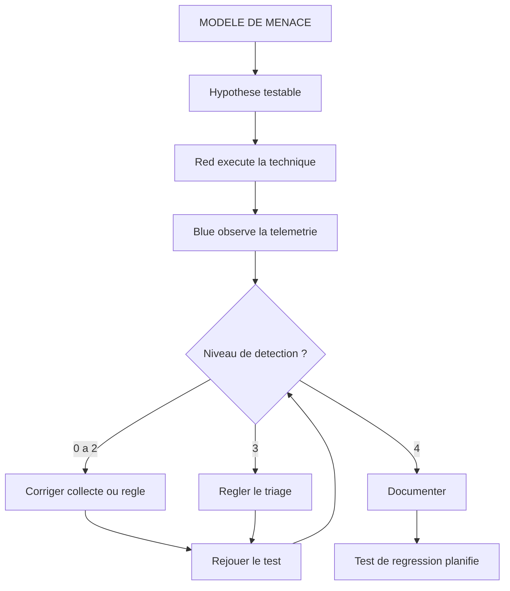
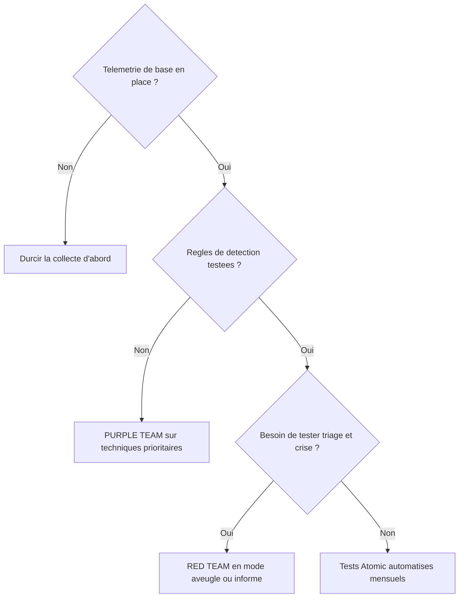

# Sécurité offensive, défensive et Purple Team

## Objectifs pédagogiques

À la fin de ce module, vous serez capable de :

- **Comparer** Red Team, Blue Team et Purple Team selon leur objectif, leur livrable et ce que chacune mesure mal.
- **Construire** une hypothèse d'attaque testable à partir d'un modèle de menace, avec le signal de détection attendu.
- **Exécuter** une technique ATT&CK en laboratoire et **vérifier** à quel stade du pipeline de détection elle s'arrête.
- **Classer** des contrôles en préventifs, détectifs et correctifs, et choisir celui qui convient à une lacune donnée.
- **Critiquer** un rapport d'exercice offensif en distinguant ce qu'il prouve de ce qu'il ne prouve pas sur la maturité globale.

## Mise en situation

> Scénario illustratif : les chiffres sont inventés pour les besoins du cours.

Une entreprise industrielle de 4 000 postes commande un exercice Red Team de quatre semaines. Le prestataire obtient les droits d'administrateur du domaine au bout de neuf jours. Son chemin est classique :

1. Un mot de passe faible sur un compte de service est cassé hors ligne après un Kerberoasting.
2. Ce compte est administrateur local sur un serveur de fichiers.
3. La mémoire du processus LSASS (Local Security Authority Subsystem Service) y est copiée.
4. Les identifiants d'un administrateur de domaine y sont récupérés.

Le rapport fait 80 pages. Le comité de direction en retient deux phrases : « le Red Team a gagné » et « le SOC n'a rien vu ».

La suite est prévisible. Le budget part dans un nouvel EDR (Endpoint Detection and Response), et six mois plus tard le Red Team rejoue le chemin initial, désormais bloqué. Il revient avec un autre compte de service, un autre serveur, une autre technique de copie mémoire. Il gagne de nouveau.

La défense naïve échoue ici pour deux raisons :

- **L'exercice a produit un constat, pas une mesure.** Personne ne sait lesquelles des 14 techniques utilisées ont généré de la télémétrie, lesquelles ont déclenché une alerte, ni lesquelles ont été triées par un humain.
- **Le retest a validé un chemin, pas une capacité.** Corriger le chemin exploité ne dit rien sur les chemins voisins.

Ce module traite de ce qui manquait : une boucle de travail partagée entre l'offensif et le défensif.

## Trois postures, trois questions

Ces trois approches ne sont pas des niveaux successifs. Elles répondent à des questions différentes.

| Dimension | Red Team | Blue Team | Purple Team |
|---|---|---|---|
| Question posée | Un adversaire réaliste peut-il atteindre l'objectif métier ? | Voit-on, comprend-on et contient-on l'attaque ? | Pour chaque technique, à quelle étape la chaîne de défense casse-t-elle ? |
| Connaissance partagée | Aucune avec le SOC en mode aveugle | Aucune sur le calendrier ni les techniques | Totale, en temps réel |
| Durée typique | 3 à 8 semaines | Continue | 1 à 5 jours par session |
| Livrable | Narration d'attaque, chemin, objectif atteint ou non | Règles, playbooks, tableaux de bord | Matrice technique par technique avec niveau de détection |
| Mesure bien | Enchaînement réaliste de faiblesses, réaction humaine sous pression | Qualité du triage, délais de réponse | Couverture de détection, régressions |
| Mesure mal | Couverture : une technique non utilisée n'est pas testée | Sa propre efficacité, faute d'adversaire | Réalisme de l'enchaînement et pression psychologique |
| Coût | Élevé (profils rares, durée) | Récurrent, intégré aux opérations | Modéré, mais mobilise les deux équipes |

> 🧠 **Concept clé** : la Purple Team n'est pas une troisième équipe. C'est une façon de travailler où l'attaquant rejoue ses actions sous les yeux du défenseur, qui ajuste ses règles dans la foulée. Dans beaucoup d'organisations, ce sont les mêmes personnes qui alternent les rôles selon la semaine.
{: .callout .callout-important}

La différence avec le pentest du module 31 porte sur l'objectif. Un pentest cherche des vulnérabilités à périmètre borné. Un Red Team cherche à atteindre un objectif métier en évitant d'être détecté. Un exercice Purple cherche à mesurer la détection, pas à l'éviter.

## Surface d'attaque : ce que l'exercice met réellement en jeu

Un exercice ne teste pas « le SI ». Il teste quelques chemins précis, et il crée aussi sa propre surface de risque.

| Vecteur | Exposition | Impact potentiel |
|---|---|---|
| Hameçonnage ciblé (T1566) | Boîtes mail, passerelle de filtrage, utilisateurs | Accès initial, mais peu informatif si la passerelle bloque toujours : d'où les départs en *assumed breach* |
| Kerberoasting (T1558.003) | Comptes de service avec SPN et mot de passe faible, chiffrement RC4 autorisé | Cassage hors ligne, donc aucun bruit réseau après la demande de ticket |
| Copie mémoire de LSASS (T1003.001) | Postes et serveurs où un compte privilégié s'est connecté | Identifiants réutilisables pour le mouvement latéral |
| Partages d'administration SMB (T1021.002) | Réseau à plat, administrateur local identique sur plusieurs machines | Propagation rapide d'un poste à un serveur |
| Infrastructure C2 (Command and Control)* de l'exercice | Domaines, IP, implants de test | Risque de fuite des outils, de confusion avec un vrai attaquant, de saturation du SOC |
| Systèmes fragiles (industriel, legacy) | Services qui plantent sur un scan agressif | Interruption de production causée par l'exercice lui-même |

\*C2 (Command and Control) : canal par lequel l'attaquant pilote à distance les implants installés sur les machines compromises.

Les deux dernières lignes sont les plus souvent oubliées. Elles se règlent avant le premier paquet, dans les règles d'engagement.

## Threat modeling : de la menace à l'hypothèse testable

Le module précédent a produit des profils d'adversaires. Le modèle de menace sert à les transformer en scénarios qu'on peut jouer. Une hypothèse utile suit un format fixe :

> *Un attaquant disposant de [accès de départ] exécute [technique ATT&CK] sur [type d'actif]. Nous devrions observer [télémétrie] et une alerte [nom de la règle] dans un délai de [durée].*

Exemple concret :

> *Un attaquant avec un compte utilisateur standard demande des tickets de service pour tous les SPN du domaine. Nous devrions voir plusieurs événements 4769 avec chiffrement RC4 (0x17) depuis la même source en moins de 60 secondes, et une alerte de niveau élevé triée en moins de 30 minutes.*

Une hypothèse qui ne nomme pas le signal attendu ne peut être ni validée ni réfutée. On parle alors de démonstration, pas de test.

Pour prioriser parmi des dizaines de techniques possibles, trois critères suffisent :

- **Vraisemblance** : le CTI relie-t-il cette technique aux adversaires qui visent votre secteur ?
- **Impact** : que permet-elle d'atteindre après elle (privilèges, données, arrêt) ?
- **Lacune présumée** : avez-vous déjà des raisons de penser qu'on ne la voit pas ? (aucune règle, logs non collectés, exclusions antivirus)

Commencez par les techniques qui cochent les trois critères. Les autres peuvent attendre le cycle suivant.

## Adversary emulation et scénarios autorisés

### Du côté de l'attaquant

L'*adversary emulation*\* reproduit la chaîne d'un adversaire précis, pas un « pirate générique ». Pour un groupe lié au rançongiciel, la chaîne typique est la suivante :

1. 🔴 **Accès initial** : pièce jointe (ISO, LNK) ou identifiants volés sur un service exposé.
2. **Exécution** : PowerShell (T1059.001) ou un implant Sliver ou Cobalt Strike.
3. **Élévation et accès aux identifiants** : Kerberoasting avec `Rubeus kerberoast` ou `GetUserSPNs.py`, puis `rundll32 comsvcs.dll, MiniDump <PID_LSASS> lsass.dmp full` ou `procdump -ma lsass.exe`.
4. **Mouvement latéral** : `psexec` ou création de service distant via SMB.
5. **Impact** : suppression des sauvegardes et chiffrement (T1486).

Ces outils sont publics. Ce qui rend l'émulation réaliste, c'est l'enchaînement et le rythme, pas une charge utile exotique.

\*Adversary emulation : exécution contrôlée des techniques observées chez un adversaire donné, par opposition à une simulation qui ne s'appuie sur aucun profil réel.

### Cadre d'autorisation

Un exercice sans cadre est une intrusion. Les règles d'engagement (RoE, Rules of Engagement) contiennent au minimum :

- le périmètre, avec une liste explicite des exclusions (production industrielle, comptes dirigeants, tiers hébergeurs sans accord) ;
- l'autorisation écrite, signée par quelqu'un qui a réellement autorité sur les systèmes concernés ;
- les conditions d'arrêt immédiat (indisponibilité d'un service, données personnelles réelles exposées) ;
- la cellule de coordination (*white cell*), seule à connaître le calendrier et à pouvoir désamorcer une escalade ;
- les règles de traitement des données collectées pendant l'exercice.

Pour les secteurs régulés, des cadres formalisent cette démarche. TIBER-EU (Threat Intelligence-based Ethical Red Teaming) en est un exemple dans la finance. Il impose notamment que le scénario s'appuie sur du renseignement sur les menaces. Vérifiez la version en vigueur avant de vous y référer dans une mission.

> 💡 **Astuce** : pour un premier exercice, partez en *assumed breach*. Donnez au Red Team un poste compromis et un compte standard. Vous économisez trois semaines d'accès initial et testez directement ce qui compte : ce qui se passe après la compromission.
{: .callout .callout-astuce}

## Tests de sécurité : rejouer une technique en laboratoire

Atomic Red Team (Red Canary) fournit des tests unitaires par technique ATT&CK. Le module PowerShell `Invoke-AtomicRedTeam` les exécute. Les noms de tests et leurs numéros évoluent selon la version du dépôt, donc listez avant d'exécuter.

```powershell
# Lister les tests disponibles pour la copie mémoire de LSASS
Invoke-AtomicTest T1003.001 -ShowDetailsBrief

# Exécuter un test précis (vérifiez le numéro dans la liste)
Invoke-AtomicTest T1003.001 -TestNumbers 2

# Nettoyer systématiquement après
Invoke-AtomicTest T1003.001 -TestNumbers 2 -Cleanup
```

Vérifiez ensuite côté défense si la télémétrie existe, avant même de parler d'alerte :

```powershell
# Sysmon Event ID 10 (ProcessAccess) ciblant LSASS
Get-WinEvent -FilterHashtable @{
  LogName='Microsoft-Windows-Sysmon/Operational'; Id=10
} -MaxEvents 500 | Where-Object { $_.Message -match 'TargetImage:.*\\lsass\.exe' }

# Demandes de tickets RC4 (signature typique du Kerberoasting), sur un contrôleur de domaine
Get-WinEvent -FilterHashtable @{LogName='Security'; Id=4769} -MaxEvents 500 |
  Where-Object { $_.Properties[5].Value -eq '0x17' }
```

L'index `Properties[5]` correspond au champ `TicketEncryptionType` sur les versions récentes de Windows. Contrôlez-le sur votre version avant d'industrialiser la requête.

> ⚠️ N'exécutez jamais ces tests sur des machines de production sans accord écrit, ni depuis un répertoire exclu de l'antivirus (voir « Erreurs fréquentes »).
{: .callout .callout-attention}

## Contrôles de détection : valider la couverture, pas l'existence d'une règle

Dire « on couvre T1003 » ne veut rien dire. Une technique a plusieurs procédures (`comsvcs.dll`, `procdump`, `Mimikatz`, copie via le gestionnaire de tâches, appel direct à `MiniDumpWriteDump`). Une règle peut en voir une et en rater quatre.

La couverture se mesure à l'aide d'un pipeline à cinq niveaux, appliqué à chaque procédure testée :

| Niveau | Constat | Ce que ça révèle |
|---|---|---|
| 0 | Aucune télémétrie produite | Journalisation absente ou non configurée (Sysmon, 4104, audit Kerberos) |
| 1 | Télémétrie présente sur le poste, mais non collectée par le SIEM (Security Information and Event Management) | Problème de collecte, de parsing ou de volumétrie |
| 2 | Événement dans le SIEM, aucune règle | Lacune de détection à combler |
| 3 | Alerte déclenchée, mais non triée ou classée faux positif | Problème de réglage ou de formation du SOC |
| 4 | Alerte triée et réponse dans le délai attendu | Détection effective |

Le niveau 3 est le plus instructif. C'est là qu'on découvre qu'une alerte « fonctionne » sur le papier et qu'elle est ignorée depuis six mois parce qu'elle fait 200 faux positifs par jour.

Voici une règle Sigma pour la copie mémoire de LSASS, avec le piège classique en commentaire :

```yaml
title: Accès mémoire suspect au processus LSASS
id: <UUID>
status: experimental
logsource:
  product: windows
  category: process_access
detection:
  selection:
    TargetImage|endswith: '\lsass.exe'
    GrantedAccess|contains:
      - '0x1010'
      - '0x1410'
      - '0x1fffff'
  filter_known_legit:
    # Filtrer l'exécutable exact (chemin complet, pas seulement le nom), JAMAIS un répertoire entier :
    # rundll32.exe (utilisé avec comsvcs.dll) vit dans C:\Windows\System32
    SourceImage|startswith: 'C:\ProgramData\Microsoft\Windows Defender\Platform\'
    SourceImage|endswith: '\MsMpEng.exe'
  condition: selection and not filter_known_legit
level: high
```

Les masques d'accès et les exclusions légitimes varient selon l'EDR et la version de Windows. Validez la règle contre votre propre bruit de fond avant de la passer en alerte de niveau élevé.

## Contrôles préventifs, détectifs et correctifs

Chaque lacune appelle un type de contrôle différent, et chaque type a un coût propre.

| Technique | Préventif | Détectif | Correctif |
|---|---|---|---|
| Kerberoasting | Mots de passe de 25+ caractères ou gMSA sur les comptes de service ; interdire RC4 | Alerte sur rafales de 4769 avec 0x17 | Rotation du secret du compte, revue des SPN |
| Copie mémoire LSASS | LSA en mode protégé (`RunAsPPL`), Credential Guard, règle ASR (Attack Surface Reduction) « Block credential stealing from the Windows local security authority subsystem (lsass.exe) » | Sysmon 10 filtré, alertes EDR | Isolation de l'hôte, réinitialisation des comptes exposés |
| Mouvement latéral SMB | Segmentation, LAPS pour des mots de passe d'administrateur local uniques | Corrélation 4624 type 3 + création de service (7045) | Désactivation des comptes, restauration |
| Chiffrement par rançongiciel | Sauvegardes hors ligne et testées | Alerte sur suppression massive de clichés (`vssadmin delete shadows`) | Plan de restauration documenté |

> 🔒 **Contrôle de sécurité** : le préventif coûte en friction (Credential Guard exige du matériel compatible et casse certaines applications anciennes). Le détectif coûte en temps d'analyste. Le correctif coûte en temps de reprise. Un exercice Purple sert à décider où placer la dépense : on bloque ce qui est peu coûteux à bloquer, on détecte ce qu'on ne peut pas bloquer, et on s'entraîne à corriger ce qu'on ne peut ni l'un ni l'autre.
{: .callout .callout-securite}

## Coordination attaque simulée et réponse défensive

Le degré d'information donné au SOC conditionne ce que l'exercice mesure.

| Mode | SOC informé ? | Mesure bien | Risque |
|---|---|---|---|
| Aveugle | Non | Réaction réelle, délais de bout en bout | Escalade inutile (blocage d'IP, cellule de crise) sans désamorçage |
| Informé | Oui, sans détail | Capacité de triage et de coordination | Hypervigilance qui fausse les délais |
| Ouvert (Purple) | Oui, technique par technique | Couverture et réglage des règles | Aucune mesure du réalisme ni de la fatigue d'alerte |

Quel que soit le mode, la coordination repose sur trois pratiques :

- **Un journal d'opération côté attaquant**, horodaté en UTC : heure, hôte source, hôte cible, commande, technique ATT&CK. Sans lui, impossible de rapprocher ce que Red a fait de ce que Blue a vu.
- **Un identifiant de déconfliction** : IP source et domaines déclarés à la white cell. Elle peut répondre « c'est l'exercice » en deux minutes sans dévoiler le scénario.
- **Un outil de suivi partagé** (VECTR, ou un simple tableur structuré), avec une ligne par procédure testée et son niveau de détection.



## Mesure des lacunes et amélioration continue

Peu d'indicateurs servent vraiment :

- **Couverture validée** : nombre de procédures testées au niveau 4, rapporté au nombre de procédures testées (pas au nombre de techniques ATT&CK).
- **MTTD (Mean Time To Detect)** et **MTTR (Mean Time To Respond)** mesurés sur les exercices, pas seulement sur les incidents réels, qui sont trop rares pour être statistiquement utiles.
- **Taux de régression** : détections de niveau 4 qui retombent plus bas au cycle suivant, souvent après une mise à jour d'agent ou de parsers.
- **Délai de correction** des constats, en jours, par criticité.

> ⚠️ **Piège fréquent** : afficher « 85 % de couverture ATT&CK » sur un tableau de bord. Le chiffre mélange des techniques jamais testées, des techniques détectées par hasard et des techniques validées. Sans la méthode de calcul, il est inutilisable.
{: .callout .callout-attention}

Pour que la validation survive aux changements, automatisez-la. Rejouez les tests Atomic chaque mois sur un groupe de machines représentatif (même politique EDR, mêmes exclusions que la production) et comparez les alertes obtenues au résultat du cycle précédent.

## Ce qu'un exercice offensif ne mesure pas

Un exercice Red Team qui réussit prouve qu'**au moins un chemin existe**. Un exercice qui échoue prouve qu'**un chemin n'a pas été trouvé dans le temps imparti**. Aucun des deux ne mesure la maturité globale.

| Résultat | Lectures possibles | Ce qu'on ignore |
|---|---|---|
| Objectif atteint en 9 jours | Faiblesse structurelle ; ou un seul compte mal configuré que le Red Team a eu la chance de trouver | Combien d'autres chemins existent, combien étaient détectés |
| Objectif non atteint en 4 semaines | Défense solide ; ou périmètre trop étroit, équipe trop petite, scénario peu réaliste | Ce qu'un adversaire disposant de six mois aurait fait |
| Détection rapide d'une première étape | Bonne détection ; ou technique bruyante choisie par le Red Team pour tester | La détection des techniques discrètes |
| Aucun constat critique | Maturité réelle ; ou exercice trop cadré | Gouvernance, sauvegardes, processus de réponse à incident |

Un Red Team réussi ou raté dit peu de choses sur ces dimensions : qualité des sauvegardes, rapidité du processus de correction, capacité de décision en crise, gestion des tiers. Ces sujets relèvent d'autres exercices (continuité, crise, audit organisationnel).

Évitez deux erreurs d'interprétation :

- **« On a gagné »** : on a un chemin, pas une couverture.
- **« On a perdu »** : le constat peut être précieux sans que la maturité soit mauvaise. Un exercice qui trouve un chemin d'attaque est un exercice qui a servi.

## Prise de décision : quel exercice, à quel moment

Il n'existe pas de bon exercice dans l'absolu, seulement un exercice adapté à un niveau de maturité.



Quelques situations typiques :

- **Un SOC récent, peu de règles** : commencez par du Purple. Un Red Team coûteux contre une défense quasi inexistante démontre l'évidence et consomme le budget dont vous auriez besoin pour corriger.
- **Un SOC rodé, couverture mesurée** : un Red Team en mode aveugle teste ce que le Purple ne teste pas, c'est-à-dire la pression, la coordination et les décisions d'escalade.
- **Un budget serré** : des tests Atomic automatisés et un outil de simulation d'attaque (BAS, Breach and Attack Simulation) donnent de la régularité, mais pas le réalisme d'une opération humaine.
- **Un secteur régulé** : le cadre peut imposer un format, et le Red Team devient alors une exigence plus qu'un choix.

Ces choix atteignent leur limite quand le périmètre testé couvre une fraction du SI. Un exercice excellent sur le domaine Active Directory ne dit rien sur l'environnement cloud ni sur les applications métier.

## Cas réel en entreprise (scénario illustratif)

> Scénario fictif, chiffres illustratifs.

Une société de services de 1 200 collaborateurs lance un premier exercice Purple de trois jours, avec dix techniques issues de son modèle de menace.

**Jour 1.** Avant tout test, l'équipe vérifie la collecte et découvre que Sysmon n'est déployé que sur 40 % des serveurs : trois techniques sur dix sont déjà au niveau 0, avant toute attaque. Elle corrige le déploiement.

**Jour 2.** Les sept techniques restantes sont rejouées une par une. Résultat : deux au niveau 4, une au niveau 3, trois au niveau 2 (événement présent, aucune règle), une au niveau 1 (un parseur du SIEM tronque le champ `GrantedAccess`). Le Red Team joue la copie mémoire de LSASS avec trois procédures : `comsvcs.dll`, `procdump` et un appel direct à l'API. La règle existante ne voyait que `procdump`.

**Jour 3.** Les règles sont écrites ou corrigées, puis les tests sont rejoués. Huit techniques sur dix passent au niveau 4. Les deux restantes font l'objet de constats datés avec responsable.

Les leçons tirées :

- La première lacune venait de l'inventaire, pas de la sophistication de l'attaquant.
- Une règle « existante » ne valait rien sans test par procédure.
- Les corrections ont été décidées sur place, pas dans un rapport de 80 pages rendu un mois plus tard.

Un trimestre plus tard, la société lance un Red Team en mode informé. Il part de cette base mesurée, et ses résultats en sont plus lisibles.

## Erreurs fréquentes

> ⚠️ **Filtre de règle sur un répertoire entier**
>
> - *Configuration dangereuse* : `SourceImage|startswith: 'C:\Windows\System32\'` pour exclure le bruit légitime.
> - *Conséquence* : `rundll32.exe`, utilisé avec `comsvcs.dll` pour copier LSASS, réside dans ce répertoire. La technique passe sous la règle.
> - *Correction* : filtrer l'exécutable exact et, si possible, sa signature. Valider chaque exclusion en rejouant le test Atomic correspondant.
{: .callout .callout-attention}

> ⚠️ **Tests exécutés depuis un répertoire exclu de l'antivirus**
>
> - *Configuration dangereuse* : le dossier des outils de test figure dans les exclusions de l'EDR « pour éviter les faux positifs ».
> - *Conséquence* : aucune alerte, donc une couverture surestimée, ou un résultat qui ne se reproduit pas en production.
> - *Correction* : vérifier les exclusions avec `Get-MpPreference | Select ExclusionPath, ExclusionProcess`, exécuter depuis un chemin normal sur une machine qui porte la même politique que la production.
{: .callout .callout-attention}

> ⚠️ **Exercice sans nettoyage**
>
> - *Configuration dangereuse* : tâche planifiée, clé de registre Run ou compte créé pendant l'exercice et laissés en place.
> - *Conséquence* : persistance involontaire, exploitable par un vrai attaquant, et pollution des investigations futures.
> - *Correction* : `Invoke-AtomicTest <TECHNIQUE> -Cleanup` après chaque test, plus un inventaire des artefacts créés dans le journal d'opération. Vérifier par comparaison avec l'état initial.
{: .callout .callout-attention}

> ⚠️ **Infrastructure de l'exercice non déconflictée**
>
> - *Configuration dangereuse* : IP et domaines du Red Team inconnus de la white cell.
> - *Conséquence* : le SOC déclenche une cellule de crise, bloque un prestataire ou, à l'inverse, un vrai attaquant se cache dans le bruit de l'exercice.
> - *Correction* : liste de déconfliction remise à la white cell avant le démarrage, avec heures d'activité attendues.
{: .callout .callout-attention}

> ⚠️ **Rapport sans retest**
>
> - *Configuration dangereuse* : constats listés avec une priorité mais sans date de validation.
> - *Conséquence* : les corrections ne sont jamais vérifiées, et le même chemin réapparaît à l'exercice suivant.
> - *Correction* : chaque constat porte un propriétaire, une échéance et un test de revalidation (commande ou procédure Atomic) rejouable.
{: .callout .callout-attention}

> ⚠️ **Détection validée une fois, jamais rejouée**
>
> - *Configuration dangereuse* : un seul passage de validation, sans automatisation.
> - *Conséquence* : une mise à jour d'agent, de parseur ou de politique casse la règle sans que personne ne le remarque.
> - *Correction* : rejeu mensuel automatisé des tests de niveau 4 et alerte en cas de dégradation.
{: .callout .callout-attention}

## Résumé

Red Team, Blue Team et Purple Team répondent à trois questions distinctes : un adversaire peut-il atteindre un objectif, la défense voit-elle et réagit-elle, et à quelle étape la chaîne de détection casse-t-elle pour chaque technique. L'émulation d'adversaire part d'un modèle de menace et se traduit en hypothèses testables avec un signal attendu. Le pipeline de détection à cinq niveaux (télémétrie, collecte, règle, triage, réponse) remplace un « couvert » binaire. Les contrôles se choisissent selon le coût du préventif, du détectif et du correctif. Un exercice offensif réussi ou raté ne mesure pas la maturité globale : il atteste d'un chemin ou de l'absence de chemin trouvé. Il reste à surveiller les régressions après chaque changement, la couverture des environnements hors périmètre et la qualité du triage sous pression réelle.

<!-- snippet
id: purple_team_definition_workflow
type: concept
tech: purple-team
level: intermediate
importance: high
format: knowledge
tags: purple-team,red-team,blue-team,detection
title: Purple Team : une méthode, pas une troisième équipe
content: Purple Team = séance où l'attaquant rejoue une technique ATT&CK sous les yeux du défenseur, qui ajuste télémétrie et règles immédiatement, puis rejoue pour valider. Elle mesure la couverture de détection par technique, là où un Red Team mesure si un objectif est atteignable sans être vu.
description: Le Purple est un cycle exécuter, observer, corriger, rejouer partagé entre offensif et défensif, avec une matrice technique par technique pour livrable.
-->

<!-- snippet
id: purple_team_detection_pipeline_levels
type: concept
tech: purple-team
level: advanced
importance: high
format: knowledge
tags: detection,couverture,siem,mitre-attack
title: Pipeline de détection à cinq niveaux
content: Pour chaque procédure testée, noter le niveau atteint : 0 aucune télémétrie, 1 télémétrie locale non collectée par le SIEM, 2 événement dans le SIEM sans règle, 3 alerte non triée ou classée faux positif, 4 alerte triée et réponse dans le délai. Un « couvert » binaire masque les niveaux 1 à 3, qui sont les plus fréquents.
description: Un seul indicateur de couverture cache quatre types de défaillance distincts (collecte, règle, triage, réponse), chacun avec un correctif différent.
-->

<!-- snippet
id: purple_team_atomic_list_run_cleanup
type: command
tech: atomic-red-team
level: intermediate
importance: high
format: knowledge
tags: atomic-red-team,purple-team,mitre-attack,test
title: Lister, exécuter et nettoyer un test Atomic
context: PowerShell, module Invoke-AtomicRedTeam installé, machine de laboratoire uniquement
command: Invoke-AtomicTest <TECHNIQUE> -ShowDetailsBrief; Invoke-AtomicTest <TECHNIQUE> -TestNumbers <N>; Invoke-AtomicTest <TECHNIQUE> -TestNumbers <N> -Cleanup
example: Invoke-AtomicTest T1003.001 -ShowDetailsBrief; Invoke-AtomicTest T1003.001 -TestNumbers 2; Invoke-AtomicTest T1003.001 -TestNumbers 2 -Cleanup
description: Lister avant d'exécuter (les numéros changent selon la version du dépôt) et finir par -Cleanup pour ne laisser aucune persistance.
-->

<!-- snippet
id: purple_team_sysmon_lsass_access_query
type: command
tech: sysmon
level: advanced
importance: high
format: knowledge
tags: sysmon,lsass,detection,windows
title: Chercher les accès à LSASS dans Sysmon (Event ID 10)
context: PowerShell sur l'hôte testé, Sysmon installé avec ProcessAccess activé dans la configuration
command: Get-WinEvent -FilterHashtable @{LogName='Microsoft-Windows-Sysmon/Operational'; Id=10} -MaxEvents <N> | Where-Object { $_.Message -match 'TargetImage:.*\\lsass\.exe' }
example: Get-WinEvent -FilterHashtable @{LogName='Microsoft-Windows-Sysmon/Operational'; Id=10} -MaxEvents 500 | Where-Object { $_.Message -match 'TargetImage:.*\\lsass\.exe' }
description: Confirme que la télémétrie existe sur l'hôte après un test T1003.001 (donc pas de niveau 0), avant d'écrire ou de blâmer une règle. La collecte par le SIEM reste à vérifier.
-->

<!-- snippet
id: purple_team_kerberoast_4769_rc4_query
type: command
tech: active-directory
level: advanced
importance: medium
format: knowledge
tags: kerberoasting,active-directory,detection,windows
title: Repérer les tickets RC4 suspects (Event 4769)
context: PowerShell sur un contrôleur de domaine, audit Kerberos Service Ticket Operations activé
command: Get-WinEvent -FilterHashtable @{LogName='Security'; Id=4769} -MaxEvents <N> | Where-Object { $_.Properties[5].Value -eq '0x17' }
example: Get-WinEvent -FilterHashtable @{LogName='Security'; Id=4769} -MaxEvents 500 | Where-Object { $_.Properties[5].Value -eq '0x17' }
description: 0x17 = chiffrement RC4, signature d'un Kerberoasting en rafale. L'index Properties[5] peut varier selon la version de Windows, à vérifier.
-->

<!-- snippet
id: purple_team_sigma_directory_filter_warning
type: warning
tech: sigma
level: advanced
importance: high
format: knowledge
tags: sigma,detection,lsass,faux-positif
title: Filtre Sigma sur un répertoire : angle mort garanti
content: Exclure SourceImage|startswith 'C:\Windows\System32\' pour réduire le bruit exclut aussi rundll32.exe, qui charge comsvcs.dll pour copier LSASS. Conséquence : la technique T1003.001 passe sous la règle. Correction : filtrer l'exécutable exact par son chemin complet (un simple nom de fichier se contourne par renommage) et, si possible, sa signature, puis rejouer le test Atomic après chaque exclusion.
description: Une exclusion de bruit par dossier peut neutraliser la règle sur la technique qu'elle est censée détecter, car les outils d'attaque se cachent dans System32.
-->

<!-- snippet
id: purple_team_success_not_maturity
type: concept
tech: purple-team
level: advanced
importance: high
format: knowledge
tags: red-team,maturite,mesure,gouvernance
title: Un Red Team réussi ne mesure pas la maturité
content: Objectif atteint = au moins un chemin existe, sans dire combien d'autres existent ni lesquels étaient détectés. Objectif non atteint = aucun chemin trouvé dans le temps et le périmètre impartis, pas une preuve de solidité. Ni l'un ni l'autre n'évalue les sauvegardes, le délai de correction ou la décision en crise.
description: Le résultat binaire d'un Red Team dépend du périmètre, de la durée et du scénario ; la maturité se lit dans la couverture validée, les délais et les régressions.
-->

<!-- snippet
id: purple_team_assumed_breach_tip
type: tip
tech: purple-team
level: intermediate
importance: medium
format: knowledge
tags: red-team,assumed-breach,scoping,purple-team
title: Démarrer en assumed breach pour un premier exercice
content: Remettre au Red Team un poste compromis et un compte standard dans le cahier des charges, au lieu de lui faire chercher l'accès initial. Cela économise environ trois semaines d'exercice et concentre le budget sur ce qui se passe après la compromission : élévation, mouvement latéral, exfiltration.
description: L'accès initial est coûteux à tester et peu informatif ; l'assumed breach teste directement la détection et la contention après compromission.
-->

<!-- snippet
id: purple_team_deconfliction_tip
type: tip
tech: purple-team
level: intermediate
importance: medium
format: knowledge
tags: deconfliction,white-cell,red-team,coordination
title: Déconflictionner l'infrastructure avant l'exercice
content: Remettre à la white cell la liste des IP sources, domaines C2 et plages horaires du Red Team avant le premier test, et tenir un journal d'opération en UTC (heure, hôte, commande, technique ATT&CK). Elle peut ainsi répondre « c'est l'exercice » sans dévoiler le scénario, et Blue rapproche ses alertes des actions réelles.
description: Sans déconfliction, le SOC escalade à tort ou, pire, rate un vrai attaquant qui profite du bruit de l'exercice.
-->

<!-- snippet
id: purple_team_atomic_excluded_path_error
type: error
tech: atomic-red-team
level: advanced
importance: medium
format: knowledge
tags: atomic-red-team,edr,exclusions,validation
title: Test Atomic sans alerte : vérifier les exclusions EDR
content: Symptôme : un test T1003.001 s'exécute sans aucune alerte. Cause probable : le dossier des outils de test est exclu de l'antivirus ou l'hôte n'a pas la politique de production. Correction : lister les exclusions avec Get-MpPreference | Select ExclusionPath, ExclusionProcess, puis rejouer depuis un chemin normal sur une machine alignée sur la production.
description: Un test passé dans un répertoire exclu surestime la couverture ; comparer les exclusions de la machine de test à celles de la production avant de conclure.
-->
