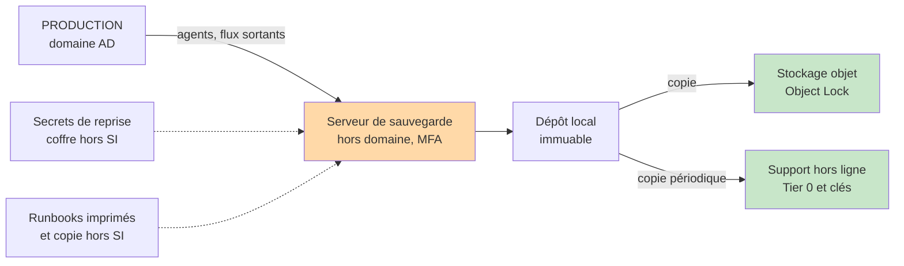
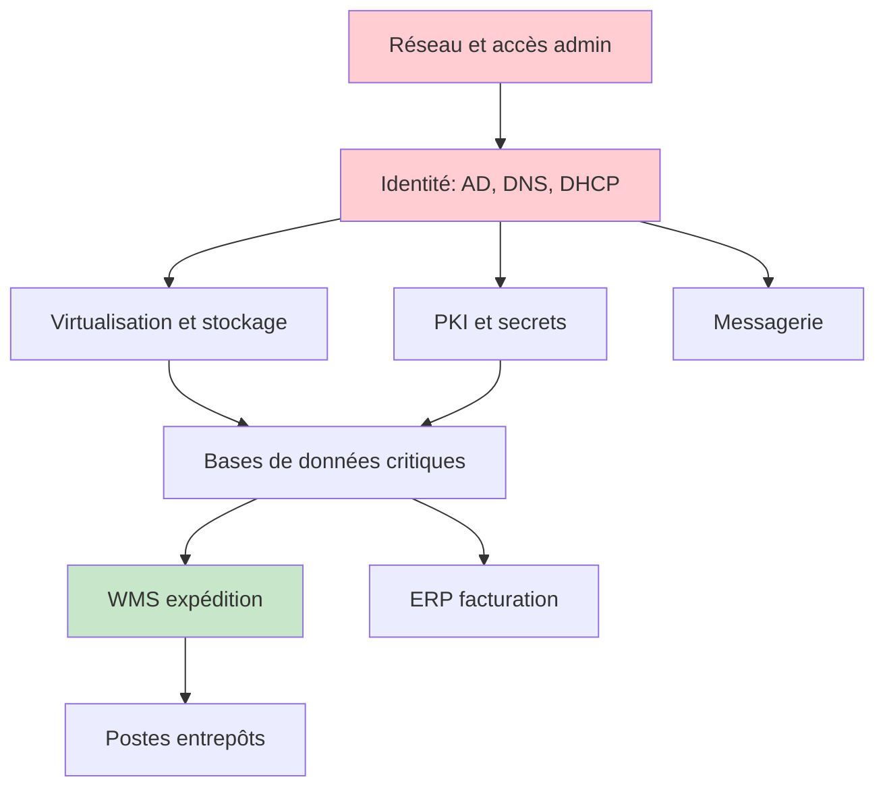

# Continuité d'activité et résilience cyber

## Objectifs pédagogiques

À la fin de ce module, vous saurez :

- **construire** un BIA (Business Impact Analysis) simple et en déduire des RTO (Recovery Time Objective) et RPO (Recovery Point Objective) défendables devant un métier ;
- **concevoir** une architecture de sauvegarde dont les copies survivent à un attaquant qui détient les droits d'administration du domaine ;
- **vérifier** qu'une restauration tient son RTO, avec des commandes et des mesures plutôt qu'avec un rapport de job vert ;
- **ordonner** la reprise d'un système d'information selon ses dépendances techniques et les ressources rares (bande passante, personnes, licences) ;
- **organiser** un exercice de crise qui révèle des défauts du plan au lieu de les confirmer, et transformer le retour d'expérience en actions suivies.

## Mise en situation

> Scénario illustratif : l'entreprise, les chiffres et la chronologie sont fictifs.

Valmont Logistique compte 400 salariés, trois entrepôts et un WMS (Warehouse Management System) qui pilote les expéditions. La direction a validé le budget sauvegarde il y a deux ans. Chaque matin, le tableau de bord affiche « 100 % des jobs réussis ». Les VM sont en plus répliquées vers un second site.

Un vendredi à 18h40, les postes des entrepôts affichent une demande de rançon. Voici ce que l'équipe découvre dans les deux heures qui suivent :

- Le serveur de sauvegarde était joint au domaine. Il a été chiffré avec le reste, catalogue compris.
- Les dépôts de sauvegarde étaient des partages SMB (Server Message Block) montés avec un compte de service administrateur du domaine. Ils sont chiffrés eux aussi.
- La réplication vers le second site a fidèlement copié les disques chiffrés. Le site de secours contient donc des VM inutilisables, à jour.
- La clé de chiffrement des sauvegardes est stockée dans un coffre de secrets hébergé sur une VM du domaine.
- Le PRA (Disaster Recovery Plan) est un document Word sur le partage de la DSI. Les numéros de téléphone du comité de crise sont dans l'annuaire, qui est lui aussi à l'arrêt.

La défense naïve consistait à avoir des sauvegardes et une réplication. Toutes deux dépendaient de la même identité, du même réseau et des mêmes privilèges que la production. Pour l'attaquant, elles n'étaient qu'une extension de la surface à chiffrer.

## Du BIA aux objectifs de reprise

### Ce que chaque acronyme engage vraiment

PCA (Business Continuity Plan) et PRA (Disaster Recovery Plan) sont souvent confondus. Le PCA répond à la question : comment le métier continue-t-il à fonctionner, même mal, pendant que le SI est indisponible ? Il s'agit de procédures manuelles, de sites de repli et de priorités métier. Le PRA répond à : comment remet-on le SI en état de marche ? C'est un plan technique, avec des runbooks, un ordre de reprise et des responsables. Un PRA excellent sans PCA laisse les entrepôts à l'arrêt pendant que les équipes IT restaurent. Un PCA sans PRA ne tient que quelques jours.

Le BIA est l'exercice qui alimente les deux. Il part des activités métier et non des serveurs, et pour chacune il pose trois questions :

1. Au bout de combien de temps l'indisponibilité devient-elle inacceptable ? C'est la MTD (Maximum Tolerable Downtime).
2. Quelle quantité de données le métier accepte-t-il de perdre ou de ressaisir ? C'est le RPO.
3. Sur quels systèmes, personnes et fournisseurs l'activité repose-t-elle ?

> 🧠 **Concept clé** : le RTO est un engagement de la DSI, la MTD est une limite du métier. On exige RTO < MTD avec de la marge, car la MTD inclut le temps de décision, de qualification de l'incident et de validation après restauration, pas seulement la restauration.
{: .callout .callout-important}

Extrait de BIA (valeurs illustratives) :

| Activité | MTD | RTO visé | RPO visé | Conséquence au-delà de la MTD |
|----------|-----|----------|----------|-------------------------------|
| Expédition (WMS) | 8 h | 4 h | 15 min | Camions à quai sans bon de chargement, pénalités contractuelles |
| Facturation (ERP) | 5 j | 48 h | 4 h | Retard de trésorerie, pas de rupture opérationnelle |
| Paie | 10 j | 72 h | 24 h | Obligation légale de versement, risque social |
| Messagerie | 24 h | 8 h | 1 h | Perte de coordination, mais contournable par téléphone |
| Site vitrine | 7 j | 72 h | 24 h | Image |

Un RPO de 15 minutes impose une réplication ou des sauvegardes de journaux de transactions toutes les 15 minutes. Cela se paie en bande passante, en stockage et en complexité. Si le métier ne peut pas justifier ce coût, le RPO réel sera de 24 h, quel que soit le chiffre écrit dans le plan.

### Les dépendances rendent le RTO plus long qu'annoncé

Le RTO effectif d'un service est le plus long des RTO de ses dépendances, plus son propre temps de restauration. Le WMS à 4 h dépend de sa base SQL, de l'identité (AD, DNS), du réseau des entrepôts et de la virtualisation. Si l'identité met 3 heures à revenir, il reste une heure pour tout le reste.

On calcule aussi le débit. Les données critiques de Valmont pèsent 8 To. Sur un dépôt de sauvegarde qui restitue 250 Mo/s en pratique :

```
8 To = 8 000 000 Mo
8 000 000 / 250 = 32 000 s ≈ 8,9 h
```

Le RTO de 4 h du WMS est donc inatteignable avec une restauration complète. Il faut alors réduire le périmètre restauré, utiliser une relecture directe depuis le dépôt (*instant recovery*, au prix de performances dégradées) ou prévoir du stockage plus rapide pour la reprise. Le débit réellement mesuré est souvent inférieur de moitié au débit théorique du lien, à cause des petits fichiers, de la déduplication, du chiffrement ou du dépôt partagé avec d'autres jobs.

> 💡 **Astuce** : consignez chaque service dans un catalogue lisible par machine, versionné hors du SI de production. Il sert de base au BIA, aux exercices et à l'ordre de reprise.
{: .callout .callout-astuce}

```yaml
service: wms-expedition
owner: <RESPONSABLE_METIER>
mtd: 8h
rto: 4h
rpo: 15m
depends_on: [ad-prod, dns-int, sql-wms, reseau-entrepots, licence-serveur]
restore_runbook: runbooks/wms-restore.md
last_restore_test: <DATE>
measured_rto_last_test: <DUREE>
```

Le champ `measured_rto_last_test` rend visible l'écart entre l'objectif et la mesure.

## Surface d'attaque de la résilience

On ne cartographie pas ici la production, mais ce qui permet de la reconstruire. Un attaquant qui veut maximiser la pression cherche ces éléments avant de chiffrer.

| Vecteur | Exposition | Impact potentiel |
|---------|-----------|------------------|
| Console de sauvegarde jointe au domaine | Compromission d'un compte admin AD donne l'accès à la console | Suppression des points de restauration et du catalogue |
| Dépôts sur partage SMB ou NFS accessible en écriture | Montés en permanence avec un compte de service | Chiffrement des sauvegardes comme n'importe quel partage |
| Vulnérabilité du logiciel de sauvegarde | Veeam Backup & Replication a connu CVE-2023-27532, qui exposait des identifiants stockés. Ce type de produit est ciblé précisément pour cela | Accès aux identifiants de toute l'infrastructure sauvegardée |
| Hyperviseur et réseau de management | Interface ESXi exposée ou joignable depuis le LAN. La campagne ESXiArgs exploitait CVE-2021-21974 sur des hôtes exposés | Chiffrement de toutes les VM en une seule opération |
| Secrets de reprise dans le SI | Clé de chiffrement des sauvegardes, mot de passe DSRM, clés de récupération BitLocker, licences | Sauvegardes présentes mais illisibles |
| Réplication synchrone | Cible accessible avec les mêmes identifiants | Propagation du chiffrement ou de la suppression |
| Compte cloud de stockage | Clés d'accès longues durées, droits de suppression | Bucket vidé avec les mêmes clés que celles qui l'alimentent |
| Documentation du PRA et annuaire de crise | Hébergés sur le SI à restaurer | Équipe sans procédure ni moyen de se joindre |
| Fournisseur SaaS unique | Responsabilité partagée : l'éditeur garantit sa plateforme, pas vos données supprimées | Données de messagerie ou de CRM non récupérables au-delà de la rétention native |

## Ce que fait l'attaquant avant de chiffrer

### Modèle de menace

Les acteurs à retenir pour un module de résilience sont les suivants :

- **Affilié de ransomware** : motivation financière, il veut un maximum de levier. Il sait que votre meilleure défense est la sauvegarde et la détruit en premier.
- **Wiper** : l'objectif est la destruction, sans rançon. NotPetya (2017) s'est présenté comme un ransomware alors que le déchiffrement n'était pas prévu. Dans ce cas, aucune négociation ne sauve l'entreprise.
- **Administrateur compromis ou malveillant** : il dispose déjà des droits légitimes pour supprimer des sauvegardes.
- **Panne non malveillante** : défaut de baie, erreur de manipulation, certificat expiré, mise à jour défectueuse. En volume, c'est le scénario le plus fréquent, et le même plan doit y répondre.
- **Fournisseur défaillant** : indisponibilité de l'hébergeur, de l'opérateur ou d'un éditeur SaaS.

Les actifs à protéger sont, dans l'ordre : l'identité (sans elle, rien ne redémarre), les copies de sauvegarde, les secrets de reprise, puis les données métier.

### Séquence typique d'un opérateur de ransomware

L'opération se déroule rarement en une seule étape. Entre l'accès initial et le chiffrement, il peut s'écouler plusieurs jours (dwell time). L'attaquant fait notamment :

1. Prendre le contrôle de l'AD (Kerberoasting, DCSync, mimikatz sur un serveur d'administration).
2. Énumérer l'infrastructure de sauvegarde : recherche des processus ou services du logiciel de sauvegarde, des partages de dépôts, des consoles.
3. Extraire les identifiants de la console de sauvegarde (la CVE-2023-27532 de Veeam a été utilisée dans ce but) et supprimer les points de restauration.
4. Supprimer les copies locales du système, avec des commandes très reconnaissables :

```
vssadmin delete shadows /all /quiet
wmic shadowcopy delete
wbadmin delete catalog -quiet
bcdedit /set {default} bootstatuspolicy ignoreallfailures
```

5. Déployer le chiffrement à un moment où personne ne regarde (vendredi soir, veille de jour férié), via GPO, PsExec ou directement sur l'hyperviseur.

> 🔴 **Vecteur d'attaque** : ce n'est pas le chiffrement qui compromet la reprise, c'est l'étape 3. Un opérateur qui a supprimé les sauvegardes avant de chiffrer rend le rapport de job « 100 % réussi » sans valeur.
{: .callout .callout-danger}

Un autre point change les décisions de restauration : la date de compromission précède souvent la date de chiffrement de plusieurs jours, voire de plusieurs semaines. Restaurer le point de la veille peut réinstaller le malware et ses comptes de persistance. La rétention doit donc dépasser le dwell time observé dans votre secteur, et chaque point candidat doit être analysé (antivirus, YARA) dans un environnement isolé avant remise en production.

## Une architecture de sauvegarde qui survit à l'administrateur de domaine

### Le principe : aucune copie ne doit dépendre des identifiants de production

La règle 3-2-1-1-0 en donne le squelette : 3 copies, sur 2 supports différents, dont 1 hors site, dont 1 hors ligne ou immuable, et 0 erreur après vérification de restauration. Le dernier « 0 » est celui qu'on oublie, et c'est le sujet de la section sur les tests.



Trois éléments portent la résilience : le serveur de sauvegarde n'appartient pas au domaine, au moins une copie est immuable, et les secrets de reprise existent en dehors du SI qu'ils servent à reconstruire.

### Immuabilité WORM*

Sur un dépôt Linux durci ou un stockage objet, l'immuabilité empêche la suppression avant la fin de la rétention. Sur AWS S3, l'Object Lock se configure ainsi :

```bash
# En us-east-1, omettre --create-bucket-configuration, refusé dans cette région
aws s3api create-bucket --bucket <BUCKET> --region <REGION> \
  --create-bucket-configuration LocationConstraint=<REGION> \
  --object-lock-enabled-for-bucket

aws s3api put-object-lock-configuration --bucket <BUCKET> \
  --object-lock-configuration \
  '{"ObjectLockEnabled":"Enabled","Rule":{"DefaultRetention":{"Mode":"COMPLIANCE","Days":35}}}'
```

> ⚠️ **Erreur fréquente** : choisir le mode `GOVERNANCE` « pour pouvoir corriger une erreur ». Tout compte disposant de `s3:BypassGovernanceRetention` peut supprimer les objets. Un attaquant avec des clés d'administration cloud aura ce droit. Seul `COMPLIANCE` résiste, y compris au compte racine, avec la contrepartie qu'on ne peut plus purger même par erreur.
{: .callout .callout-attention}

Pour un dépôt auto-hébergé, `restic` avec `rest-server --append-only --path <REPERTOIRE>` empêche un client compromis de supprimer ou d'écraser les snapshots existants. La purge se fait alors depuis une machine d'administration distincte, avec d'autres identifiants.

*WORM (Write Once Read Many) : le support ou le service refuse la modification et la suppression d'un objet pendant toute sa durée de rétention.

### Durcissement : ce que ça coûte

| Contrôle | Valeur recommandée | Ce que ça coûte |
|----------|--------------------|-----------------|
| Serveur de sauvegarde hors domaine, MFA, comptes locaux nominatifs | Workgroup, console accessible uniquement depuis un poste d'administration dédié | Gestion séparée des comptes, procédure de secours (break-glass) à tester |
| Rétention immuable | Au moins 30 jours, plus que le dwell time attendu | Stockage ≈ données de base + changement quotidien × jours de rétention. Impossible de purger en cas d'erreur de configuration |
| Flux réseau du dépôt | N'accepter que le serveur de sauvegarde en entrée, aucune exposition SMB à la production | Règles pare-feu plus strictes, restauration passant par le serveur de sauvegarde |
| Copie hors ligne du Tier 0 (AD, DNS, PKI, secrets) | Hebdomadaire ou mensuelle, support déconnecté | Opération humaine, RPO de plusieurs jours pour cette copie |
| Secrets de reprise hors SI | Clé de chiffrement des sauvegardes, DSRM, clés BitLocker, licences. Copie scellée, accès à deux personnes | Processus de mise à jour à chaque rotation |
| Réseau de management de l'hyperviseur | Segment isolé, SSH désactivé hors maintenance, mode lockdown | Maintenance plus lourde |
| Environnement de reprise isolé | VLAN ou tenant dédié, capacité réservée | Coût de calcul inutilisé 99 % du temps |
| Runbooks | Version imprimée et copie sur un support indépendant du SI | Mise à jour à chaque changement d'architecture |

> 🔒 **Contrôle de sécurité** : retirer la console de sauvegarde du domaine coupe la voie la plus courante (compromission AD → destruction des sauvegardes), et ne coûte qu'un peu de confort d'administration.
{: .callout .callout-securite}

## Appliquer le moindre privilège au plan de reprise

L'administrateur du domaine ne doit pas pouvoir supprimer une sauvegarde. Concrètement :

- Séparer les rôles : un compte qui planifie les jobs, un autre qui purge, un troisième qui restaure. Aucun n'est membre de « Admins du domaine ».
- Exiger une autorisation à deux personnes pour les opérations destructrices (suppression de points de restauration, réduction de rétention). Plusieurs produits proposent cette validation à quatre yeux, à activer et à tester.
- Utiliser des clés d'accès cloud à durée limitée, avec un rôle d'écriture seule pour les jobs et un rôle de lecture seule pour la restauration.
- Auditer les droits existants. Dans la plupart des audits, la première trouvaille est un compte de service de sauvegarde avec des droits d'administrateur de domaine « parce que c'était plus simple à l'installation ».

La limite : plus on sépare les rôles, plus la restauration d'urgence demande de personnes disponibles. Prévoyez un compte de secours, scellé et testé, plutôt que de découvrir en pleine crise qu'une seule personne détient l'accès.

## Les tests de récupération : le point qui fait la différence

> ⚠️ **Piège central du module** : une sauvegarde qui existe mais n'a jamais été restaurée n'est pas une garantie de reprise. Le statut « réussi » signifie que le job a écrit des données, pas que ces données sont complètes, déchiffrables, cohérentes pour l'application et restaurables dans le temps imparti.
{: .callout .callout-attention}

Les échecs observés en restauration appartiennent à quelques familles : sauvegarde crash-consistent d'une base (impossible à relancer sans réparation), clé de chiffrement perdue, catalogue corrompu, dépôt dont la lecture est trop lente pour le RTO, licence ou clé d'activation manquante, dépendance non sauvegardée (secrets d'application, certificats, fichiers de configuration hors VM).

On teste à quatre niveaux de profondeur, avec des fréquences différentes :

| Niveau | Ce qu'on vérifie | Fréquence indicative |
|--------|------------------|----------------------|
| Intégrité | Les blocs du dépôt sont lisibles (`restic check --read-data-subset=5%`) | Quotidienne, automatisée |
| Restauration fichier ou base | On restaure et on interroge (comptage de lignes, checksum) | Hebdomadaire ou mensuelle, automatisée |
| Restauration d'un service complet | VM + dépendances démarrées en environnement isolé, test fonctionnel métier | Trimestrielle pour les services critiques |
| Reprise du Tier 0 depuis zéro | AD, DNS, secrets, hyperviseur reconstruits avec la documentation papier uniquement | Annuelle |

Un exemple de test automatisable pour une base PostgreSQL sauvegardée avec `restic` :

```bash
#!/usr/bin/env bash
set -euo pipefail
export RESTIC_REPOSITORY=<REPO>
export RESTIC_PASSWORD_FILE=<FICHIER_MOT_DE_PASSE>

T=$(mktemp -d)
trap 'dropdb --if-exists restore_check; rm -rf "$T"' EXIT
start=$(date +%s)

restic restore latest --target "$T" --include <CHEMIN_DUMP>
createdb restore_check
pg_restore -d restore_check "$T"/<CHEMIN_DUMP>  # dump au format custom (pg_dump -Fc)
psql -d restore_check -tAc "SELECT count(*) FROM <TABLE_CRITIQUE>"

echo "Durée mesurée : $(( $(date +%s) - start )) s"
```

La sortie intéressante n'est pas le `count(*)`, c'est la durée. Comparez-la à l'objectif : un test de 40 minutes sur 1 % du volume ne prouve rien pour 100 %, sauf si la mesure est extrapolée avec prudence (le débit se dégrade souvent avec le volume et la concurrence).

Il faut aussi tester la propriété d'immuabilité, puisque c'est elle qui est censée résister à l'attaquant :

```bash
aws s3api delete-object --bucket <BUCKET> --key <CLE> --version-id <VERSION_ID>
```

La réponse attendue est un `AccessDenied` lié à la rétention. Si l'objet est supprimé, le contrôle n'existe pas, quelle que soit la documentation. Côté réseau, depuis un poste standard du domaine :

```bash
nmap -Pn -p 22,445,3389,<PORT_CONSOLE> <HOTE_SAUVEGARDE>
```

Tous les ports doivent apparaître filtrés ou fermés. S'ils répondent, un compte compromis sur ce poste peut atteindre la console ou le dépôt.

## Détecter la préparation du chiffrement

La fenêtre de détection utile est l'étape de destruction des sauvegardes, qui précède le chiffrement. Les commandes citées plus haut sont bruyantes. Une règle Sigma de base :

```yaml
title: Suppression des copies de restauration Windows
logsource:
  category: process_creation
  product: windows
detection:
  vss:
    Image|endswith: '\vssadmin.exe'
    CommandLine|contains|all: ['delete', 'shadows']
  wmic:
    Image|endswith: '\wmic.exe'
    CommandLine|contains|all: ['shadowcopy', 'delete']
  wbadmin:
    Image|endswith: '\wbadmin.exe'
    CommandLine|contains|all: ['delete', 'catalog']
  condition: vss or wmic or wbadmin
level: high
```

Cette règle détecte un comportement très répandu. Elle est contournable (appel direct de l'API VSS), donc ne comptez pas dessus seule. Ajoutez des signaux issus de l'infrastructure de sauvegarde elle-même :

- une connexion à la console depuis une machine qui n'est pas le poste d'administration dédié ;
- la suppression de points de restauration ou la modification de la rétention (événement à remonter au SIEM, avec alerte immédiate) ;
- une explosion de la taille des sauvegardes incrémentielles et un effondrement du taux de déduplication. Des fichiers chiffrés ne se dédupliquent plus et changent entièrement d'un jour à l'autre, ce qui est un indicateur de chiffrement en cours ;
- l'échec simultané des jobs sur plusieurs machines.

> 💡 **Astuce** : mesurez l'incrément quotidien normal de chaque job pendant un mois et alertez au-delà de 3 fois la médiane. C'est peu coûteux et souvent plus fiable qu'une signature.
{: .callout .callout-astuce}

## Scénarios d'indisponibilité : réseau, système, fournisseur

Un plan de continuité qui ne traite que le ransomware laisse de côté des événements plus fréquents.

| Scénario | Dépendance cachée typique | Mode dégradé à prévoir | Piège de reprise |
|----------|--------------------------|------------------------|------------------|
| Coupure du lien opérateur d'un entrepôt | Authentification, WMS hébergé au siège | Lien de secours (4G, second opérateur), file locale de transactions | Le basculement fonctionne mais l'authentification reste sur le DNS ou l'AD du siège |
| DNS interne ou PKI défaillants (certificat expiré) | Tout le SI utilise des noms et du TLS | Résolution de secours, procédure de renouvellement d'urgence | Un certificat racine ou intermédiaire expiré fait échouer des services sans rapport apparent |
| Perte d'une baie de stockage ou de l'hyperviseur | Toutes les VM sur le même volume | Capacité de redémarrage sur un second cluster | Les VM redémarrent mais la baie de secours n'a pas le débit pour la charge réelle |
| Défaut d'une mise à jour d'agent de sécurité | Déploiement automatique sur tout le parc | Déploiement par vagues, anneau pilote | Voir encadré ci-dessous |
| Panne ou compromission d'un éditeur SaaS | Données uniquement chez le fournisseur | Export régulier, sauvegarde tierce, procédure papier | Le SLA (Service Level Agreement) indemnise le service, pas votre activité perdue |

En juillet 2024, une mise à jour de contenu défectueuse d'un agent EDR a mis en boucle de plantage un grand nombre de machines Windows. La remédiation exigeait souvent une intervention manuelle poste par poste, et sur les postes chiffrés avec BitLocker il fallait fournir la clé de récupération. Si ces clés étaient stockées dans un annuaire ou un serveur lui-même affecté, l'équipe se retrouvait dans une dépendance circulaire. L'exemple vaut pour tout composant déployé partout, simultanément : la panne n'a pas besoin d'être malveillante pour demander un plan de reprise manuel.

Pour un fournisseur, la question à poser avant la signature est : comment récupère-t-on nos données, sous quel format et en combien de temps si la relation s'arrête demain ? Un test de sortie, même partiel, vaut mieux qu'une clause.

## Prioriser : l'ordre de reprise est un problème de graphe

Sous crise, les ressources se partagent : une seule équipe réseau, un seul lien vers le dépôt, quelques licences, une poignée de personnes qui connaissent l'AD. Restaurer ce qui paraît le plus important sans tenir compte des dépendances fait perdre du temps. L'ordre se déduit du graphe de dépendances, puis de la criticité métier.



Trois règles pratiques en découlent :

- **Le Tier 0 passe avant les applications**, même si le métier réclame le WMS. Sans AD, sans DNS et sans secrets, aucune application ne démarre ni n'authentifie ses utilisateurs.
- **Le goulot est souvent la bande passante du dépôt.** Si deux restaurations de 4 To tournent en parallèle sur un dépôt qui sert 250 Mo/s, chacune prend deux fois plus de temps. Il faut décider qui passe d'abord.
- **Le service minimal prime sur le service complet.** Restaurer le WMS sans l'historique de trois ans, ou rétablir l'écriture avant la consultation de l'archive, ramène l'expédition en route plus vite.

Le métier arbitre cette priorisation avant la crise, avec la DSI. Le mauvais moment pour négocier l'ordre de reprise est le samedi à 2h du matin.

## Plans de crise et exercices

### Ce que le plan de crise ajoute

Un plan de crise définit qui décide, de quoi, avec quelle information, et comment l'équipe communique. Ce n'est pas un doublon du plan de réponse aux incidents : ce dernier traite le confinement et l'éradication techniques, tandis que le plan de crise porte les décisions de continuité (activer le mode dégradé, prévenir les clients, informer les autorités, arbitrer l'ordre de reprise). Les deux se coordonnent avec une cellule de crise, un journal de décisions et un point de situation régulier.

Le point sensible est le canal de communication hors bande. Si la messagerie et l'annuaire sont à l'arrêt, comment convoque-t-on la cellule ? Il faut une liste papier ou sur un support indépendant, avec des numéros personnels, et un canal de messagerie alternatif préalablement validé par les participants.

### Exercices : trois formats complémentaires

- **Exercice sur table (tabletop)** : une demi-journée, une équipe, un scénario déroulé par des injects (événements injectés par l'animateur). Il teste les décisions, les rôles et la communication, pas la technique.
- **Test technique** : bascule ou restauration réelle d'un service, mesure du temps, comparaison au RTO.
- **Exercice complet ou *game day*** : on coupe volontairement quelque chose, hors production ou en production avec garde-fous, et on observe.

Des injects utiles pour une table ronde ransomware :

1. « 18h40 : les postes d'un entrepôt affichent un message de rançon. Que faites-vous des 3 premières minutes ? »
2. « 19h30 : la console de sauvegarde ne répond plus. Qui a le mot de passe du compte local de secours ? »
3. « 21h00 : un journaliste appelle l'accueil. Qui répond ? »
4. « Samedi 8h : l'assureur demande une liste d'actifs impactés. D'où la tirez-vous ? »

Un exercice qui ne trouve aucun défaut est un exercice trop facile. L'objectif est d'obtenir une liste d'écarts, pas un satisfecit.

## Choisir un niveau de résilience : décision et limites

| Stratégie | RTO typique | RPO typique | Coût relatif | Limite principale |
|-----------|-------------|-------------|--------------|-------------------|
| Sauvegarde + reconstruction | jours | 24 h | Faible | RTO dépendant du débit de restauration et de la disponibilité des équipes |
| Sauvegarde + instant recovery | heures | 24 h à 1 h | Moyen | Performances dégradées, dépôt sollicité en production |
| Site de secours à froid ou tiède | heures à 1 jour | minutes à heures (réplication) | Élevé | Le site de secours doit être maintenu à jour, sinon il ne démarre pas |
| Actif-actif | minutes | quasi nul | Très élevé | Bonne réponse aux pannes, aucune contre le chiffrement ou la suppression, qui se répliquent |

Les ordres de grandeur sont indicatifs et dépendent des produits et des architectures.

> 🧠 **Concept clé** : la réplication protège contre la panne de site, la sauvegarde immuable protège contre la corruption et la suppression. Ce sont deux contrôles différents. Remplacer l'un par l'autre revient à acheter un coffre-fort pour se protéger d'une inondation.
{: .callout .callout-important}

Quelques critères pour trancher :

- Si le RPO exigé est inférieur à une heure, une sauvegarde nocturne ne suffit pas. Il faut une réplication continue, plus une copie immuable décalée dans le temps.
- Si le budget impose un seul niveau, protégez d'abord le Tier 0 et les données irremplaçables. Les applications se reconstruisent, les données et l'identité non.
- Le contrôle atteint ses limites sur les attaques qui visent la confidentialité (extorsion par fuite de données) : restaurer n'empêche pas la publication. La stratégie de gestion de cette menace relève des modules sur la protection des données et de la réponse à incident.
- La décision de payer ou non une rançon n'est pas technique. Elle implique la direction, le juridique, l'assureur et les autorités. Elle ne doit pas être prise pour la première fois pendant la crise, mais cadrée à l'avance dans le plan de crise.

## Cas en entreprise : un exercice qui rapporte

> Scénario illustratif : chiffres fictifs, construits pour montrer les écarts typiques.

Valmont Logistique, après l'incident évoqué en introduction, reconstruit son dispositif. Six mois plus tard, un exercice de reprise « depuis zéro » du WMS donne les résultats suivants :

| Étape | Objectif | Mesuré | Cause de l'écart |
|-------|----------|--------|------------------|
| Reprise de l'AD et du DNS | 1 h | 3 h 20 | Mot de passe DSRM dans un coffre inaccessible. L'équipe a ouvert l'enveloppe scellée, dont le contenu était périmé |
| Restauration de la base SQL du WMS | 2 h | 6 h | Dépôt connecté en 1 Gb/s, soit un débit réel de ~90 Mo/s au lieu de 250 |
| Démarrage de l'application | 30 min | 2 h | Serveur de licences oublié, absent de la liste de dépendances |
| Validation métier | 30 min | 1 h 30 | Aucun cas de test défini, l'équipe a improvisé |
| **Total** | **4 h** | **12 h 50** | |

La MTD du WMS étant de 8 h, l'entreprise aurait dépassé sa tolérance de 4 h 50. Les actions décidées sont : passer le dépôt en 10 Gb/s, ajouter le serveur de licences au catalogue de dépendances, remplacer le mot de passe DSRM par une procédure de rotation avec test semestriel, et écrire un jeu de tests de validation avec le métier. Chaque action a un responsable et une date, et l'exercice suivant mesure si l'écart s'est réduit.

Un exemple réel connu est celui de NotPetya chez Maersk en 2017. Selon les récits publics de l'incident, la reprise du domaine a été possible grâce à un contrôleur de domaine resté hors ligne par hasard dans un site distant, qui contenait une copie saine de l'annuaire. Le retour à la normale a pris plusieurs semaines. La leçon est qu'une copie saine d'identité est la ressource la plus précieuse de la reprise, et que la compter sur la chance n'est pas un plan.

### Boucler le retour d'expérience

Un retour d'expérience utile se fait sans recherche de coupable et débouche sur des actions mesurables. Les indicateurs à suivre pour piloter la résilience :

- le **RTO mesuré** de chaque service critique, comparé à l'objectif ;
- le pourcentage de services critiques dont la **dernière restauration réussie** date de moins de six mois ;
- le **temps de détection** d'un événement de suppression de sauvegardes, mesuré lors d'exercices purple team ;
- le nombre d'actions issues des exercices **fermées dans les délais**.

Un indicateur du type « nombre de jobs réussis » est une métrique d'activité, pas de résilience.

## Référentiels : ce qui s'applique concrètement

La norme ISO 22301 structure un système de management de la continuité d'activité, et l'ISO/IEC 27031 traite de la préparation des technologies de l'information. La directive NIS2 cite la continuité d'activité, la gestion des sauvegardes, la reprise après sinistre et la gestion de crise parmi les mesures de gestion des risques à mettre en œuvre. Le règlement DORA impose des exigences de résilience opérationnelle numérique, notamment des tests, au secteur financier. L'état de la transposition de NIS2 en droit français et les obligations applicables à votre structure doivent être vérifiés à la date de votre mission. Dans une démarche d'audit, retenez une idée : un auditeur demandera la preuve des tests de restauration, pas seulement la politique de sauvegarde.

## Erreurs fréquentes

⚠️ **Console de sauvegarde jointe au domaine.**

- Conséquence : la compromission d'un compte administrateur AD donne accès à la suppression des points de restauration.
- Correction : serveur en workgroup, comptes locaux nominatifs et MFA, accès depuis un poste dédié.
- Détection : `(Get-CimInstance Win32_ComputerSystem).PartOfDomain` sur le serveur de sauvegarde doit renvoyer `False`.

⚠️ **Immuabilité en mode Governance.**

- Conséquence : un compte avec `s3:BypassGovernanceRetention` supprime les sauvegardes, donc un attaquant qui a volé des clés d'administration cloud aussi.
- Correction : mode `COMPLIANCE` pour la copie de dernier recours, avec une rétention supérieure au dwell time.
- Détection : `aws s3api get-object-lock-configuration --bucket <BUCKET>` et un test réel de suppression.

⚠️ **Réplication prise pour une sauvegarde.**

- Conséquence : un chiffrement ou une suppression est répliqué en quelques minutes, et le site de secours ne contient plus de version saine.
- Correction : ajouter une copie à points de restauration multiples, immuable, indépendante de la réplication.
- Détection : demander « peut-on restaurer l'état d'il y a 7 jours depuis le site de secours ? ». Si non, la copie n'est pas une sauvegarde.

⚠️ **Secrets de reprise dans le SI à restaurer.**

- Conséquence : clé de chiffrement des sauvegardes, DSRM ou clés BitLocker dans un coffre hébergé sur la production. Les données sont là mais illisibles.
- Correction : copie hors SI, scellée, accès à deux personnes, vérification lors de chaque exercice.
- Détection : lors d'un exercice, couper l'accès au coffre et tenter la reprise.

⚠️ **Plan et annuaire de crise hébergés sur le SI.**

- Conséquence : l'équipe ne trouve ni la procédure ni les numéros de téléphone.
- Correction : version imprimée, copie sur support indépendant, canal de crise alternatif validé.
- Détection : exercice sur table sans accès au SI.

⚠️ **Restauration du dernier point sans analyse.**

- Conséquence : réinstallation du malware ou de la persistance, nouvelle compromission quelques heures après la reprise.
- Correction : sélectionner un point antérieur à la compromission estimée, l'analyser (antivirus, YARA) dans un environnement isolé, puis reprendre.
- Détection : le runbook de reprise doit contenir une étape explicite « choix et validation du point de restauration ».

## Résumé

Le BIA fixe MTD, RTO et RPO à partir des activités métier, et les dépendances techniques rendent le RTO réel plus long que celui annoncé. Face à un ransomware, la menace principale pour la reprise est la destruction des sauvegardes avant le chiffrement : l'architecture doit donc isoler la console de sauvegarde du domaine, garder au moins une copie immuable (mode compliance) et conserver hors SI les secrets de reprise. La réplication protège contre la panne de site, pas contre le chiffrement. Seule une restauration mesurée prouve la capacité de reprise, et un job vert ne prouve rien. L'ordre de reprise suit le graphe de dépendances, avec l'identité en premier. Les exercices de crise, tabletop, techniques et complets, alimentent un retour d'expérience chiffré. Restent à surveiller : le dwell time, qui dépasse souvent la rétention des sauvegardes, les dérives de configuration du dépôt et la mise à jour du catalogue de dépendances.

<!-- snippet
id: resilience_rto_effectif_dependances
type: concept
tech: resilience
level: advanced
importance: high
format: knowledge
tags: rto,bia,dependances,pra
title: RTO effectif = dépendances + temps de restauration
content: Le RTO réel d'un service est le plus long RTO de ses dépendances (AD, DNS, base, réseau, licences) plus son propre temps de restauration. Un WMS à RTO 4 h dont l'identité revient en 3 h n'a plus qu'une heure. Cartographier les dépendances dans un catalogue versionné, puis comparer le RTO mesuré en exercice à l'objectif.
description: Un RTO annoncé sans la chaîne de dépendances est une estimation optimiste ; il se calcule sur la branche la plus lente du graphe.
-->

<!-- snippet
id: resilience_restauration_jamais_testee
type: warning
tech: resilience
level: advanced
importance: high
format: knowledge
tags: sauvegarde,restauration,test,pra
title: Sauvegarde jamais restaurée = aucune garantie de reprise
content: Se fier au statut "job réussi" signifie seulement que des données ont été écrites, pas qu'elles sont déchiffrables, cohérentes pour l'application, ni restaurables dans le RTO. Conséquence typique : clé perdue, base crash-consistent, dépôt trop lent ou dépendance non sauvegardée découverts en pleine crise. Correction : restaurer régulièrement dans un environnement isolé, interroger les données, mesurer la durée et la consigner.
description: Un rapport de sauvegarde vert prouve l'écriture, pas la reprise. Seule une restauration chronométrée valide le RTO.
-->

<!-- snippet
id: resilience_replication_vs_sauvegarde
type: concept
tech: resilience
level: advanced
importance: high
format: knowledge
tags: replication,sauvegarde,ransomware,dr
title: La réplication propage le chiffrement
content: Une réplication synchrone ou asynchrone copie l'état courant des disques. Si un ransomware chiffre la production ou supprime des fichiers, le site de secours reçoit les mêmes données altérées en quelques minutes. La réplication couvre la panne de site, pas la corruption : il faut en plus des points de restauration historiques et immuables.
description: Un site de secours répliqué ne contient que l'état le plus récent, y compris chiffré ; il ne remplace pas une copie immuable à rétention.
-->

<!-- snippet
id: resilience_console_sauvegarde_domaine
type: warning
tech: resilience
level: advanced
importance: high
format: knowledge
tags: sauvegarde,active-directory,moindre-privilege,ransomware
title: Console de sauvegarde jointe au domaine
context: Windows, serveur de sauvegarde
content: Serveur de sauvegarde joint à l'AD : un compte administrateur de domaine compromis donne accès à la console et permet de supprimer les points de restauration avant le chiffrement. Correction : serveur en workgroup, comptes locaux nominatifs, MFA, accès depuis un poste d'administration dédié. Vérification : (Get-CimInstance Win32_ComputerSystem).PartOfDomain doit renvoyer False.
description: La compromission AD devient une compromission des sauvegardes ; sortir le serveur du domaine supprime ce chemin d'attaque.
-->

<!-- snippet
id: resilience_object_lock_compliance
type: command
tech: aws-s3
level: advanced
importance: high
format: knowledge
tags: immuabilite,s3,object-lock,sauvegarde
title: Activer l'Object Lock en mode COMPLIANCE
context: Le versioning doit être activé sur le bucket ; l'Object Lock peut être activé à la création ou, depuis fin 2023, sur un bucket existant versionné
command: aws s3api put-object-lock-configuration --bucket <BUCKET> --object-lock-configuration '{"ObjectLockEnabled":"Enabled","Rule":{"DefaultRetention":{"Mode":"COMPLIANCE","Days":<JOURS>}}}'
example: aws s3api put-object-lock-configuration --bucket valmont-backup-prod --object-lock-configuration '{"ObjectLockEnabled":"Enabled","Rule":{"DefaultRetention":{"Mode":"COMPLIANCE","Days":35}}}'
description: Le mode COMPLIANCE interdit la suppression avant échéance, même pour le compte racine, contrairement à GOVERNANCE contournable par permission.
-->

<!-- snippet
id: resilience_governance_contournable
type: warning
tech: aws-s3
level: advanced
importance: high
format: knowledge
tags: immuabilite,s3,governance,sauvegarde
title: Object Lock GOVERNANCE contournable par un administrateur
content: En mode GOVERNANCE, tout compte avec s3:BypassGovernanceRetention peut supprimer les objets verrouillés. Un attaquant qui vole des clés d'administration cloud obtient ce droit. Correction : mode COMPLIANCE pour la copie de dernier recours, rétention supérieure au dwell time (30 jours minimum), puis test de suppression qui doit retourner AccessDenied.
description: GOVERNANCE protège contre l'erreur humaine, pas contre un attaquant disposant de droits d'administration.
-->

<!-- snippet
id: resilience_test_suppression_immuable
type: command
tech: aws-s3
level: advanced
importance: medium
format: knowledge
tags: immuabilite,test,s3,sauvegarde
title: Tester que l'immuabilité résiste à la suppression
context: À lancer avec un compte disposant de droits de suppression, sur un objet de test
command: aws s3api delete-object --bucket <BUCKET> --key <CLE> --version-id <VERSION_ID>
example: aws s3api delete-object --bucket valmont-backup-prod --key test/canary.bak --version-id 3HL4kqtJlcpXroDTDmJ
description: Le retour attendu est AccessDenied lié à la rétention ; si l'objet disparaît, l'immuabilité n'est pas effective malgré la configuration.
-->

<!-- snippet
id: resilience_nmap_exposition_sauvegarde
type: command
tech: nmap
level: intermediate
importance: medium
format: knowledge
tags: nmap,sauvegarde,segmentation,test
title: Vérifier l'exposition du serveur de sauvegarde
context: À exécuter depuis un poste standard du domaine, pas depuis le poste d'administration dédié
command: nmap -Pn -p 22,445,3389,<PORT_CONSOLE> <HOTE_SAUVEGARDE>
example: nmap -Pn -p 22,445,3389,9392 10.20.30.40
description: Tous les ports doivent apparaître filtrés ou fermés ; une réponse signifie qu'un compte compromis sur ce poste peut atteindre la console ou le dépôt.
-->

<!-- snippet
id: resilience_restic_check_subset
type: command
tech: restic
level: intermediate
importance: medium
format: knowledge
tags: restic,integrite,sauvegarde,verification
title: Vérifier l'intégrité d'un dépôt restic sur un échantillon
command: restic check --read-data-subset=<POURCENTAGE>%
example: restic check --read-data-subset=5%
description: Relit réellement 5 % des blocs de données, tirés aléatoirement à chaque exécution, pas seulement les index ; pour une couverture systématique, utiliser plutôt la forme n/t (--read-data-subset=1/7 à 7/7, un par jour).
-->

<!-- snippet
id: resilience_ransomware_destruction_copies
type: concept
tech: resilience
level: advanced
importance: high
format: knowledge
tags: ransomware,vssadmin,detection,sigma
title: Commandes de suppression des copies avant chiffrement
content: Avant de chiffrer, les opérateurs de ransomware exécutent typiquement vssadmin delete shadows /all /quiet, wmic shadowcopy delete et wbadmin delete catalog -quiet pour supprimer les copies locales de restauration. Ces lignes de commande apparaissent dans les logs de création de processus (Sysmon 1, événement 4688) et justifient une alerte immédiate, même si l'API VSS peut être appelée sans ces binaires.
description: La destruction des copies précède le chiffrement et laisse une trace dans les logs de processus ; c'est la dernière fenêtre de détection utile.
-->

<!-- snippet
id: resilience_dwell_time_point_restauration
type: concept
tech: resilience
level: advanced
importance: high
format: knowledge
tags: ransomware,restauration,dwell-time,retention
title: Choisir un point de restauration antérieur à la compromission
content: L'attaquant est souvent présent plusieurs jours ou semaines avant le chiffrement (dwell time). Restaurer le point de la veille peut réinstaller malware et comptes de persistance. Il faut une rétention plus longue que le dwell time attendu (30 jours minimum), et analyser chaque point candidat (antivirus, YARA) dans un environnement isolé avant remise en production.
description: La date de chiffrement n'est pas la date de compromission ; le bon point de restauration est antérieur à la première intrusion.
-->

<!-- snippet
id: resilience_secrets_reprise_hors_si
type: warning
tech: resilience
level: advanced
importance: high
format: knowledge
tags: secrets,sauvegarde,bitlocker,dependance-circulaire
title: Secrets de reprise stockés dans le SI à reconstruire
content: Clé de chiffrement des sauvegardes, mot de passe DSRM, clés de récupération BitLocker ou licences stockés dans un coffre hébergé sur la production : sauvegardes présentes mais illisibles, reprise bloquée par une dépendance circulaire. Correction : copie scellée hors SI, accès à deux personnes, revue à chaque rotation et vérification lors de chaque exercice de reprise.
description: Si l'accès aux secrets nécessite le système qu'on reconstruit, la reprise est impossible ; ils doivent exister hors du SI.
-->

<!-- snippet
id: resilience_ordre_reprise_tier0
type: concept
tech: resilience
level: advanced
importance: medium
format: knowledge
tags: priorisation,active-directory,pra,dependances
title: Ordre de reprise : le Tier 0 avant les applications
content: Sans identité (AD, DNS, DHCP), PKI et secrets, aucune application ne s'authentifie ni ne démarre correctement. L'ordre se déduit du graphe de dépendances : réseau et accès admin, identité, virtualisation et stockage, PKI, bases de données, puis applications métier. Le goulot est souvent la bande passante du dépôt : deux restaurations en parallèle doublent chacune le temps.
description: Restaurer l'application demandée par le métier avant l'identité fait perdre du temps ; l'ordre suit les dépendances, pas la pression.
-->

<!-- snippet
id: resilience_alerte_incrementiel_dedup
type: tip
tech: resilience
level: advanced
importance: medium
format: knowledge
tags: detection,sauvegarde,ransomware,supervision
title: Alerter sur la taille des incrémentiels et la déduplication
content: Mesurer pendant un mois l'incrément quotidien de chaque job de sauvegarde, puis alerter au-delà de 3 fois la médiane ou quand le taux de déduplication s'effondre. Des fichiers chiffrés changent entièrement d'un jour à l'autre et ne se dédupliquent plus, ce qui signale un chiffrement en cours avant que les utilisateurs ne le voient.
description: Un pic de volume incrémentiel est un indicateur de chiffrement exploitable depuis l'infrastructure de sauvegarde, sans signature ni agent supplémentaire.
-->

<!-- snippet
id: resilience_exercice_crise_hors_bande
type: tip
tech: resilience
level: intermediate
importance: medium
format: knowledge
tags: crise,exercice,tabletop,communication
title: Prévoir un canal de crise indépendant du SI
content: Si messagerie et annuaire sont à l'arrêt, la cellule de crise ne peut pas se convoquer. Imprimer la liste des membres avec leurs numéros personnels, choisir un canal alternatif (messagerie chiffrée ou téléphone) validé par chacun, puis le tester lors d'un exercice sur table en interdisant l'accès au SI.
description: La liste de contacts et le canal de crise doivent être accessibles sans le système en panne ; un exercice sur table sans SI le vérifie.
-->

<!-- snippet
id: resilience_regle_3_2_1_1_0
type: concept
tech: resilience
level: intermediate
importance: medium
format: knowledge
tags: sauvegarde,321,immuabilite,verification
title: Règle 3-2-1-1-0 pour les sauvegardes
content: 3 copies des données, sur 2 supports différents, dont 1 hors site, dont 1 hors ligne ou immuable, et 0 erreur après vérification de restauration. Le dernier critère est le plus négligé : une copie immuable jamais restaurée peut être illisible. Chaque copie doit aussi échapper aux identifiants de production, sinon elle reste à portée d'un administrateur compromis.
description: Le dernier chiffre impose de vérifier la restauration ; les autres garantissent la diversité des copies et l'indépendance vis-à-vis de la production.
-->
