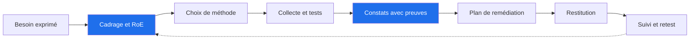
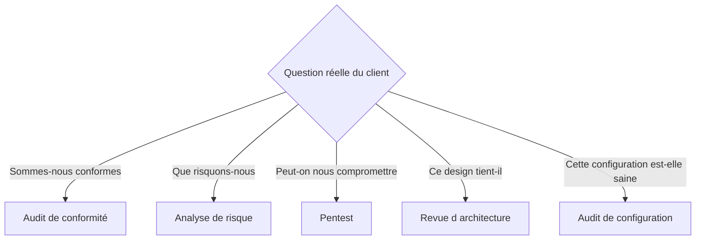

# Méthodologie de mission et projet professionnel cybersécurité

## Objectifs pédagogiques

À la fin de ce module, vous serez capable de :

- **Cadrer** une demande client floue en périmètre, règles d'engagement et critères de succès vérifiables.
- **Choisir** entre audit de conformité, analyse de risque, pentest, audit de configuration et revue d'architecture selon la question réellement posée.
- **Rédiger** un constat exploitable (constat, preuve, impact, recommandation) et prioriser avec le contexte plutôt qu'avec le seul score CVSS.
- **Construire** un plan de remédiation dont chaque action a un responsable, une échéance et un critère de clôture testable.
- **Structurer** un dépôt de mission, protéger ses livrables et ses preuves, puis choisir une première spécialisation sur la base d'essais concrets.

## Mise en situation

Voici un scénario illustratif, volontairement banal. Une société de 400 personnes commande un « audit de sécurité rapide » avant un renouvellement de cyber-assurance. Le prestataire lance un scanner de vulnérabilités sur les plages IP fournies, exporte le résultat et livre un PDF de 120 pages, trié par score CVSS décroissant.

Le client lit les trois premières pages, voit des dizaines de « Critical » sur des imprimantes et des serveurs de test, et ne sait pas par où commencer. Il classe le document.

Parmi les « Medium » figure, à la page 87, une version de passerelle VPN exposée sur Internet, sans le contexte qui en ferait une priorité. Six mois plus tard, c'est ce point d'entrée qui sert à un accès initial, suivi d'un déplacement latéral via un compte de service. Sur ce point, le rapport était pourtant exact.

La défense naïve (« on a scanné, on a livré ») échoue pour trois raisons :

- Le besoin n'a jamais été cadré : le client voulait une preuve pour l'assureur, une priorisation et un budget, pas une liste.
- Le rapport ne disait ni *ce qu'un attaquant peut faire* ni *par quoi commencer*.
- Personne n'était propriétaire des actions, donc aucune n'a été suivie.

Ce module porte sur ce qui sépare un exécutant d'outils d'un consultant capable de conduire une mission de bout en bout.



## Surface d'attaque d'une mission

Avant de parler de méthode, il faut accepter un fait : **le consultant et ses livrables sont une cible**. Un rapport d'audit est une liste priorisée de ce qui est exploitable chez le client, donc une carte au trésor pour un attaquant.

| Vecteur | Exposition | Impact potentiel |
|---|---|---|
| Poste du consultant compromis (infostealer, phishing ciblé) | Accès VPN client, mots de passe de test, exports, captures | Rebond vers le client avec un accès légitime |
| Dépôt Git mal configuré | Rapport, preuves, fichiers `.env` ou configs client poussés sur un dépôt public ou trop largement partagé | Fuite de secrets et de vulnérabilités non corrigées (les outils comme trufflehog ou les GitHub dorks les trouvent) |
| Pièces jointes de support (HAR, captures réseau, dumps) | Cookies et jetons de session dans les fichiers échangés | Voir encadré ci-dessous |
| Rapport envoyé par e-mail non chiffré | Boîtes mail, sauvegardes, corbeilles | Fuite d'un plan d'attaque prêt à l'emploi |
| Dérive de périmètre (scope creep) | Hôte tiers, SaaS ou hébergeur hors autorisation | Accès non autorisé à un système tiers : exposition pénale, notamment au titre de l'article 323-1 du Code pénal |
| Métadonnées des livrables | Auteur, chemins locaux, noms de machines dans les PDF et DOCX | Fuite d'informations sur le prestataire et le client |

> 🔴 **Vecteur d'attaque.** En octobre 2023, Okta a reconnu qu'un accès à son système de support avait permis de consulter des fichiers HAR (HTTP Archive) transmis par des clients pour le dépannage. Ces fichiers pouvaient contenir des cookies et jetons de session valides, rejouables sans mot de passe. La leçon pour une mission est directe : une capture « pour preuve » est un secret tant qu'elle n'a pas été expurgée.
{: .callout .callout-danger}

> 🧠 **Concept clé.** Une mission manipule trois catégories d'objets sensibles : des *accès* (comptes, VPN), des *données* (extraits, captures, logs) et des *connaissances* (vulnérabilités non corrigées). La méthodologie sert d'abord à les cadrer, puis à les protéger et à les détruire dans les délais prévus.
{: .callout .callout-important}

## Cadrer : du besoin au risque, puis aux contrôles

⭐ C'est le point fondamental du module. Un cadrage raté ne se rattrape pas par la qualité technique de l'exécution.

Le client formule rarement le vrai besoin. Il faut reformuler jusqu'à obtenir une question à laquelle une méthode précise peut répondre.

| Ce que dit le client | Ce qu'il veut souvent | Question de cadrage |
|---|---|---|
| « Faites-nous un audit » | Rassurer un tiers (assureur, client, direction) | Qui lira le livrable, et quelle décision en dépend ? |
| « On veut un pentest » | Une preuve de niveau de sécurité, parfois sans budget pour corriger | Qui corrigera, avec quel budget et sous quel délai ? |
| « Sommes-nous conformes à NIS2 ? » | Savoir si l'entité est concernée et ce qu'elle doit faire | Le statut d'entité est-il établi ? Quelle version du texte et quelle transposition ? |
| « On a peur du ransomware » | Réduire une probabilité et un impact précis | Quels sont les services qui ne peuvent pas s'arrêter ? |

Le fil logique du cadrage tient en une chaîne :

**actif à protéger → menace plausible → scénario → impact métier → contrôle candidat → preuve que le contrôle fonctionne**

Un contrôle qui ne remonte pas à un scénario est du bruit. Un scénario sans actif identifié est de la peur.

**Les éléments à figer par écrit avant toute action technique :**

- **Périmètre** : liste exhaustive des IP, domaines, tenants, comptes, applications, avec les exclusions explicites (production sensible, tiers).
- **RoE (Rules of Engagement)** : horaires autorisés, techniques interdites (déni de service, ingénierie sociale, exploitation destructive), seuils de charge, procédure d'arrêt d'urgence, contacts joignables 24 h/24 pendant les tests.
- **Autorisation écrite signée** par une personne ayant autorité sur les systèmes. Pour un hébergement cloud ou un prestataire tiers, l'accord de ce tiers est un point à vérifier séparément.
- **Critères de succès** : « liste priorisée des 10 risques par scénario d'attaque, plan sur 6 mois, présentation au comité de direction » est vérifiable. « Améliorer la sécurité » ne l'est pas.
- **Gestion des données** : où sont stockées les preuves, qui y accède, pendant combien de temps, comment elles sont détruites.

> 💡 **Astuce.** Si le client ne peut pas nommer qui décidera à la lecture du rapport, ne démarrez pas. Vous livreriez un document sans destinataire de décision.
{: .callout .callout-astuce}

## Choisir la méthode adaptée

Les cinq démarches se confondent facilement. Chacune répond à une question différente et produit un livrable différent.



| Méthode | Répond à | Livrable type | Limite |
|---|---|---|---|
| Audit de conformité | Écart entre l'existant et un référentiel (ISO 27001, exigences contractuelles) | Tableau d'écarts, non-conformités | Conforme ne veut pas dire protégé |
| Analyse de risque (EBIOS Risk Manager, ISO 27005) | Quels scénarios menacent les actifs métier, avec quel impact | Registre de risques, traitements proposés | Dépend de la qualité des ateliers et des hypothèses |
| Pentest | Un attaquant avec ces moyens atteint-il cet objectif ? | Chaînes d'attaque démontrées | Photographie datée ; couvre un périmètre et un temps limités |
| Revue d'architecture | Le design résiste-t-il avant même d'être déployé ? | Schémas annotés, modèle de menace, écarts | Peu de preuves « en conditions réelles » |
| Audit de configuration | Les systèmes respectent-ils le durcissement attendu (CIS Benchmarks, guides ANSSI) ? | Écarts par système et par contrôle | Ne voit pas les enchaînements entre systèmes |

**Règles de décision utilisées en pratique :**

- Le pentest arrive souvent trop tôt. Si l'organisation n'a pas d'inventaire et ne gère pas ses correctifs, il trouvera ce que l'audit de configuration aurait trouvé à moindre coût.
- Une analyse de risque sans données techniques reste théorique. Une analyse technique sans analyse de risque reste ingérable. Les missions solides combinent souvent une méthode principale et une méthode secondaire plus légère.
- Choisissez toujours un **référentiel de critères** (CIS, ANSSI, OWASP, NIST SP 800-115 pour la démarche de test). Sans critère explicite, la sévérité devient une opinion.
- Pour les référentiels réglementaires (NIS2 notamment), vérifiez l'état de la transposition nationale et les obligations qui s'appliquent réellement au client à la date de la mission.

## Rédiger un constat exploitable

Un constat se compose de quatre éléments indissociables : **constat, preuve, impact, recommandation**. Il en manque un, et le lecteur ne peut ni le croire, ni le prioriser, ni le corriger.

Exemple d'un constat qui fait réagir. L'environnement est un Active Directory de laboratoire et les valeurs sont illustratives.

**Constat.** Sept comptes de service portent un SPN et ont un mot de passe inchangé depuis plus de trois ans. Deux sont membres de `Domain Admins`.

**Preuve** (horodatée, reproductible, hachée) :

```powershell
Get-ADUser -Filter 'ServicePrincipalName -like "*"' `
  -Properties ServicePrincipalName,PasswordLastSet,MemberOf |
  Where-Object { $_.SamAccountName -ne 'krbtgt' -and $_.PasswordLastSet -lt (Get-Date).AddYears(-3) } |
  Select-Object SamAccountName,PasswordLastSet,@{n='Groupes';e={$_.MemberOf -join ';'}}
```

**Impact.** 🔴 N'importe quel utilisateur authentifié du domaine peut demander un ticket de service pour ces comptes (`GetUserSPNs.py -request` d'impacket, `Rubeus kerberoast`). Le ticket est chiffré avec le secret du compte et peut être cassé hors ligne (`hashcat -m 13100` pour RC4). Un mot de passe humain ancien y résiste peu. Un simple compte utilisateur compromis suffit donc pour atteindre l'administration du domaine.

**Recommandation.**

- Migrer les services compatibles vers des comptes gérés (gMSA).
- Pour les autres, imposer des mots de passe aléatoires d'au moins 25 caractères.
- Retirer les comptes de `Domain Admins` et désactiver RC4 pour ces comptes.
- Détecter les demandes de tickets RC4 : événement 4769 avec un type de chiffrement `0x17`.

**Critère de clôture.** La requête ci-dessus, avec un seuil d'un an (`AddYears(-1)`), ne renvoie plus aucun compte (les gMSA ne sont pas renvoyés par `Get-ADUser`).

Dans votre dépôt, chaque constat est un fichier au format fixe :

```markdown
---
id: F-003
titre: Comptes de service Kerberoastables avec privilèges élevés
severite_base: 8.8
priorite: P1
perimetre: ad.<DOMAINE>.local
preuves: [evidence/F-003-get-aduser.txt]
statut: ouvert
---
## Constat
## Preuve
## Impact
## Recommandation
## Critère de clôture
```

### Prioriser avec le contexte

Le score CVSS de base décrit la vulnérabilité en général, pas votre client. Dans le scénario d'ouverture, le « Medium » sur la passerelle VPN aurait dû passer en P1 pour trois raisons : exposition Internet, vulnérabilité exploitable sans authentification préalable et rôle de point d'entrée unique.

| Facteur | Question | Effet sur la priorité |
|---|---|---|
| Exposition | Atteignable depuis Internet ou depuis un poste utilisateur ? | Monte nettement |
| Exploitabilité | Outil public, exploit stable, prérequis faibles ? | Monte si exploit public connu |
| Valeur de l'actif | Que perd-on si l'actif tombe (service critique, données sensibles) ? | Monte ou descend |
| Contrôles compensatoires | Segmentation, détection, MFA existants ? | Descend si démontré |
| Coût de correction | Un correctif d'une heure ou un chantier de six mois ? | Détermine l'ordre, pas la gravité |

> ⚠️ **Erreur fréquente.** Trier par CVSS brut mélange gravité intrinsèque et risque réel. Documentez le raisonnement de priorisation dans le rapport. C'est ce qui rend votre conclusion défendable face à un interlocuteur qui conteste.
{: .callout .callout-attention}

## Construire un plan de remédiation réaliste et mesurable

Un plan qui énumère les corrections n'est pas un plan. Il lui faut un propriétaire, un délai, un effort estimé et une preuve de clôture.

| ID | Action | Responsable | Échéance | Effort | Preuve de clôture |
|---|---|---|---|---|---|
| R-01 | Appliquer le correctif de la passerelle VPN et restreindre l'accès aux IP des sites | Responsable réseau | J+7 | 0,5 jour | Scan externe : version corrigée ; test d'accès refusé depuis une IP externe |
| R-02 | Migrer 5 des 7 comptes de service vers gMSA et renouveler le mot de passe des 2 autres (aléatoire, 25 caractères minimum) | Équipe AD | J+45 | 6 jours | Requête `Get-ADUser` de F-003 (seuil d'un an) : 0 résultat |
| R-03 | Réduire `Domain Admins` à 4 comptes nominatifs | RSSI + DSI | J+30 | 2 jours | Export de l'appartenance au groupe signé |
| R-04 | Règle de détection sur l'événement 4769 RC4 | Équipe SOC | J+30 | 1 jour | Déclenchement lors d'un test contrôlé |

Les valeurs ci-dessus sont des ordres de grandeur pour illustrer le format.

**Principes de construction :**

- **Trois horizons** : correctifs rapides (jours), actions structurantes (semaines), évolutions de fond (trimestres). Le client doit pouvoir démarrer lundi.
- **Une seule action responsable par ligne.** « L'IT » n'est pas un responsable.
- **Contrainte réelle explicite** : fenêtre de maintenance, dépendance applicative, budget, compétences disponibles. Un plan qui ignore ces contraintes sera ignoré à son tour.
- **Indicateur mesurable** : un indicateur est utile s'il se calcule par une commande ou une requête (« % de comptes administrateurs avec authentification renforcée », « nombre de comptes avec mot de passe plus ancien que 365 jours »), pas par une impression.
- **Acceptation de risque formelle** : si le client choisit de ne pas corriger, la décision est écrite, signée par un responsable et datée. C'est protecteur pour les deux parties.

## Documentation, Git, suivi et travail en équipe

Une mission professionnelle se travaille comme un projet logiciel : versionnée, relue, traçable. Mais les dépôts de mission contiennent des données sensibles et demandent plus de rigueur que du code ordinaire.

```text
mission-<CLIENT>-<ANNEE>/
├── 00-cadrage/        # lettre de mission, RoE, contacts, périmètre
├── 10-collecte/       # exports bruts (chiffrés)
├── 20-preuves/        # captures, sorties de commande, SHA256SUMS
├── 30-constats/       # un fichier par constat (F-001.md ...)
├── 40-plan/           # plan de remédiation
├── 50-livrables/      # rapport, synthèse, slides
└── journal.md         # journal horodaté des actions
```

### Configuration sécurisée du dépôt

Avant le premier commit :

```gitignore
# .gitignore
10-collecte/
20-preuves/*.raw
*.pcap
*.har
.env
*.kdbx
```

```yaml
# .pre-commit-config.yaml : blocage des secrets avant commit
repos:
  - repo: https://github.com/gitleaks/gitleaks
    rev: <VERSION>
    hooks:
      - id: gitleaks
```

Les preuves brutes ne vont jamais en clair dans Git. Chiffrez-les avec age pour les destinataires de l'équipe :

```bash
age -R recipients.txt -o 10-collecte/export-ad.zip.age export-ad.zip
age -d -i <CLE_PRIVEE> -o export-ad.zip 10-collecte/export-ad.zip.age
```

Pour l'intégrité des preuves :

```bash
sha256sum 20-preuves/* > 20-preuves/SHA256SUMS
sha256sum -c 20-preuves/SHA256SUMS
```

### Suivi des actions et travail en équipe

- **Un ticket par constat** (issue GitHub ou GitLab, ou outil du client), avec le même identifiant que le fichier de constat. Le statut (ouvert, en cours, corrigé, retesté, risque accepté) devient le tableau de bord de la mission.
- **Relecture par un pair obligatoire** sur chaque constat avant livraison : le relecteur doit pouvoir refaire la preuve en lisant seulement le fichier. C'est le meilleur test de qualité.
- **Protection de branche** sur la branche principale : pas de poussée directe, relecture requise.
- **Journal horodaté** des actions techniques, en UTC. Il sert à répondre à « quelle activité venait de vous ? » quand le SOC du client pose la question.
- **Accès au dépôt limité à l'équipe de mission**, par comptes nominatifs, avec authentification multifacteur et révocation à la clôture.

### Gestion des secrets et moindre privilège

| À faire | À ne jamais faire |
|---|---|
| Comptes de test nominatifs, limités dans le temps, désactivés à la fin de la mission | Utiliser un compte administrateur partagé « pour aller plus vite » |
| Secrets dans un gestionnaire de mots de passe chiffré | Mots de passe client dans le journal, un chat ou un ticket |
| Expurger cookies, jetons et `Authorization` avant d'archiver une capture HTTP | Joindre un HAR ou un pcap brut à un livrable |
| Destruction des données à la date contractuelle, avec attestation | Garder « au cas où » des exports client sur un disque personnel |
| Poste de mission dédié (VM chiffrée, une par mission) | Mélanger plusieurs clients sur la même machine |

## Contrôles de détection : se faire reconnaître comme légitime

Un test bien mené génère du bruit. Sans coordination, le SOC du client peut déclencher une réponse à incident sur votre propre activité, ou à l'inverse prendre une vraie attaque pour votre test.

> 🔒 **Contrôle de sécurité.** Convenez par écrit d'un mécanisme de déconfliction :
>
> - **IP sources fixes** et communiquées avant chaque session.
> - **Marqueur applicatif** : un en-tête personnalisé ou un User-Agent contenant l'identifiant de mission, par exemple `curl -H "X-Engagement: <ID_MISSION>"`. Les outils d'automatisation (Burp, nuclei, ffuf) permettent d'ajouter un en-tête de manière systématique.
> - **Canal de contact** direct côté client pour arrêter les tests en cas d'impact imprévu.
> - **Journal des actions** conservé pour recoupement avec les alertes du SOC.
{: .callout .callout-securite}

Les constats ne sont complets que si l'on détaille aussi ce qui aurait dû alerter. Notez pour chaque chaîne d'attaque :

- Ce qui a été détecté, et en combien de temps.
- Ce qui n'a pas été détecté (par exemple l'absence d'alerte sur l'événement 4769 RC4).
- Les logs manquants ou inexploitables.

> 💡 **Astuce.** Un client apprend davantage d'un tableau « techniques testées, détectées ou non, délai de détection » que d'une longue liste de vulnérabilités. C'est aussi le meilleur pont vers un travail de SOC.
{: .callout .callout-astuce}

## Tests de sécurité : vérifier l'hygiène de votre propre mission

Avant d'envoyer un livrable, passez-le au crible comme le ferait un attaquant opportuniste.

**1. Scanner le dépôt à la recherche de secrets** (l'interface de gitleaks varie selon la version) :

```bash
gitleaks detect --source . --verbose
```

**2. Vérifier que rien n'a été scanné hors périmètre.** Comparez la liste des cibles réellement touchées à la liste autorisée :

```bash
comm -13 <(sort scope-autorise.txt) <(sort cibles-scannees.txt)
```

Les deux fichiers doivent d'abord être normalisés au même format (une IP par ligne, plages CIDR développées, noms d'hôtes résolus), sinon le résultat est trompeur. Toute ligne affichée est alors une cible hors périmètre. Elle est à traiter immédiatement, avec information du client.

**3. Contrôler les métadonnées des livrables :**

```bash
exiftool 50-livrables/rapport.pdf | grep -Ei "author|creator|producer|title|path"
exiftool -all= -overwrite_original 50-livrables/rapport.pdf
```

Sur un PDF, exiftool ajoute une mise à jour incrémentale : les métadonnées d'origine restent récupérables tant que le fichier n'est pas réécrit (par exemple avec `qpdf --linearize`, comme l'indique la documentation d'exiftool). Vérifiez ensuite que le PDF s'ouvre toujours correctement.

**4. Vérifier l'intégrité des preuves :**

```bash
sha256sum -c 20-preuves/SHA256SUMS
```

**5. Rejouer chaque preuve depuis zéro**, comme un relecteur. Si vous ne pouvez pas reproduire un constat en dix minutes à partir de son fichier, le client non plus.

## Restitution : deux publics, deux livrables

Une même mission produit au moins deux restitutions. Elles ne se résument pas à la même présentation à des vitesses différentes.

| | Public technique (admins, SOC, développeurs) | Public non technique (direction, métiers, assureur) |
|---|---|---|
| Ce qui compte | Reproductibilité, commandes exactes, diff de configuration | Impact sur l'activité, décisions à prendre, coût et délai |
| Format | Constats détaillés, fichiers de preuve, annexes | 1 à 2 pages et quelques slides |
| Vocabulaire | Précis, techniques | Aucun acronyme non défini, métaphores évitées |
| Question dominante | « Comment je corrige ? » | « Qu'est-ce que je dois décider ? » |

**Structure d'une synthèse de direction qui fonctionne :**

1. Situation en trois lignes, sans jargon.
2. Les trois risques principaux, formulés en conséquences métier (« un attaquant avec un compte utilisateur peut atteindre l'administration du domaine en quelques heures ; la facturation et la production s'arrêtent »).
3. Les décisions attendues : budget, arbitrage, date.
4. Ce qui va bien (non cosmétique : cela rend le reste crédible).

**Une réunion de restitution de 45 minutes** se découpe raisonnablement ainsi : 5 min de contexte, 15 min sur les constats majeurs, 15 min sur les décisions à prendre, 10 min de questions. Les détails vont en annexe.

**Gestion des objections courantes :**

- « C'est un faux positif » : montrez la preuve rejouable. Si elle ne l'est pas, c'est votre erreur : corrigez publiquement.
- « On acceptera le risque » : c'est légitime si la décision est formalisée, signée et datée.
- « On n'a pas le budget » : proposez le plus petit sous-ensemble d'actions qui réduit le scénario principal, plutôt que le plan idéal.

## Portfolio et première spécialisation

### Un portfolio qui prouve la conduite de mission

> ⚠️ **Piège à éviter.** Accumuler des outils et des certifications sans savoir conduire une mission complète ne fait pas un consultant. Un recruteur ou un manager technique veut voir un raisonnement, pas une liste de sigles. Trois missions simulées complètes valent mieux que dix certificats isolés.
{: .callout .callout-attention}

Contraintes à respecter :

- **Aucune donnée réelle de client**, même anonymisée à la hâte. Travaillez sur des environnements que vous contrôlez (laboratoire personnel, machines vulnérables volontairement, environnements de formation comme OWASP Juice Shop ou un domaine AD de laboratoire).
- **Chaque mission est autonome** : lettre de cadrage fictive, RoE, périmètre, 5 à 10 constats complets, plan de remédiation, synthèse de direction, retest.
- **Diversité utile** : une mission technique (AD ou web), une mission de risque ou de conformité, une revue d'architecture.
- **Lisible en 5 minutes** : un `README` par mission qui résume la question posée, la méthode choisie et les trois décisions proposées.

### Choisir une spécialisation

Ne choisissez pas par prestige. Testez pendant deux semaines chaque piste avec un livrable précis, puis constatez ce qui vous tient réellement.

| Piste | Journée type | Test de deux semaines | Signal que ça vous convient |
|---|---|---|---|
| Conseil GRC | Ateliers, rédaction, analyse d'écarts, arbitrages avec la direction | Mini analyse EBIOS Risk Manager sur un SI fictif + déclaration d'applicabilité | Vous aimez structurer, convaincre, écrire |
| Audit technique | Collecte, tests, preuves, rapports | Mission complète sur un AD de laboratoire avec PingCastle et BloodHound, rapport et retest | Vous aimez comprendre *pourquoi* ça casse |
| SOC | Triage d'alertes, enquêtes, réglage de détections | Déployer Wazuh ou Security Onion, rejouer 5 techniques avec Atomic Red Team, écrire les détections | Vous aimez l'enquête et le rythme opérationnel |
| Sécurité infrastructure | Durcissement, automatisation, segmentation | Durcir un serveur Linux selon un profil CIS, le vérifier avec Lynis ou OpenSCAP, automatiser | Vous préférez construire plutôt que démontrer |

Une spécialisation n'est pas définitive. Un auditeur technique qui sait aussi écrire une synthèse de direction a un avantage durable, de même qu'un analyste GRC qui sait lire un export Active Directory.

## Cas d'école : la même mission, conduite autrement

Ce scénario est illustratif. Les chiffres sont des ordres de grandeur pour montrer l'enchaînement.

**Client fictif** : une PME de services de 400 personnes, qui demande « un audit avant le renouvellement de sa cyber-assurance ».

- **Jour 1, cadrage (demi-journée).** Les questions révèlent que l'assureur demande une preuve de contrôle sur l'authentification des comptes privilégiés, la sauvegarde et l'exposition Internet. La direction veut aussi savoir « où investir en priorité ». Méthode retenue : audit de configuration ciblé (AD, Internet-facing, sauvegardes) plus une courte analyse de risque. Les RoE interdisent tout test de déni de service et fixent les horaires.
- **Jours 2 à 4, collecte.** Exports AD, scan externe, revue des sauvegardes. Les preuves sont horodatées, hachées et chiffrées. Le SOC est prévenu des IP sources et de l'en-tête de marquage.
- **Jours 5 et 6, analyse.** Sur 63 écarts bruts, 9 constats sont retenus et priorisés avec le contexte. Le VPN exposé et les comptes Kerberoastables sont en P1 et le reste est regroupé.
- **Jour 7, rédaction et relecture croisée.** Chaque constat est rejoué par un second consultant. Deux preuves sont reprises car non reproductibles.
- **Jour 8, restitution.** Une réunion technique de 90 minutes, puis une présentation de direction de 45 minutes qui aboutit à trois décisions : budget de migration des comptes de service, restriction d'accès VPN, rachat d'une licence de journalisation.
- **Suivi.** Retest à J+60. Cinq constats sont fermés avec preuve, deux sont en cours et un risque est formellement accepté.

La différence avec l'ouverture n'est pas technique : les outils sont les mêmes. Elle tient au cadrage, à la priorisation contextualisée, aux preuves rejouables et à un plan avec des responsables.

## Erreurs fréquentes

> ⚠️ **Livrer l'export d'un scanner.**
{: .callout .callout-attention}

*Configuration dangereuse* : PDF de 120 pages trié par CVSS, sans contexte.
*Conséquence* : rien n'est lu, rien n'est corrigé, et le vrai point d'entrée est noyé.
*Correction* : 8 à 15 constats rédigés, regroupés par cause, priorisés avec exposition et valeur d'actif. L'export brut va en annexe.

> ⚠️ **Recommandation inexploitable.**
{: .callout .callout-attention}

*Configuration dangereuse* : « Mettre en place une authentification forte. »
*Conséquence* : chaque équipe interprète à sa manière, personne ne sait quand c'est terminé.
*Correction* : « Activer l'authentification multifacteur sur les 12 comptes du groupe `Admins-Tenant` par une politique d'accès conditionnel, vérifiable par l'export des journaux de connexion à J+30 ».

> ⚠️ **Preuve non reproductible ou toxique.**
{: .callout .callout-attention}

*Configuration dangereuse* : capture d'écran recadrée, ou HAR brut contenant des jetons de session joint au rapport.
*Conséquence* : le client conteste le constat, ou pire, le livrable devient un vecteur d'accès.
*Correction* : commande exacte, sortie brute, horodatage UTC, hash. Expurgation systématique des cookies et en-têtes `Authorization`. Détection avec `gitleaks detect` avant tout commit, et relecture par un pair.

> ⚠️ **Dérive de périmètre.**
{: .callout .callout-attention}

*Configuration dangereuse* : scan large « pour être sûr » qui touche une IP appartenant à un hébergeur ou un prestataire du client.
*Conséquence* : accès non autorisé à un système tiers, avec exposition juridique et contractuelle.
*Correction* : liste de cibles issue du périmètre signé, outils lancés avec `-iL scope-autorise.txt` (nmap) et contrôle `comm -13` sur les journaux après chaque session.

> ⚠️ **Plan sans propriétaire.**
{: .callout .callout-attention}

*Configuration dangereuse* : liste d'actions sans responsable ni critère de clôture.
*Conséquence* : six mois plus tard, le retest retrouve les mêmes constats.
*Correction* : une ligne = une action = un responsable = une échéance = une preuve de clôture testable.

> ⚠️ **Portfolio de logos et d'outils.**
{: .callout .callout-attention}

*Configuration dangereuse* : CV avec 15 certifications et 30 outils, aucune mission documentée.
*Conséquence* : en entretien, la première question (« montrez-moi un constat que vous avez rédigé ») reste sans réponse.
*Correction* : trois missions simulées de bout en bout, publiables sans donnée client, avec cadrage, constats, plan et retest.

## Résumé

Une mission de cybersécurité réussie commence par un cadrage qui transforme un besoin flou en question vérifiable, avec périmètre, règles d'engagement et autorisation écrite. La méthode (audit, analyse de risque, pentest, revue d'architecture) se choisit selon la question posée, pas selon l'outil maîtrisé. Chaque constat porte sa preuve rejouable, son impact exprimé en conséquence d'attaque et une recommandation avec critère de clôture. Le plan de remédiation attribue chaque action à un responsable et à une échéance. Le consultant protège ses propres livrables, preuves et accès, car ils constituent une surface d'attaque. Restent à surveiller : la dérive de périmètre, les fuites de données de mission et la tentation de remplacer la démonstration d'un raisonnement par une liste d'outils ou de certifications.

<!-- snippet
id: mission_cadrage_roe_autorisation
type: concept
tech: methodologie
level: advanced
importance: high
format: knowledge
tags: cadrage,roe,autorisation,perimetre
title: Pas de test sans périmètre et autorisation écrits
content: Avant toute action technique, figer par écrit le périmètre exhaustif (IP, domaines, comptes), les exclusions, les RoE (horaires, techniques interdites, procédure d'arrêt) et l'autorisation signée par une personne ayant autorité sur les systèmes. Un hôte tiers ou un SaaS touché hors périmètre peut relever de l'accès frauduleux à un système de traitement automatisé de données (art. 323-1 du Code pénal).
description: Périmètre, RoE et autorisation signée sont le préalable légal de tout test ; un hôte tiers touché par erreur engage la responsabilité pénale du prestataire
-->

<!-- snippet
id: mission_constat_structure
type: concept
tech: methodologie
level: advanced
importance: high
format: knowledge
tags: constat,preuve,impact,recommandation
title: Constat : preuve, impact, recommandation, critère de clôture
content: Un constat exploitable contient quatre éléments liés : constat factuel, preuve rejouable (commande exacte, sortie brute, horodatage UTC, hash), impact exprimé comme action offensive possible (par exemple Kerberoasting puis cassage hors ligne), et recommandation avec un critère de clôture testable par une requête. Sans la preuve, le client conteste ; sans l'impact, il ne priorise pas ; sans critère de clôture, personne ne sait quand c'est fini.
description: Les quatre éléments d'un constat sont indissociables : l'absence d'un seul empêche de croire, prioriser ou corriger
-->

<!-- snippet
id: mission_priorisation_contexte
type: concept
tech: methodologie
level: advanced
importance: high
format: knowledge
tags: priorisation,cvss,risque,contexte
title: Prioriser avec le contexte, pas avec le CVSS brut
content: Le score CVSS de base décrit la vulnérabilité en général. Pour prioriser pour un client, croiser exposition (Internet ou interne), exploitabilité (exploit public stable), valeur de l'actif et contrôles compensatoires démontrés. Une passerelle VPN exposée classée Medium peut devenir P1 ; une imprimante Critical interne et isolée peut descendre. Documenter ce raisonnement dans le rapport.
description: CVSS base mesure la vulnérabilité ; le risque pour le client dépend de l'exposition, de l'exploit disponible et de la valeur de l'actif
-->

<!-- snippet
id: mission_methode_choix
type: concept
tech: methodologie
level: advanced
importance: medium
format: knowledge
tags: pentest,audit,analyse-risque,architecture
title: Choisir la méthode selon la question du client
content: Audit de conformité = écart par rapport à un référentiel. Analyse de risque (EBIOS RM, ISO 27005) = quels scénarios menacent quels actifs. Pentest = un attaquant atteint-il cet objectif. Revue d'architecture = le design tient-il avant déploiement. Audit de configuration = durcissement conforme (CIS, ANSSI). Lancer un pentest sans inventaire ni gestion de correctifs coûte plus cher qu'un audit de configuration pour le même résultat.
description: Chaque méthode répond à une question différente ; un pentest trop précoce retrouve ce qu'un audit de configuration aurait trouvé moins cher
-->

<!-- snippet
id: mission_preuves_sha256
type: command
tech: linux
level: intermediate
importance: medium
format: knowledge
tags: preuves,integrite,sha256,forensic
title: Sceller et vérifier l'intégrité des preuves d'une mission
command: sha256sum 20-preuves/* > 20-preuves/SHA256SUMS && sha256sum -c 20-preuves/SHA256SUMS
example: sha256sum 20-preuves/* > 20-preuves/SHA256SUMS && sha256sum -c 20-preuves/SHA256SUMS
description: Génère puis revérifie les empreintes de tous les fichiers de preuve ; toute modification ultérieure fait échouer la vérification
-->

<!-- snippet
id: mission_scope_verification
type: command
tech: linux
level: intermediate
importance: high
format: knowledge
tags: perimetre,scope,nmap,controle
title: Détecter les cibles scannées hors périmètre
command: comm -13 <(sort <FICHIER_SCOPE>) <(sort <FICHIER_CIBLES_SCANNEES>)
example: comm -13 <(sort scope-autorise.txt) <(sort cibles-scannees.txt)
description: Affiche les hôtes scannés absents du périmètre autorisé, à condition que les deux fichiers listent des IP individuelles au même format (CIDR développés) ; toute ligne est à traiter immédiatement
-->

<!-- snippet
id: mission_gitleaks_depot
type: command
tech: git
level: intermediate
importance: high
format: knowledge
tags: gitleaks,secrets,git,depot
title: Scanner le dépôt de mission à la recherche de secrets
context: L'interface de gitleaks varie selon la version ; vérifier `gitleaks --help`
command: gitleaks detect --source <CHEMIN_DEPOT> --verbose
example: gitleaks detect --source ./mission-acme-2025 --verbose
description: Analyse l'historique Git à la recherche de clés, jetons et mots de passe ; à lancer avant chaque livraison et en pre-commit
-->

<!-- snippet
id: mission_exiftool_metadonnees
type: command
tech: linux
level: intermediate
importance: medium
format: knowledge
tags: metadonnees,exiftool,livrable,pdf
title: Retirer les métadonnées d'un PDF avant livraison
command: exiftool -all= -overwrite_original <LIVRABLE>
example: exiftool -all= -overwrite_original 50-livrables/rapport.pdf
description: Masque auteur, chemins locaux et noms de machine ; sur un PDF, les anciennes métadonnées restent récupérables tant que le fichier n'est pas réécrit (qpdf --linearize, par exemple)
-->

<!-- snippet
id: mission_age_chiffrement_preuves
type: command
tech: age
level: advanced
importance: medium
format: knowledge
tags: chiffrement,age,preuves,donnees-client
title: Chiffrer un export client avant de l'archiver
command: age -R <FICHIER_DESTINATAIRES> -o <FICHIER>.age <FICHIER>
example: age -R recipients.txt -o 10-collecte/export-ad.zip.age export-ad.zip
description: Chiffre pour les clés publiques de l'équipe ; seuls les relecteurs listés dans recipients.txt peuvent déchiffrer l'export
-->

<!-- snippet
id: mission_kerberoast_preuve_ad
type: command
tech: active-directory
level: advanced
importance: high
format: knowledge
tags: active-directory,kerberoasting,audit,preuve
title: Lister les comptes de service Kerberoastables anciens
context: PowerShell avec le module ActiveDirectory, compte de lecture du domaine
command: Get-ADUser -Filter 'ServicePrincipalName -like "*"' -Properties ServicePrincipalName,PasswordLastSet,MemberOf | Where-Object { $_.SamAccountName -ne 'krbtgt' -and $_.PasswordLastSet -lt (Get-Date).AddYears(-<ANNEES>) }
example: Get-ADUser -Filter 'ServicePrincipalName -like "*"' -Properties ServicePrincipalName,PasswordLastSet,MemberOf | Where-Object { $_.SamAccountName -ne 'krbtgt' -and $_.PasswordLastSet -lt (Get-Date).AddYears(-3) }
description: Identifie les comptes avec SPN dont le mot de passe n'a pas changé depuis le nombre d'années indiqué (krbtgt exclu) ; tout utilisateur du domaine peut demander leurs tickets et les casser hors ligne
-->

<!-- snippet
id: mission_har_secret_warning
type: warning
tech: methodologie
level: advanced
importance: high
format: knowledge
tags: har,secrets,preuves,fuite
title: Un HAR ou un pcap brut est un secret
content: Joindre un fichier HAR ou une capture réseau brute à un livrable ou à un ticket de support contient souvent des cookies de session et des en-têtes Authorization rejouables ; Okta a reconnu en octobre 2023 que des HAR clients consultés dans son système de support avaient exposé de tels jetons. Correction : expurger cookies et Authorization avant archivage, ne partager que des extraits, chiffrer le reste.
description: Les captures HTTP contiennent des jetons de session rejouables ; les expurger ou les chiffrer avant tout partage
-->

<!-- snippet
id: mission_scanner_export_warning
type: warning
tech: methodologie
level: advanced
importance: high
format: knowledge
tags: rapport,scanner,priorisation,livrable
title: Livrer un export de scanner n'est pas un audit
content: Un PDF brut trié par CVSS noie le vrai point d'entrée (par exemple un VPN exposé classé Medium) sous des dizaines de Critical internes. Le client ne lit pas, ne corrige pas. Correction : 8 à 15 constats regroupés par cause, priorisés avec exposition et valeur d'actif, l'export brut en annexe.
description: Un rapport non trié par risque réel cache la menace principale ; regrouper par cause et prioriser avec le contexte
-->

<!-- snippet
id: mission_recommandation_mesurable
type: tip
tech: methodologie
level: advanced
importance: medium
format: knowledge
tags: remediation,recommandation,indicateur,cloture
title: Écrire une recommandation avec critère de clôture testable
content: Remplacer « mettre en place une authentification forte » par « activer l'authentification multifacteur sur les 12 comptes du groupe Admins-Tenant par politique d'accès conditionnel, vérifiable par l'export des journaux de connexion à J+30 ». Chaque action doit nommer un responsable, une échéance et une requête ou commande dont le résultat prouve la clôture.
description: Une recommandation utile cible un nombre précis d'objets, un responsable, une échéance et une vérification reproductible
-->

<!-- snippet
id: mission_deconfliction_soc
type: tip
tech: methodologie
level: advanced
importance: medium
format: knowledge
tags: soc,deconfliction,pentest,coordination
title: Marquer son trafic de test pour le SOC du client
content: Communiquer par écrit les IP sources fixes avant chaque session, ajouter un en-tête de marquage sur les requêtes HTTP (par exemple curl -H "X-Engagement: <ID_MISSION>", réglable aussi dans Burp ou ffuf) et tenir un journal UTC des actions. Cela permet de distinguer l'activité du consultant d'une vraie attaque en cours.
description: IP sources fixes, en-tête de marquage et journal horodaté évitent qu'un SOC traite le test comme un incident, ou l'inverse
-->

<!-- snippet
id: mission_portfolio_simule
type: tip
tech: methodologie
level: advanced
importance: medium
format: knowledge
tags: portfolio,carriere,specialisation,mission-simulee
title: Construire un portfolio de missions simulées complètes
content: Publier trois missions de bout en bout sur un environnement que vous contrôlez (AD de laboratoire, OWASP Juice Shop, SI fictif) : cadrage et RoE fictifs, 5 à 10 constats rédigés, plan de remédiation, synthèse de direction, retest. Aucune donnée client réelle. Un README par mission résume la question, la méthode et les trois décisions proposées, lisible en 5 minutes.
description: Trois missions complètes et documentées prouvent un raisonnement ; une liste de certifications et d'outils n'en prouve aucun
-->

<!-- snippet
id: mission_preuve_non_reproductible
type: error
tech: methodologie
level: advanced
importance: medium
format: knowledge
tags: preuve,reproductibilite,relecture,restitution
title: Le client conteste un constat parce que la preuve ne se rejoue pas
content: Symptôme : lors de la restitution, l'admin dit « je ne retrouve pas ça ». Cause : la preuve est une capture recadrée, sans commande exacte ni horodatage, ou dépend d'un état disparu. Correction : conserver commande, sortie brute et date UTC dans le fichier du constat, et faire rejouer chaque preuve par un pair en moins de dix minutes avant livraison.
description: Une preuve qu'un pair ne rejoue pas en dix minutes sera contestée ; la relecture croisée est le contrôle qualité principal d'une mission
-->
