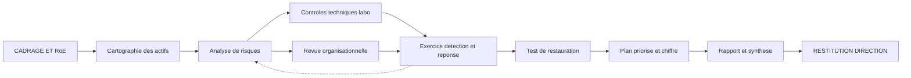

# Projet final — Mission simulée de conseil en cybersécurité

## Objectifs pédagogiques

À la fin de ce module, vous saurez :

- **Cadrer** une mission : périmètre, règles d'engagement, livrables et critères d'acceptation, avant de lancer le moindre scan.
- **Cartographier** les actifs d'une organisation fictive et **traduire** les constats techniques en scénarios de risque exprimés en impact métier.
- **Réaliser** des contrôles techniques en laboratoire (réseau, Active Directory, secrets, sauvegardes) et **documenter** chaque constat avec une preuve reproductible.
- **Conduire** un exercice de détection et de réponse, puis **vérifier** qu'une restauration tient réellement ses objectifs de temps.
- **Construire** un plan de sécurisation priorisé et chiffré en effort, puis **présenter** vos recommandations à une direction qui doit décider.

---

## Mise en situation

**Transvia Pièces** est une organisation fictive : un distributeur de pièces détachées de 180 personnes, deux sites (siège et entrepôt), un ERP (Enterprise Resource Planning) développé en interne sur Debian, un domaine Active Directory, un VPN pour 25 commerciaux nomades et un portail de commande B2B exposé sur Internet. La DSI compte deux personnes, plus un prestataire d'infogérance.

Deux événements arrivent la même semaine. Un client grand compte envoie un questionnaire de sécurité de 120 questions. L'assureur cyber demande un état des lieux avant le renouvellement. La DSI lance un scanner de vulnérabilités et obtient un export de 1 400 lignes (chiffre illustratif). La direction pose alors une question simple : **« Qu'est-ce qu'on fait en premier, combien ça coûte, et qu'est-ce qui se passe si on ne le fait pas ? »**

Deux réponses naïves se présentent :

- **Corriger par ordre de CVSS décroissant.** Le score mesure la gravité technique d'une faille, pas le risque pour Transvia. Un 9.8 sur une imprimante isolée pèse moins qu'un 6.5 sur le serveur qui détient les identifiants du domaine.
- **Acheter un outil** (EDR, SIEM) sans savoir si quelqu'un traitera les alertes à 2 h du matin, ni si les sauvegardes survivraient à une compromission du domaine.

Votre mission : transformer ces 1 400 lignes en une dizaine de décisions défendables. Vous travaillez sur un laboratoire qui reproduit l'infrastructure de Transvia. Aucun système réel n'est touché, mais vous appliquez les mêmes réflexes que sur une vraie mission : autorisation écrite, preuves, traçabilité.

---

## Cadrer la mission : ce qui se décide avant la première commande

Une mission dérape presque toujours par le cadrage, rarement par la technique. Le périmètre flou, les attentes implicites et l'autorisation orale sont les trois causes classiques.

La fiche de cadrage tient sur deux pages et contient :

| Élément | Exemple Transvia |
|---|---|
| Objectif | Évaluer l'exposition au ransomware et la capacité de reprise ; produire un plan sur 6 mois |
| Périmètre inclus | Réseau siège et entrepôt, AD, serveur ERP, VPN, sauvegardes, portail B2B (en lecture seule) |
| Périmètre exclu | Postes nomades, messagerie SaaS, déni de service, ingénierie sociale réelle |
| RoE (Rules of Engagement) | Fenêtres de test, hôtes interdits, techniques autorisées, point de contact joignable, procédure d'arrêt |
| Hypothèses | Accès réseau « utilisateur standard » fourni ; compte domaine non privilégié fourni |
| Livrables | Rapport, synthèse exécutive, support de restitution, registre de risques |
| Critère d'acceptation | Chaque constat est reproductible par la DSI à partir du rapport seul |

> ⚠️ **Piège : le périmètre qui glisse.** En cours de mission, la direction demande « et vous pouvez aussi regarder la messagerie ? ». Si vous dites oui sans avenant, vous perdez le contrôle du budget et de la qualité. La réponse correcte est : « C'est pertinent, voici l'effort supplémentaire et ce qu'on retire ou décale. »
{: .callout .callout-attention}

Le déroulé standard d'une mission de dix jours (durées illustratives) :



La flèche en pointillé compte : l'exercice d'incident révèle souvent qu'un risque classé « moyen » est en réalité critique. Votre analyse de risques n'est pas figée à J3.

---

## Surface d'attaque et cartographie des actifs

Un attaquant n'a pas besoin de l'inventaire de la DSI : il regarde ce qui répond. Vous faites de même, puis vous croisez avec ce que l'organisation croit avoir. L'écart entre les deux est déjà un constat.

Commencez par la découverte, depuis chaque segment (siège, entrepôt, VPN) :

```bash
nmap -sV -sC -p- --open -T3 -oA scan_<SEGMENT> <CIDR>
```

Puis constituez le tableau de la surface d'attaque, avec l'impact exprimé en conséquence métier :

| Vecteur | Exposition | Impact potentiel |
|---|---|---|
| Portail VPN sans second facteur | Internet, 25 comptes | Accès réseau interne avec un mot de passe réutilisé ou volé |
| Portail B2B | Internet, 300 comptes clients | Fuite de tarifs et de commandes clients |
| SMB sans signature obligatoire | Réseau interne | Relais NTLM vers les serveurs de fichiers |
| Comptes de service avec SPN (Service Principal Name) | Tout compte du domaine | Kerberoasting, puis élévation de privilèges |
| Serveur de sauvegarde joint au domaine | Réseau interne | Sauvegardes chiffrées avec le reste du SI |
| Partages réseau avec fichiers de configuration | Tous les utilisateurs | Mots de passe en clair, rebond vers l'ERP |

### Du constat au risque métier

Un scénario de risque s'écrit en une phrase avec une cause, un événement et une conséquence mesurable. « Mot de passe faible » n'est pas un risque. « Un compte de service au mot de passe craquable permet à un utilisateur compromis de devenir administrateur du domaine et de chiffrer l'ERP et les sauvegardes, ce qui arrête l'entrepôt plusieurs jours » en est un.

Registre de risques de Transvia (échelles 1 à 5, valeurs illustratives, que vous justifiez en entretien avec les métiers) :

| ID | Scénario | Vraisemblance | Impact | Niveau |
|---|---|---|---|---|
| R1 | Ransomware via élévation Kerberoasting puis chiffrement ERP et sauvegardes | 4 | 5 | 20 |
| R2 | Compromission du VPN par réutilisation de mot de passe | 4 | 4 | 16 |
| R3 | Indisponibilité de l'ERP (défaillance matérielle) sans restauration éprouvée | 3 | 4 | 12 |
| R4 | Fuite de données clients via secrets stockés dans les partages | 3 | 3 | 9 |

> 💡 **Astuce** : demandez au directeur de l'entrepôt combien coûte une journée d'arrêt. Cette seule réponse (par exemple « environ 40 000 € de commandes retardées et de pénalités ») justifie plus de budget sécurité que dix slides techniques.
{: .callout .callout-astuce}

---

## Contrôles techniques en laboratoire

Les contrôles servent à prouver ou à infirmer les scénarios du registre, pas à produire une liste exhaustive. Chaque commande répond à une hypothèse.

### Réseau : signature SMB et exposition héritée

> 🔴 **Vecteur d'attaque.** Quand la signature SMB n'est pas exigée, un attaquant en position réseau utilise la coercition d'authentification ou l'empoisonnement LLMNR/NBT-NS (outil : Responder), puis relaie les authentifications NTLM avec `ntlmrelayx` d'Impacket vers un serveur qui accepte sans signature. Il obtient une session sans jamais casser un mot de passe.
{: .callout .callout-danger}

```bash
nmap -p445 --script smb2-security-mode,smb-vuln-ms17-010 <HOST>
```

Le message « Message signing enabled but not required » est le constat à relever. Le script `smb-vuln-ms17-010` vérifie la présence de CVE-2017-0144 (EternalBlue), encore trouvée sur des serveurs industriels et d'entrepôt oubliés.

### Active Directory : où se cache l'élévation de privilèges

> 🧠 **Concept clé : le Kerberoasting.** N'importe quel utilisateur du domaine peut demander un ticket de service (TGS) pour tout compte possédant un SPN. Ce ticket est chiffré avec une clé dérivée du mot de passe du compte de service. L'attaquant le récupère (`GetUserSPNs.py`, Rubeus), l'emporte hors ligne et le casse avec hashcat (mode 13100 pour RC4). Aucune alerte n'est déclenchée côté réseau, et un mot de passe de 10 caractères tombe en heures ou en jours selon le matériel.
{: .callout .callout-important}

Côté défenseur, on énumère les mêmes cibles avec un compte standard :

```powershell
Get-ADUser -Filter 'ServicePrincipalName -like "*"' -Properties ServicePrincipalName,PasswordLastSet,MemberOf |
  Select-Object SamAccountName,PasswordLastSet,@{n='Groups';e={($_.MemberOf -join ';')}}
```

Cherchez deux choses : un `PasswordLastSet` vieux de plusieurs années, et l'appartenance à un groupe privilégié.

```powershell
Get-ADGroupMember -Identity "Domain Admins" -Recursive | Select-Object Name,SamAccountName,objectClass
```

Dans le laboratoire de Transvia, `svc_erp_sql` possède un SPN, un mot de passe de 2017 et appartient à Domain Admins : c'est le constat F-01. Pour démontrer l'exploitabilité en laboratoire, et seulement là, vous pouvez rejouer l'attaque :

```bash
GetUserSPNs.py <DOMAIN>/<USER> -dc-ip <DC_IP> -request -outputfile tgs.hash
```

Pour une vue d'ensemble, un outil comme PingCastle (`PingCastle.exe --healthcheck --server <DC>`) produit un score et une liste de configurations dangereuses. Il ne remplace pas votre analyse : il vous dit où regarder.

### Secrets oubliés

Une grande partie des élévations de privilèges en entreprise n'a rien de sophistiqué : un mot de passe traîne dans un fichier. Deux endroits à fouiller systématiquement.

```cmd
findstr /S /I cpassword \\<DOMAIN>\sysvol\<DOMAIN>\policies\*.xml
```

Les anciennes Group Policy Preferences stockaient des mots de passe chiffrés avec une clé AES publiée par Microsoft (MS14-025). Si le résultat n'est pas vide, tout utilisateur du domaine peut les déchiffrer.

```bash
grep -rIEil "password|passwd|pwd|secret|apikey" <PARTAGE_MONTE> 2>/dev/null | head -50
```

Sur Transvia, un fichier `config_erp.ini` dans un partage « Informatique » contient les identifiants de la base de données (F-04).

### Serveurs Linux et chiffrement en transit

```bash
sudo lynis audit system
testssl.sh --severity MEDIUM <HOST>:443
```

Lynis donne un indice de durcissement et des suggestions. Ne livrez jamais cette sortie brute : retenez les trois ou quatre éléments qui touchent vos scénarios de risque. De même, testssl.sh signale des protocoles obsolètes sur le portail B2B, souvent sans rapport avec un scénario prioritaire.

### Preuves : la différence entre une opinion et un constat

Chaque constat porte une preuve horodatée que la DSI peut rejouer. Conservez les sorties brutes et leur empreinte :

```bash
sha256sum evidence/* > evidence/SHA256SUMS
```

> ⚠️ **Erreur fréquente** : la capture d'écran sans commande, sans horodatage et sans identité de l'hôte testé. Six mois plus tard, personne ne peut la reproduire ni la contester.
{: .callout .callout-attention}

---

## Revue organisationnelle : ce que dit la politique, ce que fait le terrain

Les entretiens servent à mesurer l'écart entre le document et la pratique. Trois questions rapportent presque toujours plus qu'une checklist :

- **« Montrez-moi la dernière fois que vous avez restauré un serveur. »** L'absence de réponse précise vaut constat.
- **« Qui peut couper le VPN à 2 h du matin, et comment l'avez-vous prévenu ? »** Elle teste la chaîne de décision, pas l'outil.
- **« Quand avez-vous retiré un accès à un prestataire pour la dernière fois ? »** Elle teste le cycle de vie des comptes.

Sur Transvia, la politique de mots de passe exige 12 caractères, mais les comptes de service sont exemptés « pour ne pas casser l'ERP », sans date de revue. Croisé avec F-01, cet écart pèse plus qu'une règle absente : c'est une exception non gouvernée qui a produit une faille exploitable.

Les référentiels servent de grille de lecture, pas de finalité. Vous pouvez croiser vos constats avec le guide d'hygiène informatique de l'ANSSI pour parler un langage connu de la direction. Si la direction se demande si NIS2 s'applique, ne tranchez pas de mémoire : l'état de la transposition en France et la qualification de l'entité évoluent, et doivent être vérifiés à la date de la mission.

---

## Exercice de détection et de réponse

Les contrôles précédents disent ce qui est exploitable. L'exercice dit ce que Transvia verrait et ferait si quelqu'un l'exploitait. Vous jouez l'attaquant dans le laboratoire, avec un scénario écrit à l'avance et validé par le contact DSI :

| Étape | Action en laboratoire | Technique (ATT&CK) | Télémétrie attendue |
|---|---|---|---|
| 1 | Exécution d'un script « piégé » sur un poste | T1204 | Création de processus (4688 ou Sysmon 1) |
| 2 | Kerberoasting du compte `svc_erp_sql` | T1558.003 | Événement 4769, chiffrement `0x17` (RC4) |
| 3 | Connexion au serveur de fichiers avec le compte obtenu | — | 4624 (type 3), compte de service sur un hôte inhabituel |
| 4 | Envoi d'une archive de test vers l'hôte « attaquant » | T1048 | Flux sortant volumineux sur le pare-feu |
| 5 | `vssadmin delete shadows /all /quiet` | T1490 | Création de processus avec la ligne de commande complète |
| 6 | Renommage de fichiers d'un dossier test en `.locked` | — | Pic d'écritures et de renommages |

Une règle Sigma pour l'étape 2. Elle sert de point de départ, la corrélation vient ensuite :

```yaml
title: Ticket Kerberos RC4 demandé pour un compte de service
logsource:
  product: windows
  service: security
detection:
  selection:
    EventID: 4769
    TicketEncryptionType: '0x17'
  filter_machine:
    ServiceName|endswith: '$'
  filter_krbtgt:
    ServiceName: 'krbtgt'
  condition: selection and not filter_machine and not filter_krbtgt
level: medium
```

La règle seule génère du bruit, parce que d'anciens services légitimes utilisent RC4. Dans le SIEM, on ajoute une agrégation : un même compte demandant des tickets pour plus de cinq services différents en quelques minutes passe en priorité haute. Dans une PME où les contrôleurs de domaine n'envoient pas leurs journaux à un collecteur, cette règle est inutile. Le premier constat de détection est alors « on ne voit rien », et la première action est la centralisation des journaux des contrôleurs de domaine.

Ce que vous mesurez pendant l'exercice :

- **MTTD (Mean Time To Detect)** : temps entre l'étape 2 et la première alerte vue par un humain. Sur Transvia : jamais, car aucune règle n'existe.
- **Délai de qualification** : combien de temps pour dire « c'est réel » et pas « c'est un faux positif ».
- **Délai de décision de containment** : qui a le droit d'isoler un serveur de production, et en combien de temps le sait-on ?
- **Qualité de la communication** : la direction apprend-elle l'incident par la DSI ou par un client ?

> 💡 **Astuce** : l'étape 5 est la plus rentable à tester. `vssadmin delete shadows` est utilisée par de nombreux ransomwares avant le chiffrement. Si votre exercice ne génère aucune alerte à ce stade, vous disposez d'un exemple parlant pour la restitution.
{: .callout .callout-astuce}

---

## Restauration et continuité : prouver plutôt que déclarer

Un job de sauvegarde « terminé avec succès » ne prouve rien. Les opérateurs de ransomware ciblent explicitement les systèmes de sauvegarde : des vulnérabilités comme CVE-2023-27532 dans Veeam Backup & Replication ont été exploitées pour récupérer des identifiants, et un serveur de sauvegarde joint au domaine tombe avec lui dès que l'administrateur du domaine est compromis.

Votre vérification se fait en trois temps. D'abord l'isolation : le dépôt de sauvegarde est-il accessible en écriture avec un compte du domaine ? Ensuite l'intégrité :

```bash
restic -r <REPO> snapshots
restic -r <REPO> check --read-data
```

Enfin la restauration réelle, chronométrée, sur une machine différente de l'originale :

```bash
time restic -r <REPO> restore latest --target /tmp/restore-test --include /srv/erp
sha256sum -c <FICHIER_SOMMES_REFERENCE>
```

Comparez le temps mesuré à l'objectif déclaré. Sur Transvia, la DSI annonce un RTO de 4 heures pour l'ERP. Le test, sur un volume de 800 Go (valeurs illustratives), donne 11 heures, sans compter la reconstruction du serveur ni la reconnexion au domaine. L'écart de 7 heures est un constat chiffré qui parle à la direction.

Une dernière question souvent oubliée : l'entrepôt peut-il travailler sans l'ERP ? Si la réponse est « on ne sait pas », la continuité est un risque non évalué.

---

## Plan de sécurisation : réaliste, priorisé, chiffré

La priorisation est la valeur ajoutée du consultant. Pour chaque action, trois questions : quel risque du registre réduit-elle, quel effort demande-t-elle, quelles dépendances impose-t-elle ?

Plan Transvia (efforts en jours-homme et coûts illustratifs, avec une hypothèse de 700 € par jour, hors licences) :

| # | Action | Risque traité | Effort | Délai | Remarque |
|---|---|---|---|---|---|
| 1 | Second facteur sur le VPN | R2 | 4 J/H | 30 j | Gain très élevé pour un effort faible |
| 2 | Sortir les comptes de service de Domain Admins, mots de passe longs ou gMSA | R1 | 6 J/H | 30 j | Tester d'abord avec l'éditeur de l'ERP |
| 3 | Sauvegarde immuable hors domaine et test de restauration trimestriel | R1, R3 | 8 J/H | 45 j | Environ 150 €/mois de stockage |
| 4 | Signature SMB obligatoire, désactivation de LLMNR et NBT-NS | R1 | 3 J/H | 60 j | Vérifier les scanners et équipements anciens |
| 5 | LAPS (Local Administrator Password Solution) sur postes et serveurs | R1 | 4 J/H | 60 j | Windows LAPS selon la version de Windows |
| 6 | Centralisation des journaux des contrôleurs de domaine et 5 règles de détection | R1 | 10 J/H | 90 j | Nécessite une astreinte pour traiter les alertes |
| 7 | Nettoyage des secrets dans les partages, rotation | R4 | 3 J/H | 60 j | Rotation avec l'éditeur de l'ERP |
| 8 | Segmentation siège / entrepôt / serveurs | R1, R3 | 15 J/H | 120 j | Fenêtres de maintenance à négocier |
| 9 | PRA documenté et exercice annuel | R3 | 10 J/H | 180 j | Dépend de l'action 3 |

Total : 63 J/H, soit environ 44 000 € hors licences. Précisez toujours les hypothèses sous un chiffre, sinon il ne vaut rien : « sous réserve que l'éditeur de l'ERP valide le changement de compte en moins de 5 jours ».

> 🔒 **Contrôle de sécurité** : sur le dépôt de sauvegarde, le mode « ajout uniquement » casse la chaîne d'attaque du ransomware. Exemple avec rest-server pour restic :
{: .callout .callout-securite}

```bash
# Avant : dépôt modifiable par tout client authentifié
rest-server --path <DATA_DIR> --listen :8000

# Après : écriture seule, aucune suppression ni modification des snapshots existants
rest-server --path <DATA_DIR> --listen :8000 --append-only
```

Le compromis : la purge des anciens snapshots doit se faire côté serveur, avec un compte distinct jamais exposé aux postes clients. C'est un peu plus de gestion pour une garantie bien plus forte.

Côté SMB, la bascule se fait en PowerShell, après test de compatibilité :

```powershell
Set-SmbServerConfiguration -RequireSecuritySignature $true -Force
```

Le coût en performance est faible sur du matériel récent. Le vrai coût est la compatibilité avec de vieux scanners réseau et NAS, d'où le délai de 60 jours dans le plan.

Un plan crédible contient aussi ce qu'on ne fait pas. Vous listez les risques acceptés (par exemple la durée de vie des certificats sur un portail interne) avec leur propriétaire et une date de revue. Une direction qui signe une acceptation de risque prend une décision. Une direction qui ignore un constat subit un incident.

---

## Livrables : rapport, synthèse exécutive, support de restitution

Trois documents, trois lecteurs :

| Livrable | Lecteur | Contenu |
|---|---|---|
| Synthèse exécutive (2 pages) | Direction | Situation, 3 risques en langage métier, décisions demandées, budget global |
| Rapport de mission | DSI, prestataire | Méthode, périmètre, constats détaillés, preuves, plan complet, annexes |
| Support de restitution (10 à 12 slides) | Direction et DSI | Mêmes messages que la synthèse, avec visuels |

Chaque constat du rapport suit la même fiche, afin que la DSI puisse l'exécuter sans vous :

```yaml
id: F-01
titre: Compte de service Kerberoastable membre de Domain Admins
severite_technique: élevée
risque_associe: R1 (niveau 20)
preuve: evidence/F01_getuserspns.txt + evidence/F01_domain_admins.txt (SHA256 dans SHA256SUMS)
impact_metier: Un utilisateur standard compromis peut devenir administrateur du domaine et chiffrer l'ERP ainsi que les sauvegardes
recommandation: Retirer le compte de Domain Admins ; mot de passe 25+ caractères ou gMSA ; alerter sur 4769 RC4
effort: 6 J/H
verification: GetUserSPNs.py ne retourne plus de ticket pour ce compte ; Get-ADGroupMember ne le liste plus
```

Le champ `verification` est celui qu'on oublie : il définit comment on saura, après correction, que le constat est clos.

---

## Restituer à la direction

Vous avez 15 minutes et une question à faire trancher. Une structure qui tient :

1. **La situation en une phrase** : « Aujourd'hui, une compromission d'un seul compte pourrait arrêter l'entrepôt plusieurs jours. »
2. **Trois risques en langage métier**, avec ce que coûterait une journée d'arrêt.
3. **Ce qu'on a prouvé** : une démonstration courte, par exemple le temps de restauration mesuré face à celui annoncé.
4. **Le plan en trois vagues** : 30 jours, 90 jours, 180 jours, avec le budget de chaque vague.
5. **La décision demandée** : valider la vague 1 et nommer un responsable pour chaque action.

Les questions qui reviennent, et auxquelles il faut une réponse prête :

- *« Et si on ne fait rien ? »* Vous répondez avec le scénario R1 et son coût d'arrêt, pas avec une peur générique.
- *« Pourquoi pas un outil qui règle tout ? »* Parce que la moitié des actions du plan sont des changements de configuration et d'organisation, que ni EDR ni SIEM ne font à votre place.
- *« C'est le minimum, ou le maximum ? »* Précisez que les actions 1 à 4 couvrent l'essentiel du risque R1 pour environ un tiers de l'effort total.

Ne justifiez pas chaque constat. La direction n'a pas besoin de la liste des 1 400 lignes, elle a besoin de savoir que vous avez fait le tri, et sur quel critère.

---

## Déroulé illustratif de la mission Transvia

*Scénario pédagogique : les chiffres ci-dessous sont fictifs et servent à calibrer vos attentes.*

Sur dix jours, la mission produit 11 constats retenus (3 critiques, 4 élevés, 4 moyens), alors que le scan initial en listait 1 400. Les 1 389 autres sont regroupés dans une annexe « hygiène », traitée par la routine de patch du prestataire. Le constat F-01 (compte de service dans Domain Admins) est le pivot : il alimente R1, justifie l'exercice de détection et explique pourquoi les sauvegardes doivent sortir du domaine.

Ce que l'exercice a révélé et que l'analyse documentaire n'aurait pas montré : aucune alerte sur les étapes 1 à 6, et une direction qui découvre l'incident simulé 90 minutes après le début, par un appel d'un salarié de l'entrepôt. La décision prise en restitution : valider les actions 1 à 4 immédiatement (21 J/H), lancer l'action 6 au trimestre suivant, et inscrire la segmentation au budget N+1.

Leçons à retenir :

- Un seul constat bien démontré convainc davantage que dix constats théoriques.
- Les actions rapides à fort effet doivent être livrées avant les chantiers lourds, pour que la direction voie la valeur.
- La mesure de l'écart (RTO annoncé contre RTO mesuré) est l'argument le plus efficace de toute la mission.

---

## Erreurs fréquentes

> ⚠️ **Livrer l'export du scanner comme rapport.**
>
> - *Configuration dangereuse* : joindre le PDF du scanner en annexe unique, sans tri.
> - *Conséquence* : la DSI ne sait pas par où commencer, la direction ne comprend rien, et la mission est perçue comme un coût sans décision.
> - *Correction* : regrouper par scénario de risque, garder les constats qui alimentent le registre, renvoyer le reste en annexe d'hygiène. Contrôle : chaque constat du rapport renvoie à un risque `R<N>`.
{: .callout .callout-attention}

> ⚠️ **Tester sans autorisation écrite ni règles d'engagement.**
>
> - *Configuration dangereuse* : un accord oral du responsable informatique, sans périmètre ni fenêtre.
> - *Conséquence* : un scan de port fait tomber un automate d'entrepôt, personne ne sait qui a lancé quoi, et vous n'avez aucune protection juridique.
> - *Correction* : RoE signées avant toute action, liste des hôtes interdits, contact joignable pendant les tests. Même en laboratoire, prenez l'habitude de le faire.
{: .callout .callout-attention}

> ⚠️ **Valider la sauvegarde par le statut du job.**
>
> - *Configuration dangereuse* : se fier au « succès » de l'outil de sauvegarde, sur un dépôt accessible avec les identifiants du domaine.
> - *Conséquence* : en cas d'incident, la restauration échoue ou prend trois fois plus longtemps que prévu, et les sauvegardes sont chiffrées avec le reste.
> - *Correction* : test de restauration chronométré sur une autre machine, `restic check --read-data` ou équivalent, dépôt hors domaine en mode ajout uniquement.
{: .callout .callout-attention}

> ⚠️ **Confondre sévérité technique et risque.**
>
> - *Configuration dangereuse* : classer les constats par CVSS seul.
> - *Conséquence* : on corrige d'abord ce qui est bruyant plutôt que ce qui ouvre le chemin vers l'ERP.
> - *Correction* : chaque constat porte un risque associé et un impact métier chiffré. Le rapport indique la sévérité technique et le niveau de risque séparément.
{: .callout .callout-attention}

> ⚠️ **Chiffrer l'effort sans hypothèses.**
>
> - *Configuration dangereuse* : « Segmentation : 15 J/H » sans mention de la dépendance à l'éditeur de l'ERP ni de la fenêtre de maintenance.
> - *Conséquence* : le chiffre double au premier obstacle et vous perdez votre crédibilité.
> - *Correction* : chaque estimation s'accompagne de ses hypothèses, de ses dépendances et d'une fourchette (« 12 à 18 J/H »).
{: .callout .callout-attention}

---

## Résumé

Une mission de conseil transforme un volume de constats techniques en décisions. Vous cadrez le périmètre et les règles d'engagement par écrit, vous cartographiez la surface d'attaque, puis vous exprimez chaque risque comme un scénario avec un impact métier. Les contrôles en laboratoire (SMB, Kerberoasting, secrets, durcissement des serveurs) prouvent ou infirment ces scénarios. L'exercice de détection mesure ce que l'organisation voit et la vitesse de sa réponse, et le test de restauration confronte les objectifs de temps déclarés à la réalité mesurée. Le plan se priorise par réduction de risque rapportée à l'effort, avec ses hypothèses et ses risques acceptés. Ce qui reste à surveiller après la mission : la correction effective des actions 1 à 4, la fréquence réelle des tests de restauration, la couverture de la journalisation et l'évolution des obligations réglementaires applicables.

<!-- snippet
id: conseil_roe_autorisation_ecrite
type: warning
tech: conseil-cyber
level: intermediate
importance: high
format: knowledge
tags: roe,perimetre,autorisation,mission
title: Tester sans règles d'engagement écrites
content: Accord oral du responsable IT sans périmètre ni fenêtre : un scan de ports peut faire tomber un automate d'entrepôt et vous n'avez aucune couverture juridique. Correction : RoE signées avant toute action, avec hôtes interdits, techniques autorisées, fenêtres horaires et un contact joignable pendant les tests.
description: Sans RoE signées, un test légitime devient un incident non couvert ; périmètre, hôtes exclus et contact d'urgence doivent être écrits.
-->

<!-- snippet
id: conseil_nmap_smb_signing_ms17010
type: command
tech: nmap
level: intermediate
importance: high
format: knowledge
tags: nmap,smb,signature,eternalblue
title: Vérifier la signature SMB et MS17-010 avec nmap
context: À lancer depuis un segment interne, dans le périmètre autorisé
command: nmap -p445 --script smb2-security-mode,smb-vuln-ms17-010 <HOST>
example: nmap -p445 --script smb2-security-mode,smb-vuln-ms17-010 10.20.0.15
description: "Signing enabled but not required" ouvre au relais NTLM ; le script ms17-010 teste CVE-2017-0144 (EternalBlue) sans exploiter la faille.
-->

<!-- snippet
id: conseil_kerberoasting_mecanisme
type: concept
tech: active-directory
level: intermediate
importance: high
format: knowledge
tags: kerberos,kerberoasting,active-directory,spn
title: Kerberoasting : comment le ticket devient un mot de passe
content: Tout utilisateur du domaine peut demander un ticket de service (TGS) pour un compte avec SPN ; il est chiffré avec une clé dérivée du mot de passe du compte. L'attaquant l'extrait (GetUserSPNs.py, Rubeus), le casse hors ligne avec hashcat -m 13100, sans générer d'alerte réseau. Un compte de service ancien dans Domain Admins offre l'élévation complète.
description: Le ticket TGS est chiffré avec le secret du compte de service et se casse hors ligne ; un mot de passe court ou ancien tombe rapidement.
-->

<!-- snippet
id: conseil_ad_enum_spn_comptes_service
type: command
tech: active-directory
level: intermediate
importance: high
format: knowledge
tags: powershell,active-directory,spn,audit
title: Lister les comptes de service exposés au Kerberoasting
context: Depuis un poste du domaine avec le module ActiveDirectory
command: Get-ADUser -Filter 'ServicePrincipalName -like "*"' -Properties ServicePrincipalName,PasswordLastSet,MemberOf
example: Get-ADUser -Filter 'ServicePrincipalName -like "*"' -Properties ServicePrincipalName,PasswordLastSet,MemberOf | Select SamAccountName,PasswordLastSet
description: Repérer les comptes avec SPN, leur ancienneté de mot de passe et leur appartenance à des groupes privilégiés pour prioriser les corrections.
-->

<!-- snippet
id: conseil_gpp_cpassword_sysvol
type: command
tech: active-directory
level: intermediate
importance: medium
format: knowledge
tags: sysvol,gpp,secrets,ms14-025
title: Chercher des mots de passe GPP dans SYSVOL
command: findstr /S /I cpassword \\<DOMAIN>\sysvol\<DOMAIN>\policies\*.xml
example: findstr /S /I cpassword \\transvia.lab\sysvol\transvia.lab\policies\*.xml
description: Les anciennes GPP stockent des mots de passe chiffrés avec une clé AES publique (MS14-025) ; tout utilisateur du domaine peut les lire et les déchiffrer.
-->

<!-- snippet
id: conseil_detection_kerberoast_4769_rc4
type: concept
tech: siem
level: advanced
importance: medium
format: knowledge
tags: detection,sigma,kerberos,event4769
title: Détecter le Kerberoasting par les événements 4769
content: L'événement Windows 4769 enregistre chaque demande de ticket de service. Un TicketEncryptionType à 0x17 (RC4) pour un compte utilisateur est suspect, surtout si un même compte demande des tickets pour plus de 5 services différents en quelques minutes. La règle simple génère du bruit : il faut l'agréger dans le SIEM et exclure les comptes machine ($) et krbtgt.
description: Un 4769 en RC4 isolé est ambigu ; la valeur de détection vient de l'agrégation par compte demandeur et de l'exclusion des comptes machine.
-->

<!-- snippet
id: conseil_restic_restore_test_chronometre
type: command
tech: restic
level: intermediate
importance: high
format: knowledge
tags: sauvegarde,restauration,rto,restic
title: Chronométrer une restauration réelle avec restic
context: À exécuter sur une machine différente de la source, pas sur le serveur d'origine
command: time restic -r <REPO> restore latest --target <DIR> --include <CHEMIN>
example: time restic -r rest:https://backup.transvia.lab:8000/erp restore latest --target /tmp/restore-test --include /srv/erp
description: Le temps mesuré se compare au RTO déclaré ; pensez à vérifier ensuite les sommes de contrôle de quelques fichiers critiques.
-->

<!-- snippet
id: conseil_sauvegarde_serveur_joint_domaine
type: warning
tech: sauvegarde
level: intermediate
importance: high
format: knowledge
tags: ransomware,sauvegarde,active-directory,veeam
title: Serveur de sauvegarde joint au domaine
content: Un serveur de sauvegarde joint au domaine avec les mêmes administrateurs tombe avec le domaine : le ransomware chiffre les sauvegardes avec le reste, et des failles comme CVE-2023-27532 (Veeam B&R) ont servi à récupérer des identifiants. Correction : serveur hors domaine, comptes dédiés, dépôt immuable ou en ajout uniquement, test de restauration trimestriel.
description: Compromettre le domaine donne accès aux sauvegardes si elles partagent l'identité ; isoler le dépôt et tester la restauration casse cette chaîne.
-->

<!-- snippet
id: conseil_restserver_append_only
type: tip
tech: restic
level: advanced
importance: medium
format: knowledge
tags: sauvegarde,restic,ransomware,immutabilite
title: Dépôt restic en mode ajout uniquement
content: Lancer rest-server avec --append-only (rest-server --path <DATA_DIR> --listen :8000 --append-only) : les clients peuvent ajouter des snapshots mais ni supprimer ni modifier les existants. La purge se fait côté serveur avec un compte distinct jamais exposé aux postes clients.
description: Un poste compromis ne peut plus effacer l'historique de sauvegarde ; le coût est une purge à gérer séparément côté serveur.
-->

<!-- snippet
id: conseil_fiche_constat_structure
type: concept
tech: conseil-cyber
level: intermediate
importance: high
format: knowledge
tags: rapport,constat,preuve,livrable
title: Structure d'un constat exploitable par la DSI
content: Chaque constat porte un identifiant, la sévérité technique, le risque métier associé, une preuve reproductible avec empreinte SHA256, l'impact en langage métier, la recommandation, l'effort en J/H et un champ « vérification » qui dit comment confirmer la correction. Sans ce dernier champ, on ne sait jamais si un constat est réellement clos.
description: Le champ vérification et la preuve rejouable distinguent un constat défendable d'une opinion que la DSI ne peut ni reproduire ni clore.
-->

<!-- snippet
id: conseil_sha256_evidence
type: command
tech: linux
level: beginner
importance: medium
format: knowledge
tags: preuves,integrite,sha256,audit
title: Figer les preuves d'une mission avec SHA256
command: sha256sum evidence/* > evidence/SHA256SUMS
description: Génère l'empreinte de chaque preuve ; vérifiable plus tard avec sha256sum -c pour montrer qu'aucune sortie n'a été modifiée après la mission.
-->

<!-- snippet
id: conseil_scan_brut_livrable
type: error
tech: conseil-cyber
level: beginner
importance: high
format: knowledge
tags: rapport,priorisation,scanner,risque
title: Rapport réduit à l'export du scanner
content: Symptôme : la DSI reçoit 1 400 lignes et ne sait pas par où commencer, la direction ne décide rien. Cause : tri par CVSS sans lien avec les scénarios de risque. Correction : regrouper par risque du registre (R1, R2...), garder les constats qui l'alimentent, reléguer le reste en annexe d'hygiène.
description: Un score CVSS élevé n'a pas de sens sans scénario métier ; chaque constat du rapport doit renvoyer à un risque du registre.
-->

<!-- snippet
id: conseil_priorisation_effort_hypotheses
type: tip
tech: conseil-cyber
level: advanced
importance: medium
format: knowledge
tags: plan,effort,priorisation,chiffrage
title: Chiffrer un plan de sécurisation défendable
content: Pour chaque action, noter le risque du registre réduit, l'effort en fourchette (ex. 12 à 18 J/H), les dépendances (éditeur, fenêtre de maintenance) et les hypothèses. Livrer d'abord les actions à fort effet et faible effort (MFA VPN, comptes de service, SMB signing), puis lister les risques acceptés avec propriétaire et date de revue.
description: Un chiffre sans hypothèses double au premier obstacle ; la liste des risques acceptés force la direction à décider plutôt qu'à ignorer.
-->

<!-- snippet
id: conseil_restitution_ecart_mesure
type: tip
tech: conseil-cyber
level: intermediate
importance: medium
format: knowledge
tags: restitution,direction,communication,rto
title: Ouvrir la restitution avec un écart mesuré
content: Présenter en première slide un écart chiffré issu d'un test (RTO annoncé 4 h, mesuré 11 h sur 800 Go) plutôt qu'une liste de vulnérabilités. Terminer par une décision explicite : valider la vague 1 à 30 jours avec un responsable nommé par action.
description: Un écart mesuré entre ce qui est déclaré et ce qui est démontré convainc plus vite une direction qu'une liste de constats techniques.
-->

<!-- snippet
id: conseil_vssadmin_delete_shadows
type: concept
tech: windows
level: advanced
importance: medium
format: knowledge
tags: ransomware,detection,vssadmin,shadowcopy
title: vssadmin delete shadows comme signal avant chiffrement
content: De nombreux ransomwares exécutent vssadmin delete shadows /all /quiet pour supprimer les copies shadow avant de chiffrer (T1490, Inhibit System Recovery). Si la journalisation des processus avec ligne de commande (4688 ou Sysmon 1) est active, cette commande déclenche une alerte à fort signal et faible taux de faux positifs.
description: Exécutée peu avant le chiffrement, cette commande est une alerte précoce rare en usage légitime, à condition de collecter les lignes de commande.
-->
